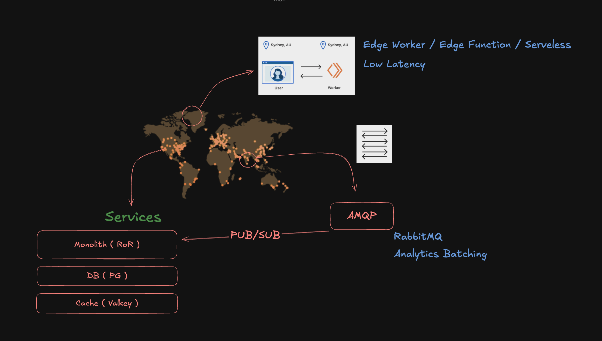
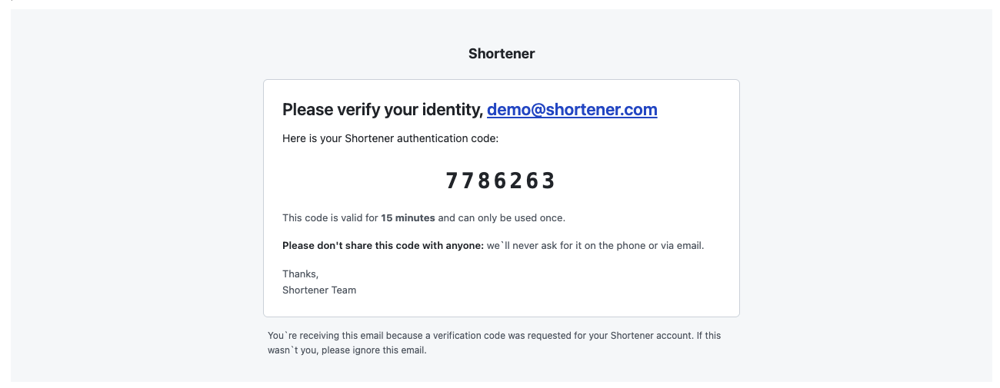

# Introdução

Este projeto é pra substituir completamente o `bitly.com` para uso pessoal.

A estrutura é simples, primeiro o usuário acessa ao Admin, cria o link e envia para alguém em algum lugar do mundo.



A pessoa entra no link encurtado por um worker distribuído da Cloudflare ( não importa se é Cloudflare, AWS Lambda, Azure Function ), é validado a key da url ao buscar no Valkey ( ou Redis, ou Cloudflare KV ), se for válido, é disparado uma mensagem por RabbitMQ ( Sem esperar o ACK ) e já redireciona para o site. Caso contrário, o usuário é redirecionado para um 404.

O mais importante aqui, é que temos um worker com baixa latência, e também um KV com baixa latência.
Por que não adianta ter um worker distribuido e ter um KV no outro lado do mundo.

Também garantimos que temos uma mensageria resiliente e com boa performance. 

Este projeto não é pequeno demais para usar soluções interessantes como PGMQ, Solid Queue, ou algo do tipo. Nem grande demais para usar Apache Kafka.

A agregação dos dados aqui, não precisa ser em tempo real, então não importa se estiver alguns segundos atrasados. Então o servidor pode estar em uma VPS, self hosted ou em um App Service qualquer.

# Autenticação

Entra-se com senha, com Google ou com um código enviado por e-mail; o cadastro e a recuperação de senha também usam e-mail. A sessão é um cookie (`kurz_session`).



# O que tem aqui

- **Links curtos**: o fluxo de redirecionamento acima, com estatísticas, expiração, agendamento e links protegidos por senha.
- **Páginas**: páginas de bio com links, modelos e verificação de segurança de cada link.
- **Formulários**: formulários públicos com perguntas, capas, envio de arquivos e respostas; um formulário pode ter uma pergunta de agendamento (marcações, lista de espera, feed `.ics`). Veja [docs/appointments.md](./docs/appointments.md).
- **Notificações**: no app, por e-mail e por Web Push.
- **Servidor MCP**: apps de IA gerenciam links, páginas e formulários via OAuth. Veja [docs/mcp.md](./docs/mcp.md).

Notas por parte: [backend](./backend/README.md), [frontend](./frontend/README.md), [i18n](./docs/i18n.md), [e2e](./e2e/README.md).

# Rodando localmente

O `docker-compose.yml` sobe RabbitMQ, Postgres, Valkey, o backend (porta 3000, `.env.development`) e a edge function (porta 8000). Ele lê um `.env` na raiz para RabbitMQ, Valkey e a edge function: crie-o antes.

```
docker compose up --build
```

Rode o frontend com `cd frontend && npm ci && npm run dev`. Os testes rodam em containers; as receitas estão em [CLAUDE.md](./CLAUDE.md) e [e2e/README.md](./e2e/README.md).
