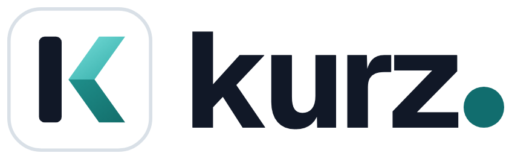

# Introduction

<p align="center">
    <picture>
        <source media="(prefers-color-scheme: dark)" srcset="./.github/assets/kurz-logo-dark.png">
        
    </picture>
</p>

<p align="center">
    This project is meant to completely replace <code>bitly.com</code> for personal use.
</p>

------------

The structure is simple: first, the user accesses the Admin, creates the link, and sends it to someone somewhere in the world.


The person enters the shortened link through a Cloudflare distributed worker (it doesn't matter if it's Cloudflare, AWS Lambda, Azure Function), the URL key is validated by querying Valkey (or Redis, or Cloudflare KV), if valid, a message is dispatched through RabbitMQ (without waiting for ACK) and immediately redirects to the site. Otherwise, the user is redirected to a 404.

The most important thing here is that we have a low-latency worker, and also a low-latency KV.
Because there's no point in having a distributed worker and having a KV on the other side of the world.

We also ensure we have resilient messaging with good performance.

This project is not too small to use interesting solutions like PGMQ, Solid Queue, or similar. Nor too large to use Apache Kafka.

Data aggregation here doesn't need to be real-time, so it doesn't matter if it's a few seconds delayed. Therefore, the server can be on a VPS, self-hosted, or on any App Service.

# Authentication

Sign in with a password, with Google, or with a code sent by e-mail; sign up and password reset use e-mail too. Sessions are a cookie (`kurz_session`).


# What is in the box

- **Short links**: the redirect flow above, with statistics, expiry, scheduling and password-locked links.
- **Pages**: bio pages with links, templates and a safety check on every link.
- **Forms**: public forms with questions, covers, file uploads and responses; a form can carry a booking question (appointments, a waiting list, an `.ics` feed). See [docs/appointments.md](./docs/appointments.md).
- **Notifications**: in the app, by e-mail and by Web Push.
- **MCP server**: AI apps manage links, pages and forms over OAuth. See [docs/mcp.md](./docs/mcp.md).

Per-part notes: [backend](./backend/README.md), [frontend](./frontend/README.md), [i18n](./docs/i18n.md), [e2e](./e2e/README.md).

# Run it locally

`docker-compose.yml` starts RabbitMQ, Postgres, Valkey, the backend (port 3000, `.env.development`) and the edge function (port 8000). It reads a root `.env` for RabbitMQ, Valkey and the edge function: create it first.

```
docker compose up --build
```

Run the frontend with `cd frontend && npm ci && npm run dev`. Tests run in containers; the recipes are in [CLAUDE.md](./CLAUDE.md) and [e2e/README.md](./e2e/README.md).
