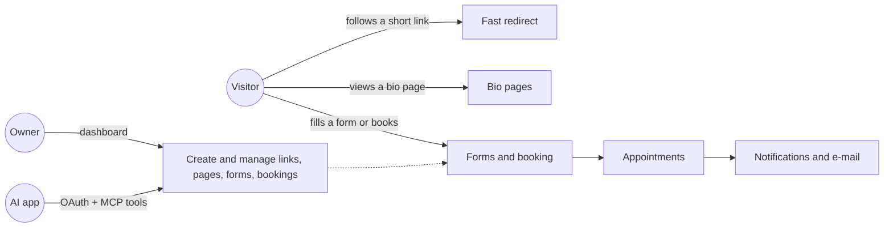

# Kurz wiki

> The business rules and product decisions of the Kurz application. State as of 2026-10-17.

Use it before shaping a feature, to know what the app does today, which rule governs it, why it was decided that way, and what else is affected if it changes.

## How to use it

1. **Find the owner page** of the area you are changing in the table below and read its *Business rules* and *Change impact*.
2. **Check the [impact map](#cross-domain-impact-map)** below for couplings with other areas. Most missed impacts come from a rule that lives in two places at once.
3. **Cite rule ids in plans and reviews** ("changes BK-12, adds FO-63"). Ids are stable: a removed rule keeps its id, marked as removed.
4. **Update the page in the same change** that changes the behaviour, and move the page's state line to the current date.
5. **Security findings are not listed here.** A weakness is reported privately, as described in [`SECURITY.md`](../SECURITY.md), and stays out of these pages until it is fixed.
6. **Rationale** comes from recorded product decisions and design docs. Where none was found, a reading is marked as an inference rather than a recorded decision.

Each page has the same sections: Summary, Glossary, Business rules, Flows, States and transitions, Limits and configuration, Authorization and privacy, API and UI surface, Decisions, Change impact, and Drift and open questions. The architecture pages (accounts, MCP, data model, platform, frontend) also carry a conceptual Data section.

## Pages

| Page | Ids | Covers |
|---|---|---|
| [Short links](shortlinks.md) | SL, D-SL | Short codes, URL validation, expiry, password lock, URL safety, the redirect experience, click statistics, QR codes |
| [Accounts and authentication](accounts-and-auth.md) | AU, D-AU | Sign-up, sessions, passwords, login codes, Google, Turnstile, time zone and language, data export, account deletion, client accounts |
| [Bio pages](bio-pages.md) | BP, D-BP | Pages, links, built-in, personal and community templates, palettes, avatars, link safety, click statistics |
| [Forms](forms.md) | FO, D-FO | Fields, layouts, draft and published versions, submission pipeline, uploads, covers, events, summary, export, templates |
| [Booking engine](booking-engine.md) | BK, D-BK | The booking question, modes, availability and slot computation, durations, prices, resources, reservation and concurrency, monthly plans, impact |
| [Appointments lifecycle](appointments-lifecycle.md) | AP, D-AP | Statuses, approval, verification, cancel, reschedule, reminders, expiry, waitlist, calendar feed, agenda, tokens, health |
| [Notifications and e-mail](notifications-and-email.md) | NT, D-NT | In-app, e-mail and push notifications, preferences, delivery, mail budget, catalogue of every e-mail |
| [MCP and OAuth](mcp-and-oauth.md) | MC, D-MC | OAuth 2.1 server, scopes, grants, the MCP tool catalogue, guards, budgets, logging |
| [Admin and moderation](admin-and-moderation.md) | AD, D-AD | Roles and the permission matrix, admin screens, audits, abuse signals and their detection, template reports |
| [Data model](data-model.md) | DM, D-DM | Every entity and relationship, the deletion cascade map, stored JSON shapes, data conventions |
| [Platform and operations](platform-and-operations.md) | OP, D-OP | Topology, deploy, CI, security harness, testing, queues and the job schedule, rate limits, environment variables, observability |
| [Frontend architecture](frontend-architecture.md) | FE, D-FE | Rendering modes, route map, auth guards, API conventions, i18n, CSP, packages, service worker |

A few topics also have standalone guides — appointments, language, the AI-app (MCP) interface and database roles. The wiki pages summarise them and note where they disagree with current behaviour.

## How it fits together

- Short-link redirects are fast and resilient: a short link keeps working even during maintenance, and clicks are counted in the background without slowing the visitor.
- Short-link clicks are aggregated in the background; bio-page clicks are counted immediately.
- A booking is made as part of submitting a form — there is no separate booking step for the visitor.
- A notification is recorded the instant its event happens and delivered within about a minute.

## Cross-domain impact map

| If you change… | Also check | Why | Pages |
|---|---|---|---|
| Whether a short link works (active, safe, expired, deleted, locked), from any path | Every other path that can turn a link on or off (admin actions, account deactivation) | The redirect reads one simple cached entry; a path that changes the link but not that entry leaves the redirect as it was | [SL](shortlinks.md), [AD](admin-and-moderation.md), [AU](accounts-and-auth.md) |
| URL validation | The redirect path and bio-page links | The same URL rule applies to short links and to bio-page links | [SL](shortlinks.md), [BP](bio-pages.md) |
| Whether an account is active, paused or being deleted | Link redirects, public pages, public forms, the calendar feed, MCP and OAuth access | The visibility of everything public depends on the account being active | [AU](accounts-and-auth.md), [AD](admin-and-moderation.md), [SL](shortlinks.md) |
| Add a new kind of data owned by a user | Account deletion/purge and the data export | Purge must remove it and the export must include it | [AU](accounts-and-auth.md), [DM](data-model.md) |
| A user's time zone or language | Booking times, the agenda, e-mail times and language, MCP tools | Times and e-mail language are resolved from the owner and recipient | [AU](accounts-and-auth.md), [NT](notifications-and-email.md), [BK](booking-engine.md) |
| The shape of a form's fields (any field type, the booking question) | Both the draft and the published version, and the MCP form and booking tools | Visitors read the published version; draft and published must both stay valid | [FO](forms.md), [BK](booking-engine.md), [MC](mcp-and-oauth.md) |
| Booking validation or slot computation | What the public form shows | The public form mirrors the booking rules and the daylight-saving handling | [BK](booking-engine.md), [FE](frontend-architecture.md) |
| A slot's places (booked, held, capacity) | Reservation, release, reschedule and the waitlist | Every availability check counts booked + held, and several actions share the same slot | [BK](booking-engine.md), [AP](appointments-lifecycle.md), [DM](data-model.md) |
| Form submission | Bookings, waitlist claims, owner notifications, anti-abuse checks and rate limits | A booking or claim happens as part of the submission; losing a place rolls the whole submission back | [FO](forms.md), [BK](booking-engine.md), [AP](appointments-lifecycle.md) |
| Deleting responses, forms or accounts | Slot release, uploads, response counts, and clients who are not notified | Cascading deletes free places without e-mail; bulk deletes skip per-record side effects | [FO](forms.md), [AP](appointments-lifecycle.md), [DM](data-model.md) |
| An appointment transition | Its notification and the matching e-mail and push text | Each transition has one notification; the push text is kept in sync separately in the app | [AP](appointments-lifecycle.md), [NT](notifications-and-email.md) |
| What reads the draft vs the published form | Agenda names, capacity, reschedule targets, waitlist offers, reminders, exports | Some readers use the published version, others still read the draft | [AP](appointments-lifecycle.md), [FO](forms.md) |
| A domain rule (forms, pages, links, appointments) | The MCP tool that performs the same action, and the guards that exist only in MCP | Most MCP tools reuse the same rules but add their own scopes, limits and guards; a few reimplement them | [MC](mcp-and-oauth.md#change-impact) |
| Expose a new field on a model | The MCP output, which is separate from the dashboard | A new field is never shared with AI apps automatically | [MC](mcp-and-oauth.md) |
| The OAuth issuer | Every existing grant | Tokens are bound to the issuer; changing it disconnects every app | [MC](mcp-and-oauth.md), [OP](platform-and-operations.md) |
| An e-mail, or the shared mail budget | Login codes, data export, appointment e-mail, and the health alert at 80% | One budget is shared by every sender | [NT](notifications-and-email.md), [AU](accounts-and-auth.md) |
| Revoking sessions (for example on a password change) | OAuth grants and MCP | Revoking sessions also disconnects MCP clients | [AU](accounts-and-auth.md), [MC](mcp-and-oauth.md) |
| Add a new route | Who is allowed to reach it, and for admin routes the access-control rules | A new route cannot ship until it declares who may reach it | [OP](platform-and-operations.md), [AD](admin-and-moderation.md) |
| Add a recurring job or queue | The production schedule and the queue workers | Some queues need their own worker, and jobs only run in production | [OP](platform-and-operations.md) |
| Add an environment variable | The stack, compose and development configuration | A variable missing from the stack is silently off in production | [OP](platform-and-operations.md) |
| A migration | That the previous release survives the new schema | During a deploy the previous release runs briefly against the new schema | [DM](data-model.md), [OP](platform-and-operations.md) |
| The session cookie, CORS origins or request headers | How /app is gated and how cookie writes are protected | The session cookie is host-only on the API host, so the app is gated on the client | [FE](frontend-architecture.md), [AU](accounts-and-auth.md) |
| Rate limits | How the visitor's IP is forwarded and trusted | The forwarded IP decides the rate-limit key | [OP](platform-and-operations.md), [FE](frontend-architecture.md) |
| A theme or custom colours | Pages, forms and page templates | One theme list and one custom-colour rule are shared by all three | [BP](bio-pages.md), [FO](forms.md) |
| A user-visible string | Both languages | A missing translation blocks the release | [FE](frontend-architecture.md) |

## Shared concepts with the widest impact

A change to one of these affects many areas.

| Concept | Affects |
|---|---|
| Account active / paused / purged state | Every public surface, short-link redirects, MCP and OAuth access, data export |
| The cached redirect entry for a short link | Short links, admin toggles, account deactivation, and every form (each form owns a short link) |
| The published form definition and the compiled booking question | Public forms, availability, the booking engine, the agenda, MCP |
| Reserving and releasing a slot's places | Booking, cancellation, rescheduling, expiry, waitlist offers |
| Notifications | Every appointment transition, the in-app bell, push, the MCP notification listing |
| The shared mail budget | Login codes, data export, appointment e-mail, the health check |
| Anti-abuse checks, the forwarded visitor IP and rate limits | Sign-in, sign-up, form submissions, uploads, unlocks, MCP |
| Browser/platform and traffic-source detection | Short-link analytics, bio-page clicks, forms |
| Image upload and re-encoding | Form covers and uploads, avatars |
| The URL safety check | Short links and bio-page links |

## Glossary

Terms used across pages. Each page has its own glossary for its domain.

- **Owner**: a signed-in user who creates links, pages and forms.
- **Visitor**: anyone using a public link, page or form, without an account.
- **Client account**: a verified, active user whose e-mail equals an appointment's client e-mail. It is matched by e-mail every time, never linked by id ([accounts](accounts-and-auth.md)).
- **Short code**: the key of a short link, used by the redirect service ([shortlinks](shortlinks.md)).
- **Servable**: a short link that redirects — active, safe and not expired ([shortlinks](shortlinks.md)).
- **Draft / published version**: a form is edited as a draft; visitors read the published version, a copy taken at publish time ([forms](forms.md)).
- **Booking question**: the booking field of a form, with its mode, services, availability and rules ([booking engine](booking-engine.md)).
- **Mode**: how a booking question is configured (services or individual) ([booking engine](booking-engine.md)).
- **Resource**: whose time a slot is; services that name the same resource share its hours ([booking engine](booking-engine.md)).
- **Slot**: one bookable start time for a form and resource, with its capacity, booked and held places ([booking engine](booking-engine.md)).
- **Held**: places of a slot kept for a waitlist offer; they count like booked places ([appointments](appointments-lifecycle.md)).
- **Grant**: a user's consent to an AI app for a set of scopes ([MCP and OAuth](mcp-and-oauth.md)).
- **Abuse signal**: an item opened by a detection job for an admin to review ([admin](admin-and-moderation.md)).

## Keeping it current

- A change that alters a rule updates the rule on its page, keeps its id, and moves the page's state line to the current date.
- A new area gets its own page with the same sections and a new two-letter prefix, and a row in the tables above.
- The site is built with VitePress and published to GitHub Pages. The build fails on a dead link between pages, so keep cross-page links valid.
