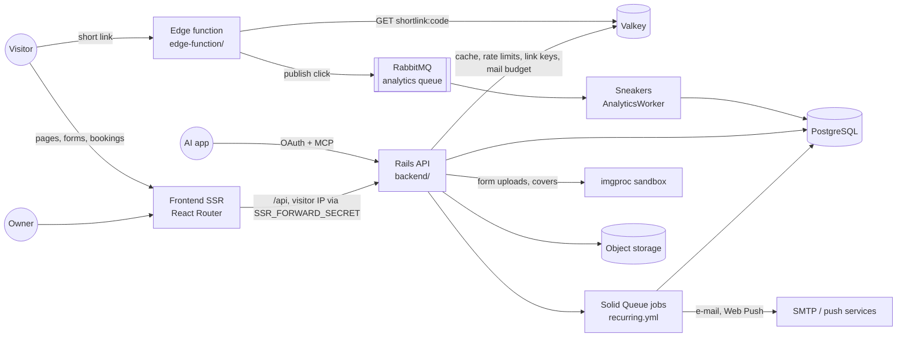

# Kurz wiki

> The business rules and the decisions of the Kurz application as they are at commit `bc7f65c` (2026-10-17).
> The code is the source of truth: every rule cites the file and line that enforces it, and the test that pins it when there is one.

Use it before implementing a feature, to know what the app does today, which rule enforces it, why it was decided that way, and what else breaks if it changes.

## How to use it

1. **Find the owner page** of the area you are changing in the table below and read its *Business rules* and *Change impact*.
2. **Check the [impact map](#cross-domain-impact-map)** below for couplings with other domains. Most impact misses in this codebase come from a rule that exists in two places (Rails and the edge function, the dashboard and the MCP tools, the backend and `@internal/booking`).
3. **Cite rule ids in PRs and plans** ("changes BK-12, adds FO-63"). Ids are stable: a removed rule keeps its id, marked as removed.
4. **Update the page in the same PR** that changes the behaviour, and move the state line (`State as of commit ...`) of the pages you touched.
5. **Security findings are not listed here.** A weakness found while reading the code is reported privately, as described in [`SECURITY.md`](../SECURITY.md), and stays out of these pages until it is fixed.
6. **Rationale** comes from code comments, `docs/`, commit messages and PRs. `Rationale: not recorded.` means none was found; `(inferred)` marks a reading of the code, not a recorded decision.

Each page has the same sections: Summary, Glossary, Data, Business rules, Flows, States and transitions, Limits and configuration, Authorization and privacy, API and UI surface, Decisions, Change impact, Tests that pin this behaviour, Drift and open questions.

## Pages

| Page | Ids | Covers |
|---|---|---|
| [Short links](shortlinks.md) | SL, D-SL | Short codes, URL validation, expiry, password lock, URL safety, the redirect path (edge function, Valkey, RabbitMQ, analytics worker), statistics, QR codes |
| [Accounts and authentication](accounts-and-auth.md) | AU, D-AU | Sign-up, sessions, passwords, login codes, Google, Turnstile, time zone and language, data export, account deletion, client accounts |
| [Bio pages](bio-pages.md) | BP, D-BP | Pages, links, built-in, personal and community templates, palettes, avatars, link safety, click statistics |
| [Forms](forms.md) | FO, D-FO | Fields, layouts, draft and published snapshot, submission pipeline, uploads, covers, events, summary, export, templates |
| [Booking engine](booking-engine.md) | BK, D-BK | The booking question, modes, availability and slot computation, durations, prices, resources, reservation and concurrency, monthly plans, impact |
| [Appointments lifecycle](appointments-lifecycle.md) | AP, D-AP | Statuses, approval, verification, cancel, reschedule, reminders, expiry, waitlist, calendar feed, agenda, tokens, health |
| [Notifications and e-mail](notifications-and-email.md) | NT, D-NT | In-app, e-mail and push notifications, preferences, delivery jobs, mail budget, catalogue of every e-mail |
| [MCP and OAuth](mcp-and-oauth.md) | MC, D-MC | OAuth 2.1 server, scopes, grants, the MCP tool catalogue, guards, budgets, logging |
| [Admin and moderation](admin-and-moderation.md) | AD, D-AD | Roles and the permission matrix, admin screens, audits, abuse signals and their detection, template reports |
| [Data model](data-model.md) | DM, D-DM | Every table and constraint, the deletion cascade map, JSON shapes, migration history and conventions |
| [Platform and operations](platform-and-operations.md) | OP, D-OP | Topology, deploy, CI, security harness, testing, queues and the job schedule, rate limits, environment variables, observability |
| [Frontend architecture](frontend-architecture.md) | FE, D-FE | React Router app, SSR and prerender, route map, auth guards, API client conventions, i18n, CSP, packages, service worker |

Existing decision records stay in [`docs/`](../docs): [appointments](../docs/appointments.md), [i18n](../docs/i18n.md), [MCP](../docs/mcp.md), [Postgres roles](../docs/postgres-roles.md). The wiki pages link to them and list where they disagree with the code.

## Architecture at a glance

- Rails writes `shortlink:<code>` in Valkey and the edge function only reads it. Valkey must never be flushed ([shortlinks](shortlinks.md), [platform](platform-and-operations.md)).
- Clicks on short links go through the edge function and RabbitMQ. Clicks on bio page links are written synchronously by Rails ([bio pages](bio-pages.md)).
- Bookings have no endpoint of their own: they are made inside the form submission transaction ([forms](forms.md), [booking engine](booking-engine.md)).
- Notifications are rows written in the same transaction as the event and delivered by a job every minute ([notifications](notifications-and-email.md)).

## Cross-domain impact map

| If you change… | Also check | Why | Pages |
|---|---|---|---|
| Whether a short link works (active, safe, expired, deleted, locked), from any path | The Valkey key `shortlink:<code>` is written or deleted on that path | The edge function reads only Valkey. A path that changes the row and not the key (an `update_all`, a new job) leaves the redirect as it was | [SL](shortlinks.md), [AD](admin-and-moderation.md), [AU](accounts-and-auth.md) |
| The Valkey value format (`{"t":"url","v":…}`, `{"t":"locked"}`) | `edge-function/Cache.cs` and its tests | An unknown `t` reads as not found. The edge function deploys first | [SL](shortlinks.md) |
| The click payload or the `analytics` queue | `edge-function/Analytics.cs`, `Headers.cs`, `AnalyticsWorker`, `Event` column lengths | Three components share a 9-key payload | [SL](shortlinks.md), [OP](platform-and-operations.md) |
| URL validation (`http_url`) or user agent parsing | The edge function (`HttpHref`, `Headers.cs`), the bio page links, `UserAgentParser` | The same rule exists in Ruby and C# | [SL](shortlinks.md), [BP](bio-pages.md) |
| `User.active`, `User#deactivate!`, `reactivate!`, `cancel_deletion!` | Link cache, public pages, public forms, calendar feed, MCP and OAuth token checks | Visibility of everything public is merged with `User.active` | [AU](accounts-and-auth.md), [AD](admin-and-moderation.md), [SL](shortlinks.md) |
| A new table owned by a user | `ON DELETE` cascade or `dependent:`, `User#purge!`, `Users::DataExport` | Account purge relies on cascades; the export must list every owned table | [AU](accounts-and-auth.md), [DM](data-model.md) |
| `users.time_zone` or `users.locale` | Booking engine, agenda, e-mail times and language, MCP tools, `useLocaleSync` | Times and e-mail language are resolved from the owner and recipient | [AU](accounts-and-auth.md), [NT](notifications-and-email.md), [BK](booking-engine.md) |
| The shape of `forms.fields` (any field type, the booking question) | A data migration on **both** `fields` and `published_snapshot`, the frontend package `@internal/booking`, the MCP form and booking tools | Visitors read the snapshot; the draft and the snapshot must both stay valid (precedent `157fbd4`, #255) | [FO](forms.md), [BK](booking-engine.md), [MC](mcp-and-oauth.md) |
| Booking validation or slot computation | `frontend/packages/booking` and `zone-time.ts` | The frontend mirrors the backend modes and the DST handling | [BK](booking-engine.md), [FE](frontend-architecture.md) |
| `appointment_slots` (`booked`, `held`, `capacity`) | `Reserve`, `Release`, `Reschedule`, the waitlist, the check and exclusion constraints | Every availability check counts `booked + held`; several services share the row | [BK](booking-engine.md), [AP](appointments-lifecycle.md), [DM](data-model.md) |
| `Forms::SubmitResponse` | Bookings, waitlist claims, owner notifications, Turnstile, rate limits | Bookings and claims happen inside the response transaction; losing a place rolls the response back with 409 | [FO](forms.md), [BK](booking-engine.md), [AP](appointments-lifecycle.md) |
| Deleting responses, forms or accounts | Slot release, uploads, `responses_count`, clients who are not told | Cascades release places without e-mail; bulk deletes skip callbacks | [FO](forms.md), [AP](appointments-lifecycle.md), [DM](data-model.md) |
| A transition of an appointment | Its `notifications` row and `event_key`, `Deliver::TEMPLATES`, the mailer, `frontend/public/sw.js` texts, `notifications.json` and `notices.json` | The unique `event_key` makes e-mails idempotent; push texts are duplicated in the service worker | [AP](appointments-lifecycle.md), [NT](notifications-and-email.md) |
| What reads the draft vs the published form | Agenda names, capacity, reschedule targets, waitlist offers, reminders, exports | Some readers use `PublicDefinition`, others still read the draft `fields` | [AP](appointments-lifecycle.md), [FO](forms.md) |
| A rule of a domain service (forms, pages, links, appointments) | The MCP tool that calls it, and the guards that exist only in MCP | Most MCP tools reuse the services but add their own scopes, rate limits and guards. Some copy controller code instead: `update_shortlink` (cache refresh, safety job), `create_page`, page link reorder, `delete_all_responses` | [MC](mcp-and-oauth.md#change-impact) |
| A column of a serialized model | The MCP serializers, which are separate from the dashboard ones | A new column is never exposed (or leaked) to AI apps automatically | [MC](mcp-and-oauth.md) |
| `OAUTH_ISSUER` | Every existing grant | Tokens are bound to the issuer; changing it disconnects every app | [MC](mcp-and-oauth.md), [OP](platform-and-operations.md) |
| `MailBudget` shares or a new e-mail | Login codes, data export, appointment e-mails, the health alert at 80% | One budget is shared by every sender | [NT](notifications-and-email.md), [AU](accounts-and-auth.md) |
| Session revocation (`sessions_revoked_at`) | OAuth grants and MCP | A password change also disconnects MCP clients | [AU](accounts-and-auth.md), [MC](mcp-and-oauth.md) |
| A new route | `.ci/security/matrix.tsv` (check A00) and, for admin routes, `bfla_spec.rb` | The security harness fails on a route without a matrix row | [OP](platform-and-operations.md), [AD](admin-and-moderation.md) |
| A new recurring job or queue | `backend/config/recurring.yml` (under `production:`), `queue.yml` workers | The `notifications` queue needs its own worker; jobs only run in production | [OP](platform-and-operations.md) |
| A new environment variable | `.ci/stack.yml` / `.ci/fe-stack.yml`, `docker-compose.yml`, `.env.development` | A variable missing from the stack file is silently off in production | [OP](platform-and-operations.md) |
| A migration | The previous release runs against the new schema for a few seconds and after a rollback | Expand, backfill, ship the code; drop or rename in a later release | [DM](data-model.md), [OP](platform-and-operations.md) |
| The session cookie, CORS origins or request headers | `/app` gating, `X-Requested-With` on cookie writes, `backend/config/initializers/cors.rb` | `kurz_session` is host-only on the API host, so the SSR server cannot authenticate: `/app` is gated on the client by `GET /api/me` | [FE](frontend-architecture.md), [AU](accounts-and-auth.md) |
| Rate limits | They live in Valkey through the Rails cache and are keyed by the IP the frontend SSR forwards | `client_ip` and `SSR_FORWARD_SECRET` decide the key | [OP](platform-and-operations.md), [FE](frontend-architecture.md) |
| A theme or custom colours | `Page::THEMES` validates pages, forms and page templates; `CustomColors` is shared | One list for three models | [BP](bio-pages.md), [FO](forms.md) |
| A user-visible string | `en` and `pt-PT`, the route namespace declaration, the parity test | `npm test` fails on a missing key or an undeclared namespace | [FE](frontend-architecture.md), [docs/i18n.md](../docs/i18n.md) |

## Shared building blocks

Code that several domains depend on. A change here has the widest blast radius.

| Building block | Used by |
|---|---|
| `User.active`, `User#deactivate!`, `User#purge!` | Every public surface, shortlinks cache, MCP/OAuth, data export |
| `Shortlink#cache_key` / `#cache_value` | Shortlinks, admin toggles, account deactivation, forms (every form owns a short link) |
| `Forms::PublicDefinition`, `Booking::Modes.compile` | Public forms, the slots endpoint, the booking engine, the agenda, MCP |
| `Appointments::Reserve` / `Release` | Booking, cancellation, rescheduling, expiry, waitlist offers |
| `Notification` rows and `Notifications::Deliver` | Every appointment transition, the bell, push, MCP `list_notifications` |
| `MailBudget` | Login codes, data export, appointments, the health check |
| `Turnstile`, `client_ip`, Rails `rate_limit` | Sign-in, sign-up, form submissions, uploads, unlocks, MCP |
| `UserAgentParser`, `TrafficSource` | Short link analytics (mirrored in the edge function), bio page clicks, forms |
| `ImageUpload`, `imgproc` | Form covers and uploads (imgproc), avatars (in-process libvips) |
| `GoogleLib::SafeBrowsing` | Short links (`SafetyUrlJob`), bio page links (`PageLinkSafetyJob`) |

## Glossary

Terms used across pages. Each page has its own glossary for its domain.

- **Owner**: a signed-in user who creates links, pages and forms.
- **Visitor**: anyone using a public link, page or form, without an account.
- **Client account**: a verified, active user whose e-mail equals an appointment's `client_email`. It is matched by e-mail every time, never linked by id ([accounts](accounts-and-auth.md)).
- **Short code**: the key of a short link, read by the edge function from Valkey ([shortlinks](shortlinks.md)).
- **Servable**: a short link that redirects: not inactive, safe and not expired ([shortlinks](shortlinks.md)).
- **Draft / published snapshot**: a form is edited as a draft; visitors read `published_snapshot`, a copy taken at publish time with a version and digest ([forms](forms.md)).
- **Booking question**: the `booking` field of a form, with its mode, services, availability and rules ([booking engine](booking-engine.md)).
- **Mode**: how a booking question is configured (`services` or `individual`) and compiled for the engine ([booking engine](booking-engine.md)).
- **Resource**: whose time a slot is; services that name the same resource share its hours ([booking engine](booking-engine.md)).
- **Slot**: one row of `appointment_slots` per form, resource and start time, with `capacity`, `booked` and `held` ([booking engine](booking-engine.md)).
- **Held**: places of a slot kept for a waitlist offer; they count like booked places ([appointments](appointments-lifecycle.md)).
- **Grant**: a user's consent to an OAuth client with a set of scopes ([MCP and OAuth](mcp-and-oauth.md)).
- **Abuse signal**: a row opened by a detection job for an admin to review ([admin](admin-and-moderation.md)).

## Keeping it current

- A PR that changes a rule updates the rule on its page, keeps its id, and moves the page's state line to the new commit.
- A new domain gets its own page with the same sections and a new two-letter prefix, and a row in the tables above.
- References are `path:LINE`. Lines move: when you touch a file, fix the references to it in the pages that cite it.
