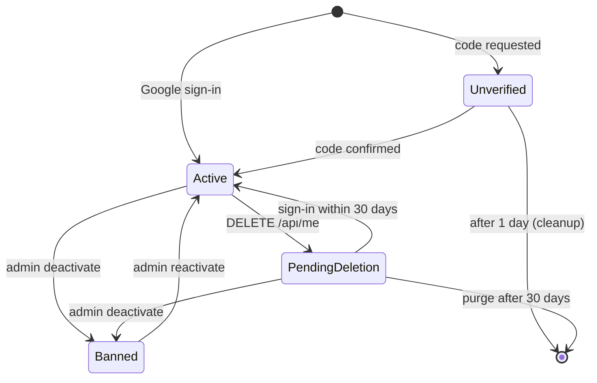

# Accounts and authentication

> Scope: users, sign-up, sign-in (password, e-mailed code, Google), the session cookie, passwords, Turnstile, account settings (time zone, language), data export, account deletion, the client account. State as of commit `bc7f65c` (2026-10-17).
> Main code: `backend/app/models/user.rb`, `backend/app/models/identity.rb`, `backend/app/models/concerns/password_authenticatable.rb`, `backend/app/controllers/application_controller.rb`, `backend/app/controllers/api/{sessions,registrations,password_resets}_controller.rb`, `backend/app/controllers/api/me/{users,passwords}_controller.rb`, `backend/app/controllers/concerns/{session_cookie,client_ip,code_request_response}.rb`, `backend/app/services/{google_sign_in,login_code_request,password_policy,session_token,turnstile,mail_budget}.rb`, `backend/app/services/users/data_export.rb`, `frontend/app/routes/{login,password,signup.tsx,account.tsx}`, `frontend/app/modules/auth/`, `frontend/packages/core/actions/api.ts`.

## Summary

A Kurz account is one row in `users`, identified by a lower-cased e-mail. There are three ways to sign in: a password (Argon2id), a 7-digit code sent by e-mail, and Google (ID token, linked by Google's stable `sub` in `identities`). Sign-up and password reset both send that same e-mailed code. Every successful sign-in issues an HS256 JWT that lasts 2 days. The JWT travels only in the httpOnly, SameSite=Strict cookie `kurz_session`, or as a Bearer header for API clients. It can be revoked one token at a time (logout, through a Valkey key per `jti`) or all at once (`users.sessions_revoked_at`). An account is created when the first code is requested. It becomes verified when a code is confirmed or Google vouches for the address, and it is deleted after a day if it is never verified. Deleting an account is a soft delete: the account goes offline at once, any sign-in within 30 days restores it, and a daily job purges it after that. Data export is a JSON file sent by e-mail, one request a week. A "client account" is an ordinary verified account whose e-mail matches the `client_email` of appointments booked on other people's forms. There is no separate client user type.

## Glossary

- **Owner**: the signed-in user who owns short links, pages and forms. Every account is potentially an owner.
- **Client account** (`Notification.client_account`): an active, verified `User` whose e-mail (case-insensitive) equals an appointment's or waitlist entry's `client_email`. It receives the in-app copy of client notifications and sees its own bookings under `/api/me/bookings`.
- **Login code / magic link** (`users.login_token`): a 7-digit numeric code, sent by e-mail, used for sign-in, sign-up confirmation and password reset. The code says "magic link" in its names, but the e-mail carries a code only.
- **Purpose** (`LoginCodeRequest::PURPOSES`, `LoginMailer::PURPOSES`): `sign_in`, `sign_up`, `sign_up_existing` (sign-up for an address that is already verified), `password_reset`. It only changes the e-mail wording and whether a password is staged. The code itself is not bound to a purpose.
- **Pending password** (`pending_password_digest`): the password chosen at sign-up. It takes effect only when the code is confirmed with purpose `sign_up`.
- **Verified** (`verified_at`): the address has been proven by a confirmed code or by Google.
- **Deactivated** (`deactivated_at`): offline, either because an admin banned the account or because a deletion is pending.
- **Pending deletion** (`deletion_requested_at`): the user asked to delete the account. It is always set together with `deactivated_at`.
- **Session token** (`SessionToken`): the JWT `{sub, jti, iat, exp}`.
- **Recent sign-in** (`RECENT_SIGN_IN = 15.minutes`): the token's `iat` is less than 15 minutes old. This stands in for a password on accounts that have none.
- **Identity** (`Identity`): an external sign-in account linked to a user. The only provider is `google`.

## Data

Full catalogue: [data-model](data-model.md).

**`users`** (`backend/db/schema.rb:628`)

| Column | Type / default | Meaning |
|---|---|---|
| `email` | string, not null | Normalized with `strip.downcase` (`backend/app/models/user.rb:56`). Unique index on `lower(email)` (`index_users_on_lower_email`). |
| `admin` | bool, default false | The only role flag. See [admin-and-moderation](admin-and-moderation.md). |
| `verified_at` | datetime | Set on the first successful sign-in. A migration set it to `created_at` for every account that existed before (`backend/db/migrate/20260923190000_add_verified_at_to_users.rb`). |
| `deactivated_at` | datetime | Banned or pending deletion. |
| `deletion_requested_at` | datetime | Partial index `WHERE deletion_requested_at IS NOT NULL`. |
| `login_token`, `login_token_sent_at`, `login_attempts` | string, datetime, int default 0 | The current code, stored in plaintext, and the wrong guesses against it. The unique index on `login_token` was dropped in #307 (`36d9a67`). |
| `password_digest` | string | Argon2id, or nil for accounts that only use codes. |
| `pending_password_digest` | string | The staged sign-up password. |
| `password_changed_at`, `failed_password_attempts` (default 0), `password_locked_until` | | Password lock state. |
| `sessions_revoked_at` | datetime | Tokens with `iat` before this are rejected. |
| `time_zone` | string, not null, default `Europe/Lisbon` | IANA name. The default was `UTC` until `20261012120000_default_user_time_zone_to_lisbon.rb`, which also rewrote every `UTC` row. |
| `locale` | string, nullable | `en` or `pt-PT` (`User::LOCALES`). |
| `shortlinks_count` | int | counter_culture. Owned by [shortlinks](shortlinks.md). |

Indexes: `(verified_at, created_at)` for the cleanup job; `lower(email)` unique.

**`identities`** (`backend/db/schema.rb:253`): `provider` (not null, in `["google"]`), `uid` (Google `sub`, not null), `email` (informational, refreshed on every sign-in), `last_used_at`. Unique `(provider, uid)` and unique `(user_id, provider)`, so a user has at most one Google identity. FK `user_id` has `ON DELETE CASCADE`.

**Valkey / Rails.cache keys** (namespace `kurz`)

| Key | TTL | Purpose |
|---|---|---|
| `session_token:revoked:<jti>` | until the token's `exp` | A logged-out token (`backend/app/services/session_token.rb:29`). |
| `data-export:<user_id>` | 1 week | The weekly allowance (`backend/app/controllers/api/me/users_controller.rb:36`). |
| `mail_mx:<domain>` | 1 day | Cached MX lookup (`backend/app/services/login_code_request.rb:69`). |
| `mail_budget:{day,month,new}:*`, `mail_budget:alerted:*` | 2 d / 32 d / 1 d | E-mail budget. See [notifications-and-email](notifications-and-email.md). |
| Rails `rate_limit` counters | per limit window | Every limit in the table below. |

Audit: `User` is audited only on `email, admin, deactivated_at, deletion_requested_at, password_changed_at` (`backend/app/models/user.rb:44`). Changes to the login token are not audited (`backend/spec/models/user_audit_spec.rb:20`).

## Business rules

### Accounts and e-mail

- **AU-01** E-mail is stripped, lower-cased, required, must match `URI::MailTo::EMAIL_REGEXP` and is unique regardless of case: a model validation plus the DB index on `lower(email)`. — `backend/app/models/user.rb:56-58`; test `backend/spec/models/user_spec.rb:32`.
- **AU-02** An account is created the first time a code is requested for an unknown address that passes AU-21 (sign-in, sign-up), or the first time someone signs in with Google. Accounts are created nowhere else, and there is no admin "create user". — `backend/app/services/login_code_request.rb:48-51`, `backend/app/services/google_sign_in.rb:98`.
- **AU-03** No endpoint changes a user's e-mail. A Google identity's e-mail is refreshed on every sign-in, but `users.email` stays the same. — `backend/app/services/google_sign_in.rb:93`.
- **AU-04** Accounts whose `verified_at` is null and whose `created_at` is more than 1 day old are destroyed daily (in batches of 500). — `backend/app/jobs/cleanup_unverified_users_job.rb:7-12`; test `backend/spec/jobs/cleanup_unverified_users_job_spec.rb:4`.
- **AU-05** An account becomes verified on the first confirmed code (`login_verify`) or on Google sign-in. Password sign-in and reset require it to be verified already. — `backend/app/models/user.rb:194`, `backend/app/controllers/api/sessions_controller.rb:107`; test `backend/spec/requests/api/login_request_protection_spec.rb:61`.
- **AU-06** An unverified user cannot obtain a session by any path: password and reset refuse it, `login_verify` verifies it first, Google verifies it. All an unverified user has is a pending code and a staged password. `/api/me/bookings` also checks `verified?` explicitly, as defence in depth. — `backend/app/controllers/api/sessions_controller.rb:70`, `backend/app/controllers/api/password_resets_controller.rb:31`, `backend/app/controllers/api/me/bookings_controller.rb:37`; test `backend/spec/requests/api/me/bookings_spec.rb:52`.

### E-mailed code

- **AU-10** The code is 7 random digits, left-padded with zeros (`SecureRandom.random_number(10**7)`). Generating a new code resets `login_attempts` to 0. — `backend/app/models/user.rb:151-157`.
- **AU-11** A code is valid for 15 minutes (`LOGIN_TOKEN_TTL`). The e-mail states the same number of minutes. — `backend/app/models/user.rb:35,159`, `backend/app/mailers/login_mailer.rb:10`.
- **AU-12** The code is compared in constant time. Each wrong guess increments `login_attempts`, and at 5 (`MAX_LOGIN_ATTEMPTS`) the code is erased, so a new code must be requested. — `backend/app/models/user.rb:165-172`; test `backend/spec/requests/api/sessions_spec.rb:50`.
- **AU-13** A code is single use: a successful verify, a password reset, or a password sign-in clears it. — `backend/app/controllers/api/sessions_controller.rb:75,105`, `backend/app/controllers/api/password_resets_controller.rb:38`.
- **AU-14** Resend cooldown: no new code is generated or sent within 1 minute of the previous one (`MAGIC_LINK_COOLDOWN`). The request still answers "sent". — `backend/app/models/user.rb:36,178-187`, `backend/app/services/login_code_request.rb:40`; test `backend/spec/requests/api/sessions_spec.rb:102`.
- **AU-15** One code serves every purpose. A code sent for sign-in also works for `password/reset`, and the reverse. The `purpose` field on `login_verify` is supplied by the client: `sign_up` activates the pending password, anything else discards it. — `backend/app/controllers/api/sessions_controller.rb:106`.
- **AU-16** In development only, the code `0000000` signs into any existing account. — `backend/app/controllers/api/sessions_controller.rb:142`; test `backend/spec/requests/api/sessions_spec.rb:74`.
- **AU-17** The code is the e-mail subject and appears in a text part as well as in HTML. The wording follows the purpose and the recipient's language. — `backend/app/mailers/login_mailer.rb:5-21`; test `backend/spec/mailers/login_mailer_spec.rb:19`.

### Code requests (`LoginCodeRequest`)

- **AU-20** A malformed address (`ValidEmail2` validity) answers `422 invalid_email`. — `backend/app/services/login_code_request.rb:28`; test `backend/spec/requests/api/login_request_protection_spec.rb:47`.
- **AU-21** For an address that is not yet verified, disposable domains or domains without MX records answer `422 undeliverable_email`. The MX result is cached for 1 day per domain. Verified accounts skip the check. — `backend/app/services/login_code_request.rb:42-43,65-70`; test `backend/spec/requests/api/login_request_protection_spec.rb:26,37`.
- **AU-22** Silent skips, which still answer `200 "If the email can receive a code, it is on its way."`: the account cannot sign in (banned), the purpose is `password_reset` and the address is unknown or unverified, or the cooldown is running. — `backend/app/services/login_code_request.rb:31-32,40`, `backend/app/controllers/concerns/code_request_response.rb:10`; test `backend/spec/requests/api/login_request_protection_spec.rb:54`.
- **AU-23** Every code e-mail must fit in `MailBudget`. New addresses also count against `MAIL_NEW_ADDRESS_DAILY_LIMIT`. When the budget is spent the request answers `503` with `daily_limit`, `monthly_limit` or `new_address_limit`. — `backend/app/services/login_code_request.rb:45-46`, `backend/app/services/mail_budget.rb:16-18`; test `backend/spec/requests/api/login_request_protection_spec.rb:71`.
- **AU-24** An unknown `purpose` falls back to `sign_in`. — `backend/app/services/login_code_request.rb:22`.
- **AU-25** The account's language is saved from the request's `locale` (only `en` or `pt-PT`) when the account is created by a code request, and at `start_session` when `users.locale` is still nil. An existing locale is never overwritten by a sign-in. — `backend/app/services/login_code_request.rb:49`, `backend/app/controllers/concerns/code_request_response.rb:31`; test `backend/spec/requests/api/login_request_locale_spec.rb:37-83`.

### Sign-up

- **AU-30** `POST /api/signup` checks Turnstile (action `signup`) and then `PasswordPolicy`, and only then requests a code with purpose `sign_up`. The chosen password is hashed into `pending_password_digest`. — `backend/app/controllers/api/registrations_controller.rb:17-24`, `backend/app/services/login_code_request.rb:39,50`.
- **AU-31** Signing up with an address that is already verified gets the same answer. The e-mail purpose becomes `sign_up_existing`, which tells the owner what confirming does, and the password is staged. Confirming that code with purpose `sign_up` changes the password and ends every other session. — `backend/app/services/login_code_request.rb:34-39`, `backend/app/models/concerns/password_authenticatable.rb:75-84`; test `backend/spec/requests/api/passwords_spec.rb:98`, `backend/spec/mailers/login_mailer_spec.rb:36`.
- **AU-32** A plain code sign-in (any purpose other than `sign_up`) or a Google sign-in discards the pending password. This stops a stranger from planting a password on someone else's address. — `backend/app/models/concerns/password_authenticatable.rb:71-74,86`, `backend/app/services/google_sign_in.rb:101`; test `backend/spec/requests/api/passwords_spec.rb:87`, `backend/spec/requests/api/google_sign_in_spec.rb:57`.
- **AU-33** Sign-up keeps the password of an existing account when the owner signs in with a plain code instead of confirming the sign-up. — test `backend/spec/requests/api/passwords_spec.rb:116`.

### Password sign-in and lock

- **AU-40** `POST /api/login/password` gives one answer for every failure: `401 invalid_credentials` for an unknown e-mail, an unverified account, a banned account, a wrong password or a locked password. A dummy Argon2 verification runs whenever the real check is skipped, so response times match. — `backend/app/controllers/api/sessions_controller.rb:66-77`, `backend/app/models/concerns/password_authenticatable.rb:17,25`; test `backend/spec/requests/api/passwords_spec.rb:37,63`.
- **AU-41** Lock: the first 5 failures (`FREE_ATTEMPTS`) are free. From the 5th failure on, the password is locked for `1 min × 2^(attempts−5)`, at most 1 hour (`MAX_LOCK`), so 1, 2, 4, 8 … 60 minutes. While locked, even the right password fails. A correct password resets the counter. Code and Google sign-in keep working while the password is locked. — `backend/app/models/concerns/password_authenticatable.rb:11-13,40-52,98-104`; test `backend/spec/requests/api/passwords_spec.rb:48`.
- **AU-42** A successful password sign-in clears any pending code. — `backend/app/controllers/api/sessions_controller.rb:75`.

### Password hashing and policy

- **AU-45** User passwords are Argon2id with `t_cost 2, m_cost 15 (2^15 KiB = 32 MiB), p_cost 1`. The `bcrypt` gem is used only for password-locked short links (`has_secure_password`, see [shortlinks](shortlinks.md)). User passwords have never been bcrypt, so no bcrypt-to-Argon2 migration exists. — `backend/app/models/concerns/password_authenticatable.rb:1-3,11,20`, `backend/Gemfile:61-62,95`; test `backend/spec/models/password_authenticatable_spec.rb:6`.
- **AU-46** A digest whose `m/t/p` parameters differ from the current costs is rehashed on the next successful password check, whether that is a sign-in, a re-authentication on export or delete, or a password change. — `backend/app/models/concerns/password_authenticatable.rb:45,106-111`; test `backend/spec/models/password_authenticatable_spec.rb:13`.
- **AU-47** `PasswordPolicy.error_for` applies these checks in order:

  | Check | Error code |
  |---|---|
  | length < 8 | `password_too_short` |
  | length > 128 | `password_too_long` |
  | contains the e-mail's local part (case-insensitive) and length < 16 | `password_matches_email` |
  | found in Have I Been Pwned (k-anonymity range API, `Add-Padding`) | `password_breached` |

  The breach check fails open on timeout or network error (open 3 s, read 4 s). There are no composition rules. — `backend/app/services/password_policy.rb:9-47`; test `backend/spec/requests/api/passwords_spec.rb:141,147`.
- **AU-48** The policy applies to sign-up, reset and `PUT /api/me/password`. The frontend enforces only the 8-character minimum and the confirmation match (`MIN_PASSWORD_LENGTH = 8`). Its strength bar is advisory. — `frontend/app/modules/auth/new-password-fields.tsx:7,49-71`.

### Password reset and change

- **AU-50** `POST /api/password/forgot` checks Turnstile (action `password_reset`) and sends a code with purpose `password_reset`, but only to verified accounts that can sign in (AU-22). — `backend/app/controllers/api/password_resets_controller.rb:22-26`; test `backend/spec/requests/api/passwords_spec.rb:163`.
- **AU-51** `POST /api/password/reset {email, code, password}` needs a verified account that can sign in and a valid code (AU-11, AU-12). Otherwise it answers `401 invalid_code`. Next it applies the policy (`422`). Then it clears the code, sets the password, sets `sessions_revoked_at = now` so every other session ends, and signs in. The token TTL is the code TTL (15 min). The token is single use (AU-13). Reset has no Turnstile. — `backend/app/controllers/api/password_resets_controller.rb:29-41`, `backend/app/models/concerns/password_authenticatable.rb:55-65`; test `backend/spec/requests/api/passwords_spec.rb:174,191`.
- **AU-52** `PUT /api/me/password`: an account that has a password must give `current_password` (`422 invalid_current_password`). An account without one needs a recent sign-in (`403 reauthentication_required`). The change revokes every session and then issues a fresh cookie for the current one. — `backend/app/controllers/api/me/passwords_controller.rb:20-36`; test `backend/spec/requests/api/passwords_spec.rb:203,216`.

### Google

- **AU-55** Google sign-in is on only when `GOOGLE_CLIENT_ID` or `GOOGLE_NATIVE_CLIENT_IDS` (comma-separated) gives at least one audience. Otherwise `POST /api/login/google` answers `404`. — `backend/app/services/google_sign_in.rb:24-30,38`, `backend/app/controllers/api/sessions_controller.rb:87`; test `backend/spec/requests/api/google_sign_in_spec.rb:127,177`.
- **AU-56** The endpoint accepts either `code` from the popup or `credential`, an ID token. A `code` is exchanged with `GOOGLE_CLIENT_SECRET` and the web client id only, with `redirect_uri=postmessage`, a timeout of 5 s open and 8 s read, and the code truncated to 1024 characters. The ID token must pass `verify_oidc` (signature, issuer, audience among the accepted ids, expiry) and carry `email_verified == true`. — `backend/app/services/google_sign_in.rb:40-44,62-88`; test `backend/spec/requests/api/google_sign_in_spec.rb:68,100,138,159`.
- **AU-57** Error answers: `401 google_invalid_token`, `401 google_email_not_verified`, `403` with the deactivated message. — `backend/app/controllers/api/sessions_controller.rb:84-89`.
- **AU-58** Account linking. The `Identity` is looked up by `(google, sub)` first. When none exists, the account with the same e-mail is used, or a new one is created. In either case the pending password is discarded, the account is marked verified, and the identity is created, all in one transaction. A Google account is linked automatically to an existing e-mail/password account, with no confirmation e-mail. Linking by the Google-verified e-mail happens only the first time; afterwards only the `sub` counts. Google cannot be unlinked, and there is no "connect Google" button. — `backend/app/services/google_sign_in.rb:90-106`; test `backend/spec/requests/api/google_sign_in_spec.rb:31,43`.
- **AU-59** Google sign-in sends no e-mail and does not touch `MailBudget` or Turnstile. — `backend/app/services/google_sign_in.rb:11-13`; test `backend/spec/requests/api/google_sign_in_spec.rb:31`.

### Session token and cookie

- **AU-60** Token: a JWT signed with HS256 (the only algorithm accepted on decode; `alg` from the header is ignored). The claims are `sub` (user id), `jti` (UUID), `iat` and `exp = iat + 2 days`, and `sub`, `jti` and `exp` are required. The key is `key_generator.generate_key("kurz session token v1", 64)`, derived from `secret_key_base` and never `secret_key_base` itself. — `backend/app/services/session_token.rb:7-25,44-46`; test `backend/spec/requests/api/session_cookie_spec.rb:82-100`.
- **AU-61** Cookie `kurz_session`: `httponly`, `same_site: :strict`, `path: /`, `secure` only in production, and `expires` equal to the token TTL (2 days). The token is never returned in a response body. — `backend/app/controllers/concerns/session_cookie.rb:8-21`, `backend/app/controllers/concerns/code_request_response.rb:32-35`.
- **AU-62** There is no sliding renewal. A session ends 2 days after sign-in, whatever the activity. Only a password change re-issues a token. — `backend/app/services/session_token.rb:12-15`, `backend/app/controllers/api/me/passwords_controller.rb:34`.
- **AU-63** `authenticate_user!` reads `Authorization: Bearer` first and the cookie second. It decodes the token. For cookie sessions, any method other than GET/HEAD must carry `X-Requested-With: XMLHttpRequest`, or it gets `403`. Then it loads the user: a missing user or `iat < sessions_revoked_at` gives `401 "Invalid or expired token"`, a deactivated user gives `403 errors.account_deactivated`, and no token gives `401 "Missing token"`. — `backend/app/controllers/application_controller.rb:70-114`; test `backend/spec/requests/api/session_cookie_spec.rb:18-47`, `backend/spec/requests/deleted_user_token_spec.rb:6`.
- **AU-64** CORS gives credentials only to the exact origins `https://kurz.fyi`, `https://app.kurz.fyi`, `FRONTEND_URL`, and `http://localhost:5173` outside production. — `backend/config/initializers/cors.rb:12-34`.
- **AU-65** Logout (`DELETE /api/logout`) writes `session_token:revoked:<jti>` until `exp` and deletes the cookie. It always answers `204`. With a null cache store (development or test without `REDIS_URL`) revocation does nothing. — `backend/app/controllers/api/sessions_controller.rb:117-130`, `backend/app/services/session_token.rb:27-32`; test `backend/spec/requests/api/session_cookie_spec.rb:56,70`.
- **AU-66** "Sign out everywhere" exists only as a side effect: setting `sessions_revoked_at` (password change, reset, sign-up confirmation on a verified account, deletion request) invalidates every token issued before it, and every OAuth grant created before it, because MCP and the token endpoint check `session_current?(grant.created_at)`. The comparison is at whole-second precision. — `backend/app/models/concerns/password_authenticatable.rb:92-94`, `backend/app/controllers/mcp/endpoint_controller.rb:38`, `backend/app/controllers/oauth/tokens_controller.rb:49`.

### Turnstile

- **AU-70** Turnstile is checked on `POST /api/login_request` and `POST /api/login/password` (action `login`), `POST /api/signup` (`signup`) and `POST /api/password/forgot` (`password_reset`). It is not checked on `login_verify`, `password/reset` or `login/google`. A rejection answers `403 captcha_failed`. — `backend/app/controllers/api/sessions_controller.rb:57,67`, `backend/app/controllers/api/registrations_controller.rb:18`, `backend/app/controllers/api/password_resets_controller.rb:23`, `backend/app/controllers/concerns/code_request_response.rb:21-26`.
- **AU-71** The check has three states: `:ok`, `:rejected` and `:unavailable`. Without `TURNSTILE_SECRET_KEY` it is `:unavailable`, which lets the request through (and logs a warning plus a Sentry message on every call). When Cloudflare cannot be reached, or answers something unexpected, it is also `:unavailable` and the request passes. A blank or non-string token is `:rejected` without calling Cloudflare. A token passes only with `success`, the matching `action`, and a `hostname` in `TURNSTILE_HOSTNAMES` when that variable is set. Outside production, Cloudflare test keys pass on `success` alone. The HTTP timeouts are 3 s open and 5 s read, and the token is truncated to 2048 characters. — `backend/app/services/turnstile.rb:15-86`; test `backend/spec/services/turnstile_spec.rb:19-118`, `backend/spec/requests/api/login_request_protection_spec.rb:101`.
- **AU-72** Frontend: the widget renders only when `VITE_TURNSTILE_SITE_KEY` is set (`appearance: interaction-only`). Submit is disabled until a token arrives, and the widget resets after every submission because tokens are single use. — `frontend/app/modules/auth/turnstile.tsx:9-12,113-169`, `frontend/app/routes/login/index.tsx:65,72`.

### Deactivation (admin ban)

- **AU-75** `can_sign_in?` is `deactivated_at.nil? || pending_deletion?`. A banned account cannot sign in by any method. Code requests for it are skipped silently. — `backend/app/models/user.rb:94-96`; test `backend/spec/requests/api/sessions_spec.rb:36`, `backend/spec/requests/api/google_sign_in_spec.rb:80`.
- **AU-76** An admin can ban (`deactivate!`) or reactivate (`reactivate!`) through `POST /api/admin/users/:id/toggle_active`, but not their own account. `deactivate!` sets `deactivated_at`, clears `deletion_requested_at` (a ban cancels a pending deletion, so the purge job will not delete the account), removes every active short link from the cache and sets its `inactive_at`. `reactivate!` only clears `deactivated_at`: the links stay inactive. — `backend/app/models/user.rb:98-108`, `backend/app/policies/user_policy.rb:6-8`, `backend/app/controllers/api/admin/users_controller.rb:13-25`; test `backend/spec/requests/api/admin/users_spec.rb:35-67`, `backend/spec/requests/account_deletion_spec.rb:121`.
- **AU-77** A ban does not set `sessions_revoked_at`. Existing tokens get `403` on every authenticated request, and MCP and OAuth refuse grants of inactive users. Pages and forms of deactivated users stop being served through `User.active` joins. — `backend/app/controllers/application_controller.rb:83`, `backend/app/models/page.rb:79`, `backend/app/models/form.rb:21`, `backend/app/controllers/mcp/endpoint_controller.rb:38`.

### Account deletion

- **AU-80** `DELETE /api/me {confirm_email, current_password?}` requires `confirm_email` to equal the account's e-mail after strip and downcase (`422 confirmation_mismatch`). It also requires the current password (`422 invalid_current_password`) or, for an account without a password, a recent sign-in (`403 reauthentication_required`). It is limited to 5 per hour per user. — `backend/app/controllers/api/me/users_controller.rb:8-13,43-57`; test `backend/spec/requests/account_deletion_spec.rb:41,48,60`.
- **AU-81** `request_deletion!` runs `deactivate!` (links come out of the cache and become inactive). It then sets `deletion_requested_at = deactivated_at` and `sessions_revoked_at = now`, and revokes every OAuth grant. Afterwards the endpoint queues `AccountMailer.deletion_scheduled`, clears the cookie and answers `202 {deletion_due_at}`. — `backend/app/models/user.rb:110-114`; test `backend/spec/requests/account_deletion_spec.rb:17,32`.
- **AU-82** The grace period is 30 days (`DELETION_GRACE`). A successful sign-in of any kind during the grace period (code, password, Google, reset) calls `cancel_deletion!`. It clears both flags and re-activates, and writes back to the cache, only the short links whose `inactive_at` falls in `[deactivated_at, deactivated_at + 10 min]` (`RESTORE_WINDOW`). The sign-in response carries `deletion_cancelled: true`. Links that were inactive before the request stay inactive. — `backend/app/models/user.rb:37-39,116-123`, `backend/app/controllers/concerns/code_request_response.rb:29-36`; test `backend/spec/requests/account_deletion_spec.rb:81,101,111,132`.
- **AU-83** `PurgeDeletedAccountsJob` runs daily at 04:30. It runs `purge!` on users with `deletion_requested_at` more than 30 days ago and `deactivated_at` not null. `purge!` runs in one transaction. It hard-destroys short links and pages, including soft-deleted ones, and their page links. `destroy!` on the user cascades to forms (with their responses, uploads and blobs, waitlist entries, daily stats and appointments), identities, OAuth grants, palettes, templates, push subscriptions, notification preferences, notifications, template reports and the calendar feed. It deletes every audit row about those records, every audit with `associated` set to those pages, and every audit made by the user. — `backend/app/jobs/purge_deleted_accounts_job.rb:4-6`, `backend/app/models/user.rb:65-75,129-149`, `backend/config/recurring.yml:32-35`; test `backend/spec/requests/account_deletion_spec.rb:158,183`.
- **AU-84** After a purge, the user's e-mail survives as `client_email` on appointments the user booked on other owners' forms. Those rows belong to those owners. Mail logs at the provider are outside the app. (inferred from `Appointments::ForClient.live`, `backend/app/services/appointments/for_client.rb:49-50`.)

### Data export

- **AU-85** `POST /api/me/data_export` needs the current password (`422`) or a recent sign-in (`403`). It is limited to one accepted request per week per user (`429 export_weekly_limit`), and the week is consumed only after the password or re-authentication check passes. It answers `202 {queued: true}` and queues `SendDataExportJob` on the `mailers` queue. — `backend/app/controllers/api/me/users_controller.rb:28-40`; test `backend/spec/requests/data_export_spec.rb:46,100,122`.
- **AU-86** The job does nothing for an account that is missing or banned. It runs for active accounts and for accounts pending deletion. It reserves `MailBudget` with `share 0.5` (at most half of the daily and monthly limits), and when that fails it retries every hour with no limit. — `backend/app/jobs/send_data_export_job.rb:4-15`; test `backend/spec/requests/data_export_spec.rb:160,174`.
- **AU-87** Contents (`Users::DataExport`): `exported_at`; `account` (email, created_at, verified_at, has_password, sign_in_providers); short links (code, URL, title, dates, active, password_protected, clicks); pages with their links; forms with questions and responses (choice ids rendered as labels, `(removed option)` for deleted choices, images as `{type: "image"}`, plus country, platform, browser and source); page templates; palettes; connected apps (client name, scopes, dates); and two notes. It leaves out password hashes, session and OAuth tokens, upload tokens and visitor IPs. — `backend/app/services/users/data_export.rb:12-124`; test `backend/spec/requests/data_export_spec.rb:54,74,90`.
- **AU-88** Size: more than 50,000 form responses in total (`MAX_RESPONSES`), or pretty JSON over 15 MB (`MAX_BYTES`), sends `data_export_too_large` instead. Otherwise the export is attached as `kurz-data-YYYY-MM-DD.json` to an e-mail sent only to the account's address. — `backend/app/services/users/data_export.rb:5,13`, `backend/app/jobs/send_data_export_job.rb:4,19-25`, `backend/app/mailers/account_mailer.rb:2-6`; test `backend/spec/requests/data_export_spec.rb:144`.

### Account settings read by other domains

- **AU-90** `PATCH /api/me` permits only `time_zone` and `locale`. The time zone must be in `TZInfo::Timezone.all_identifiers` (`422 invalid_time_zone`; blank is rejected). The locale must be `en` or `pt-PT`; blank clears it to nil, and an invalid value gives `422 invalid_locale`. When both are invalid the error is `invalid_locale`. — `backend/app/controllers/api/me/users_controller.rb:19-26`, `backend/app/models/user.rb:57-60`; test `backend/spec/requests/api/me/time_zone_spec.rb:14-48`, `backend/spec/requests/api/me/locale_spec.rb:14-47`, `e2e/tests/account-time-zone.spec.ts:6`.
- **AU-91** `users.time_zone` decides how the owner sees times (agenda, e-mails, MCP agenda), the zone a new booking question starts with, the days of `/api/me/bookings?from&to`, and the fallback zone of a client's booking summary. Changing it never moves existing availability. See [booking-engine](booking-engine.md) and `docs/appointments.md` ("Each owner has a time zone"). — `backend/app/services/appointments/for_client.rb:35,45`; test `backend/spec/models/user_spec.rb:59,68`.
- **AU-92** `users.locale` is the second choice of `ApplicationMailer.recipient_locale`. The order is: the requested locale, then the recipient's locale, then the owner's locale, then `en`. API error messages are always English: no per-request locale is set. — `backend/app/mailers/application_mailer.rb:10-12`.
- **AU-93** Frontend language order: cookie `kurz_locale` (1 year, `SameSite=Lax`), then the profile's `locale`, then `Accept-Language`, then `en`. When the profile has none, the shown or chosen language is saved to it once. See `docs/i18n.md`. — `frontend/app/i18n/use-locale-sync.ts:11-42`, `frontend/app/i18n/locales.ts:44`.
- **AU-94** Notification settings live in `notification_preferences`, not on `users`. See [notifications-and-email](notifications-and-email.md).

### Client account

- **AU-95** A client account is any active, verified user whose e-mail equals the booking's `client_email`, case-insensitively. Booking never creates an account and never links one by id. The link is recomputed from the e-mail every time. — `backend/app/models/notification.rb:47-49`, `backend/app/services/appointments/for_client.rb:49-50`; test `e2e/tests/client-account.spec.ts` ("a booking with an e-mail that is not an account notifies only the owner").
- **AU-96** A client account sees its bookings at `GET /api/me/bookings` (the 50 newest groups, or a range of fewer than `Agenda::MAX_RANGE_DAYS` days with at most 200 groups), and can request a manage link (`POST /api/me/bookings/:group_key/manage_link`, 20 a minute, UUID keys only, `404` when the booking is someone else's). Client notifications are mirrored in-app to the account, except `appointment_verify`. — `backend/app/controllers/api/me/bookings_controller.rb:5-29`, `backend/app/services/appointments/for_client.rb:5-26`, `backend/app/models/notification.rb:25-45`; test `backend/spec/requests/api/me/bookings_spec.rb:66-173`, `e2e/tests/client-account.spec.ts`. Lifecycle: [appointments-lifecycle](appointments-lifecycle.md).

### Errors and input hygiene (application-wide)

- **AU-98** Any NUL byte in any parameter answers `400`. `RecordNotFound` answers `404`. `RecordNotUnique` answers `409 "Conflict"` without the PG detail. `RecordInvalid` and `RecordNotDestroyed` answer `422` with details. Pundit refusals answer `403`. — `backend/app/controllers/application_controller.rb:7-61`; test `backend/spec/requests/null_bytes_spec.rb:10-36`, `backend/spec/controllers/application_controller_spec.rb:10`.

## Flows

**Sign in with a code**
1. `/login` → `POST /api/login_request {email, turnstile_token, locale}`. The request passes through the rate limits and Turnstile, then `LoginCodeRequest`: validate, skip, MX check, budget, create the user if needed, `send_magic_link`, and queue `LoginMailer.magic_link` through `MailDeliveryJob` on the `mailers` queue.
2. `/login-confirmation` (7-box PIN, auto-submits) → `POST /api/login_verify {email, code, purpose, locale}`.
3. `verify_login_token`, then `can_sign_in?`, then the code is cleared and the pending password is activated or discarded. The account is marked verified, then `start_session`: cancel the deletion if one is pending, save the locale if missing, issue the JWT, set the cookie, and answer with `CurrentUserSerializer` plus `deletion_cancelled` when a deletion was cancelled.
4. The frontend stores the user in zustand (`v2-user-storage`, profile only) and goes to the OAuth return-to target or the app (`goAfterLogin`).

**Sign up**: `/signup` → `POST /api/signup` → the code (purpose `sign_up`, password staged) → `/login-confirmation` with `purpose: sign_up` → `login_verify` activates the password.

**Password sign-in**: `/login` → `POST /api/login/password` → `start_session`.

**Forgot password**: `/password/forgot` → `POST /api/password/forgot` → `/password/reset` (code + new password) → `POST /api/password/reset` → `change_password!` (all other sessions end) → `start_session`.

**Google**: the frontend opens Google's popup → `POST /api/login/google {code}` → exchange the code → verify the ID token → link or create the account → `start_session`.

**Logout**: `useLogout` → `DELETE /api/logout` (errors are ignored) → clear the zustand user and the react-query cache → navigate. Separately, the axios `api` client clears the user and calls `location.replace('/login')` on any `401`, and goes to `/login?deactivated=true` on a `403` whose `message` is exactly `"Your account has been deactivated"` (`frontend/packages/core/actions/api.ts:29-44`).

**Delete account**: the Account card → `DELETE /api/me` → `202` → the frontend stores `deletion_due_at` in `sessionStorage['kurz.deletion_due_at']` and shows a notice on `/login`. A later sign-in shows "Welcome back" when `deletion_cancelled` is set (`frontend/app/modules/auth/deletion-notice.ts`). Day 30 or later: the 04:30 job purges the account.

**Data export**: the Account card → `POST /api/me/data_export` → `202` → `SendDataExportJob` (budget share 0.5, retries hourly) → `AccountMailer.data_export` with the JSON attached, or `data_export_too_large`.

## States and transitions

Account state derives from `verified_at`, `deactivated_at` and `deletion_requested_at`.

| From | Event | To | Guard | Side effects |
|---|---|---|---|---|
| (none) | first code request / Google | unverified (Google: active) | address valid and deliverable, budget | Row created; code e-mailed (not for Google). |
| unverified | code confirmed | active | code valid | `verified_at` set; session. |
| unverified | 1 day passes | (destroyed) | `created_at < 1.day.ago` | `CleanupUnverifiedUsersJob` 03:30. |
| active | admin toggle | banned | admin, not self | Links uncached and inactive. |
| banned | admin toggle | active | admin | Links stay inactive. |
| active | `DELETE /api/me` | pending deletion | e-mail + password/recent sign-in | Links offline, sessions and grants revoked, e-mail sent. |
| pending deletion | any successful sign-in | active | within 30 days | Links paused within 10 min restored; `deletion_cancelled`. |
| pending deletion | admin toggle | banned | admin | `deletion_requested_at` cleared, so no purge. |
| pending deletion | 30 days pass | (purged) | daily 04:30 | `purge!`. |

Password lock: `failed_password_attempts` 0..4 → locked from the 5th failure onward, `password_locked_until = now + min(2^(n−5) min, 1 h)` → reset to 0 by a correct password, a reset or a change.

## Limits and configuration

| Name | Value | Where | Notes |
|---|---|---|---|
| `login_request_ip` | 10 / 10 min per IP | `backend/app/controllers/api/sessions_controller.rb:8` | `POST /api/login_request` |
| `login_request_ip_daily` | 30 / day per IP | `backend/app/controllers/api/sessions_controller.rb:14` | same |
| `login_request` | 5 / 10 min per e-mail | `backend/app/controllers/api/sessions_controller.rb:41` | same |
| `login_password_ip` | 20 / 10 min per IP | `backend/app/controllers/api/sessions_controller.rb:22` | `POST /api/login/password` |
| `login_password_email` | 10 / 15 min per e-mail | `backend/app/controllers/api/sessions_controller.rb:28` | same |
| `login_google_ip` | 20 / 10 min per IP | `backend/app/controllers/api/sessions_controller.rb:34` | `POST /api/login/google` |
| `login_verify` | 10 / 15 min per e-mail | `backend/app/controllers/api/sessions_controller.rb:47` | `POST /api/login_verify` |
| `signup_ip` | 10 / hour per IP | `backend/app/controllers/api/registrations_controller.rb:9` | `POST /api/signup` |
| `password_forgot_ip` | 10 / hour per IP | `backend/app/controllers/api/password_resets_controller.rb:8` | |
| `password_reset_email` | 10 / 15 min per e-mail | `backend/app/controllers/api/password_resets_controller.rb:14` | |
| `me_password` | 10 / 15 min per user | `backend/app/controllers/api/me/passwords_controller.rb:12` | |
| `me_delete_account` | 5 / hour per user | `backend/app/controllers/api/me/users_controller.rb:8` | |
| Data export | 1 / week per user | `users_controller.rb:36` | `429 export_weekly_limit` |
| `my_booking_manage_link` | 20 / min per user | `backend/app/controllers/api/me/bookings_controller.rb:5` | |
| Rate-limit answer | `429 {"error":"Too many attempts, please try again later"}` | | The frontend maps any 429 to `err_rate_limited`. |
| `LOGIN_TOKEN_TTL` | 15 min | `backend/app/models/user.rb:35` | |
| `MAX_LOGIN_ATTEMPTS` | 5 | `backend/app/models/user.rb:34` | per code |
| `MAGIC_LINK_COOLDOWN` | 1 min | `backend/app/models/user.rb:36` | |
| Code length | 7 digits | `backend/app/models/user.rb:153`; `frontend/app/routes/login/confirmation/index.tsx:21` | Duplicated in both layers. |
| `SessionToken::TTL` | 2 days | `backend/app/services/session_token.rb:7` | Cookie expiry too. |
| `RECENT_SIGN_IN` | 15 min | `users_controller.rb:4`, `backend/app/controllers/api/me/passwords_controller.rb:8` | Two separate constants. |
| `FREE_ATTEMPTS` / `MAX_LOCK` | 5 / 1 h | `backend/app/models/concerns/password_authenticatable.rb:12-13` | |
| Argon2 | t=2, m=2^15 KiB, p=1 | `backend/app/models/concerns/password_authenticatable.rb:11` | |
| `PasswordPolicy` | 8..128 chars | `backend/app/services/password_policy.rb:9-11` | |
| `DELETION_GRACE` | 30 days | `backend/app/models/user.rb:37` | |
| `RESTORE_WINDOW` | 10 min | `backend/app/models/user.rb:39` | |
| Unverified grace | 1 day | `backend/app/jobs/cleanup_unverified_users_job.rb:7` | |
| `MAX_RESPONSES` / `MAX_BYTES` | 50,000 / 15 MB | `backend/app/services/users/data_export.rb:5`, `backend/app/jobs/send_data_export_job.rb:4` | |
| Export budget share | 0.5 | `backend/app/jobs/send_data_export_job.rb:5` | |
| `MAIL_DAILY_LIMIT` / `MAIL_MONTHLY_LIMIT` / `MAIL_NEW_ADDRESS_DAILY_LIMIT` | env (defaults 100 / 3000 / 40) | `backend/app/services/mail_budget.rb:16-18` | |
| `TURNSTILE_SECRET_KEY`, `TURNSTILE_HOSTNAMES` | env | `backend/app/services/turnstile.rb:80,85` | unset = off |
| `VITE_TURNSTILE_SITE_KEY` | env (frontend build) | `frontend/app/modules/auth/turnstile.tsx:11` | |
| `GOOGLE_CLIENT_ID`, `GOOGLE_CLIENT_SECRET`, `GOOGLE_NATIVE_CLIENT_IDS` | env | `backend/app/services/google_sign_in.rb:25,63` | The frontend reads `VITE_GOOGLE_CLIENT_ID` (`frontend/app/modules/auth/google-button.tsx:12`) and hides the button when it is unset. |
| `SSR_FORWARD_SECRET` | env (backend and frontend) | `backend/app/controllers/concerns/client_ip.rb:15` | Trusts `X-Visitor-Ip`. |
| `FRONTEND_URL` | env | `backend/config/initializers/cors.rb:12`, `backend/app/mailers/application_mailer.rb:20` | |
| `secret_key_base` | credentials | `backend/app/services/session_token.rb:45` | Rotating it signs every user out. |

## Authorization and privacy

- **Anonymous**: may call `login_request`, `login_verify`, `login/password`, `login/google`, `signup`, `password/forgot`, `password/reset` and `logout`.
- **Signed in** (`authenticate_user!`): everything under `/api/me`. Every resource is scoped to `current_user` in its controller.
- **Admin**: `users.admin = true`, which can only be set in the database (no endpoint changes it; it is audited). `UserPolicy#list_all?` and `#toggle_active?` (not self). The full matrix is in [admin-and-moderation](admin-and-moderation.md).
- **MCP / OAuth**: account deletion, passwords and connected apps are not available through MCP (`docs/mcp.md`). The OAuth consent screen uses this session. See [mcp-and-oauth](mcp-and-oauth.md).
- **Serialized fields**: `UserSerializer` exposes `id, email, admin, deactivated_at, shortlinks_count, created_at, updated_at`. It also renders admin lists. `CurrentUserSerializer` adds `deletion_due_at, time_zone, locale, has_password, google_connected` (`backend/app/serializers/current_user_serializer.rb:6-18`).
- **Personal data stored**: e-mail, time zone, language, the Google `sub` and Google e-mail, the plaintext login code (15 min), and Argon2 hashes. Nothing about IP addresses is stored by the auth flows. The client IP serves only as a rate-limit key and as Turnstile's `remoteip`. The IP is taken from `X-Visitor-Ip` when `X-Ssr-Secret` matches `SSR_FORWARD_SECRET` in constant time, otherwise from `CF-Connecting-IP`, otherwise from `remote_ip`, and must be a well-formed IP (`backend/app/controllers/concerns/client_ip.rb:6-26`; test `backend/spec/requests/client_ip_spec.rb:22-45`). Request logs omit the IP (`backend/config/initializers/request_log.rb`). `passw, email, token, code, credential, otp` and others are filtered from the logs (`backend/config/initializers/filter_parameter_logging.rb`).
- **Third parties**: Have I Been Pwned receives the first 5 hex characters of the SHA-1, Cloudflare receives the Turnstile token and the client IP, and Google receives the authorization code.
- **Retention**: unverified accounts are kept 1 day; deleted accounts are purged 30 days after the request (AU-83); revocation keys live until token expiry. Visitors' raw IPs are cleared after 90 days by `PurgeOldIpAddressesJob`, which belongs to [shortlinks](shortlinks.md) and [platform-and-operations](platform-and-operations.md).

## API and UI surface

| Endpoint | Action |
|---|---|
| `POST /api/login_request` | `api/sessions#create` |
| `POST /api/login_verify` | `api/sessions#verify` |
| `POST /api/login/password` | `api/sessions#password` |
| `POST /api/login/google` | `api/sessions#google` |
| `DELETE /api/logout` | `api/sessions#destroy` |
| `POST /api/signup` | `api/registrations#create` |
| `POST /api/password/forgot` | `api/password_resets#create` |
| `POST /api/password/reset` | `api/password_resets#update` |
| `GET /api/me` | `api/me/users#show` |
| `PATCH/PUT /api/me` | `api/me/users#update` |
| `DELETE /api/me` | `api/me/users#destroy` |
| `POST /api/me/data_export` | `api/me/users#export` |
| `PUT/PATCH /api/me/password` | `api/me/passwords#update` |
| `GET /api/me/bookings`, `POST /api/me/bookings/:group_key/manage_link` | `api/me/bookings` |
| `GET /api/admin/users`, `POST /api/admin/users/:id/toggle_active` | `api/admin/users` |

Routes: `backend/config/routes.rb:25-32,56-67`.

Frontend routes: `/login` (`frontend/app/routes/login/index.tsx`), `/login-confirmation` (`frontend/app/routes/login/confirmation/index.tsx`), `/signup`, `/password/forgot`, `/password/reset`, and `/app/account` (`frontend/app/routes/account.tsx`), whose cards are profile, language, time zone, calendar feed, notices, password, connected apps, download data and delete account. All of them have `ssr = false`.

Mailers: `LoginMailer#magic_link` (4 purposes), `AccountMailer#deletion_scheduled`, `#data_export`, `#data_export_too_large`. Catalogue: [notifications-and-email](notifications-and-email.md).

Jobs: `CleanupUnverifiedUsersJob` (every day at 03:30, `default`), `PurgeDeletedAccountsJob` (04:30 daily, `default`), `SendDataExportJob` (on demand, `mailers`). Schedule: `backend/config/recurring.yml:32-59`.

Note: `backend/lib/google_lib.rb` is the Google Safe Browsing client, not sign-in. It belongs to [shortlinks](shortlinks.md) and [bio-pages](bio-pages.md).

## Decisions

### D-AU-01 Session in an httpOnly SameSite=Strict cookie plus a CSRF header
**Decision.** The JWT lives only in `kurz_session` (httpOnly, Strict). Cookie writes must send `X-Requested-With`, and Bearer remains for API clients. **Why.** Page scripts cannot read the cookie, so an XSS cannot steal it. kurz.fyi and api.kurz.fyi are the same site, and the custom header forces a CORS preflight (code comments, `backend/app/controllers/concerns/session_cookie.rb:1-4`, `backend/app/controllers/application_controller.rb:105-107`). v1 kept the token in localStorage, and the frontend deletes that key (`frontend/packages/core/states/use-user-state.ts:13`). **Consequence.** Credentialed CORS must list exact origins. The prerendered or SSR frontend cannot read the session.

### D-AU-02 Dedicated signing key and per-jti revocation
**Decision.** HS256 with a key derived for this purpose only, a pinned algorithm and a required `jti`. Logout revokes the `jti` in Valkey. **Why.** So that one token can be revoked before it expires (`backend/app/services/session_token.rb:1-3`). Tokens signed with `secret_key_base` (the old scheme) are rejected (`backend/spec/requests/api/session_cookie_spec.rb:82`). **Consequence.** Revocation depends on the shared cache.

### D-AU-03 Argon2id, with rehash on sign-in
**Decision.** Argon2id at 32 MiB with t=2, and an upgrade on the next successful check. **Why.** OWASP minimum of 19 MiB and t=2 (`backend/app/models/concerns/password_authenticatable.rb:1-3`). **Consequence.** Raising `ARGON2_COSTS` upgrades hashes gradually and adds CPU and memory per sign-in.

### D-AU-04 Lock the password, never the account
**Decision.** Wrong passwords lock only the password, with a doubling wait. Codes keep working. **Why.** "A stranger guessing passwords cannot lock the owner out" (`backend/app/models/concerns/password_authenticatable.rb:5-7`).

### D-AU-05 One answer and constant work for every credential failure
**Decision.** A single `invalid_credentials`, a dummy Argon2 check, and silent skips on code requests. **Why.** Neither the message nor the timing reveals whether an account exists (`backend/app/controllers/api/sessions_controller.rb:62-65`, `backend/app/services/login_code_request.rb:16-17`).

### D-AU-06 Sign-up password waits for the code
**Decision.** The password is staged and activates only on a `sign_up` confirmation. A plain code sign-in or Google drops it. **Why.** Otherwise someone could sign up with another person's e-mail and the account would carry the stranger's password (`backend/app/models/concerns/password_authenticatable.rb:71-74`; spec `backend/spec/requests/api/passwords_spec.rb:87`).

### D-AU-07 NIST-style password policy that fails open
**Decision.** Length 8..128, a check against the e-mail, and HIBP k-anonymity, accepted when HIBP is unreachable. **Why.** NIST 800-63B prefers length over composition rules. 128 is the maximum because hashing megabytes per request is a free DoS (`backend/app/services/password_policy.rb:1-11`).

### D-AU-08 Turnstile fails open
**Decision.** `:unavailable` (no secret, Cloudflare down) lets the request through. **Why.** The per-IP limits and MailBudget still apply, and a Turnstile outage should not lock everyone out (`backend/app/services/turnstile.rb:7-9`; `1268208`, #49).

### D-AU-09 Code requests guarded by deliverability and the mail budget
**Decision.** Disposable and no-MX addresses are refused, and new addresses get only part of the daily budget. **Why.** Every e-mail costs provider quota and sender reputation. Flooding with fresh addresses must not lock existing users out (`backend/app/services/login_code_request.rb:1-5`, `backend/app/services/mail_budget.rb:1-8`).

### D-AU-10 Google linked by `sub`, trusted for verification
**Decision.** The link is by Google's stable id. The first time, it attaches to the account with the same e-mail and marks it verified. **Why.** Google has proven the address (`backend/app/services/google_sign_in.rb:11-13`; migration comment `backend/db/migrate/20260923210000_create_identities.rb:2-4`). Native app client ids were added as extra audiences in #243 (`8c68c99`).

### D-AU-11 Soft delete with a 30-day grace period
**Decision.** Deletion deactivates the account at once, revokes sessions and grants, and any sign-in within 30 days restores it. The purge removes everything, including audits. **Why.** RGPD erasure with a way back. Audit rows hold e-mails, URLs and titles (`effd548`, #85). Restoring writes links back to the cache (`dac1eb8`, #296). A ban clears a pending deletion so the two states cannot be confused (#85).

### D-AU-12 Data export by e-mail, weekly
**Decision.** The export is queued, built in a job and e-mailed as an attachment, one a week, only while there is budget. **Why.** #203 (`d7765aa`) replaced the direct download (#90, `9cb3e7e`, 3 an hour). Wrong passwords do not use up the week, and the job keeps a share of the budget for sign-in codes.

### D-AU-13 Recent sign-in instead of a password for code-only accounts
**Decision.** Sensitive actions on accounts without a password need a token issued within the last 15 minutes. **Why.** "A session left open on someone else's computer cannot be turned into a permanent password" (`backend/app/controllers/api/me/passwords_controller.rb:1-4`).

### D-AU-14 Unverified accounts are temporary
**Decision.** An account is created on the first code request and removed after a day if never confirmed. **Why.** Typing random addresses must not leave rows behind (`backend/app/jobs/cleanup_unverified_users_job.rb:1-3`). Accounts that existed before the column were treated as verified (`20260923190000_add_verified_at_to_users.rb`).

### D-AU-15 No unique index on `login_token`
**Decision.** The index was dropped. **Why.** Nothing looks a user up by code, and a collision between two users turned into a 409 (`36d9a67`, #307). The same commit made a deleted user's token answer 401 instead of 404.

## Change impact

- **`SessionToken` claims, key, TTL or cookie attributes** → `authenticate_user!`, `api/me/passwords#update`, the e2e cookie injection (`e2e/support/auth.ts:16-26`) and the seed tokens, `backend/spec/requests/api/session_cookie_spec.rb`, and the CORS origins. A key change signs everyone out at deploy, and during the rolling deploy the old container still accepts old tokens.
- **`sessions_revoked_at` semantics** → OAuth and MCP grant validity (`backend/app/controllers/mcp/endpoint_controller.rb:38`, `backend/app/controllers/oauth/tokens_controller.rb:49`). A password change disconnects MCP clients. See [mcp-and-oauth](mcp-and-oauth.md).
- **`deactivated?` / `can_sign_in?` / `User.active`** → public pages and forms (`backend/app/models/page.rb:79`, `backend/app/models/form.rb:21`), the calendar feed (`backend/app/controllers/api/public/calendars_controller.rb:13`), the client account, the abuse-signal admin view, `SendDataExportJob`, and the edge redirect cache via `deactivate!` → `remove_cache` ([shortlinks](shortlinks.md)).
- **The text of `errors.account_deactivated`** → the frontend redirect compares the English message exactly (`frontend/packages/core/actions/api.ts:37`).
- **Code length or TTL** → `frontend/app/routes/login/confirmation/index.tsx:21`, `frontend/app/routes/password/reset.tsx:91,113`, the e-mail copy in `config/locales` (`valid_minutes`), and `e2e/tests/emails-verify-waitlist-login.spec.ts:222`.
- **API error codes** (`invalid_credentials`, `captcha_failed`, `password_*`, `daily_limit` …) → `frontend/app/modules/auth/auth-errors.ts:11-28` and both i18n namespaces (`en`, `pt-PT`, parity test).
- **New columns on `users`** → the CLAUDE.md rule: add first, backfill, drop or rename only in a later release, because the previous release runs against the new schema. Update `CurrentUserSerializer`, `Users::DataExport` (and its "never includes" spec), the `audited only:` list, and the stale schema comments in `user.rb` and `user_serializer.rb`.
- **New owned table** → `has_many ... dependent:` or an FK `ON DELETE CASCADE` so that `purge!` removes it; audits of it in `purge!`; the export contents; `backend/spec/requests/account_deletion_spec.rb:158`.
- **`time_zone` default or validation** → the booking engine, the agenda, e-mail times, MCP tools, `frontend/app/i18n/time-zones.ts:1`, and `docs/appointments.md`.
- **`User::LOCALES`** → `frontend/app/i18n/locales.ts`, `ApplicationMailer.recipient_locale`, the built-in template locales, and `docs/i18n.md`.
- **`MailBudget` shares** → code delivery versus data export versus appointment e-mails ([notifications-and-email](notifications-and-email.md)).
- **Rate limits** → [platform-and-operations](platform-and-operations.md) (rate limit catalogue) and `client_ip` resolution (SSR forwarding secret on both services).
- **Client-account matching by e-mail** → `Notification.client_account`, `Appointments::ForClient`, waitlist mailers ([appointments-lifecycle](appointments-lifecycle.md)).

## Tests that pin this behaviour

- Code sign-in and requests: `backend/spec/requests/api/sessions_spec.rb`, `backend/spec/requests/api/login_request_protection_spec.rb`, `backend/spec/requests/api/login_request_locale_spec.rb`, `backend/spec/mailers/login_mailer_spec.rb`, `backend/spec/models/user_spec.rb:47`, `e2e/tests/emails-verify-waitlist-login.spec.ts:222`.
- Passwords, sign-up and reset: `backend/spec/requests/api/passwords_spec.rb`, `backend/spec/models/password_authenticatable_spec.rb`.
- Google: `backend/spec/requests/api/google_sign_in_spec.rb`.
- Session and cookie: `backend/spec/requests/api/session_cookie_spec.rb`, `backend/spec/requests/deleted_user_token_spec.rb`.
- Turnstile: `backend/spec/services/turnstile_spec.rb`.
- IP: `backend/spec/requests/client_ip_spec.rb`.
- Deletion and purge: `backend/spec/requests/account_deletion_spec.rb`.
- Export: `backend/spec/requests/data_export_spec.rb`.
- Unverified cleanup: `backend/spec/jobs/cleanup_unverified_users_job_spec.rb`.
- Settings: `backend/spec/requests/api/me/time_zone_spec.rb`, `backend/spec/requests/api/me/locale_spec.rb`, `e2e/tests/account-time-zone.spec.ts`.
- Admin ban: `backend/spec/requests/api/admin/users_spec.rb`, `backend/spec/models/user_audit_spec.rb`.
- Client account: `backend/spec/requests/api/me/bookings_spec.rb`, `backend/spec/requests/api/me/client_notifications_spec.rb`, `e2e/tests/client-account.spec.ts`.
- Error handling: `backend/spec/requests/null_bytes_spec.rb`, `backend/spec/controllers/application_controller_spec.rb`.

## Drift and open questions

- **The frontend depends on an English message string (medium).** `api.ts` detects deactivation by comparing `message === 'Your account has been deactivated'` rather than an error code. Translating or rewording `errors.account_deactivated` breaks the redirect. The login endpoints answer `{error: <same text>}`, not `{message}`, and those calls go through `publicApi`, which has no interceptor.
- **Admin reactivation does not restore links (low).** `reactivate!` leaves `inactive_at` on every link that `deactivate!` paused, unlike `cancel_deletion!`. This may be intended; it is not documented.
- **Possible 409 on Google linking (low, inferred).** When the user with the matching e-mail already has a different Google identity (`(user_id, provider)` unique), `identities.create!` raises `RecordNotUnique`, which answers `409 Conflict`, not a Google error.
- **`RESTORE_WINDOW` heuristic (low).** Restoration picks links whose `inactive_at` falls in a 10-minute window after deactivation. A link that the expiry jobs deactivated in that window would be revived.
- **Revocation is a no-op without the cache (low).** In development or test without `REDIS_URL`, logout does not revoke the token (documented in code).
- **Stale schema annotations (low).** The comments at the top of `backend/app/models/user.rb` omit `time_zone` and `locale`. `backend/app/serializers/user_serializer.rb` also omits `deletion_requested_at` and its index.
- **Duplicated constants (low).** `RECENT_SIGN_IN` is defined twice (users and passwords controllers). The code length 7 is hard-coded in three frontend places.
- **No email change, Google unlink or "sign out everywhere" endpoint (info).** The only way to end other sessions is a password change or reset.
- **`MAGIC_LINK_*` naming (info).** The e-mail carries a code, not a link.
- **`#90` vs `#203` (info).** #90 says "3 times an hour" and a direct download. Both were replaced by #203 (weekly, by e-mail). No doc repeats the old rule.
- **Gaps in the frontend error map (low).** `auth-errors.ts` has no entry for `google_*` beyond two codes, nor `export_weekly_limit` or `confirmation_mismatch`. The account page handles these by HTTP status, and anything else shows the generic error.
