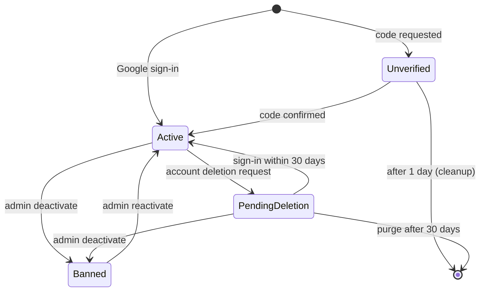

# Accounts and authentication

> Scope: users, sign-up, sign-in (password, e-mailed code, Google), the session cookie, passwords, Turnstile, account settings (time zone, language), data export, account deletion, the client account. State as of 2026-10-17.

## Summary

A Kurz account is one user record, identified by a lower-cased e-mail. There are three ways to sign in: a password (hashed with Argon2id), a 7-digit code sent by e-mail, and Google (an ID token, linked by Google's stable subject id). Sign-up and password reset both send that same e-mailed code. Every successful sign-in issues a signed session token (HS256) that lasts 2 days. The token travels only in an httpOnly, SameSite=Strict cookie, or as a bearer token for API clients. It can be revoked one token at a time (logout, through a per-token revocation key in Valkey) or all at once (a per-account "sessions revoked at" timestamp). An account is created when the first code is requested. It becomes verified when a code is confirmed or Google vouches for the address, and it is deleted after a day if it is never verified. Deleting an account is a soft delete: the account goes offline at once, any sign-in within 30 days restores it, and a daily job purges it after that. Data export is a JSON file sent by e-mail, one request a week. A "client account" is an ordinary verified account whose e-mail matches the client e-mail of appointments booked on other people's forms. There is no separate client user type.

## Glossary

- **Owner**: the signed-in user who owns short links, pages and forms. Every account is potentially an owner.
- **Client account**: an active, verified user whose e-mail (case-insensitive) equals an appointment's or waitlist entry's client e-mail. It receives the in-app copy of client notifications and sees its own bookings.
- **Login code / magic link**: a 7-digit numeric code, sent by e-mail, used for sign-in, sign-up confirmation and password reset. Internally it is called a "magic link", but the e-mail carries a code only.
- **Purpose**: `sign_in`, `sign_up`, `sign_up_existing` (sign-up for an address that is already verified), `password_reset`. It only changes the e-mail wording and whether a password is staged. The code itself is not bound to a purpose.
- **Pending password**: the password chosen at sign-up. It takes effect only when the code is confirmed with purpose `sign_up`.
- **Verified**: the address has been proven by a confirmed code or by Google.
- **Deactivated**: offline, either because an admin banned the account or because a deletion is pending.
- **Pending deletion**: the user asked to delete the account. It is always set together with deactivation.
- **Session token**: the signed token that proves a session. It carries the user, a unique token id, an issue time and an expiry.
- **Recent sign-in**: the session token was issued less than 15 minutes ago. This stands in for a password on accounts that have none.
- **Identity**: an external sign-in account linked to a user. The only provider is Google.

## Data

Full catalogue: [data-model](data-model.md).

**The account.** One record per user, with these security-relevant facts:

- **E-mail**: stored lower-cased and trimmed, and unique regardless of case. It is the account's identity and never changes (AU-03).
- **Admin flag**: the only role. It is set directly in the database. See [admin-and-moderation](admin-and-moderation.md).
- **Verification state**: a "verified at" moment, set on the first successful sign-in or Google sign-in. Every account that existed before verification was introduced was treated as verified from its creation date.
- **Deactivation and deletion state**: a "deactivated at" moment (ban or pending deletion) and a "deletion requested at" moment (the start of the 30-day grace).
- **Login code state**: the current code, kept in plain form for its 15 minutes of life, when it was sent, and how many wrong guesses have been made against it. Codes are not required to be unique across users.
- **Password**: an Argon2id hash, or nothing for accounts that only use codes. A second, staged hash holds the sign-up password until the code is confirmed. The account also tracks when the password last changed and its lock state (failed attempts and locked-until).
- **Session revocation timestamp**: tokens issued before it are rejected.
- **Preferences**: a time zone (an IANA name, default Europe/Lisbon; the default used to be UTC and existing UTC accounts were moved) and an optional language (`en` or `pt-PT`).
- **Short-link counter**: owned by [shortlinks](shortlinks.md).

**Google link.** A user has at most one Google identity. It stores Google's stable subject id, the Google e-mail (informational, refreshed on every sign-in) and the last time it was used. A given Google subject can belong to only one user. Deleting the user deletes the identity.

**Temporary cache entries** (Valkey, shared by all backend instances):

| Entry | Lifetime | Purpose |
|---|---|---|
| Revoked session token | until the token would have expired | A logged-out token. |
| Data-export allowance | 1 week | The weekly allowance. |
| Mail-server lookup per domain | 1 day | Cached check that a domain can receive mail. |
| E-mail budget counters | 2 days / 32 days / 1 day | E-mail budget. See [notifications-and-email](notifications-and-email.md). |
| Rate-limit counters | per limit window | Every limit in the table below. |

**Audit.** Changes to the account are audited only for e-mail, admin flag, deactivation, deletion request and password change. Changes to the login code are not audited.

## Business rules

### Accounts and e-mail

- **AU-01** An e-mail is trimmed, lower-cased, required, must be a well-formed address and is unique regardless of case. The uniqueness is enforced both by validation and by the database.
- **AU-02** An account is created the first time a code is requested for an unknown address that passes AU-21 (sign-in, sign-up), or the first time someone signs in with Google. Accounts are created nowhere else, and there is no admin "create user".
- **AU-03** Nothing changes a user's e-mail. A Google identity's e-mail is refreshed on every sign-in, but the account's e-mail stays the same.
- **AU-04** Accounts that are still unverified more than 1 day after creation are destroyed daily (in batches of 500).
- **AU-05** An account becomes verified on the first confirmed code or on Google sign-in. Password sign-in and password reset require it to be verified already.
- **AU-06** An unverified user cannot obtain a session by any path: password sign-in and reset refuse it, code confirmation verifies it first, Google verifies it. All an unverified user has is a pending code and a staged password. The client's bookings view also checks that the account is verified, as defence in depth.

### E-mailed code

- **AU-10** The code is 7 random digits, left-padded with zeros. Generating a new code resets the count of wrong guesses to 0.
- **AU-11** A code is valid for 15 minutes. The e-mail states the same number of minutes.
- **AU-12** The code is compared in constant time. Each wrong guess is counted, and at 5 the code is erased, so a new code must be requested.
- **AU-13** A code is single use: a successful confirmation, a password reset, or a password sign-in clears it.
- **AU-14** Resend cooldown: no new code is generated or sent within 1 minute of the previous one. The request still answers "sent".
- **AU-15** One code serves every purpose. A code sent for sign-in also works for password reset, and the reverse. The purpose is supplied by the client at confirmation: `sign_up` activates the pending password, anything else discards it.
- **AU-16** In development only, the code `0000000` signs into any existing account.
- **AU-17** The code is the e-mail subject and appears in a text part as well as in HTML. The wording follows the purpose and the recipient's language.

### Code requests

- **AU-20** A malformed address answers `422` (invalid e-mail).
- **AU-21** For an address that is not yet verified, disposable domains or domains without mail servers answer `422` (undeliverable e-mail). The mail-server result is cached for 1 day per domain. Verified accounts skip the check.
- **AU-22** Silent skips still answer `200` with "If the email can receive a code, it is on its way.": the account cannot sign in (banned), the purpose is password reset and the address is unknown or unverified, or the cooldown is running.
- **AU-23** Every code e-mail must fit in the e-mail budget. New addresses also count against a separate daily limit for new addresses (`MAIL_NEW_ADDRESS_DAILY_LIMIT`). When the budget is spent the request answers `503` and says which limit was hit: daily, monthly or new-address.
- **AU-24** An unknown purpose falls back to sign-in.
- **AU-25** The account's language is saved from the request's locale (only `en` or `pt-PT`) when the account is created by a code request, and at the start of a session when the account has no language yet. An existing language is never overwritten by a sign-in.

### Sign-up

- **AU-30** Sign-up checks Turnstile (action `signup`) and then the password policy, and only then requests a code with purpose `sign_up`. The chosen password is hashed and staged as the pending password.
- **AU-31** Signing up with an address that is already verified gets the same answer. The e-mail purpose becomes `sign_up_existing`, which tells the owner what confirming does, and the password is staged. Confirming that code with purpose `sign_up` changes the password and ends every other session.
- **AU-32** A plain code sign-in (any purpose other than `sign_up`) or a Google sign-in discards the pending password. This stops a stranger from planting a password on someone else's address.
- **AU-33** Sign-up keeps the password of an existing account when the owner signs in with a plain code instead of confirming the sign-up.

### Password sign-in and lock

- **AU-40** Password sign-in gives one answer for every failure: `401` (invalid credentials) for an unknown e-mail, an unverified account, a banned account, a wrong password or a locked password. A dummy Argon2 verification runs whenever the real check is skipped, so response times match.
- **AU-41** Lock: the first 5 failures are free. From the 5th failure on, the password is locked for 1 minute × 2^(attempts − 5), at most 1 hour, so 1, 2, 4, 8 … 60 minutes. While locked, even the right password fails. A correct password resets the counter. Code and Google sign-in keep working while the password is locked.
- **AU-42** A successful password sign-in clears any pending code.

### Password hashing and policy

- **AU-45** User passwords are hashed with Argon2id (time cost 2, memory 32 MiB, parallelism 1). A different hash, bcrypt, is used only for password-locked short links (see [shortlinks](shortlinks.md)). User passwords have never been bcrypt, so no migration between the two exists.
- **AU-46** A hash whose parameters differ from the current ones is rehashed on the next successful password check, whether that is a sign-in, a re-authentication on export or delete, or a password change.
- **AU-47** The password policy applies these checks in order:

  | Check | Error |
  |---|---|
  | length < 8 | password too short |
  | length > 128 | password too long |
  | contains the e-mail's local part (case-insensitive) and length < 16 | password matches e-mail |
  | found in Have I Been Pwned (k-anonymity range lookup, padded) | password breached |

  The breach check fails open on timeout or network error (3 s to connect, 4 s to read). There are no composition rules.
- **AU-48** The policy applies to sign-up, reset and password change. The interface enforces only the 8-character minimum and that the confirmation matches. Its strength bar is advisory.

### Password reset and change

- **AU-50** Requesting a reset checks Turnstile (action `password_reset`) and sends a code with purpose `password_reset`, but only to verified accounts that can sign in (AU-22).
- **AU-51** Completing a reset takes the e-mail, the code and the new password. It needs a verified account that can sign in and a valid code (AU-11, AU-12). Otherwise it answers `401` (invalid code). Next it applies the password policy (`422`). Then it clears the code, sets the password, revokes every other session, and signs in. The session lasts as long as a code (15 min) and is single use (AU-13). Reset has no Turnstile.
- **AU-52** Changing the password while signed in: an account that has a password must give its current password (`422`, invalid current password). An account without one needs a recent sign-in (`403`, re-authentication required). The change revokes every session and then issues a fresh cookie for the current one.

### Google

- **AU-55** Google sign-in is on only when at least one accepted audience is configured, through `GOOGLE_CLIENT_ID` or `GOOGLE_NATIVE_CLIENT_IDS` (comma-separated). Otherwise the Google sign-in answers `404`.
- **AU-56** Google sign-in accepts either an authorization code from the popup or an ID token. A code is exchanged using `GOOGLE_CLIENT_SECRET` and the web client id only, with a 5 s connect and 8 s read timeout, and the code is truncated to 1024 characters. The ID token must pass full verification (signature, issuer, audience among the accepted ids, expiry) and carry a verified e-mail.
- **AU-57** Error answers: `401` for an invalid Google token, `401` for an e-mail Google has not verified, `403` with the deactivated message for a banned account.
- **AU-58** Account linking. The Google identity is looked up by Google's subject id first. When none exists, the account with the same e-mail is used, or a new one is created. In either case the pending password is discarded, the account is marked verified, and the identity is created, all in one transaction. A Google account is linked automatically to an existing e-mail/password account, with no confirmation e-mail. Linking by the Google-verified e-mail happens only the first time; afterwards only the subject id counts. Google cannot be unlinked, and there is no "connect Google" button.
- **AU-59** Google sign-in sends no e-mail and does not touch the e-mail budget or Turnstile.

### Session token and cookie

- **AU-60** The session token is signed with HS256, the only algorithm accepted when reading a token (the algorithm named in the token header is ignored). It carries the user, a unique token id, the issue time and an expiry 2 days after issue; user, token id and expiry are required. The signing key is derived for this purpose from the application's master secret and is never the master secret itself.
- **AU-61** The session cookie is httpOnly, SameSite=Strict, valid for the whole site, marked secure in production, and expires with the token (2 days). The token is never returned in a response body.
- **AU-62** There is no sliding renewal. A session ends 2 days after sign-in, whatever the activity. Only a password change re-issues a token.
- **AU-63** Authentication reads the bearer token first and the cookie second. For cookie sessions, any request other than GET/HEAD must carry the `X-Requested-With: XMLHttpRequest` header, or it gets `403`. Then the user is loaded: a missing user, or a token issued before the account's session-revocation timestamp, gives `401` ("Invalid or expired token"); a deactivated user gives `403` (account deactivated); and no token gives `401` ("Missing token").
- **AU-64** Cross-origin requests with credentials are accepted only from the exact origins `https://kurz.fyi`, `https://app.kurz.fyi`, `FRONTEND_URL`, and `http://localhost:5173` outside production.
- **AU-65** Logout revokes the current token until its expiry and deletes the cookie. It always answers `204`. When no shared cache is available (development or test without `REDIS_URL`) revocation does nothing.
- **AU-66** "Sign out everywhere" exists only as a side effect: setting the session-revocation timestamp (password change, reset, sign-up confirmation on a verified account, deletion request) invalidates every token issued before it, and every OAuth grant created before it, because MCP and the OAuth token endpoint check the grant's creation against it. The comparison is at whole-second precision.

### Turnstile

- **AU-70** Turnstile is checked on code requests and password sign-in (action `login`), sign-up (`signup`) and forgot-password (`password_reset`). It is not checked on code confirmation, password reset completion or Google sign-in. A rejection answers `403` (captcha failed).
- **AU-71** The check has three outcomes: ok, rejected and unavailable. Without `TURNSTILE_SECRET_KEY` it is unavailable, which lets the request through (and logs a warning plus a Sentry message on every call). When Cloudflare cannot be reached, or answers something unexpected, it is also unavailable and the request passes. A blank or non-string token is rejected without calling Cloudflare. A token passes only when Cloudflare reports success, the action matches, and the hostname is in `TURNSTILE_HOSTNAMES` when that variable is set. Outside production, Cloudflare test keys pass on success alone. The HTTP timeouts are 3 s to connect and 5 s to read, and the token is truncated to 2048 characters.
- **AU-72** In the interface, the widget renders only when `VITE_TURNSTILE_SITE_KEY` is set (interaction-only appearance). Submit is disabled until a token arrives, and the widget resets after every submission because tokens are single use.

### Deactivation (admin ban)

- **AU-75** An account can sign in when it is not deactivated, or when it is only deactivated because of a pending deletion. A banned account cannot sign in by any method. Code requests for it are skipped silently.
- **AU-76** An admin can ban or reactivate an account, but not their own. A ban sets the deactivation moment, clears any pending deletion (a ban cancels a pending deletion, so the purge will not delete the account), and takes every active short link offline, marking it inactive. Reactivating only clears the deactivation: the links stay inactive.
- **AU-77** A ban does not set the session-revocation timestamp. Existing tokens get `403` on every authenticated request, and MCP and OAuth refuse grants of inactive users. Pages and forms of deactivated users stop being served.

### Account deletion

- **AU-80** Deleting an account requires the confirmation e-mail to equal the account's e-mail after trimming and lower-casing (`422`, confirmation mismatch). It also requires the current password (`422`, invalid current password) or, for an account without a password, a recent sign-in (`403`, re-authentication required). It is limited to 5 per hour per user.
- **AU-81** Requesting deletion deactivates the account (links come out of the redirect cache and become inactive). It then records the deletion request at the same moment as the deactivation, revokes every session, and revokes every OAuth grant. Afterwards a "deletion scheduled" e-mail is queued, the cookie is cleared and the answer is `202` with the date the deletion is due.
- **AU-82** The grace period is 30 days. A successful sign-in of any kind during the grace period (code, password, Google, reset) cancels the deletion. It clears both flags and re-activates, and puts back in the redirect cache, only the short links that became inactive within 10 minutes after the deactivation. The sign-in response says the deletion was cancelled. Links that were inactive before the request stay inactive.
- **AU-83** A purge job runs daily at 04:30. It purges users whose deletion was requested more than 30 days ago and who are still deactivated. A purge runs in one transaction. It hard-destroys short links and pages, including soft-deleted ones, and their page links. Destroying the user cascades to forms (with their responses, uploads and files, waitlist entries, daily stats and appointments), identities, OAuth grants, palettes, templates, push subscriptions, notification preferences, notifications, template reports and the calendar feed. It deletes every audit row about those records, every audit attached to those pages, and every audit made by the user.
- **AU-84** After a purge, the user's e-mail survives as the client e-mail on appointments the user booked on other owners' forms. Those rows belong to those owners. Mail logs at the e-mail provider are outside the application.

### Data export

- **AU-85** Requesting a data export needs the current password (`422`) or a recent sign-in (`403`). It is limited to one accepted request per week per user (`429`, weekly limit), and the week is consumed only after the password or re-authentication check passes. It answers `202` ("queued") and queues a background job on the mail queue.
- **AU-86** The job does nothing for an account that is missing or banned. It runs for active accounts and for accounts pending deletion. It reserves e-mail budget with a 0.5 share (at most half of the daily and monthly limits), and when that fails it retries every hour with no limit.
- **AU-87** The export contains: the export date; the account (e-mail, creation date, verification date, whether it has a password, sign-in providers); short links (code, URL, title, dates, active, password-protected, clicks); pages with their links; forms with questions and responses (choice ids rendered as labels, "(removed option)" for deleted choices, images marked as images, plus country, platform, browser and source); page templates; palettes; connected apps (client name, scopes, dates); and two notes. It leaves out password hashes, session and OAuth tokens, upload tokens and visitor IPs.
- **AU-88** Size: more than 50,000 form responses in total, or a pretty-printed JSON over 15 MB, sends a "data export too large" e-mail instead. Otherwise the export is attached as `kurz-data-YYYY-MM-DD.json` to an e-mail sent only to the account's address.

### Account settings read by other domains

- **AU-90** Account settings can change only the time zone and the language. The time zone must be a known IANA zone (`422`, invalid time zone; blank is rejected). The language must be `en` or `pt-PT`; blank clears it, and an invalid value gives `422` (invalid locale). When both are invalid the error is the locale one.
- **AU-91** The time zone decides how the owner sees times (agenda, e-mails, MCP agenda), the zone a new booking question starts with, the days of the client's bookings view, and the fallback zone of a client's booking summary. Changing it never moves existing availability. See [booking-engine](booking-engine.md) and the appointments guide ("Each owner has a time zone").
- **AU-92** The account's language is the second choice when choosing an e-mail's language. The order is: the requested language, then the recipient's language, then the owner's language, then `en`. API error messages are always English: no per-request language is set.
- **AU-93** Interface language order: the language cookie (1 year, SameSite=Lax), then the profile's language, then the browser's `Accept-Language`, then `en`. When the profile has none, the shown or chosen language is saved to it once. See the language guide.
- **AU-94** Notification settings are kept separately from the account. See [notifications-and-email](notifications-and-email.md).

### Client account

- **AU-95** A client account is any active, verified user whose e-mail equals the booking's client e-mail, case-insensitively. Booking never creates an account and never links one by id. The link is recomputed from the e-mail every time. A booking with an e-mail that is not an account notifies only the owner.
- **AU-96** A client account sees its bookings (the 50 newest groups, or a date range of limited length with at most 200 groups), and can request a manage link for a booking (20 a minute; `404` when the booking is someone else's). Client notifications are mirrored in-app to the account, except the booking-verification notification. Lifecycle: [appointments-lifecycle](appointments-lifecycle.md).

### Errors and input hygiene (application-wide)

- **AU-98** Any NUL byte in any parameter answers `400`. A missing record answers `404`. A uniqueness conflict answers `409 "Conflict"` without database detail. An invalid or undeletable record answers `422` with details. Authorization refusals answer `403`.

## Flows

**Sign in with a code**
1. The visitor enters an e-mail on the login page. The request passes through the rate limits and Turnstile, then the code request checks: validate, silent skip, mail-server check, budget, create the user if needed, generate the code, and queue the e-mail on the mail queue.
2. The confirmation page (seven boxes, submits automatically) sends the e-mail, code, purpose and language.
3. The code is verified, then the account is checked for sign-in ability, the code is cleared and the pending password is activated or discarded. The account is marked verified, then the session starts: cancel the deletion if one is pending, save the language if missing, issue the token, set the cookie, and answer with the current user plus a "deletion cancelled" flag when a deletion was cancelled.
4. The interface keeps the user's profile in browser storage and goes to the OAuth return target or the app.

**Sign up**: sign-up page → the code (purpose `sign_up`, password staged) → confirmation page with purpose `sign_up` → confirmation activates the password.

**Password sign-in**: login page → password sign-in → session starts.

**Forgot password**: forgot-password page → reset page (code + new password) → the password is changed (all other sessions end) → session starts.

**Google**: the interface opens Google's popup → the authorization code is sent to Kurz → Kurz exchanges the code → verifies the ID token → links or creates the account → session starts.

**Logout**: the interface asks Kurz to end the session (errors are ignored), clears the stored user and cached data, and navigates away. Separately, the interface clears the user and returns to the login page on any `401`, and goes to the login page with a "deactivated" notice on a `403` whose message is exactly "Your account has been deactivated".

**Delete account**: the Account card → deletion request → `202` → the interface remembers the due date and shows a notice on the login page. A later sign-in shows "Welcome back" when the deletion was cancelled. Day 30 or later: the 04:30 job purges the account.

**Data export**: the Account card → export request → `202` → background job (budget share 0.5, retries hourly) → e-mail with the JSON attached, or the "too large" e-mail.

## States and transitions

Account state derives from the verification, deactivation and deletion-request moments.

| From | Event | To | Guard | Side effects |
|---|---|---|---|---|
| (none) | first code request / Google | unverified (Google: active) | address valid and deliverable, budget | Account created; code e-mailed (not for Google). |
| unverified | code confirmed | active | code valid | Marked verified; session starts. |
| unverified | 1 day passes | (destroyed) | created more than 1 day ago | Daily cleanup at 03:30. |
| active | admin toggle | banned | admin, not self | Links leave the redirect cache and become inactive. |
| banned | admin toggle | active | admin | Links stay inactive. |
| active | account deletion request | pending deletion | e-mail + password/recent sign-in | Links offline, sessions and grants revoked, e-mail sent. |
| pending deletion | any successful sign-in | active | within 30 days | Links paused within 10 min restored; "deletion cancelled" flag. |
| pending deletion | admin toggle | banned | admin | Deletion request cleared, so no purge. |
| pending deletion | 30 days pass | (purged) | daily 04:30 | Full purge (AU-83). |

Password lock: 0 to 4 failed attempts → locked from the 5th failure onward, for min(2^(n−5) minutes, 1 hour) → reset to 0 by a correct password, a reset or a change.

## Limits and configuration

| Name | Value | Notes |
|---|---|---|
| Code requests per IP | 10 / 10 min | |
| Code requests per IP, daily | 30 / day | |
| Code requests per e-mail | 5 / 10 min | |
| Password sign-in per IP | 20 / 10 min | |
| Password sign-in per e-mail | 10 / 15 min | |
| Google sign-in per IP | 20 / 10 min | |
| Code confirmation per e-mail | 10 / 15 min | |
| Sign-up per IP | 10 / hour | |
| Forgot-password per IP | 10 / hour | |
| Password reset per e-mail | 10 / 15 min | |
| Password change per user | 10 / 15 min | |
| Account deletion per user | 5 / hour | |
| Data export | 1 / week per user | `429` weekly limit |
| Booking manage link per user | 20 / min | |
| Rate-limit answer | `429 {"error":"Too many attempts, please try again later"}` | The interface maps any 429 to a "rate limited" message. |
| Code lifetime | 15 min | |
| Wrong guesses per code | 5 | |
| Code resend cooldown | 1 min | |
| Code length | 7 digits | The length is known to both the backend and the interface. |
| Session token lifetime | 2 days | Cookie expiry too. |
| Recent sign-in window | 15 min | |
| Free password attempts / maximum lock | 5 / 1 h | |
| Argon2id | time 2, memory 32 MiB, parallelism 1 | |
| Password length | 8 to 128 chars | |
| Deletion grace | 30 days | |
| Link restore window on cancelling deletion | 10 min | |
| Unverified account lifetime | 1 day | |
| Export size | 50,000 responses / 15 MB | |
| Export budget share | 0.5 | |
| `MAIL_DAILY_LIMIT` / `MAIL_MONTHLY_LIMIT` / `MAIL_NEW_ADDRESS_DAILY_LIMIT` | env (defaults 100 / 3000 / 40) | |
| `TURNSTILE_SECRET_KEY`, `TURNSTILE_HOSTNAMES` | env | unset = off |
| `VITE_TURNSTILE_SITE_KEY` | env (frontend build) | |
| `GOOGLE_CLIENT_ID`, `GOOGLE_CLIENT_SECRET`, `GOOGLE_NATIVE_CLIENT_IDS` | env | The frontend reads `VITE_GOOGLE_CLIENT_ID` and hides the Google button when it is unset. |
| `SSR_FORWARD_SECRET` | env (backend and frontend) | Lets the backend trust the visitor IP forwarded by the frontend server. |
| `FRONTEND_URL` | env | |
| Application master secret | credentials | Rotating it signs every user out. |

## Authorization and privacy

- **Anonymous**: may request a code, confirm a code, sign in with a password or Google, sign up, ask for and complete a password reset, and log out.
- **Signed in**: everything under the owner's own account area. Every resource is scoped to the current user.
- **Admin**: the admin flag, which can only be set in the database (nothing changes it through the application; it is audited). Admins can list users and ban or reactivate them (not themselves). The full matrix is in [admin-and-moderation](admin-and-moderation.md).
- **MCP / OAuth**: account deletion, passwords and connected apps are not available through MCP. The OAuth consent screen uses this session. See [mcp-and-oauth](mcp-and-oauth.md).
- **Visible account fields**: admin lists show id, e-mail, admin flag, deactivation date, short-link count and dates. The signed-in user additionally sees the deletion due date, time zone, language, whether the account has a password, and whether Google is connected.
- **Personal data stored**: e-mail, time zone, language, the Google subject id and Google e-mail, the plaintext login code (15 min), and Argon2 hashes. Nothing about IP addresses is stored by the auth flows. The client IP serves only as a rate-limit key and as Turnstile's remote IP. The IP is taken from the forwarded visitor IP header when the shared forwarding secret matches (compared in constant time), otherwise from the Cloudflare connecting-IP header, otherwise from the connection itself, and must be a well-formed IP. Request logs omit the IP. Passwords, e-mails, tokens, codes, credentials and similar fields are filtered from the logs.
- **Third parties**: Have I Been Pwned receives the first 5 hex characters of the password's SHA-1, Cloudflare receives the Turnstile token and the client IP, and Google receives the authorization code.
- **Retention**: unverified accounts are kept 1 day; deleted accounts are purged 30 days after the request (AU-83); revocation entries live until token expiry. Visitors' raw IPs are cleared after 90 days by a job that belongs to [shortlinks](shortlinks.md) and [platform-and-operations](platform-and-operations.md).

## API and UI surface

**Visitors** can request a code, confirm it, sign in with a password or Google, sign up, ask for and complete a password reset, and log out.

**Signed-in owners** can read their profile, change time zone and language, change their password, request a data export, delete their account, see their bookings as a client and request a manage link for one. All of this happens in the account area of the dashboard, whose cards are profile, language, time zone, calendar feed, notices, password, connected apps, download data and delete account. The login, confirmation, sign-up and password pages are client-rendered only.

**Admins** can list users and ban or reactivate them (see [admin-and-moderation](admin-and-moderation.md)).

**E-mails sent**: the login code e-mail (four purposes), the deletion-scheduled e-mail, the data export e-mail and the export-too-large e-mail. Catalogue: [notifications-and-email](notifications-and-email.md).

**Scheduled jobs**: unverified-account cleanup (daily, 03:30), deleted-account purge (daily, 04:30) and data export delivery (on demand, on the mail queue).

Note: the Google Safe Browsing client is unrelated to Google sign-in. It belongs to [shortlinks](shortlinks.md) and [bio-pages](bio-pages.md).

## Decisions

### D-AU-01 Session in an httpOnly SameSite=Strict cookie plus a CSRF header
**Decision.** The session token lives only in an httpOnly, SameSite=Strict cookie. Cookie-authenticated writes must send the `X-Requested-With` header, and API clients use a bearer token instead. **Why.** Page scripts cannot read the cookie, so an XSS cannot steal it. kurz.fyi and api.kurz.fyi are the same site, and the custom header forces a CORS preflight. An earlier version kept the token in browser local storage, and the interface deletes that leftover. **Consequence.** Credentialed CORS must list exact origins. The prerendered or server-rendered frontend cannot read the session.

### D-AU-02 Dedicated signing key and per-token revocation
**Decision.** HS256 with a key derived for this purpose only, a pinned algorithm and a required unique token id. Logout revokes that token id in Valkey. **Why.** So that one token can be revoked before it expires. Tokens signed with the master secret (the old scheme) are rejected. **Consequence.** Revocation depends on the shared cache.

### D-AU-03 Argon2id, with rehash on sign-in
**Decision.** Argon2id at 32 MiB with time cost 2, and an upgrade on the next successful check. **Why.** The OWASP minimum is 19 MiB and time cost 2. **Consequence.** Raising the cost parameters upgrades hashes gradually and adds CPU and memory per sign-in.

### D-AU-04 Lock the password, never the account
**Decision.** Wrong passwords lock only the password, with a doubling wait. Codes keep working. **Why.** A stranger guessing passwords cannot lock the owner out.

### D-AU-05 One answer and constant work for every credential failure
**Decision.** A single "invalid credentials" answer, a dummy Argon2 check, and silent skips on code requests. **Why.** Neither the message nor the timing reveals whether an account exists.

### D-AU-06 Sign-up password waits for the code
**Decision.** The password is staged and activates only on a `sign_up` confirmation. A plain code sign-in or Google drops it. **Why.** Otherwise someone could sign up with another person's e-mail and the account would carry the stranger's password.

### D-AU-07 NIST-style password policy that fails open
**Decision.** Length 8 to 128, a check against the e-mail, and a Have I Been Pwned k-anonymity check, accepted when that service is unreachable. **Why.** NIST 800-63B prefers length over composition rules. 128 is the maximum because hashing megabytes per request is a free denial of service.

### D-AU-08 Turnstile fails open
**Decision.** An "unavailable" outcome (no secret, Cloudflare down) lets the request through. **Why.** The per-IP limits and the e-mail budget still apply, and a Turnstile outage should not lock everyone out.

### D-AU-09 Code requests guarded by deliverability and the mail budget
**Decision.** Disposable and no-mail-server addresses are refused, and new addresses get only part of the daily budget. **Why.** Every e-mail costs provider quota and sender reputation. Flooding with fresh addresses must not lock existing users out.

### D-AU-10 Google linked by subject id, trusted for verification
**Decision.** The link is by Google's stable subject id. The first time, it attaches to the account with the same e-mail and marks it verified. **Why.** Google has proven the address. Native app client ids were later added as extra accepted audiences.

### D-AU-11 Soft delete with a 30-day grace period
**Decision.** Deletion deactivates the account at once, revokes sessions and grants, and any sign-in within 30 days restores it. The purge removes everything, including audits. **Why.** GDPR (RGPD) erasure with a way back. Audit rows hold e-mails, URLs and titles. Restoring puts links back in the redirect cache. A ban clears a pending deletion so the two states cannot be confused.

### D-AU-12 Data export by e-mail, weekly
**Decision.** The export is queued, built in a job and e-mailed as an attachment, one a week, only while there is budget. **Why.** This replaced an earlier direct download limited to 3 an hour. Wrong passwords do not use up the week, and the job keeps a share of the budget for sign-in codes.

### D-AU-13 Recent sign-in instead of a password for code-only accounts
**Decision.** Sensitive actions on accounts without a password need a token issued within the last 15 minutes. **Why.** A session left open on someone else's computer cannot be turned into a permanent password.

### D-AU-14 Unverified accounts are temporary
**Decision.** An account is created on the first code request and removed after a day if never confirmed. **Why.** Typing random addresses must not leave records behind. Accounts that existed before verification was introduced were treated as verified.

### D-AU-15 Login codes are not required to be unique across users
**Decision.** The database no longer enforces that two users cannot hold the same code. **Why.** Nothing looks a user up by code, and a collision between two users turned into a 409 conflict. The same change made a deleted user's token answer 401 instead of 404.

## Change impact

- **Session token contents, signing key, lifetime or cookie attributes** (AU-60 to AU-63, D-AU-01, D-AU-02) → authentication on every request, password change (AU-52), end-to-end test sign-in and seed tokens, and the allowed CORS origins (AU-64). A key change signs everyone out at deploy, and during the rolling deploy the old container still accepts old tokens.
- **Session-revocation semantics** (AU-66) → OAuth and MCP grant validity. A password change disconnects MCP clients. See [mcp-and-oauth](mcp-and-oauth.md).
- **Deactivation and sign-in ability** (AU-75 to AU-77) → public pages and forms, the calendar feed, the client account, the abuse-signal admin view, data export (AU-86), and the redirect cache through the pause of links ([shortlinks](shortlinks.md)).
- **The wording of the "account deactivated" message** → the interface's redirect compares the English message exactly (see Drift).
- **Code length or lifetime** (AU-10, AU-11) → the confirmation and reset pages in the interface, the e-mail copy (it states the validity in minutes), and the end-to-end login test.
- **API error codes** (invalid credentials, captcha failed, password errors, daily limit …) → the interface's error messages in both languages (`en`, `pt-PT`).
- **New account fields** → add first, backfill, drop or rename only in a later release, because the previous release runs against the new schema. Update what is shown to the signed-in user, the data export (and its "never includes" list) and the audited fields.
- **New data owned by a user** → it must be removed by the purge (AU-83), covered by its audits, and added to the export (AU-87).
- **Time zone default or validation** (AU-90, AU-91) → the booking engine, the agenda, e-mail times, MCP tools, the time-zone picker, and the appointments guide.
- **Supported languages** (AU-25, AU-92, AU-93) → the interface language list, e-mail language selection, the built-in template languages, and the language guide.
- **E-mail budget shares** (AU-23, AU-86) → code delivery versus data export versus appointment e-mails ([notifications-and-email](notifications-and-email.md)).
- **Rate limits** → [platform-and-operations](platform-and-operations.md) (rate limit catalogue) and client IP resolution (the forwarding secret must match on both services).
- **Client-account matching by e-mail** (AU-95, AU-96) → client notifications, the client's bookings view and the waitlist e-mails ([appointments-lifecycle](appointments-lifecycle.md)).

## Drift and open questions

- **The interface depends on an English message string (medium).** Deactivation is detected by comparing the message with "Your account has been deactivated" rather than an error code. Translating or rewording that message breaks the redirect. The login endpoints answer with the same text under a different field, and those calls go through a client with no interceptor.
- **Admin reactivation does not restore links (low).** Reactivating leaves every link paused by the ban inactive, unlike cancelling a deletion (AU-82). This may be intended; it is not documented.
- **Possible 409 on Google linking (low).** When the user with the matching e-mail already has a different Google identity (a user can have only one), creating the new identity fails with a uniqueness conflict, which answers `409 Conflict` rather than a Google error.
- **Restore-window heuristic (low).** Restoration picks links that became inactive within a 10-minute window after deactivation. A link that an expiry job deactivated in that window would be revived.
- **Revocation is a no-op without the cache (low).** In development or test without a shared cache, logout does not revoke the token.
- **Duplicated values (low).** The 15-minute recent sign-in window is defined independently in two places, and the code length of 7 is hard-coded in the backend and in several places in the interface.
- **No e-mail change, Google unlink or "sign out everywhere" feature (info).** The only way to end other sessions is a password change or reset.
- **"Magic link" naming (info).** The e-mail carries a code, not a link.
- **Superseded export rule (info).** An earlier rule said "3 times an hour" with a direct download. It was replaced by the weekly, by-e-mail export (AU-85, D-AU-12). No documentation repeats the old rule.
- **Gaps in the interface's error map (low).** There is no specific message for most Google errors, the weekly export limit or the deletion confirmation mismatch. The account page handles these by HTTP status, and anything else shows the generic error.
