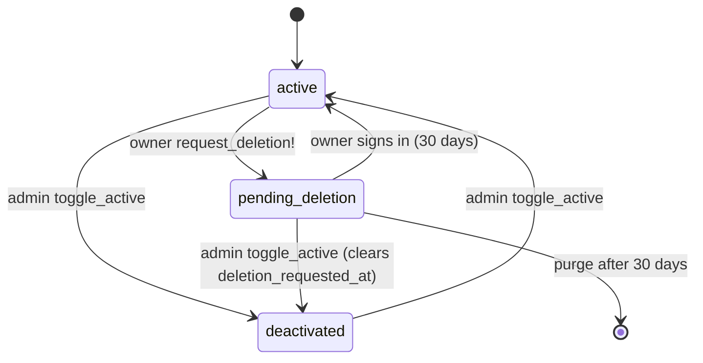

# Admin and Moderation

> Scope: roles and Pundit policies, the permission matrix, the admin API and screens, auditing (`audited`), abuse signals and their detection jobs, community template reports, and what deactivating a user, link, form or template does across the app. State as of commit `bc7f65c` (2026-10-17).
> Main code: `backend/app/policies/*`, `backend/app/controllers/api/admin/*`, `backend/app/services/admin/*`, `backend/app/models/{user,abuse_signal,page_template,page_template_report}.rb`, `backend/app/jobs/detect_{form,page}_abuse_job.rb`, `backend/app/jobs/purge_old_ip_addresses_job.rb`, `frontend/app/routes/admin/**`, `frontend/app/components/admin-guard/`, `frontend/app/routes/report.tsx`.

## Summary

Kurz has exactly two roles: a normal user and an admin (`users.admin` boolean). An admin can list every user and short link, deactivate or reactivate other accounts, deactivate or flag short links, read the global audit log, moderate community page templates and review abuse signals. There is no admin override on owner data: bio pages, forms, responses, statistics and appointments stay reachable only by their owner, also for admins. Authorization is Pundit with a default-deny base policy, but nothing enforces that a controller calls it (`verify_authorized` is never used). Abuse handling is mostly manual: `DetectPageAbuseJob` only raises signals, `DetectFormAbuseJob` also unpublishes the flooded form on its own, and community templates hide themselves after three reports. The public report page sends nothing to the backend; it builds a `mailto:` link.

There is no way to become an admin from inside the app (see [AD-01](#who-is-an-admin)).

## Glossary

- **Admin** (`User#admin`): boolean column, default `false`, `NOT NULL`. Checked by every admin policy as `user.admin?`.
- **Deactivated user** (`User#deactivated_at`): timestamp set by `User#deactivate!`. `active?` is `deactivated_at.nil?`. Also used by account deletion, where it means "paused" (see [accounts-and-auth](accounts-and-auth.md)).
- **Inactive short link** (`Shortlink#inactive_at`): timestamp; the link is not served while it is set. Set by the admin, by the owner's deactivation, by expiry jobs and by `mark_as_dangerous!`.
- **Unsafe short link** (`Shortlink#safe = false`): flagged by Google Safe Browsing (`SafetyUrlJob`) or by an admin. See [shortlinks](shortlinks.md).
- **Abuse signal** (`AbuseSignal`): a row that tells admins about a possible campaign (`same_text`, `same_links`) or an auto-contained flood (`form_flood`).
- **Fingerprint** (`abuse_signals.fingerprint`): SHA-256 of the normalised text or link set (pages) or `form:<id>:<date>` (forms). Unique together with `kind`.
- **Community template** (`PageTemplate` with `visibility = "public"`): a bio page template published by its owner; others see only a placeholder version. See [bio-pages](bio-pages.md).
- **Hidden template** (`PageTemplate#hidden_at`): removed from the Community gallery by auto-hide or by an admin.
- **Audit** (`Audited::Audit`, table `audits`): one row per create/update/destroy of an audited model.
- **Session payload `sub`/`iat`**: JWT claims used by `authenticate_user!`; `sessions_revoked_at` invalidates old tokens.

## Data

Full catalogue in [data-model](data-model.md).

| Table / column | Key facts | Source |
|---|---|---|
| `users.admin` | `boolean NOT NULL DEFAULT false`. Audited. | `backend/app/serializers/user_serializer.rb:6`, `backend/app/models/user.rb:44` |
| `users.deactivated_at` | `datetime`, null = active. Audited. | `backend/app/models/user.rb:7`, `:44` |
| `users.deletion_requested_at` | Cleared by admin deactivation. Audited. | `backend/app/models/user.rb:99` |
| `users.sessions_revoked_at` | Not touched by admin deactivation. | `backend/app/models/user.rb:112` |
| `shortlinks.inactive_at`, `safe`, `safe_checked_at` | Moderation columns. All three are audited (only `short_code`, `events_count`, `last_accessed_at`, `deleted_at`, `password_digest` are excluded). | `backend/app/models/shortlink.rb:34` |
| `abuse_signals` | `kind`, `fingerprint`, `user_ids jsonb`, `page_ids jsonb`, `form_ids jsonb` (added by `20261006020000`), `status default "open"`, `first_seen_at`, `last_seen_at`. Unique index `(kind, fingerprint)`, index on `status`. No FK: ids are plain JSON arrays. | `backend/db/schema.rb:18`, `backend/db/migrate/20260923170000_add_community_templates_and_abuse_signals.rb`, `backend/db/migrate/20261006020000_add_form_ids_to_abuse_signals.rb` |
| `page_templates` moderation columns | `visibility` (`private` default), `reports_count int default 0`, `hidden_at`, `published_at`, `uses_count`. Index `(visibility, hidden_at, uses_count)`. | `backend/app/models/page_template.rb:11-24` |
| `page_template_reports` | `reason`, `user_id` (FK cascade), `page_template_id` (FK cascade). Unique `(page_template_id, user_id)`. | `backend/app/models/page_template_report.rb:26-30` |
| `audits` | `auditable_type/id`, `associated_type/id`, `user_id/user_type`, `action`, `audited_changes jsonb`, `version`, `remote_address`, `request_uuid`, `username`, `comment`, `created_at`. Indexes include partial `index_audits_ip_retention (created_at) WHERE remote_address IS NOT NULL`. No FK to users (polymorphic). | `backend/db/schema.rb:131-152` |

The model annotation comment on `AbuseSignal` is stale: it lists no `form_ids` column (`backend/app/models/abuse_signal.rb:5-24`); the schema has it.

## Business rules

### Who is an admin

- **AD-01** The admin role is the `users.admin` boolean and nothing else. No controller, service, MCP tool, rake task, seed or credential sets it; `backend/db/seeds.rb` is empty and `backend/lib/tasks/seed.rake` creates `user@example.com` without `admin`. An admin is made by writing the column directly (Rails console or SQL). The only code that sets it is the test factory/context and the CI security seed. — `backend/db/seeds.rb`, `backend/lib/tasks/seed.rake:1-14`, `backend/spec/support/authentication_shared_context.rb:6`, `.ci/security/seed.rb:1-5`.
- **AD-02** The change of `admin` is audited (`audited only: [:email, :admin, :deactivated_at, :deletion_requested_at, :password_changed_at]`), but when done from a console there is no `current_user`, so the audit row has `user_id = NULL`. — `backend/app/models/user.rb:44`.
- **AD-03** `UserSerializer` exposes `admin` for every user in admin lists, and `CurrentUserSerializer` (a subclass) carries it to the signed-in user; the frontend reads `data.user.admin` to show the admin menu. — `backend/app/serializers/user_serializer.rb:36`, `backend/app/serializers/current_user_serializer.rb:4`, `frontend/app/components/admin-guard/admin-guard.tsx:14`.
- **AD-04** Nothing demotes or promotes an admin through the API. The admin users screen shows an "Admin"/"User" badge only. — `frontend/app/routes/admin/users.tsx` (badge block).
- **AD-05** Account deletion does not exempt admins: `purge!` deletes any user whose grace period has passed, including audit rows where that user is the actor. — `backend/app/models/user.rb:129-148`.

### Policies and how controllers use Pundit

- **AD-10** `ApplicationPolicy` denies everything by default (`index?`, `show?`, `create?`, `update?`, `destroy?` return `false`; `new?` and `edit?` delegate). Its `Scope#resolve` raises `NoMethodError`, so a policy without its own scope cannot be used with `policy_scope`. — `backend/app/policies/application_policy.rb:11-52`.
- **AD-11** Admin-only predicates, all `user.admin?`: `UserPolicy#list_all?`, `ShortlinkPolicy#list_all?`, `#modify_shortlink_safety?`, `#modify_shortlink_active?`, `AuditPolicy#list_all?`, `AbuseSignalPolicy#moderate?`, `PageTemplatePolicy#moderate?`, `AppointmentHealthPolicy#show?`. — `backend/app/policies/*.rb`.
- **AD-12** `UserPolicy#toggle_active?` is `user.admin? && user != record`: an admin cannot deactivate or reactivate themselves. The frontend hides the button for the own row (`isSelf`) but the rule is enforced in the backend (403). — `backend/app/policies/user_policy.rb:6-8`; test `backend/spec/requests/api/admin/users_spec.rb:67`; `frontend/app/routes/admin/users.tsx` (`isSelf`).
- **AD-13** Ownership is not expressed as a policy except for pages and forms. `PagePolicy::Scope` and `FormPolicy::Scope` resolve to `scope.where(user: user)` and are used through `policy_scope(Page)` / `policy_scope(Form)` in the `/api/me` controllers. Every other resource (short links, page templates, colour palettes, push subscriptions, OAuth grants, appointments) is scoped by association from `current_user` (`@current_user.shortlinks.find`, `@current_user.page_templates.find`, `Appointment.where(form_id: current_user.forms.select(:id))`). — `backend/app/policies/page_policy.rb:1-9`, `backend/app/policies/form_policy.rb:2-6`, `backend/app/controllers/api/me/shortlinks_controller.rb:106`, `backend/app/controllers/api/me/page_templates_controller.rb:44`, `backend/app/controllers/api/me/appointments_controller.rb:59`.
- **AD-14** `Pundit::NotAuthorizedError` is rescued in `ApplicationController` and answered as `403 {"message":"You are not authorized to perform this action"}`. `ActiveRecord::RecordNotFound` is answered `404 {"message":"Resource not found"}`. Because owner resources are looked up through the owner scope, another user's record is a 404 (not a 403): no existence oracle. — `backend/app/controllers/application_controller.rb:7-11`, `:42-44`, `:59-61`.
- **AD-15** `verify_authorized` / `verify_policy_scoped` are not used anywhere. A new controller that forgets `authorize` or the owner scope is open to any authenticated user. The only automated net is the CI security harness: it requires every route to be classified in `matrix.tsv` (`public | auth | owner | admin | infra | storage | internal`) and requires `owner`/`admin`/`mcp` routes to answer 401 anonymously. — `.ci/security/suite.rb:67-76`, `.ci/security/matrix.tsv:3-13`.
- **AD-16** Admin member actions authorize the class first, then load the record, then authorize the record. A non-admin therefore gets 403 for an id that exists and for one that does not (no existence oracle); an admin gets 404 for a missing id. — `backend/app/controllers/api/admin/users_controller.rb:14-16`, `backend/app/controllers/api/admin/shortlinks_controller.rb:15-17`, `:30-32`, `backend/app/controllers/api/admin/page_templates_controller.rb:27-29`, `backend/app/controllers/api/admin/abuse_signals_controller.rb:23-25`; tests `backend/spec/requests/api/admin/bfla_spec.rb:11-27`, `.ci/security/suite.rb:56-65`. Rationale: commit `a1090a9` "authorize admin member routes before lookup (P11)" (#13); further reasoning not recorded.
- **AD-17** Admin index and member actions all run `before_action :authenticate_user!`, so the checks happen in this order: token present (401 `Missing token`), token valid and not revoked (401 `Invalid or expired token`), user not deactivated (403 `Your account has been deactivated`), then the policy (403). A deactivated admin is therefore locked out of admin routes. — `backend/app/controllers/application_controller.rb:70-88`.
- **AD-18** Cookie sessions must send `X-Requested-With: XMLHttpRequest` on non-GET requests (403 otherwise); Bearer tokens skip that check. This also covers every admin POST. — `backend/app/controllers/application_controller.rb:101-114`.
- **AD-19** Admin actions are not exposed through MCP. No MCP tool checks `admin`; MCP acts only as the grant's owner within the grant's scopes. See [mcp-and-oauth](mcp-and-oauth.md).

### Permission matrix

Legend: Y = allowed; - = refused with the status shown in the notes; own = only the owner's records. Statuses: anonymous 401, deactivated 403 (`account_deactivated`), non-admin on an admin route 403, another user's owner resource 404.

| Action | Anonymous | Owner | Other user | Admin | Deactivated user |
|---|---|---|---|---|---|
| Open public page `/u/:slug`, `GET /api/public/pages/:slug` | Y only if page published, not expired, owner active | same | same | same | page hidden (404) |
| Click on a page link (`POST` public click) | Y under the same visibility rule | same | same | same | 404 |
| Open public form, submit, upload, slots, waitlist | Y only if form published and owner active | same | same | same | 404 |
| Follow a short link at the edge | Y only if Valkey holds `shortlink:<code>` | same | same | same | links removed from Valkey on deactivation |
| `GET/POST/PATCH/DELETE /api/me/shortlinks*` | 401 | own | 404 | own only (no override) | 403 |
| `/api/me/pages*`, `/api/me/forms*` (policy scope) | 401 | own | 404 | own only | 403 |
| `/api/me/page_templates*` (custom) | 401 | own | 404 | own only | 403 |
| `GET /api/me/community_templates` | 401 | Y (listed only) | Y | Y | 403 |
| `POST /api/me/community_templates/:id/report` | 401 | refused (422, own template) | Y once per template, 20/hour | Y (same rules; an admin may report) | 403 |
| `GET /api/admin/users` | 401 | 403 | 403 | Y | 403 |
| `POST /api/admin/users/:id/toggle_active` | 401 | 403 | 403 | Y for others; 403 for self | 403 |
| `GET /api/admin/shortlinks` | 401 | 403 | 403 | Y | 403 |
| `POST /api/admin/shortlinks/:id/toggle_safe` | 401 | 403 | 403 | Y | 403 |
| `POST /api/admin/shortlinks/:id/toggle_active` | 401 | 403 | 403 | Y | 403 |
| `GET /api/admin/audits` | 401 | 403 | 403 | Y | 403 |
| `GET /api/admin/page_templates`, `POST .../:id/toggle_hidden` | 401 | 403 | 403 | Y | 403 |
| `GET /api/admin/abuse_signals`, `POST .../:id/dismiss` | 401 | 403 | 403 | Y | 403 |
| `GET /api/admin/appointments_health` | 401 | 403 | 403 | Y | 403 |
| Read another user's statistics, responses, appointments, pages | 401 | own | 404 | 404 (no override) | 403 |
| `/mcp` tools | 401 challenge | own grant | n/a | own grant (no admin tools) | 401 challenge (grant user inactive) |

Evidence: `backend/app/controllers/application_controller.rb:70-88`, policies above, `backend/app/models/page.rb:76-80`, `backend/app/models/form.rb:21`, `backend/app/controllers/mcp/endpoint_controller.rb:38`; tests `backend/spec/requests/api/admin/*_spec.rb`, `backend/spec/requests/api/me/community_templates_spec.rb:168-192`, `backend/spec/jobs/detect_page_abuse_job_spec.rb:65-91`, `.ci/security/suite.rb:49-65`.

### Auditing

- **AD-20** Audited models and the columns tracked:

  | Model | Tracked | Excluded | Source |
  |---|---|---|---|
  | `User` | `email`, `admin`, `deactivated_at`, `deletion_requested_at`, `password_changed_at` | everything else (login tokens, password digests, `sessions_revoked_at`, `verified_at`, ...) | `backend/app/models/user.rb:44` |
  | `Shortlink` | all except the list at right | `short_code`, `events_count`, `last_accessed_at`, `deleted_at`, `password_digest` | `backend/app/models/shortlink.rb:34` |
  | `Page` | all except `deleted_at` (so title, bio, slug, theme, `published`, colours, `expires_at`) | `deleted_at` | `backend/app/models/page.rb:69` |
  | `PageLink` | all except `clicks_count`, `position`; `associated_with: :page` | | `backend/app/models/page_link.rb:48` |
  | `Form` | `title`, `published`, `accepting_responses` only | | `backend/app/models/form.rb:9` |
  | `OauthGrant` | `scopes`, `revoked_at` only | | `backend/app/models/oauth_grant.rb:8` |

  Tests: `backend/spec/models/user_audit_spec.rb:4-25`, `backend/spec/models/shortlink_audit_spec.rb:6-39`, `backend/spec/models/form_spec.rb:63`, `backend/spec/models/oauth_spec.rb:40`.
- **AD-21** Not audited: `FormResponse` (pinned by spec: it does not respond to `audits`), `PageTemplate`, `PageTemplateReport`, `AbuseSignal`, appointments, notifications, `McpToolCall` (it has its own metadata log). So hiding a template and dismissing an abuse signal leave no audit row. — `backend/spec/models/form_response_spec.rb:62-65`; absence of `audited` in the other models.
- **AD-22** The actor of an audit row is `current_user` of the controller handling the request, read by the `audited` sweeper; `remote_address` and `request_uuid` come from the request. Jobs (`DetectFormAbuseJob`, expiry jobs, `SafetyUrlJob`) and the MCP endpoint (its controller has no `current_user`) write rows with `user_id = NULL`. The MCP spec accepts either the user id or `nil`. Gem behaviour is not in the repository (`audited ~> 5.7`, locked 5.8.0), so the sweeper wiring is inferred. — `backend/Gemfile:64`, `backend/Gemfile.lock:89`, `backend/spec/requests/mcp_tools_spec.rb:183-188`.
- **AD-23** Moderation actions that are audited, with the admin as actor: user toggle (`deactivated_at`, plus `deletion_requested_at` when it was set), short link toggle safe (`safe`, `safe_checked_at`, `inactive_at`), short link toggle active (`inactive_at`). The automatic form unpublication is audited as `Form.published` with no actor. Template hiding and signal dismissal are not (AD-21).
- **AD-24** Search: `GET /api/admin/audits?user_id=<id>` filters on `user_id = <id> AND user_type = 'User'`; there is no other filter (no model, action, date or record). Order is `created_at DESC`. There is no pagination or limit: the whole table is returned, with `meta.total = Audited::Audit.count`. — `backend/app/services/admin/audit_search_service.rb:11-23`, `backend/app/controllers/api/admin/audits_controller.rb:5-11`. The screen filters by user only and shows "N of total logs". — `frontend/app/routes/admin/audit-logs.tsx:113-121`, `:172-182`.
- **AD-25** Audit JSON fields: `id`, `action`, `audited_changes`, `version`, `remote_address`, `request_uuid`, `auditable_type`, `auditable_id`, `created_at` (ISO 8601) and, when `user_id` is present, `user` (a full `UserSerializer`: `email`, `admin`, `deactivated_at`, `shortlinks_count`, timestamps). `audited_changes` for `User` can contain old and new e-mail addresses. — `backend/app/serializers/audit_serializer.rb:3-20`.
- **AD-26** Retention: there is no age-based deletion of audits. Two rules apply. (a) `PurgeOldIpAddressesJob` (daily 04:15) sets `audits.remote_address` to `NULL` when `created_at` is older than 90 days, in batches of 5000; the rest of the row stays. (b) `User#purge!` (after the 30-day deletion grace) deletes the audits of the user's short links, pages, page links, forms, OAuth grants and the user record itself, the audits whose associated page is theirs, and every audit where the user is the actor. — `backend/app/jobs/purge_old_ip_addresses_job.rb:4-11`, `backend/config/recurring.yml:28-31`, `backend/app/models/user.rb:129-148`; tests `backend/spec/jobs/purge_old_ip_addresses_job_spec.rb:12-40`, `backend/spec/requests/account_deletion_spec.rb:163-176`. Rationale: commit `a8f555f` (#89, RGPD 2/4) and `effd548` (#85, RGPD 1/4: audit rows "hold emails, URLs and titles").
- **AD-27** The audit log is shown on the report page text as a user-facing promise: "All links are audited so we can trace who created them and when." — `frontend/app/routes/report.tsx:90-92`.

### What an admin does to a user

- **AD-30** `POST /api/admin/users/:id/toggle_active` flips the state: if `user.active?` it calls `deactivate!`, otherwise `reactivate!`. The response is the `UserSerializer` of the target. — `backend/app/controllers/api/admin/users_controller.rb:12-24`.
- **AD-31** `deactivate!` in one call: sets `deactivated_at = now`, clears `deletion_requested_at` (an admin deactivation cancels a pending self-deletion, so the purge job never deletes an account an admin banned), then for each of the owner's short links with `inactive_at IS NULL` deletes the Valkey key and sets `inactive_at = now`, one by one with `update!` (audited). It is not wrapped in a transaction. — `backend/app/models/user.rb:98-104`; tests `backend/spec/requests/api/admin/users_spec.rb:35-65`, `backend/spec/requests/account_deletion_spec.rb:121-129`. Rationale: commit `effd548` ("an admin deactivation clears a pending request, so the two cannot be confused").
- **AD-32** `reactivate!` only clears `deactivated_at`. It does not restore the short links that `deactivate!` switched off, does not re-cache them, and does not touch sessions. The admin must reactivate each link through the shortlinks screen (see AD-47). Contrast: the user's own cancel of a deletion restores links whose `inactive_at` falls within 10 minutes of the pause (`RESTORE_WINDOW`). — `backend/app/models/user.rb:106-108`, `:116-123`.
- **AD-33** Deactivation does not revoke sessions or OAuth grants (`sessions_revoked_at` and `oauth_grants.revoked_at` are untouched; contrast `request_deletion!`, which does both). It works by making every request check the flag: sessions stop working because `authenticate_user!` answers 403, and grants stop working because the MCP endpoint and the OAuth token endpoint require `grant.user.active?`. After reactivation the old cookie, JWT and MCP grants work again. — `backend/app/controllers/application_controller.rb:83-85`, `backend/app/controllers/mcp/endpoint_controller.rb:38`, `backend/app/controllers/oauth/tokens_controller.rb:49`, `backend/app/models/user.rb:110-114`.
- **AD-34** Sign-in is refused for a deactivated user on every path with 403 `Your account has been deactivated`: e-mail code verify, password login (reported as the generic `invalid_credentials` 401), Google sign-in, and password reset (`can_sign_in?` false). Requesting a login code for a deactivated address answers `sent` but sends no e-mail. The exception is `can_sign_in?`'s `pending_deletion?` branch, which cannot apply after an admin deactivation because AD-31 clears `deletion_requested_at`. — `backend/app/controllers/api/sessions_controller.rb:70`, `:86`, `:100-102`, `backend/app/services/login_code_request.rb:31`, `backend/app/controllers/api/password_resets_controller.rb:31`, `backend/app/services/google_sign_in.rb:47`, `backend/app/models/user.rb:94-96`. Details in [accounts-and-auth](accounts-and-auth.md).
- **AD-35** Public surfaces that disappear for a deactivated owner (scope `User.active`): bio pages (`Page.visible`: published, not expired, owner active) for `GET /api/public/pages/:slug` and page link clicks; public forms (`Form.visible`: published, owner active) for the form, its responses, uploads, covers, slots, events and waitlist endpoints; the ICS calendar feed (`calendars_controller` raises not found when the owner is deactivated); e-mail lookups of client notifications (`User.active`). All answer 404. — `backend/app/models/page.rb:76-80`, `backend/app/models/form.rb:21`, `backend/app/controllers/api/public/pages_controller.rb:14`, `backend/app/controllers/api/public/page_link_clicks_controller.rb:17`, `backend/app/controllers/api/public/forms_controller.rb:16`, `backend/app/controllers/api/public/calendars_controller.rb:13`, `backend/app/models/notification.rb:48`. Data is kept; nothing is deleted.
- **AD-36** Things that keep running for a deactivated owner (no `active?` check found): appointment tokens/links held by clients, reminder jobs and notification dispatch for the owner's appointments, community templates the user published (`PageTemplate.listed` has no owner filter), and short links that an admin later reactivates or re-marks safe (AD-47, AD-48). Only the first two are inferred from the absence of a check in `app/jobs` and `app/controllers/api/public/appointment*`; verify before relying on them.
- **AD-37** The user list search is `pg_search` full-text over `email` with prefix matching; filter `status=active` is `deactivated_at IS NULL`, `inactive` is `NOT NULL`, anything else lists all; order `id DESC`; no pagination; `meta.total = User.count`. — `backend/app/services/admin/user_search_service.rb:12-33`, `backend/app/models/user.rb:49-51`, `backend/app/controllers/api/admin/users_controller.rb:4-10`.

### What an admin does to a short link

- **AD-40** `GET /api/admin/shortlinks` lists every non-deleted link (default scope excludes soft-deleted), with the owner (`user`) and `safe_checked_at` added to the serializer (`params[:admin]`). Filters: `status=active` (`inactive_at IS NULL`), `status=inactive` (`inactive_at IS NOT NULL`), else all; `q` is `pg_search` over `title`, `original_url`, `short_code` and the owner's e-mail, prefix matching. Order `id DESC`, no pagination, `meta.total = Shortlink.count`. — `backend/app/services/admin/shortlink_search_service.rb:12-33`, `backend/app/models/shortlink.rb:39-42`, `backend/app/serializers/shortlink_serializer.rb:33`, `:54`, `backend/app/controllers/api/admin/shortlinks_controller.rb:4-11`.
- **AD-41** The `status` filter's "active" means only `inactive_at IS NULL`; an unsafe link with `inactive_at` set by an admin shows under "inactive", but an unsafe link with `inactive_at` null (see AD-49) shows as active. The serialized `is_active` is also `inactive_at.nil?`. — `backend/app/serializers/shortlink_serializer.rb:40-42`.
- **AD-42** `toggle_safe` with `safe = true` calls `mark_as_dangerous!`: deletes the Valkey key, sets `safe = false`, `safe_checked_at = now`, `inactive_at = now`. With `safe = false` it calls `mark_as_safe!`: sets `safe = true`, `safe_checked_at = now`, `inactive_at = (expired? ? (inactive_at || now) : nil)`, then `save_cache` if `servable?` (no `inactive_at`, safe, not expired). — `backend/app/controllers/api/admin/shortlinks_controller.rb:13-26`, `backend/app/models/shortlink.rb:113-122`, `:148-150`; test `backend/spec/requests/api/admin/shortlinks_spec.rb:51-62`.
- **AD-43** `mark_as_safe!` clears every kind of `inactive_at` (admin deactivation, 30-day inactivity, owner deactivation, `ExpireScheduledShortlinksJob`) unless the link is past `expires_at`. So marking a link safe re-activates it and puts it back in Valkey, even when the owner is deactivated (no owner check). — `backend/app/models/shortlink.rb:119-122`.
- **AD-44** `toggle_active` with `inactive_at` null: deletes the Valkey key, then sets `inactive_at = now`. With `inactive_at` set: `save_cache` only if `safe?`, then `inactive_at = nil`. Expiry is not checked: an expired but reactivated link is cached and redirects until `ExpireScheduledShortlinksJob` (every 5 minutes) deactivates it again; a link idle for more than 30 days is deactivated again by `ExpireInactiveShortlinksJob` at 03:00 unless it was accessed. The second part is inferred from the job conditions. — `backend/app/controllers/api/admin/shortlinks_controller.rb:28-43`, `backend/app/jobs/expire_inactive_shortlinks_job.rb:4-12`, `backend/config/recurring.yml:16-19`, `:40-43`.
- **AD-45** Effect on the redirect path: the edge function does not talk to the database; it reads `shortlink:<code>` from Valkey. If the key is missing it redirects to `/404`; if Valkey fails it answers 503 with `Retry-After: 5`. Hence deleting the key is what takes a link down, and `inactive_at`/`safe` are only the source of truth the Rails side uses to decide whether to write it. — `edge-function/Cache.cs:15-36`, `edge-function/Program.cs:64-87`, `backend/app/models/shortlink.rb:95-102`.
- **AD-46** Effect on the password-locked path: `GET /api/public/shortlinks/:code` and the unlock `POST` return 404 unless the link is password-protected and `servable?`, so a deactivated, unsafe or expired locked link cannot be unlocked either. — `backend/app/controllers/api/public/shortlink_unlocks_controller.rb:36`.
- **AD-47** `Shortlink` states relevant here: `inactive_at` (any reason), `safe`, `expires_at`. `servable?` = `inactive_at.nil? && safe? && !expired?`. The rebuild task `rake shortlink:update_cache` writes the key only for non-deleted `servable?` links and deletes it for the rest. — `backend/app/models/shortlink.rb:148-150`, `backend/lib/tasks/shortlink.rake:13-22`.
- **AD-48** `toggle_active` and `toggle_safe` do not look at the owner's state, so an admin can serve a link of a deactivated owner. No other safeguard was found. See Drift.
- **AD-49** Reactivating (`toggle_active`) an unsafe link clears `inactive_at` without caching it: the link shows "active" in the admin list but is not served. — `backend/app/controllers/api/admin/shortlinks_controller.rb:38-39`.
- **AD-50** Owners cannot see why a link is off. The owner API refuses cache refresh while `inactive_at` is present (`refresh_cache` returns), and the MCP `update_shortlink` does the same, so editing an admin-deactivated link does not bring it back. — `backend/app/controllers/api/me/shortlinks_controller.rb:98-101`, `backend/app/services/mcp/tools/update_shortlink.rb:31`.

### Abuse detection

- **AD-60** `AbuseSignal` kinds: `same_text`, `same_links`, `form_flood`. Statuses: `open`, `dismissed`. Both are validated by inclusion; `fingerprint` must be present. — `backend/app/models/abuse_signal.rb:26-31`.
- **AD-61** `DetectPageAbuseJob` (queue `default`, production schedule `every hour at minute 40`) never changes a page, a user or a link. It selects pages with `created_at` in the last 24 hours (`WINDOW`) whose owner `created_at` is within the last 7 days (`NEW_ACCOUNT_AGE`), regardless of `published`, `expires_at` or whether the owner is deactivated; soft-deleted pages are excluded by the default scope. — `backend/app/jobs/detect_page_abuse_job.rb:7-8`, `:12-17`, `backend/config/recurring.yml:52-55`; test `backend/spec/jobs/detect_page_abuse_job_spec.rb:36-43` ("ignores old accounts").
- **AD-62** Text fingerprint: `display_title` and `bio` joined with a space, lower-cased, whitespace runs collapsed to one space, stripped; if the result is shorter than 20 characters (`MIN_TEXT_LENGTH`) the page gets no text fingerprint; otherwise SHA-256 hex. — `backend/app/jobs/detect_page_abuse_job.rb:10`, `:38-43`; test `backend/spec/jobs/detect_page_abuse_job_spec.rb:45-51`.
- **AD-63** Links fingerprint: for every page link (all kinds, active or not, safe or not) take `url`, strip, lower-case, remove one trailing `/`, drop blanks, drop placeholders (`BuiltInPageTemplates::PLACEHOLDER` and each `PageLink::NETWORKS[*][:placeholder]`, compared the same normalised way), de-duplicate and sort; if empty there is no fingerprint; otherwise SHA-256 of the URLs joined by newline. Order and duplicates do not matter, and a page that adds one extra link gets a different fingerprint. — `backend/app/jobs/detect_page_abuse_job.rb:45-58`.
- **AD-64** Grouping: pages are grouped by `[kind, fingerprint]`; a group raises a signal only when it has at least 3 (`MIN_USERS`) distinct `user_id`s. One user with several identical pages counts once. A page can feed both a `same_text` and a `same_links` group. — `backend/app/jobs/detect_page_abuse_job.rb:9`, `:19-31`, `:35-38`; tests `backend/spec/jobs/detect_page_abuse_job_spec.rb:17-34`.
- **AD-65** Recording: `find_or_initialize_by(kind, fingerprint)`; `user_ids` and `page_ids` become the sorted union of the stored and current ids; `first_seen_at` is kept; `last_seen_at = now`. The key has no date, so one fingerprint is one signal forever. The id arrays are never pruned (deleted pages are shown as "deleted" in the UI). Sentry gets a `warning` message ("Possible abuse campaign: N new accounts with same text|same links") only when the signal is created. — `backend/app/jobs/detect_page_abuse_job.rb:60-79`; test `backend/spec/jobs/detect_page_abuse_job_spec.rb:53-63`.
- **AD-66** The page job does not touch `status`. A dismissed page signal stays dismissed when later runs add more pages or users, and it never produces a new Sentry message. A new wave using the same text or links is therefore invisible unless an admin looks at the "Dismissed" tab. — inferred from `assign_attributes` in `backend/app/jobs/detect_page_abuse_job.rb:62-68` (no `status`); not pinned by a spec.
- **AD-67** `DetectFormAbuseJob` (queue `default`, `every 10 minutes`) looks at a sliding 1-hour window (`WINDOW`). A form is flooded if it has more than 600 `FormResponse` rows (`COUNT(*) > MAX_RESPONSES`, so 601 or more; exactly 600 passes) created in the window, or if the summed `byte_size` of the blobs of its `FormUpload` rows created in the window exceeds 300 MB (`300.megabytes` = 314 572 800 bytes). — `backend/app/jobs/detect_form_abuse_job.rb:4-6`, `:8-11`, `:23-25`, `backend/config/recurring.yml:24-27`; tests `backend/spec/jobs/detect_form_abuse_job_spec.rb:16-27`, `:29-40`, `:42-52`.
- **AD-68** Automatic action for a flooded form (only if `published = true`; already-unpublished forms are ignored and create no signal): `Forms::Unpublish` (`published = false`, snapshot kept; the change is audited as `Form.published` with no actor), then the signal is upserted and the Sentry `warning` "Form unpublished automatically: N responses | N MB of uploads in an hour" is sent. The owner is not deactivated, not notified (no mail or notification call exists in the job) and may republish at once; if the window still holds the flood, the next run unpublishes again. — `backend/app/jobs/detect_form_abuse_job.rb:13-19`, `:27-46`, `backend/app/services/forms/unpublish.rb:9-12`; test `backend/spec/jobs/detect_form_abuse_job_spec.rb:54-61`. Rationale: commit `a092776` (#95); commit `c114d0d` (#106) routes the job through `Forms::Unpublish`.
- **AD-69** Form signal key: `fingerprint = "form:<form_id>:<YYYY-MM-DD>"` with `Time.current.to_date` (app time zone, UTC because `config.time_zone` is not set). One signal per form per day; `user_ids` and `form_ids` are unioned and sorted; `last_seen_at = now`; and unlike pages `status` is forced back to `open`, so a dismissed signal is reopened if the same form floods again the same day. Sentry is sent only when the row is new. — `backend/app/jobs/detect_form_abuse_job.rb:28-46`; test `backend/spec/jobs/detect_form_abuse_job_spec.rb:63-73`.
- **AD-70** `dismiss!` is `update!(status: "dismissed")`. That is all: it does not republish a form, reactivate users, delete the signal or notify anyone. The dismissed signals stay listed under `status=dismissed`. Dismissing an already dismissed signal succeeds (204). There is no "undismiss". — `backend/app/models/abuse_signal.rb:43-45`, `backend/app/controllers/api/admin/abuse_signals_controller.rb:21-29`; test `backend/spec/jobs/detect_page_abuse_job_spec.rb:84-89`.
- **AD-71** Listing: `GET /api/admin/abuse_signals?status=open|dismissed`; any other value falls back to `open`; ordered `last_seen_at DESC`; limited to 100 rows; response root key `abuse_signal`. Each signal carries `users` (`id`, `email`, `active`, `created_at`), `pages` (`id`, `slug`, `display_title`, `user_id`, `published`, `deleted`; looked up with `with_deleted`) and `forms` (`id`, `title`, `user_id`, `published`, `responses_count`; hard-deleted forms silently disappear). Ids that no longer resolve are skipped. — `backend/app/controllers/api/admin/abuse_signals_controller.rb:6-19`, `:33-57`.
- **AD-72** The admin has no per-signal actions on content: from a signal the UI can only deactivate or reactivate each owner (the same `toggle_active` endpoint) and dismiss. Unpublishing a page and deactivating a page's link are not available to admins; deactivating the owner is the lever (AD-35). — `backend/app/controllers/api/admin/abuse_signals_controller.rb:1-2`, `frontend/app/routes/admin/moderation/abuse.tsx:185-203`.
- **AD-73** Detection runs only in the `production:` block of `recurring.yml`; in development, test and e2e the jobs are never scheduled. — `backend/config/recurring.yml:12`.

### Community template reports

- **AD-80** Any signed-in user may report a listed community template (`PageTemplate.listed` = public and not hidden) with a reason in `spam | offensive | impersonation | other`. Other reasons are rejected by the contract with 422. Rate limit: 20 reports per hour per user (`community_template_report`), then 429 `Too many reports, please try again later`. A report on a hidden, private or unknown template is a 404. Success is 204. — `backend/app/controllers/api/me/community_templates_controller.rb:8-13`, `:35-45`, `backend/app/models/page_template.rb:54`, `backend/app/models/page_template_report.rb:24`, `backend/app/contracts/page_template_report_contract.rb`; tests `backend/spec/requests/api/me/community_templates_spec.rb:120-166`.
- **AD-81** One report per user and template (unique index and model validation, "already reported this template") and no reports on one's own template ("You cannot report your own template"); both come back as 422 with `errors`. — `backend/app/models/page_template_report.rb:30-31`, `:75-82`; test `backend/spec/requests/api/me/community_templates_spec.rb:121-146`.
- **AD-82** Auto-hide: `report!` creates the report, increments `reports_count`, and when `reports_count >= 3` (`AUTO_HIDE_AFTER_REPORTS`) and the template is not hidden sets `hidden_at = now`, all in one transaction. The reports are not weighted by reporter age or reason. — `backend/app/models/page_template.rb:36`, `:114-120`; test `backend/spec/requests/api/me/community_templates_spec.rb:121-137`.
- **AD-83** Hidden means: not in `GET /api/me/community_templates`, not usable (`find_template` uses `listed`: 404 for a hidden template), not reportable. It does not change pages already created from the template (they keep their copies) and does not touch the owner's private original. — `backend/app/controllers/api/me/community_templates_controller.rb:20`, `backend/app/controllers/concerns/page_template_lookup.rb:20`; test `backend/spec/requests/api/me/community_templates_spec.rb:110-117`.
- **AD-84** `GET /api/admin/page_templates?status=...` always starts from public templates and then filters: `hidden` = `hidden_at IS NOT NULL`; `public` = `hidden_at IS NULL`; anything else (default, UI "Reported") = `reports_count > 0 OR hidden_at IS NOT NULL`. Order `reports_count DESC, published_at DESC`, limit 200. Each item has the originals (`items`) and the placeholder version (`public_items`), `owner_email`, `owner_id`, `author_label`, `author_slug` (`author_page&.slug`, null only when the author page row is gone and the FK was nullified; unpublished or expired author pages still give a slug), counts and `reasons` tallied by reason. Admins see the originals; everyone else never does. — `backend/app/controllers/api/admin/page_templates_controller.rb:1-22`, `:37-55`.
- **AD-85** `toggle_hidden` on a public template: if hidden, it sets `hidden_at = NULL`, `reports_count = 0` and deletes every report row ("unhiding clears the reports: the template starts over"); otherwise it sets `hidden_at = now` without touching reports. A private template is a 404 for the admin action. — `backend/app/models/page_template.rb:122-129`, `backend/app/controllers/api/admin/page_templates_controller.rb:24-33`; test `backend/spec/requests/api/me/community_templates_spec.rb:179-192`.
- **AD-86** Consequences of the clear-on-unhide rule: users who reported can report the same template again; a template can be hidden again by three new reports. There is no permanent ban and no way to hide a private template. The owner can unpublish and republish; `hidden_at` survives both (`publish!` and `unpublish!` do not clear it), so republishing does not evade moderation. — `backend/app/models/page_template.rb:76-88`.
- **AD-87** Deleting a template (owner) or the owner's account removes the reports (`dependent: :delete_all`, FK cascade). — `backend/app/models/page_template.rb:43`, `backend/app/models/page_template_report.rb:26-27`.

### Public report page

- **AD-90** `/report` is a prerendered public page with no form and no API call. It shows a fixed e-mail address (`REPORT_EMAIL` constant in the source) and a `mailto:` link. After hydration it reads `?page=<slug>` or `?form=<id>` and puts a subject `Report bio page: <slug>` / `Report form: <id>` and a body containing `https://kurz.fyi/u/<slug>` or `https://kurz.fyi/f/<id>` and "Why it is abusive:" in the link. The host in the body is hard-coded to `kurz.fyi`. — `frontend/app/routes/report.tsx:20-48`.
- **AD-91** Entry points: the site footer links to `/report`; bio pages link to `/report?page=<slug>`; public forms link to `/report?form=<id>`. Short links have no report link in the app. — `frontend/app/layout/web-layout.tsx:56`, `frontend/app/modules/bio-page/bio-page-view.tsx:183`, `frontend/app/routes/f/$publicId.tsx:176`.
- **AD-92** The page promises "We review every report and will deactivate links and pages that violate our policies." Nothing in the backend receives, stores or tracks e-mailed reports; the review is a manual mailbox process followed by the admin screens. — `frontend/app/routes/report.tsx:89-93`.
- **AD-93** The slug `report` (and `admin`) is a reserved bio page slug, so no user page can shadow these routes. — `backend/app/models/page.rb:44-64`.
- **AD-94** `.github/assets/report-2025-10-27.md` is unrelated to moderation: it is a Portuguese table of network timings (DNS, SSL, connect, send, wait, receive, blocked, total) from six locations (Lisbon 0.5 ms total up to Sydney 927 ms), added in commits `dd8a635` and `2f05df2` on 2025-10-27. It is a performance report, not an abuse report; nothing references it. — `.github/assets/report-2025-10-27.md`.

### Admin screens

- **AD-100** Frontend routes: `/admin` (hub), `/admin/users`, `/admin/shortlinks`, `/admin/audit-logs`, `/admin/moderation` (templates), `/admin/moderation/abuse`. All set `ssr = false`. — `frontend/app/routes.ts:40-47`.
- **AD-101** The guard is cosmetic: `AdminGuard` hides the "Admin" entry in the header and sidebar when `data.user.admin` is falsy, and each page renders an "Access denied" alert when the loaded user is not an admin or when the data query errors. While the user query is still loading (`data` undefined) the page renders normally and fires its admin queries, which the backend answers with 403. Authorization is only the backend's. — `frontend/app/components/admin-guard/admin-guard.tsx:8-19`, `frontend/app/components/app-header/app-header.tsx:56-62`, `frontend/app/components/app-sidebar/app-sidebar.tsx:128-138`, `frontend/app/routes/admin/shortlinks.tsx:86-98`.
- **AD-102** The hub shows a badge with open abuse signals plus reported templates (`status=open` and `status=reported`). — `frontend/app/routes/admin/index.tsx:29-34`.
- **AD-103** Users screen: default filter "Active", search by e-mail debounced 300 ms, "Deactivate"/"Reactivate" button without confirmation, none on the own row. Shortlinks screen: default "Active", two switches per row (Safe, Active), each behind a confirmation modal. Audit screen: user select fed by the full user list. Templates screen: tabs Reported / Hidden / Listed, button "Hide from Community" or "Unhide and clear reports". Abuse screen: tabs Open / Dismissed, per-owner Deactivate/Reactivate, Dismiss (only on open signals). — `frontend/app/routes/admin/users.tsx`, `frontend/app/routes/admin/shortlinks.tsx:239-280`, `frontend/app/routes/admin/audit-logs.tsx:172-180`, `frontend/app/routes/admin/moderation/templates.tsx` (`SegmentedControl`, `Button`), `frontend/app/routes/admin/moderation/abuse.tsx:80-93`, `:206-217`.
- **AD-104** The abuse screen help text states thresholds in prose ("three or more new accounts publishing the same page within a day (checked hourly)... checked every 10 minutes") and the template screen says "Three reports hide a template until it is reviewed". These duplicate the backend constants and are not generated from them. — `frontend/app/routes/admin/moderation/abuse.tsx:88-92`, `frontend/app/routes/admin/moderation/templates.tsx` ("Three reports hide...").

## Flows

**Becoming an admin.** An operator opens a Rails console (or SQL) and sets `users.admin = true` for a verified account. The user's next `GET /api/me` returns `admin: true` and the frontend shows the admin entry. There is no invitation, no UI and no audit actor.

**Deactivating a user (admin).**
1. UI `POST /api/admin/users/:id/toggle_active` with the cookie and `X-Requested-With`.
2. `authenticate_user!` (401/403) then `authorize(User, :list_all?)` then `User.find` (404) then `authorize(user, :toggle_active?)` (403 for self).
3. `deactivate!`: `UPDATE users SET deactivated_at, deletion_requested_at = NULL` (audited); for each active link `DEL shortlink:<code>` and `UPDATE inactive_at` (audited).
4. From now on: that user's requests get 403, MCP tokens get 401, public page/form/calendar answer 404, edge redirects for their links answer `/404`.

**Reactivating a user.** Steps 1-2 as above; `reactivate!` clears `deactivated_at`. Sessions and MCP grants work again; links stay inactive until the admin switches each one back on.

**Flagging a link.** Admin switches "Safe" off: confirm modal, `POST toggle_safe`, key deleted, `safe=false`, `inactive_at=now`, response is the admin serializer. Switching it on again clears `inactive_at` and rewrites the key.

**Page campaign detection.** Hourly at :40: load recent pages of new accounts, fingerprint, group, upsert signals, Sentry on creation. An admin opens `/admin/moderation/abuse`, reads the users and pages, optionally deactivates owners (which pulls their pages and links offline), then dismisses.

**Form flood.** Every 10 minutes: count responses and upload bytes of the last hour; for each flooded published form unpublish it, upsert the day's signal (status `open`), Sentry. The admin sees the form with `responses_count` and may deactivate the owner or dismiss.

**Community template report.** A user opens the template gallery menu, picks a reason, `POST /api/me/community_templates/community-<id>/report` (the prefix `community-` is stripped). The third report hides the template. The admin sees it under Reported/Hidden with the reason tally and either leaves it hidden or unhides it (clearing reports).

## States and transitions

User (moderation view; `deactivated_at`):

| from | event | to | guard | side effects |
|---|---|---|---|---|
| active | admin `toggle_active` | deactivated | actor is admin and not the target | `deletion_requested_at` cleared; active links deactivated and uncached |
| deactivated | admin `toggle_active` | active | same | links stay inactive; sessions and grants valid again |
| active | owner `request_deletion!` | deactivated (pending deletion) | owner action | `deactivate!` plus sessions and grants revoked; see [accounts-and-auth](accounts-and-auth.md) |
| deactivated (pending deletion) | owner signs in | active | within 30 days | links paused in the last 10 minutes restored |
| deactivated (pending deletion) | `PurgeDeletedAccountsJob` | deleted | `deletion_requested_at` older than 30 days | `purge!` incl. audits |

Reactivating a user that is in pending deletion clears only `deactivated_at`; `deletion_requested_at` stays set while the user is active (the purge job requires `deactivated_at` not null, so nothing is purged). This path is reachable only if an admin toggles a user whose state is "pending deletion": the toggle sees `active?` false and calls `reactivate!`, which leaves `deletion_requested_at` set. Inferred from the code; no spec.

Short link (moderation view):

| from | event | to | guard | side effects |
|---|---|---|---|---|
| served | admin toggle_active | inactive | - | key deleted, `inactive_at = now` |
| inactive | admin toggle_active | served (if safe) | - | key written if `safe?`, `inactive_at = NULL` (expiry ignored) |
| served | admin toggle_safe | unsafe + inactive | `safe = true` | key deleted, `safe=false`, `inactive_at=now` |
| unsafe | admin toggle_safe | safe | `safe = false` | `inactive_at` cleared unless expired; key written if servable |
| any | owner deactivated by admin | inactive | `inactive_at IS NULL` | key deleted |

Abuse signal:

| from | event | to | guard | side effects |
|---|---|---|---|---|
| (none) | page job finds 3+ users | open | new fingerprint | Sentry warning |
| (none) | form job finds flood | open | new `form:<id>:<date>` | form unpublished, Sentry warning |
| open | admin dismiss | dismissed | - | none |
| dismissed | page job sees the fingerprint again | dismissed | - | ids/last_seen_at updated, no Sentry |
| dismissed | form job floods same form same day | open | - | form unpublished again |

Community template:

| from | event | to | guard | side effects |
|---|---|---|---|---|
| listed | 3rd distinct report | hidden | `reports_count >= 3` | `hidden_at = now` |
| listed | admin hide | hidden | - | `hidden_at = now`, reports kept |
| hidden | admin unhide | listed | - | `hidden_at = NULL`, `reports_count = 0`, reports deleted |
| listed/hidden | owner unpublish | private | owner | `hidden_at` kept |
| private | owner publish | listed or hidden | `hidden_at` kept | `published_at = now` |

## Limits and configuration

| Name | Value | Where | Notes |
|---|---|---|---|
| Page abuse window | 24 hours | `backend/app/jobs/detect_page_abuse_job.rb:7` | page `created_at` |
| New account age | 7 days | `backend/app/jobs/detect_page_abuse_job.rb:8` | user `created_at` |
| Distinct users per group | 3 | `backend/app/jobs/detect_page_abuse_job.rb:9` | `MIN_USERS` |
| Minimum text length | 20 characters | `backend/app/jobs/detect_page_abuse_job.rb:10` | after normalisation |
| Page job schedule | every hour at minute 40, production only | `backend/config/recurring.yml:52` | queue `default` |
| Form abuse window | 1 hour (sliding) | `backend/app/jobs/detect_form_abuse_job.rb:4` | |
| Form response threshold | more than 600 | `backend/app/jobs/detect_form_abuse_job.rb:5` | `COUNT(*) > 600` |
| Form upload threshold | more than 300 MB | `backend/app/jobs/detect_form_abuse_job.rb:6` | sum of blob `byte_size` |
| Form job schedule | every 10 minutes, production only | `backend/config/recurring.yml:24` | |
| Auto-hide threshold | 3 reports | `backend/app/models/page_template.rb:36` | |
| Report reasons | `spam`, `offensive`, `impersonation`, `other` | `backend/app/models/page_template_report.rb:24` | |
| Report rate limit | 20 per hour per user | `backend/app/controllers/api/me/community_templates_controller.rb:8` | 429 |
| Admin signal list | 100 rows | `backend/app/controllers/api/admin/abuse_signals_controller.rb:11` | |
| Admin template list | 200 rows | `backend/app/controllers/api/admin/page_templates_controller.rb:19` | |
| Admin users, shortlinks, audits lists | unlimited | `backend/app/services/admin/*.rb` | no pagination |
| Audit IP retention | 90 days (`remote_address` nulled) | `backend/app/jobs/purge_old_ip_addresses_job.rb:4` | daily 04:15 |
| Audit row retention | unlimited, except account purge | `backend/app/models/user.rb:145-147` | |
| Account deletion grace | 30 days | `backend/app/models/user.rb:37` | |
| Restore window after cancel | 10 minutes | `backend/app/models/user.rb:39` | |
| Inactivity expiry | 30 days, daily 03:00 | `backend/app/jobs/expire_inactive_shortlinks_job.rb:4` | |
| Env vars | none specific to this domain | | admin role is not env-driven |

## Authorization and privacy

- Personal data in this domain: user e-mail addresses (users list, abuse signal owners, audit `user`, template `owner_email`), IP address of the actor in `audits.remote_address` (kept 90 days, then nulled), `request_uuid`, and old/new e-mail values inside `audited_changes`. Admins see all of it; no one else does.
- Admins see the original items and links of community templates; other users get placeholders only (`PageTemplate#public_items`).
- Admins can read every short link's destination URL and owner. They cannot read bio page contents or form responses through the admin API, only slugs/titles in signals and template originals.
- Deletion: `purge!` removes the user's audits, both as subject and as actor. Abuse signals keep the numeric ids of purged users and pages in their JSON arrays; they resolve to nothing and are skipped in the listing. Template reports cascade.
- MCP: a deactivated user's grant fails authentication (AD-33). No MCP tool reaches admin data.
- Sentry messages carry ids only (`abuse_signal_id`, `page_ids`, `form_id`, `user_id`), not e-mail addresses.

## API and UI surface

| Endpoint | Controller#action | Notes |
|---|---|---|
| `GET /api/admin/users?status=&q=` | `api/admin/users#index` | `backend/config/routes.rb:35` |
| `POST /api/admin/users/:id/toggle_active` | `api/admin/users#toggle_active` | `backend/config/routes.rb:37` |
| `GET /api/admin/shortlinks?status=&q=` | `api/admin/shortlinks#index` | |
| `POST /api/admin/shortlinks/:id/toggle_safe` | `api/admin/shortlinks#toggle_safe` | |
| `POST /api/admin/shortlinks/:id/toggle_active` | `api/admin/shortlinks#toggle_active` | |
| `GET /api/admin/audits?user_id=` | `api/admin/audits#index` | |
| `GET /api/admin/page_templates?status=reported\|hidden\|public` | `api/admin/page_templates#index` | |
| `POST /api/admin/page_templates/:id/toggle_hidden` | `api/admin/page_templates#toggle_hidden` | |
| `GET /api/admin/abuse_signals?status=open\|dismissed` | `api/admin/abuse_signals#index` | |
| `POST /api/admin/abuse_signals/:id/dismiss` | `api/admin/abuse_signals#dismiss` | 204 |
| `GET /api/admin/appointments_health` | `api/admin/appointments_health#show` | `AppointmentHealthPolicy#show?`; belongs to [appointments-lifecycle](appointments-lifecycle.md) |
| `POST /api/me/community_templates/:id/report` | `api/me/community_templates#report` | `backend/config/routes.rb:113` |

Routes: `backend/config/routes.rb:34-52`. Frontend routes in AD-100. Frontend client code: `frontend/packages/core/actions/admin-*/`, `get-manage-users/`, `report-community-template/`. Jobs: `DetectPageAbuseJob`, `DetectFormAbuseJob`, `PurgeOldIpAddressesJob`. No mailers.

## Decisions

### D-AD-01 Authorize the class before loading the record
**Decision.** Admin member actions call `authorize(Class, :predicate?)` before `find`, then authorize the record again. **Why.** So a non-admin cannot tell whether an id exists (403 either way). (evidence: commit `a1090a9`, PR #13, spec `backend/spec/requests/api/admin/bfla_spec.rb:3` comment "no existence oracle"). **Consequence.** New admin member routes must follow the pattern and be added to `bfla_spec.rb` and the security suite.

### D-AD-02 Admins have no override on owner data
**Decision.** Admin endpoints are separate (`/api/admin/*`) and the `/api/me/*` controllers scope strictly to `current_user`. **Why.** Not recorded. (inferred: privacy of bio pages, forms and responses). **Consequence.** An admin cannot edit a user's page or form; moderation of pages works only by deactivating the owner.

### D-AD-03 Page abuse is advisory, form abuse is automatic
**Decision.** Page campaigns only raise signals; flooded forms are unpublished at once. **Why.** The page job's header comment says "it never takes anything down on its own"; the form job exists to stop response and upload floods before an admin looks (commit `a092776`, #95; detailed reasoning not recorded). **Consequence.** Raising a page threshold has no safety effect; lowering the form thresholds can take down legitimate busy forms (booking forms count their responses too).

### D-AD-04 Deactivation as a flag, checked on every request
**Decision.** Deactivating a user sets a timestamp and switches off short links; sessions and grants are not revoked. **Why.** Not recorded. (inferred: makes reactivation lossless). **Consequence.** Every new surface that serves a user's content must filter on `User.active`, or it keeps serving after a ban.

### D-AD-05 Reports clear on unhide
**Decision.** Unhiding a template deletes its reports and zeroes the counter. **Why.** Controller comment: "the template starts over". **Consequence.** Reporters can re-report; no memory of previous decisions.

## Change impact

- Add an admin action: add a predicate to the matching policy, call `authorize(Class, ...)` then `find` then `authorize(record, ...)`, add the route to `.ci/security/matrix.tsv`, to `bfla_spec.rb`, a request spec, and a screen under `frontend/app/routes/admin/`. Decide whether it must be audited (the model needs `audited`).
- Change what `deactivate!` does: check `request_deletion!` and `cancel_deletion!` (`backend/app/models/user.rb:110-123`), the account-deletion specs, the MCP and OAuth `active?` checks, `Page.visible`, `Form.visible`, the calendar feed, and the edge cache (Valkey keys). See [accounts-and-auth](accounts-and-auth.md), [shortlinks](shortlinks.md), [bio-pages](bio-pages.md), [forms](forms.md).
- Make reactivation restore links: reuse the `RESTORE_WINDOW` logic; today it exists only for `cancel_deletion!`.
- New surface that serves user content: filter on `User.active` (AD-35) and make sure a Valkey key is not written for a deactivated owner (AD-43, AD-48).
- Change abuse thresholds: update the constants, the specs, and the help text in `frontend/app/routes/admin/moderation/abuse.tsx:88-92` and `templates.tsx`.
- Change the audited columns: existing audits keep old shapes; `AuditSerializer` returns raw `audited_changes`; update `PurgeOldIpAddressesJob` and `User#purge!` if new auditable types appear (purge lists types by name).
- Add an `audited` model with personal data: it must be added to `User#purge!`'s `owned` map or its audits survive account deletion.
- Add a new `AbuseSignal` kind: extend `KINDS`, the frontend `KIND_LABELS`, the serializer (new id array requires a migration; previous release must survive the new column, per CLAUDE.md).
- Change `Forms::Unpublish`/`Publish`: `DetectFormAbuseJob` depends on it.
- Add pagination to admin lists: the frontend reads `meta.total` and assumes the full list (client-side counts "N of total").
- Grant admin through the app: nothing exists; the auditing already tracks `admin`, so reuse it, and mind the self-demotion guard.
- Database migrations touching `users.admin`, `abuse_signals`, `audits`: the previous release runs against the new schema for a few seconds (CLAUDE.md "Deploys do not stop the site").

## Tests that pin this behaviour

- Policies and permission edges: `backend/spec/requests/api/admin/bfla_spec.rb:11-27`, `backend/spec/requests/api/admin/users_spec.rb:10-72`, `backend/spec/requests/api/admin/shortlinks_spec.rb:10-62`, `backend/spec/requests/api/admin/appointments_health_spec.rb:28`.
- Security harness (route classification, anonymous 401, non-admin 403, deactivated 403): `.ci/security/suite.rb:49-76`, `.ci/security/matrix.tsv`, `.ci/security/seed.rb`.
- Audits: `backend/spec/models/user_audit_spec.rb`, `backend/spec/models/shortlink_audit_spec.rb`, `backend/spec/models/form_spec.rb:63`, `backend/spec/models/oauth_spec.rb:40`, `backend/spec/models/form_response_spec.rb:62`, `backend/spec/jobs/purge_old_ip_addresses_job_spec.rb`, `backend/spec/requests/account_deletion_spec.rb:121-129`, `:163-185`.
- Abuse: `backend/spec/jobs/detect_page_abuse_job_spec.rb` (includes the admin list/dismiss request), `backend/spec/jobs/detect_form_abuse_job_spec.rb`.
- Template reports and moderation: `backend/spec/requests/api/me/community_templates_spec.rb:110-192`.
- Not covered by any spec or e2e test: `GET /api/admin/audits` (no request spec at all), `POST /api/admin/shortlinks/:id/toggle_active`, `toggle_active` effect on the Valkey key, reactivating a user, admin screens (no frontend test, no e2e), `/report` page, dismissed page signals staying dismissed.

## Drift and open questions

- **No path to create an admin** (medium). `users.admin` can only be set by hand; no doc, rake task or seed explains it. The repository has no operations doc for it. Anyone implementing admin management must decide on audit actor and last-admin protection.
- **Reactivating a user does not restore their links** (medium). `deactivate!` switches links off, `reactivate!` leaves them off, and the admin UI has no bulk action. Compare `cancel_deletion!`.
- **Admin link actions ignore the owner state** (medium). `toggle_active`/`toggle_safe` can write the Valkey key for a link whose owner is deactivated (AD-43, AD-48).
- **Unbounded admin lists** (medium). Users, short links and audits are returned in full on every request; the audits table also never shrinks (AD-24, AD-26). The audit user filter loads the full users list too.
- **Page signals never reopen** (low/medium). A dismissed `same_text`/`same_links` signal absorbs later waves silently (AD-66).
- **Admin template and signal actions are not audited** (low). No trace of who hid a template or dismissed a signal (AD-21).
- **Deactivated owners' community templates stay listed** (low). `PageTemplate.listed` has no owner filter (AD-36).
- **Reactivating a pending-deletion user** (low). Leaves `deletion_requested_at` set on an active user; see States and transitions.
- **Deactivation is not transactional** (low). `deactivate!` updates the user and then each link separately; a failure in the loop leaves a deactivated user with some links still served.
- **Stale annotation** (low). `AbuseSignal` schema comment lacks `form_ids` (`backend/app/models/abuse_signal.rb:5-24`); `UserSerializer` annotation lacks `deletion_requested_at`.
- **Hard-coded values in the report page** (low). Host `kurz.fyi` in the mailto body and the report e-mail address are constants in the source (AD-90); self-hosted installs report to the wrong place.
- **Frontend admin guard flashes** (low). Pages render before the user query finishes (AD-101).
- **Mixed i18n** (low). The audit, abuse and templates admin screens use hard-coded English strings; users and shortlinks screens use the `admin` namespace (`frontend/app/routes/admin/audit-logs.tsx:131`, `frontend/app/routes/admin/moderation/abuse.tsx:69`).
- **Missing pt-PT string for the deactivation error** (low). `errors.account_deactivated` exists only in `backend/config/locales/en.yml:33`; pt-PT falls back to English (`config.i18n.fallbacks = true`).
- **`.github/assets/report-2025-10-27.md`** is a performance table, not an abuse report (AD-94). Possibly misleading file name.
- **Docs**: none of `docs/*.md` covers admin, audit, abuse or moderation, so there is no doc to disagree with the code.
