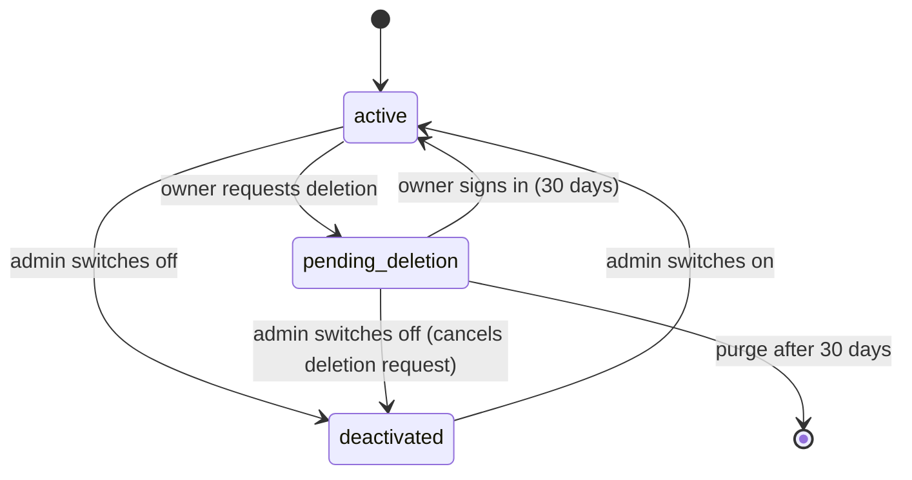

# Admin and Moderation

> Scope: roles, the permission matrix, how permissions are enforced, the admin screens, auditing, abuse signals and their detection, community template reports, and what deactivating a user, link, form or template does across the app. State as of 2026-10-17.

## Summary

Kurz has exactly two roles: a normal user and an admin. An admin can list every user and short link, deactivate or reactivate other accounts, deactivate or flag short links, read the global audit log, moderate community page templates and review abuse signals. There is no admin override on owner data: bio pages, forms, responses, statistics and appointments stay reachable only by their owner, also for admins. Access is refused by default, but nothing forces a new feature to declare its access rules. Abuse handling is mostly manual: the page-abuse detection only raises signals, the form-abuse detection also unpublishes the flooded form on its own, and community templates hide themselves after three reports. The public report page sends nothing to the backend; it builds an e-mail link.

There is no way to become an admin from inside the app (see [AD-01](#who-is-an-admin)).

## Glossary

- **Admin**: a user flagged as administrator. This is the only thing that unlocks the admin screens and actions.
- **Deactivated user**: an account that is switched off (it cannot sign in and its public content disappears). Also used by account deletion, where it means "paused" (see [accounts-and-auth](accounts-and-auth.md)).
- **Inactive short link**: a link that is switched off and not served. Set by an admin, by the owner's deactivation, by the expiry sweeps and when a link is flagged as dangerous.
- **Unsafe short link**: a link flagged as dangerous, either by the automatic Google Safe Browsing check or by an admin. See [shortlinks](shortlinks.md).
- **Abuse signal**: a record that tells admins about a possible campaign (same text, same links) or an auto-contained flood (form flood). It is open until an admin dismisses it.
- **Fingerprint**: the identity of an abuse signal. For pages it is a hash of the normalised text or link set; for forms it is the form plus the day. One fingerprint is one signal per kind.
- **Community template**: a bio page template published by its owner; others see only a placeholder version. See [bio-pages](bio-pages.md).
- **Hidden template**: a community template removed from the Community gallery by auto-hide or by an admin.
- **Audit**: one record per creation, change or deletion of an audited item, stating who did what, when and from which address.
- **Template report**: a signed-in user's report of a community template, with one of four reasons.

## Business rules

### Who is an admin

- **AD-01** The admin role is a single flag on the user and nothing else. No screen, API, AI-app tool, script, seed or credential sets it. An admin is made by an operator editing the user record directly in the database. There is no in-product way to grant it.
- **AD-02** A change of the admin flag is audited, but when an operator does it directly in the database there is no signed-in actor, so the audit record has no actor.
- **AD-03** Admin user lists show each user's admin flag, and the signed-in user's own profile carries it so the app can show the admin menu.
- **AD-04** Nothing promotes or demotes an admin through the app. The admin users screen shows an "Admin"/"User" badge only.
- **AD-05** Account deletion does not exempt admins: once the grace period has passed the account is deleted, including audit records where that user is the actor.

### How permissions are enforced

- **AD-10** Access is denied by default: an action that has no explicit rule is refused for everyone. Features that have no per-record rules of their own cannot be listed through the generic ownership filter.
- **AD-11** These actions are admin-only: listing all users, listing all short links, flagging a link as safe or unsafe, switching a link on or off, reading the audit log, moderating abuse signals, moderating community templates, and viewing the appointment health overview.
- **AD-12** An admin cannot deactivate or reactivate themselves. The admin screen hides the button on the admin's own row, but the rule is enforced by the backend, which refuses the request.
- **AD-13** Ownership is enforced by scoping: bio pages and forms are filtered to the signed-in owner, and every other resource (short links, page templates, colour palettes, push subscriptions, OAuth grants, appointments) is looked up only among the signed-in user's own records.
- **AD-14** A refused action answers "You are not authorized to perform this action"; a missing record answers "Resource not found". Because owner resources are looked up through the owner's own records, another user's record looks like a missing one (answered as "not found", not "not allowed"), so nobody can learn whether it exists.
- **AD-15** Nothing forces a new feature to declare who may use it: a new action that forgets its access check is open to any signed-in user. The safety net is a rule that every route is classified (public, signed-in, owner, admin, infrastructure, storage or internal) and that owner, admin and AI-app routes must refuse anonymous callers.
- **AD-16** For admin actions on a specific record, the admin permission is checked before the record is looked up. A non-admin therefore gets the same "not allowed" refusal whether the id exists or not, while an admin gets "not found" for a missing id. The reason is that non-admins must not be able to tell which ids exist.
- **AD-17** Every admin request is checked in this order: a sign-in token is present ("Missing token"), it is valid and not revoked ("Invalid or expired token"), the account is not deactivated ("Your account has been deactivated"), and finally the caller is an admin. A deactivated admin is therefore locked out of the admin area.
- **AD-18** Browser sessions must identify themselves as an in-app request on every request that changes data (refused otherwise); API-token callers are exempt. This also covers every admin action.
- **AD-19** Admin actions are not available to AI apps. No MCP tool checks the admin role; MCP acts only as the grant's owner within the grant's scopes. See [mcp-and-oauth](mcp-and-oauth.md).

### Permission matrix

Legend: Y = allowed; own = only the owner's records. Refusals: anonymous → not signed in; deactivated user → not allowed; non-admin on an admin action → not allowed; another user's owner resource → not found.

| Capability | Anonymous | Owner | Other user | Admin | Deactivated user |
|---|---|---|---|---|---|
| View a public bio page | Y only if the page is published, not expired and the owner is active | same | same | same | page hidden (not found) |
| Click a link on a public bio page | Y under the same visibility rule | same | same | same | not found |
| Open, submit, upload to, book slots on or join the waitlist of a public form | Y only if the form is published and the owner is active | same | same | same | not found |
| Follow a short link | Y only if the link is currently served | same | same | same | links stop redirecting on deactivation |
| Manage short links | not signed in | own | not found | own only (no override) | not allowed |
| Manage bio pages and forms | not signed in | own | not found | own only | not allowed |
| Manage custom page templates | not signed in | own | not found | own only | not allowed |
| Browse the Community template gallery | not signed in | Y (listed templates only) | Y | Y | not allowed |
| Report a community template | not signed in | refused (own template) | Y once per template, 20 per hour | Y (same rules; an admin may report) | not allowed |
| List all users | not signed in | not allowed | not allowed | Y | not allowed |
| Deactivate or reactivate a user | not signed in | not allowed | not allowed | Y for others; refused for self | not allowed |
| List all short links | not signed in | not allowed | not allowed | Y | not allowed |
| Flag a short link safe or unsafe | not signed in | not allowed | not allowed | Y | not allowed |
| Switch a short link on or off | not signed in | not allowed | not allowed | Y | not allowed |
| Read the audit log | not signed in | not allowed | not allowed | Y | not allowed |
| Review and hide or unhide community templates | not signed in | not allowed | not allowed | Y | not allowed |
| Review and dismiss abuse signals | not signed in | not allowed | not allowed | Y | not allowed |
| View the appointment health overview | not signed in | not allowed | not allowed | Y | not allowed |
| Read another user's statistics, responses, appointments or pages | not signed in | own | not found | not found (no override) | not allowed |
| Use AI-app (MCP) tools | not-signed-in challenge | own grant | n/a | own grant (no admin tools) | challenge (the grant's user is inactive) |

### Auditing

- **AD-20** Audited items and what is tracked:

  | Item | Tracked | Not tracked |
  |---|---|---|
  | User | e-mail, admin flag, deactivation, deletion request, password change | everything else (login tokens, password data, session revocation, verification, ...) |
  | Short link | everything except the list at right | short code, click count, last-accessed time, soft-deletion time, password data |
  | Bio page | everything (title, bio, slug, theme, published state, colours, expiry) | soft-deletion time |
  | Bio page link | everything, attached to its page | click count, position |
  | Form | title, published state and whether it accepts responses only | everything else |
  | OAuth grant | scopes and revocation only | everything else |

- **AD-21** Not audited: form responses, page templates, template reports, abuse signals, appointments, notifications and AI-app tool calls (which keep their own metadata log). So hiding a template and dismissing an abuse signal leave no audit record.
- **AD-22** The actor of an audit record is the signed-in user handling the request, together with the request's address and identifier. Background jobs (form-abuse detection, expiry sweeps, the safety check) and AI-app requests write records with no actor.
- **AD-23** Moderation actions that are audited, with the admin as actor: switching a user on or off (including the cleared deletion request), flagging a link safe or unsafe (safe state, last check time, active state) and switching a link on or off. The automatic form unpublication is audited with no actor. Template hiding and signal dismissal are not (AD-21).
- **AD-24** Searching the audit log: the only filter is by acting user. Records are newest first. There is no pagination or limit: the whole log is returned together with the total count. The screen filters by user only and shows "N of total logs".
- **AD-25** Each audit record shows the action, what changed (old and new values), the version, the originating address and request identifier, the audited item and its type, the time, and, when there is an actor, the full user profile of that actor (e-mail, admin flag, deactivation, link count, timestamps). Changes to a user can contain old and new e-mail addresses.
- **AD-26** Retention: audits are never deleted by age. Two rules apply. (a) A daily sweep (04:15) clears the originating address of audits older than 90 days; the rest of the record stays. (b) When an account is purged (after the 30-day deletion grace), the audits of the user's short links, pages, page links, forms, OAuth grants and the user record itself are deleted, along with audits attached to their pages and every audit where the user is the actor. Reason: audit records hold e-mails, URLs and titles, so they fall under the privacy (GDPR) clean-up.
- **AD-27** The public report page makes the audit log a user-facing promise: "All links are audited so we can trace who created them and when."

### What an admin does to a user

- **AD-30** An admin switches a user on or off with one action: an active user is deactivated, a deactivated one is reactivated. The result shows the updated user.
- **AD-31** Deactivating a user does this in one step: the account is marked deactivated, a pending self-deletion request is cancelled (an admin deactivation cancels a pending deletion, so the purge sweep never deletes an account an admin banned), and each of the owner's active short links is removed from redirecting and marked inactive, one by one, each change audited. It is not atomic: a failure midway can leave the user deactivated with some links still served. Reason: an admin deactivation must not be confused with a self-requested deletion.
- **AD-32** Reactivating a user only clears the deactivation. It does not restore the short links that were switched off, and does not make them redirect again. The admin must reactivate each link through the short links screen (see AD-47). Contrast: when a user cancels their own deletion, links paused in the 10 minutes around the pause are restored automatically.
- **AD-33** Deactivation does not revoke sessions or OAuth grants (contrast a self-requested deletion, which does both). It works by making every request check the account state: web sessions stop working (not allowed), and AI-app grants stop working because the MCP endpoint and the OAuth token step require an active user. After reactivation the old session and AI-app grants work again.
- **AD-34** Sign-in is refused for a deactivated user on every path with "Your account has been deactivated": e-mail code verification, password login (shown as the generic invalid-credentials message), Google sign-in and password reset. Requesting a login code for a deactivated address answers "sent" but sends no e-mail. The "pending deletion" exception cannot apply after an admin deactivation because AD-31 cancels the deletion request. Details in [accounts-and-auth](accounts-and-auth.md).
- **AD-35** Public surfaces that disappear for a deactivated owner: bio pages (published, not expired, owner active) and their link clicks; public forms and their responses, uploads, covers, slots, events and waitlist; the calendar feed; and the e-mail lookups of client notifications. All answer "not found". Data is kept; nothing is deleted.
- **AD-36** Things that keep running for a deactivated owner (no active-user check exists): appointment links held by clients, reminder and notification sending for the owner's appointments, community templates the user published, and short links that an admin later reactivates or re-marks safe (AD-47, AD-48). The first two are not confirmed by an explicit rule; verify before relying on them.
- **AD-37** The user list can be searched by e-mail (full-text, prefix matching) and filtered by status: active, inactive, or all otherwise. Newest first; no pagination; the total count of users is returned.

### What an admin does to a short link

- **AD-40** An admin can list every non-deleted short link with its owner and last safety-check time. Filters: status active or inactive (otherwise all); search by title, destination URL, short code and the owner's e-mail (prefix matching). Newest first, no pagination, the total count of links is returned.
- **AD-41** In the status filter "active" means only "not switched off". A link marked unsafe and switched off by an admin shows under "inactive", but an unsafe link that is not switched off (see AD-49) shows as active. The "is active" value shown to owners follows the same rule.
- **AD-42** Flagging a safe link as unsafe stops it redirecting, marks it unsafe, records the check time and switches it off. Flagging an unsafe link as safe marks it safe, records the check time, switches it on again unless it has expired (an already switched-off expired link stays off), and makes it redirect again if it is servable (switched on, safe and not expired).
- **AD-43** Marking a link safe clears every kind of "switched off" (admin deactivation, 30-day inactivity, owner deactivation, scheduled expiry) unless the link is past its expiry. So marking a link safe re-activates it and makes it redirect again, even when its owner is deactivated (no owner check).
- **AD-44** Switching a link off stops it redirecting and marks it inactive. Switching it on makes it redirect again only if it is safe. Expiry is not checked: an expired but reactivated link redirects until the five-minute expiry sweep switches it off again; a link idle for more than 30 days is switched off again by the daily 03:00 inactivity sweep unless it was accessed. The second part follows from the sweep's conditions rather than an explicit rule.
- **AD-45** Effect on redirects: the redirect service does not talk to the database; it looks up a cached entry per short code. If the entry is missing it redirects to the "not found" page; if the cache fails it answers "service unavailable" with a retry hint of 5 seconds. Removing the cached entry is therefore what takes a link down; the inactive and safe states are the record the main app uses to decide whether to write it.
- **AD-46** Effect on password-protected links: the unlock page and the unlock submission answer "not found" unless the link is password-protected and servable, so a deactivated, unsafe or expired locked link cannot be unlocked either.
- **AD-47** The states that matter here are: switched off (for any reason), safe/unsafe and expiry. A link is servable when it is not switched off, is safe and has not expired. The cache rebuild task writes an entry only for non-deleted servable links and removes it for the rest.
- **AD-48** Switching a link on or off and flagging it safe or unsafe do not look at the owner's state, so an admin can serve a link of a deactivated owner. No other safeguard exists. See Drift.
- **AD-49** Reactivating an unsafe link clears its switched-off state without making it redirect: the link shows "active" in the admin list but is not served.
- **AD-50** Owners cannot see why a link is off. The owner's own screens and the MCP "update link" tool do not bring a switched-off link back, so editing an admin-deactivated link does not reactivate it.

### Abuse detection

- **AD-60** Abuse signal kinds: same text, same links and form flood. Statuses: open and dismissed. A signal must have a fingerprint.
- **AD-61** The page-abuse detection runs hourly at minute 40 (production only). It never changes a page, a user or a link. It looks at pages created in the last 24 hours whose owner's account is less than 7 days old, regardless of whether the page is published, expired or its owner deactivated; deleted pages are excluded.
- **AD-62** Text fingerprint: the page title and bio are joined, lower-cased, whitespace collapsed and trimmed; if the result is shorter than 20 characters the page gets no text fingerprint; otherwise it is hashed.
- **AD-63** Links fingerprint: every link on the page (any kind, active or not, safe or not) is trimmed, lower-cased and stripped of one trailing slash; blanks and placeholder links (those from built-in templates and social-network placeholders, compared the same way) are dropped; the rest is de-duplicated, sorted and hashed. With no links left there is no fingerprint. Order and duplicates do not matter, and a page that adds one extra link gets a different fingerprint.
- **AD-64** Grouping: pages are grouped by kind and fingerprint; a group raises a signal only when it has at least 3 distinct owners. One user with several identical pages counts once. A page can feed both a same-text and a same-links group.
- **AD-65** Recording: if a signal already exists for the fingerprint, its users and pages become the combined set of the stored and current ones, the first-seen time is kept and the last-seen time is updated. The fingerprint carries no date, so one fingerprint is one signal forever. The lists are never pruned (deleted pages are shown as "deleted" in the screen). An error-monitoring warning ("Possible abuse campaign: N new accounts with same text|same links") is sent only when the signal is created.
- **AD-66** The page detection does not change a signal's status. A dismissed page signal stays dismissed when later runs add more pages or users, and it never produces a new warning. A new wave using the same text or links is therefore invisible unless an admin looks at the "Dismissed" tab.
- **AD-67** The form-abuse detection runs every 10 minutes (production only) over a sliding 1-hour window. A form is flooded if it received more than 600 responses in the window (601 or more; exactly 600 passes), or if the uploads attached in the window total more than 300 MB.
- **AD-68** Automatic action for a flooded form (only if it is published; already-unpublished forms are ignored and create no signal): the form is unpublished (its content is kept; the change is audited with no actor), the signal is recorded and an error-monitoring warning "Form unpublished automatically: N responses | N MB of uploads in an hour" is sent. The owner is not deactivated, not notified and may republish at once; if the window still holds the flood, the next run unpublishes again. Reason: stop response and upload floods before an admin looks.
- **AD-69** Form signal key: the form plus the calendar day (UTC). One signal per form per day; the users and forms are combined; the last-seen time is updated; and, unlike pages, the status is forced back to open, so a dismissed signal is reopened if the same form floods again the same day. The warning is sent only when the signal is new.
- **AD-70** Dismissing a signal only marks it dismissed: it does not republish a form, reactivate users, delete the signal or notify anyone. Dismissed signals stay listed under "Dismissed". Dismissing an already dismissed signal succeeds. There is no "undismiss".
- **AD-71** Listing: the admin sees open or dismissed signals (open by default), most recently seen first, limited to 100. Each signal shows its users (e-mail, active state, creation date), pages (slug, title, owner, published, deleted) and forms (title, owner, published, response count; forms that were permanently deleted silently disappear). References that no longer resolve are skipped.
- **AD-72** The admin has no per-signal actions on content: from a signal the screen can only deactivate or reactivate each owner and dismiss. Unpublishing a page and deactivating a page's link are not available to admins; deactivating the owner is the lever (AD-35).
- **AD-73** Detection runs only in production; in development, test and end-to-end environments the detections are never scheduled.

### Community template reports

- **AD-80** Any signed-in user may report a listed community template (public and not hidden) with a reason: spam, offensive, impersonation or other. Other reasons are rejected. Rate limit: 20 reports per hour per user, then "Too many reports, please try again later". A report on a hidden, private or unknown template answers "not found". Success has no content.
- **AD-81** One report per user and template ("already reported this template") and no reports on one's own template ("You cannot report your own template"); both come back rejected with an error message.
- **AD-82** Auto-hide: each report is counted, and when a template reaches 3 reports and is not yet hidden it is hidden, all in one step. Reports are not weighted by reporter age or reason.
- **AD-83** Hidden means: not in the Community gallery, not usable (using a hidden template answers "not found") and not reportable. It does not change pages already created from the template (they keep their copies) and does not touch the owner's private original.
- **AD-84** The admin template list always starts from public templates and filters by status: hidden, listed, or (default, shown as "Reported") any template that has reports or is hidden. Order: most reports first, then most recently published; limit 200. Each item shows the original content and the placeholder version, owner, author label and author page, counts, and the reports tallied by reason. The author page is empty only when it no longer exists; unpublished or expired author pages still show. Admins see the originals; everyone else never does.
- **AD-85** Hiding a public template as admin sets it hidden and keeps its reports. Unhiding it clears the hidden state, zeroes the report count and deletes every report ("unhiding clears the reports: the template starts over"). A private template answers "not found" for the admin action.
- **AD-86** Consequences of clearing on unhide: users who reported can report the same template again; a template can be hidden again by three new reports. There is no permanent ban and no way to hide a private template. The owner can unpublish and republish; the hidden state survives both, so republishing does not evade moderation.
- **AD-87** Deleting a template (by its owner) or the owner's account removes its reports.

### Public report page

- **AD-90** The report page is a public page with no form and no backend call. It shows a fixed e-mail address and an e-mail link. When opened with a bio page or form reference, it prefills the e-mail subject ("Report bio page: <slug>" / "Report form: <id>") and a body with the link to that page or form (always on kurz.fyi) and the prompt "Why it is abusive:".
- **AD-91** Entry points: the site footer links to the report page; bio pages link to it with their slug; public forms link to it with their id. Short links have no report link in the app.
- **AD-92** The page promises "We review every report and will deactivate links and pages that violate our policies." Nothing in the backend receives, stores or tracks e-mailed reports; the review is a manual mailbox process followed by the admin screens.
- **AD-93** The slugs "report" and "admin" are reserved for bio pages, so no user page can shadow these routes.
- **AD-94** A "report" file among the repository's assets is unrelated to moderation: it is a Portuguese table of network timings from six locations (Lisbon 0.5 ms total up to Sydney 927 ms), added on 2025-10-27. It is a performance report, not an abuse report, and nothing references it.

### Admin screens

- **AD-100** Admin screens: the hub, Users, Short links, Audit logs, Moderation (templates) and Moderation › Abuse. They are rendered only in the browser, not pre-rendered.
- **AD-101** The guard is cosmetic: the "Admin" entry in the header and sidebar is hidden for non-admins, and each screen shows an "Access denied" alert when the signed-in user is not an admin or when loading fails. While the user is still loading, the screen renders normally and fires its admin requests, which the backend refuses (not allowed). Authorization is only the backend's.
- **AD-102** The hub shows a badge with the number of open abuse signals plus reported templates.
- **AD-103** Users screen: default filter "Active", search by e-mail (debounced 300 ms), "Deactivate"/"Reactivate" button without confirmation, none on the admin's own row. Short links screen: default "Active", two switches per row (Safe, Active), each behind a confirmation. Audit screen: user selector fed by the full user list. Templates screen: tabs Reported / Hidden / Listed, button "Hide from Community" or "Unhide and clear reports". Abuse screen: tabs Open / Dismissed, per-owner Deactivate/Reactivate, Dismiss (only on open signals).
- **AD-104** The abuse screen help text states thresholds in prose ("three or more new accounts publishing the same page within a day (checked hourly)... checked every 10 minutes") and the template screen says "Three reports hide a template until it is reviewed". These repeat the real thresholds by hand and are not generated from them.

## Flows

**Becoming an admin.** An operator edits the user record directly and sets the admin flag for a verified account. The user's next profile load shows the admin flag and the app displays the admin entry. There is no invitation, no screen and no audit actor.

**Deactivating a user (admin).**
1. The admin presses "Deactivate" on the Users screen.
2. The backend checks sign-in, the admin role, that the user exists and that the target is not the admin themselves.
3. The account is marked deactivated, any pending deletion request is cancelled, and each active short link of the user is taken offline and marked inactive (all audited).
4. From now on that user's requests are refused as not allowed, AI-app tokens are refused as not signed in, public bio pages, forms and the calendar answer "not found", and redirects for their links go to the "not found" page.

**Reactivating a user.** Same checks; the deactivation is cleared. Sessions and AI-app grants work again; links stay inactive until the admin switches each one back on.

**Flagging a link.** The admin switches "Safe" off and confirms: the link stops redirecting, is marked unsafe and switched off. Switching it on again clears the switched-off state and makes it redirect again.

**Page campaign detection.** Hourly: recent pages of new accounts are fingerprinted and grouped, signals are created or updated and a monitoring warning is sent on creation. An admin opens the Abuse screen, reads the users and pages, optionally deactivates owners (which pulls their pages and links offline), then dismisses.

**Form flood.** Every 10 minutes: responses and upload volume of the last hour are counted; each flooded published form is unpublished, the day's signal is recorded as open and a monitoring warning is sent. The admin sees the form with its response count and may deactivate the owner or dismiss.

**Community template report.** A user opens the template gallery menu and picks a reason. The third report hides the template. The admin sees it under Reported/Hidden with the reason tally and either leaves it hidden or unhides it (clearing reports).

## States and transitions

User (moderation view):

| from | event | to | guard | effects |
|---|---|---|---|---|
| active | admin switches off | deactivated | actor is an admin and not the target | pending deletion request cleared; active links switched off and stop redirecting |
| deactivated | admin switches on | active | same | links stay inactive; sessions and grants valid again |
| active | owner requests deletion | deactivated (pending deletion) | owner action | deactivated plus sessions and grants revoked; see [accounts-and-auth](accounts-and-auth.md) |
| deactivated (pending deletion) | owner signs in | active | within 30 days | links paused in the last 10 minutes restored |
| deactivated (pending deletion) | daily account purge | deleted | deletion requested more than 30 days ago | account and its audits removed |

Reactivating a user that is in pending deletion clears only the deactivation; the deletion request stays set while the user is active (the purge requires the account to be deactivated, so nothing is purged). This path is reachable only if an admin toggles a user whose state is "pending deletion": the toggle sees them as not active and reactivates them, leaving the deletion request set. This follows from the behaviour rather than an explicit rule.

Short link (moderation view):

| from | event | to | guard | effects |
|---|---|---|---|---|
| served | admin switches off | inactive | - | stops redirecting, marked inactive |
| inactive | admin switches on | served (if safe) | - | redirects again only if safe; expiry ignored |
| served | admin flags unsafe | unsafe + inactive | link is safe | stops redirecting, marked unsafe and inactive |
| unsafe | admin flags safe | safe | link is unsafe | switched on unless expired; redirects again if servable |
| any | owner deactivated by admin | inactive | link is switched on | stops redirecting |

Abuse signal:

| from | event | to | guard | effects |
|---|---|---|---|---|
| (none) | page detection finds 3+ users | open | new fingerprint | monitoring warning |
| (none) | form detection finds a flood | open | new form-and-day fingerprint | form unpublished, monitoring warning |
| open | admin dismisses | dismissed | - | none |
| dismissed | page detection sees the fingerprint again | dismissed | - | users and last-seen updated, no warning |
| dismissed | same form floods again the same day | open | - | form unpublished again |

Community template:

| from | event | to | guard | effects |
|---|---|---|---|---|
| listed | 3rd distinct report | hidden | 3 reports | hidden, reports kept |
| listed | admin hides | hidden | - | hidden, reports kept |
| hidden | admin unhides | listed | - | hidden state cleared, report count zeroed, reports deleted |
| listed/hidden | owner unpublishes | private | owner | hidden state kept |
| private | owner publishes | listed or hidden | hidden state kept | publication time set |

## Limits and configuration

| Name | Value | Notes |
|---|---|---|
| Page abuse window | 24 hours | page creation time |
| New account age | 7 days | owner's account creation time |
| Distinct users per group | 3 | a signal needs at least 3 owners |
| Minimum text length | 20 characters | after normalisation |
| Page detection schedule | every hour at minute 40, production only | |
| Form abuse window | 1 hour (sliding) | |
| Form response threshold | more than 600 | 601 or more |
| Form upload threshold | more than 300 MB | total size of uploads |
| Form detection schedule | every 10 minutes, production only | |
| Auto-hide threshold | 3 reports | |
| Report reasons | spam, offensive, impersonation, other | |
| Report rate limit | 20 per hour per user | then "too many requests" |
| Admin signal list | 100 rows | |
| Admin template list | 200 rows | |
| Admin users, short links, audits lists | unlimited | no pagination |
| Audit address retention | 90 days (originating address cleared) | daily 04:15 |
| Audit record retention | unlimited, except account purge | |
| Account deletion grace | 30 days | |
| Restore window after cancel | 10 minutes | |
| Inactivity expiry | 30 days, daily 03:00 | |
| Configuration | none specific to this domain | the admin role is not configurable by setting |

## Authorization and privacy

- Personal data in this domain: user e-mail addresses (users list, abuse signal owners, audit actor, template owner), the actor's IP address in audits (kept 90 days, then cleared), the request identifier, and old/new e-mail values inside audited changes. Admins see all of it; no one else does.
- Admins see the original items and links of community templates; other users get placeholders only.
- Admins can read every short link's destination URL and owner. They cannot read bio page contents or form responses through the admin area, only slugs and titles in signals and template originals.
- Deletion: purging an account removes the user's audits, both as subject and as actor. Abuse signals keep the ids of purged users and pages; they resolve to nothing and are skipped in the listing. Template reports are removed with the template.
- MCP: a deactivated user's grant fails authentication (AD-33). No MCP tool reaches admin data.
- Monitoring warnings carry ids only (signal, pages, form, user), not e-mail addresses.

## API and UI surface

**Admins** (dashboard, Admin area; refused to everyone else):
- Users: list and search by e-mail, filter by active/inactive, deactivate or reactivate another user.
- Short links: list and search, filter by active/inactive, flag a link safe or unsafe, switch it on or off.
- Audit logs: read the global log, filter by acting user.
- Moderation: review community templates (Reported / Hidden / Listed) and hide or unhide them; review abuse signals (Open / Dismissed), deactivate or reactivate owners from a signal, and dismiss signals.
- Appointment health overview (belongs to [appointments-lifecycle](appointments-lifecycle.md)).
- The hub shows a badge counting open abuse signals plus reported templates (AD-102).

**Signed-in users** (dashboard): report a community template from the gallery menu (AD-80).

**Visitors** (public page): the report page that opens an e-mail to the moderation address (AD-90).

**AI apps (MCP):** no admin or moderation tools (AD-19).

Background sweeps: page-abuse detection, form-abuse detection and the daily clean-up of old audit addresses. No e-mails are sent by this domain.

## Decisions

### D-AD-01 Check the admin role before looking up the record
**Decision.** Admin actions on a specific record check the admin permission before looking the record up, then check again on the record. **Why.** So a non-admin cannot tell whether an id exists ("not allowed" either way). **Consequence.** New admin actions on specific records must follow the same pattern and be added to the automated security checks.

### D-AD-02 Admins have no override on owner data
**Decision.** Admin endpoints are separate from the owner's own endpoints, and owner endpoints scope strictly to the signed-in user. **Why.** Privacy of bio pages, forms and responses. **Consequence.** An admin cannot edit a user's page or form; moderation of pages works only by deactivating the owner.

### D-AD-03 Page abuse is advisory, form abuse is automatic
**Decision.** Page campaigns only raise signals; flooded forms are unpublished at once. **Why.** Page detection is meant never to take anything down on its own; form detection exists to stop response and upload floods before an admin looks. **Consequence.** Raising a page threshold has no safety effect; lowering the form thresholds can take down legitimate busy forms (booking forms count their responses too).

### D-AD-04 Deactivation as a flag, checked on every request
**Decision.** Deactivating a user sets a flag and switches off short links; sessions and grants are not revoked. **Why.** It makes reactivation lossless. **Consequence.** Every new surface that serves a user's content must check that the owner is active, or it keeps serving after a ban.

### D-AD-05 Reports clear on unhide
**Decision.** Unhiding a template deletes its reports and zeroes the counter. **Why.** "The template starts over." **Consequence.** Reporters can re-report; there is no memory of previous decisions.

## Change impact

- Add an admin action: give it an admin-only permission, check the role before looking up the record (D-AD-01), classify the route in the security checks, add a screen, and decide whether it must be audited (AD-20, AD-21).
- Change what deactivating a user does: review a self-requested deletion and its cancellation (AD-31, AD-32, AD-33), the account-deletion rules, the AI-app and OAuth active-user checks, public bio pages and forms, the calendar feed and the redirect cache. See [accounts-and-auth](accounts-and-auth.md), [shortlinks](shortlinks.md), [bio-pages](bio-pages.md), [forms](forms.md).
- Make reactivation restore links: reuse the 10-minute restore logic that exists today only for cancelling a deletion (AD-32).
- Add a surface that serves user content: filter on active owners (AD-35) and make sure no redirect is enabled for a deactivated owner (AD-43, AD-48).
- Change abuse thresholds: update the detection limits and the help text on the Abuse and Templates screens (AD-104).
- Change the audited columns: existing audits keep their old shape and the audit log shows raw changes; update the address clean-up and the account purge if new audited item types appear (AD-26).
- Add an audited item with personal data: it must be included in the account purge or its audits survive account deletion (AD-26).
- Add a new abuse signal kind: extend the kinds, the screen labels and the signal's references; a new stored field needs a migration the previous release survives.
- Change how forms are published or unpublished: the form-abuse detection depends on it (AD-68).
- Add pagination to admin lists: the screens assume the full list and count client-side "N of total" (AD-24, AD-37, AD-40).
- Grant admin through the app: nothing exists; auditing already tracks the admin flag, so reuse it, and mind the self-demotion guard (AD-12).
- Database changes touching the admin flag, abuse signals or audits: the previous release runs against the new schema for a few seconds.

## Drift and open questions

- **No path to create an admin** (medium). The admin flag can only be set by hand; no document, script or seed explains it, and there is no operations guide. Anyone implementing admin management must decide on the audit actor and last-admin protection.
- **Reactivating a user does not restore their links** (medium). Deactivation switches links off, reactivation leaves them off, and the admin screen has no bulk action. Compare cancelling a deletion.
- **Admin link actions ignore the owner state** (medium). Switching a link on or flagging it safe can make a deactivated owner's link redirect (AD-43, AD-48).
- **Unbounded admin lists** (medium). Users, short links and audits are returned in full on every request; the audit log also never shrinks (AD-24, AD-26). The audit user filter loads the full users list too.
- **Page signals never reopen** (low/medium). A dismissed same-text or same-links signal absorbs later waves silently (AD-66).
- **Admin template and signal actions are not audited** (low). No trace of who hid a template or dismissed a signal (AD-21).
- **Deactivated owners' community templates stay listed** (low). The gallery has no owner-active filter (AD-36).
- **Reactivating a pending-deletion user** (low). Leaves the deletion request set on an active user; see States and transitions.
- **Deactivation is not atomic** (low). The user is updated and then each link separately; a failure midway leaves a deactivated user with some links still served.
- **Hard-coded values in the report page** (low). The kurz.fyi host in the e-mail body and the report e-mail address are fixed in the code (AD-90); self-hosted installs report to the wrong place.
- **Admin guard flashes** (low). Screens render before the user finishes loading (AD-101).
- **Mixed translations** (low). The audit, abuse and templates admin screens use hard-coded English strings; the users and short links screens use translations.
- **Missing pt-PT string for the deactivation error** (low). The "account deactivated" message exists only in English; Portuguese falls back to English.
- **Misleading "report" asset** (low). The repository's performance table named like a report is not an abuse report (AD-94).
- **Documentation**: none of the guides in the docs folder covers admin, audit, abuse or moderation, so there is no guide to disagree with the behaviour.
