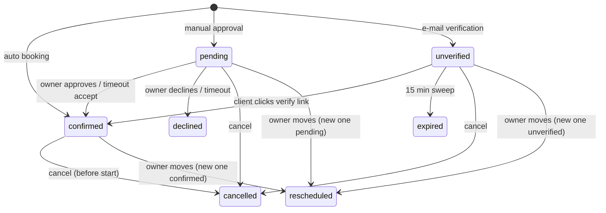

# Appointments lifecycle

> Scope: what happens to an appointment once it is booked: statuses, approval, e-mail verification, cancellation, reschedule, reminders, expiry, the waiting list, the calendar feed, the owner agenda and search, the client views, private links and the health check. State as of 2026-10-17.

Availability, slot computation and reservation are in [booking-engine](booking-engine.md). The generic e-mail machinery (queue, budget, retries, preferences) is in [notifications-and-email](notifications-and-email.md). The appointments guide holds the decision record; this page does not repeat it.

## Summary

A booking made through a form creates one appointment per session, all belonging to one booking (one submission = one booking). The booking starts as `confirmed`, `pending` (manual approval, with a deadline) or `unverified` (e-mail verification, 15 minutes). Every later transition (approve, decline, verify, cancel, expire, reschedule) works on the whole booking at once and is safe to repeat, except partial cancellation and reschedule, which touch single sessions. A transition that gives a place back frees the place and then offers it to the waiting list. Two scheduled sweeps drive time: one every minute (expiry of pending and unverified bookings, and the waiting-list clean-up) and one every 5 minutes (reminders). Visitors act through private, expiring links (manage, decide, verify) and private waiting-list links; owners act from the agenda, the form's appointments tab or through AI apps (MCP tools).

## Glossary

- **Booking (group)**: all appointments created by one submission. E-mails, decisions, verification, expiry and reminders work per booking.
- **Session**: one appointment = one time slot at one start time.
- **Holding statuses**: `pending`, `unverified` and `confirmed`; these occupy a place in the slot.
- **Booking snapshot**: the service name, duration, price, currency, totals, number of sessions, monthly flag and the accept-on-timeout choice, frozen when the booking is made so later edits to the form do not change it.
- **Series**: a booking made as a monthly booking; the only case where the interface offers partial cancellation.
- **Manage / decide / verify link**: a private link with a random secret that lets the holder view or cancel a booking, approve or decline it, or confirm the e-mail address. Only a hashed form of the secret is kept.
- **Waitlist entry**: a person queued for one full time (form, service, start time).
- **Held place**: a place reserved for a waitlist entry that has been offered a spot; it counts against capacity just like a booked place.
- **Calendar feed**: one secret `.ics` calendar URL per owner.
- **Client account**: an active, verified account whose e-mail matches the booking e-mail (case-insensitive).

## Business rules

### Statuses and grouping

- **AP-01** Appointment statuses are `pending`, `unverified`, `confirmed`, `cancelled`, `declined`, `expired` and `rescheduled`. Only `pending`, `unverified` and `confirmed` hold a place.
- **AP-02** The initial status is chosen once per booking: `pending` when approval is needed (AP-03); otherwise `unverified` when the form is not in manual-approval mode, e-mail verification is on and the contact has an e-mail; otherwise `confirmed`.
- **AP-03** Approval is needed when the form uses manual approval and either no approval window is set or the earliest session starts within that window from now. A manual-approval form whose booking is further away than the window is confirmed on the spot, with no deadline and **no e-mail verification even if verification is on** (AP-02 excludes manual-approval forms).
- **AP-04** Deadlines: a `pending` booking expires after the form's approval timeout (default 1440 minutes, range 5 to 43 200); an `unverified` booking expires 15 minutes after booking.
- **AP-05** The accept-on-timeout choice (`decline` by default, or `accept`) is stored with the booking, so changing the rule later does not affect requests that are already waiting.
- **AP-06** Every booking-wide transition is applied once and safely: the booking is locked and its status re-checked, so a repeated or concurrent action changes nothing and sends nothing.

### Approval (pending)

- **AP-07** An owner decision (approve or decline) applies to every pending appointment of the booking. It is refused as "already decided" when none is pending and as "expired" when the deadline has passed, even before the sweep has run.
- **AP-08** Approve makes the booking `confirmed` (decided by the owner); decline makes it `declined` and frees the places. The owner's optional message is trimmed and limited to 500 characters. The client receives a confirmed or declined e-mail when the booking has an e-mail address.
- **AP-09** Decision channels: the logged-in owner (dashboard), the decide link in the owner's new-request e-mail, and an AI app (approve or decline). All follow the same rules.
- **AP-10** At the deadline the booking is confirmed when accept-on-timeout was chosen **and** every session is still ahead; otherwise it is declined and the places are freed. The decision is recorded as made by timeout. The owner gets an in-app/push notice (booking auto-confirmed, or request expired; there is no owner e-mail for these); the client gets a confirmed or declined e-mail.

### E-mail verification (unverified)

- **AP-11** Verification is requested only in automatic mode when the form has e-mail verification on. Publishing is blocked without a required e-mail question, and the first required e-mail question is the booking contact.
- **AP-12** While `unverified`, the place is held and only the client is told (verification e-mail); the owner gets no notice and no in-app message.
- **AP-13** Confirming through the verification link (an explicit confirm action, never a plain page view) makes the booking `confirmed`, clears the deadline, records the client as the decider, and then sends exactly what an automatic booking sends: owner in-app/push/e-mail "new booking" and client confirmed e-mail. Confirming is refused after the deadline, even before the sweep has run.
- **AP-14** If the client does not confirm, the sweep marks the booking `expired` (decided by timeout), frees the places and notifies nobody. A verification e-mail still waiting to be sent is dropped if no appointment is unverified any more.

### Private links

- **AP-15** A link secret is a random 43-character value; only a hashed form is stored and the raw value is shown once. A link only works for the right purpose and before it expires. Unknown, expired, wrong-purpose and foreign links all answer the same "not found".
- **AP-16** Link kinds and lifetimes:

  | Link | Issued by | Lifetime | Page | Bound to |
  |---|---|---|---|---|
  | Manage | the booking receipt, every client e-mail that carries a manage link, and a signed-in client asking for a new manage link | 7 days after the last session starts (the receipt link is at least 7 days from now) | `/m/:token` | the whole booking |
  | Decide | the owner's new-request e-mail | 7 days after the last session starts | `/a/:token` | the pending part of the booking |
  | Verify | the client's verification e-mail | 1 hour after the verification deadline (75 minutes after booking) | `/v/:token` | the whole booking |

- **AP-17** Links are **not single-use** and are not revoked by a transition: a manage link keeps opening the booking (also after cancellation) until it expires; repeated actions are harmless because of AP-06. A new link is created every time an e-mail is rendered, and links disappear only with their appointment. Each link covers the whole booking, whichever session it points to.
- **AP-18** Waitlist links are not stored: they are signed, valid until one day after the waitlisted time starts, and cannot be revoked. The entry's status decides what the link can still do.

### Cancellation

- **AP-19** A booking can be cancelled only while its sessions have **not started yet**; there is no other cut-off (no minimum notice for cancelling). Cancelling a `pending` or `unverified` booking is allowed.
- **AP-20** Cancellation scopes: **all** = every upcoming session of the booking (default; unknown values fall back to all); **one** = the chosen session; **remaining** = upcoming sessions of the **same service** starting at or after the chosen session. The public manage page identifies the chosen session by its start time; an unknown session is refused.
- **AP-21** Effect: status `cancelled`, recorded as cancelled by the client or the owner, with an optional reason (trimmed, limited to 500 characters) and a decision time; the places are freed.
- **AP-22** Notifications: when the client cancels, the owner gets an in-app/push notice plus an e-mail (the e-mail can be switched off in preferences) and the client gets a cancellation e-mail; when the owner cancels (agenda, API, MCP), only the client e-mail is sent. Each partial cancellation sends its own single e-mail, and the e-mail lists only the sessions cancelled by that action.
- **AP-23** The owner's cancel action reports "nothing to cancel" when nothing was cancelled; the public manage page always answers with the booking's current state.
- **AP-24** Interface only: partial-cancellation buttons appear on the manage page and in the agenda dialog only for a series. The agenda sends a scope only for a series, so cancelling a non-series booking from the agenda cancels the whole booking. The API and MCP accept any scope for any booking.
- **AP-25** A confirmed booking can still be cancelled with its link after the form was closed or unpublished.

### Reschedule (owner only)

- **AP-26** Reschedule moves **one session**. It is allowed only if the service still exists in the published form, the appointment holds a place and its slot has not started. Moving to the same time is refused, the target time must be free, and anything else is refused as "not reschedulable".
- **AP-27** Normally the target must be a time the service offers on that date with the booked duration, ignoring minimum notice. With **force** (used by agenda drag-and-drop) any future time in the form's time zone is accepted and the weekly opening hours are skipped, but capacity and shared-resource exclusion still apply. MCP never uses force.
- **AP-28** A reschedule is atomic: the new slot is reserved, the old one freed, the old appointment is marked `rescheduled` and a new appointment is created carrying the same booking, status, deadline, contact and snapshot, linked to the original, with the owner's message (up to 500 characters). Reminders already sent are not carried over, so the moved session can be reminded again. A pending request stays pending with its deadline.
- **AP-29** The client gets a "rescheduled" e-mail showing the old and new time and the message. `rescheduled` appointments are hidden from client pages, e-mails, the client's booking list and the owner's booking view.
- **AP-30** Dragging a session in the agenda moves every client of that session except `unverified` ones, one appointment at a time, and only onto a future time of the same form and service that has room.

### Reminders

- **AP-31** Reminder lead times come from the form's reminder setting: up to 3 distinct values between 15 and 10 080 minutes; unset means one reminder 1440 minutes (24 hours) before; an empty list means no reminders.
- **AP-32** Every 5 minutes, for each booking with `confirmed` appointments, an e-mail address and a session in the next 7 days, a lead is due when the first session's start minus the lead has passed and the booking was made at or before that moment (a lead already past at booking time is skipped). Only the smallest due lead is e-mailed; all due leads are recorded as sent for the booking.
- **AP-33** Reminders are sent once per lead. They are not sent instantly but picked up by the notification sweep that runs every minute. Delivery is dropped if the booking no longer has a confirmed appointment, and reminders use only half of the mail budget share.
- **AP-34** Remind now (owner, MCP): needs an e-mail and a confirmed upcoming session; refused ("too soon") if any reminder e-mail for the booking was created in the last hour, automatic ones included; it does not change which automatic leads count as sent.

### Release and waiting list

- **AP-35** Whenever a place is given back (decline, timeout decline, verification timeout, cancel, reschedule of the old slot, deletion of a response), the slot's booked count goes down by the number of appointments released (never below zero) and, once everything is saved, the place is offered to the waiting list.
- **AP-36** Joining the waiting list requires: the form has the waiting list on, the service has a capacity, the time is one the service offers, and the slot is full by the **current** capacity (booked plus held places). The name is cleaned and limited to 100 characters; the e-mail must be well formed (one `@`, no spaces, dotted domain).
- **AP-37** Limits: at most 20 people waiting per time (further joins are refused as "waitlist full"); at most 5 active entries per e-mail per form (refused as "too many waitlists"); joining twice returns the existing entry. Joining also needs a form that is accepting responses, passes the bot check, and a hidden spam-trap field is silently accepted without effect. Publishing is blocked when the form has required questions other than one short text, one e-mail and the booking.
- **AP-38** Offer: for each freed place, the oldest waiting entry (first come, first served) for the same form, service and start, still in the future, gets a held place only if a place is really free; the entry becomes `offered` and has until the earlier of the confirm window (default 120 minutes, range 15 to 4 320) from now and the start time. This repeats while places remain.
- **AP-39** Claim (offered entry, before the offer ends): the person books through the normal form flow with the entry's contact details and the held slot's duration, and the held place becomes a booked place. Success marks the entry `claimed`; any failure gives up: the hold is released, the entry becomes `expired` and the next person is offered the place. The resulting booking follows the form's rules, so it can be `pending` or `unverified`. Claiming works even after the form was closed.
- **AP-40** Leave (waiting or offered entry): the entry becomes `left`; an offered hold is released and passed on. The every-minute sweep expires offers past their deadline and every active entry whose time has started, releasing holds and offering them again.
- **AP-41** Waitlist e-mails ("joined", "offered") are sent directly when the mail budget allows (0.8 share), outside the normal notification records, so they have no retry and no duplicate protection. A verified client account also gets an in-app "joined" / "offered" notice (carrying the waitlist link only while the entry is still active).

### Calendar feed (.ics)

- **AP-42** One calendar feed per owner. Creating a new feed replaces the previous one; the feed URL is shown once and only a hashed form of its secret is kept. Revoking deletes the feed. Only well-formed secrets are accepted.
- **AP-43** Content: `confirmed` appointments of the owner's forms starting between 30 days ago and 365 days ahead, at most 2 000, ordered by start. Each appointment is one event with a stable identifier, UTC start and end (booked duration, 30 minutes if unknown), a title of service and client name, the form title as description, and status confirmed. Text is sanitised for the calendar format (control characters removed, line breaks flattened, special characters escaped, long lines folded).
- **AP-44** Serving: 60 requests per minute per IP; wrong, malformed and revoked secrets and deactivated owners all answer the same "not found"; the response is private and not cached, sends no referrer, and records when the feed was last fetched.
- **AP-45** There is **no per-booking calendar file** (no `.ics` attachment or "add to calendar" link in any e-mail or page); the only calendar export is the owner feed.

### Agenda, appointments tab, client views

- **AP-46** The owner's agenda covers a date range of at most 62 days (otherwise refused as invalid range) and shows sessions in the owner's time zone. It merges **real** slots that have booked or held places (past and future) with **derived** future times of published forms computed with open rules (no minimum notice, unlimited window, no buffer, no daily limit); a real slot wins over a derived one at the same form, resource and start. Service name and capacity come from the published service, falling back to the booking's snapshot when the service has been removed. Each session lists only holding appointments and counts the `pending` ones.
- **AP-47** Agenda filters work in the browser only: hide forms, hide categories, "waiting only" (sessions with pending requests), and show/hide my own bookings as a client. "Approve all" approves one pending booking per group in view. Views: day, week, month; phones are limited to day.
- **AP-48** The form's appointments tab filters by status (unknown values ignored), by free-text search on client name or e-mail (up to 100 characters, wildcards treated literally) and by date range in the owner's time zone. Results are newest first, 50 per page. Export to CSV or XLSX is limited to 50 000 rows (larger exports are refused), oldest start first; cells that start with a formula character are neutralised and XLSX cells are stored as text.
- **AP-49** A client's own bookings need a verified account and match the e-mail case-insensitively, excluding `rescheduled` appointments. Without a date range the 50 newest bookings are shown; with a range (at most 62 days, in the client's time zone) up to 200 bookings, ordered by first session. A booking's displayed status is `confirmed` if any appointment is, else another holding status, else `cancelled` (also for declined or expired bookings).

### Health

- **AP-50** The appointments health report covers: overdue `pending`/`unverified` bookings and the oldest delay; pending e-mail/push notifications that are due and the oldest age; failed notifications in the last day; notification queue lag; today's mail budget use; and MCP "insufficient scope" denials per appointment read/config tool in the last day. Alerts fire for overdue bookings (more than 300 seconds), notification queue lag (more than 300 seconds), e-mail budget use (80 % or more) and any failed notification.
- **AP-51** Only admins see the health report. A background check runs every 5 minutes, logs one line and raises each alert at most once per hour.

## Flows

**Auto booking.** The booking is created `confirmed` → owner in-app + push "new booking", owner e-mail "new booking" (if the preference is on), client confirmed e-mail with a manage link (if there is an e-mail). Notifications are prepared with the booking and sent once it is saved. The receipt shown to the visitor carries a fresh manage link. A client account also gets in-app copies of client e-mails except the verification one.

**Manual booking.** The booking is created `pending` with a deadline → owner in-app/push "request" and owner e-mail "new request" (deadline, accept-on-timeout flag, decide link), client "request received" e-mail with a manage link. Then AP-07..AP-10.

**Verification.** The booking is created `unverified` → client verification e-mail with a verify link → confirm → AP-13, or sweep → AP-14.

**Cancel by client.** Manage page → cancel with reason and scope → booking locked → cancelled → places released → owner and client notices → waiting-list offer.

**Waitlist.** The public form shows full times ([booking-engine](booking-engine.md)) → the visitor joins → "joined" e-mail with a waitlist link → a place frees (AP-35) → "offered" e-mail → the visitor claims from the link → normal booking e-mails.

**Sweeps.** Every minute: expire overdue unverified bookings first, then overdue pending ones, booking by booking, then clean up the waiting list.

### E-mail catalogue for this domain

| E-mail | To | When |
|---|---|---|
| Booking confirmed | client | Automatic booking, e-mail verified, owner approved, or accepted on timeout |
| New booking | owner | Automatic booking confirmed, or e-mail verified |
| New request | owner | Manual-approval request received (includes deadline and decide link) |
| Request received | client | Manual-approval request received |
| Verify your e-mail | client | Booking needs e-mail verification |
| Booking declined | client | Owner declined, or the request timed out |
| Booking cancelled | client | Booking cancelled by the client or the owner |
| Booking cancelled by client | owner | Client cancelled (can be switched off in preferences) |
| Booking rescheduled | client | Owner moved a session |
| Reminder | client | Automatic reminder, or owner's "remind now" |
| Waitlist joined / spot offered | waitlist person | Joined the waiting list; a place became available |

Owner-only in-app/push notices without an e-mail: request expired, booking auto-confirmed.

## States and transitions

### Appointment status

| From | Event | To | Guard | Effects |
|---|---|---|---|---|
| — | submit, automatic | `confirmed` | slot free | owner "new booking" notices, client confirmed e-mail |
| — | submit, manual in window | `pending` | AP-03 | deadline set; owner request, client receipt |
| — | submit, verification on | `unverified` | AP-02 | deadline 15 min; client verify e-mail |
| `pending` | owner approves (dashboard, decide link, MCP) | `confirmed` | before the deadline | client confirmed e-mail |
| `pending` | owner declines | `declined` | before the deadline | places freed, client declined e-mail |
| `pending` | sweep, accept on timeout | `confirmed` | all sessions ahead | owner auto-confirmed notice, client confirmed e-mail |
| `pending` | sweep, otherwise | `declined` | deadline passed | places freed, owner expired notice, client declined e-mail |
| `unverified` | client confirms via verify link | `confirmed` | before the deadline | owner "new booking" notices, client confirmed e-mail |
| `unverified` | sweep | `expired` | deadline passed | places freed, no notice |
| holding | cancel (client manage page, owner dashboard/agenda, MCP) | `cancelled` | slot not started | places freed, e-mails per AP-22 |
| holding | owner reschedule | `rescheduled` (+ new appointment, same status) | AP-26 | old place freed, new reserved, client e-mail |

No transition leaves `cancelled`, `declined`, `expired` or `rescheduled`. Appointments whose session has passed stay `confirmed` (there is no "completed" or "no-show" status).

### Waitlist status

| From | Event | To | Guard | Effects |
|---|---|---|---|---|
| — | join | `waiting` | AP-36, AP-37 | "joined" e-mail, in-app notice |
| `waiting` | place released | `offered` | first in line, room for a hold | place held, "offered" e-mail |
| `offered` | claim | `claimed` | before the offer ends, booking succeeds | normal booking |
| `offered` | claim fails | `expired` | — | hold released, next person offered |
| `waiting`/`offered` | leave | `left` | — | hold released and offered again |
| `offered` | sweep | `expired` | offer deadline passed | hold released and offered again |
| `waiting`/`offered` | sweep | `expired` | time has started | hold released |

## Limits and configuration

| Name | Value | Notes |
|---|---|---|
| Approval timeout | default 1440 min, 5 to 43 200 | pending deadline |
| Accept on timeout | `decline` (default), `accept` | frozen with the booking |
| Approval window | 1 to 43 200 min, unset = always | manual approval only inside the window |
| Verification deadline | 15 min | not configurable |
| Verify link lifetime | deadline + 1 hour | |
| Manage / decide link lifetime | last session start + 7 days | |
| Waitlist link lifetime | waitlisted time + 1 day | signed link |
| Reminder lead times | up to 3 distinct, 15 to 10 080 min; default one at 1440 | |
| Remind-now cooldown | 1 hour per booking | |
| Message / reason length | 500 characters | decision, cancellation reason, reschedule message |
| Waitlist confirm window | default 120 min, 15 to 4 320 | capped at the start time |
| Waitlist per time / per e-mail | 20 waiting / 5 active per form | |
| Owner waitlist view | 200 active entries | |
| Agenda / client bookings range | 62 days | |
| Client bookings | 50 bookings (no range), 200 (range) | |
| Appointments page / export | 50 / 50 000 rows | |
| `.ics` window / size | 30 days back to 365 days ahead, 2 000 events | |
| Health thresholds | 300 s overdue, 300 s queue lag, 80 % budget | each alert at most once per hour |
| Rate: manage page view / cancel | 60 / 20 per minute per IP | |
| Rate: decision view / act | 60 / 20 per minute per IP | |
| Rate: verification view / confirm | 60 / 20 per minute per IP | |
| Rate: calendar feed | 60 per minute per IP | |
| Rate: waitlist join | 10 per 10 minutes per IP | plus bot check |
| Rate: waitlist view / act | 60 / 20 per minute per IP | |
| Rate: request my manage link | 20 per minute per user | |
| MCP appointment actions | 30 per hour and 100 per day per user (shared), plus 20 per hour per tool | see [mcp-and-oauth](mcp-and-oauth.md) |
| Mail budget share | 0.8 default, 0.5 reminders, 0.8 waitlist | |

## Authorization and privacy

- **Anonymous with a link**: manage page (view, cancel), decide page (it is the owner's link, no login), verify page, waitlist page (claim, leave), and the calendar feed. Possession of the link is the only credential. These pages send no referrer, cannot be framed and are hidden from search engines.
- **Owner (signed in)**: can act only on appointments of their own forms (anything else is "not found"); agenda, appointments tab, export, waitlist list, calendar feed.
- **Client account**: sees own bookings through the verified e-mail match; can request a manage link (refused if the e-mail is not verified).
- **MCP**: the read permission (list appointments, view an appointment, view the agenda; results are record-budgeted and visitor text is marked as untrusted) and the manage permission (approve, decline, cancel, reschedule and remind; the confirmation must repeat the appointment id).
- **Admin**: health report only.
- **Personal data stored**: on appointments, the client's name, e-mail, time zone, language, cancellation reason and decision message; on waitlist entries, name, e-mail, language and time zone. A phone field exists but is never filled. The calendar feed exposes client names to whoever holds the URL. The decision page shows the client's name and e-mail to the link holder; the waitlist page shows only the entry's own data.
- **Retention**: appointments live until their response, form or owner account is deleted (an account is purged 30 days after deletion is requested). Deleting responses releases holding places silently (no client e-mail) and offers them to the waiting list. Waitlist entries in final states, expired links and calendar feeds are never purged automatically. Notifications are purged after 90 days; push payloads carry only identifiers.

## API and UI surface

- **Owners (dashboard)**: approve, decline, cancel, reschedule and remind from the agenda or appointments tab; view the agenda; search, filter and export a form's appointments; view a form's waiting list; create, view and revoke the calendar feed (card on the account page); see their own bookings as a client and request a new manage link.
- **Visitors (private pages)**: manage page (`/m/:token`: view, cancel), decide page (`/a/:token`: approve or decline), verify page (`/v/:token`: confirm e-mail), waitlist page (`/w/:token`: claim or leave), and the join-waiting-list block on the public form.
- **Calendar apps**: fetch the owner's `.ics` feed by its secret URL.
- **AI apps (MCP)**: list and read appointments, read the agenda, approve, decline, cancel, reschedule and remind (see Authorization and privacy).
- **Admins**: view the appointments health report.
- **Scheduled work**: reminders every 5 minutes, expiry and waiting-list sweep every minute, health check every 5 minutes.

## Decisions

### D-AP-01 Decisions and expiry are booking-wide and swept, not scheduled per appointment
**Decision.** One recurring sweep resolves every overdue booking; a decision always covers the whole booking. **Why.** Simple, predictable deadlines (see the appointments guide). **Consequence.** Up to one minute of lag; actions also check the deadline themselves (AP-07, AP-13).

### D-AP-02 Accept-on-timeout is frozen at booking time
**Decision.** The accept-on-timeout choice is stored with the booking. **Why.** Changing the rule later must not change a request that is already waiting. **Consequence.** Rule changes affect only new requests.

### D-AP-03 Verification only in automatic mode, silent on timeout
**Decision.** `unverified` holds the place for 15 minutes; the owner hears nothing until the client confirms; expiry is silent. **Why.** Unconfirmed bookings are noise for the owner. **Consequence.** Manual-approval forms never verify e-mails (AP-03).

### D-AP-04 Link secrets are hashed and indistinguishable on failure
**Decision.** Link secrets are stored hashed, like OAuth tokens; unknown, expired and foreign links answer alike. **Why.** A leaked database must not yield working links, and failures must not reveal which links exist. **Consequence.** A lost link cannot be recovered, only re-issued by a new e-mail or a new manage-link request.

### D-AP-05 Reschedule creates a new appointment
**Decision.** The old appointment becomes `rescheduled`, the new one is linked to it, and reminders restart. **Why.** Keeps the history of what was moved and lets the moved session be reminded again. **Consequence.** Every read path must exclude `rescheduled` appointments.

### D-AP-06 Owner moves can ignore the schedule
**Decision.** Forced moves skip weekly hours but still need a future time with room. **Why.** Owners need to place clients outside the usual hours. **Consequence.** Off-schedule slots appear; the agenda hides real slots that nobody holds.

### D-AP-07 Freed places go to the waiting list first, held on the slot
**Decision.** Any release offers the place to the first in line and holds it. **Why.** The waiting list should win over new visitors; "full" is judged by the current capacity. **Consequence.** Every availability check must count held places.

### D-AP-08 Owner is e-mailed on client cancellations only
**Decision.** A client cancellation e-mails the owner; an owner cancellation stays silent for the owner. **Why.** The owner already knows what they did.

### D-AP-09 Agenda shows the published service, appointments keep their booked name
**Decision.** The agenda takes name and capacity from the published service; snapshots keep what the visitor was told. **Why.** The agenda reflects the current offer while bookings stay faithful to what was promised.

## Change impact

- Adding an appointment status → review which statuses hold a place (AP-01), the sweep that expires waiting bookings (AP-10, AP-14), the client booking summary (AP-49), the AI-app appointment list filter, the appointments-tab filters, status labels in every language, and the deadline handling.
- Changing who is notified → review the e-mail catalogue above, owner notification preferences, e-mail wording in English and Portuguese, duplicate protection of notifications, and [notifications-and-email](notifications-and-email.md).
- Changing how places are released (AP-35) → review waitlist offers (AP-38), response-deletion behaviour, and slot capacity checks in [booking-engine](booking-engine.md).
- Changing link lifetimes or kinds (AP-15..AP-18) → review the e-mails and receipt that issue links, the client booking list and manage-link requests; widen what is accepted first and narrow it in a later release.
- Changing reminder rules (AP-31..AP-34) → review form validation and the editor, the due-lead logic, and the reminder mail budget share.
- Changing the `.ics` content (AP-43) → review privacy (client names) and the stability of event identifiers (calendar apps de-duplicate on them).
- Changing reschedule or cancel semantics (AP-19..AP-30) → review MCP tool descriptions, agenda drag rules, and the manage-page buttons.
- Retiring stored fields: the previous release keeps running on the new schema for a few seconds, so do not remove anything in the same release that stops using it.

## Drift and open questions

- **Medium** — the appointments guide lists link purposes "manage", "approve" and "decline"; the product issues "manage", "decide" and "verify", and the data model still allows the unused "approve"/"decline".
- **Low** — Docs say the booked count stays between 0 and capacity; the rule is now booked plus held places must not exceed capacity.
- **Low** — Docs say release subtracts one; it subtracts the number of appointments released per slot and triggers waiting-list offers.
- **Low** — Docs describe cancel scope "remaining" but not "one"; docs say notifications are delivered right after saving, but automatic reminders wait for the one-minute notification sweep.
- **Medium** — Reminder lead times are read from the form's draft, not the published version, so an unpublished draft change to the reminder setting applies at once. The agenda's category filter also reads the draft.
- **Medium** — Deleting responses, a form or the owner account removes upcoming appointments without telling the client.
- **Medium** — No retention purge for waitlist entries, expired links or old appointments' personal data.
- **Low** — Waitlist e-mails bypass the notification records: no retry, no duplicate protection, no health visibility.
- **Low** — The client booking list reports declined or expired bookings as `cancelled`.
- **Low** — Decision and verification pages include `rescheduled` appointments, unlike the manage page.
- **Low** — The health report's MCP denial count omits the write tools (approve, decline, cancel, remind, reschedule), so their permission denials are not counted.
- **Low** — The `.ics` feed falls back to 30 minutes for unknown durations, the agenda to 60; the feed's event identifiers hard-code the `kurz.fyi` domain.
- **Low** — The owner can reschedule an `unverified` appointment through the API or MCP (agenda drag skips them).
- **Low** — If two reminder sweeps overlap, a duplicate-reminder collision can stop the remaining bookings for that run.
- **Low** — Unused stored fields: client phone, an owner-nudge timestamp, link "used" markers; "cancelled by system" is allowed but never recorded.
- **Open** — The per-tool MCP limit (20 per hour) differs from the documented shared "30 per hour"; which one binds first is in [mcp-and-oauth](mcp-and-oauth.md).
