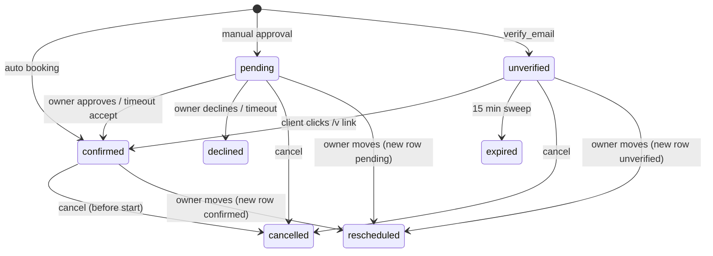

# Appointments lifecycle

> Scope: what happens to an appointment once it is booked: statuses, approval, e-mail verification, cancellation, reschedule, reminders, expiry, the waiting list, the `.ics` feed, the owner agenda and search, the client views, tokens and the health check. State as of commit `bc7f65c` (2026-10-17).
> Main code: `backend/app/models/{appointment,appointment_token,waitlist_entry,calendar_feed}.rb`, `backend/app/services/appointments/` (`decide`, `verify`, `client_cancel`, `release`, `reschedule`, `remind_now`, `send_reminders`, `resolve_expired`, `waitlist`, `ics`, `agenda`, `search`, `for_client`, `health`, `book/notify`, `book/receipt`), `backend/app/controllers/api/{me,public,admin}/`, `backend/app/mailers/{appointment,waitlist}_mailer.rb`, `frontend/app/routes/{agenda,a,m,v,w}/`, `frontend/app/modules/{agenda,appointments-tab,calendar-feed}/`.

Availability, slot computation and reservation (`Book`, `Cast`, `Reserve`, `Slots`, `FreeSlots`) are in [booking-engine](booking-engine.md). The generic e-mail plumbing (queue, budget, retries, preferences) is in [notifications-and-email](notifications-and-email.md). The decision record is [docs/appointments.md](../docs/appointments.md); this page does not repeat it.

## Summary

A booking made through `Forms::SubmitResponse` writes one `appointments` row per session, all sharing a `group_key` (one response = one group). The group starts `confirmed`, `pending` (manual approval, with a deadline) or `unverified` (e-mail verification, 15 minutes). Every later transition (approve, decline, verify, cancel, expire, reschedule) works on the whole group under a row lock, except cancel scopes `one`/`remaining` and reschedule, which touch single sessions. A transition that gives a place back calls `Appointments::Release`, which decrements the slot counter and, after commit, offers the place to the waiting list. Two recurring jobs drive time: `ResolvePendingAppointmentsJob` (every minute: expiry and waiting-list sweep) and `SendAppointmentRemindersJob` (every 5 minutes). Visitors act through hashed, expiring links (`/m`, `/a`, `/v`) and signed waiting-list links (`/w`); owners act from the agenda, the form's appointments tab or MCP tools.

## Glossary

- **Booking / group** (`group_key`, uuid): all appointment rows created by one submission. E-mails, decisions, verification, expiry and reminders are per group.
- **Session**: one appointment row = one slot (`slot_id`) at one start time.
- **Holding** (`Appointment::HOLDING`): `pending`, `unverified`, `confirmed`; statuses that occupy a place in the slot.
- **Snapshot** (`appointments.snapshot`): service `name`, `duration`, `price`, `currency`, group `total`, `sessions`, `monthly`, and `on_timeout` frozen at booking time.
- **Series**: a group whose rows have `snapshot.monthly` (monthly booking); the only case where the UI offers partial cancellation.
- **Manage / decide / verify token** (`AppointmentToken.purpose`): random link secrets stored as SHA-256 digests.
- **Waitlist entry** (`WaitlistEntry`): a person queued for one full time (form, service, `starts_at`).
- **Held place** (`appointment_slots.held`): a place reserved for an `offered` waitlist entry; counted against capacity like `booked`.
- **Calendar feed** (`CalendarFeed`): one secret `.ics` URL per owner.
- **Client account**: an active, verified `User` whose e-mail equals the booking e-mail (case-insensitive) (`Notification.client_account`, `backend/app/models/notification.rb:47`).

## Data

Full catalogue in [data-model](data-model.md).

| Table | Key columns | Constraints and notes |
|---|---|---|
| `appointments` | `form_id`, `response_id`, `slot_id`, `group_key` (uuid), `status`, `expires_at`, `decided_at`, `decided_by`, `decision_message`, `cancel_reason`, `cancelled_by`, `rescheduled_from_id`, `client_name`, `client_email`, `client_phone`, `client_time_zone`, `client_locale`, `snapshot` jsonb, `published_version`, `reminders_sent int[]`, `reminder_sent_at`, `owner_nudged_at` | `backend/db/schema.rb:94`. No CHECK on `status` (values only in code). CHECK `decided_by IN (owner, timeout, client)`, `cancelled_by IN (owner, client, system)`, `snapshot` is an object. FK `response_id`/`form_id` ON DELETE CASCADE, `slot_id` no cascade (slot cannot be deleted while referenced), `rescheduled_from_id` ON DELETE SET NULL (`backend/db/schema.rb:676-679`). Partial index on `expires_at` where status in (`pending`,`unverified`); index on `lower(client_email)`. |
| `appointment_tokens` | `appointment_id`, `purpose`, `digest` (unique), `expires_at`, `used_at`, `created_at` | `backend/db/schema.rb:82`. CHECK purpose in (`manage`,`approve`,`decline`,`decide`,`verify`); `approve`/`decline` are legacy values no code issues. FK ON DELETE CASCADE (`backend/db/schema.rb:675`). `used_at` is never written. |
| `waitlist_entries` | `form_id`, `service_key`, `starts_at`, `name` (≤100), `email` (≤254), `locale`, `time_zone`, `status`, `offered_until` | `backend/db/schema.rb:653`. CHECK status in (`waiting`,`offered`,`claimed`,`expired`,`left`). Unique `(form_id, service_key, starts_at, lower(email))` where status in (`waiting`,`offered`). FK to `forms` without cascade; `Form has_many :waitlist_entries, dependent: :delete_all` (`backend/app/models/form.rb:19`). |
| `calendar_feeds` | `user_id` (unique), `digest` (64, unique), `last_fetched_at` | `backend/db/schema.rb:154`. `User has_one :calendar_feed, dependent: :delete` (`backend/app/models/user.rb:68`). |
| `appointment_slots.held` | integer ≥ 0 | CHECK `capacity IS NULL OR booked + held <= capacity` (`backend/db/schema.rb:77`). Owned by [booking-engine](booking-engine.md); this page writes `held` (waitlist) and decrements `booked` (Release). |
| `notifications` | one row per event × recipient × channel | Unique `(kind, event_key, channel, recipient_kind, coalesce(user_id, recipient_email))` (`backend/db/schema.rb:306`) is the idempotency guard for every appointment e-mail. Owned by [notifications-and-email](notifications-and-email.md). |

Valkey/cache key: `appointments:health:alerted:<alert>` (1 hour, `backend/app/jobs/appointments_health_job.rb:13`). Queue: `notifications` (resolve, reminders, deliveries), `default` (health).

## Business rules

### Statuses and grouping

- **AP-01** Appointment statuses are `pending`, `unverified`, `confirmed`, `cancelled`, `declined`, `expired`, `rescheduled` (`backend/app/services/appointments/search.rb:5`). Only `pending`, `unverified`, `confirmed` hold a place (`backend/app/models/appointment.rb:2`). The database does not constrain `status`. — test `backend/spec/requests/api/me/agenda_spec.rb:185`.
- **AP-02** Initial status is chosen once per group in `Book.call`: `pending` when `needs_approval?`; else `unverified` when `approval != "manual"`, `verify_email == true` and the contact has an e-mail; else `confirmed` (`backend/app/services/appointments/book.rb:31-35`). — tests `backend/spec/requests/api/public/booking_verification_spec.rb:75`, `backend/spec/requests/api/public/booking_approval_window_spec.rb:45`.
- **AP-03** `needs_approval?` is true when `approval == "manual"` and either `approval_within_minutes` is unset or the earliest session starts before `now + approval_within_minutes` (`backend/app/services/appointments/book.rb:82-87`). A manual form whose booking is further away than the window is confirmed on the spot, with no deadline and **no e-mail verification even if `verify_email` is on** (AP-02 excludes `approval == "manual"`). — test `backend/spec/requests/api/public/booking_approval_window_spec.rb:52`, `:61`, `:75`.
- **AP-04** Deadlines: `pending` gets `expires_at = now + approval_timeout_minutes` (default 1440, range 5..43 200); `unverified` gets `now + 15 min` (`Forms::BookingSchema::VERIFY_MINUTES`) (`backend/app/services/appointments/book.rb:36-37`, `backend/app/services/forms/booking_schema.rb:8-12`).
- **AP-05** `snapshot.on_timeout` stores `approval_on_timeout` (`decline` default, or `accept`) at booking time, so changing the rule later does not affect waiting requests (`backend/app/services/appointments/book.rb:47`; commit d565d2e, #155). — test `backend/spec/requests/api/public/appointment_expiry_spec.rb:148`.
- **AP-06** Every group transition locks the group's rows (`SELECT ... FOR UPDATE` ordered by id) and re-reads the status inside the transaction, so a repeated or concurrent action changes nothing and sends nothing (`backend/app/services/appointments/decide.rb:13`, `backend/app/services/appointments/verify.rb:8`, `backend/app/services/appointments/client_cancel.rb:17`, `backend/app/services/appointments/resolve_expired.rb:22,33`). — test `backend/spec/requests/api/public/appointment_decision_spec.rb:108`, `backend/spec/requests/api/public/booking_verification_spec.rb:110`, `backend/spec/requests/api/public/appointment_manage_spec.rb:104`.

### Approval (pending)

- **AP-07** Owner decision (`approve`/`decline`) applies to every `pending` row of the group; it returns `:already_decided` when none is pending and `:expired` when the first row's `expires_at <= now`, even before the sweep ran (`backend/app/services/appointments/decide.rb:28-33`). — test `backend/spec/requests/api/me/appointment_decisions_spec.rb:91`, `backend/spec/requests/api/public/appointment_decision_spec.rb:122`.
- **AP-08** Approve sets `confirmed`, `decided_by=owner`; decline sets `declined` and releases the slots. The owner's optional message is stripped and cut to 500 chars into `decision_message` (`backend/app/services/appointments/decide.rb:6,17-20`). The client gets `appointment_confirmed` or `appointment_declined` when the booking has an e-mail (`backend/app/services/appointments/decide.rb:35-41`).
- **AP-09** Decision channels: logged-in owner (`POST /api/me/appointments/:id/approve|decline`), the decide link `/a/:token` from the owner's new-request e-mail, and MCP `approve_appointment`/`decline_appointment`. All call `Appointments::Decide`.
- **AP-10** At the deadline `ResolveExpired.decline` confirms the group when `on_timeout == "accept"` **and** every session is still ahead; otherwise it declines and releases (`backend/app/services/appointments/resolve_expired.rb:36-38`). `decided_by=timeout`. Owner gets in-app/push `appointment_auto_confirmed` or `appointment_expired` (no owner e-mail exists for these kinds, `backend/app/models/notification_preference.rb:7-8`); client gets `appointment_confirmed`/`appointment_declined` (`backend/app/services/appointments/resolve_expired.rb:44-51`). — test `backend/spec/requests/api/public/appointment_expiry_spec.rb:69`, `:119`, `:133`.

### E-mail verification (unverified)

- **AP-11** Verification is requested only in automatic mode with `rules.verify_email == true`; publishing is blocked (`no_email`) without a required e-mail question (`backend/app/services/forms/booking_schema.rb:140`), and the first required e-mail question is the contact (`backend/app/services/forms/submit_response.rb:102-105`).
- **AP-12** While `unverified`, the place is held and only the client is told (`appointment_verify` e-mail; no owner notice, no in-app mirror) (`backend/app/services/appointments/book.rb:71-72`, `backend/app/services/appointments/book/notify.rb:17-27`, `backend/app/models/notification.rb:25`). — test `backend/spec/requests/api/public/booking_verification_spec.rb:56`, e2e `e2e/tests/emails-verify-waitlist-login.spec.ts:80`.
- **AP-13** Clicking confirm (POST, never GET) sets the group `confirmed`, `expires_at=nil`, `decided_by=client`, then sends exactly what an automatic booking sends (`Book.announce`: owner in-app/push/e-mail `appointment_created`, client `appointment_confirmed`) (`backend/app/services/appointments/verify.rb:12-15`). Refused after `expires_at` even before the sweep (`backend/app/services/appointments/verify.rb:24`). — test `backend/spec/requests/api/public/booking_verification_spec.rb:98`, `:119`.
- **AP-14** No click: the sweep sets `expired`, `decided_by=timeout`, releases the places, and notifies nobody (`backend/app/services/appointments/resolve_expired.rb:20-29`; commit 4f45686, #186). The queued verify e-mail is dropped at delivery if no row is `unverified` any more (`backend/app/services/notifications/deliver.rb:26`). — test `backend/spec/requests/api/public/booking_verification_spec.rb:151`, `:162`.

### Tokens

- **AP-15** `AppointmentToken.issue` makes `SecureRandom.urlsafe_base64(32)` (43 chars), stores only `SHA256(raw)` and returns the raw value once (`backend/app/models/appointment_token.rb:6-10`). `resolve` matches digest **and** purpose and refuses expired rows (`backend/app/models/appointment_token.rb:12-17`). Unknown, expired, wrong-purpose and foreign tokens answer the same 404 `not_found`. — test `backend/spec/requests/api/public/appointment_manage_spec.rb:55`, `:130`; `backend/spec/requests/api/public/appointment_decision_spec.rb:65`, `:74`; `backend/spec/requests/api/public/booking_verification_spec.rb:127`.
- **AP-16** Token kinds and TTL:

  | Purpose | Issued by | TTL | Route | Bound to |
  |---|---|---|---|---|
  | `manage` | booking receipt (`backend/app/services/appointments/book/receipt.rb:33`), every client e-mail with a manage link (`backend/app/mailers/appointment_mailer.rb:125,128`), `POST /api/me/bookings/:group_key/manage_link` (`backend/app/services/appointments/for_client.rb:20-27`) | `max(last session start, now) + 7 days` (receipt), `last session start + 7 days` (mail) | `/m/:token` | first row of the group |
  | `decide` | owner `new_request` e-mail (`backend/app/mailers/appointment_mailer.rb:51`) | last session start + 7 days | `/a/:token` | first pending row |
  | `verify` | client `verify` e-mail (`backend/app/mailers/appointment_mailer.rb:65`) | `expires_at + 1 hour` (75 min after booking) | `/v/:token` | first row |

- **AP-17** Tokens are **not single-use** and are not revoked by a transition: `used_at` is never set; a manage link keeps opening the booking (also after cancellation) until it expires; repeated actions are harmless because of AP-06. A new token row is created every time a mail renders, and rows are only deleted with their appointment (FK cascade). Scope of every token is the whole group (`group_key`), whichever row it points to.
- **AP-18** Waitlist links are not stored: `WaitlistEntry#token` is `signed_id(purpose: :waitlist, expires_at: starts_at + 1 day)`; `from_token` accepts 20..400 chars (`backend/app/models/waitlist_entry.rb:10-16`). They cannot be revoked; the entry status decides what they can still do. — test `backend/spec/requests/api/public/waitlist_spec.rb:305`.

### Cancellation

- **AP-19** `ClientCancel` cancels only holding rows whose slot has **not started yet** (`slot.starts_at > now`); there is no other cut-off (no minimum notice for cancelling) (`backend/app/services/appointments/client_cancel.rb:17`). Cancelling a `pending` or `unverified` booking is allowed. — test `backend/spec/requests/api/public/appointment_manage_spec.rb:115`, `backend/spec/requests/api/me/appointment_decisions_spec.rb:127`, `backend/spec/requests/api/public/booking_verification_spec.rb:172`.
- **AP-20** Scopes (`SCOPES = all, one, remaining`, `backend/app/services/appointments/client_cancel.rb:10,32-38`): `all` = every upcoming session of the group (default; unknown values fall back to `all`); `one` = the target row; `remaining` = upcoming rows of the **same service** starting at or after the target. The public endpoint finds the target by `session` = ISO 8601 start time, 422 `unknown_session` otherwise (`backend/app/controllers/api/public/appointments_controller.rb:24-45`).
- **AP-21** Effect: `status=cancelled`, `cancelled_by` = `client` or `owner`, `cancel_reason` stripped and cut to 500 chars, `decided_at=now`; places released (`backend/app/services/appointments/client_cancel.rb:21-22`). `cancelled_by = system` is allowed by the schema but never written.
- **AP-22** Notifications: client cancels → owner in-app/push + owner e-mail `owner_cancelled` (switchable preference) + client e-mail `cancelled`; owner cancels (agenda, API, MCP) → only the client e-mail (`backend/app/services/appointments/client_cancel.rb:40-51`; commit 2df0928, #199). Event key is `group_key` for `all` and `<group>:<scope><first id>` otherwise, so each partial cancellation mails once. Mails list only `payload.cancelled_ids` (`backend/app/mailers/appointment_mailer.rb:80-81`). — test `backend/spec/requests/api/public/owner_cancel_email_spec.rb:61`, `:91`, `:98`.
- **AP-23** Owner endpoint answers 422 `nothing_to_cancel` when nothing was cancelled; the public endpoint always answers 200 with the current state (`backend/app/controllers/api/me/appointments_controller.rb:13-18`, `backend/app/controllers/api/public/appointments_controller.rb:24-31`).
- **AP-24** UI only: partial cancellation buttons appear on `/m/:token` and in the agenda dialog only for a series (`frontend/app/routes/m/$token.tsx:131-160`, `frontend/app/routes/agenda/session-panel.tsx:449-493`); the agenda sends `scope` only for a series, so a non-series cancel from the agenda cancels the whole group. The API and MCP accept any scope for any booking.
- **AP-25** A confirmed booking can still be cancelled by link after the form closed or was unpublished (no form-state check). — e2e `e2e/tests/emails-booking.spec.ts:248`.

### Reschedule (owner only)

- **AP-26** `Reschedule` moves **one session**. Guards: the service still exists in the published definition, the row is holding, its slot has not started (`backend/app/services/appointments/reschedule.rb:12`); not the same instant (`:same_time`, 422); target must be free (`:unavailable`, 409); else 422 `not_reschedulable` (`appointments_controller.rb:20-28`).
- **AP-27** Without `force` the target must be a time the service offers on that date with the booked duration, ignoring `min_notice_minutes` (`backend/app/services/appointments/reschedule.rb:40-47`). With `force=true` (agenda drag-and-drop) any future time in the form's zone is accepted, the weekly hours are skipped, and `Reserve` still enforces capacity and the shared-resource exclusion (`backend/app/services/appointments/reschedule.rb:49-54`; commit 0b5c572, #219). MCP never passes `force`. — test `backend/spec/requests/api/me/appointment_actions_spec.rb:134`, `:142`, `:154`.
- **AP-28** In one transaction: lock old row, reserve new slot, release old slot, mark old `rescheduled`, create a new row copying group, status, `expires_at`, contact, snapshot, `decided_by`, with `rescheduled_from_id` and the owner's message (≤500) (`backend/app/services/appointments/reschedule.rb:21-32,70-72`). `reminders_sent` is not copied, so the moved session can be reminded again. A pending request stays pending with its deadline. — test `backend/spec/requests/api/me/appointment_actions_spec.rb:77`, `:126`.
- **AP-29** The client gets `appointment_rescheduled` (old and new time, message), event key `<group>:r<new id>` (`backend/app/services/appointments/reschedule.rb:74-80`). `rescheduled` rows are hidden from client pages, mails, `ForClient` and the owner group view (`backend/app/mailers/appointment_mailer.rb:79`, `backend/app/services/appointments/for_client.rb:50`, `appointments_controller.rb:55`).
- **AP-30** Agenda drag moves every client of the session except `unverified` ones, one call per appointment, and only onto a future time of the same form and service with room (frontend check `frontend/app/modules/agenda/agenda-layout.ts:32-46`, `frontend/app/routes/agenda/index.tsx:233-255`).

### Reminders

- **AP-31** Lead times come from `rules.reminder_minutes`: up to 3 distinct integers in 15..10 080; unset = `[1440]`; `[]` = none (`backend/app/services/forms/booking_schema.rb:13-14,347-349`, `backend/app/services/appointments/send_reminders.rb:5,16-19`). — test `backend/spec/requests/api/public/booking_reminder_leads_spec.rb:64`, `:72`, `:93`.
- **AP-32** Every 5 minutes, for each group of `confirmed` rows with an e-mail and a session in `(now, now + 7 days]`, a lead is due when `first start − lead <= now` and the booking was created at or before `first start − lead` (a lead already past at booking time is skipped). Only the smallest due lead is mailed; all due leads are added to `reminders_sent` of every confirmed row of the group (`backend/app/services/appointments/send_reminders.rb:8-39`; commit f2e1903, #185). — test `backend/spec/requests/api/public/booking_reminder_leads_spec.rb:35`, `:46`, `:54`.
- **AP-33** Idempotency: `reminders_sent` plus the notification unique key `<group>:r<lead>`. The reminder is not dispatched immediately; `DispatchNotificationsJob` (every minute) picks it up. Delivery is dropped if the group has no `confirmed` row any more (`backend/app/services/notifications/deliver.rb:24`) and uses a 0.5 share of the mail budget (`backend/app/services/notifications/deliver.rb:6`). — test `backend/spec/requests/api/public/booking_reminders_spec.rb:94`, `:105`.
- **AP-34** Remind now (owner, MCP): needs an e-mail and a confirmed upcoming session; refused (429 `too_soon`) if any `appointment_reminder` e-mail for the group was created in the last hour, automatic ones included; does not touch `reminders_sent` (`backend/app/services/appointments/remind_now.rb:5-21`). — test `backend/spec/requests/api/me/appointment_actions_spec.rb:204`, `:213`.

### Release and waiting list

- **AP-35** `Release.call(slot_ids)` decrements `booked` by the number of rows per slot with `GREATEST(booked - n, 0)`, in slot id order, and after all transactions commit calls `Waitlist.offer_for` (`backend/app/services/appointments/release.rb:5-11`). Callers: decline, timeout decline, verify timeout, cancel, reschedule (old slot), response deletion (`backend/app/models/form_response.rb:9`, `backend/app/controllers/api/me/form_responses_controller.rb:47`).
- **AP-36** Join: the waiting list must be on (`rules.waitlist == true`), the service must have a capacity, the time must be one the service offers, and the slot must be full by the **current** capacity (`booked + held >= capacity`) (`backend/app/services/appointments/waitlist.rb:25-41`). Name: control chars → space, strip, ≤100; e-mail: 3..`EMAIL_MAX`, one `@`, no spaces, dotted domain (`backend/app/services/appointments/waitlist.rb:30-32,97-102`). — test `backend/spec/requests/api/public/waitlist_spec.rb:153`, `:166`.
- **AP-37** Limits: ≤20 `waiting` per time (`list_full` → 409 `waitlist_full`); ≤5 active entries per e-mail per form (`too_many` → 429 `too_many_waitlists`); joining twice returns the existing entry (`backend/app/services/appointments/waitlist.rb:5-6,114-127`). The public endpoint also needs an accepting form (410 `closed`), Turnstile, and silently accepts the `website` honeypot (`backend/app/controllers/api/public/waitlists_controller.rb:11-48`). Publishing is blocked (`waitlist_questions`) when the form has required questions other than one short text, one e-mail and the booking (`backend/app/services/forms/booking_schema.rb:136-139`).
- **AP-38** Offer: for each released slot, oldest `waiting` entry first (`order(:id)`, FIFO) for the same form, service and start, still in the future; `held += 1` only if `booked + held < capacity`; the entry becomes `offered` with `offered_until = min(now + waitlist_confirm_minutes, starts_at)` (default 120, range 15..4 320); loop while places remain (`backend/app/services/appointments/waitlist.rb:129-142`). — test `backend/spec/requests/api/public/waitlist_spec.rb:179`, `:325`.
- **AP-39** Claim (`offered`, before `offered_until`): books through `Forms::SubmitResponse` with `claim_at`, the entry's contact, and the held slot's duration; `Reserve` converts `held` into `booked`. Success → `claimed`; any failure → give up: release the hold, `expired`, offer the next person (`backend/app/services/appointments/waitlist.rb:49-66,150-170`). The resulting booking follows the form's rules, so it can be `pending` or `unverified`. Works after the form closed. — test `backend/spec/requests/api/public/waitlist_spec.rb:209`, `:222`, `:263`.
- **AP-40** Leave (`waiting`/`offered`): `left`; an offered hold is released and passed on (`backend/app/services/appointments/waitlist.rb:68-78`). Sweep (every minute, inside `ResolvePendingAppointmentsJob`): offers past `offered_until` and every active entry whose time has started become `expired`, holds released and re-offered (`backend/app/services/appointments/waitlist.rb:80-93`). — test `backend/spec/requests/api/public/waitlist_spec.rb:237`, `:252`, `:290`.
- **AP-41** Waitlist mails (`joined`, `offered`) go straight to `WaitlistMailer.deliver_later` when `MailBudget.reserve(share: 0.8)` allows, not through the `notifications` table, so they have no retry and no dedupe row; a verified client account also gets an in-app `waitlist_joined`/`waitlist_offered` notice (with the `/w` path only while the entry is active) (`backend/app/services/appointments/waitlist.rb:172-201`, `backend/app/models/notification.rb:55-63`). — test `backend/spec/requests/api/public/waitlist_spec.rb:392`, `:414`, `:440`.

### Calendar feed (.ics)

- **AP-42** One feed per owner. `CalendarFeed.issue` deletes the previous row and stores the SHA-256 digest of a 43-char random token; the URL `<API base>/api/public/calendar/<raw>` is shown once (`backend/app/models/calendar_feed.rb:4-11`, `backend/app/controllers/api/me/calendar_feeds_controller.rb:9-12`). Revoke deletes the row. `resolve` accepts only `/\A[A-Za-z0-9_-]{43}\z/` (`backend/app/models/calendar_feed.rb:13-15`). — test `backend/spec/requests/api/me/calendar_feed_spec.rb:44`, `:57`, `:68`.
- **AP-43** Content: `confirmed` appointments of the owner's forms with a start in `[now − 30 days, now + 365 days]`, at most 2 000, ordered by start; one `VEVENT` per appointment with `UID:appointment-<id>@kurz.fyi`, UTC `DTSTART`/`DTEND` (snapshot duration, 30 min fallback), `SUMMARY` = service · client name, `DESCRIPTION` = form title, `STATUS:CONFIRMED`; control chars removed, newlines flattened, `\ ; ,` escaped, lines folded at 75 bytes (`backend/app/services/appointments/ics.rb:5-53`). — test `backend/spec/requests/api/me/calendar_feed_spec.rb:89`, `:110`, `:119`.
- **AP-44** Serving: 60 requests/min per IP; wrong, malformed, revoked tokens and deactivated owners answer the same 404; `Cache-Control: private, no-store`, `Referrer-Policy: no-referrer`; `last_fetched_at` updated on each read (`backend/app/controllers/api/public/calendars_controller.rb:4-19`). — test `backend/spec/requests/api/me/calendar_feed_spec.rb:131`, `:142`, `:149`.
- **AP-45** There is **no per-booking calendar file** (no `.ics` attachment or "add to calendar" link in any e-mail or page); the only calendar export is the owner feed.

### Agenda, appointments tab, client views

- **AP-46** `GET /api/me/agenda?from&to` (ISO dates, `to >= from`, at most 62 days, else 422 `invalid_range`) returns sessions in the owner's `users.time_zone` (`backend/app/controllers/api/me/agenda_controller.rb:4-13`, `backend/app/services/appointments/slots.rb:5`). It merges **stored** slots with `booked > 0 or held > 0` (past and future facts) and **derived** future times of published forms computed with open rules (min notice 0, window 36 500 days, buffer 0, no daily limit), stored wins on the same `(form, resource, start)` (`backend/app/services/appointments/agenda.rb:6-50`). Service name and capacity come from the published service, falling back to the slot/snapshot when the service is gone (commit ea2e335). Each session lists only holding appointments and counts `pending`. — test `backend/spec/requests/api/me/agenda_spec.rb:83`, `:139`, `:149`, `:195`.
- **AP-47** Agenda filters are client-side only: hide forms, hide categories, "waiting only" (sessions with pending > 0), show/hide my own bookings as a client; "approve all" approves one row per pending group in view (`frontend/app/routes/agenda/index.tsx:146-266`, `frontend/app/modules/agenda/agenda-actions.ts:7-23`). Views: day/week/month, phone forces day.
- **AP-48** Appointments tab `GET /api/me/forms/:id/appointments`: filter `status` (unknown ignored), `q` (ILIKE on name or e-mail, wildcards escaped, ≤100 chars), `from`/`to` in the owner's zone; newest id first, page 50 with `before` cursor (`backend/app/services/appointments/search.rb:8-15`, `backend/app/controllers/api/me/form_appointments_controller.rb:7-17`). Export CSV/XLSX up to 50 000 rows (413 `export_too_large`), oldest start first, cells starting with `= + - @ TAB CR` prefixed with `'`, XLSX cells typed as text (`backend/app/services/appointments/search.rb:6,31-40`, `backend/app/controllers/api/me/form_appointments_controller.rb:19-57`). — test `backend/spec/requests/api/me/form_appointments_spec.rb:97`, `:154`, `:166`.
- **AP-49** Client bookings `GET /api/me/bookings` need a verified account and match `lower(client_email)`, excluding `rescheduled`; without a range the 50 newest groups, with a range (≤62 days, user's zone) up to 200 groups by first session (`backend/app/services/appointments/for_client.rb:5-18,43-51`, `backend/app/controllers/api/me/bookings_controller.rb:12-22`). The group status shown is `confirmed` if any row is, else another holding status, else `cancelled` (also for declined/expired groups) (`backend/app/services/appointments/for_client.rb:33`). — test `backend/spec/requests/api/me/bookings_spec.rb:66`, `:116`.

### Health

- **AP-50** `Appointments::Health` reports: overdue `pending`/`unverified` groups and the oldest lag; pending e-mail/push notifications due and the oldest age; failed notifications in the last day; `notifications` queue lag (Solid Queue ready executions); today's mail budget use; MCP `insufficient_scope` denials per appointment read/config tool in the last day (`backend/app/services/appointments/health.rb:5-58`). Alerts: `pending_overdue` (> 300 s), `notification_queue_lag` (> 300 s), `email_budget` (≥ 80 %), `notifications_failed` (> 0) (`backend/app/services/appointments/health.rb:60-67`). — test `backend/spec/requests/api/admin/appointments_health_spec.rb:46-89`.
- **AP-51** Only admins see it (`GET /api/admin/appointments_health`, `AppointmentHealthPolicy#show?` = `user.admin?`). `AppointmentsHealthJob` (every 5 minutes) logs one line and sends each alert to Sentry at most once per hour (`backend/app/jobs/appointments_health_job.rb:4-17`). — test `backend/spec/requests/api/admin/appointments_health_spec.rb:28`, `:100`.

## Flows

**Auto booking.** `SubmitResponse` → `Book.call` inserts rows `confirmed` → `Notify.announce`: owner in-app + push `appointment_created`, owner e-mail `new_booking` (if preference on), client e-mail `confirmed` with manage link (if e-mail), all queued in the same transaction and dispatched after commit (`backend/app/services/appointments/book/notify.rb:6-54`). The receipt returned to the browser carries a fresh manage URL (`backend/app/services/appointments/book/receipt.rb:17-35`). A client account also gets in-app mirrors of client e-mails except `appointment_verify` (`backend/app/models/notification.rb:25-45`).

**Manual booking.** Rows `pending` with `expires_at` → owner in-app/push `appointment_requested`, owner e-mail `new_request` (deadline, accept-on-timeout flag, decide link), client e-mail `request_received` with manage link. Then AP-07..AP-10.

**Verification.** Rows `unverified` → client e-mail `verify` (`/v/:token`) → POST confirm → AP-13, or sweep → AP-14.

**Cancel by client.** `/m/:token` → `POST /api/public/appointments/:token/cancel {reason, scope, session}` → lock group → cancel → Release → owner + client notices → after commit, waitlist offer.

**Waitlist.** Public form shows `full` times (slots endpoint, [booking-engine](booking-engine.md)) → `POST /api/public/forms/:public_id/waitlist` → `joined` mail with `/w` link → a place frees (AP-35) → `offered` mail → `/w/:token` claim → normal booking mails.

**Jobs.** `ResolvePendingAppointmentsJob` every minute: log lag, `ResolveExpired.call` (unverified first, then pending, group by group, each in its own transaction), `Waitlist.sweep` (`backend/app/jobs/resolve_pending_appointments_job.rb:4-9`).

### E-mail catalogue for this domain

| Event | Notification kind → template | To | Trigger |
|---|---|---|---|
| Auto booking / verified / approved / accepted on timeout | `appointment_confirmed` → `confirmed` | client | Book, Verify, Decide, ResolveExpired |
| Auto booking / verified | `appointment_created` → `new_booking` | owner | Book, Verify |
| Manual request | `appointment_requested` → `new_request` | owner | Book |
| Manual request | `appointment_request_received` → `request_received` | client | Book |
| Verification needed | `appointment_verify` → `verify` | client | Book |
| Declined (owner or timeout) | `appointment_declined` → `declined` | client | Decide, ResolveExpired |
| Cancelled | `appointment_cancelled` → `cancelled` | client | ClientCancel |
| Cancelled by client | `appointment_cancelled` → `owner_cancelled` | owner | ClientCancel |
| Rescheduled | `appointment_rescheduled` → `rescheduled` | client | Reschedule |
| Reminder | `appointment_reminder` → `reminder` | client | SendReminders, RemindNow |
| Waitlist joined / offered | — → `WaitlistMailer#joined` / `#offered` | entry e-mail | Waitlist |

Mapping in `backend/app/services/notifications/deliver.rb:11`. Owner-only in-app/push kinds without e-mail: `appointment_expired`, `appointment_auto_confirmed`.

## States and transitions

### `appointments.status`

| From | Event | To | Guard | Side effects |
|---|---|---|---|---|
| — | submit, auto | `confirmed` | slot free | owner created notices, client confirmed mail |
| — | submit, manual in window | `pending` | AP-03 | `expires_at`; owner request, client receipt |
| — | submit, verify on | `unverified` | AP-02 | `expires_at` +15 min; client verify mail |
| `pending` | owner approve (API, `/a`, MCP) | `confirmed` | before `expires_at` | client confirmed mail |
| `pending` | owner decline | `declined` | before `expires_at` | Release, client declined mail |
| `pending` | sweep, on_timeout accept | `confirmed` | all sessions ahead | owner auto_confirmed notice, client confirmed mail |
| `pending` | sweep, otherwise | `declined` | `expires_at <= now` | Release, owner expired notice, client declined mail |
| `unverified` | client confirm `/v` | `confirmed` | before `expires_at` | owner created notices, client confirmed mail |
| `unverified` | sweep | `expired` | `expires_at <= now` | Release, no notice |
| holding | cancel (client `/m`, owner API/agenda, MCP) | `cancelled` | slot not started | Release, mails per AP-22 |
| holding | owner reschedule | `rescheduled` (+ new row same status) | AP-26 | Release old, reserve new, client mail |

No transition leaves `cancelled`, `declined`, `expired` or `rescheduled`. Rows whose session passed stay `confirmed` (there is no `completed`/`no_show`).

### `waitlist_entries.status`

| From | Event | To | Guard | Side effects |
|---|---|---|---|---|
| — | join | `waiting` | AP-36, AP-37 | `joined` mail, in-app notice |
| `waiting` | place released | `offered` | first in line, room for a hold | `held += 1`, `offered` mail |
| `offered` | claim | `claimed` | before `offered_until`, booking succeeds | normal booking |
| `offered` | claim fails | `expired` | — | hold released, next offered |
| `waiting`/`offered` | leave | `left` | — | hold released and re-offered |
| `offered` | sweep | `expired` | `offered_until <= now` | hold released and re-offered |
| `waiting`/`offered` | sweep | `expired` | `starts_at <= now` | hold released |

## Limits and configuration

| Name | Value | Where | Notes |
|---|---|---|---|
| `approval_timeout_minutes` | default 1440, 5..43 200 | `backend/app/services/forms/booking_schema.rb:8,11` | pending deadline |
| `approval_on_timeout` | `decline` (default), `accept` | `backend/app/services/forms/booking_schema.rb:10,93` | frozen in snapshot |
| `approval_within_minutes` | 1..43 200, unset = always | `backend/app/services/forms/booking_schema.rb:8` | manual only inside window |
| `VERIFY_MINUTES` | 15 | `backend/app/services/forms/booking_schema.rb:12` | not configurable |
| Verify token TTL | `expires_at + 1 h` | `backend/app/mailers/appointment_mailer.rb:65` | |
| Manage / decide token TTL | last start + 7 days | `backend/app/mailers/appointment_mailer.rb:125`, `backend/app/services/appointments/book/receipt.rb:33` | |
| Waitlist link TTL | `starts_at + 1 day` | `backend/app/models/waitlist_entry.rb:11` | signed id |
| `reminder_minutes` | ≤3 distinct, 15..10 080; default [1440] | `backend/app/services/forms/booking_schema.rb:13-14`, `backend/app/services/appointments/send_reminders.rb:5` | |
| Remind-now cooldown | 1 hour per group | `backend/app/services/appointments/remind_now.rb:5` | |
| Message / reason length | 500 | `backend/app/services/appointments/decide.rb:6`, `backend/app/services/appointments/client_cancel.rb:8`, `backend/app/services/appointments/reschedule.rb:5` | |
| Waitlist confirm window | default 120, 15..4 320 min | `backend/app/services/appointments/waitlist.rb:7-8` | capped at `starts_at` |
| Waitlist per time / per e-mail | 20 waiting / 5 active per form | `backend/app/services/appointments/waitlist.rb:5-6` | |
| Owner waitlist view | 200 active rows | `backend/app/controllers/api/me/form_waitlist_controller.rb:7` | |
| Agenda / bookings range | 62 days | `backend/app/services/appointments/slots.rb:5` | |
| Client bookings | 50 groups (no range), 200 (range) | `backend/app/services/appointments/for_client.rb:5-6` | |
| Appointments page / export | 50 / 50 000 | `backend/app/controllers/api/me/form_appointments_controller.rb:7`, `backend/app/services/appointments/search.rb:6` | |
| `.ics` window / size | −30 d .. +365 d, 2 000 events | `backend/app/services/appointments/ics.rb:5-7` | |
| Health thresholds | 300 s overdue, 300 s queue lag, 80 % budget | `backend/app/services/appointments/health.rb:5-7` | Sentry once/hour |
| Rate: manage show / cancel | 60 / 20 per min per IP | `backend/app/controllers/api/public/appointments_controller.rb:4-16` | |
| Rate: decision show / create | 60 / 20 per min per IP | `backend/app/controllers/api/public/appointment_decisions_controller.rb:4-16` | |
| Rate: verification show / create | 60 / 20 per min per IP | `backend/app/controllers/api/public/appointment_verifications_controller.rb:4-16` | |
| Rate: calendar | 60 per min per IP | `backend/app/controllers/api/public/calendars_controller.rb:4-8` | |
| Rate: waitlist join | 10 per 10 min per IP | `backend/app/controllers/api/public/waitlists_controller.rb:5-9` | plus Turnstile |
| Rate: waitlist show / act | 60 / 20 per min per IP | `backend/app/controllers/api/public/waitlist_entries_controller.rb:4-16` | |
| Rate: my manage link | 20 per min per user | `backend/app/controllers/api/me/bookings_controller.rb:5-10` | |
| MCP appointment actions | 30/hour and 100/day per user (shared), plus 20/hour per tool | `backend/app/services/mcp/tools/appointment_tool_helpers.rb:7`, each tool `requires ... limits` | see [mcp-and-oauth](mcp-and-oauth.md) |
| Mail budget share | 0.8 default, 0.5 reminders, 0.8 waitlist | `backend/app/services/notifications/deliver.rb:5-6`, `backend/app/services/appointments/waitlist.rb:183` | |
| `FRONTEND_URL` | env | `backend/app/services/appointments/book/receipt.rb:34` | base of `/m` links |

## Authorization and privacy

- **Anonymous with a token**: `/m` (manage: view, cancel), `/a` (decide; it is the owner's link, no login), `/v` (verify), `/w` (claim, leave), `.ics` feed. Possession of the link is the only credential. Frontend pages send `Referrer-Policy: no-referrer`, `frame-ancestors 'none'`, `noindex` (`frontend/app/routes/a/$token.tsx:17-30`, same in `m`, `v`, `w`).
- **Owner (session)**: actions only on appointments of `current_user.forms` (404 otherwise) (`appointments_controller.rb:58-60`); agenda, appointments tab, export, waitlist list, calendar feed.
- **Client account**: own bookings by verified e-mail match; can request a manage link (403 `email_not_verified` otherwise).
- **MCP**: `appointments:read` (`list_appointments`, `get_appointment`, `get_agenda`, record budget, visitor text wrapped as untrusted) and `appointments:manage` (`approve_appointment`, `decline_appointment`, `cancel_appointment`, `reschedule_appointment`, `remind_appointment`; `confirm` must repeat the id) (`backend/app/services/mcp/tools/appointment_tool_helpers.rb:10-16`).
- **Admin**: health endpoint only.
- **Personal data stored**: `client_name`, `client_email`, `client_time_zone`, `client_locale`, `cancel_reason`, `decision_message` on `appointments`; `name`, `email`, `locale`, `time_zone` on `waitlist_entries`; `client_phone` exists but is never written. The `.ics` feed exposes client names to whoever holds the URL. Decision page shows the client's name and e-mail to the link holder (`backend/app/controllers/api/public/appointment_decisions_controller.rb:46-47`); the waitlist page shows only the entry's own data.
- **Retention**: appointments live until their response, form or owner account is deleted (FK cascade; account purge after `DELETION_GRACE` 30 days, `backend/app/models/user.rb:37,129-149`). Deleting responses releases holding places silently (no client e-mail) and offers them to the waitlist. Waitlist entries in final states, expired tokens and calendar feed rows are never purged by a job. Notifications are purged after 90 days (`backend/app/models/notification.rb:2`, `PurgeOldNotificationsJob`); push payloads carry only ids.

## API and UI surface

| Endpoint | Controller#action |
|---|---|
| `POST /api/me/appointments/:id/{approve,decline,cancel,reschedule,remind}` | `api/me/appointments#…` |
| `GET /api/me/agenda` | `api/me/agenda#show` |
| `GET /api/me/bookings`, `POST /api/me/bookings/:group_key/manage_link` | `api/me/bookings#index`, `#manage_link` |
| `GET/POST/DELETE /api/me/calendar_feed` | `api/me/calendar_feeds#show/create/destroy` |
| `GET /api/me/forms/:id/appointments`, `/appointments_export`, `/waitlist` | `api/me/form_appointments#index/export`, `api/me/form_waitlist#index` |
| `GET /api/public/appointments/:token`, `POST …/cancel` | `api/public/appointments#show/cancel` |
| `GET/POST /api/public/appointment_decisions/:token` | `api/public/appointment_decisions#show/create` |
| `GET/POST /api/public/appointment_verifications/:token` | `api/public/appointment_verifications#show/create` |
| `POST /api/public/forms/:public_id/waitlist` | `api/public/waitlists#create` |
| `GET /api/public/waitlist/:token`, `POST …/claim`, `POST …/leave` | `api/public/waitlist_entries#show/claim/leave` |
| `GET /api/public/calendar/:token` | `api/public/calendars#show` |
| `GET /api/admin/appointments_health` | `api/admin/appointments_health#show` |

Routes in `backend/config/routes.rb:47,69-88,100-102,135-147`. Frontend: `/app/agenda` (`frontend/app/routes/agenda/`), `/a/:token`, `/m/:token`, `/v/:token`, `/w/:token`, calendar feed card on the account page (`frontend/app/modules/calendar-feed/index.tsx`), waitlist block on the public form (`frontend/app/modules/forms/waitlist-join.tsx`), appointments tab filters (`frontend/app/modules/appointments-tab/appointment-filters.ts`). Jobs (`backend/config/recurring.yml:68-79`): `send_appointment_reminders` every 5 minutes, `resolve_pending_appointments` every minute (queue `notifications`), `appointments_health` every 5 minutes (queue `default`).

## Decisions

### D-AP-01 Decisions and expiry are group-wide and swept, not scheduled per appointment
**Decision.** One recurring sweep resolves every overdue group; a decision always covers the whole group. **Why.** docs/appointments.md "Approval and deadlines"; commits 20e2e66 (#153), db2aad3 (#154). **Consequence.** Up to one minute of lag; actions also check `expires_at` themselves (AP-07, AP-13).

### D-AP-02 Accept-on-timeout is frozen at booking time
**Decision.** `on_timeout` lives in the snapshot. **Why.** "changing the rule later does not change a request already waiting" (d565d2e, #155). **Consequence.** Rule changes affect only new requests.

### D-AP-03 Verification only in automatic mode, silent on timeout
**Decision.** `unverified` holds the place 15 minutes; the owner hears nothing until confirmed; expiry is silent. **Why.** 4f45686 (#186). **Consequence.** Manual forms never verify e-mails (AP-03).

### D-AP-04 Link secrets are hashed and indistinguishable on failure
**Decision.** SHA-256 digests, like OAuth tokens; unknown, expired and foreign links answer alike. **Why.** 77e4027 (#148), 29ce4ed (#183). **Consequence.** A lost link cannot be recovered, only re-issued by a new mail or `manage_link`.

### D-AP-05 Reschedule creates a new row
**Decision.** Old row becomes `rescheduled`, new row linked by `rescheduled_from_id`, reminder reset. **Why.** 3a2b30f (#156). **Consequence.** Every read path must exclude `rescheduled`.

### D-AP-06 Owner moves can ignore the schedule
**Decision.** `force` skips weekly hours but needs a future time with room. **Why.** 0b5c572 (#219). **Consequence.** Off-schedule slots appear; the agenda hides stored slots nobody holds (c4575bf, #221).

### D-AP-07 Freed places go to the waiting list first, held on the slot
**Decision.** Any release offers the place to the first in line and holds it (`held`). **Why.** cc0ff4e (#189); full is judged by the current capacity (2399fef, #190). **Consequence.** Every availability check must count `held`.

### D-AP-08 Owner is e-mailed on client cancellations only
**Decision.** Client cancel e-mails the owner; owner cancel stays silent for the owner. **Why.** 2df0928 (#199).

### D-AP-09 Agenda shows the published service, appointments keep their booked name
**Decision.** Name and capacity from the published definition; snapshots keep what the visitor was told. **Why.** ea2e335.

## Change impact

- Adding a status → `Appointment::HOLDING`, `Search::STATUSES`, `ResolveExpired::WAITING`, `ForClient.summary`, MCP `list_appointments` enum, `frontend/app/modules/appointments-tab/appointment-filters.ts`, `schedule-events.ts` `HOLDING`, i18n status labels, and the partial index on `expires_at`. No DB check to migrate.
- Changing who is notified → `Notifications::Deliver::TEMPLATES`, `NotificationPreference::SUPPORTED`, mailer views in EN and pt-PT, the notification unique key (event keys), and [notifications-and-email](notifications-and-email.md).
- Changing `Release` → waitlist offers, response deletion paths, `appointment_slots` checks ([booking-engine](booking-engine.md)).
- Changing token TTL or purpose → `appointment_tokens_purpose_known` check (widen first, narrow in a later release), mailers, receipt, `ForClient.manage_url`.
- Changing reminder rules → `BookingSchema` validation, editor, `SendReminders.leads_for`, `Deliver` share.
- Changing the `.ics` content → privacy (client names), UID stability (calendar clients deduplicate on it).
- Reschedule or cancel semantics → MCP tool descriptions, agenda drag rules (`agenda-layout.ts:canReceive`), `/m` page buttons.
- Migrations: the previous release runs on the new schema for seconds (CLAUDE.md); do not drop `client_phone`, `owner_nudged_at`, `used_at` or token purposes in the same release that stops writing them.

## Tests that pin this behaviour

- Approval and expiry: `backend/spec/requests/api/public/appointment_decision_spec.rb`, `backend/spec/requests/api/me/appointment_decisions_spec.rb`, `backend/spec/requests/api/public/appointment_expiry_spec.rb`, `booking_approval_window_spec.rb`; e2e `e2e/tests/agenda-approval.spec.ts`.
- Verification: `backend/spec/requests/api/public/booking_verification_spec.rb`; e2e `e2e/tests/emails-verify-waitlist-login.spec.ts:20-107`.
- Manage and cancel: `backend/spec/requests/api/public/appointment_manage_spec.rb`, `owner_cancel_email_spec.rb`; e2e `e2e/tests/emails-booking.spec.ts:193,248`, `e2e/tests/client-account.spec.ts:48`.
- Reschedule and remind: `backend/spec/requests/api/me/appointment_actions_spec.rb`.
- Reminders: `booking_reminders_spec.rb`, `booking_reminder_leads_spec.rb`.
- E-mails: `booking_emails_spec.rb`; e2e `e2e/tests/emails-booking.spec.ts`.
- Waitlist: `backend/spec/requests/api/public/waitlist_spec.rb`; e2e `e2e/tests/waitlist.spec.ts`, `e2e/tests/emails-verify-waitlist-login.spec.ts:130-204`.
- Feed: `backend/spec/requests/api/me/calendar_feed_spec.rb`.
- Agenda, tab, client: `agenda_spec.rb`, `form_appointments_spec.rb`, `bookings_spec.rb`; `frontend/app/modules/agenda/agenda-actions.test.ts`, `agenda-layout.test.ts`, `frontend/app/modules/appointments-tab/appointment-filters.test.ts`; e2e `agenda-clients.spec.ts`, `client-account.spec.ts`.
- Health: `backend/spec/requests/api/admin/appointments_health_spec.rb`.
- MCP: `backend/spec/requests/mcp_appointment_manage_spec.rb`, `mcp_appointment_tools_spec.rb`; security: `appointment_security_spec.rb`, `appointment_security_gates_spec.rb`.

## Drift and open questions

- **Medium** — docs/appointments.md lists token purposes `manage`, `approve`, `decline`; the code issues `manage`, `decide`, `verify` (`backend/app/models/appointment_token.rb:2`); the DB check still allows the unused `approve`/`decline`.
- **Low** — docs say `booked` stays between 0 and `capacity`; the constraint is now `booked + held <= capacity`.
- **Low** — docs say release is `GREATEST(booked - 1, 0)`; it subtracts the count per slot and triggers waitlist offers.
- **Low** — docs describe cancel scope `remaining` but not `one`; docs say notifications are delivered right after commit, but automatic reminders wait for the 1-minute dispatch sweep.
- **Medium** — `SendReminders.leads_for` reads `form.fields` (the draft), not the published definition, so an unpublished draft change to `reminder_minutes` applies at once (`backend/app/services/appointments/send_reminders.rb:17`). `Agenda#category` also reads the draft (`backend/app/services/appointments/agenda.rb:57`).
- **Medium** — Deleting responses, a form or the owner account removes upcoming appointments without telling the client.
- **Medium** — No retention purge for waitlist entries, expired tokens or old appointments' personal data.
- **Low** — Waitlist mails bypass the `notifications` table: no retry, no dedupe, no health visibility.
- **Low** — `ForClient.summary` reports declined or expired bookings as `cancelled`.
- **Low** — Decision and verification payloads include `rescheduled` rows (no filter), unlike the manage page.
- **Low** — `Health::APPOINTMENT_TOOLS` omits the write tools (approve, decline, cancel, remind, reschedule), so their scope denials are not counted.
- **Low** — `.ics` falls back to 30 minutes, the agenda UI to 60 (`frontend/app/modules/agenda/agenda-layout.ts:5`); `UID`/`PRODID` hard-code `kurz.fyi`.
- **Low** — The owner can reschedule an `unverified` row through the API or MCP (the agenda drag skips them).
- **Low** — A unique-key collision in `SendReminders` (e.g. two overlapping job runs) raises out of the job and stops the remaining groups for that run.
- **Low** — Unused columns: `client_phone`, `owner_nudged_at`, `appointment_tokens.used_at`; `cancelled_by = system` never written.
- **Low** — Several specs still say "404 with the feature off" though the feature flag was removed (e.g. `backend/spec/requests/api/me/appointment_actions_spec.rb:62`).
- **Open** — Per-tool MCP limit `[[20, 1.hour]]` vs the description's "30 a hour" shared limit; which one binds first is in [mcp-and-oauth](mcp-and-oauth.md).
