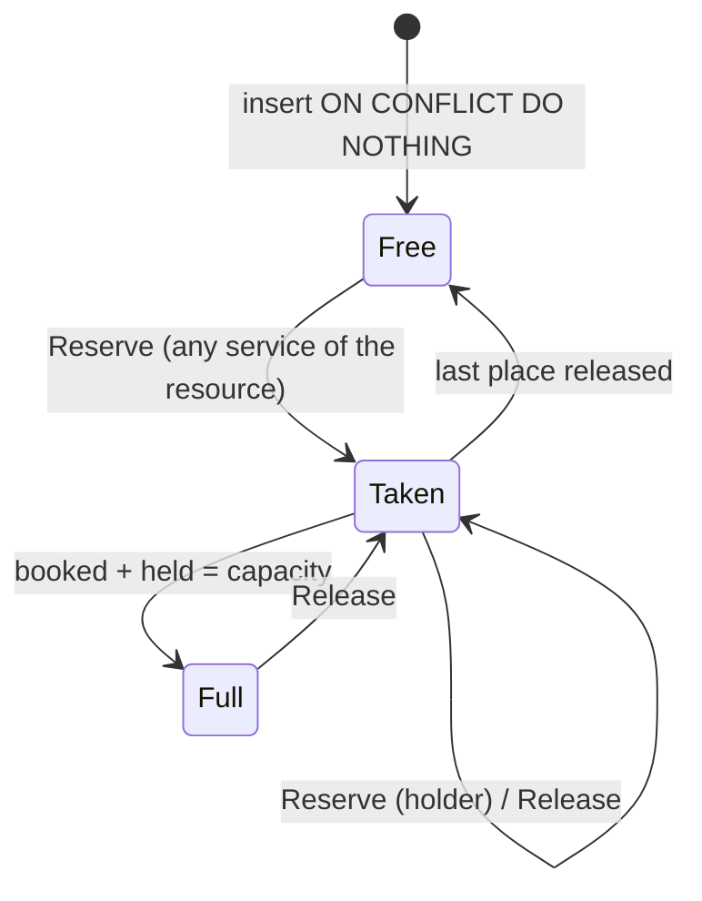

# Booking engine

> Scope: the booking question's configuration, its modes, availability and slot computation, durations, prices, resources, reservation, monthly offers, several services in one booking, impact and the time generator. State as of commit `bc7f65c` (2026-10-17).
> Main code: `backend/app/services/booking/`, `backend/app/services/forms/booking_schema.rb`, `backend/app/services/appointments/{slots,free_slots,durations,pricing,resource,reserve,book,impact,generate_times}.rb`, `backend/app/services/appointments/book/`, `backend/app/models/appointment_slot.rb`, `frontend/packages/booking/`, `frontend/app/modules/forms/booking-*`, `frontend/app/routes/forms/components/booking-modes/`.

The decision record is [docs/appointments.md](../docs/appointments.md). This page is the rule-level reference: it lists what the code enforces, where, and what a change breaks. What happens to an appointment after it is created (statuses, approval, verification, cancel, reschedule, reminders, waiting list) is in [appointments-lifecycle](appointments-lifecycle.md).

## Summary

A form can hold one `booking` question. Its configuration (services, categories, availability, exceptions, rules) lives inside `forms.fields`, is validated by `Forms::BookingSchema` through the module of its **mode** (`Booking::Modes`), and is **compiled** by that mode into plain services when it is read. Visitors and the engine only ever see the compiled, published definition (`Forms::PublicDefinition`). `Appointments::Slots` is a pure function that expands a service into bookable times for a date range in the form's zone; `Appointments::FreeSlots` feeds it the stored `appointment_slots` rows. A submission is cast and checked by `Appointments::Book::Cast` (sessions, monthly pattern, monthly plan, several services), then reserved by `Appointments::Reserve` with a conditional `UPDATE` inside the response's transaction, guarded by check constraints, two unique indexes, a `btree_gist` exclusion constraint and per-day advisory locks. `Appointments::Impact` compares a draft with upcoming bookings; `Appointments::GenerateTimes` turns working hours into a list of start times.

## Glossary

- **Booking question** (`type: "booking"`): the form field that holds the whole configuration. At most one per form.
- **Mode** (`field["mode"]`, `Booking::Modes`): `services` (absent means services) or `individual`. Fixed at creation.
- **Service** (`services[]`): what a visitor books. In the individual mode the UI calls it a **lesson**.
- **Teacher availability** (`availability`): individual mode only; the `days`, `times`, `times_by_day` that lessons without their own schedule use.
- **Own schedule** (`Individual.own?`): a lesson that carries any of `days`, `times`, `times_by_day`.
- **Compile** (`Booking::Modes.compile`): turns a stored question into the services the engine reads (schedule copied into each lesson, `resource_key` set).
- **Resource** (`Appointments::Resource.key`): whose time a slot is. `service["resource_key"] || service["id"]`.
- **Explicit resource**: a resource named by a compiled `resource_key` (today only `main`, the teacher). Exclusive: one booking blocks the hours it covers for every service of the resource.
- **Slot row** (`AppointmentSlot`): one row per form, resource and start, with `capacity`, `booked`, `held`, `duration`, `ends_at` and the holding `service_key`.
- **Holder**: the service whose `service_key` a slot row carries while it has places taken.
- **Pinned length**: the `duration` a slot row was opened with; a partly booked time offers only that length while the service still offers it.
- **Occupied** (`FreeSlots` → `Slots occupied:`): rows of the same resource held by another service.
- **Session**: one booked start time, with its duration (`{date, time, duration}` in the form zone).
- **Item**: the booking of one service inside a request (`{service, sessions}` or `{service, monthly}`).
- **Weekday pattern**: a monthly offer without `monthly.sessions`; month + weekdays + one time.
- **Plan with an allowance**: a monthly offer with `monthly.sessions` (and `per`); the visitor picks dates and times up to the allowance.
- **Exception** (`exceptions[]`): a closed day or range, or special hours, for every service or listed `service_ids` (UI: "days off").
- **Form zone** (`rules.time_zone`): the IANA zone the wall-clock times of the question mean. **View zone**: the zone the visitor reads the times in (display only).
- **Impact** (`Appointments::Impact`): which upcoming bookings a draft would leave without a service or a time.

## Data

Full catalogue in [data-model](data-model.md). This domain owns `appointment_slots` and the booking part of `forms.fields` / `forms.published_snapshot`.

### `appointment_slots`

| Column | Type | Meaning |
|---|---|---|
| `form_id` | bigint, FK `forms` `ON DELETE CASCADE` | — |
| `service_key` | string, not null | Service that holds the row (changes only while the row is free). |
| `resource_key` | string, not null | Whose time it is; equals `service_key` for a service that is its own resource. Model default `resource_key ||= service_key` (`backend/app/models/appointment_slot.rb:2`). |
| `starts_at` | datetime (UTC) | Start of the session. |
| `capacity` | integer, null = unlimited | Overwritten on every reservation with the capacity of the current published service. |
| `booked` | integer, default 0 | Places taken by appointments in a holding status (`pending`, `unverified`, `confirmed`). |
| `held` | integer, default 0 | Places held for a waiting-list offer ([appointments-lifecycle](appointments-lifecycle.md)). |
| `duration` | integer, null | Length (minutes) the row was opened with. |
| `ends_at` | datetime, null | `starts_at + duration`, kept by `Reserve`; feeds the exclusion constraint. |

Constraints (`backend/db/schema.rb:61-80`):

| Name | Kind | Rule | Migration |
|---|---|---|---|
| `appointment_slots_booked_non_negative` | check | `booked >= 0` | `20261006050000_create_appointments.rb` |
| `appointment_slots_held_non_negative` | check | `held >= 0` | `20261007130000_create_waitlist_entries.rb` |
| `appointment_slots_taken_within_capacity` | check | `capacity IS NULL OR booked + held <= capacity` | `20261007130000` (replaced `booked <= capacity`) |
| `index_appointment_slots_on_form_resource_start` | unique | `(form_id, resource_key, starts_at)` | `20261011170200` (built concurrently) |
| `index_appointment_slots_on_form_service_start` | unique | `(form_id, service_key, starts_at)` | `20261006050000` (kept as a safety net, `1691259` #261) |
| `appointment_slots_no_overlap_in_shared_resource` | exclusion (gist, `btree_gist`) | `form_id =, resource_key =, tsrange(starts_at, ends_at) &&` WHERE `resource_key <> service_key AND booked + held > 0 AND ends_at IS NOT NULL` | `20261011172000_add_overlap_guard_to_appointment_slots.rb` |
| FK `appointments.slot_id` | FK, no `ON DELETE` | a slot that still has appointments cannot be deleted | `20261006050000` |

`resource_key` was added nullable (`20261011170000`), backfilled in batches of 5000 (`20261011170100`), indexed concurrently (`20261011170200`) and made `NOT NULL` through a validated check constraint (`20261011170300`): the expand/backfill/contract sequence the deploy rule asks for.

### Booking question shape (stored in `forms.fields`)

| Key | Mode | Notes |
|---|---|---|
| `mode` | both | `services` (or absent) / `individual`. |
| `services[]` | both | Keys `SERVICE_KEYS` (`booking_schema.rb:5`); compiled services also carry `resource_key`. |
| `categories[]` | services | `{id, name}`. |
| `availability` | individual | `{days, times, times_by_day}`. |
| `exceptions[]` | both | `{id, from, to, kind, times, service_ids, note}`. |
| `rules` | both | Keys `RULE_KEYS` (`booking_schema.rb:7`). |

No Valkey keys or queues are owned here. Advisory lock keys: `hashtextextended('max_per_day:<form_id>:<YYYY-MM-DD>', 0)` (`backend/app/services/appointments/book.rb:141`).

## Business rules

### Question and mode

- **BK-01** A form has at most one booking question ("only one booking question is allowed"). — `backend/app/services/forms/field_schema.rb:47`; test `backend/spec/requests/api/me/booking_field_spec.rb:46`.
- **BK-02** The booking question is the only type whose `label` is optional; it may carry `mode`, `availability`, `services`, `categories`, `rules`, `exceptions` besides the common keys. — `field_schema.rb:20`, `field_schema.rb:27`; test `backend/spec/requests/api/me/booking_optional_label_spec.rb`.
- **BK-03** `mode` must be one of `services`, `individual`; absent means `services`. — `backend/app/services/booking/modes.rb:5`, `modes.rb:7`, `booking_schema.rb:38`; test `backend/spec/services/booking/modes_spec.rb:14`.
- **BK-04** The mode cannot be changed after creation ("mode cannot be changed"); the update contract does not even accept the key. — `backend/app/services/forms/definition.rb:19`, `backend/app/contracts/form_field_update_contract.rb:1`; test `backend/spec/requests/api/me/booking_individual_spec.rb:109`.
- **BK-05** Adding a booking question fills defaults: `services`, `categories`, `exceptions` = `[]`; `rules.time_zone` = the owner's `users.time_zone`; `approval` = `auto`; with `manual`, `approval_timeout_minutes` = 1440 and `approval_on_timeout` = `decline`; `min_notice_minutes` = 0 (unless the key is sent), `window_days` = 60, `buffer_minutes` = 0. No default for `max_per_day` (no limit). — `booking_schema.rb:83`, called from `definition.rb:6`; test `booking_field_spec.rb:29`.
- **BK-06** Missing ids of services, categories and exceptions are generated (8 alphanumerics, `SecureRandom.alphanumeric`) and kept on later edits; every id must match `/\A[A-Za-z0-9]{8}\z/` and be unique in its list. — `booking_schema.rb:101`, `field_schema.rb:8`; test `booking_field_spec.rb:64`.
- **BK-07** An update merges `rules` key by key into the stored rules (a key not sent keeps its value; `null` stores `nil`), while `services`, `categories`, `exceptions`, `availability` are replaced as a whole; a top-level key sent as `null` is removed (`compact`). — `definition.rb:21-22`; test `booking_field_spec.rb:77`.

### Services (both modes)

| Field | Rule | Source |
|---|---|---|
| list | at most 20 (`SERVICES_MAX`) | `booking_schema.rb:17`, `:50`; test `booking_field_spec.rb:140` |
| keys | only `SERVICE_KEYS`; in the individual mode `category_id` is refused and `days`/`times`/`times_by_day` are validated only for an own schedule | `booking_schema.rb:232`, `modes/individual.rb:31` |
| `name` | string, 1–100 characters after strip, no NUL | `booking_schema.rb:234` |
| `duration` | integer 5–600 minutes | `booking_schema.rb:27`, `:235` |
| `price`, `currency` | both or neither; price numeric, finite, 0–1,000,000; currency `/\A[A-Z]{3}\z/` | `booking_schema.rb:303`, `:319` |
| `capacity` | `nil` (unlimited) or integer 1–1000 | `booking_schema.rb:28`, `:238`; test `booking_field_spec.rb:164` |
| `days` | array, subset of `mon`…`sun`, unique | `booking_schema.rb:247` |
| `times` | array of unique `HH:MM` (`/\A([01]\d|2[0-3]):[0-5]\d\z/`), at most 96 | `booking_schema.rb:16`, `:21`, `:249` |
| `times_by_day` | object; keys only days the service runs; each value an array of unique `HH:MM`, at most 96, may be empty (closes that weekday) | `booking_schema.rb:305`; test `backend/spec/requests/api/me/booking_times_by_weekday_spec.rb:94` |
| `extra_durations` | at most 4; each `{duration, price}` only; duration 5–600, different from each other and from `duration`; a price exactly when the service has one | `booking_schema.rb:283`; test `booking_field_spec.rb:105`, `:112` |
| `monthly` | object with keys `price`, `duration`, `sessions`, `per`; `duration` nil or 5–600; `per` nil, `month` or `week`; `per` needs `sessions`; `sessions` integer 1–31 (`month`) or 1–7 (`week`); `price` nil or 0–1,000,000 and needs the service `currency` | `booking_schema.rb:253`, `:270`; test `backend/spec/requests/api/public/booking_monthly_spec.rb:263`, `:270`, `:394`, `:401` |
| `category_id` | services mode; required on every service once there are 2 or more categories; must name a category | `booking_schema.rb:173`; test `backend/spec/requests/api/me/booking_categories_spec.rb:37`, `:43`, `:48` |

- **BK-08** Categories (services mode): at most 10, keys `id`, `name` only, name 1–60 characters. One category or none means an ungrouped list: the frontend saves no categories and no `category_id` below two. — `booking_schema.rb:150`, `frontend/packages/booking/src/services/categories.ts:14`; test `booking_categories_spec.rb:55`, `frontend/packages/booking/src/services/index.test.ts:99`.
- **BK-09** The individual mode refuses categories, an `availability` with other keys than `days`/`times`/`times_by_day`, and `rules.waitlist = true`; the services mode refuses an `availability` key. — `modes/individual.rb:18`, `:35`, `:65`, `booking_schema.rb:51`; test `booking_individual_spec.rb:86`.
- **BK-10** A lesson has its own schedule when it carries any of `days`, `times`, `times_by_day` (the key present is enough, even empty); otherwise it uses the teacher availability. — `modes/individual.rb:61`; test `modes_spec.rb:36`.

### Exceptions (days off and special hours)

- **BK-11** At most 100 exceptions; `from` (and optional `to`) are real `YYYY-MM-DD` dates; `to` not before `from`; a span of at most 366 calendar days (`last - first < 366`); `kind` is `closed` or `special`; `special` needs 1–96 unique `HH:MM` times, `closed` takes no times; `service_ids` nil or a unique subset (≤ 20) of this question's service ids; `note` ≤ 200 characters. — `booking_schema.rb:31-36`, `:181`, `:203`; test `backend/spec/requests/api/me/booking_exceptions_spec.rb:72`, `:79`.
- **BK-12** An exception applies to a date when the date is in `from..to` (`to` defaults to `from`) and `service_ids` is blank or lists the service. A `closed` exception wins over any `special`; otherwise the first covering `special` replaces the times of the day, including `times_by_day`. — `backend/app/services/appointments/slots.rb:65`, `:73`; test `booking_exceptions_spec.rb:113`, `:121`, `booking_times_by_weekday_spec.rb:102`.
- **BK-13** Special hours never open a weekday the service does not run. — `slots.rb:29`; test `booking_exceptions_spec.rb:107`.
- **BK-14** Visitors never see exceptions or their notes; only the published exceptions apply. — `backend/app/serializers/public_form_serializer.rb:15-23`; test `booking_exceptions_spec.rb:142`, `:149`.

### Rules

| Rule | Values | Default | Server check | Frontend |
|---|---|---|---|---|
| `time_zone` | a `TZInfo` identifier (required) | owner zone | `booking_schema.rb:333` | not edited in the booking editor |
| `approval` | `auto`, `manual` (required) | `auto` | `:334` | radio |
| `approval_timeout_minutes` | 5–43,200 | 1440 with manual | `:8` | `timeoutInRange` 5–43,200 |
| `approval_on_timeout` | `decline`, `accept` | `decline` | `:335` | select |
| `approval_within_minutes` | 1–43,200 | none | `:8` | 5–43,200 (`MIN_TIMEOUT`) |
| `verify_email` | boolean | false | `:342` | sent only with `auto` |
| `waitlist` | boolean | false | `:340` | services mode only |
| `waitlist_confirm_minutes` | 15–4320 | 120 (in `Waitlist`) | `:8` | 15–4320 |
| `multiple_services` | boolean | false | `:341`, `:73` | `validation.ts:263` |
| `reminder_minutes` | ≤ 3 unique integers 15–10,080 | `[1440]` in the editor | `:347` | chips |
| `min_notice_minutes` | 0–43,200 | 0 | `:8` | input `min={0}` only |
| `window_days` | 1–365 | 60 | `:8` | input `min/max` only |
| `buffer_minutes` | 0–600 | 0 | `:8` | input `min/max` only |
| `max_per_day` | 1–1000 | none | `:8` | input `min/max` only |

Approval, verification, waiting list and reminders are described in [appointments-lifecycle](appointments-lifecycle.md) and [notifications-and-email](notifications-and-email.md).

- **BK-15** With `multiple_services` on: at most one category (2 or more refused) and every priced service in one currency. Checked at save (`booking_schema.rb:73`) and again on each request for the services chosen (`backend/app/services/appointments/book/cast.rb:33`). — test `backend/spec/requests/api/public/booking_multiple_services_spec.rb:209`, `:217`; e2e `e2e/tests/booking-editor.spec.ts:146`.

### Publishing a booking question

- **BK-16** Publishing is blocked (`Forms::Publish::Blocked`, codes returned with `name` and `service_id`) by: `no_service` (no service); `service_incomplete` (services mode: a service with blank `days` or `times`; individual: a lesson with an own schedule and blank `days` or `times`); `availability_incomplete` (individual: the teacher has blank `days` or `times` while at least one lesson has no own schedule); `waitlist_questions` (waitlist on and the required non-booking questions are not at most one `short_text` and one `email`); `no_email` (`verify_email` on without a required email question). A form with no answerable question raises `no_questions` first. — `booking_schema.rb:115`, `:122`, `:133`, `modes/individual.rb:40`, `backend/app/services/forms/publish.rb:30`, `:43`; test `booking_field_spec.rb:206`, `:215`, `:239`, `booking_individual_spec.rb:130`-`:178`; e2e `e2e/tests/booking-individual.spec.ts:174`, `:205`, `:234`.
- **BK-17** Only `times` is checked for publishing: a service whose `times_by_day` lists are all empty publishes and offers nothing on those days. — `booking_schema.rb:128` (inferred from the code).

### Compilation and what visitors see

- **BK-18** `services` compiles to itself. `individual` copies the teacher `availability` (`days`, `times`, `times_by_day`) into every lesson without an own schedule and sets `resource_key: "main"` on every lesson. — `modes/services.rb:10`, `modes/individual.rb:54`; test `modes_spec.rb:22`, `:28`, `:36`, `:51`.
- **BK-19** Every reader of the published question goes through `Forms::PublicDefinition.for`, which reads `published_snapshot` (or the current fields of a form published before snapshots existed) and compiles it: the public form, the slots endpoint, submissions, rescheduling, the agenda, the waiting list and MCP appointment tools. `Impact` compiles the draft instead. — `backend/app/services/forms/public_definition.rb:8-10`, `backend/app/services/appointments/impact.rb:8`; test `backend/spec/requests/api/public/form_slots_spec.rb:181`, `booking_submit_spec.rb:311`.
- **BK-20** The public form exposes per service only `PUBLIC_SERVICE_KEYS` (`id`, `category_id`, `name`, `duration`, `price`, `currency`, `days`, `times`, `extra_durations`, `monthly`): never `capacity`, `times_by_day` or `resource_key`. Of the rules it exposes `waitlist`, `multiple_services`, `buffer_minutes`, `verify_email`, `time_zone`; notice, window and per-day limit stay server-side. — `booking_schema.rb:6`, `public_form_serializer.rb:16-22`; test `booking_field_spec.rb:179`, `booking_times_by_weekday_spec.rb:131`, `booking_individual_spec.rb:200`.

### Slot computation (`Appointments::Slots`, `FreeSlots`)

- **BK-21** All wall-clock times mean the form zone `rules.time_zone`; slots are computed per local date of that zone and returned with `starts_at` in UTC plus the local `date` and `time`. The weekday is the one of the local date. — `slots.rb:9`, `:29`, `:79`; test `backend/spec/services/appointments/slots_spec.rb:41`, `form_slots_spec.rb:36`.
- **BK-22** DST: a local time that does not exist on a spring-forward day is skipped; a time that repeats on a fall-back day is offered once (the first occurrence); a time keeps its wall clock across DST changes. — `slots.rb:81-82`; test `slots_spec.rb:27`, `:35`, `form_slots_spec.rb:55`; frontend mirror `frontend/app/modules/forms/zone-time.test.ts:65`, `:75`.
- **BK-23** Horizon: the last date is `min(to, today_in_form_zone + window_days, from + 61)`, so a request never covers more than 62 days and `window_days = 60` reaches 61 calendar days including today. — `slots.rb:5`, `:11`; test `slots_spec.rb:21`, `form_slots_spec.rb:75`.
- **BK-24** Minimum notice: a time is offered only if `starts_at >= now + min_notice_minutes`; nothing before now is ever offered. — `slots.rb:15`, `:45`; test `slots_spec.rb:10`, `form_slots_spec.rb:70`, `booking_submit_spec.rb:295`.
- **BK-25** Times of a day: the service must run that weekday; then BK-12; else `times_by_day[weekday]` if present (an empty list closes the day), else `times`. — `slots.rb:29`, `:70`; test `booking_times_by_weekday_spec.rb:85`, `:90`, `:94`.
- **BK-26** Per-day limit: a day whose total `booked` (all slots of the form, every service and resource, counted by local date of the form zone; `held` not counted) is `>= max_per_day` offers nothing. — `slots.rb:33`, `free_slots.rb:16`; test `form_slots_spec.rb:83`, `booking_submit_spec.rb:300`.
- **BK-27** A time with `remaining` = 0 (capacity minus `booked + held` of the service's own row) is hidden; unlimited capacity reports `remaining: null`. — `slots.rb:45`, `:85`; test `form_slots_spec.rb:105`, `:111`, `:117`.
- **BK-28** Durations offered at a time: the service's `duration` and `extra_durations` (`Durations.minutes`), or only `only` when given (monthly). A time whose own row is booked offers only its pinned length while that length is among the wanted ones; when the service no longer offers it, the time offers the service's durations again (the row keeps its pinned length). — `slots.rb:38`, `:47-48`, `backend/app/services/appointments/durations.rb:9`; test `slots_spec.rb:80`, `:86`, `backend/spec/requests/api/public/booking_durations_spec.rb:132`, `:136`, `:144`, `:154`.
- **BK-29** Blocking spans: each blocking booking covers `[start, start + its length + buffer)`; a candidate `[start, start + minutes + buffer)` is offered with a duration only if it intersects no span starting at another time. A time is omitted when no duration fits. The buffer therefore separates sessions on both sides. — `slots.rb:42-43`, `:49`, `:61`; test `slots_spec.rb:60`, `:65`, `:75`, `booking_durations_spec.rb:98`, `:107`; e2e `e2e/tests/booking-durations.spec.ts:85`.
- **BK-30** Which bookings block (`holders_of`): for a service that is its own resource, only its **full** rows (capacity set, `remaining` 0) among the times of that day; an unlimited service never blocks its neighbours; a partly booked class does not block either. For a service on an explicit resource, every own row with a place taken blocks, whatever the capacity. — `slots.rb:54`; test `slots_spec.rb:134`, `:139`; `form_slots_spec.rb:94`.
- **BK-31** Rows of the same resource held by another service (`occupied`) hide that start entirely and block their span (length = row `duration`, else the holder's main duration from the definition, else this service's duration) plus the buffer, whatever their capacity. — `free_slots.rb:9`, `:13`, `:23`, `slots.rb:43`, `:45`; test `backend/spec/services/appointments/free_slots_spec.rb:24`, `:29`, `slots_spec.rb:100`-`:120`, `backend/spec/requests/api/public/booking_shared_resource_spec.rb:53`, `:64`, `:85`.
- **BK-32** `FreeSlots` loads only rows whose `starts_at` lies within the local days `from..to` (00:00 of `from` to the end of `to`, form zone). A booking that starts the evening before `from` and runs past midnight is not seen. — `free_slots.rb:8` (inferred from the code).
- **BK-33** `releasing:` (waiting-list claim) counts one place less at that time and drops its pinned length when the row becomes empty, so the claimant's own held place is offered to him. — `free_slots.rb:14-15`; test `free_slots_spec.rb:40`.
- **BK-34** `Slots.offered?` (used by `Impact`) answers whether the configuration offers a UTC start: weekday and time after exceptions, ignoring bookings, notice, window and durations. — `slots.rb:19`.

### Resources and exclusivity

- **BK-35** The time belongs to `Resource.key(service)` = `resource_key || id`. Today only the individual mode names a resource (`main`); services-mode services are their own resource and share nothing. — `backend/app/services/appointments/resource.rb:5`; test `backend/spec/services/appointments/resource_spec.rb:4`.
- **BK-36** One slot row per form, resource and start (unique index). The first booking makes its service the holder; another service can take the row only once `booked + held = 0`; the holder may keep adding places up to its capacity. — `backend/app/services/appointments/reserve.rb:18`, `:24`; test `backend/spec/services/appointments/reserve_spec.rb:149`, `:155`, `:162`, `:169`; `backend/spec/db/appointment_slot_resource_spec.rb:19`.
- **BK-37** On an explicit resource the database refuses two rows with places taken whose `[starts_at, ends_at)` overlap (adjacent is allowed). The range has no buffer. Rows of a service that is its own resource are outside the constraint and may overlap. — `backend/db/schema.rb:79`; test `backend/spec/db/appointment_slot_overlap_spec.rb:21`-`:48`, `reserve_spec.rb:203`, `:209`, `:214`, `booking_individual_spec.rb:154`.
- **BK-38** In the individual mode a lesson's own days off (`service_ids`) close only that lesson; lessons always share the teacher's time. — `slots.rb:76`, `modes/individual.rb:56`; test `booking_individual_spec.rb:198`, `:122`.

### Casting a booking answer (`Appointments::Book::Cast`)

Answer shapes: legacy `{service, sessions: [{date, time, duration?}]}`, `{service, monthly: {month, weekdays, time}}`, `{service, monthly: {month, sessions: [{date, time}]}}`, or with `multiple_services` `{items: [<one of those per service>]}`.

- **BK-39** A missing or empty booking answer is `blank`, whatever `required` says; a non-object is `invalid`. — `backend/app/services/forms/submit_response.rb:86`, `cast.rb:7`; test `booking_submit_spec.rb:205`, `:213`.
- **BK-40** `items` is accepted only when `multiple_services` is on, there is no waiting-list claim, `items` is the only key, it lists 1–5 objects (`ITEMS_MAX`) with distinct services, and the chosen priced services share one currency; otherwise `invalid`. The legacy shape stays valid with the rule on or off. — `cast.rb:27-33`, `book.rb:6`; test `booking_multiple_services_spec.rb:79`, `:176`, `:189`, `:205`.
- **BK-41** Single sessions: the service must exist; 1–31 sessions (`MAX_SESSIONS`); each `date` `YYYY-MM-DD` and `time` `HH:MM` strings; `duration` absent (= main duration) or one the service offers; `(date, time)` unique; first to last date < 62 days. Each session must match a free slot (`FreeSlots`) on that local date and time whose `durations` include its length, or the request is `unavailable` with `details {service, date, time}` of the first one that fails. — `cast.rb:53-81`, `:192`; test `booking_submit_spec.rb:198`, `:240`, `booking_durations_spec.rb:83`, `:90`.
- **BK-42** All sessions of a request (every item) are one person's time: no two may overlap, each span being `[start, start + duration + buffer)`; the refusal names the later of the two (`details`). — `cast.rb:42`, `:166`; test `booking_submit_spec.rb:248`, `:255`, `:265`, `booking_multiple_services_spec.rb:91`, `:100`, `:150`; e2e `e2e/tests/booking-page.spec.ts:75`.
- **BK-43** Every session of a local day counts towards `max_per_day`: a date with two or more sessions in the request fails when `booked` of that day plus their number exceeds the limit (single sessions are already filtered by BK-26). This refusal has no `details`. — `cast.rb:176`; test `booking_submit_spec.rb:277`, `:284`, `booking_multiple_services_spec.rb:112`, `:159`.
- **BK-44** The stored answer keeps only `service` and the expanded `sessions` (`{date, time, duration}`), per item in the `items` shape; `monthly` input is not stored. — `cast.rb:36`, `:75`; test `booking_submit_spec.rb:94`.

### Monthly offers

- **BK-45** Weekday pattern (offer without `sessions`): `monthly` input `{month: "YYYY-MM", weekdays: [1–7 distinct days], time: HH:MM}`; the month must be this or the next one in the form zone. The dates are every matching weekday from `max(first of month, today)` to the month's end. A date the configuration does not offer at that time (not a service day, day off, special hours without that time, notice, window) is skipped and reported in the receipt (`skipped`); a date offered but not free refuses the whole request with its date; no date left is `unavailable`. Every session lasts `Durations.monthly_minutes` (`monthly.duration || duration`). — `cast.rb:118-148`, `durations.rb:13`; test `booking_monthly_spec.rb:46`, `:56`, `:63`, `:73`, `:81`, `:100`.
- **BK-46** Plan with an allowance (offer with `sessions`): input `{month, sessions: [{date, time}]}` with 1–31 unique well-formed picks; month this or next; every date inside that month and not before today; at most `sessions` picks in the month, or with `per: "week"` at most `sessions` in each Monday–Sunday week; every pick must be a free slot for the monthly duration (`only: [minutes]`), one taken pick refuses the whole plan. — `cast.rb:83-116`; test `booking_monthly_spec.rb:122`, `:143`, `:152`, `:164`, `:176`, `:215`, `:226`; e2e `e2e/tests/booking-monthly-plan.spec.ts:76`, `:152`.
- **BK-47** Both monthly shapes produce the same item as single sessions (one appointment per date, `snapshot.monthly = {month, skipped}`), so reserving, the clash check (BK-42/43), pricing, the receipt, cancelling and e-mails are shared. — `cast.rb:155`; test `booking_multiple_services_spec.rb:70`, `booking_monthly_spec.rb:244`.
- **BK-48** The slots endpoint answers for the monthly duration with `monthly=1`: `only: [monthly_minutes]`, no `full`; any other value, or a service whose `monthly` is blank, is 422 `invalid_monthly`. — `backend/app/controllers/api/public/form_slots_controller.rb:23-27`; test `form_slots_spec.rb:130`, `:140`, `:151`, `:158`, `:170`.

### Pricing and totals

- **BK-49** Prices are informational (no payment). A service is priced when it has `price` and `currency`. Each session costs the price of its own duration (`Durations.option`); an item total is the sum, rounded to 2 decimals; a monthly item with a monthly price (and a currency) costs the monthly price once, whatever the number of sessions. — `backend/app/services/appointments/pricing.rb:5`, `book.rb:127`; test `booking_durations_spec.rb:72`, `booking_monthly_spec.rb:56`, `:135`.
- **BK-50** The group total is the sum of the item totals; every appointment row's snapshot carries `name`, its own `duration` and `price` (option price, else service price), `currency`, the group `total` and `sessions` (count of all sessions of the request), `monthly`, and `on_timeout` with manual approval. The receipt shows `price {total, currency}` from the first row. — `book.rb:39-50`, `backend/app/services/appointments/book/receipt.rb:28`; test `booking_multiple_services_spec.rb:56`.
- **BK-51** "Take X, pay Y" packages no longer exist; a `bundle` key is refused as an unknown key. — `157fbd4` (#255); test `booking_field_spec.rb:135`.

### Reservation (`Appointments::Book.call`, `Appointments::Reserve`)

- **BK-52** A booking is created inside `Forms::SubmitResponse`'s transaction, after the response row; any failure rolls back the response too. There is no separate public endpoint to create an appointment. — `submit_response.rb:124-146`; test `booking_submit_spec.rb:136`, `:151`.
- **BK-53** A submission with a `form_version` other than the published version is refused with 409 `form_changed` before any place is touched. — `submit_response.rb:40`, `backend/app/controllers/api/public/form_responses_controller.rb:51`; test `booking_submit_spec.rb:320`.
- **BK-54** With `max_per_day`, `Book.call` first takes `pg_advisory_xact_lock(hashtextextended('max_per_day:<form>:<day>', 0))` for every local day of the request, in date order, and recounts the day's `booked`; going over raises `Full` (409 `slot_full`). — `book.rb:135-143`; test `backend/spec/services/appointments/book_spec.rb:25`.
- **BK-55** Items are reserved one after the other, ordered by their earliest start; within an item, distinct times in ascending order, all in one savepoint (`requires_new: true`). — `book.rb:29`, `reserve.rb:16-17`; test `reserve_spec.rb:45`, `:53`.
- **BK-56** For each time `Reserve` inserts the row (`INSERT … ON CONFLICT DO NOTHING`, any unique index) with `booked = 0`, then takes a place with one conditional `UPDATE` on `(form_id, starts_at, resource_key)` and `(service_key = :service OR booked + held = 0)` and, with a capacity, `booked + held < :capacity` (the capacity of the current published service, not the stored one). Zero rows raises `Full`. The update sets `booked + 1`, the holder, the capacity, and — only when the row was empty — `duration` and `ends_at = starts_at + duration`. — `reserve.rb:19`, `:24-26`; test `reserve_spec.rb:21`, `:26`, `:33`, `:38`, `:109`, `:115`, `:198`.
- **BK-57** A waiting-list claim (`held: true`) converts one held place of the same service (`held > 0`) into a booked one instead. — `reserve.rb:21-22`.
- **BK-58** `ExclusionViolation` and `Deadlocked` during a reservation become `Full`, so the visitor sees the time as taken. — `reserve.rb:30`; test `reserve_spec.rb:226`.
- **BK-59** Concurrency guarantees: capacity cannot be exceeded (row lock of the conditional update plus `appointment_slots_taken_within_capacity`); a row has one holder; explicit-resource sessions cannot overlap (exclusion constraint); the per-day limit holds (advisory lock). Not guarded concurrently: the buffer and overlaps between different starts of a service that is its own resource (checked only by `FreeSlots` before the transaction). — tests `reserve_spec.rb:59`, `:71`, `:178`, `book_spec.rb:25`.
- **BK-60** Releasing a place (`Appointments::Release`) does `booked = GREATEST(booked - n, 0)`; `duration`/`ends_at` stay until the next first booking overwrites them; the row leaves the exclusion constraint once `booked + held = 0`. — `backend/app/services/appointments/release.rb:7`; test `reserve_spec.rb:86`, `:92`, `:219`.
- **BK-61** Status at creation: `pending` with manual approval (always, or only when the first session starts within `approval_within_minutes`), `unverified` with automatic approval, `verify_email` and an e-mail, else `confirmed`; `expires_at` = now + `approval_timeout_minutes` (default 1440) or + 15 minutes (`VERIFY_MINUTES`). One `group_key` (UUID) per request. Details in [appointments-lifecycle](appointments-lifecycle.md). — `book.rb:31-38`, `:82`.
- **BK-62** Refusals: cast errors answer 422 `{errors: {answers: {<field_id>: ["blank"|"invalid"|"unavailable"]}}, details: {<field_id>: {service, date?, time?}}}`; a reservation that fails answers 409 `{error: "slot_full", starts_at}`. — `form_responses_controller.rb:36-39`, `:55`, `cast.rb:49`; test `booking_multiple_services_spec.rb:133`-`:166`, `booking_submit_spec.rb:144`.

### Impact

- **BK-63** `Impact.call` compiles the **draft** booking question and checks every appointment in a holding status whose slot starts after now: `service_removed` when the slot's `service_key` is not in the draft, `time_no_longer_offered` when `Slots.offered?` is false in the draft's zone. It returns `{upcoming, affected, appointments}` with at most 50 entries (`id`, `starts_at`, `reason`). It does not look at durations, capacity, notice, window, buffer or per-day limit. — `impact.rb:5-27`; test `booking_individual_spec.rb:232`, `:241`, `backend/spec/requests/mcp_booking_config_tools_spec.rb:158`, `:173`, `:180`.
- **BK-64** The only caller is the MCP tool `get_booking_impact` (scope `appointments:read`); no app screen calls it. — `backend/app/services/mcp/tools/get_booking_impact.rb:9`, `:14`.

### GenerateTimes

- **BK-65** `POST /api/me/appointments/generate_times` (signed-in) takes `from`, `to`, `step` (required), `duration` (default 60), `lunch {from, to}`, `blocks [{from, to}]`. Errors: `invalid_time` (not `HH:MM`), `invalid_step` (not 5–600; the presets 30/60/90/120 are inside), `invalid_duration` (not a positive integer), `invalid_range` (`to <= from`), `no_times`. It lists `from + k·step` while `start + duration <= to`, skipping a start whose session overlaps lunch or a block, and warns `overlapping_sessions` when `duration > step`. 422 when there are errors. — `backend/app/services/appointments/generate_times.rb:5-43`, `backend/app/controllers/api/me/appointment_times_controller.rb:4`, `backend/app/contracts/generate_times_contract.rb:1`; test `backend/spec/requests/api/me/appointment_times_spec.rb:26`-`:112`.
- **BK-66** The generator does not cap the result at 96 times (`TIMES_MAX`) nor the duration at 600: a list longer than 96 is refused when the service is saved. — `generate_times.rb:21` vs `booking_schema.rb:21` (inferred).

### Frontend mirror (`@internal/booking` and the public form)

- **BK-67** `modeFor(mode)` returns the module of a mode, falling back to `services` for an unknown or missing name; each module builds form values, a blank item, the API input, the preview compile and its share of the zod validation. — `frontend/packages/booking/src/registry.ts:5-7`, `mode.ts:5`; test `frontend/packages/booking/src/registry.test.ts:7`, `:16`.
- **BK-68** The preview compile of the individual mode treats a lesson as having its own schedule when `days` or `times` is non-empty (not when a key is present), because the editor draft fills `days: []`/`times: []` on every service; it sets no `resource_key`. — `frontend/packages/booking/src/individual/index.ts:92`, `frontend/app/modules/forms/booking-draft.ts:29-36`; test `individual/index.test.ts:203`, `:212`, `:223`.
- **BK-69** A new service: 30 minutes, capacity 1, `EUR`, no price, Monday–Friday, times every `duration` from 09:00 while the session ends by 18:00 (18 half-hour times). A new lesson: 60 minutes, no schedule. — `frontend/packages/booking/src/shared/service.ts:15`, `shared/time-generator.ts:45`, `individual/index.ts:13`; test `shared/service.test.ts:25`, `services/index.test.ts:76`, `individual/index.test.ts:170`.
- **BK-70** The public calendar loads at most 56 days from today (`MAX_DAYS`), whatever `window_days` allows. — `frontend/app/modules/forms/booking-calendar.ts:7`; test `booking-calendar.test.ts:36`, `:41`.
- **BK-71** `toggleSession`: the same time and duration again removes it; the same time with another duration replaces it; a pick overlapping another session of the request (same date, buffer counted, other services included) is refused (`overlap`); with an allowance a pick over the cap is refused (`limit`, per month or per Monday–Sunday week). — `booking-calendar.ts:108`, `:141`; test `booking-calendar.test.ts:73`-`:154`; e2e `e2e/tests/booking-page.spec.ts:46`, `:75`.
- **BK-72** After every slots reload the picker drops chosen sessions that are no longer free (`keepFree`) and says so. — `booking-calendar.ts:171`, `frontend/app/modules/forms/session-picker.tsx:167`; e2e `e2e/tests/booking-multiple-services.spec.ts:210`.
- **BK-73** View zone: the slots request grows by `max(1, ceil((max offset gap + 60) / 1440))` days on both ends when the view zone differs from the form zone; each slot is placed on the day its `starts_at` has in the view zone; the answer keeps the form-zone `date`/`time`; the zone is remembered under the `localStorage` key `kurz.view-zone` and sent as `client_time_zone` (kept only if it is a `TZInfo` identifier). The weekday pattern is not converted. — `frontend/app/modules/forms/zone-time.ts:13`, `:89`, `:102`, `:112`, `book.rb:94`; test `zone-time.test.ts:121`-`:159`; e2e `e2e/tests/booking-visitor-zone.spec.ts:66`, `:174`, `:201`.
- **BK-74** The slots request gives up after 10 seconds and shows a retry. — `frontend/packages/core/actions/get-form-slots/get-form-slots.service.ts:4` (`990ff03` #330).
- **BK-75** The weekday-pattern picker offers the service's `days` and its general `times` only (`times_by_day` is not public). — `frontend/app/modules/forms/service-block.tsx:399`.

### Validation layers

| Rule | Frontend | Backend |
|---|---|---|
| Name 1–100, duration 5–600, extra duration 5–600 and distinct, extra price when priced, currency of 3 letters | zod (`validation.ts:81`, `:88`, `:135-194`) | `booking_schema.rb:230-301` |
| Monthly sessions 1–31 / 1–7, monthly price needs a currency | zod (`validation.ts:155-186`) | `booking_schema.rb:253-281` |
| Days and times required (services mode); teacher availability required only while a lesson uses it | zod (`services/index.ts:20`, `individual/index.ts:43`) | publish blocks only (BK-16): saving an incomplete schedule is allowed |
| `multiple_services`: < 2 categories, one currency | zod (`validation.ts:263`) | `booking_schema.rb:73`, `cast.rb:33` |
| Exception date format, `to >= from`, special needs a time, unsaved draft date | zod (`validation.ts:197`, `:289`) | `booking_schema.rb:203` (plus span ≤ 366, ≤ 100, notes ≤ 200, service ids) |
| Approval timeout 5–43,200, waiting-list confirm 15–4320 | zod (`validation.ts:297-320`) | `booking_schema.rb:8` (`approval_within_minutes` from 1) |
| Notice, window, buffer, per-day ranges | `NumberInput`/`TimeoutInput` bounds only (`rules-section.tsx:220-244`) | `booking_schema.rb:8` |
| ≤ 20 services, ≤ 96 times, price ≤ 1,000,000, valid time zone, unique times, ≤ 3 reminders | none (times deduplicated by `fromSchedule`) | backend only |
| Overlapping picks, allowance cap | `toggleSession` | `cast.rb:166`, `:111` |
| ≤ 5 services, ≤ 31 sessions per item | none | backend only (`invalid`) |
| Booking window 56 days | `MAX_DAYS` | `window_days` (1–365) |
| Capacity, holder, overlap of explicit resources, per-day limit under concurrency | none | database and `Reserve`/`Book` only |

## Flows

### Loading free times (anonymous)

1. `GET /api/public/forms/:public_id/slots?service=&from=&to=[&monthly=1]` (120 requests/min per IP).
2. 404 unless `public_id` is well formed, the form is `visible` (published, owner active) and the compiled published question has the service.
3. 422 `invalid_range` unless both dates parse and `0 <= to - from < 62`; 422 `invalid_monthly` (BK-48).
4. `FreeSlots` reads the rows of the form for those local days, splits own rows from rows held by other services of the resource, computes day totals, and calls `Slots`.
5. Body: `{time_zone, slots: [{starts_at, date, time, remaining, durations}], full?}`. `full` (waiting list on, capacity set, not monthly) lists the configured times that are not in `slots`. — `form_slots_controller.rb:11-49`.

### Submitting a booking (anonymous)

1. `POST /api/public/forms/:public_id/responses`: rate limits (30/10 min per IP; 5/10 min when Turnstile is unavailable), honeypot, closed form (410), Turnstile.
2. `SubmitResponse`: idempotency key, stale version (409 `form_changed`), cast every field; the booking field goes through `Book.cast` (BK-39 to BK-47). Errors return 422 with `details`.
3. One transaction: create the response, claim uploads, `Book.call`: advisory locks per local day (BK-54), `Reserve` per item (BK-55 to BK-58), `Appointment.insert_all!` one row per session, notifications queued (`Book::Notify`, see [notifications-and-email](notifications-and-email.md)).
4. `Book::Full` rolls everything back and answers 409 `slot_full`.
5. 201 with `appointments` (`starts_at`, `service`, `status`, `duration`), `manage_url` (token valid until 7 days after the last session), `email_delivery`, `price`, `skipped`. — `receipt.rb:6-35`.

### Editing a published booking question

1. The owner edits the draft (`PATCH /api/me/forms/:id/fields/:field_id` → `Definition.update`, whole `fields` rewritten under a row lock). Visitors keep the published snapshot.
2. Through MCP, `get_booking_impact` lists the upcoming bookings the draft would orphan (BK-63).
3. `POST /api/me/forms/:id/publish` checks the blocks (BK-16) and stores a new snapshot and version. Existing appointments keep their slot and snapshot; their slot rows keep their pinned length (BK-28).

## States and transitions

`appointment_slots` row (per form, resource, start):

| From | Event | To | Guard | Side effects |
|---|---|---|---|---|
| (none) | first `Reserve` | free row then taken | — | row inserted with `booked 0`, then BK-56 |
| free (`booked + held = 0`) | `Reserve` by any service of the resource | taken by S | capacity ≥ 1 | holder = S, `duration`/`ends_at` set |
| taken by S | `Reserve` by S | taken / full | `booked + held < capacity` | `booked + 1`, length kept |
| taken by S | `Reserve` by T ≠ S | refused | — | `Full` |
| taken | `Release` | taken or free | — | `booked - 1` (never < 0) |
| full | waiting-list hold | full with `held` | `booked + held < capacity` | `held + 1` ([appointments-lifecycle](appointments-lifecycle.md)) |
| held | claim (`held: true`) | taken | `held > 0`, same service | `held - 1`, `booked + 1` |

## Limits and configuration

| Name | Value | Where | Notes |
|---|---|---|---|
| Services per question | 20 | `booking_schema.rb:17` | backend only |
| Categories | 10 | `booking_schema.rb:18`, `categories.ts:12` | grouped from 2 |
| Category name | 60 | `booking_schema.rb:20` | — |
| Service name | 100 | `booking_schema.rb:26` | — |
| Times per list | 96 | `booking_schema.rb:21` | backend only |
| Duration | 5–600 min | `booking_schema.rb:27` | also extra and monthly durations |
| Extra durations | 4 | `booking_schema.rb:23`, `values.ts:8` | — |
| Capacity | 1–1000, null = unlimited | `booking_schema.rb:28` | editor default 1 |
| Price | 0–1,000,000 | `booking_schema.rb:29` | informational |
| Monthly sessions | 1–31 per month, 1–7 per week | `booking_schema.rb:278`, `values.ts:9` | — |
| Exceptions | 100, span ≤ 366 days, note 200 | `booking_schema.rb:33-35` | — |
| Rule ranges | see Rules table | `booking_schema.rb:8` | — |
| Reminders | ≤ 3, 15–10,080 min | `booking_schema.rb:13-14` | — |
| Slot range per request | 62 days | `slots.rb:5`, `form_slots_controller.rb:21` | also `Cast` |
| Sessions per item | 31 | `book.rb:5` | — |
| Services per request | 5 | `book.rb:6` | — |
| Impact sample | 50 | `impact.rb:5` | — |
| Verification window | 15 min | `booking_schema.rb:12` | lifecycle |
| Default approval timeout | 1440 min | `booking_schema.rb:11` | lifecycle |
| Slots endpoint rate limit | 120 / min / IP | `form_slots_controller.rb:4` | 429 `rate_limited` |
| Submission rate limit | 30 / 10 min / IP; 5 / 10 min degraded | `form_responses_controller.rb:7`, `:18` | — |
| Public calendar window | 56 days | `booking-calendar.ts:7` | frontend only |
| Slots request timeout | 10 s | `get-form-slots.service.ts:4` | frontend only |
| Generator step | 5–600 (presets 30, 60, 90, 120) | `generate_times.rb:5-6` | — |
| Manage link lifetime | last session + 7 days | `receipt.rb:33` | — |
| `FRONTEND_URL` | env var | `receipt.rb:34` | base of `manage_url` |

## Authorization and privacy

- Anonymous: read free times of a visible form (`Form.visible`) and submit; nothing about other visitors is exposed beyond `remaining` and `full`.
- Owner (signed in, through `FormLookup`): edit the question, publish, generate times. Any signed-in user may call `generate_times` (it touches no data).
- MCP: `get_booking_impact` needs `appointments:read`; the setup tools refuse the individual mode with `unsupported_mode` (`backend/app/services/mcp/tools/booking_config_helpers.rb:85`). See [mcp-and-oauth](mcp-and-oauth.md).
- Hidden from visitors: capacity, `times_by_day`, exceptions and notes, notice, window, per-day limit, `resource_key`, the mode (BK-14, BK-20).
- Personal data written by this domain: `appointments.client_name`, `client_email`, `client_time_zone`, `client_locale` (from the form's own questions and the request). Retention and purge are in [appointments-lifecycle](appointments-lifecycle.md) and [accounts-and-auth](accounts-and-auth.md).

## API and UI surface

| Endpoint | Controller | Notes |
|---|---|---|
| `GET /api/public/forms/:public_id/slots` | `api/public/form_slots#index` | `backend/config/routes.rb:139` |
| `POST /api/public/forms/:public_id/responses` | `api/public/form_responses#create` | booking cast and reservation; `routes.rb:148` |
| `POST /api/me/appointments/generate_times` | `api/me/appointment_times#create` | `routes.rb:64` |
| `POST /api/me/forms/:form_id/fields`, `PATCH/DELETE …/fields/:id` | `api/me/form_fields#create/update/destroy` | booking question saved like any field; `routes.rb:106` |
| `POST /api/me/forms/:id/publish` | `api/me/forms#publish` | `routes.rb:91`; blocks rendered at `backend/app/controllers/api/me/forms_controller.rb:64-66` |

MCP tools touching this domain: `get_booking_impact`, `preview_availability` (`FreeSlots`), `update_booking_config`, `apply_time_slots` and `generate_time_slots` (`GenerateTimes`). Frontend: the booking editor (`frontend/app/routes/forms/components/booking-editor.tsx`, mode flows registered in `booking-modes/modes.ts:6`), the public booking field (`frontend/app/modules/forms/booking-input.tsx`, `service-block.tsx`, `session-picker.tsx`, `view-zone.tsx`). No job belongs to this domain.

## Decisions

### D-BK-01 One module per mode, compiled on read
**Decision.** A mode validates, blocks publishing and compiles; the engine reads compiled services only. **Why.** So the slots endpoint, bookings, rescheduling, the agenda and the public form work unchanged and never expose the mode or the resource; a question with no mode stays a services question and no stored definition changes (`364bece` #264). **Consequence.** A new mode needs a backend module, a `@internal/booking` module and an editor flow, one registry entry each; nothing downstream of `PublicDefinition` may test the mode.

### D-BK-02 Time belongs to a resource
**Decision.** Slots are unique per form, resource and start; a service is its own resource unless compiled otherwise. **Why.** First step to share a teacher's hours between lessons without changing existing forms (`1691259` #261, `af3ca0a` #262). **Consequence.** Two unique indexes guard a row; `Reserve` uses `ON CONFLICT DO NOTHING` without naming one.

### D-BK-03 The database refuses overlapping time of an explicit resource
**Decision.** Partial gist exclusion constraint on `tsrange(starts_at, ends_at)`, only for `resource_key <> service_key` and rows with places taken. **Why.** The engine checks before the reservation, outside its transaction, so two bookings of different lessons at different starts could both pass; services that are their own resource keep their old behaviour where overlapping starts were allowed (`f8f272b` #265). **Consequence.** Violations and deadlocks become `Full`; `ends_at` must be kept by every writer of `duration`.

### D-BK-04 Atomic counter inside the response transaction
**Decision.** `INSERT … ON CONFLICT DO NOTHING` then `UPDATE … WHERE booked + held < capacity`; one row means reserved. **Why.** All or nothing, no deadlock between crossing requests of one service, the capacity passed in is authoritative (`5a49f3b` #108); booking inside `SubmitResponse` because name and e-mail are answers of the form (`58ad7e6` #111, docs). **Consequence.** No public "create appointment" endpoint; any new writer must go through `Reserve`.

### D-BK-05 Per-day limit under an advisory lock
**Decision.** Transaction-level advisory lock per form and local day, in date order, then a recount. **Why.** The day total spans several rows, so no row lock covered it and two bookings of the same day could pass together (`f3c311a` #301). **Consequence.** The limit only holds for writers that take the same lock.

### D-BK-06 Duration per session, pinned on the slot
**Decision.** Each session stores its duration on the row and the appointment; a partly booked time offers only that length while the service offers it. **Why.** So two people are not in the same class for different lengths; when the owner removed that length, the time vanished for everyone (a production group class lost all of October), so an unknown pinned length now un-pins (`0fb9b1a` #256, `0e8deae`). **Consequence.** A removed duration is invisible to `Impact` (docs Known limits).

### D-BK-07 A price per duration, no packages
**Decision.** Every session costs the price of its own duration; "take X, pay Y" removed, with a data migration stripping `bundle`. **Why.** With several prices the total is no longer price × sessions (`157fbd4` #255). **Consequence.** `Pricing` is a plain sum.

### D-BK-08 Monthly plan returns the shape of the weekday pattern
**Decision.** `cast_plan` produces the same item as the weekday pattern. **Why.** Reserving, the clash check, pricing, the receipt, cancelling and e-mails stay unchanged (`20780ab` #280). **Consequence.** One appointment per date; the monthly price is written as the group total.

### D-BK-09 Several services behind an owner rule
**Decision.** `multiple_services` (off by default) enables the `items` shape; the legacy shape stays valid. **Why.** No existing form changes (`0a338a6` #273). **Consequence.** One response, one group, one decision; one currency and no categories.

### D-BK-10 Refusals name the service and time
**Decision.** 422 keeps `errors.answers.<id> = ["unavailable"]` and adds `details.<id>`. **Why.** With several services the visitor did not know which one to change (`79cb23d` #287). **Consequence.** A per-day refusal has no details.

### D-BK-11 The form zone owns the wall clock; the view zone only displays
**Decision.** Times mean `rules.time_zone`, a copy of the owner's zone taken at creation; the visitor's zone converts the display only. **Why.** Changing the account zone must not move availability (docs "Time"); visitors read times in their own zone (`88709b2` #290). **Consequence.** The answer always carries form-zone `date`/`time`.

## Change impact

- Booking question schema (`booking_schema.rb`, `modes/*`) → also `FormFieldContract`/`FormFieldUpdateContract` (they whitelist keys), the MCP booking config schema (`booking_config_helpers.rb`, [mcp-and-oauth](mcp-and-oauth.md)), `@internal/booking` validation and `values.ts`, `PUBLIC_SERVICE_KEYS` and the public serializer, `frontend/packages/core/types/Form.ts`. Stored definitions and published snapshots must stay valid: tighten only with a data migration that rewrites `fields` and `published_snapshot` and refreshes `published_digest` (precedent `157fbd4` #255).
- A new mode → `Booking::Modes.fetch`, `NAMES`, the frontend `registry.ts` and `booking-modes/modes.ts`, `editable_booking` in MCP; keep `compile` pure and idempotent and never expose the mode in `PublicDefinition`.
- `Slots`/`FreeSlots` → the agenda projection (`agenda.rb:45`), `Reschedule` (owner moves use notice 0), the waiting list (`Waitlist` uses `Slots.call` and `releasing:`), `Impact` (`offered?`), MCP `preview_availability`, the frontend preview (`previewSlots`, editor only) and `keepFree`.
- `Reserve` or the slot columns → `Release`, `Reschedule`, `Waitlist` hold/claim, the exclusion constraint (`ends_at` must follow `duration`), the deploy rule: the previous release writes rows without the new column for a few seconds, so new columns are nullable or defaulted and readers tolerate `NULL` (as `resource_key`, `duration`, `ends_at` did).
- The answer shape → `submit_response.rb`, the stored answer (exports, summaries in [forms](forms.md)), `booking-answer.ts`, e-mails and the manage page, MCP appointment tools.
- Pricing or snapshot keys → the receipt, e-mails, `.ics`, agenda and exports read `snapshot` ([appointments-lifecycle](appointments-lifecycle.md), [notifications-and-email](notifications-and-email.md)).
- Rules ranges → frontend inputs (`rules-section.tsx`), `rules-summary.ts`, MCP schema, docs.
- Time zone handling → `zone-time.ts` must stay consistent with `Slots.build` (DST first occurrence, skipped times).
- docs/appointments.md is the decision record: update it with any behaviour change listed there.

Invariants a change must never break:
1. `booked + held <= capacity` and both counters `>= 0` (database checks).
2. A slot row has one holder; another service takes it only when empty.
3. Places are taken only by the conditional `UPDATE` in `Reserve`, inside the response's transaction, all or nothing per request.
4. Times of one request are reserved in a deterministic order (by start within an item, items by first start) and per-day advisory locks in date order, before any row lock.
5. The engine reads only compiled, published definitions (`PublicDefinition.for`), never the draft (except `Impact`).
6. Stored times are UTC; wall-clock times always mean the form zone; the answer carries form-zone date and time.
7. A booked session's length is fixed at booking (row `duration`, appointment `snapshot.duration`); later edits never change it.

## Tests that pin this behaviour

- Schema and modes: `backend/spec/requests/api/me/booking_field_spec.rb`, `booking_individual_spec.rb`, `booking_categories_spec.rb`, `booking_exceptions_spec.rb`, `booking_times_by_weekday_spec.rb`, `booking_optional_label_spec.rb`; `backend/spec/services/booking/modes_spec.rb`; frontend `frontend/packages/booking/src/**/*.test.ts`.
- Slots: `backend/spec/services/appointments/slots_spec.rb`, `free_slots_spec.rb`, `backend/spec/requests/api/public/form_slots_spec.rb`; frontend `frontend/app/modules/forms/booking-calendar.test.ts`, `zone-time.test.ts`.
- Durations and prices: `backend/spec/requests/api/public/booking_durations_spec.rb`; e2e `e2e/tests/booking-durations.spec.ts`, `booking-bar.spec.ts`.
- Resources: `backend/spec/services/appointments/resource_spec.rb`, `backend/spec/models/appointment_slot_spec.rb`, `backend/spec/db/appointment_slot_resource_spec.rb`, `appointment_slot_overlap_spec.rb`, `backend/spec/requests/api/public/booking_shared_resource_spec.rb`, `booking_individual_spec.rb`; e2e `e2e/tests/booking-individual.spec.ts`.
- Reservation and concurrency: `backend/spec/services/appointments/reserve_spec.rb`, `book_spec.rb`, `backend/spec/requests/api/public/booking_submit_spec.rb`, `backend/spec/services/forms/submit_response_spec.rb`; e2e `e2e/tests/public-booking.spec.ts`, `booking-page.spec.ts`.
- Monthly: `backend/spec/requests/api/public/booking_monthly_spec.rb`; frontend `monthly-booking.test.ts`, `booking-answer.test.ts`; e2e `e2e/tests/booking-monthly-plan.spec.ts`.
- Several services: `backend/spec/requests/api/public/booking_multiple_services_spec.rb`; e2e `e2e/tests/booking-multiple-services.spec.ts`.
- Days off: e2e `e2e/tests/days-off.spec.ts`. Visitor zone: e2e `e2e/tests/booking-visitor-zone.spec.ts`.
- Impact: `backend/spec/requests/mcp_booking_config_tools_spec.rb:158`-`:180`, `booking_individual_spec.rb:232`.
- GenerateTimes: `backend/spec/requests/api/me/appointment_times_spec.rb`.

## Drift and open questions

Against `docs/appointments.md`:
- (medium) "Publishing and versions" says the owner sees the impact before publishing; no app screen calls `Impact`, only the MCP tool `get_booking_impact` (BK-64).
- (medium) "Resources" says "today `resource_key == service_key` everywhere and nothing is shared"; the individual mode compiles `resource_key: "main"` for every lesson (`modes/individual.rb:56`).
- (low) "Several services" and its limits say the question "cannot have categories"; the code refuses 2 or more and accepts one (`booking_schema.rb:77`, `validation.ts:265`).
- (low) "Booking" step 2 quotes `UPDATE … WHERE id = ? AND (capacity IS NULL OR booked < capacity)`; the code matches by form, start and resource, requires the service to hold the row or the row to be empty, counts `held`, and compares with the capacity of the current definition (BK-56).
- (low) "Booking" step 3 says days are reserved in `starts_at` order with no deadlocks; with several services items are reserved one by one (each sorted, items by first start), so crossing multi-service requests and overlapping explicit-resource bookings can deadlock; `Reserve` maps that to `Full` (BK-55, BK-58).
- (low) "Data model" says `booked` stays between 0 and capacity; the check is `booked + held <= capacity`.
- (low) "Modes" says a lesson has its own schedule when it carries `days` and `times`; the backend counts any of `days`, `times`, `times_by_day` (BK-10), the editor counts `days` or `times` keys, the preview counts non-empty `days` or `times` (BK-68).

In the code (inferred from reading, not executed):
- (medium) `Pricing.call` raises `NoMethodError` when a priced service's monthly offer has its own `duration` that is not one of the service's durations and no monthly price: `Durations.option` returns `nil` (`pricing.rb:8`, `book.rb:132`). No spec covers it.
- (medium) The editor cannot clear `max_per_day`: `ruleInput` omits the key when empty (`frontend/packages/booking/src/shared/rules.ts:57`) and `Definition.update` merges rules, so the stored limit stays (`definition.rb:21`).
- (low) Lowering a capacity below what is booked makes `remaining` negative: the time stays offered (`remaining&.zero?` is false) and no longer blocks neighbours, then `Reserve` refuses it with 409 (`slots.rb:45`, `:58`).
- (low) `FreeSlots` ignores bookings that start the day before `from` (BK-32); for services that are their own resource nothing else catches the overlap.
- (low) The buffer is not part of the exclusion range: two concurrent bookings of the teacher can end up closer than the buffer (BK-59).
- (low) The weekday-pattern picker offers the general `times` only; a time that exists only in `times_by_day` cannot be chosen, and a general time missing from a weekday's list is skipped by the server (BK-75).
- (low) The public calendar stops at 56 days even when `window_days` is up to 365 (BK-70); rationale not recorded beyond `3e11779` (#147).
- (low) The frontend does not cap services per request (5) or sessions per item (31); the server answers `invalid`.
- (low) A booking answer is required by the server even when the question is not `required` (BK-39).
- (low) `approval_within_minutes`: backend accepts from 1, the editor from 5 (`duration-units.ts:9`).
- (low) `GenerateTimes` can return more than 96 times, which the save then refuses (BK-66).
- (low) `full` in the slots endpoint lists configured times hidden for any reason (per-day limit, a blocking neighbour), not only full ones; `Waitlist.join` then answers `not_full`.
- (low) An individual draft whose `availability` key was removed (`null` on update) compiles lessons without `days`; `Slots.offered?` would then raise on `nil.include?` in `Impact` (`slots.rb:22`).
- (low) `day_totals` and `Book.day_total` count `booked` only, so a place held for a waiting-list offer does not count towards `max_per_day` until it is claimed.
