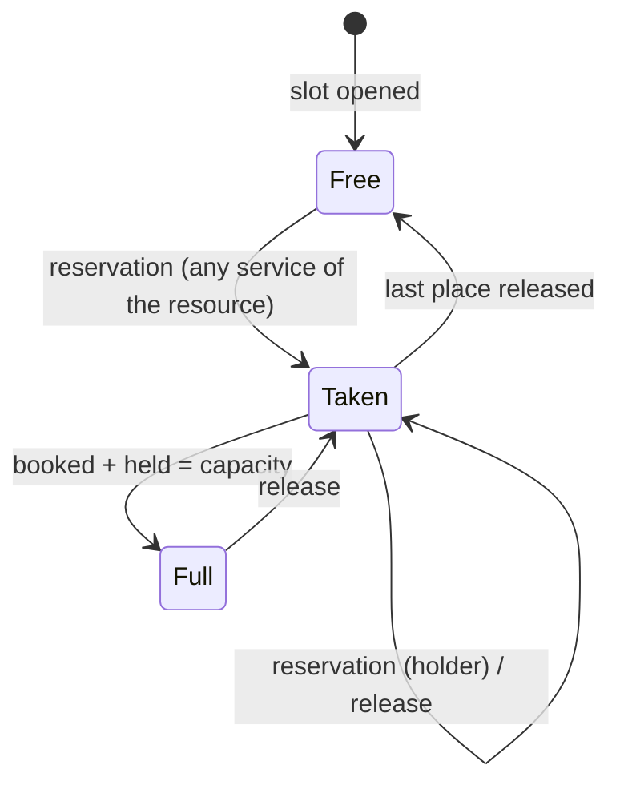

# Booking engine

> Scope: the booking question's configuration, its modes, availability and slot computation, durations, prices, resources, reservation, monthly offers, several services in one booking, impact and the start-time generator. State as of 2026-10-17.

The appointments guide holds the decision record. This page is the rule-level reference: it lists what the product enforces and what a change breaks. What happens to an appointment after it is created (statuses, approval, verification, cancel, reschedule, reminders, waiting list) is in [appointments-lifecycle](appointments-lifecycle.md).

## Summary

A form can hold one booking question. It is part of the form: its configuration (services, categories, availability, exceptions, rules) is saved with the form's other questions and validated when saved according to its **mode** (services or individual). The mode turns the configuration into plain services when it is read. Visitors and the booking engine only ever see this resolved, published definition, never the draft.

Availability is computed as a pure function: for a service and a date range, the configured days and times are expanded into bookable times in the form's time zone, then filtered by notice, window, per-day limit, capacity, durations and what is already booked. A **slot** is one bookable start time of one resource; it records its capacity (places, or unlimited), how many places are booked, how many are held for a waiting-list offer, the length it was opened with and the service that holds it.

A booking question carries a mode, a list of services (with optional categories), availability (a teacher's schedule in the individual mode), exceptions (days off and special hours) and rules (time zone, approval, notice, window, buffer, per-day limit, and so on).

A submission is checked and expanded into sessions (single sessions, a monthly pattern, a monthly plan, or several services), then reserved all or nothing inside the same operation that saves the visitor's answers. Capacity, a single holder per slot, no overlap of a shared teacher's time and the per-day limit hold even when many visitors book at once. The impact check compares a draft with upcoming bookings; the time generator turns working hours into a list of start times.

## Glossary

- **Booking question**: the form question that holds the whole booking configuration. At most one per form.
- **Mode**: `services` (the default when none is given) or `individual`. Fixed at creation.
- **Service**: what a visitor books. In the individual mode the UI calls it a **lesson**.
- **Teacher availability**: individual mode only; the days, times and times per weekday that lessons without their own schedule use.
- **Own schedule**: a lesson that carries any of days, times or times per weekday.
- **Resolved definition**: what the engine reads: the stored question turned into plain services (the teacher's schedule copied into each lesson that has none, and the shared resource set).
- **Resource**: whose time a slot is. A service is its own resource unless the mode names a shared one.
- **Explicit resource**: a resource named by the mode (today only the teacher in the individual mode). Exclusive: one booking blocks the hours it covers for every service of the resource.
- **Slot**: one bookable start time of one resource in a form, with its capacity, booked places, held places, length, end and holding service.
- **Holder**: the service that holds a slot while it has places taken.
- **Pinned length**: the duration a slot was opened with; a partly booked time offers only that length while the service still offers it.
- **Occupied**: a time of the same resource held by another service.
- **Session**: one booked start time, with its duration, in the form's time zone.
- **Item**: the booking of one service inside a request (its sessions, or its monthly offer).
- **Weekday pattern**: a monthly offer without a session allowance; month, weekdays and one time.
- **Plan with an allowance**: a monthly offer with a number of sessions (per month or per week); the visitor picks dates and times up to the allowance.
- **Exception**: a closed day or range, or special hours, for every service or for listed services (UI: "days off").
- **Form zone**: the time zone the wall-clock times of the question mean. **View zone**: the zone the visitor reads the times in (display only).
- **Impact**: which upcoming bookings a draft would leave without a service or a time.

## Business rules

### Question and mode

- **BK-01** A form has at most one booking question ("only one booking question is allowed").
- **BK-02** The booking question is the only question type whose label is optional; besides the common settings it may carry mode, availability, services, categories, rules and exceptions.
- **BK-03** The mode must be `services` or `individual`; no mode means `services`.
- **BK-04** The mode cannot be changed after creation ("mode cannot be changed"); updating a question does not even accept a mode.
- **BK-05** Adding a booking question fills defaults: no services, categories or exceptions; the form zone is the owner's time zone; approval is automatic; with manual approval the approval timeout is 1440 minutes and an unanswered request is declined; minimum notice is 0 (unless sent), booking window 60 days, buffer 0 minutes. There is no default per-day limit (no limit).
- **BK-06** Services, categories and exceptions that arrive without an id get one (8 letters or digits) which is kept on later edits; every id must be 8 letters or digits and unique in its list.
- **BK-07** An update merges the rules key by key (a rule not sent keeps its value; sending an empty value clears it), while services, categories, exceptions and availability are replaced as a whole; a top-level setting sent empty is removed.

### Services (both modes)

| Field | Rule |
|---|---|
| list | at most 20 services |
| category | services mode only; required on every service once there are 2 or more categories, and must name a category. In the individual mode a category is refused. |
| name | 1–100 characters after trimming, no NUL character |
| duration | 5–600 minutes |
| price and currency | both or neither; price is a finite number 0–1,000,000; currency is a 3-letter uppercase code |
| capacity | unlimited, or 1–1000 |
| days | a unique subset of Monday…Sunday |
| times | unique `HH:MM` times (00:00–23:59), at most 96 |
| times per weekday | only for weekdays the service runs; each weekday has its own unique times (at most 96); a weekday may be empty, which closes that weekday |
| extra durations | at most 4; each has only a duration and a price; durations 5–600, different from each other and from the main duration; a price exactly when the service has a price |
| monthly offer | optional price, duration, number of sessions and period; duration empty or 5–600; the period is month or week and needs a number of sessions; sessions are 1–31 per month or 1–7 per week; a monthly price is empty or 0–1,000,000 and needs the service's currency |

- **BK-08** Categories (services mode): at most 10, each with only an id and a name of 1–60 characters. One category or none means an ungrouped list: the editor saves no categories and no category on services below two.
- **BK-09** The individual mode refuses categories, an availability with anything other than days, times and times per weekday, and the waiting list; the services mode refuses an availability.
- **BK-10** A lesson has its own schedule when it carries any of days, times or times per weekday (being present is enough, even empty); otherwise it uses the teacher availability.

### Exceptions (days off and special hours)

- **BK-11** At most 100 exceptions. Each has a start date (and an optional end date) that are real calendar dates; the end is not before the start; the span is at most 366 calendar days; the kind is `closed` or `special`; a special exception needs 1–96 unique times and a closed one takes none; it applies to every service or to a unique subset (at most 20) of this question's services; the note is at most 200 characters.
- **BK-12** An exception applies to a date when the date is within its range (the end defaults to the start) and it covers all services or lists the service. A closed exception wins over any special one; otherwise the first covering special exception replaces the times of the day, including the times per weekday.
- **BK-13** Special hours never open a weekday the service does not run.
- **BK-14** Visitors never see exceptions or their notes; only the published exceptions apply.

### Rules

| Rule | Values | Default |
|---|---|---|
| time zone | a valid time-zone identifier (required) | the owner's zone; not edited in the booking editor |
| approval | automatic or manual (required) | automatic |
| approval timeout | 5–43,200 minutes | 1440 with manual approval |
| on approval timeout | decline or accept | decline |
| approval only for near sessions | 1–43,200 minutes (the editor starts at 5) | none |
| verify e-mail | yes/no | no; the editor offers it only with automatic approval |
| waiting list | yes/no | no; services mode only |
| waiting-list confirmation time | 15–4320 minutes | 120 |
| multiple services | yes/no | no |
| reminders | at most 3 unique values, 15–10,080 minutes | one reminder at 1440 minutes in the editor |
| minimum notice | 0–43,200 minutes | 0 |
| booking window | 1–365 days | 60 |
| buffer between sessions | 0–600 minutes | 0 |
| per-day limit | 1–1000 bookings per day | none |

Approval, verification, waiting list and reminders are described in [appointments-lifecycle](appointments-lifecycle.md) and [notifications-and-email](notifications-and-email.md).

- **BK-15** With multiple services on: at most one category (2 or more are refused) and every priced service in one currency. This is checked when the question is saved and again on each request for the services chosen.

### Publishing a booking question

- **BK-16** Publishing is blocked, with the reason and the offending service, when: there is no service; a service is incomplete (services mode: a service with no days or no times; individual mode: a lesson with its own schedule but no days or no times); the teacher's availability is incomplete (individual mode: no days or no times while at least one lesson has no own schedule); the waiting list is on and the form's required non-booking questions are not at most one short text and one e-mail; or e-mail verification is on without a required e-mail question. A form with no answerable question is refused first.
- **BK-17** Only the general times are checked for publishing: a service whose times per weekday are all empty publishes and offers nothing on those days.

### Resolution and what visitors see

- **BK-18** The services mode is used as stored. The individual mode copies the teacher's availability (days, times, times per weekday) into every lesson without its own schedule and puts every lesson on one shared resource, the teacher.
- **BK-19** Everything that reads the published question reads the published version (or the current question of a form published before versions existed), resolved as in BK-18: the public form, the free-times lookup, submissions, rescheduling, the agenda, the waiting list and the AI-app (MCP) appointment tools. The impact check resolves the draft instead.
- **BK-20** The public form exposes per service only its id, category, name, duration, price, currency, days, times, extra durations and monthly offer: never capacity, times per weekday or the shared resource. Of the rules it exposes only the waiting list, multiple services, buffer, e-mail verification and time zone; notice, window and per-day limit stay private.

### Slot computation

- **BK-21** All wall-clock times mean the form zone; slots are computed per local date of that zone and returned with their start in UTC plus the local date and time. The weekday is the one of the local date.
- **BK-22** Daylight-saving time: a local time that does not exist on a spring-forward day is skipped; a time that repeats on a fall-back day is offered once (the first occurrence); a time keeps its wall clock across DST changes. The visitor-facing display follows the same rules.
- **BK-23** Horizon: the last date is the earliest of the requested end, today plus the booking window (in the form zone) and 61 days after the requested start, so a request never covers more than 62 days, and a 60-day window reaches 61 calendar days including today.
- **BK-24** Minimum notice: a time is offered only if it starts at least the minimum notice from now; nothing before now is ever offered.
- **BK-25** Times of a day: the service must run that weekday; then the exception rule (BK-12); otherwise the times for that weekday if present (an empty list closes the day), otherwise the general times.
- **BK-26** Per-day limit: a day whose total booked places (all slots of the form, every service and resource, counted by local date of the form zone; held places not counted) has reached the limit offers nothing.
- **BK-27** A time with no places remaining (capacity minus booked and held places of the service's own slot) is hidden; unlimited capacity reports no remaining count.
- **BK-28** Durations offered at a time: the service's duration and extra durations, or only the monthly duration for a monthly offer. A time whose own slot is already booked offers only its pinned length while that length is still offered by the service; when the service no longer offers it, the time offers the service's durations again (the slot keeps its pinned length).
- **BK-29** Blocking spans: each blocking booking covers its start up to its length plus the buffer; a candidate time (its length plus the buffer) is offered with a duration only if it intersects no span that starts at another time. A time is omitted when no duration fits. The buffer therefore separates sessions on both sides.
- **BK-30** Which bookings block: for a service that is its own resource, only its full slots (capacity set and no places left) among the times of that day; an unlimited service never blocks its neighbours; a partly booked class does not block either. For a service on an explicit resource, every own slot with a place taken blocks, whatever the capacity.
- **BK-31** Times of the same resource held by another service hide that start entirely and block their span (their slot length, else the holder's main duration, else this service's duration) plus the buffer, whatever their capacity.
- **BK-32** Only bookings starting within the requested local days (from 00:00 of the first day to the end of the last, form zone) are considered. A booking that starts the evening before the requested range and runs past midnight is not seen.
- **BK-33** When a waiting-list claim is being offered its time, one place less is counted and the pinned length is dropped when the slot becomes empty, so the claimant's own held place is offered to them.
- **BK-34** The impact check asks only whether the configuration offers a start time: the weekday and the time after exceptions, ignoring bookings, notice, window and durations.

### Resources and exclusivity

- **BK-35** A slot belongs to a resource. Today only the individual mode names a resource (the teacher); services-mode services are their own resource and share nothing.
- **BK-36** There is one slot per form, resource and start. The first booking makes its service the holder; another service can take the slot only once no place is booked or held; the holder may keep adding places up to its capacity.
- **BK-37** On an explicit resource, two slots with places taken may not overlap (adjacent is allowed). The check has no buffer. Slots of a service that is its own resource are outside this check and may overlap.
- **BK-38** In the individual mode a lesson's own days off (the services an exception lists) close only that lesson; lessons always share the teacher's time.

### Casting a booking answer

A booking answer can be one of: a single-service answer with sessions (date, time and optional duration); a monthly weekday pattern (month, weekdays, one time); a monthly plan (month and picked dates and times); or, with multiple services on, a list of items, each one of the former for one service.

- **BK-39** A missing or empty booking answer is treated as blank, whatever "required" says; an answer of the wrong shape is invalid.
- **BK-40** A list of items is accepted only when multiple services is on, there is no waiting-list claim, the list is the only content, it holds 1–5 items with distinct services, and the chosen priced services share one currency; otherwise it is invalid. The single-service shape stays valid with the rule on or off.
- **BK-41** Single sessions: the service must exist; 1–31 sessions; each with a valid date and time; the duration is absent (the main duration) or one the service offers; each date and time pair is unique; the first to last date is under 62 days. Each session must match a free time on that local date and time whose offered durations include its length; otherwise the request is refused as unavailable, naming the service, date and time of the first session that fails.
- **BK-42** All sessions of a request (every item) are one person's time: no two may overlap, each span being its start plus its duration plus the buffer; the refusal names the later of the two.
- **BK-43** Every session of a local day counts towards the per-day limit: a date with two or more sessions in the request fails when the day's booked places plus their number exceed the limit (single sessions are already filtered by BK-26). This refusal does not name a service or time.
- **BK-44** The stored answer keeps only the service and the expanded sessions (date, time, duration), per item when several services are booked; the monthly input is not stored.

### Monthly offers

- **BK-45** Weekday pattern (an offer without a session allowance): the visitor gives a month, 1–7 distinct weekdays and one time; the month must be this or the next one in the form zone. The dates are every matching weekday from the later of the first of the month and today to the month's end. A date the configuration does not offer at that time (not a service day, day off, special hours without that time, notice, window) is skipped and reported in the receipt; a date offered but not free refuses the whole request, naming the date; no date left is unavailable. Every session lasts the monthly duration, or the service's duration when none is set.
- **BK-46** Plan with an allowance (an offer with a number of sessions): the visitor picks 1–31 unique dates and times; the month is this or the next one; every date lies inside that month and not before today; at most the allowance of picks fall in the month, or with a weekly period at most the allowance in each Monday–Sunday week; every pick must be a free time for the monthly duration, and one taken pick refuses the whole plan.
- **BK-47** Both monthly shapes produce the same result as single sessions (one appointment per date, with the month and skipped dates recorded), so reserving, the clash check (BK-42/43), pricing, the receipt, cancelling and e-mails are shared.
- **BK-48** The free-times lookup can answer for the monthly duration; it does not then list full times for the waiting list. A request for monthly times for a service without a monthly offer, or with any other monthly value, is refused as invalid.

### Pricing and totals

- **BK-49** Prices are informational (no payment). A service is priced when it has a price and a currency. Each session costs the price of its own duration; an item total is the sum, rounded to 2 decimals; a monthly item with a monthly price (and a currency) costs the monthly price once, whatever the number of sessions.
- **BK-50** The group total is the sum of the item totals. Every appointment of the request records its service name, its own duration and price (the duration's price, else the service price), the currency, the group total, the number of sessions of the whole request, the monthly details, and, with manual approval, what happens on timeout. The receipt shows the total and currency from the first appointment.
- **BK-51** "Take X, pay Y" packages no longer exist; a package setting is refused as unknown.

### Reservation

- **BK-52** A booking is created in the same all-or-nothing operation as the saved response, after it; any failure also cancels the saved response. There is no separate public way to create an appointment.
- **BK-53** A submission made against a form version other than the published one is refused (the form changed) before any place is touched.
- **BK-54** With a per-day limit, the booking first locks each local day of the request, in date order, and recounts the day's booked places; going over the limit refuses the booking as full.
- **BK-55** Items are reserved one after the other, ordered by their earliest start; within an item, distinct times in ascending order, all as one step that can be undone as a unit.
- **BK-56** For each time, the slot is opened if needed and one place is taken in a single conditional step: it succeeds only when the slot is held by the same service or is empty and, with a capacity, when booked plus held places are below the capacity (the capacity of the current published service, not the stored one). Otherwise the time is full. A successful step adds one booked place and records the holder and the capacity, and — only when the slot was empty — its length and end.
- **BK-57** A waiting-list claim converts one held place of the same service into a booked one instead.
- **BK-58** A clash on a shared resource or a deadlock between simultaneous bookings during a reservation counts as full, so the visitor sees the time as taken.
- **BK-59** Concurrency guarantees: capacity cannot be exceeded; a slot has one holder; sessions on an explicit resource cannot overlap; the per-day limit holds. Not guarded against simultaneous bookings: the buffer, and overlaps between different starts of a service that is its own resource (checked only when free times are computed, before the reservation).
- **BK-60** Releasing a place lowers the booked count (never below 0); the length and end stay until the next first booking overwrites them; the slot stops counting for shared-resource overlap once no place is booked or held.
- **BK-61** Status at creation: pending with manual approval (always, or only when the first session starts within the approval-only-for-near-sessions window), unverified with automatic approval, e-mail verification and an e-mail address, otherwise confirmed. Expiry is the approval timeout from now (default 1440 minutes) or 15 minutes for verification. One group identifier is shared by the whole request. Details in [appointments-lifecycle](appointments-lifecycle.md).
- **BK-62** Refusals: an answer that cannot be accepted is refused per question as blank, invalid or unavailable, with the service, date and time named when applicable; a reservation that fails is refused as full, with the start time.

### Impact

- **BK-63** The impact check resolves the **draft** booking question and examines every appointment in a holding status whose slot starts after now. It reports "service removed" when the slot's service is not in the draft and "time no longer offered" when the draft no longer offers that start (in the draft's zone). It returns the number of upcoming and of affected appointments, and at most 50 affected appointments (id, start, reason). It does not look at durations, capacity, notice, window, buffer or per-day limit.
- **BK-64** The only way to run the impact check is through an AI app with the appointments read permission; no app screen shows it.

### Start-time generator

- **BK-65** A signed-in owner can generate a list of start times from a start time, an end time and a step (all required), with an optional session duration (default 60 minutes), a lunch break and further blocked ranges. Errors: a time not in `HH:MM` form, a step outside 5–600 minutes (the presets 30/60/90/120 are inside), a duration that is not a positive whole number, an end not after the start, and no times produced. It lists a start every step while the session still ends by the end time, skipping a start whose session overlaps lunch or a block, and warns when the duration is longer than the step (overlapping sessions). The request is refused when there are errors.
- **BK-66** The generator does not cap the result at 96 times nor the duration at 600: a list longer than 96 is refused when the service is saved.

### Frontend consistency

The booking editor and the public booking form follow the same rules as the server. Where the editor and the server differ, the server rule decides.

- **BK-67** Each mode brings its own editor behaviour: defaults, blank item, what is sent to the server, the live preview and its share of the validation. An unknown or missing mode behaves as `services`.
- **BK-68** The editor's preview of the individual mode treats a lesson as having its own schedule when its days or times are non-empty (not merely present), because the editor's draft fills empty days and times on every service; the preview sets no shared resource.
- **BK-69** A new service starts as 30 minutes, capacity 1, euros, no price, Monday–Friday, with a start every 30 minutes from 09:00 while the session ends by 18:00 (18 half-hour times). A new lesson starts as 60 minutes with no schedule.
- **BK-70** The public calendar loads at most 56 days from today, whatever the booking window allows.
- **BK-71** Picking sessions: choosing the same time and duration again removes it; the same time with another duration replaces it; a pick overlapping another session of the request (same date, buffer counted, other services included) is refused; with an allowance, a pick over the cap is refused (per month or per Monday–Sunday week).
- **BK-72** Whenever free times reload, the picker drops chosen sessions that are no longer free and tells the visitor.
- **BK-73** View zone: when the visitor's zone differs from the form zone, the lookup is widened by at least one day (more for large zone offsets) on both ends; each time is placed on the day it has in the visitor's zone; the answer keeps the form-zone date and time; the visitor's zone choice is remembered in their browser and sent with the booking (kept only if it is a valid zone). The weekday pattern is not converted.
- **BK-74** The free-times request gives up after 10 seconds and shows a retry.
- **BK-75** The weekday-pattern picker offers the service's days and its general times only (times per weekday are not public).

Where checks happen:

- The editor checks the same limits as the server for name, durations, extra durations and prices, monthly sessions and price, multiple services (fewer than 2 categories, one currency), exception dates and times, approval timeout and waiting-list confirmation time.
- Days and times are required in the editor for the services mode; for the individual mode the teacher availability is required only while a lesson uses it. The server allows saving an incomplete schedule and blocks only publishing (BK-16).
- Notice, window, buffer and per-day limit are checked by simple bounds in the editor and fully by the server.
- Only the server checks: at most 20 services, 96 times, price up to 1,000,000, a valid time zone, unique times, at most 3 reminders, at most 5 services per request and 31 sessions per item.
- Overlapping picks and the allowance cap are checked in the picker and again by the server.
- Capacity, holder, overlap of explicit resources and the per-day limit under simultaneous bookings are guaranteed by the server only.

## Flows

### Loading free times (anonymous)

1. A visitor's page asks for the free times of one service over a date range, optionally for the monthly duration (120 requests per minute per IP).
2. Not found unless the form is visible (published, owner active) and its published question has the service.
3. Refused as an invalid range unless both dates are valid and the range is under 62 days; refused as invalid monthly (BK-48).
4. The engine reads the form's bookings for those local days, separates the service's own bookings from times held by other services of the resource, computes day totals and works out the free times.
5. The answer lists the form zone and the free times (start, date, time, remaining places, offered durations). When the waiting list is on, capacity is set and the request is not monthly, it also lists the configured times that are not free.

### Submitting a booking (anonymous)

1. The visitor submits the form: rate limits (30 per 10 minutes per IP; 5 per 10 minutes when the bot check is unavailable), a hidden trap field, a closed form and the bot check.
2. The submission is checked: duplicate-submission key, stale form version (BK-53), every answer is cast; the booking answer goes through BK-39 to BK-47. Errors are returned with details.
3. One all-or-nothing operation: save the response, claim uploads, lock the days (BK-54), reserve each item (BK-55 to BK-58), create one appointment per session and queue notifications (see [notifications-and-email](notifications-and-email.md)).
4. A full time rolls everything back and the visitor is told the time is full.
5. Success returns the appointments (start, service, status, duration), a link to manage the booking (valid until 7 days after the last session), whether the e-mail was sent, the price and the skipped dates.

### Editing a published booking question

1. The owner edits the draft (the whole question is rewritten safely against concurrent edits). Visitors keep the published version.
2. Through MCP, the impact check lists the upcoming bookings the draft would orphan (BK-63).
3. Publishing checks the blocks (BK-16) and stores a new published version. Existing appointments keep their slot and recorded details; their slots keep their pinned length (BK-28).

## States and transitions

A slot (per form, resource and start):

| From | Event | To | Guard | Effects |
|---|---|---|---|---|
| (none) | first reservation | free, then taken | none | the slot is opened with no places, then BK-56 applies |
| free (no booked or held places) | reservation by any service of the resource | taken by that service | capacity at least 1 | that service becomes holder; length and end are set |
| taken by S | reservation by S | taken or full | booked plus held below capacity | one more booked place; length kept |
| taken by S | reservation by another service T | refused | none | the time is full |
| taken | release | taken or free | none | one fewer booked place (never below 0) |
| full | waiting-list hold | full with a held place | booked plus held below capacity | one more held place ([appointments-lifecycle](appointments-lifecycle.md)) |
| held | claim by the same service | taken | a held place exists | one fewer held place, one more booked |

## Limits and configuration

| Name | Value | Notes |
|---|---|---|
| Services per question | 20 | server only |
| Categories | 10 | grouped from 2 |
| Category name | 60 characters | |
| Service name | 100 characters | |
| Times per list | 96 | server only |
| Duration | 5–600 min | also extra and monthly durations |
| Extra durations | 4 | |
| Capacity | 1–1000, unlimited allowed | editor default 1 |
| Price | 0–1,000,000 | informational |
| Monthly sessions | 1–31 per month, 1–7 per week | |
| Exceptions | 100, span up to 366 days, note 200 characters | |
| Rule ranges | see Rules table | |
| Reminders | up to 3, 15–10,080 min | |
| Free-times range per request | 62 days | also applies to booking requests |
| Sessions per item | 31 | |
| Services per request | 5 | |
| Impact sample | 50 appointments | |
| Verification window | 15 min | lifecycle |
| Default approval timeout | 1440 min | lifecycle |
| Free-times rate limit | 120 per minute per IP | rate-limited answer |
| Submission rate limit | 30 per 10 min per IP; 5 per 10 min degraded | |
| Public calendar window | 56 days | editor and public form only |
| Free-times request timeout | 10 s | public form only |
| Generator step | 5–600 (presets 30, 60, 90, 120) | |
| Manage link lifetime | last session + 7 days | |

## Authorization and privacy

- Anonymous visitors: read the free times of a visible form and submit; nothing about other visitors is exposed beyond remaining places and the list of full times.
- Owner (signed in): edit the question, publish, generate start times. Any signed-in user may use the generator (it touches no data).
- MCP: the impact check needs the appointments read permission; the setup tools refuse the individual mode as unsupported. See [mcp-and-oauth](mcp-and-oauth.md).
- Hidden from visitors: capacity, times per weekday, exceptions and notes, notice, window, per-day limit, the shared resource and the mode (BK-14, BK-20).
- Personal data written by this domain: the client's name, e-mail, time zone and locale (from the form's own questions and the request). Retention and purge are in [appointments-lifecycle](appointments-lifecycle.md) and [accounts-and-auth](accounts-and-auth.md).

## API and UI surface

- **Public page**: visitors see the booking question, load free times for a service (optionally for a monthly offer), pick sessions, a weekday pattern or a monthly plan, optionally in their own time zone, and submit the form to book; they receive a receipt with a link to manage the booking.
- **Dashboard**: owners add, edit and delete the booking question like any other form question (in a booking editor with a flow per mode), generate start times from working hours, and publish (publishing is blocked with reasons, BK-16).
- **MCP (AI apps)**: list the upcoming bookings a draft would orphan; preview the free times of a configuration; edit the booking question; and set start times from working hours (directly or generated).
- No background job belongs to this domain.

## Decisions

### D-BK-01 One module per mode, resolved on read
**Decision.** Each mode validates its own configuration, blocks publishing when incomplete and resolves into plain services; the engine reads resolved services only. **Why.** So the free-times lookup, bookings, rescheduling, the agenda and the public form work unchanged and never expose the mode or the resource; a question with no mode stays a services question and no stored definition changes. **Consequence.** A new mode needs a server definition, an editor definition and an editor flow; nothing downstream of the published definition may test the mode.

### D-BK-02 Time belongs to a resource
**Decision.** Slots are unique per form, resource and start; a service is its own resource unless the mode says otherwise. **Why.** First step to share a teacher's hours between lessons without changing existing forms. **Consequence.** A slot is guarded both per resource and per service; reservation takes a place without naming which uniqueness it relies on.

### D-BK-03 The product refuses overlapping time of an explicit resource
**Decision.** Slots with places taken on an explicit resource may never overlap in time, enforced at the storage level; services that are their own resource keep their old behaviour where overlapping starts were allowed. **Why.** The engine checks before the reservation, outside its all-or-nothing operation, so two bookings of different lessons at different starts could both pass. **Consequence.** A clash or deadlock is shown as a full time; every change to a slot's length must keep its end in step.

### D-BK-04 Atomic counter inside the response operation
**Decision.** A slot is opened if needed and then one place is taken only if the slot has room; one successful step means reserved. **Why.** All or nothing, no deadlock between crossing requests of one service, and the capacity passed in is authoritative; booking happens inside the form submission because name and e-mail are answers of the form. **Consequence.** No public "create appointment" way; any new writer must go through the same reservation step.

### D-BK-05 Per-day limit under a lock
**Decision.** A lock per form and local day, taken in date order, then a recount. **Why.** The day total spans several slots, so no single slot lock covered it and two bookings of the same day could pass together. **Consequence.** The limit only holds for writers that take the same lock.

### D-BK-06 Duration per session, pinned on the slot
**Decision.** Each session stores its duration on the slot and the appointment; a partly booked time offers only that length while the service offers it. **Why.** So two people are not in the same class for different lengths; when the owner removed that length, the time vanished for everyone (a production group class lost all of October), so an unknown pinned length is now released. **Consequence.** A removed duration is invisible to the impact check (see the known limits in the appointments guide).

### D-BK-07 A price per duration, no packages
**Decision.** Every session costs the price of its own duration; "take X, pay Y" was removed, with a data migration stripping the old package setting. **Why.** With several prices the total is no longer price × sessions. **Consequence.** Pricing is a plain sum.

### D-BK-08 Monthly plan returns the shape of the weekday pattern
**Decision.** A monthly plan produces the same item as the weekday pattern. **Why.** Reserving, the clash check, pricing, the receipt, cancelling and e-mails stay unchanged. **Consequence.** One appointment per date; the monthly price is written as the group total.

### D-BK-09 Several services behind an owner rule
**Decision.** Multiple services (off by default) enables the list-of-items answer; the single-service answer stays valid. **Why.** No existing form changes. **Consequence.** One response, one group, one decision; one currency and no categories.

### D-BK-10 Refusals name the service and time
**Decision.** An unavailable refusal keeps its reason and adds the service, date and time. **Why.** With several services the visitor did not know which one to change. **Consequence.** A per-day refusal has no details.

### D-BK-11 The form zone owns the wall clock; the view zone only displays
**Decision.** Times mean the form's time zone, a copy of the owner's zone taken at creation; the visitor's zone converts the display only. **Why.** Changing the account zone must not move availability; visitors read times in their own zone. **Consequence.** The answer always carries form-zone date and time.

## Change impact

- Booking question configuration (limits, modes, services) → also review the form-question validation, the MCP booking configuration ([mcp-and-oauth](mcp-and-oauth.md)), the booking editor's validation and the public form's visible fields (BK-20). Stored questions and published versions must stay valid: tighten a rule only together with a data migration that rewrites stored and published questions.
- A new mode → needs server and editor support and an editor flow, MCP editing rules (BK-09), publishing blocks (BK-16); resolving must stay predictable and the mode must never be exposed to visitors (BK-18, BK-20).
- Slot computation (BK-21 to BK-34) → also review the agenda, rescheduling (owner moves use notice 0), the waiting list (it relies on BK-33), the impact check (BK-34), the AI-app availability preview, the editor preview and the picker's dropping of unavailable picks (BK-72).
- Reservation or the slot fields (BK-36 to BK-60) → also review release, rescheduling, waiting-list hold and claim, and the overlap guard (a slot's end must follow its length). Because a deploy briefly runs the previous release against new data, new fields must be optional and readers must tolerate their absence.
- The answer shape (BK-39 to BK-47) → also review the form submission, the stored answer (exports and summaries in [forms](forms.md)), the booking answer on the public page, e-mails, the manage page and the MCP appointment tools.
- Pricing or recorded appointment details (BK-49, BK-50) → the receipt, e-mails, calendar files, agenda and exports read them ([appointments-lifecycle](appointments-lifecycle.md), [notifications-and-email](notifications-and-email.md)).
- Rule ranges (BK-05, Rules table) → also review the editor inputs and rules summary, the MCP schema and the docs.
- Time zone handling (BK-21, BK-22, BK-73) → the visitor-facing time display must stay consistent with slot computation (daylight-saving first occurrence, skipped times).
- The appointments guide is the decision record: update it with any behaviour change listed there.

Invariants a change must never break:
1. Booked plus held places never exceed capacity and both are never negative.
2. A slot has one holder; another service takes it only when it is empty.
3. Places are taken only by the conditional reservation step, inside the response's all-or-nothing operation, all or nothing per request.
4. Times of one request are reserved in a deterministic order (by start within an item, items by first start) and per-day locks are taken in date order, before any slot lock.
5. The engine reads only resolved, published definitions, never the draft (except the impact check).
6. Stored times are UTC; wall-clock times always mean the form zone; the answer carries form-zone date and time.
7. A booked session's length is fixed at booking; later edits never change it.

## Drift and open questions

Against the appointments guide:
- (medium) "Publishing and versions" says the owner sees the impact before publishing; no app screen shows it, only an AI app with the appointments read permission (BK-64).
- (medium) "Resources" says that today every service is its own resource and nothing is shared; the individual mode puts every lesson on one shared resource, the teacher.
- (low) "Several services" and its limits say the question "cannot have categories"; the product refuses 2 or more and accepts one.
- (low) "Booking" step 2 describes taking a place by matching one appointment slot with remaining capacity; the product matches by form, start and resource, requires the service to hold the slot or the slot to be empty, counts held places, and compares with the capacity of the current definition (BK-56).
- (low) "Booking" step 3 says days are reserved in start order with no deadlocks; with several services items are reserved one by one (each sorted, items by first start), so crossing multi-service requests and overlapping explicit-resource bookings can deadlock; that is shown as a full time (BK-55, BK-58).
- (low) "Data model" says booked places stay between 0 and capacity; the rule is that booked plus held places stay within capacity.
- (low) "Modes" says a lesson has its own schedule when it carries days and times; the server counts any of days, times or times per weekday (BK-10), the editor counts the days or times being present, and the preview counts non-empty days or times (BK-68).

Product behaviour found by reading, not exercised end to end:
- (medium) Pricing fails when a priced service's monthly offer has its own duration that is not one of the service's durations and no monthly price: the price for that duration cannot be found. Nothing covers this case.
- (medium) The editor cannot clear the per-day limit: it omits the setting when empty and an update merges rules, so the stored limit stays.
- (low) Lowering a capacity below what is booked makes the remaining count negative: the time stays offered and no longer blocks neighbours, then the reservation is refused as full.
- (low) Bookings that start the day before the requested range are ignored (BK-32); for services that are their own resource nothing else catches the overlap.
- (low) The buffer is not part of the overlap guard: two simultaneous bookings of the teacher can end up closer than the buffer (BK-59).
- (low) The weekday-pattern picker offers the general times only; a time that exists only for a given weekday cannot be chosen, and a general time missing from a weekday's list is skipped by the server (BK-75).
- (low) The public calendar stops at 56 days even when the booking window is up to 365 (BK-70); no rationale is recorded beyond an early calendar change.
- (low) The editor does not cap services per request (5) or sessions per item (31); the server answers invalid.
- (low) A booking answer is required by the server even when the question is not marked required (BK-39).
- (low) The approval-only-for-near-sessions window: the server accepts from 1 minute, the editor from 5.
- (low) The generator can return more than 96 times, which saving the service then refuses (BK-66).
- (low) The list of full times in the free-times lookup contains configured times hidden for any reason (per-day limit, a blocking neighbour), not only full ones; joining the waiting list then answers that the time is not full.
- (low) An individual draft whose availability was removed compiles lessons without days; the impact check may then fail on it.
- (low) Day totals for the per-day limit count booked places only, so a place held for a waiting-list offer does not count towards the limit until it is claimed.
