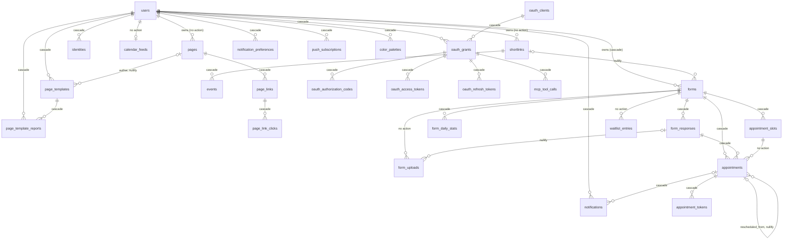

# Data model

> Scope: every table, constraint, index and extension of the PostgreSQL schema, the deletion cascades, the stored JSON shapes, the migration history and conventions. State as of commit `bc7f65c` (2026-10-17).
> Main code: `backend/db/schema.rb` (authority, version `2026_10_14_130000`), `backend/db/migrate/` (75 files), `backend/app/models/`, `backend/spec/db/`, `docs/postgres-roles.md`, `CLAUDE.md` ("Deploys do not stop the site").

## Summary
Kurz uses one PostgreSQL database (`development`, `test`, `e2e`, `production` in `backend/config/database.yml:11-22`) that holds the application tables, Active Storage, `audits` and the Solid Queue tables. Two extensions are enabled: `btree_gist` (the slot overlap guard) and `plpgsql`. There are no custom functions, triggers or enum types: status-like columns are plain `varchar`, and some of them are guarded by `CHECK` constraints. Integrity rests on foreign keys with explicit `ON DELETE` actions, a handful of `CHECK` and exclusion constraints, partial unique indexes, and Rails-side `dependent:` options for what the database does not cascade. Short links and pages are soft-deleted (`deleted_at`); everything else is hard-deleted. Cache, rate limits and the redirect path live in Valkey, not in this schema.

## Glossary
- **Soft delete** (`deleted_at`): `Shortlink` and `Page` hide a row with a `default_scope { where(deleted_at: nil) }` and expose `with_deleted`. — `backend/app/models/shortlink.rb:47-48`, `backend/app/models/page.rb:74-75`.
- **Counter cache** (`counter_culture`): a counter column kept by the gem, never by a database trigger.
- **Snapshot**: a JSON copy taken at a point in time (`forms.published_snapshot`, `appointments.snapshot`).
- **Resource key** (`appointment_slots.resource_key`): the thing a slot occupies; equal to `service_key` unless a booking mode shares one teacher across lessons. See [booking-engine](booking-engine.md).
- **Owner role / app role**: the Postgres role that runs migrations (`MIGRATE_POSTGRES_USER`) versus `kurz_app`, which has data access only.

## 1. Extensions and database-level objects

| Object | Value | Source |
|---|---|---|
| Extensions | `btree_gist`, `pg_catalog.plpgsql` only | `backend/db/schema.rb:15-16`; enabled by `backend/db/migrate/20261011172000_add_overlap_guard_to_appointment_slots.rb:3` |
| `pg_search` | Ruby gem only. `pg_search_scope :search_by_term` uses built-in `tsearch` with prefix matching on `users.email` and on `shortlinks.title/original_url/short_code` plus `users.email`. No extension, no search index (no GIN/tsvector column). | `backend/app/models/user.rb:49-51`, `backend/app/models/shortlink.rb:39-42` |
| `pgcrypto` | Not enabled. `group_key` UUIDs come from `SecureRandom.uuid` in Ruby, not `gen_random_uuid()`. | `backend/app/services/appointments/book.rb:38-60` |
| Functions, triggers, views, enum types, sequences by hand | None. `sha256`, `jsonb_typeof`, `octet_length` appear only inside `CHECK` constraints and one-shot migration SQL. | `backend/db/schema.rb` (no `create_function`/`create_trigger`) |
| Exclusion constraint | `appointment_slots_no_overlap_in_shared_resource` (GiST, needs `btree_gist` for the `=` operators on `form_id` and `resource_key`). | `backend/db/schema.rb:79` |
| Database count | One database holds app, Solid Queue and Active Storage. | `backend/config/database.yml:11-22`, `backend/config/environments/production.rb:52` |
| Solid Queue tables (11) | `solid_queue_jobs`, `_ready_executions`, `_scheduled_executions`, `_claimed_executions`, `_blocked_executions`, `_failed_executions`, `_recurring_executions`, `_recurring_tasks`, `_processes`, `_pauses`, `_semaphores`. Six execution tables reference `solid_queue_jobs.id` with `ON DELETE CASCADE`; deleting a job deletes its executions. `_processes.supervisor_id` has no FK. | `backend/db/schema.rb:507-626,708-713` |
| Solid Cache / Solid Cable tables | `solid_cache_entries`, `solid_cable_messages` exist (migration `20250930172736_init_cache_queue.rb`) but the app does not use them: the Rails cache store is `redis_cache_store`. | `backend/db/schema.rb:486-505`, `backend/config/application.rb:46` |
| Active Storage tables | `active_storage_blobs`, `active_storage_attachments`, `active_storage_variant_records`. Attachments are polymorphic (`record_type`, `record_id`) with no FK to the record. | `backend/db/schema.rb:33-59,672-673` |
| Audit table | `audits` (gem `audited`). `auditable_id`, `associated_id`, `user_id` are 4-byte `integer`, not `bigint`; no FK to any table. | `backend/db/schema.rb:131-152` |

Solid Queue job schedule and queues: see [platform-and-operations](platform-and-operations.md).

## 2. Table catalogue

Conventions: every table has a `bigint` auto-increment primary key `id` unless stated. `created_at`/`updated_at` are `datetime NOT NULL` where present. "Model" paths are under `backend/app/models/`. FK delete actions: `CASCADE`, `NULLIFY`, or `NO ACTION` (the PostgreSQL default, written "none" below; it blocks the delete). Line numbers are in `backend/db/schema.rb`.

### Accounts and sign-in (owner: [accounts-and-auth](accounts-and-auth.md))

#### users
Purpose: one row per account. Lines 628-651; model `user.rb`.
- PK `bigint`.
- `email` string NOT NULL, normalised to `strip.downcase` (`backend/app/models/user.rb:56`); unique through the expression index `index_users_on_lower_email` on `lower(email)`.
- `admin` bool default false. `verified_at` (set on first successful sign-in; unverified accounts are cleaned up by `CleanupUnverifiedUsersJob`). `deactivated_at`, `deletion_requested_at` (30-day grace, `User::DELETION_GRACE`, `backend/app/models/user.rb:36`).
- `login_token` string and `login_token_sent_at`, `login_attempts` int default 0: the 7-digit emailed code. No unique index since `20261013130000` (see section 6).
- `password_digest`, `pending_password_digest`, `password_changed_at`, `failed_password_attempts` int default 0, `password_locked_until`, `sessions_revoked_at` (older session tokens refused).
- `shortlinks_count` int default 0 NOT NULL: counter cache of visible (not soft-deleted) links, maintained by `counter_culture` on `Shortlink` (`backend/app/models/shortlink.rb:67`).
- `time_zone` string default `Europe/Lisbon` NOT NULL (validated against `TZInfo`, `backend/app/models/user.rb:59`). `locale` string nullable (`en` or `pt-PT`, `backend/app/models/user.rb:60`).
- Indexes: `index_users_on_verified_at_and_created_at`; partial `index_users_on_deletion_requested_at WHERE deletion_requested_at IS NOT NULL`.
- Referenced by (DB action): `calendar_feeds` none, `color_palettes` cascade, `forms` cascade, `identities` cascade, `notification_preferences` cascade, `notifications` cascade, `oauth_grants` cascade, `page_template_reports` cascade, `page_templates` cascade, `pages` none, `push_subscriptions` cascade, `shortlinks` none.
- Annotation comment at the top of `user.rb` is stale (lacks `time_zone`, `locale`).

#### identities
Purpose: external sign-in accounts (Google) linked to a user. Lines 253-264; model `identity.rb`.
- `provider` string NOT NULL, `uid` string NOT NULL (provider's stable id), `email` informational only, `last_used_at`.
- FK `user_id` -> users, CASCADE.
- Unique `(provider, uid)` and unique `(user_id, provider)`: one identity per provider per user.

### Short links (owner: [shortlinks](shortlinks.md))

#### shortlinks
Purpose: a short code pointing to a URL. Lines 465-484; model `shortlink.rb`.
- `short_code` string NOT NULL, unique index `index_shortlinks_on_short_code` over all rows including soft-deleted ones; generation checks `with_deleted` (`backend/app/models/shortlink.rb:168`).
- `original_url` NOT NULL, `title`, `password_digest` (bcrypt via `has_secure_password validations: false`, `backend/app/models/shortlink.rb:60`; password length 4..72, `backend/app/models/shortlink.rb:61`).
- `expires_at`, `inactive_at` (set by expiry/deactivation/danger marking), `deleted_at` (soft delete), `last_accessed_at`.
- `safe` bool default true, `safe_checked_at`: Google Safe Browsing result.
- `events_count` int default 0: counter cache from `Event` (`backend/app/models/event.rb:29`).
- FK `user_id` -> users, NO ACTION, added NOT VALID then validated in 2026-10 (`20261013140000`, `20261014130000`).
- Indexes: `deleted_at`, `user_id`, partial `index_shortlinks_on_expires_at WHERE expires_at IS NOT NULL AND inactive_at IS NULL` (feeds the expiry jobs).
- Audited except `short_code`, `events_count`, `last_accessed_at`, `deleted_at`, `password_digest` (`backend/app/models/shortlink.rb:34`).

#### events
Purpose: one row per click on a short link (statistics). Lines 172-184; model `event.rb`.
- `clicked_at` NOT NULL; `ip_address`, `user_agent`, `referer`, `country_code`, `region`, `platform`, `browser` (all strings, max 255 in the model, `backend/app/models/event.rb:36`). IP, user agent and referer are nulled after 90 days (`PurgeOldIpAddressesJob::RETENTION`).
- FK `shortlink_id` -> shortlinks, CASCADE (`20260613000100`).
- Indexes: `shortlink_id`; partial `index_events_ip_retention (clicked_at) WHERE ip_address IS NOT NULL`.
- No `updated_at`. Created by the analytics worker, not only by Rails.

### Bio pages (owner: [bio-pages](bio-pages.md))

#### pages
Purpose: a public bio page at `/u/<slug>`. Lines 435-450; model `page.rb`.
- `slug` string NOT NULL, unique over all rows including soft-deleted (`Page.with_deleted` is used by `slug_not_taken`, `backend/app/models/page.rb:137`); format `SLUG_FORMAT`, reserved list `RESERVED_SLUGS` (`backend/app/models/page.rb:42-44`).
- `display_title` (max 80), `bio` text (max 300), `theme` default `default`, `published` bool default true, `expires_at`, `deleted_at`, `custom_colors` jsonb nullable.
- FK `user_id` -> users, NO ACTION.
- Avatar: Active Storage `avatar` and `avatar_upload` (`backend/app/models/page.rb:97-102`).

#### page_links
Purpose: ordered items of a page (button, social icon, section header). Lines 388-402; model `page_link.rb`.
- `kind` default `link` (`link|social|header`, validated at `backend/app/models/page_link.rb:62`, no CHECK). `label` NOT NULL (max 80), `url` nullable (required unless `header`, absent for `header`, `backend/app/models/page_link.rb:64-65`), `icon`, `position` int default 0, `active` default true.
- `clicks_count` int default 0: counter cache from `PageLinkClick` (`backend/app/models/page_link_click.rb:30`).
- `safe` default true, `safe_checked_at`: link safety result.
- FK `page_id` -> pages, CASCADE. Index `(page_id, position)`. At most 50 per page (`PageLink::MAX_PER_PAGE`, `backend/app/models/page_link.rb:28`; model-only).

#### page_link_clicks
Purpose: one row per click on a page link. Lines 373-386; model `page_link_click.rb`.
- Same click columns as `events`. FK `page_link_id` -> page_links, CASCADE.
- Indexes: `page_link_id`; `(page_link_id, clicked_at)`; partial `index_page_link_clicks_ip_retention (clicked_at) WHERE ip_address IS NOT NULL`.

#### page_templates
Purpose: templates saved from a page; `visibility` private or public (community). Lines 415-433; model `page_template.rb`.
- `name` NOT NULL (max 60), `description` (max 140), `theme`, `items` jsonb default `[]` (shape: section 5), `visibility` default `private`, `author_page_id`, `author_label` (text snapshot of "Title - @slug"), `published_at`, `hidden_at`, `uses_count` and `reports_count` int default 0 (plain columns updated by `update_counters`/`increment!`, not `counter_culture`: `backend/app/controllers/concerns/page_template_lookup.rb:32`, `backend/app/models/page_template.rb:117`).
- FKs: `user_id` -> users CASCADE; `author_page_id` -> pages NULLIFY.
- Index `idx_on_visibility_hidden_at_uses_count_757c1d2d8f (visibility, hidden_at, uses_count)` (auto-generated name) for the community listing. Max 20 templates per user (`backend/app/models/page_template.rb:33`, model-only).

#### page_template_reports
Purpose: a user's report against a community template. Lines 404-413; model `page_template_report.rb`.
- `reason` NOT NULL (inclusion in `REASONS`, model-only). FKs `page_template_id` and `user_id`, both CASCADE. Unique `(page_template_id, user_id)`: one report per user per template.

#### color_palettes
Purpose: saved custom colour sets. Lines 163-170; model `color_palette.rb`.
- `name` NOT NULL (max 40), `custom_colors` jsonb NOT NULL (shape: section 5). FK `user_id` -> users CASCADE. Max 20 per user (`backend/app/models/color_palette.rb:4`, model-only).
- Owner page: [bio-pages](bio-pages.md) (also used by forms).

### Forms (owner: [forms](forms.md))

#### forms
Purpose: a form or booking form. Lines 223-251; model `form.rb`.
- `public_id` string NOT NULL unique (12 alphanumerics, `backend/app/models/form.rb:11`). `title` NOT NULL (max 120), `description`, `thank_you_message`, `theme`, `custom_colors` jsonb nullable, `layout` default `page` (`page|one_at_a_time|steps`, `backend/app/models/form.rb:5`, no CHECK).
- `published` bool default false; `accepting_responses` bool default true.
- `fields` jsonb NOT NULL default `[]`, `CHECK jsonb_typeof(fields) = 'array'` (`forms_fields_is_array`). Content shape: `Forms::FieldSchema` (section 5).
- `published_snapshot` jsonb nullable, `published_version` int default 0 NOT NULL, `published_digest` string (SHA-256 hex of the snapshot text).
- `responses_count` int default 0: counter cache from `FormResponse` (`backend/app/models/form_response.rb:5`).
- `cover_token` (limit 24), `cover_position` int default 50 (0..100), `intro_enabled` bool default false, `start_label` (limit 40).
- `shortlink_id` nullable. FKs: `user_id` -> users CASCADE; `shortlink_id` -> shortlinks NULLIFY.
- Indexes: unique `public_id`; `(user_id, created_at)`; `user_id`; `shortlink_id`.

#### form_responses
Purpose: one submission. Lines 195-209; model `form_response.rb`.
- `answers` jsonb NOT NULL default `{}` with `CHECK jsonb_typeof(answers) = 'object' AND octet_length(answers::text) <= 65536` (`form_responses_answers_object_max_64kb`). The model limit is stricter: 32 KB of JSON (`ANSWERS_MAX_BYTES`, `backend/app/models/form_response.rb:2,18`).
- `country` (limit 2, `[A-Z]{2}`), `platform`, `browser`, `source`, `published_version` (the form version answered).
- `idempotency_key` (limit 64); unique partial index `index_form_responses_on_form_and_idempotency_key (form_id, idempotency_key) WHERE idempotency_key IS NOT NULL`.
- FK `form_id` -> forms CASCADE. Indexes `(form_id, created_at)`, `(form_id, id)`. No `updated_at`.

#### form_daily_stats
Purpose: per form and day counters of views, unique views and starts. Lines 186-193; model `form_daily_stat.rb`.
- `views`, `unique_views`, `starts` int default 0. FK `form_id` CASCADE. Unique `(form_id, day)` (supports upsert).

#### form_uploads
Purpose: a file uploaded for a form (answer image or cover); the file itself is in Active Storage. Lines 211-221; model `form_upload.rb`.
- `field_id` (limit 8) NOT NULL: the form field id, or `coverimg` for the cover. `token` (limit 24) NOT NULL unique (`has_secure_token`, `backend/app/models/form_upload.rb:9`). `response_id` nullable until the response is stored.
- FKs: `form_id` -> forms NO ACTION; `response_id` -> form_responses NULLIFY.
- Partial index `index_form_uploads_orphans (created_at) WHERE response_id IS NULL` (feeds `CleanupOrphanFormUploadsJob`, every 15 minutes). Total size cap 20 GB (`MAX_TOTAL_BYTES`, `backend/app/models/form_upload.rb:4`).

### Booking and appointments (owners: [booking-engine](booking-engine.md) for slots, [appointments-lifecycle](appointments-lifecycle.md) for the rest)

#### appointment_slots
Purpose: one bookable start time of one service/resource of a form, with a capacity counter. Lines 61-80; model `appointment_slot.rb`. Owner: [booking-engine](booking-engine.md).
- `service_key` NOT NULL, `resource_key` NOT NULL (`before_validation` defaults it to `service_key`, `backend/app/models/appointment_slot.rb:2`), `starts_at` NOT NULL, `ends_at` nullable (kept by `Reserve`), `duration` int nullable (minutes), `capacity` int nullable (NULL means unlimited), `booked` int default 0, `held` int default 0 (places offered to the waiting list).
- FK `form_id` -> forms CASCADE.
- Unique `(form_id, service_key, starts_at)` and unique `(form_id, resource_key, starts_at)`.
- CHECKs: `booked >= 0`; `held >= 0`; `capacity IS NULL OR (booked + held) <= capacity`.
- Exclusion `appointment_slots_no_overlap_in_shared_resource`: `EXCLUDE USING gist (form_id WITH =, resource_key WITH =, tsrange(starts_at, ends_at) WITH &&) WHERE resource_key <> service_key AND booked + held > 0 AND ends_at IS NOT NULL`.
- Referenced by `appointments.slot_id` (NO ACTION).

#### appointments
Purpose: one booked session; several rows share a `group_key` for one booking of many sessions. Lines 94-129; model `appointment.rb`. Owner: [appointments-lifecycle](appointments-lifecycle.md).
- `status` string NOT NULL, no CHECK. Values in use: `pending`, `unverified`, `confirmed`, `cancelled`, `declined`, `expired`, `rescheduled` (`Appointments::Search::STATUSES`, `backend/app/services/appointments/search.rb:5`); `Appointment::HOLDING = pending, unverified, confirmed` (`backend/app/models/appointment.rb:2`).
- `group_key` uuid NOT NULL. `snapshot` jsonb NOT NULL default `{}` with `CHECK jsonb_typeof(snapshot) = 'object'`.
- `client_name`, `client_email`, `client_phone`, `client_time_zone`, `client_locale`; `published_version`; `expires_at`; `decided_at`; `decided_by` (CHECK in `owner|timeout|client` or NULL); `decision_message`; `cancel_reason`; `cancelled_by` (CHECK in `owner|client|system` or NULL).
- `reminders_sent` integer[] default `{}` NOT NULL: the reminder offsets (minutes) already sent. `reminder_sent_at` is the older single-reminder column (kept; see Drift). `owner_nudged_at`.
- `rescheduled_from_id` self-reference. Only `created_at`, no `updated_at`.
- FKs: `form_id` -> forms CASCADE; `response_id` -> form_responses CASCADE; `slot_id` -> appointment_slots NO ACTION; `rescheduled_from_id` -> appointments NULLIFY.
- Indexes: `lower(client_email)` (`index_appointments_on_lower_client_email`); partial `index_appointments_pending_expires_at (expires_at) WHERE status IN ('pending','unverified')`; `(form_id, status)`; `form_id`; `group_key`; `rescheduled_from_id`; `response_id`; `slot_id`.

#### appointment_tokens
Purpose: single-purpose secrets for e-mail links (manage, approve, decline, decide, verify). Lines 82-92; model `appointment_token.rb`. Owner: [appointments-lifecycle](appointments-lifecycle.md).
- `digest` NOT NULL unique (only the digest is stored), `purpose` NOT NULL with CHECK in `manage|approve|decline|decide|verify`, `expires_at` NOT NULL, `used_at`. FK `appointment_id` CASCADE. Only `created_at`.

#### waitlist_entries
Purpose: a person waiting for a full time. Lines 653-670; model `waitlist_entry.rb`. Owner: [appointments-lifecycle](appointments-lifecycle.md).
- `service_key`, `starts_at` identify the time (no FK to the slot). `name` (limit 100), `email` (limit 254), `locale`, `time_zone`, `status` default `waiting` with CHECK in `waiting|offered|claimed|expired|left`, `offered_until`.
- FK `form_id` -> forms NO ACTION.
- Unique partial `index_waitlist_entries_one_per_email (form_id, service_key, starts_at, lower(email)) WHERE status IN ('waiting','offered')`. Indexes `index_waitlist_entries_queue (form_id, service_key, starts_at, status)`, partial `index_waitlist_entries_offers (status, offered_until) WHERE status = 'offered'`.

#### calendar_feeds
Purpose: the signed `.ics` feed of a user. Lines 154-161; model `calendar_feed.rb`. Owner: [appointments-lifecycle](appointments-lifecycle.md).
- `digest` (limit 64) NOT NULL unique, `last_fetched_at`. FK `user_id` -> users NO ACTION. Unique `user_id`: one feed per user.

### Notifications (owner: [notifications-and-email](notifications-and-email.md))

#### notifications
Purpose: one row per delivery to one channel (in-app, e-mail, push), also the delivery queue for e-mail and push. Lines 290-317; model `notification.rb`.
- `channel` CHECK in `in_app|email|push`; `recipient_kind` CHECK in `owner|client`; `status` default `pending` CHECK in `pending|sent|failed`; `kind` string (no CHECK); `event_key` NOT NULL (idempotency key of the event); `payload` jsonb NOT NULL default `{}` CHECK object; `attempts` int default 0; `next_attempt_at`, `sent_at`, `read_at`, `last_error`.
- CHECK `notifications_has_recipient`: `(recipient_kind='owner' AND user_id IS NOT NULL) OR (recipient_kind='client' AND recipient_email IS NOT NULL)`.
- FKs: `user_id` -> users CASCADE (nullable); `appointment_id` -> appointments CASCADE (nullable).
- Unique expression index `index_notifications_uniqueness` on `(kind, event_key, channel, recipient_kind, COALESCE(user_id::text, recipient_email::text))`: the same event is never notified twice to the same recipient on the same channel.
- Partial `index_notifications_pending (status, next_attempt_at) WHERE status = 'pending'`; `(user_id, channel, id)`; `created_at`. Retention 90 days (`Notification::RETENTION`, `backend/app/models/notification.rb:2`, `PurgeOldNotificationsJob`).

#### notification_preferences
Purpose: per user opt-in/out per event kind and channel. Lines 278-288; model `notification_preference.rb`.
- `kind` (inclusion in `SUPPORTED.keys`, model-only), `channel` (CHECK in `in_app|email|push`), `enabled` bool NOT NULL (no default). FK `user_id` CASCADE. Unique `(user_id, kind, channel)`.

#### push_subscriptions
Purpose: Web Push endpoints of a user. Lines 452-463; model `push_subscription.rb`.
- `endpoint` (limit 2048) NOT NULL unique, `p256dh` NOT NULL, `auth` NOT NULL, `user_agent_label`, `last_used_at`. FK `user_id` CASCADE. Max 5 per user (`backend/app/models/push_subscription.rb:2`, model-only).

### MCP and OAuth (owner: [mcp-and-oauth](mcp-and-oauth.md))

#### oauth_clients
Purpose: dynamically registered OAuth clients. Lines 340-347; model `oauth_client.rb`.
- `client_id` NOT NULL unique (`SecureRandom.urlsafe_base64(24)`, `backend/app/models/oauth_client.rb:7`), `client_name` NOT NULL (max 100), `redirect_uris` jsonb NOT NULL default `[]` (1..5 entries, `backend/app/models/oauth_client.rb:2,20`).

#### oauth_grants
Purpose: a user's consent for a client: scopes and resource. Lines 349-360; model `oauth_grant.rb`.
- `scopes` jsonb NOT NULL default `[]` (array of the 13 values of `OauthGrant::SCOPES`, `backend/app/models/oauth_grant.rb:2`), `resource` NOT NULL, `revoked_at`, `last_used_at`.
- FKs: `user_id` -> users CASCADE; `oauth_client_id` -> oauth_clients CASCADE. Audited on `scopes`, `revoked_at` (`backend/app/models/oauth_grant.rb:8`).

#### oauth_authorization_codes, oauth_access_tokens, oauth_refresh_tokens
Purpose: short-lived credentials of a grant; only digests are stored. Lines 328-338, 319-326, 362-371.
- `code_digest` / `token_digest` NOT NULL unique. Authorization code: `code_challenge` (PKCE) NOT NULL, `redirect_uri` NOT NULL, `expires_at` NOT NULL, `used_at`. Refresh token: `expires_at` and `absolute_expires_at` NOT NULL, `used_at` (rotation).
- FK `oauth_grant_id` -> oauth_grants CASCADE on all three. Only `created_at`.

#### mcp_tool_calls
Purpose: log of MCP tool calls per grant. Lines 266-276; model `mcp_tool_call.rb`.
- `tool` NOT NULL, `status` NOT NULL (no CHECK), `error_code`, `duration_ms` int default 0, `records_returned` int default 0. FK `oauth_grant_id` CASCADE. Index `created_at` (purge job `PurgeMcpToolCallsJob`, daily).

### Administration and audit (owner: [admin-and-moderation](admin-and-moderation.md))

#### abuse_signals
Purpose: admin flags for repeated content or form flooding. Lines 18-31; model `abuse_signal.rb`.
- `kind` (`same_text|same_links|form_flood`, model-only, `backend/app/models/abuse_signal.rb:26`), `fingerprint` NOT NULL, `status` default `open` (`open|dismissed`, model-only), `first_seen_at`, `last_seen_at`, `user_ids`, `page_ids`, `form_ids` (jsonb arrays of ids, default `[]`; no FK, so ids may point at deleted rows).
- Unique `(kind, fingerprint)`; index `status`.

#### audits
Purpose: change history written by the `audited` gem (users, shortlinks, pages, page links, forms, grants). Lines 131-152. See "Audit table" in section 1.
- `audited_changes` jsonb, `action`, `auditable_*`, `associated_*`, `user_*`, `username`, `remote_address`, `request_uuid`, `version` default 0, `comment`.
- Indexes: `auditable_index (auditable_type, auditable_id, version)`, `associated_index`, `user_index`, `request_uuid`, `created_at`, partial `index_audits_ip_retention (created_at) WHERE remote_address IS NOT NULL` (`remote_address` is nulled after 90 days).

### Platform tables (owner: [platform-and-operations](platform-and-operations.md))
`solid_queue_*` (11), `solid_cache_entries`, `solid_cable_messages` and the three Active Storage tables: see section 1. Active Storage is used by [bio-pages](bio-pages.md) (avatars) and [forms](forms.md) (uploads, covers).

## 3. Relationship overview

Not drawn (no FK): `abuse_signals` (ids inside jsonb), `audits` (polymorphic integers), `waitlist_entries` -> `appointment_slots` (matched by `form_id`, `service_key`, `starts_at`), Active Storage attachments (polymorphic).

## 4. Deletion cascade map

Two layers act. The database layer is `ON DELETE` on the FKs above and runs for any delete, including `delete_all` and raw SQL. The model layer is `dependent:` and callbacks; it runs only for `destroy`, and `dependent: :delete_all` skips the callbacks of the children. Where the FK is `NO ACTION`, the model layer must clear the children first or the delete fails with `ActiveRecord::InvalidForeignKey`.

| Deleted | Effect | Layer |
|---|---|---|
| **User** (`User#purge!`, `backend/app/models/user.rb:129-148`; called by `PurgeDeletedAccountsJob` after the 30-day grace) | In one transaction: every shortlink (including soft-deleted) is destroyed, then every page (including soft-deleted), then the user. `purge!` does this explicitly because `has_many :shortlinks` and `:pages` use the default scope and would skip soft-deleted rows, which the `NO ACTION` FKs on `shortlinks.user_id` and `pages.user_id` would then reject. Then audits of the owned shortlinks, pages, page links, forms, grants and the user, and audits written by the user, are deleted by `delete_all` (no FK exists on `audits`). | model + FK |
| User, remaining children | `forms` (model `destroy`, also DB cascade), `page_templates` (model `destroy`, also cascade), `color_palettes` (model `destroy`, also cascade), `oauth_grants` (model `destroy`, also cascade), `push_subscriptions`, `notification_preferences`, `page_template_reports`, `identities` (model `delete_all`, also cascade), `calendar_feeds` (model `delete`; the FK is `NO ACTION`, so only the model layer removes it, `backend/app/models/user.rb:68`). `notifications` are removed by the DB cascade only (no `has_many`). `mcp_tool_calls` and OAuth tokens go through the grant cascade. | model + FK (`calendar_feeds` model only; `notifications` DB only) |
| **Shortlink** soft delete (`Shortlink#soft_delete!`, `backend/app/models/shortlink.rb:106-111`) | Removes the Valkey cache entry, sets `deleted_at`, enqueues `PurgeShortlinkJob`. `counter_culture` decrements `users.shortlinks_count` because the column lambda returns nil once `deleted_at` is set (`backend/app/models/shortlink.rb:67`; fix #298). | model |
| Shortlink hard delete (`PurgeShortlinkJob`, batches of 5,000 events, then `shortlink.delete`; or `destroy!` inside `User#purge!`) | `events` cascade at the database (`has_many :events` has no `dependent:`, `backend/app/models/shortlink.rb:68`). `forms.shortlink_id` is set to NULL by the database. Audits of the link are not deleted by the job. | FK |
| **Page** soft delete (`Page#soft_delete!`, `backend/app/models/page.rb:104-106`) | Only sets `deleted_at`; links and clicks stay; the slug stays reserved. | model |
| Page destroy (`User#purge!`) | `page_links` destroyed (`dependent: :destroy`, `backend/app/models/page.rb:96`), each deleting its `page_link_clicks` with `delete_all` (`backend/app/models/page_link.rb:75`); the DB also cascades. `page_templates.author_page_id` set NULL by the database. Active Storage avatar blobs are purged by Rails' default `has_one_attached` behaviour. | model + FK |
| **Form** destroy (`Form#destroy`, `backend/app/models/form.rb:15-20`) | `before_destroy` soft-deletes the form's short link (`backend/app/models/form.rb:15`). `uploads` destroyed first (`FormUpload` destroy purges the file); then `responses`, `waitlist_entries`, `daily_stats` removed by `delete_all`. The database cascades `appointment_slots`, `appointments` (and through them `appointment_tokens` and `notifications`) from `form_id`. `appointments` has `dependent: nil` because the DB does it. Slot counters are not released (the slots are going too). | model + FK |
| **Form response** destroy (`FormResponse`, `backend/app/models/form_response.rb:5-9`) | `before_destroy` calls `Appointments::Release` for the slots of its holding appointments (restores `booked`). Its uploads are destroyed (`dependent: :destroy`). The DB cascades its `appointments`, then their `appointment_tokens` and `notifications`; `appointments.rescheduled_from_id` pointing at them is set NULL. `counter_culture` decrements `forms.responses_count`. | model + FK |
| Form responses `delete_all` (bulk "delete all responses", `backend/app/controllers/api/me/form_responses_controller.rb:48`, MCP `backend/app/services/mcp/tools/delete_all_responses.rb:16`) | No callbacks: slot counters are NOT released by the model layer, uploads are NOT destroyed (the DB sets `form_uploads.response_id` to NULL; `CleanupOrphanFormUploadsJob` later removes the orphans), `responses_count` is not decremented by `counter_culture`. Appointments, tokens and notifications cascade at the DB. | FK only (see Drift) |
| **Appointment slot** | Cannot be deleted while any appointment references it (`appointments.slot_id` is `NO ACTION`; `backend/app/models/appointment_slot.rb:7` has `dependent: nil`). No application code deletes a slot; slots disappear only when their form is deleted. | FK (blocks); spec `backend/spec/db/appointment_tables_spec.rb:63` |
| **Appointment** | No application delete path. Via cascades: its `appointment_tokens` and `notifications` are deleted; appointments that point at it with `rescheduled_from_id` keep existing with NULL. | FK |
| **OAuth grant** destroy | `authorization_codes`, `access_tokens`, `refresh_tokens` removed with `delete_all` (`backend/app/models/oauth_grant.rb:12-14`), `mcp_tool_calls` by DB cascade only. Deleting an `OauthClient` destroys its grants (`backend/app/models/oauth_client.rb:5`). | model + FK |
| **Page template** destroy | `reports` removed (`dependent: :delete_all`, `backend/app/models/page_template.rb:43`). | model + FK |

Retention deletes (not cascades): `events`/`page_link_clicks`/`audits` IP fields nulled after 90 days; `notifications` deleted after 90 days; `mcp_tool_calls` purged daily; unverified users destroyed after one day.

## 5. Stored JSON/JSONB columns

| Column | Shape | Validated by |
|---|---|---|
| `forms.fields` | Array of field objects. Common keys `id` (8 alphanumerics), `type`, `label`, `help`, `required`. Types: `short_text`, `long_text`, `email`, `number`, `single_choice`, `multiple_choice`, `yes_no`, `rating`, `date`, `image`, `section`, `booking`. Extra keys per type: `choices`, `max_choices`, `scale`, `min`/`max`, and for `booking` `mode`, `availability`, `services`, `categories`, `rules`, `exceptions`. | DB: array type only (`forms_fields_is_array`, schema:250). App: `Forms::FieldSchema.definition_errors` (`backend/app/services/forms/field_schema.rb:30`, via `Form#field_definitions`, `backend/app/models/form.rb:51`); booking part `Forms::BookingSchema`. See [forms](forms.md), [booking-engine](booking-engine.md). |
| `forms.published_snapshot` | Object with the keys `title`, `description`, `thank_you_message`, `theme`, `custom_colors`, `layout`, `fields`, `cover_token`, `cover_position`, `intro_enabled`, `start_label`. Older snapshots lack the last four; `Snapshot::DEFAULTS` fills them. | App only: `Forms::Snapshot::KEYS` (`backend/app/services/forms/snapshot.rb:5`), written by `Forms::Publish` (`backend/app/services/forms/publish.rb:48`). `published_digest` is the SHA-256 of `published_snapshot::text` (`backend/app/services/forms/publish.rb:24`). |
| `form_responses.answers` | Object keyed by field id. Max 65,536 bytes of `answers::text` (DB) and 32 KB of JSON (model). | DB check `form_responses_answers_object_max_64kb` (schema:208); `FormResponse#answers_is_object`, `#answers_size` (`backend/app/models/form_response.rb:12-18`); per-field rules in `Forms::SubmitResponse`. |
| `appointments.snapshot` | Object copied at booking: `name`, `duration` (minutes of the session), `price`, `currency`, `on_timeout` (manual approval rule), and for multi-session bookings `total`, `sessions`, `monthly` (with `skipped`). | DB: object type only (`appointments_snapshot_is_object`, schema:128). App: built in `Appointments::Book` (`backend/app/services/appointments/book.rb:45-50`), read by `Appointments::Book::Receipt`. |
| `pages.custom_colors`, `forms.custom_colors`, `color_palettes.custom_colors` | `{ "background": "#rrggbb", "text": "#rrggbb", "accent": "#rrggbb" }`, exactly these three keys, lower-cased hex. NULL on pages/forms means "use the theme". | App only: `CustomColors#custom_colors_shape` (`backend/app/models/concerns/custom_colors.rb:19`); `ColorPalette` requires presence (`backend/app/models/color_palette.rb:9`). |
| `page_templates.items` | Array of at most 50 objects (page link attributes). | App: `PageTemplate#items_shape` (`backend/app/models/page_template.rb:133`); content built by `ApplyPageTemplate`. |
| `notifications.payload` | Object. Keys depend on `kind`; appointment events carry `form_id`, `response_id`, `group_key`, `sessions`, optional `expires_at`; the waitlist adds `waitlist_entry_id`. | DB: object type only (`notifications_payload_is_object`, schema:313). Writers in `Notifications::*`. See [notifications-and-email](notifications-and-email.md). |
| `oauth_grants.scopes` | Non-empty array of unique values from `OauthGrant::SCOPES`; may not mix a personal-data scope with a publish scope. | App only: `scopes_known`, `publish_apart_from_responses` (`backend/app/models/oauth_grant.rb:36-44`). |
| `oauth_clients.redirect_uris` | Array of 1..5 URIs. | App only: `OauthClient#redirect_uris_allowed` (`backend/app/models/oauth_client.rb:20`). |
| `abuse_signals.user_ids`, `page_ids`, `form_ids` | Arrays of integers. | None (no validation, no FK). |
| `audits.audited_changes` | Hash of attribute to value or `[old, new]` (gem format). | `audited` gem. |

## 6. Migration conventions and history

### How migrations are written
- Rails 8.1 migrations in `backend/db/migrate/` (earlier ones `[8.0]`). Schema is `schema.rb` (Ruby format), loaded by `db:schema:load` for tests (`CLAUDE.md`). `strong_migrations` is not installed (`backend/Gemfile`); the rules below are conventions, not enforced by a gem.
- Index creation on a table that can be large uses `disable_ddl_transaction!` and `algorithm: :concurrently`: `20261006010000` (IP retention partial indexes), `20261008090000` (`lower(client_email)`), `20261011170200` (resource unique index). Older indexes (for example `20260923180000` on `page_link_clicks`, `20260613000000` on `shortlinks`) were created without it.
- Foreign keys on live tables are added `validate: false` and validated in a later migration: `20261013140000` (#314) then `20261014130000` (commit `3a7acc5`, #324). Required columns follow the same path: add a `NOT VALID` check, backfill, `validate_check_constraint`, `change_column_null`, drop the helper check (`20261011170300`, #263).
- Backfills are idempotent and batched: `in_batches(of: 5000)` (`20261011170100`), or a single `UPDATE ... WHERE <differs>` (`20261013120000`). They use a local `MigrationX < ActiveRecord::Base` class or raw SQL, never the app models; the exception is `20261006040100`, which calls the service `Forms::BackfillSnapshots`.
- Data fixes are `up`-only with `IrreversibleMigration` on `down` (`20261014120000`, `20261011170100`, `20261011090000`) and each has a spec in `backend/spec/db/` that runs `described_class.new.up`.
- New constraints are named explicitly (`appointments_decided_by_known`, ...). Status columns get `CHECK` constraints on the 2026-10 tables, not on older ones.
- Models carry a `# == Schema Information` header written by `annotaterb` (`backend/.annotaterb.yml`: `position: before`, `show_indexes`, `show_foreign_keys`, no check constraints, models only). 20 of 30 models have no header (all the October 2026 tables), and `user.rb`'s is stale.

### Expand/contract rule (CLAUDE.md, commit `79debd9`, #291)
`deploy.sh` migrates first, then rolls services with `order: start-first`; for a few seconds, and after a rollback, the previous release runs against the new schema. Therefore: add, backfill and ship the code that uses a column; drop or rename only in a later release; a new service needs a `healthcheck`. Applied example: the resource key was added nullable (`20261011170000`), backfilled and indexed (`...0100`, `...0200`), written by every booking (#261), and made NOT NULL one release later (`...0300`, #263).

### Roles
- Production connects as `kurz_app`: `NOSUPERUSER NOCREATEDB NOCREATEROLE NOREPLICATION`, `SELECT/INSERT/UPDATE/DELETE` on all tables and `USAGE, SELECT` on sequences, plus `ALTER DEFAULT PRIVILEGES FOR ROLE <owner>` so tables created by later migrations are usable. — `docs/postgres-roles.md`.
- Migrations run as the owner role: `deploy.sh` runs `./bin/rails db:prepare` in a throwaway container with `POSTGRES_USER`/`POSTGRES_PASSWORD` replaced by `MIGRATE_POSTGRES_USER`/`MIGRATE_POSTGRES_PASSWORD` when the former is set (`deploy.sh:43-53`). Until `MIGRATE_POSTGRES_USER` is set, both use the same credentials.
- Consequence: a migration cannot depend on the app role creating objects; `CREATE EXTENSION` needs the owner. The security harness check P16 proves `kurz_app` cannot create, alter or drop tables (`.ci/security/suite.rb:625`).

### Notable migrations
| Migration | Date | Commit | What |
|---|---|---|---|
| `20250930172736_init_cache_queue` | 2025-10-06 | `79e80b6` | Solid Cache/Cable/Queue tables (cache and cable unused). |
| `20251009003905`, `20251009004534` | 2025-10-09 | `396766a` | `click_count` removed, `event_count` added, then renamed by remove/add to `events_count` (counter_culture naming). Counters reset to 0. |
| `20251015013700_remove_user_required` | 2025-10-15 | `6e1ab57` | `shortlinks.user_id` made nullable and its FK dropped (anonymous links). Reversed by `20260713185207` and `20261013140000`. |
| `20251015225559_index_email` | 2025-10-15 | `be7bfd3` | Unique `email` index replaced by unique `lower(email)`. |
| `20260419130000` | 2026-04-19 | `ef3973c` | `inactive_at` added, `created_by_guest` dropped in the same migration (single release). |
| `20260613000100_cascade_delete_events_on_shortlink` | 2026-06-13 | `d5c05e4` | `events.shortlink_id` FK recreated with `ON DELETE CASCADE`. |
| `20260713185207_make_user_id_required_on_shortlinks` | 2026-07-13 | `2de5270` | Deletes shortlinks with no user, then `NOT NULL`. |
| `20260713190000_add_shortlinks_count_to_users` | 2026-07-13 | `2de5270` | Counter cache column, backfilled by `COUNT(*)` (counted soft-deleted rows; corrected by `20261013120000`). |
| `20260923190000_add_verified_at_to_users` | 2026-09-23 | `23188c0` | `UPDATE users SET verified_at = created_at` so no existing account is purged as unverified. |
| `20261005050000`, `20261006060000` | 2026-10-05 | `e8dbcc2`, `90087b7` | `forms.layout` added default `one_at_a_time`, then default changed to `page` (existing rows keep their value). |
| `20261006040000`, `...0100` | 2026-10-05 | `dbb1aff` (#100) | Snapshot columns on `forms`, `form_responses.published_version`; backfill of snapshots and digests. |
| `20261006100000`, `20261007120000` | 2026-10-06 | `20e2e66` (#153), `4f45686` (#186) | `appointment_tokens_purpose_known` dropped and recreated to add `decide`, then `verify`; the pending-expiry index widened to `unverified`. |
| `20261007110000` | 2026-10-06 | `f2e1903` (#185) | `reminders_sent integer[]`; existing `reminder_sent_at` rows mapped to `ARRAY[1440]`. |
| `20261007130000_create_waitlist_entries` | 2026-10-06 | `cc0ff4e` (#189) | `held` column, `appointment_slots_booked_within_capacity` replaced by `..._taken_within_capacity (booked + held <= capacity)`. |
| `20261011090000_remove_bundle_from_booking_services` | 2026-10-11 | `157fbd4` (#255) | Rewrites `forms.fields` and `published_snapshot` to drop the `bundle` key of services, then recomputes `published_digest`. Irreversible. |
| `20261011170000`-`...0300` | 2026-10-11 | `1691259` (#261), `5375105` (#263) | `resource_key` added, backfilled, indexed concurrently, made required. |
| `20261011172000_add_overlap_guard_to_appointment_slots` | 2026-10-11 | `f8f272b` (#265) | `btree_gist`, `ends_at`, exclusion constraint. Existing rows have NULL `ends_at` and are outside the constraint. |
| `20261012120000_default_user_time_zone_to_lisbon` | 2026-10-12 | `87e3a22` (#284) | Default `UTC` -> `Europe/Lisbon`; users still on `UTC` moved. Not reversible for the data. |
| `20261013120000_recount_user_shortlinks` | 2026-10-13 | `9468489` (#298) | Recomputes `shortlinks_count` as visible links. |
| `20261013130000_drop_unique_index_on_users_login_token` | 2026-10-14 | `36d9a67` (#307) | The 7-digit code collided between users and raised `RecordNotUnique`; the index is removed, nothing queries by token. |
| `20261013140000`, `20261014130000` | 2026-10-14 | `af2efd4` (#314), `3a7acc5` (#324) | Shortlinks -> users FK added `NOT VALID`, then validated. |
| `20261014120000_purge_dead_failed_jobs` | 2026-10-14 | `08549af` (#317) | Deletes old failed jobs of three dead classes (`IpaddrJob`, `ExpireInactiveShortlinksJob`, `ActionMailer::MailDeliveryJob`) created before 2026-05-11; executions cascade. |

Seeds: `backend/db/seeds.rb` is the empty Rails template; the only seed is `rake seed:example` (`backend/lib/tasks/seed.rake`), which creates `user@example.com` and one short link. The e2e data comes from `e2e/support/seed.rb` (see [platform-and-operations](platform-and-operations.md)).

## 7. Rules

### Identity and accounts
- **DM-01** Email is unique case-insensitively: unique index on `lower(email)`; the model also strips and downcases. — `backend/db/schema.rb:648`; `backend/app/models/user.rb:56-58`.
- **DM-02** One identity per (provider, uid) and one identity per provider per user. — `backend/db/schema.rb:261-262`.
- **DM-03** `users.login_token` is not unique; two users may hold the same code at once. Never look a user up by token. — `backend/db/migrate/20261013130000_drop_unique_index_on_users_login_token.rb:2` (#307).
- **DM-04** `users.time_zone` is NOT NULL, default `Europe/Lisbon`; `locale` may be NULL (browser/default decides). — `backend/db/schema.rb:643,647`.
- **DM-05** A user has at most one calendar feed, and feed digests are unique. — `backend/db/schema.rb:159-160`.
- **DM-06** Deleting a user with shortlinks or pages through plain SQL or `delete` fails (`NO ACTION` FKs). The only supported path is `User#purge!`. — `backend/db/schema.rb:680,705,707`; `backend/app/models/user.rb:129`.

### Short links and statistics
- **DM-07** `short_code` is unique across live and soft-deleted rows; a deleted code is not reusable until the purge job removes the row. — `backend/db/schema.rb:482`; `backend/app/models/shortlink.rb:168`.
- **DM-08** `shortlinks.user_id` is NOT NULL and a validated FK. — `backend/db/schema.rb:479,707`; `backend/db/migrate/20261014130000_validate_shortlinks_user_foreign_key.rb:3`.
- **DM-09** Deleting a short link deletes its events in the database. — `backend/db/schema.rb:682`.
- **DM-10** `users.shortlinks_count` counts only links with `deleted_at IS NULL`; it is a Rails counter, so raw SQL deletes or `update_columns` desynchronise it. — `backend/app/models/shortlink.rb:67`; `backend/db/migrate/20261013120000_recount_user_shortlinks.rb`; spec `backend/spec/db/recount_user_shortlinks_migration_spec.rb:7`.
- **DM-11** `events_count`, `clicks_count`, `responses_count` are `counter_culture` columns (NOT NULL default 0). Bulk inserts and `delete_all` bypass them. — `backend/app/models/event.rb:29`, `backend/app/models/page_link_click.rb:30`, `backend/app/models/form_response.rb:5`.
- **DM-12** The partial index on `shortlinks.expires_at` only covers rows with `expires_at IS NOT NULL AND inactive_at IS NULL`; expiry queries must use the same predicate to use it. — `backend/db/schema.rb:481`.
- **DM-13** IP address, user agent and referer of `events` and `page_link_clicks`, and `remote_address` of `audits`, are set to NULL after 90 days; the partial indexes on `WHERE ip_address IS NOT NULL` serve this job. — `backend/app/jobs/purge_old_ip_addresses_job.rb:4-12`; `backend/db/schema.rb:148,182,383`.

### Bio pages
- **DM-14** `pages.slug` is unique across live and soft-deleted pages. — `backend/db/schema.rb:448`; `backend/app/models/page.rb:137`.
- **DM-15** Deleting a page deletes its links and their clicks in the database; a template that was made from the page keeps existing with `author_page_id` NULL. — `backend/db/schema.rb:699,700,703`.
- **DM-16** One report per user per template; deleting either side deletes the report. — `backend/db/schema.rb:410,701-702`.
- **DM-17** `page_links.url` is nullable only because of the `header` kind; the model requires it for other kinds. Model-only. — `backend/db/migrate/20260923150000_add_kind_to_page_links.rb:6`; `backend/app/models/page_link.rb:64-65`.

### Forms and responses
- **DM-18** `forms.public_id` is unique. — `backend/db/schema.rb:246`.
- **DM-19** `forms.fields` must be a JSON array; the shape of each field is checked only in Ruby. — `backend/db/schema.rb:250`; `backend/app/services/forms/field_schema.rb:30`.
- **DM-20** `form_responses.answers` must be a JSON object of at most 65,536 bytes at the database; the application refuses more than 32 KB first. — `backend/db/schema.rb:208`; `backend/app/models/form_response.rb:2`.
- **DM-21** A response with an `idempotency_key` is unique per form; a repeated key raises a unique violation. NULL keys are not constrained. — `backend/db/schema.rb:207`.
- **DM-22** `form_daily_stats` has one row per form and day. — `backend/db/schema.rb:192`.
- **DM-23** Deleting a form deletes its responses, daily stats, slots and appointments at the database; `form_uploads.form_id` and `waitlist_entries.form_id` are `NO ACTION`, so only `Form#destroy` (which deletes them first) can delete a form that has uploads or waitlist entries. — `backend/db/schema.rb:674,679,683-684,686,714`; `backend/app/models/form.rb:16-20`.
- **DM-24** Deleting a response sets `form_uploads.response_id` to NULL (orphan, removed later by the cleanup job); `Form`/`FormResponse` `destroy` removes the uploads first. — `backend/db/schema.rb:685,217`; `backend/app/models/form_response.rb:6`.
- **DM-25** Deleting a short link that a form uses sets `forms.shortlink_id` to NULL; deleting a form soft-deletes its short link. — `backend/db/schema.rb:687`; `backend/app/models/form.rb:15`.
- **DM-26** `form_uploads.token` is unique. — `backend/db/schema.rb:220`.

### Appointments
- **DM-27** `appointment_slots.booked >= 0`, `held >= 0`, and for a limited slot `booked + held <= capacity`. The reservation code relies on the database to refuse overbooking. — `backend/db/schema.rb:76-78`; spec `backend/spec/db/appointment_tables_spec.rb:29-46`.
- **DM-28** One slot per (form, service, start) and one per (form, resource, start). — `backend/db/schema.rb:73-74`; spec `backend/spec/db/appointment_slot_resource_spec.rb:19-34`.
- **DM-29** `resource_key` is NOT NULL; the model fills it from `service_key`. — `backend/db/schema.rb:71`; `backend/app/models/appointment_slot.rb:2`.
- **DM-30** Two slots of the same form and explicit shared resource (`resource_key <> service_key`) cannot both hold bookings (`booked + held > 0`) over overlapping `[starts_at, ends_at)` ranges. Back-to-back is allowed; rows with NULL `ends_at` are ignored. `Reserve` maps the violation (and deadlocks) to `Full`. — `backend/db/schema.rb:79`; spec `backend/spec/db/appointment_slot_overlap_spec.rb:21-48`; `docs/appointments.md`.
- **DM-31** A slot with appointments cannot be deleted. — `backend/db/schema.rb:676`; spec `backend/spec/db/appointment_tables_spec.rb:63`.
- **DM-32** `appointments.decided_by` is NULL or `owner|timeout|client`; `cancelled_by` is NULL or `owner|client|system`; `snapshot` is a JSON object. `status` is not constrained by the database. — `backend/db/schema.rb:126-128`; spec `backend/spec/db/appointment_tables_spec.rb:77`.
- **DM-33** Appointment token purposes are `manage|approve|decline|decide|verify`; digests are unique. Adding a purpose needs a migration that recreates the CHECK. — `backend/db/schema.rb:90-91`; spec `backend/spec/db/appointment_tables_spec.rb:69`.
- **DM-34** Deleting a form response deletes its appointments, their tokens and their notifications. — `backend/db/schema.rb:675,678,692`; spec `backend/spec/db/appointment_tables_spec.rb:53`.
- **DM-35** A person can wait only once per (form, service, start) while `waiting` or `offered` (case-insensitive e-mail); `status` is one of `waiting|offered|claimed|expired|left`. — `backend/db/schema.rb:665,669`.
- **DM-36** Pending-expiry sweeps use `appointments.expires_at` filtered to `pending` or `unverified`; a new waiting status needs the partial index changed. — `backend/db/schema.rb:119`.

### Notifications, OAuth, MCP
- **DM-37** A notification needs an owner `user_id` or a client `recipient_email`, matching its `recipient_kind`. — `backend/db/schema.rb:314`.
- **DM-38** At most one notification per (kind, event_key, channel, recipient_kind, user id or e-mail). Creating it twice raises a unique violation, which is how the app deduplicates events. — `backend/db/schema.rb:306`.
- **DM-39** `channel` is `in_app|email|push` on both `notifications` and `notification_preferences`; adding a channel needs both CHECKs changed. `notification_preferences` has one row per (user, kind, channel). — `backend/db/schema.rb:285,287,312`.
- **DM-40** `push_subscriptions.endpoint` is globally unique (one browser endpoint belongs to one user). — `backend/db/schema.rb:461`.
- **DM-41** OAuth codes, access tokens and refresh tokens are stored as unique digests; deleting or revoking a grant deletes them and its `mcp_tool_calls`. Revocation sets `revoked_at` (the row stays); deletion cascades. — `backend/db/schema.rb:325,336,370,690,694-698`.
- **DM-42** `oauth_clients.client_id` is unique. — `backend/db/schema.rb:346`.

### Audit and moderation
- **DM-43** `abuse_signals` is unique per (kind, fingerprint); ids inside the jsonb arrays are not foreign keys and can reference deleted rows (the admin controller loads pages with `with_deleted`). — `backend/db/schema.rb:29`; `backend/app/controllers/api/admin/abuse_signals_controller.rb:14`.
- **DM-44** `audits` has no FK; removing a user's data from the history is done by `User#purge!` with explicit `delete_all`. Integer id columns limit auditable ids to 2^31-1. — `backend/db/schema.rb:131-152`; `backend/app/models/user.rb:145-147`.

### Migrations
- **DM-45** A migration must leave the previous release working: add and backfill first, drop, rename or make NOT NULL in a later release. — `CLAUDE.md` ("Deploys do not stop the site"); `.ci/stack.yml`.
- **DM-46** Add a foreign key to a populated table with `validate: false` and validate in a separate migration; build indexes with `algorithm: :concurrently` inside `disable_ddl_transaction!`. Convention only, no tool enforces it. — `backend/db/migrate/20261013140000_add_foreign_key_shortlinks_user.rb:3`, `backend/db/migrate/20261011170200_index_appointment_slots_by_resource.rb:2-5`.
- **DM-47** Data migrations are idempotent, use local model classes or SQL, and have a spec under `backend/spec/db/` that calls `up` twice where relevant. — `backend/spec/db/recount_user_shortlinks_migration_spec.rb:7`, `backend/spec/db/purge_dead_failed_jobs_migration_spec.rb:25`.
- **DM-48** Migrations run as the owner role, never as `kurz_app`. — `docs/postgres-roles.md`; `deploy.sh:48-53`.

## Decisions

### D-DM-01 Constraints in the database for money-like counters
**Decision.** Slot capacity, the `held` counter, token purposes, actor columns and notification shape are `CHECK` constraints, and the overlap rule is an exclusion constraint. **Why.** The reservation path updates counters in SQL; the database is the last guard when two requests race (`docs/appointments.md`; `f8f272b` #265: "the database refuses overlapping time of a teacher"). **Consequence.** Adding a status, purpose or channel is a migration that recreates the CHECK (see `20261006100000`).

### D-DM-02 Soft delete for short links and pages only
**Decision.** `deleted_at` plus `default_scope` on `Shortlink` and `Page`; hard delete elsewhere. **Why.** A link with thousands of events must answer the delete at once and purge in the background (comment at `backend/app/models/shortlink.rb:103-105`); pages keep their slug reserved (evidence: `Page.with_deleted` in the slug check). **Consequence.** Every FK to these tables is `NO ACTION` or relies on `with_deleted` paths, and `User#purge!` must walk `with_deleted`.

### D-DM-03 `NO ACTION` on user -> shortlinks and pages
**Decision.** `shortlinks.user_id` and `pages.user_id` are not cascading. **Why.** af2efd4 (#314): "Restrict on delete: User#purge! and dependent: :destroy remove shortlinks first, so the constraint only fails loudly for deletes that bypass them." For pages: not recorded. **Consequence.** Raw user deletes fail; use `purge!`.

### D-DM-04 Counters by gem, not by trigger
**Decision.** `counter_culture` in Rails maintains counters; no triggers. **Why:** not recorded (the migration `396766a` is "fix: counters and caching"). **Consequence.** `delete_all`, `insert_all` and raw SQL desynchronise counters; repairs are one-shot recount migrations (#298).

### D-DM-05 Drop the unique index on `login_token`
**Decision.** No unique index; the code is checked only through the e-mail address. **Why.** `36d9a67` (#307): a collision between two users raised `RecordNotUnique` (409) on the login request and the index protected nothing. **Consequence.** Never query users by token.

### D-DM-06 Two Postgres roles
**Decision.** The app runs as `kurz_app`, migrations as the owner. **Why.** `docs/postgres-roles.md` and check P16: a SQL injection must not change the schema or read the host. **Consequence.** Default privileges must be set for new tables; migrations needing superuser rights (extensions) work only under the owner.

### D-DM-07 Solid Queue in the primary database
**Decision.** Jobs are stored in the same database (`config.solid_queue.connects_to = { database: { writing: :production } }`). **Why:** not recorded. **Consequence.** Job tables are in `schema.rb`; a job-table migration needs the same rollout care; `20261014120000` shows jobs can be deleted by SQL.

## Change impact
- Add a status value (appointment, notification, waitlist, token purpose, actor): update the CHECK if the column has one (DM-32, DM-33, DM-35, DM-39), the Ruby constant (`Appointments::Search::STATUSES`, `Appointment::HOLDING`, `NotificationPreference::SUPPORTED`), the frontend types, the MCP tool schemas and the partial indexes with a status predicate (DM-36). The old release must still accept the new value, so ship the widened CHECK first.
- Change the shape of `forms.fields`: update `Forms::FieldSchema`/`BookingSchema`, the snapshot and published forms (stored copies are not re-validated), `Forms::SubmitResponse`, the form export and summary, the frontend editor, MCP form tools, and write a data migration that rewrites both `fields` and `published_snapshot` and the digest, as `20261011090000` did. See [forms](forms.md).
- Change `appointments.snapshot` keys: old rows keep the old shape; readers (`Receipt`, `Ics`, notification mailers, agenda) must tolerate both. See [appointments-lifecycle](appointments-lifecycle.md).
- Add a table that references `users`, `forms`, `pages` or `shortlinks`: choose the `ON DELETE` action, add the `has_many dependent:` if the DB does not cascade, extend section 4, and check `User#purge!` and the account export (`accounts-and-auth.md`). A `NO ACTION` FK to `users` makes `purge!` fail until the model deletes the rows first.
- Add a `deleted_at`-style soft delete elsewhere: every FK to it needs the `with_deleted` handling that `purge!` has.
- Delete responses in bulk: use the path that releases slots and destroys uploads, or accept the gaps in Drift. See [booking-engine](booking-engine.md).
- Add or change a column used by the redirect path (`shortlinks`): the edge function and the Valkey record (`Shortlink#cache_value`) read it; see [shortlinks](shortlinks.md).
- Add an index on a large table (`events`, `page_link_clicks`, `audits`, `form_responses`, `notifications`): use `algorithm: :concurrently` with `disable_ddl_transaction!` (DM-46).
- Drop or rename a column: two releases (stop reading and writing, then drop). The previous release runs against the new schema during the deploy and after a rollback (DM-45).
- Make a column NOT NULL or add an FK to a populated table: add the NOT VALID constraint, backfill, validate, then finish, as in `20261011170300` and `20261013140000`/`20261014130000`.
- Change `btree_gist` or the overlap constraint: `Appointments::Reserve` converts the violation and deadlocks to `Full`; see [booking-engine](booking-engine.md).
- Regenerate `schema.rb`: it is the file tests load; run it with the Rails version of `ActiveRecord::Schema[8.1]` in the backend container (never on the host, `CLAUDE.md`).
- New roles/privileges: `docs/postgres-roles.md`, `deploy.sh`, `.ci/compose.security.yml`, and security check P16.

## Tests that pin this behaviour
- Slot constraints, token and actor CHECKs, slot/appointment FKs: `backend/spec/db/appointment_tables_spec.rb` (negative `booked`, over capacity, unique slot, atomic counter, cascade from response, slot delete blocked, token purposes, `decided_by`/`cancelled_by`).
- Resource key and unique per resource: `backend/spec/db/appointment_slot_resource_spec.rb`; migration `backend/spec/db/require_resource_key_migration_spec.rb`.
- Exclusion constraint: `backend/spec/db/appointment_slot_overlap_spec.rb`.
- Data migrations: `backend/spec/db/default_user_time_zone_migration_spec.rb`, `recount_user_shortlinks_migration_spec.rb`, `purge_dead_failed_jobs_migration_spec.rb`, `remove_bundle_migration_spec.rb`.
- Model-level validations and counters are covered by `backend/spec/models/` and the service specs of each domain (see the owner pages). No spec asserts the full FK `ON DELETE` map or the schema/annotation agreement.
- Security harness P16 (role cannot alter the schema): `.ci/security/suite.rb:625`.

## Drift and open questions
| # | Finding | Severity |
|---|---|---|
| 1 | `docs/postgres-roles.md` says "tables created by future migrations are readable and writable" by default privileges; this holds only if migrations run as `<owner>`. Consistent with `deploy.sh`, but nothing checks that `MIGRATE_POSTGRES_USER` equals `<owner>`. | low |
| 2 | Annotation headers: 20 of 30 models have none (all models added from 2026-10-04), and `backend/app/models/user.rb` lacks `time_zone` and `locale`. `.annotaterb.yml` has `skip_on_db_migrate: false`, so a development `db:migrate` would rewrite them; they are not in CI. | low |
| 3 | `solid_cache_entries` and `solid_cable_messages` exist but are unused (cache is Redis, no cable adapter). Dead tables. | low |
| 4 | Bulk response deletion (`form.responses.delete_all`, `backend/app/controllers/api/me/form_responses_controller.rb:48`, MCP `backend/app/services/mcp/tools/delete_all_responses.rb:16`) skips `FormResponse#before_destroy` (slot release), upload destruction and `counter_culture`. `forms.responses_count` and `appointment_slots.booked` can disagree with reality afterwards. Confirm whether `Release` is called elsewhere in those paths. | medium |
| 5 | `appointments.status`, `forms.layout`, `shortlinks`/`pages` themes, `abuse_signals.kind/status`, `page_links.kind`, `notifications.kind`, `mcp_tool_calls.status` have no CHECK, unlike the other 2026-10 status columns. Values are guarded in Ruby only. | medium |
| 6 | `appointments.reminder_sent_at` is the pre-`reminders_sent` column (`20261007110000`). Still in the schema; whether any code writes it was not verified. | low |
| 7 | `form_responses.answers` limit: 64 KB in the database, 32 KB in the model. Intentional slack (inferred) but undocumented. | low |
| 8 | `appointments` and `waitlist_entries` match slots by value (`form_id`, `service_key`, `starts_at`) for the waitlist; there is no FK. A slot regenerated or removed with its form leaves no dangling rows because the form cascade also deletes waitlist rows through `Form#destroy` only (`has_many :waitlist_entries, dependent: :delete_all`); the FK is `NO ACTION`. | low |
| 9 | `calendar_feeds.user_id` FK is `NO ACTION` while every other user-owned table cascades; only `has_one :calendar_feed, dependent: :delete` clears it. A user delete that bypasses the model fails. | low |
| 10 | `notifications` is not declared as `has_many` on `User`/`Appointment`; it depends entirely on the DB cascade. | low |
| 11 | `audits` ids are `integer` (not `bigint`) and unconstrained; `audits` has no retention beyond IP nulling, only explicit deletion in `User#purge!`. | low |
| 12 | `strong_migrations` is absent; the concurrent-index and validate-later conventions were applied from 2026-10-08 on, but the earlier large-table migrations did not use them. Any new migration relies on the author knowing the rule. | medium |
| 13 | `users.shortlinks_count` was backfilled including soft-deleted links in `20260713190000` and fixed 3 months later (`20261013120000`); the same trap exists for any new counter on a soft-deleted parent. | low |
| 14 | `docs/appointments.md` describes the overlap constraint as covering "booked rows"; the code counts `booked + held > 0`. Held places (waitlist offers) therefore also block overlap. | low |
