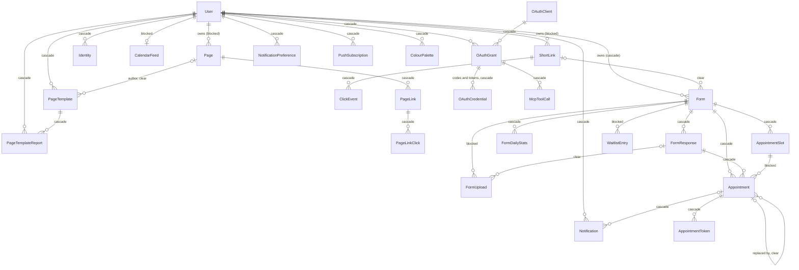

# Data model

> Scope: the entities Kurz stores, how they relate, what happens to dependent data when something is deleted, the structured data kept inside records, and the conventions for evolving the schema. State as of 2026-10-17.
> Database roles are described in the Postgres roles guide; the booking overlap rule is described in the appointments guide.

## Summary
Kurz uses one PostgreSQL database for the application data, uploaded-file metadata, the change history and the background-job queue. One extension is used on top of the standard language: an extension that lets the database refuse overlapping bookings of the same shared resource (the "overlap guard"). There are no custom database functions, triggers or enumerated types: status-like fields are plain text, and some of them are guarded by value checks. Integrity rests on relationships with explicit delete behaviour, a handful of value checks and the overlap guard, uniqueness rules (some of them partial), and application-level cleanup for what the database does not cascade. Short links and bio pages are soft-deleted (hidden, then purged); everything else is hard-deleted. The cache, rate limits and the redirect path live in Valkey, not in this database.

## Glossary
- **Soft delete**: a short link or bio page is hidden from normal use by stamping a deletion time instead of removing the record. Soft-deleted records still count for uniqueness (their code or slug stays reserved) until they are purged.
- **Counter**: a stored count kept on a parent record (for example a user's number of visible short links, a short link's number of clicks, a form's number of responses). Counters are maintained by the application, never by the database, so bulk operations that bypass the application leave them out of date.
- **Snapshot**: a structured copy of something taken at a point in time (a form's published version, the details of a booking).
- **Resource key**: the thing a bookable slot occupies; equal to the service key unless a booking mode shares one teacher across lessons. See [booking-engine](booking-engine.md).
- **Overlap guard**: a database rule that stops two slots of the same form and the same shared resource from both holding bookings over overlapping time.
- **Owner role / app role**: the database role that runs schema changes versus the application role, which has data access only.
- **Expand/contract**: the migration discipline of adding and backfilling first and removing later, so the previous release keeps working.

## 1. Platform objects

| Object | Meaning |
|---|---|
| Extensions | Only the overlap-guard extension and the procedural language that ships with PostgreSQL. |
| Search | Text search over users (by e-mail) and short links (by title, URL, code and owner e-mail) uses PostgreSQL's built-in text matching with prefix matching. No search extension and no dedicated search index. |
| Identifier generation | Booking group identifiers are generated by the application, not by the database. |
| Functions, triggers, views, enum types | None. Hash and size functions appear only inside value checks and one-off data fixes. |
| Databases | One database holds the application, the job queue and file metadata. |
| Job queue tables | Eleven tables hold jobs and their executions (ready, scheduled, claimed, blocked, failed, recurring), recurring task definitions, worker processes, pauses and semaphores. Every kind of execution is removed with its job; deleting a job deletes its executions. Worker process records are not linked to anything. |
| Unused cache and cable tables | A database cache table and a message table exist from the initial setup but the application does not use them: the cache is held in Valkey. |
| File storage tables | Three tables hold file metadata: blobs, attachments and variants. An attachment points at its owner polymorphically (type and id), with no database-level link to the owning record. |
| Audit table | The change history of users, short links, pages, page links, forms and grants. Its record ids are 4-byte integers and have no database link to any table. |

Job schedule and queues: see [platform-and-operations](platform-and-operations.md).

## 2. Data dictionary

Conventions: every entity has a generated numeric identifier and, unless stated, creation and update times. "Cascade" means deleting the parent deletes the children at the database level; "clear" means the link is set to empty and the child survives; "blocked" means the parent cannot be deleted while children exist, so the application must remove them first.

### Accounts and sign-in (owner: [accounts-and-auth](accounts-and-auth.md))

#### User
One record per account.
- **Identity:** an e-mail address, stored trimmed and lower-cased and unique case-insensitively; an admin flag.
- **Lifecycle:** a verification time (set at first successful sign-in; unverified accounts are cleaned up), a deactivation time, and a deletion-request time that starts a 30-day grace period before the account is purged.
- **Sign-in secrets:** the 7-digit e-mailed code with its send time and attempt count; a password hash, a pending password hash, a password-change time, a failed-attempt count, a lock-until time; a "sessions revoked at" time after which older sign-in tokens are refused.
- **Preferences:** a time zone (required, default Europe/Lisbon, validated against known zones) and an optional language (English or European Portuguese).
- **Counter:** the number of the user's visible (not soft-deleted) short links.
- **Dependents and delete behaviour:** calendar feed (blocked, cleared by the application), short links and pages (blocked; only the purge path may delete them), and cascade to forms, sign-in identities, notification preferences, notifications, grants, templates, template reports, colour palettes and push subscriptions.

#### Identity
An external sign-in account (Google) linked to a user: provider, the provider's stable user id, an informational e-mail, and last-used time. One identity per provider account and one per provider per user. Cascades with the user.

### Short links (owner: [shortlinks](shortlinks.md))

#### Short link
A short code pointing to a URL.
- **Fields:** the code (unique across all rows including soft-deleted ones), the destination URL, an optional title, an optional password hash (4 to 72 characters when set), an expiry time, an "inactive since" time (set by expiry, deactivation or danger marking), a soft-deletion time, the last-accessed time, a safe flag (default true) with its last safety-check time, and a count of clicks.
- **Relationships:** belongs to a user (required; the user cannot be deleted while links exist, so the purge path removes them first). Its clicks cascade with it. A form that uses the link as its public address has the link cleared when the link is deleted.
- **Audit:** changes are recorded except for the code, click count, last-accessed time, deletion time and password hash.
- **Retrieval aid:** the expiry sweep relies on a partial index over links that have an expiry and are still active.

#### Click event
One record per click on a short link, for statistics.
- **Fields:** click time, IP address, user agent, referer, country, region, platform and browser (text, up to 255 characters each). IP address, user agent and referer are cleared after 90 days.
- **Relationships:** belongs to a short link and is deleted with it. No update time; clicks may also be written by the separate analytics path, not only the main application.

### Bio pages (owner: [bio-pages](bio-pages.md))

#### Page
A public bio page at a personal address.
- **Fields:** a slug (unique across live and soft-deleted pages, with a format and a reserved-word list), display title (max 80), bio (max 300), theme, published flag (default true), expiry time, soft-deletion time, optional custom colours, and an avatar stored as a file.
- **Relationships:** belongs to a user (blocked on user delete; the purge path removes pages first). Links cascade with it; templates made from the page keep existing with their author page cleared.

#### Page link
An ordered item of a page: a button, a social icon or a section header.
- **Fields:** kind (link, social or header), label (max 80), URL (required except for headers), icon, position, active flag, click count, safe flag with its last check time. At most 50 per page.
- **Relationships:** belongs to a page; deleted with it.

#### Page link click
One record per click on a page link, with the same click details as a short-link click and the same 90-day clearing of IP address, user agent and referer. Deleted with its page link.

#### Page template
A template saved from a page; private, or public in the community gallery.
- **Fields:** name (max 60), description (max 140), theme, the list of items (see Stored JSON), visibility (default private), an author page reference, an author label (a text snapshot of "title and slug"), publication time, hidden-by-moderation time, a use count and a report count. At most 20 per user.
- **Relationships:** belongs to a user (cascade). The author page link is cleared if the page is deleted. Reports cascade with the template.

#### Page template report
A user's report against a community template: a reason from a fixed list. One report per user per template. Deleted with either the template or the reporting user.

#### Colour palette
A saved custom colour set of a user: name (max 40) and three colours (see Stored JSON). At most 20 per user. Cascades with the user. Owned by [bio-pages](bio-pages.md) and also used by forms.

### Forms (owner: [forms](forms.md))

#### Form
A form or booking form.
- **Fields:** a public identifier (12 letters and digits, unique), title (max 120), description, thank-you message, theme, optional custom colours, layout (page, one question at a time, or steps), published flag (default false), accepting-responses flag (default true), the list of fields (always a list; see Stored JSON), the published snapshot with its version number and a digest, a response count, cover settings (cover token, vertical position 0 to 100), an intro-screen flag and start-button label.
- **Relationships:** belongs to a user (cascade). May reference a short link as its public address (cleared if the link is deleted). Deleting a form deletes its responses, daily statistics, slots and appointments at the database level; uploads and waitlist entries are blocked, so the application removes them first.

#### Form response
One submission.
- **Fields:** the answers (an object, max 64 KB at the database and 32 KB by the application), country (two capital letters), platform, browser, source, the form version answered, and an optional idempotency key unique per form (null keys are unconstrained). No update time.
- **Relationships:** belongs to a form (cascade). Its appointments cascade. Its uploads are cleared (left orphaned) at the database level.

#### Form daily statistics
Per form and day: views, unique views and starts. One row per form and day. Deleted with the form.

#### Form upload
A file uploaded for a form, either an answer image or the cover; the file itself is in file storage.
- **Fields:** the field it belongs to (or the cover marker), a unique token, and the response it belongs to (empty until the response is stored). Total storage is capped at 20 GB.
- **Relationships:** belongs to a form (blocked; the application removes uploads first). Cleared from its response if the response is deleted; orphans are cleaned up every 15 minutes.

### Booking and appointments (owners: [booking-engine](booking-engine.md) for slots, [appointments-lifecycle](appointments-lifecycle.md) for the rest)

#### Appointment slot
One bookable start time of one service or resource of a form, with a capacity counter.
- **Fields:** service key, resource key (defaults to the service key), start time, end time (empty on older slots), duration in minutes, capacity (empty means unlimited), a booked count and a held count (places offered to the waiting list).
- **Rules:** one slot per form, service and start; one per form, resource and start; booked and held never negative; for a limited slot booked plus held never exceeds capacity; the overlap guard (see Business rules).
- **Relationships:** belongs to a form (cascade). Cannot be deleted while appointments reference it; in practice slots disappear only with their form.

#### Appointment
One booked session; several rows share a group identifier when one booking covers many sessions.
- **Fields:** a status (pending, unverified, confirmed, cancelled, declined, expired, rescheduled; pending, unverified and confirmed "hold" a place), the group identifier, a snapshot of the booking (see Stored JSON), client name, e-mail, phone, time zone and language, the form version, an expiry time, decision time, who decided (owner, timeout or client), a decision message, a cancellation reason and who cancelled (owner, client or system), the reminder offsets already sent (and an older single-reminder time that is kept), a "nudged owner" time, and a link to the appointment it replaced. No update time.
- **Relationships:** belongs to a form and a response (both cascade) and to a slot (blocked). The replaced-appointment link is cleared if the older appointment is deleted. Its tokens and notifications cascade.

#### Appointment token
A single-purpose secret behind an e-mail link, for managing, approving, declining, deciding or verifying. Only a digest is stored (unique), plus purpose, expiry and used time. Deleted with its appointment. No update time.

#### Waitlist entry
A person waiting for a full time.
- **Fields:** the form, service key and start time that identify the time (no link to the slot), name (max 100), e-mail (max 254), language, time zone, a status (waiting, offered, claimed, expired or left) and the time until which an offer is open.
- **Rules:** one active entry (waiting or offered) per person per time, e-mail compared case-insensitively.
- **Relationships:** belongs to a form (blocked; the application removes entries first).

#### Calendar feed
The signed calendar subscription feed of a user: a unique digest and a last-fetched time. One per user. Blocked on user delete; the application removes it first.

### Notifications (owner: [notifications-and-email](notifications-and-email.md))

#### Notification
One delivery to one channel (in-app, e-mail or push); also the delivery queue for e-mail and push.
- **Fields:** channel, recipient kind (owner or client), status (pending, sent or failed), a kind (event type, unchecked), an event key that identifies the event, a payload (see Stored JSON), attempt count, next-attempt, sent and read times, and the last error. Kept 90 days.
- **Rules:** needs an owner user or a client e-mail matching its recipient kind; the same event is never notified twice to the same recipient on the same channel.
- **Relationships:** optionally belongs to a user and to an appointment; both cascade.

#### Notification preference
A user's opt-in or opt-out per event kind and channel; one per user, kind and channel. Cascades with the user.

#### Push subscription
A Web Push endpoint of a user: the endpoint (unique), keys, a browser label and last-used time. At most 5 per user. Cascades with the user.

### MCP and OAuth (owner: [mcp-and-oauth](mcp-and-oauth.md))

#### OAuth client
A dynamically registered OAuth client: a unique client id, a name (max 100) and 1 to 5 redirect addresses.

#### OAuth grant
A user's consent for a client: scopes, the resource, a revocation time and last-used time. Cascades with the user and with the client. Audited on scopes and revocation.

#### OAuth codes and tokens
Short-lived credentials of a grant (authorization codes, access tokens, refresh tokens). Only digests are stored, all unique. An authorization code also records its PKCE challenge, redirect address, expiry and used time; a refresh token has an expiry, an absolute expiry and a used time (rotation). All cascade with the grant.

#### MCP tool call
A log of an AI app's tool calls under a grant: tool name, status, error code, duration and number of records returned. Cascades with the grant; purged daily.

### Administration and audit (owner: [admin-and-moderation](admin-and-moderation.md))

#### Abuse signal
An admin flag for repeated content or form flooding: kind (same text, same links, form flood), a fingerprint, status (open or dismissed), first and last seen times, and lists of related user, page and form ids. The id lists are not links, so they may point at deleted records.

#### Audit entry
The change history: the changes, the action, the audited record and its association, the acting user and name, the remote address (cleared after 90 days), a request identifier, a version and a comment. Not linked to any table.

### Platform entities (owner: [platform-and-operations](platform-and-operations.md))
The job-queue, unused cache and file-storage tables are described in section 1. File storage is used by [bio-pages](bio-pages.md) (avatars) and [forms](forms.md) (uploads, covers).

## 3. Relationship overview

Not drawn (no database link): abuse signals (ids stored inside the signal), audit entries (plain ids), waitlist entries to slots (matched by form, service and start time), and file attachments (matched by type and id).

## 4. Deletion cascade map

Two layers act. The database layer runs for any delete, including bulk and raw deletes. The application layer runs only when a record is deleted through the application, and bulk deletes skip the cleanup that individual deletes perform. Where the database blocks a delete, the application must clear the children first or the delete fails.

| Deleted | Effect | Layer |
|---|---|---|
| **User** (account purge after the 30-day grace) | In one transaction: every short link (including soft-deleted) is destroyed, then every page (including soft-deleted), then the user. This is explicit because the normal views of a user's links and pages hide soft-deleted records, which would otherwise block the user delete. The change history of the owned links, pages, page links, forms and grants, and of the user, is then deleted explicitly, because the history has no database link. | application + database |
| User, remaining dependents | Forms, templates, palettes, grants, push subscriptions, notification preferences, template reports and identities are removed by the application and also cascade in the database. The calendar feed is blocked in the database, so only the application removes it. Notifications are removed by the database cascade only. Tool-call logs and OAuth credentials go through the grant cascade. | application + database |
| **Short link** soft delete | Removes the redirect cache entry, stamps the deletion time and schedules the purge. The owner's visible-link counter drops at once. | application |
| Short link hard delete (purge job, or the account purge) | Clicks cascade in the database. A form using the link has it cleared. The change history of the link is not deleted by the purge job. | database |
| **Page** soft delete | Only stamps the deletion time; links and clicks stay; the slug stays reserved. | application |
| Page destroy (account purge) | Page links are removed, each deleting its clicks; the database also cascades. A template made from the page keeps existing with its author page cleared. The avatar file is removed with the page. | application + database |
| **Form** destroy | The form's short link is soft-deleted. Uploads are destroyed first (removing their files), then responses, waitlist entries and daily statistics are deleted in bulk. The database cascades slots and appointments (and through them tokens and notifications). Slot counters are not released because the slots go too. | application + database |
| **Form response** destroy | Releases the slot places of its holding appointments, destroys its uploads, and decrements the form's response count. The database cascades its appointments and their tokens and notifications; appointments that were replaced by those are cleared. | application + database |
| Bulk "delete all responses" (dashboard bulk action and MCP) | No cleanup: slot places are NOT released, uploads are NOT destroyed (the database clears their response and the orphan sweep later removes them), and the response count is not decremented. Appointments, tokens and notifications cascade at the database. | database only (see Drift) |
| **Appointment slot** | Cannot be deleted while any appointment references it. No application path deletes a slot; slots disappear only with their form. | database (blocks) |
| **Appointment** | No application delete path. Through cascades its tokens and notifications are deleted; appointments it replaced keep existing with the link cleared. | database |
| **OAuth grant** destroy | Codes and tokens are removed by the application; tool-call logs by the database cascade only. Deleting a client destroys its grants. | application + database |
| **Page template** destroy | Its reports are removed. | application + database |

Retention deletes (not cascades): IP address, user agent and referer of clicks and page-link clicks, and the remote address of audit entries, are cleared after 90 days; notifications are deleted after 90 days; MCP tool calls are purged daily; unverified users are removed after one day.

## 5. Stored JSON columns

| Entity and field | What it contains | Validation |
|---|---|---|
| Form: fields | A list of field definitions. Each has an 8-character id, a type, a label, help text and a required flag. Types: short text, long text, e-mail, number, single choice, multiple choice, yes/no, rating, date, image, section and booking. Types add their own settings (choices, maximum choices, scale, minimum/maximum; for booking: mode, availability, services, categories, rules, exceptions). | Database: must be a list. Application: field and booking definitions are checked in detail. See [forms](forms.md) and [booking-engine](booking-engine.md). |
| Form: published snapshot | The published copy of the form: title, description, thank-you message, theme, custom colours, layout, fields, cover token and position, intro flag and start label. Older snapshots lack the last four, which default. The form's digest is a SHA-256 of the snapshot text. | Application only, written on publish. |
| Form response: answers | An object keyed by field id. | Database: object, max 64 KB. Application: max 32 KB and per-field checks. |
| Appointment: snapshot | Copied at booking: name, duration (minutes), price, currency, the manual-approval timeout rule, and for multi-session bookings the total, the sessions and the monthly details (including skipped sessions). | Database: object only. Application builds it at booking and reads it for receipts. |
| Custom colours (pages, forms, colour palettes) | Exactly three lower-case hex colours: background, text and accent. Empty on pages and forms means "use the theme". | Application only; a palette requires them. |
| Page template: items | A list of at most 50 page-link definitions. | Application only. |
| Notification: payload | An object whose keys depend on the kind; appointment events carry form, response, group, sessions and optional expiry; waitlist events add the waitlist entry. | Database: object only. See [notifications-and-email](notifications-and-email.md). |
| OAuth grant: scopes | A non-empty list of unique known scopes; a personal-data scope may not be mixed with a publish scope. | Application only. |
| OAuth client: redirect addresses | A list of 1 to 5 addresses. | Application only. |
| Abuse signal: user, page and form ids | Lists of ids. | None (no validation, not links). |
| Audit entry: changes | Each changed attribute with its value or old and new value. | Provided by the audit tool. |

## 6. Migration conventions and evolution

### How schema changes are made
- Index creation on a table that can be large is done without blocking writes; older indexes on some large tables were created the plain way before this became the practice.
- Foreign keys on live tables are added unvalidated and validated in a later change. Making a column required follows the same path: add an unvalidated check, backfill, validate, make the column required, then remove the helper check.
- Backfills are repeatable and batched, and work on raw data rather than application models.
- Data fixes can only be applied, not undone, and each is covered by automated checks.
- New constraints are named explicitly. Status fields added in October 2026 have value checks; older ones do not.
- No tool enforces these conventions; they rely on the author knowing the rule.

### Expand/contract rule
Deployment migrates the database first, then replaces services one at a time, starting the new container before stopping the old. For a few seconds, and again after a rollback, the previous release runs against the new schema. Therefore: add, backfill and ship the code that uses a column; drop or rename only in a later release; a new service needs a health check. Example: the resource key was added as optional, backfilled and indexed, written by every booking, and made required one release later.

### Roles
- Production connects as an application role with no superuser, create-database, create-role or replication rights, only read and write on the data (and use of sequences), plus default privileges so tables created by later migrations are usable.
- Migrations run as the owner role, which is substituted for the application credentials during deployment when a separate migration user is configured. Until one is set, both use the same credentials.
- Consequence: a migration cannot depend on the application role creating objects; enabling an extension needs the owner. A security check proves the application role cannot create, alter or drop tables.

### Notable schema evolution
- **Counters:** click counting moved from a single click count to a per-event counter maintained by the application; counters were reset when this changed. A user's short-link counter was added later, first counting soft-deleted links, and was corrected to count only visible links.
- **Ownership of short links:** links were once allowed without a user (anonymous links); user ownership was later made required again, with a foreign key added unvalidated and then validated.
- **E-mail uniqueness:** unique e-mail became unique case-insensitively.
- **Click cleanup:** clicks now cascade when their short link is deleted.
- **Verification:** the verification time was introduced with existing accounts treated as verified so none were purged.
- **Forms:** layout was added (default later changed to a single page, existing forms keeping their value); the published snapshot, its digest and the answered version were added and backfilled. A bundle option was removed from booking services by rewriting stored forms and recomputing digests.
- **Booking:** token purposes were widened to include deciding and verifying, and the pending-expiry index to cover unverified bookings; a list of reminder offsets replaced the single reminder time; a held count and a waiting list were added with capacity then counting held places; the resource key was introduced; and the overlap guard was added (older slots have no end time and are outside it).
- **Defaults:** the default user time zone changed from UTC to Europe/Lisbon, moving users still on UTC.
- **Sign-in codes:** the uniqueness rule on the 7-digit code was dropped because two users could be issued the same code.
- **Clean-up:** old failed jobs of retired job types were deleted.

Seeding: the only seed data is an example user with one short link, created on demand. End-to-end test data is created separately (see [platform-and-operations](platform-and-operations.md)).

## Business rules

### Identity and accounts
- **DM-01** An e-mail is unique case-insensitively; it is also trimmed and lower-cased on save.
- **DM-02** One sign-in identity per provider account and one identity per provider per user.
- **DM-03** The sign-in code is not unique; two users may hold the same code at once. Never look a user up by code.
- **DM-04** A user's time zone is required, default Europe/Lisbon; the language may be empty (browser or default decides).
- **DM-05** A user has at most one calendar feed, and feed digests are unique.
- **DM-06** Deleting a user who has short links or pages through a plain database delete fails. The only supported path is the account purge.

### Short links and statistics
- **DM-07** A short code is unique across live and soft-deleted links; a deleted code is not reusable until the purge removes the record.
- **DM-08** A short link always has a user, enforced by a validated database relationship.
- **DM-09** Deleting a short link deletes its click events in the database.
- **DM-10** A user's short-link counter counts only links that are not soft-deleted. It is maintained by the application, so raw database deletes or direct edits desynchronise it.
- **DM-11** The click, page-link click and form-response counters are maintained by the application (required, default 0). Bulk inserts and bulk deletes bypass them.
- **DM-12** The partial index on short-link expiry only covers links that have an expiry and are still active; expiry queries must use the same condition to benefit from it.
- **DM-13** IP address, user agent and referer of click events and page-link clicks, and the remote address of audit entries, are cleared after 90 days; partial indexes over the rows that still hold an address serve this job.

### Bio pages
- **DM-14** A page slug is unique across live and soft-deleted pages.
- **DM-15** Deleting a page deletes its links and their clicks in the database; a template made from the page keeps existing with no author page.
- **DM-16** One report per user per template; deleting either side deletes the report.
- **DM-17** A page link's URL is optional only because of the header kind; the application requires it for other kinds. Application-only rule.

### Forms and responses
- **DM-18** A form's public identifier is unique.
- **DM-19** A form's fields must be a list; the shape of each field is checked only by the application.
- **DM-20** A response's answers must be an object of at most 65,536 bytes at the database; the application refuses more than 32 KB first.
- **DM-21** A response with an idempotency key is unique per form; a repeated key is rejected as a duplicate. Responses without a key are not constrained.
- **DM-22** Daily statistics have one row per form and day.
- **DM-23** Deleting a form deletes its responses, daily statistics, slots and appointments at the database; uploads and waitlist entries block the delete, so only the application's form deletion (which removes them first) can delete a form that has uploads or waitlist entries.
- **DM-24** Deleting a response clears its uploads' link (they become orphans, removed later by the cleanup sweep); deleting a form or response through the application removes the uploads first.
- **DM-25** Deleting a short link that a form uses clears the form's link; deleting a form soft-deletes its short link.
- **DM-26** An upload's token is unique.

### Appointments
- **DM-27** A slot's booked and held counts are never negative, and for a limited slot booked plus held never exceeds capacity. The reservation logic relies on the database to refuse overbooking.
- **DM-28** One slot per (form, service, start) and one per (form, resource, start).
- **DM-29** A slot's resource key is required; it defaults to the service key.
- **DM-30** Two slots of the same form and an explicit shared resource (resource different from service) cannot both hold bookings (booked plus held above zero) over overlapping time ranges. Back-to-back slots are allowed; slots with no end time are ignored. The reservation logic reports a violation (or a deadlock) as "full". See the appointments guide.
- **DM-31** A slot that has appointments cannot be deleted.
- **DM-32** An appointment's decided-by is empty or owner, timeout or client; cancelled-by is empty or owner, client or system; the snapshot is an object. The status itself is not constrained by the database.
- **DM-33** Appointment token purposes are manage, approve, decline, decide and verify; digests are unique. Adding a purpose needs a migration that recreates the purpose check.
- **DM-34** Deleting a form response deletes its appointments, their tokens and their notifications.
- **DM-35** A person can wait only once per (form, service, start) while waiting or offered (e-mail compared case-insensitively); the status is one of waiting, offered, claimed, expired or left.
- **DM-36** Pending-expiry sweeps use the appointment expiry time filtered to pending or unverified; a new waiting status needs that partial index changed.

### Notifications, OAuth, MCP
- **DM-37** A notification needs an owner user or a client e-mail, matching its recipient kind.
- **DM-38** At most one notification per (kind, event key, channel, recipient kind, user or e-mail). Creating it twice is rejected as a duplicate, which is how the application deduplicates events.
- **DM-39** Channel is in-app, e-mail or push on both notifications and notification preferences; adding a channel needs both checks changed. Preferences have one row per (user, kind, channel).
- **DM-40** A push endpoint is globally unique: one browser endpoint belongs to one user.
- **DM-41** OAuth codes, access tokens and refresh tokens are stored as unique digests; deleting a grant deletes them and its tool-call logs. Revocation stamps a revocation time (the record stays); deletion cascades.
- **DM-42** An OAuth client id is unique.

### Audit and moderation
- **DM-43** An abuse signal is unique per (kind, fingerprint); the ids inside its lists are not database links and can reference deleted records (the admin view loads pages including soft-deleted ones).
- **DM-44** The audit history has no database links; removing a user's data from it is done by the account purge with explicit deletes. Integer id columns limit auditable ids to 2³¹−1.

### Migrations
- **DM-45** A migration must leave the previous release working: add and backfill first; drop, rename or make required in a later release.
- **DM-46** Add a foreign key to a populated table unvalidated and validate it in a separate migration; build indexes without blocking writes. Convention only; no tool enforces it.
- **DM-47** Data migrations are repeatable, work on raw data or local model stand-ins rather than application models, and are covered by automated checks that run them twice where relevant.
- **DM-48** Migrations run as the owner role, never as the application role. See the Postgres roles guide.

## Decisions

### D-DM-01 Constraints in the database for money-like counters
**Decision.** Slot capacity, the held count, token purposes, actor fields and notification shape are database value checks, and the overlap rule is an exclusion constraint. **Why.** The reservation path updates counters in the database; it is the last guard when two requests race, and it refuses overlapping time of a teacher (see the appointments guide). **Consequence.** Adding a status, purpose or channel is a migration that recreates the check.

### D-DM-02 Soft delete for short links and pages only
**Decision.** Short links and pages are hidden by a deletion time; everything else is hard-deleted. **Why.** A link with thousands of clicks must answer the delete at once and be purged in the background; pages keep their slug reserved. **Consequence.** Every relationship to these tables is blocked or relies on paths that include soft-deleted records, and the account purge must walk them.

### D-DM-03 Blocked deletes from user to short links and pages
**Decision.** The user-to-short-link and user-to-page relationships do not cascade. **Why.** The account purge and the application's own deletion remove links first, so the constraint only fails loudly for deletes that bypass them. For pages no separate reason was recorded. **Consequence.** Raw user deletes fail; use the account purge.

### D-DM-04 Counters by the application, not by trigger
**Decision.** The application maintains counters; there are no database triggers. **Why.** No reason was recorded beyond a fix that moved counting into the application. **Consequence.** Bulk deletes, bulk inserts and raw SQL desynchronise counters; repairs are one-off recount migrations.

### D-DM-05 Drop the uniqueness rule on the sign-in code
**Decision.** The 7-digit code has no uniqueness rule; it is checked only together with the e-mail address. **Why.** A collision between two users made the login request fail with a conflict, and the rule protected nothing. **Consequence.** Never query users by code.

### D-DM-06 Two database roles
**Decision.** The application runs as a restricted role and migrations as the owner. **Why.** A SQL injection must not be able to change the schema or read the host (see the Postgres roles guide). **Consequence.** Default privileges must be set for new tables; migrations needing elevated rights (extensions) work only under the owner.

### D-DM-07 Job queue in the primary database
**Decision.** Jobs are stored in the same database as the application data. **Why.** No reason was recorded. **Consequence.** Job tables are part of the schema; a job-table migration needs the same rollout care; old jobs can be deleted by a data migration.

## Change impact
- Add a status value (appointment, notification, waitlist, token purpose, actor): update the database check if the field has one (DM-32, DM-33, DM-35, DM-39), the application's list of valid values, the frontend types, the MCP tool schemas and any partial index with a status condition (DM-36). The old release must still accept the new value, so ship the widened check first.
- Change the shape of a form's fields: update the field and booking validation, the snapshot and already-published forms (stored copies are not re-validated), response submission, the form export and summary, the frontend editor and the MCP form tools, and write a data migration that rewrites both the fields and the published snapshot and its digest. See [forms](forms.md).
- Change the appointment snapshot's content: old rows keep the old shape; receipts, calendar files, notification e-mails and the agenda must tolerate both. See [appointments-lifecycle](appointments-lifecycle.md).
- Add a table that references users, forms, pages or short links: choose the delete behaviour, add the application-level cleanup if the database does not cascade, extend the deletion cascade map, and check the account purge and the account export ([accounts-and-auth](accounts-and-auth.md)). A blocking relationship to users makes the purge fail until the application deletes the rows first.
- Add a soft delete elsewhere: every relationship to it needs the handling of soft-deleted records that the account purge has.
- Delete responses in bulk: use the path that releases slots and destroys uploads, or accept the gaps in Drift (item 4). See [booking-engine](booking-engine.md).
- Add or change a field used by the redirect path (short links): the redirect service and the cached link entry read it; see [shortlinks](shortlinks.md).
- Add an index on a large table (clicks, page-link clicks, audit entries, form responses, notifications): build it without blocking writes (DM-46).
- Drop or rename a field: two releases (stop reading and writing, then drop). The previous release runs against the new schema during the deploy and after a rollback (DM-45).
- Make a field required or add a relationship to a populated table: add the unvalidated constraint, backfill, validate, then finish (DM-45, DM-46).
- Change the overlap guard: the reservation logic converts its violation and deadlocks into "full"; see [booking-engine](booking-engine.md) (DM-30).
- New roles or privileges: review the Postgres roles guide, the deployment procedure and the security check that the application role cannot alter the schema (DM-48).

## Drift and open questions
| # | Finding | Severity |
|---|---|---|
| 1 | The Postgres roles guide says tables created by future migrations are readable and writable by default privileges; this holds only if migrations run as the owner role. Deployment is consistent with it, but nothing checks that the configured migration user is the owner. | low |
| 2 | Schema annotation headers on models are incomplete: about two thirds of the models (all added from October 2026) have none, and the user model's header lacks time zone and language. A development migration would rewrite them; they are not checked in CI. | low |
| 3 | The database cache table and the message table exist but are unused (the cache is Valkey, no cable adapter). Dead tables. | low |
| 4 | Bulk response deletion (dashboard and MCP) skips slot release, upload destruction and the response counter. A form's response count and a slot's booked count can disagree with reality afterwards. Confirm whether slot release happens elsewhere in those paths. | medium |
| 5 | Appointment status, form layout, themes, abuse-signal kind and status, page-link kind, notification kind and MCP call status have no database check, unlike the other October 2026 status fields. Values are guarded only in the application. | medium |
| 6 | The older single reminder time on appointments is still in the schema alongside the list of reminder offsets; whether anything still writes it was not verified. | low |
| 7 | The response answers limit is 64 KB in the database and 32 KB in the application. The slack looks intentional but is undocumented. | low |
| 8 | Waitlist entries match slots by value (form, service, start) with no link. A form deletion leaves no dangling entries only because the application's form deletion removes them first; the database blocks it otherwise. | low |
| 9 | The calendar feed is the only user-owned entity that is blocked rather than cascaded on user delete; only the application clears it. A user delete that bypasses the application fails. | low |
| 10 | Notifications depend entirely on the database cascade; the application does not declare them as dependents of users or appointments. | low |
| 11 | Audit ids are 4-byte integers and unconstrained; audit entries have no retention beyond address clearing, only the explicit deletion during the account purge. | low |
| 12 | No tool enforces safe-migration rules; the non-blocking index and validate-later conventions were applied from October 2026 on, but earlier large-table migrations did not use them. Any new migration relies on the author knowing the rule. | medium |
| 13 | A user's short-link counter was first backfilled including soft-deleted links and fixed three months later; the same trap exists for any new counter on a soft-deleted parent. | low |
| 14 | The appointments guide describes the overlap guard as covering "booked rows"; the rule counts booked plus held places, so held places (waitlist offers) also block overlap. | low |
