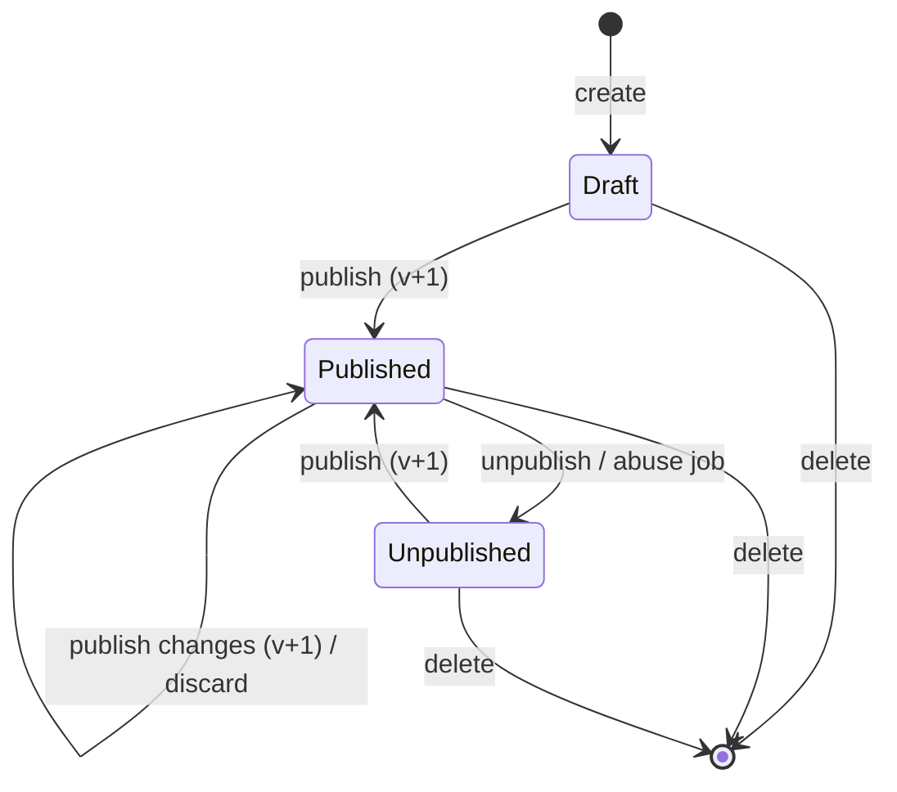

# Forms

> Scope: forms, fields, drafts and publishing, responses, uploads, covers, templates, export, summary, form events. State as of commit `bc7f65c` (2026-10-17).
> Main code: `backend/app/models/form*.rb`, `backend/app/services/forms/`, `backend/app/contracts/form_*.rb`, `backend/app/controllers/api/me/form*_controller.rb`, `backend/app/controllers/api/public/form*_controller.rb`, `backend/app/services/built_in_form_templates*.rb`, `backend/imgproc/`, `frontend/app/routes/forms/`, `frontend/app/routes/f/`, `frontend/app/modules/forms/`.

## Summary

A form is an owner-built list of questions (`forms.fields`, a JSONB array) served to anonymous visitors at `/f/:public_id`. The owner edits a draft (the form's own columns); publishing copies the publishable columns into `published_snapshot`, raises `published_version` and is the only thing visitors read, through `Forms::PublicDefinition`. Visitors submit through a public JSON endpoint guarded by a honeypot, Turnstile, per-IP rate limits and a body limit; answers are cast and validated by `Forms::FieldSchema` against the published definition and stored in `form_responses` without IP or raw user agent. Image answers are uploaded first, re-encoded to WebP by the sandboxed `imgproc` service and claimed by the response in the same transaction. A booking question (one per form) turns a submission into appointments in that same transaction; see [booking-engine](booking-engine.md) and [appointments-lifecycle](appointments-lifecycle.md). Owners read responses, a summary (funnel, timeline, audience, per-question numbers), and export XLSX (server) or CSV (browser).

## Glossary

- **Form** (`Form`): a questionnaire owned by one user. Identified publicly by `public_id`, privately by `id`.
- **Field / question** (`forms.fields[]`): a hash `{id, type, label, help, required, ...type keys}`. "Question" means an answerable field (every type except `section`).
- **Section** (`type: "section"`): a non-answerable heading; splits pages in the `steps` layout. Ignored by submit, summary, export and the publish check.
- **Draft**: the form's own columns (`title`, `fields`, ...). Always what the owner edits.
- **Published snapshot** (`published_snapshot`, `Forms::Snapshot`): a JSON copy of the publishable keys taken at publish time; what visitors see.
- **Published version** (`published_version`): counter raised on each publish; 0 means never published. Stored on each response.
- **Digest** (`published_digest`): sha256 hex of the snapshot text, computed in SQL.
- **Public definition** (`Forms::PublicDefinition`): the single read point of what a visitor sees and what submissions are validated against.
- **Publish blocks** (`Forms::Publish.blocks`): codes that prevent publishing (`no_questions` plus the booking blocks).
- **Upload** (`FormUpload`): one stored image, identified by a 24-character `token`. An answer to an `image` field is that token.
- **Orphan upload**: an upload with no response after 1 hour (`FormUpload.orphaned`).
- **Cover** (`cover_token`, `Form::COVER_FIELD = "coverimg"`): the form's header image, stored as a `FormUpload` with `field_id = "coverimg"`.
- **Intro screen** (`intro_enabled`, `start_label`): a welcome screen with cover, title, description and a start button.
- **Accepting responses** (`accepting_responses`): an open/closed switch independent of publishing and of the snapshot.
- **Form event** (`Forms::TrackEvent`): `view` or `start`, aggregated per form and UTC day in `form_daily_stats`.
- **Reporting fields** (`Snapshot.reporting_fields`): draft fields plus fields still live in the snapshot but removed from the draft; used by summary and XLSX export.
- **Built-in template** (`BuiltInFormTemplates`): six hard-coded starter forms, in English and European Portuguese.

## Data

Full catalogue: [data-model](data-model.md).

**`forms`** (`backend/db/schema.rb:223`)

| Column | Type / default | Notes |
|---|---|---|
| `user_id` | bigint, not null | FK `users` `on_delete: :cascade` (`schema.rb:688`) |
| `public_id` | string, not null, unique index | 12 alphanumeric chars, set on create |
| `title` | string, not null | max 120 (model) |
| `description` | text | max 1000 (model) |
| `thank_you_message` | text | max 500 (model) |
| `theme` | string, default `"default"` | in `Page::THEMES` |
| `custom_colors` | jsonb | `{background, text, accent}`, see [bio-pages](bio-pages.md) (`CustomColors`) |
| `layout` | string, default `"page"` | `page`, `one_at_a_time`, `steps` |
| `published` | bool, default false | |
| `fields` | jsonb, default `[]` | check `forms_fields_is_array` (`schema.rb:250`) |
| `responses_count` | int, default 0 | `counter_culture` from `form_responses` |
| `shortlink_id` | bigint | FK `shortlinks` `on_delete: :nullify` (`schema.rb:687`) |
| `published_snapshot` | jsonb | null until first publish |
| `published_version` | int, default 0 | |
| `published_digest` | string | sha256 hex |
| `cover_token` | string(24) | draft cover |
| `cover_position` | int, default 50 | 0..100, vertical focal point |
| `intro_enabled` | bool, default false | |
| `start_label` | string(40) | |
| `accepting_responses` | bool, default true | |

Indexes: `public_id` unique, `shortlink_id`, `(user_id, created_at)` (daily quota), `user_id`.

**`form_responses`** (`schema.rb:195`): `form_id` (FK `on_delete: :cascade`, `schema.rb:684`), `answers` jsonb default `{}`, `country` string(2), `platform`, `browser`, `source`, `idempotency_key` string(64), `created_at` (no `updated_at`), `published_version`. Indexes `(form_id, created_at)`, `(form_id, id)`, unique `(form_id, idempotency_key) WHERE idempotency_key IS NOT NULL`. Check `form_responses_answers_object_max_64kb`: `jsonb_typeof(answers) = 'object' AND octet_length(answers::text) <= 65536`.

**`form_uploads`** (`schema.rb:211`): `form_id` (FK `forms`, **no** `on_delete`, `schema.rb:686`), `response_id` (FK `form_responses` `on_delete: :nullify`, `schema.rb:685`), `field_id` string(8) not null, `token` string(24) unique, `created_at`. Partial index `index_form_uploads_orphans` on `created_at WHERE response_id IS NULL`. File in ActiveStorage (`has_one_attached :file`), on the `seaweedfs_forms` S3 service in production when `S3_FORMS_BUCKET` is set (`backend/app/models/form_upload.rb:8`, `backend/config/storage.yml:22`).

**`form_daily_stats`** (`schema.rb:186`): `form_id` (FK `on_delete: :cascade`), `day` date, `views`, `unique_views`, `starts` (ints, default 0). Unique `(form_id, day)`.

**Valkey / cache keys** (Rails cache is `redis_cache_store`, `backend/config/application.rb:46`):

| Key | TTL | Owner |
|---|---|---|
| `fv:<form_id>:<utc day>:<visitor digest>` | 25 h | unique view marker, `backend/app/services/forms/track_event.rb:48` |
| `form_uploads/total_bytes` | 1 min | total stored bytes, `backend/app/models/form_upload.rb:14` |
| Rails `rate_limit` counters | per limit | see Limits |

Associations and deletion (`backend/app/models/form.rb:13-20`): `uploads` `dependent: :destroy` (purges blobs), `responses` `dependent: :delete_all`, `appointments` `dependent: nil` (DB cascade), `waitlist_entries` `dependent: :delete_all`, `daily_stats` `dependent: :delete_all`; `before_destroy` soft-deletes the short link. Audited columns: `title`, `published`, `accepting_responses` only (`form.rb:9`); responses are never audited.

## Business rules

### Form attributes

- **FO-01** `title` is required, at most 120 characters; `description` at most 1000; `thank_you_message` at most 500; `start_label` at most 40; `cover_position` an integer 0..100; `theme` one of `Page::THEMES`; `layout` one of `page`, `one_at_a_time`, `steps`. — `backend/app/models/form.rb:4-8,23-29`; test `backend/spec/models/form_spec.rb:26`, `backend/spec/requests/api/me/form_cover_spec.rb:241`, `backend/spec/requests/api/me/forms_spec.rb:242`. The editor repeats the same maxima (`frontend/app/routes/forms/$id.tsx:72-84`).
- **FO-02** New forms default to the `page` layout; a layout given on creation is kept; duplicates keep the original's layout; existing rows were not migrated. — `backend/db/schema.rb:236`; test `backend/spec/requests/api/me/forms_default_layout_spec.rb:10-37`. Rationale: commit `90087b7` (#103).
- **FO-03** The owner create contract accepts only `title, description, thank_you_message, theme, custom_colors, layout, template, locale`; update accepts `title, description, thank_you_message, theme, custom_colors, layout, cover_position, intro_enabled, start_label, accepting_responses`. `published`, `fields`, `user_id`, counters and the snapshot columns cannot be set through create/update. — `backend/app/contracts/form_contract.rb:2-15`, `backend/app/contracts/form_update_contract.rb:2-17`; test `backend/spec/requests/api/me/forms_spec.rb:159,259`.
- **FO-04** `public_id` is `SecureRandom.alphanumeric(12)`, generated before validation on create, unique in the database. Public endpoints 404 before any query unless the id matches `/\A[A-Za-z0-9]{12}\z/`. — `backend/app/models/form.rb:10-11`, `backend/app/controllers/api/public/forms_controller.rb:11-14`; test `backend/spec/models/form_spec.rb:10,20`, `backend/spec/requests/api/public/forms_spec.rb:56`.
- **FO-05** A user may create at most 20 forms per rolling 24 hours (creates and duplicates both count), checked under a row lock on the user; over the quota the API answers `429 {error: "forms_daily_limit"}`. There is no cap on the total number of forms. — `backend/app/models/form.rb:4`, `backend/app/services/forms/create.rb:11-24`, `backend/app/controllers/api/me/forms_controller.rb:7-9`; test `backend/spec/services/forms/create_spec.rb:19-39`, `backend/spec/requests/api/me/forms_spec.rb:194,444`.

### Short link

- **FO-06** Every form gets a short link to `FRONTEND_URL/f/<public_id>` on creation (inside the creation lock), owned by the form's owner, titled with the first 120 characters of the form title. Publishing creates it for older forms that have none. Without `FRONTEND_URL` no link is created. A duplicate gets its own link. Deleting the form soft-deletes the link. — `backend/app/models/form.rb:15,36-47`, `backend/app/services/forms/create.rb:14`, `backend/app/services/forms/publish.rb:46`; test `backend/spec/requests/api/me/forms_spec.rb:107-139`. Rationale: commit `e8dbcc2` (#69), so the form's clicks appear in the existing link statistics. The link title is not updated when the form is renamed (inferred from the code: no callback). See [shortlinks](shortlinks.md).

### Field definitions (`Forms::FieldSchema`)

- **FO-07** `fields` must be an array (model and DB check). Each element must be a hash with an `id` matching `/\A[A-Za-z0-9]{8}\z/`, unique within the form. — `backend/app/services/forms/field_schema.rb:7-8,30-49`; test `backend/spec/models/form_spec.rb:35`, `backend/spec/services/forms/field_schema_spec.rb:60`.
- **FO-08** Types: `short_text`, `long_text`, `email`, `number`, `single_choice`, `multiple_choice`, `yes_no`, `rating`, `date`, `image`, `section`, `booking`. Unknown types are rejected. — `field_schema.rb:5,110`.
- **FO-09** Allowed keys are `id, type, label, help, required` plus per-type keys; any other key is rejected ("has unknown keys"). — `field_schema.rb:21-28,112-113`.

| Type | Extra keys | Definition rules | Answer (cast) | Errors |
|---|---|---|---|---|
| `short_text` | none | | String, stripped, max 500 chars | `invalid`, `too_long` |
| `long_text` | none | | String, stripped, max 5000 chars | `invalid`, `too_long` |
| `email` | none | | String, stripped, max 254, `URI::MailTo::EMAIL_REGEXP` and `/@[^@\s]+\.[^@\s]+\z/`, no whitespace | `invalid`, `too_long` |
| `number` | `min`, `max` | bounds numeric, finite, abs <= 1e12, `min <= max` | Numeric or string `/\A-?\d+(\.\d+)?\z/`; at most 4 decimals; abs <= 1e12; within min/max; stored as integer when whole, else float | `invalid`, `out_of_range` |
| `single_choice` | `choices` | >= 2 choices, each `{id, label}` only, id 8 alnum unique, label 1..100 | one existing choice id | `invalid` |
| `multiple_choice` | `choices`, `max_choices` | as above; `max_choices` nil or integer 1..choices.size | array of distinct existing choice ids, size <= `max_choices` (default all) | `invalid`, `too_many` |
| `yes_no` | none | | `true` or `false` (`false` is an answer) | `invalid` |
| `rating` | `scale` | `scale` 5 or 10 | integer 1..scale | `invalid`, `out_of_range` |
| `date` | none | | `YYYY-MM-DD`, valid ISO date, year 1900..2100 | `invalid`, `out_of_range` |
| `image` | none | | upload token (see FO-31) | `invalid` |
| `section` | none | label required | not answerable | |
| `booking` | `mode, availability, services, categories, rules, exceptions` | `BookingSchema.errors`; at most one per form | `Appointments::Book.cast` | see [booking-engine](booking-engine.md) |

  — `field_schema.rb:9-20,82-99,120-247`; test `backend/spec/services/forms/field_schema_spec.rb:15-208`.
- **FO-10** `label` is required (non-blank) and at most 300 characters for every type except `booking`, where it is optional; `help` at most 500; `required` nil or boolean; no string may contain NUL. A blank label is dropped from storage (no empty string is stored). — `field_schema.rb:9-10,20,60-63,114-116,165-177`; test `field_schema_spec.rb:80-115`. Rationale: commit `cc29ff9` (#279).
- **FO-11** Only one `booking` question per form. — `field_schema.rb:47`.
- **FO-12** Blank answers (`nil`, whitespace-only string, `[]`) are "unanswered": an error `blank` when the field is required, otherwise omitted from the stored answers. Any string containing NUL is `invalid`. — `field_schema.rb:84-85,179-185`; test `field_schema_spec.rb:122`.
- **FO-13** There is no limit on the number of fields or choices per form; the only bound on the owner side is the request body. (Enforced nowhere; see Drift.)

### Editing fields (`Forms::Definition`)

- **FO-14** Every field operation (add, update, remove, reorder, apply template) runs under a row lock on the form and rewrites the whole `fields` array, then validates the whole form. — `backend/app/services/forms/definition.rb:7,15,30,39,52`; test `backend/spec/services/forms/definition_spec.rb:119`.
- **FO-15** Field and choice ids are server-generated (8 alphanumeric): a client-sent field id on add is ignored; existing choice ids are kept on update and new choices get one. — `definition.rb:8`, `field_schema.rb:65-80`; test `definition_spec.rb:13,21,51`, `backend/spec/requests/api/me/forms_spec.rb:380`.
- **FO-16** A field's `type` cannot be changed, and a booking question's `mode` cannot be changed (422). On update the given keys are merged into the field and keys sent as `null` are removed (`.compact`); a booking question's `rules` are merged key by key. — `definition.rb:18-23`; test `definition_spec.rb:44`, `backend/spec/requests/api/me/forms_spec.rb:360`.
- **FO-17** Reorder must list every current id exactly once, otherwise 422 `ids must list every question exactly once`. — `definition.rb:41`; test `definition_spec.rb:89`, `forms_spec.rb:371`.
- **FO-18** Adding a booking question fills defaults from the owner (`BookingSchema.defaults`). — `definition.rb:6`; see [booking-engine](booking-engine.md).
- **FO-19** After a form has responses, the dashboard API still lets the owner add, edit, remove and reorder questions; only applying a template is refused (`cannot replace the questions of a form that has responses`). Old answers keep their field ids; answers to removed questions disappear from the responses list but stay in the database. The MCP tools refuse structural edits on a form with responses (`form_has_responses`) unless the connection has `account:full`. — `definition.rb:53`, `backend/app/services/mcp/guards.rb:53-57`; test `definition_spec.rb:109`, `backend/spec/requests/api/me/form_responses_spec.rb:83`. See [mcp-and-oauth](mcp-and-oauth.md).

### Draft, publish, unpublish, discard

- **FO-20** The snapshot keys are `title, description, thank_you_message, theme, custom_colors, layout, fields, cover_token, cover_position, intro_enabled, start_label`. Missing cover/intro keys (snapshots made before covers existed) default to `cover_token: nil, cover_position: 50, intro_enabled: false, start_label: nil`. — `backend/app/services/forms/snapshot.rb:5-6,15-17`; test `backend/spec/requests/api/me/form_cover_spec.rb:250`.
- **FO-21** Publishing requires at least one answerable field (`NoQuestions`, 422 with `blocks: [{code: "no_questions"}]`) and no booking publish blocks (`Blocked`, 422 with `errors.fields` messages and `blocks` codes `{code, name, service_id}`). A form with only sections cannot be published. — `backend/app/services/forms/publish.rb:26-44`, `backend/app/controllers/api/me/forms_controller.rb:62-68`; test `backend/spec/requests/api/me/forms_spec.rb:251,297,306`. Block codes known to the editor: `no_questions, no_service, service_incomplete, availability_incomplete, waitlist_questions, no_email` (`frontend/app/modules/forms/form-errors.ts:4-11`); their rules are in [booking-engine](booking-engine.md).
- **FO-22** Publish ensures the short link, then under the form lock sets `published = true`, stores `Snapshot.of(form)`, raises `published_version` by 1 and computes `published_digest = sha256(published_snapshot::text)` in SQL; afterwards it prunes unused cover files. Every publish raises the version, including a republish after unpublishing. — `publish.rb:24,46-52`; test `backend/spec/requests/api/me/forms_publish_snapshot_spec.rb:32,84`. Rationale: commit `c114d0d` (#106).
- **FO-23** Unpublish only sets `published = false`; snapshot and version stay. — `backend/app/services/forms/unpublish.rb:10`; test `forms_publish_snapshot_spec.rb:77`.
- **FO-24** Discard restores every snapshot key into the draft columns (including the cover) and prunes cover files; it is refused with 422 `nothing has been published yet` when there is no snapshot. — `backend/app/services/forms/discard.rb:12-17`; test `forms_publish_snapshot_spec.rb:60,71`, `form_cover_spec.rb:260`.
- **FO-25** `has_unpublished_changes` is true when a snapshot exists and the draft differs from it (after defaults). — `snapshot.rb:23-25`, `backend/app/serializers/form_serializer.rb:8-10`; test `forms_publish_snapshot_spec.rb:42,98`.
- **FO-26** Visitors read only the published snapshot (fallback to the draft columns only for a published form with no snapshot, i.e. legacy rows before the backfill). Booking fields are compiled by `Booking::Modes.compile` before serving. — `backend/app/services/forms/public_definition.rb:7-12`; test `backend/spec/requests/api/public/form_definition_spec.rb:37`, `backend/spec/requests/api/public/form_snapshot_read_spec.rb:51`. Rationale: commits `164a2df` (#104), `08c01a8` (#107), flag removed in `c61b24f` (#196).
- **FO-27** A form is publicly visible only when `published = true` and its owner is active (`Form.visible`); every other state (draft, unpublished, deleted, deactivated owner, malformed id) answers the same 404. — `backend/app/models/form.rb:21`; test `backend/spec/models/form_spec.rb:53`, `backend/spec/requests/api/public/forms_spec.rb:40,62`.
- **FO-28** The public form JSON exposes only `title, description, thank_you_message, theme, custom_colors, layout, cover_token, cover_position, intro_enabled, start_label, published_version, fields`, plus `accepting_responses` read live from the draft column. Field keys are limited to `id, type, label, help, required, choices, max_choices, scale, min, max`; choices to `id, label`; a booking field adds `services` (public keys only), `categories`, `waitlist`, `multiple_services`, `buffer_minutes`, `verify_email`, `time_zone`. Owner, ids, counters and timestamps are never exposed. — `backend/app/serializers/public_form_serializer.rb:4-26`, `backend/app/controllers/api/public/forms_controller.rb:16-19`; test `backend/spec/requests/api/public/forms_spec.rb:20,31`.
- **FO-29** `Forms::BackfillSnapshots` snapshots every published form without a snapshot at version 1 (without cover/intro keys), fills missing digests, and tags those forms' untagged responses with version 1. It only fills nulls, so reruns are safe. — `backend/app/services/forms/backfill_snapshots.rb:5-34`; test `backend/spec/services/forms/backfill_snapshots_spec.rb:15-44`. Rationale: commit `dbb1aff` (#100).

### Accepting responses

- **FO-30** `accepting_responses` (default true) is independent of publishing and bypasses the snapshot: it takes effect immediately. When false, `POST .../responses` and waitlist joins answer `410 {error: "closed"}`; the public page shows a closed screen; already offered waitlist places can still be claimed and existing bookings managed. The backend lets the switch change on a draft; the editor disables the switch until the form is published (frontend only). There is no schedule (open/close dates) and no response cap. The MCP `update_form` tool does not expose it on purpose. — `backend/app/controllers/api/public/form_responses_controller.rb:71-73`, `frontend/app/routes/f/$publicId.tsx:102-109`, `frontend/app/routes/forms/$id.tsx:433-447`; test `backend/spec/requests/api/public/form_responses_spec.rb:33-49`, `backend/spec/requests/api/me/forms_spec.rb:224`, `e2e/tests/accepting-responses.spec.ts:17,26,66,87,100`. Rationale: commit `7d6813e` (#223).

### Submission

- **FO-31** Image answers: the answer must be a token matching `/\A[A-Za-z0-9]{24}\z/` of an upload of this form, for this field, not yet claimed; it is claimed with a conditional `UPDATE ... WHERE response_id IS NULL` inside the response transaction; if any claim affects 0 rows the whole response is rolled back and the API answers 422 `answers: ["invalid"]`. — `backend/app/services/forms/submit_response.rb:113-122,124-134`, `backend/app/models/form_upload.rb:3`; test `backend/spec/requests/form_uploads_spec.rb:144,156,183`.
- **FO-32** Validation runs against the published definition. Answers keys that are not questions of the form are dropped; sections are ignored; errors are reported per field id as codes without echoing values. A non-object `answers` is 422 `answers: ["invalid"]`. — `submit_response.rb:38,62-83`; test `backend/spec/services/forms/submit_response_spec.rb:29-66`, `form_snapshot_read_spec.rb:75`.
- **FO-33** If the client sends `form_version` and it differs from the live `published_version`, the API answers `409 {error: "form_changed", form: <current public form>}` and stores nothing. Without `form_version` the submission is accepted and validated against the live version. The response stores the version it was validated against. — `submit_response.rb:40,58-60,152`, `backend/app/controllers/api/public/form_responses_controller.rb:51-53`; test `form_snapshot_read_spec.rb:64-93`.
- **FO-34** Idempotency: `idempotency_key` (first 64 chars) is unique per form. A repeated key returns the stored response with 200 without validating again (even if the form changed); a concurrent duplicate caught by the unique index also returns the existing row. The web client sends one random UUID per page load. — `submit_response.rb:30,35-36,135-139,169-173`, `frontend/app/routes/f/$publicId.tsx:63`; test `submit_response_spec.rb:72-119`, `form_responses_spec.rb:83`, `form_snapshot_read_spec.rb:93`.
- **FO-35** Stored request metadata: `country` from `CF-IPCountry` when two capital letters and not `XX`/`T1`; `platform` and `browser` from `UserAgentParser`; `source` from `TrafficSource` using the user agent and the client-sent `referer` (first 255 chars); each text trimmed to 40 chars. IP and raw user agent are never stored. — `submit_response.rb:9,149-167`, `form_responses_controller.rb:80-93`; test `form_responses_spec.rb:51,63`, `submit_response_spec.rb:121-130`, `backend/spec/models/form_response_spec.rb:19`.
- **FO-36** Answers JSON is at most 32 KB (model), 64 KB (DB check), and the request body at most 64 KB (413). — `backend/app/models/form_response.rb:2,17-19`, `schema.rb:208`, `backend/app/controllers/concerns/public_json_endpoint.rb:4,17-23`; test `form_response_spec.rb:24,38`, `form_responses_spec.rb:173`.
- **FO-37** Booking step: `Appointments::Book.cast` validates the booking answer during casting (may add `details` to a 422); inside the response transaction `Appointments::Book.call` reserves places and creates appointments using the contact (`email`: the first required email question when the booking requires e-mail verification, otherwise the email question the visitor ticked, sent as `confirm_field_id`; `name`: the first required `short_text`), the visitor's time zone and locale. A lost race raises `Full` → `409 {error: "slot_full", starts_at}` and rolls back the response. The 201 body adds `appointments` and the receipt (manage URL, e-mail delivery, price). — `submit_response.rb:85-111,142-147`, `form_responses_controller.rb:41-57`; see [booking-engine](booking-engine.md), [appointments-lifecycle](appointments-lifecycle.md).
- **FO-38** A form without a booking question sends no e-mail and no notification on submission: there is no confirmation e-mail to the respondent and no owner alert. The "confirm here" checkbox appears only on booking forms without e-mail verification that have an email question. — `frontend/app/modules/forms/confirm-email.ts:9-16`; notifications only from `backend/app/services/appointments/book/notify.rb:7`. See [notifications-and-email](notifications-and-email.md).

### Uploads

- **FO-39** `POST /api/public/forms/:public_id/fields/:field_id/uploads` requires `multipart/form-data` (415), a body at most 11 MB (413), a file at most 10 MB whose magic bytes are PNG, JPEG, WebP, HEIC or HEIF (422 `invalid_image`), a visible form and an `image` field of the **draft** with that id (404). When the stored total is at or over 20 GB, or imgproc or storage fails, it answers `503 uploads_unavailable` and leaves no row. On success: `201 {token}`. — `backend/app/controllers/api/public/form_uploads_controller.rb:7-72`, `backend/app/services/image_upload.rb:7-28`, `backend/app/models/form_upload.rb:4,13-17`; test `backend/spec/requests/form_uploads_spec.rb:48-134`.
- **FO-40** Every image is re-encoded by `imgproc` (separate Rack app, no Rails/DB/S3, read-only fs, internal network `imgnet`): it re-checks magic bytes, refuses more than 10 MB, more than 10000 px per side or 50 MP before decoding, blocks untrusted libvips loaders, keeps the primary frame, caps the longest side at 4096 px and outputs WebP with metadata stripped. The client times out after 2 s open / 25 s read; 411/413/422 → `Rejected` (422), anything else → `Unavailable` (503). Files are stored as `image.webp` (`cover.webp` for covers); the client file name is dropped. There is no antivirus scanning: re-encoding is the content defence. — `backend/imgproc/app.rb:10-55`, `backend/app/services/imgproc.rb:9-27`, `.ci/stack.yml:131`. Rationale: commits `433073f` (#74), `9a6be53` (#75).
- **FO-41** Owner download `GET /api/me/forms/:form_id/uploads/:token` serves only uploads attached to a response of the owner's form, as an `image/webp` attachment with `Content-Security-Policy: default-src 'none'; sandbox` and `Cache-Control: private, no-store`. The web drawer fetches it into a blob URL, so an answer image never has a public URL. — `backend/app/controllers/api/me/form_uploads_controller.rb:6-11`; test `form_uploads_spec.rb:216,235`. Rationale: commit `8043cad` (#76).
- **FO-42** ActiveStorage's blob and representation controllers (proxy and redirect) answer 404 for any blob attached to a `FormUpload`, so a signed id alone never serves a respondent's image or a cover. — `backend/app/controllers/concerns/form_blob_guard.rb:10-12`, `backend/config/initializers/form_blob_guard.rb:1-8`; test `form_uploads_spec.rb:301`.
- **FO-43** Orphans (no response, older than 1 hour, not a cover) are destroyed with their blobs every 15 minutes by `CleanupOrphanFormUploadsJob`. — `backend/app/models/form_upload.rb:2,19`, `backend/app/jobs/cleanup_orphan_form_uploads_job.rb:4-6`, `backend/config/recurring.yml:20-23`; test `form_uploads_spec.rb:244`, `form_cover_spec.rb:135`.

### Covers and intro

- **FO-44** `PUT/PATCH /api/me/forms/:id/cover` takes multipart (415 otherwise), a file at most 5 MB whose bytes are PNG, JPEG or WebP (HEIC refused, unlike avatars), at most 8000 px per side and 40 MP (checked with libvips headers before imgproc), re-encoded by imgproc; 20 per 10 minutes per user. It sets the **draft** `cover_token` and prunes cover files that neither the draft nor the snapshot uses. `DELETE` clears the draft cover and prunes. — `backend/app/services/cover_upload.rb:4-26`, `backend/app/controllers/api/me/form_covers_controller.rb:9-49`, `backend/app/services/forms/covers.rb:5-8`; test `form_cover_spec.rb:47-150`. Rationale: commit `bc33889` (#181).
- **FO-45** Visitors see a cover only after it is published: `GET /api/public/forms/:public_id/cover/:token` serves only the snapshot's `cover_token` of a visible form (`Cache-Control: public, max-age=3600`, sandbox CSP); the owner's draft cover is served privately (`private, no-store`) at `GET /api/me/forms/:id/cover`. A replaced or removed cover keeps its file until the new version is published. — `backend/app/controllers/api/public/form_covers_controller.rb:12-22`, `form_covers_controller.rb:18-25`; test `form_cover_spec.rb:156-218`.
- **FO-46** Layouts (frontend): `one_at_a_time` shows one question per screen with a progress bar and always opens on a welcome screen (title, description, cover, start button with `start_label` or "Start", "~N min" with N = ceil(questions/4)); `page` shows all questions on one page; `steps` splits pages at each section that follows a non-empty page. In `page` and `steps`, the intro screen appears only when `intro_enabled`; otherwise the cover is shown on top of the page. Required questions and incomplete booking picks are checked per screen before moving on. — `frontend/app/modules/forms/form-renderer.tsx:53-63,180-208`, `frontend/app/modules/forms/paged-form.tsx:24-32,62`.
- **FO-47** In the intro text and the thank-you message, `http`/`https` URLs become links; trailing punctuation and unbalanced closing brackets are trimmed; other schemes stay text. — `frontend/app/modules/forms/linkify.ts:1-52`; test `frontend/app/modules/forms/linkify.test.ts`, `e2e/tests/form-text-links.spec.ts:7`.
- **FO-48** The SSR head of `/f/:publicId` uses the form title, the description collapsed to one line and clipped at a word to 160 chars (or a text that depends on whether there is a booking question), the published cover as `og:image` (WebP) or the default Kurz image, and always `robots: noindex, nofollow`; an unknown form gets a generic head. The public page sends `frame-ancestors 'none'` and `X-Frame-Options: DENY`. — `frontend/app/modules/forms/form-meta.ts:3-63`, `frontend/app/routes/f/preview.tsx`, `frontend/app/routes/f/$publicId.tsx:33-38`; test `frontend/app/modules/forms/form-meta.test.ts`, `e2e/tests/form-share-preview.spec.ts:25-142`.

### Form events and daily stats

- **FO-49** `POST /api/public/forms/:public_id/events` accepts `{event: "view"|"start"}` (else 422 `invalid_event`), JSON only, body at most 1 KB, 60 per minute per IP (bare 429), visible forms only; answers 204 and sets no cookie. It upserts the `(form, UTC day)` row with atomic increments. — `backend/app/controllers/api/public/form_events_controller.rb:5-32`, `backend/app/services/forms/track_event.rb:5,16-29`; test `backend/spec/requests/api/public/form_events_spec.rb:16-75`, `backend/spec/services/forms/track_event_spec.rb:15,83`.
- **FO-50** A view is unique once per visitor, form and UTC day. The visitor key is `HMAC(HMAC(secret_key_base, "form-visitor:<day>"), "<form_id>|<ip>|<user agent>")` truncated to 32 hex chars, kept only in the cache for 25 hours; nothing about the visitor is stored in the database, and visitors cannot be linked across forms or days. — `track_event.rb:6,43-54`; test `track_event_spec.rb:23-69`.
- **FO-51** The web client sends `view` once per page load and `start` once, on the start button or the first answer (with `keepalive`, `credentials: 'omit'`, errors ignored). — `frontend/app/routes/f/$publicId.tsx:70-74,134-138`, `frontend/packages/core/actions/track-form-event/track-form-event.service.ts`.

### Owner reads: list, summary, export

- **FO-52** The forms list is not paginated; it filters by `status` (`live`/`draft`), searches the title with `ILIKE` on the first 100 characters of `q` (wildcards escaped), sorts by `edited` (default), `name` or `responses`, and returns `meta {total, live, draft, responses}` computed without the filters. — `backend/app/controllers/api/me/forms_controller.rb:11-29,99-103`; test `backend/spec/requests/api/me/forms_spec.rb:53-98`.
- **FO-53** The responses list is newest first, pages of at most 50 (default 50) with an id cursor `before`/`next_before`, filtered by `days` in {7, 30, 90} (anything else: all). Choice answers are resolved to labels using the **draft** fields; answers to questions not in the draft are omitted. — `backend/app/controllers/api/me/form_responses_controller.rb:4,16-33`, `backend/app/serializers/form_response_serializer.rb:11-22`; test `form_responses_spec.rb:39-90`.
- **FO-54** Summary (`GET /api/me/forms/:id/summary?days=7|30|90|all`, default 30): period starts at UTC midnight `days-1` days ago; `funnel {views, unique_views, starts, completions, completion_rate}` (`completion_rate` = responses/views rounded to 3 decimals, null with no views); `timeline` one entry per UTC day from the period start (or the form's creation) to today; `audience` sources, devices, browsers, countries, each top 8 plus `Other`, blanks as `Unknown`; per-question detail over the reporting fields: text → last 5 samples of up to 200 chars (omitted when `text_samples: false`, used by MCP), number → min/max/average(2), choices → counts per choice including zero plus a `removed` bucket, yes_no → yes/no, rating → average and distribution, date → first/last, image and booking → only `answered`. — `backend/app/services/forms/summary.rb:5-137`; test `form_responses_spec.rb:140-169`.
- **FO-55** XLSX export (`GET /api/me/forms/:id/responses_export?days=`): one sheet named after the title (forbidden chars `[]:*?/\` replaced, 31 chars, fallback `Responses`); columns `Submitted` (UTC ISO 8601), one per reporting question (label, or humanized type), `Source`, `Platform`, `Browser`, `Country`. Cells: choices as labels (`(removed option)` when unknown, multiple joined with `, `), yes_no `Yes`/`No`, image `Image`, booking as `date time` list (several services: `Service: times; ...`), numbers and ratings as numbers, every other cell an inline string (never a formula). At most 50,000 rows (413 `export_too_large`), 10 exports per hour per user (429), `Cache-Control: private, no-store`, file `<title-parameterized>-responses.xlsx`. — `backend/app/services/forms/export.rb:5-81`, `form_responses_controller.rb:9-14,53-59`; test `backend/spec/requests/form_export_spec.rb:36-117`. Rationale: commits `68ea52d` (#87), `81f347d` (#146).
- **FO-56** CSV export is built in the browser by paging the responses list: same column order with translated headers, UTF-8 BOM, CRLF, cells starting with `= + - @ TAB CR` prefixed with `'`. It has no row cap and no rate limit beyond the list endpoint, and uses the draft questions. — `frontend/app/routes/forms/responses.tsx:123-124,212-241`.

### Templates and duplication

- **FO-57** Six built-in templates: `contact`, `feedback`, `event_rsvp`, `satisfaction`, `bug_report`, `waitlist`, each with name, description, theme, title, thank-you message and fields. Only built-in ids are accepted (community page templates are not form templates). — `backend/app/services/built_in_form_templates.rb:12-95,101-104`; test `backend/spec/services/built_in_form_templates_spec.rb:4-42`, `backend/spec/requests/api/me/forms_spec.rb:178`.
- **FO-58** Locale: `pt-PT` gets the texts from `BuiltInFormTemplatesPt::TEXTS` (structure, types and limits stay English); any other locale stays English. The requested `locale` (when in `User::LOCALES`) wins over the owner's saved locale; MCP stays English. — `built_in_form_templates.rb:116-128`, `backend/app/controllers/api/me/forms_controller.rb:95-97`, `backend/app/controllers/api/me/form_templates_controller.rb:5`; test `built_in_form_templates_spec.rb:48-69`, `backend/spec/requests/api/me/form_templates_spec.rb:26-52`. Rationale: commits `2896544` (#209), `313a54c` (#210).
- **FO-59** Creating from a template takes the template's title, theme, thank-you message and fields (fresh ids), overridden by any non-null attribute in the request (so a given title wins). Applying a template to an existing form replaces fields, theme and thank-you message, keeps the title, and is refused when the form has responses. — `forms_controller.rb:117-124`, `backend/app/services/forms/definition.rb:48-57`; test `forms_spec.rb:169,412,421`, `definition_spec.rb:100`.
- **FO-60** Duplicate copies title (`Copy of <title>`, cut to 120), description, thank-you message, theme, colors, layout and fields with fresh field and choice ids (booking ids too); the copy is unpublished, has no responses, cover, intro settings or snapshot, gets its own short link, and counts against the daily quota. — `forms_controller.rb:78-81,105-115`, `backend/app/services/forms/field_schema.rb:72-76`; test `forms_spec.rb:139,431,444`.

### Deletion

- **FO-61** Deleting one response destroys its uploads (and blobs), releases its holding slots and decrements `responses_count`. Deleting all responses destroys every attached upload, releases holding slots of the form's appointments, `delete_all`s the responses (appointments cascade in the DB) and resets the counter to 0. — `backend/app/models/form_response.rb:5-9`, `backend/app/controllers/api/me/form_responses_controller.rb:40-51`; test `form_responses_spec.rb:93,106`, `form_uploads_spec.rb:261`.
- **FO-62** Deleting a form soft-deletes its short link, destroys uploads (blobs purged), deletes responses, waitlist entries and daily stats; appointments go by DB cascade. A user's forms are destroyed with the user (`has_many :forms, dependent: :destroy`). — `backend/app/models/form.rb:15-20`, `backend/app/models/user.rb:67`; test `backend/spec/models/form_spec.rb:71`, `form_uploads_spec.rb:261`, `forms_spec.rb:128`.

## Flows

**Create.** `POST /api/me/forms` → `FormContract` → optional template build (`BuiltInFormTemplates.build`) → `Forms::Create`: `user.with_lock` (transaction + `SELECT ... FOR UPDATE` on the user), count forms of the last 24 h, `create!`, `ensure_shortlink!` (creates a `Shortlink` and `update_column(:shortlink_id)`), commit → 201 `FormSerializer`.

**Edit.** Settings: `PATCH /api/me/forms/:id` → `FormUpdateContract` → `update`. Questions: `/fields` endpoints → contracts → `Forms::Definition` (form row lock, whole-array rewrite, model validation runs `FieldSchema.definition_errors`). The editor marks `has_unpublished_changes` and offers "publish changes" (confirm dialog with the next version) or "discard draft".

**Publish.** `POST /api/me/forms/:id/publish` → `Forms::Publish`: question and booking block checks (outside the lock) → `ensure_shortlink!` → lock: `update!(published, snapshot, version+1)` + digest `UPDATE` → `Covers.prune` (destroys cover uploads not referenced by draft or snapshot) → reload.

**Visit.** Browser loads `/f/:publicId` (SSR route `f/preview.tsx` fetches the public form for the head; client loader fetches it again) → `GET /api/public/forms/:public_id` (120/min/IP) → `POST .../events {view}`.

**Image answer.** Visitor picks a file (browser refuses > 10 MB before upload) → `POST .../fields/:field_id/uploads` → magic bytes → budget check → `Imgproc.convert` → `FormUpload.create!` + attach WebP → `{token}` placed in the answers.

**Submit.** `POST /api/public/forms/:public_id/responses`, filter order:
1. `limit_body` (64 KB → 413) and `require_json` (415);
2. rate limit 30 / 10 min / IP;
3. `load_form` (visible, else 404);
4. honeypot `website` filled → fake `201 {ok: true}`, nothing stored, Cloudflare not called;
5. `reject_closed` → 410;
6. Turnstile (`action: "form_response"`): `:rejected` → `403 captcha_failed`; `:unavailable` (Cloudflare down **or no `TURNSTILE_SECRET_KEY`**) → the stricter limit 5 / 10 min / IP applies;
7. `Forms::SubmitResponse`: existing idempotency key → return it (200); non-hash answers → 422; stale `form_version` → 409; cast every question (booking cast may compute availability) → 422 with `errors.answers.<field_id>` and optional `details`;
8. one DB transaction: `form.responses.create!` (counter_culture bumps `responses_count`) → claim each upload (`UPDATE ... WHERE response_id IS NULL`, else rollback → 422) → `Appointments::Book.call` (slot reservation, appointments, owner notification and e-mails queued after commit; `Full` → rollback → 409) → commit;
9. 201 `{ok: true}` (+ `appointments`, receipt). The web client resets the Turnstile widget after every attempt.

**Closed form.** Owner toggles `accepting_responses` (audited) → next submission 410; public JSON says `accepting_responses: false` → closed screen.

**Read responses.** List / show / summary / export as in FO-52..FO-56; image cells open through the authenticated download.

**Abuse containment.** `DetectFormAbuseJob` (every 10 min) unpublishes a published form with more than 600 responses or 300 MB of uploads in the last hour and opens an `AbuseSignal`; see [admin-and-moderation](admin-and-moderation.md).

## States and transitions

`forms.published` with `published_version` / `published_snapshot`:

| From | Event | To | Guard | Side effects |
|---|---|---|---|---|
| (none) | create | draft, v0, no snapshot | daily quota 20 | short link created |
| draft (v0) | publish | published, v1 | >= 1 question, no booking blocks | snapshot, digest, cover prune, short link if missing |
| published vN | edit draft | published vN, `has_unpublished_changes` | | visitors still see vN |
| published vN | publish | published vN+1 | same as publish | new snapshot |
| published vN | discard | published vN, no changes | snapshot exists | draft restored, cover prune |
| published vN | unpublish | unpublished vN (snapshot kept) | | public 404; also by `DetectFormAbuseJob` |
| unpublished vN | publish | published vN+1 | same as publish | |
| unpublished vN | discard | unpublished vN | snapshot exists | draft restored |
| any | delete | (gone) | owner | see FO-62 |

`forms.accepting_responses`: `true` ↔ `false` by owner `PATCH` at any time (no guard in the backend; the editor requires published). Effect is immediate (not in the snapshot).

`form_uploads.response_id`: `NULL` (pending) → response id (claimed at submit, once) ; `NULL` older than 1 h → destroyed by the sweep (except covers) ; claimed → destroyed with the response/form. Cover rows (`field_id = "coverimg"`) never get a response; they live while the draft or the snapshot references them.

## Limits and configuration

| Name | Value | Where | Notes |
|---|---|---|---|
| Forms created per user | 20 / rolling 24 h | `backend/app/models/form.rb:4` | includes duplicates; 429 `forms_daily_limit` |
| Title / description / thank-you / start label | 120 / 1000 / 500 / 40 chars | `form.rb:5-8,23-29` | `start_label` also `limit: 40` in DB |
| `public_id` | 12 alnum | `form.rb:10` | |
| Field id / choice id | 8 alnum | `field_schema.rb:7` | |
| Label / help / choice label | 300 / 500 / 100 | `field_schema.rb:9-11` | booking label optional |
| short_text / long_text / email answer | 500 / 5000 / 254 chars | `field_schema.rb:12-14` | |
| Number | abs <= 1e12, <= 4 decimals | `field_schema.rb:16-17` | |
| Rating scales | 5, 10 | `field_schema.rb:18` | |
| Date years | 1900..2100 | `field_schema.rb:19` | |
| Answers JSON | 32 KB model, 64 KB DB | `form_response.rb:2`, `schema.rb:208` | |
| Public JSON body | 64 KB (events 1 KB, uploads 11 MB) | `public_json_endpoint.rb:4`, `form_events_controller.rb:5`, `form_uploads_controller.rb:42-44` | 413 |
| Idempotency key | 64 chars | `submit_response.rb:30` | |
| Metadata text | 40 chars; referer 255 | `submit_response.rb:9`, `form_responses_controller.rb:86` | |
| Public form read | 120 / min / IP | `api/public/forms_controller.rb:4-9` | `public_forms_show` |
| Submit | 30 / 10 min / IP | `api/public/form_responses_controller.rb:7-11` | `public_form_submit` |
| Submit, Turnstile unavailable | 5 / 10 min / IP | `form_responses_controller.rb:18-23` | `public_form_submit_degraded` |
| Upload | 15 / 10 min / IP | `api/public/form_uploads_controller.rb:14-18` | `public_form_upload` |
| Public cover | 240 / min / IP | `api/public/form_covers_controller.rb:6-10` | |
| Events | 60 / min / IP | `form_events_controller.rb:8-12` | bare 429 |
| Cover upload | 20 / 10 min / user | `api/me/form_covers_controller.rb:11-16` | |
| XLSX export | 10 / h / user; 50,000 rows | `api/me/form_responses_controller.rb:9-14`, `export.rb:5` | 429 / 413 |
| Responses page | max 50 | `form_responses_controller.rb:4` | |
| Forms search term | 100 chars | `api/me/forms_controller.rb:16` | |
| Image upload | 10 MB; PNG/JPEG/WebP/HEIC/HEIF | `form_uploads_controller.rb:7`, `image_upload.rb:7-13` | |
| Cover upload | 5 MB; PNG/JPEG/WebP; 8000 px side; 40 MP | `cover_upload.rb:4-7` | |
| imgproc | 10 MB in; 10000 px side; 50 MP; output <= 4096 px WebP | `backend/imgproc/app.rb:10-13` | |
| imgproc client timeouts | open 2 s, read/write 25 s | `backend/app/services/imgproc.rb:9-10` | |
| Upload storage budget | 20 GB total (cached 1 min) | `form_upload.rb:4,13-17` | 503 when reached |
| Orphan upload age | 1 h; sweep every 15 min | `form_upload.rb:2`, `config/recurring.yml:20-23` | |
| Unique view marker TTL | 25 h | `track_event.rb:6` | |
| Summary periods | 7, 30, 90, `all`; default 30; top 8; 5 samples of 200 chars | `summary.rb:5-10` | |
| Abuse thresholds | > 600 responses or > 300 MB uploads per hour; every 10 min | `backend/app/jobs/detect_form_abuse_job.rb:4-6`, `config/recurring.yml:24-27` | [admin-and-moderation](admin-and-moderation.md) |
| `FRONTEND_URL` | env | `form.rb:37,42` | public URL and short link; none created when blank |
| `S3_FORMS_BUCKET`, `S3_ENDPOINT`, `S3_ACCESS_KEY_ID`, `S3_SECRET_ACCESS_KEY` | env | `config/storage.yml:22-29` | forms bucket in production |
| `IMGPROC_URL` | env | `imgproc.rb:13` | missing → uploads 503 |
| `TURNSTILE_SECRET_KEY`, `TURNSTILE_HOSTNAMES` | env | `backend/app/services/turnstile.rb:79-86` | see [accounts-and-auth](accounts-and-auth.md) |

## Authorization and privacy

- **Owner**: every `/api/me/forms...` route requires authentication (401) and loads the form through `policy_scope(Form)` (`user_id = current user`), so another user's form, field or response answers 404, the same as a missing one. — `backend/app/controllers/concerns/form_lookup.rb:10-12`, `backend/app/policies/form_policy.rb:3-5`; test `forms_spec.rb:24,274,388`, `form_responses_spec.rb:118`.
- **Anonymous visitor**: read a visible form, its published cover, send events, upload images to its image fields, submit. No cookies, no credentials (`credentials: 'omit'` for events). — test `backend/spec/requests/api/public/forms_spec.rb:76`, `form_events_spec.rb:47`.
- **MCP**: form tools need `forms:read`/`forms:write`, publishing `forms:publish`, responses `responses:read`; structural edits on published forms or forms with responses need `account:full`. See [mcp-and-oauth](mcp-and-oauth.md) and `docs/mcp.md`.
- **Admin**: abuse signals reference forms; see [admin-and-moderation](admin-and-moderation.md).
- **Personal data stored**: answers (whatever respondents type, possibly names and e-mails), images (re-encoded, metadata stripped), country, platform, browser, traffic source, created time. Not stored: IP, raw user agent, visitor identifiers (the unique-view digest lives only in the cache for 25 h). Request logs filter `answers`, `answer`, `value(s)`, `text`, `file`, `filename`, `token`, `email` and others (`backend/config/initializers/filter_parameter_logging.rb:6-37`). The public form footer tells respondents this (`frontend/app/routes/f/$publicId.tsx:161-165`).
- **Retention**: responses and uploads have no automatic expiry; they live until the owner deletes them, the form, or the account. Orphan uploads go after 1 hour. Daily stats are kept with the form. Responses count in the user data export (`backend/app/services/users/data_export.rb:79-101`, see [accounts-and-auth](accounts-and-auth.md)).

## API and UI surface

Owner (`backend/config/routes.rb:68,89-109`):

| Method and path | Action |
|---|---|
| `GET /api/me/forms` | `api/me/forms#index` |
| `POST /api/me/forms` | `api/me/forms#create` |
| `GET/PATCH/DELETE /api/me/forms/:id` | `#show` / `#update` / `#destroy` |
| `POST /api/me/forms/:id/publish`, `/unpublish`, `/discard`, `/apply_template`, `/duplicate` | `api/me/forms#…` |
| `POST /api/me/forms/:form_id/fields`, `PATCH/DELETE .../fields/:id`, `PATCH .../fields/reorder` | `api/me/form_fields#create/update/destroy/reorder` |
| `GET /api/me/forms/:form_id/responses`, `GET/DELETE .../responses/:id`, `DELETE .../responses` | `api/me/form_responses#index/show/destroy/destroy_all` |
| `GET /api/me/forms/:form_id/responses_export` | `api/me/form_responses#export` |
| `GET /api/me/forms/:form_id/summary` | `api/me/form_responses#summary` |
| `GET /api/me/forms/:form_id/uploads/:id` | `api/me/form_uploads#show` |
| `GET/PUT/PATCH/DELETE /api/me/forms/:form_id/cover` | `api/me/form_covers#show/update/destroy` |
| `GET /api/me/form_templates` | `api/me/form_templates#index` (id, name, description, theme, questions count) |
| appointments, waitlist, appointments export | see [appointments-lifecycle](appointments-lifecycle.md) |

Public (`backend/config/routes.rb:134-150`):

| Method and path | Action |
|---|---|
| `GET /api/public/forms/:public_id` | `api/public/forms#show` |
| `POST /api/public/forms/:public_id/responses` | `api/public/form_responses#create` |
| `POST /api/public/forms/:public_id/fields/:field_id/uploads` | `api/public/form_uploads#create` |
| `GET /api/public/forms/:public_id/cover/:token` | `api/public/form_covers#show` |
| `POST /api/public/forms/:public_id/events` | `api/public/form_events#create` |
| slots, waitlist | see [booking-engine](booking-engine.md), [appointments-lifecycle](appointments-lifecycle.md) |

Frontend routes (`frontend/app/routes.ts:19,34-36`): `/f/:publicId` (`routes/f/preview.tsx` SSR head + `routes/f/$publicId.tsx` client page), `/app/forms` (list, templates row), `/app/forms/:id` (editor: Questions and Settings tabs, preview, publish controls, `ssr = false`), `/app/forms/:id/responses` (summary, table, drawer, export menu). Shared renderer: `frontend/app/modules/forms/form-renderer.tsx`, `paged-form.tsx`, `field-inputs.tsx`, `submission-result.tsx`.

Jobs: `CleanupOrphanFormUploadsJob` every 15 minutes; `DetectFormAbuseJob` every 10 minutes (`backend/config/recurring.yml:20-27`). No mailer belongs to plain forms.

MCP tools touching forms (`backend/app/services/mcp/tools/`): `create_form`, `create_form_from_template`, `apply_form_template`, `duplicate_form`, `add_field`, `update_field`, `remove_field`, `reorder_fields`, `publish_form`, `unpublish_form`, `get_summary`, `delete_form`, `delete_all_responses`, response readers; catalogue in [mcp-and-oauth](mcp-and-oauth.md).

## Decisions

### D-FO-01 Visitors read a published snapshot, not the draft
**Decision.** Publishing copies the publishable columns into `published_snapshot` with a version and digest; visitors and submission validation read it through `Forms::PublicDefinition`. **Why.** So draft edits never reach visitors; one read point lets the source change in one place (evidence: `164a2df` #104, `c114d0d` #106, `08c01a8` #107, `docs/appointments.md` "Publishing stores one snapshot"). **Consequence.** Any new publishable attribute must be added to `Snapshot::KEYS` (and `DEFAULTS` for old snapshots), `PublicDefinition` and `PublicFormSerializer`.

### D-FO-02 Closing a form is separate from publishing
**Decision.** `accepting_responses` is a live column outside the snapshot. **Why.** Closing must take effect at once without a republish, while offered waitlist places and existing bookings keep working (evidence: `7d6813e` #223). **Consequence.** The public JSON adds it outside the serialized definition.

### D-FO-03 Images are re-encoded in a sandbox and never public
**Decision.** Uploads go through `imgproc` (separate process, no secrets, no network route to DB/cache/Internet) and are stored as WebP; answers hold a single-use token; ActiveStorage routes refuse form blobs; only the owner downloads. **Why.** Respondents control the bytes; a dead sandbox should only turn uploads off (evidence: `433073f` #74, `9a6be53` #75, `8043cad` #76). **Consequence.** Uploads depend on `IMGPROC_URL` and the forms bucket; imgproc down → 503.

### D-FO-04 Every spreadsheet cell from respondents is a string
**Decision.** XLSX cells are written as inline strings (numbers and ratings excepted); CSV cells starting with formula characters are prefixed with `'`. **Why.** Respondent text must never execute as a formula (evidence: `68ea52d` #87, `e8dbcc2` #69 "CSV export (formula-safe)"). **Consequence.** Keep the explicit `types:` in `Forms::Export#add`.

### D-FO-05 No IP or visitor identifier is stored
**Decision.** Responses keep only country, platform, browser and source; unique views use a daily-rotating HMAC kept 25 h in the cache. **Why.** Privacy promise shown on the form footer; commit `a87cd9d` (#52) "keep visitor IP and user agent out of request logs". **Consequence.** No per-visitor dedup of responses beyond the idempotency key and rate limits.

### D-FO-06 Bookings are created inside the submission
**Decision.** No separate appointment endpoint; `SubmitResponse` books in the response transaction. **Why.** The contact comes from the form's own questions and a lost place must roll the response back (evidence: `58ad7e6` #111, `docs/appointments.md`). **Consequence.** See [booking-engine](booking-engine.md).

### D-FO-07 Every form has a short link
**Decision.** Created on form creation (and on publish for old forms), removed with the form. **Why.** Reuse the link click statistics on the responses summary (evidence: `e8dbcc2` #69). **Consequence.** Form creation writes a `shortlinks` row; see [shortlinks](shortlinks.md).

### D-FO-08 Built-in templates are code, translated by a parallel table
**Decision.** Templates live in `BuiltInFormTemplates`; `pt-PT` texts in `BuiltInFormTemplatesPt` keep the English structure. **Why.** Evidence `2896544` (#209), `313a54c` (#210); specs check the structure matches. **Consequence.** A new template or question needs both files; see `docs/i18n.md`.

## Change impact

- New field type → `FieldSchema::TYPES`, `EXTRA_KEYS`, `cast_answer`; `PublicFormSerializer::FIELD_KEYS`; `Summary#detail`; `Export#value`; `FormResponseSerializer`; `Users::DataExport#value`; frontend `field-types.ts` (groups, labels, hints, icons), `field-inputs.tsx`, `question-editor.tsx`, `responses.tsx` (`show`, CSV), i18n `forms`/`respond` in `en` and `pt-PT`; MCP `add_field`/`update_field` (type enum comes from `FieldSchema`), `docs/mcp.md`; specs `field_schema_spec.rb:15`.
- New publishable form attribute → `Snapshot::KEYS` + `DEFAULTS` (or old snapshots flag `has_unpublished_changes`), `PublicDefinition` (Data members and defaults), `PublicFormSerializer`, `FormUpdateContract`, `RenderableForm` type in the renderer, editor schema in `$id.tsx`; migration with a default so the previous release survives (CLAUDE.md).
- Changing `fields` storage shape → existing responses keep field ids as keys; `reporting_fields` unions snapshot fields; backfill rather than rename (old release reads the old shape during deploy).
- Changing `public_id` length/format → `Form::PUBLIC_ID_LENGTH`, the regexes in four public controllers, short link URLs already issued, the frontend route and `/report?form=`.
- Changing the submit pipeline → keep the filter order (honeypot before Turnstile so bots never cost a Cloudflare call; closed before Turnstile); `waitlists_controller.rb` reuses the same Turnstile action and closed rule; `Appointments::Book` expects to run inside the response transaction.
- Changing upload rules → `ImageUpload` is shared with avatars ([accounts-and-auth](accounts-and-auth.md)/[bio-pages](bio-pages.md)); `imgproc` limits must stay >= web limits; the `.ci` security harness (D01, oracles) exercises imgproc; `FormBlobGuard` must cover any new ActiveStorage controller; `DetectFormAbuseJob` sums upload bytes.
- Changing `FormUpload` orphan rules → covers are excluded by `field_id = "coverimg"`; a real field must never get that id (ids are random 8 alnum, so the collision is only theoretical).
- Changing summary/export columns → MCP `get_summary` and response tools, the frontend summary cards and CSV, `form_export_spec.rb`.
- Changing response deletion → `Appointments::Release` of holding slots, waitlist, counter reset; MCP `delete_all_responses` duplicates the controller logic (`backend/app/services/mcp/tools/delete_all_responses.rb:14-17`).
- Changing `accepting_responses` semantics → public waitlist join, waitlist claim, the editor switch, the list badge, e2e `accepting-responses.spec.ts`.
- Changing rate limits → [platform-and-operations](platform-and-operations.md) catalogue, frontend error messages (`failureFor` in `$publicId.tsx`, `uploadMessage`).
- Changing the public form JSON → SSR head (`form-meta.ts`), e2e `api-contract.spec.ts`, the security harness A04 (expects the public keys), MCP previews.

## Tests that pin this behaviour

- Model and schema: `backend/spec/models/form_spec.rb`, `backend/spec/models/form_response_spec.rb` (incl. `FormDailyStat`), `backend/spec/services/forms/field_schema_spec.rb`.
- Owner API: `backend/spec/requests/api/me/forms_spec.rb`, `forms_default_layout_spec.rb`, `forms_publish_snapshot_spec.rb`, `form_templates_spec.rb`, `form_cover_spec.rb`, `form_responses_spec.rb`.
- Services: `backend/spec/services/forms/create_spec.rb`, `definition_spec.rb`, `submit_response_spec.rb`, `track_event_spec.rb`, `backfill_snapshots_spec.rb`, `backend/spec/services/built_in_form_templates_spec.rb`.
- Public API: `backend/spec/requests/api/public/forms_spec.rb`, `form_definition_spec.rb`, `form_snapshot_read_spec.rb`, `form_responses_spec.rb`, `form_events_spec.rb`.
- Uploads and export: `backend/spec/requests/form_uploads_spec.rb`, `backend/spec/requests/form_export_spec.rb`.
- Abuse: `backend/spec/jobs/detect_form_abuse_job_spec.rb`.
- MCP: `backend/spec/requests/mcp_form_tools_spec.rb`.
- Frontend units: `frontend/app/modules/forms/confirm-email.test.ts`, `linkify.test.ts`, `form-meta.test.ts`, `form-cover.test.ts`, `field-title.test.ts`.
- e2e: `e2e/tests/publish.spec.ts`, `accepting-responses.spec.ts`, `form-share-preview.spec.ts`, `form-text-links.spec.ts`, `submission-result.spec.ts`.

## Drift and open questions

- **Medium.** The web client never sends `form_version` (`frontend/packages/core/actions/submit-form-response/submit-form-response.service.ts`), so a visitor whose page is older than a republish is validated against the new version instead of getting `409 form_changed`. `docs/appointments.md` ("A submission made against an older version is refused with `409 form_changed`") describes only what API clients that send the version get.
- **Medium.** The public upload endpoint looks up the image field in the **draft** `fields` (`backend/app/controllers/api/public/form_uploads_controller.rb:70`), while submission validates against the published snapshot. An image question removed from the draft but still live cannot receive uploads; one added to the draft but not published accepts uploads that can never be claimed (swept after 1 h). Predates the snapshot work (`9a6be53` #75 vs `08c01a8` #107).
- **Medium.** Without `TURNSTILE_SECRET_KEY`, every submission is treated as "Turnstile unavailable": the degraded limit of 5 per 10 minutes per IP applies and a Sentry warning is captured on every submit (`backend/app/services/turnstile.rb:38`, `form_responses_controller.rb:18-23`).
- **Medium.** No limit on the number of fields, choices or forms in total, and no cap on responses per form (only the 20/day creation quota and the abuse job). A huge `fields` array is bounded only by the owner request body size.
- **Low.** The responses list, the response drawer and the CSV use the draft fields (`form_responses_controller.rb:28,37`), while the summary and the XLSX use the draft-plus-live union (`Snapshot.reporting_fields`): a question removed from the draft but still live disappears from the table and CSV but not from the summary and XLSX.
- **Low.** CSV export has no row cap or dedicated rate limit (paged through the list endpoint), unlike XLSX (50,000 rows, 10/h).
- **Low.** `accepting_responses` can be changed on a draft through the API; only the editor disables it (`frontend/app/routes/forms/$id.tsx:443`).
- **Low.** The `one_at_a_time` layout always shows a welcome screen, ignoring `intro_enabled` (`form-renderer.tsx:180`); `intro_enabled` only affects `page` and `steps`.
- **Low.** `form_uploads.form_id` FK has no `on_delete` while `forms.user_id` cascades (`schema.rb:686,688`): a raw SQL delete of a user or form with uploads fails; only Rails `destroy` paths work.
- **Low.** `destroy_all` responses runs the upload destroys, slot release and `delete_all` outside one transaction (`form_responses_controller.rb:45-50`); a failure midway leaves a partial deletion. MCP `delete_all_responses` duplicates the logic.
- **Low.** The short link title is set once at creation and not updated when the form is renamed (inferred).
- **Low.** Commit `e8dbcc2` (#69) says `one_at_a_time` is the default layout; `90087b7` (#103) changed it to `page`. `docs/mcp.md` lists `one_at_a_time` first but does not claim a default.
- Open: no notification or e-mail exists for a plain (non-booking) response; whether owners expect one is not recorded.
