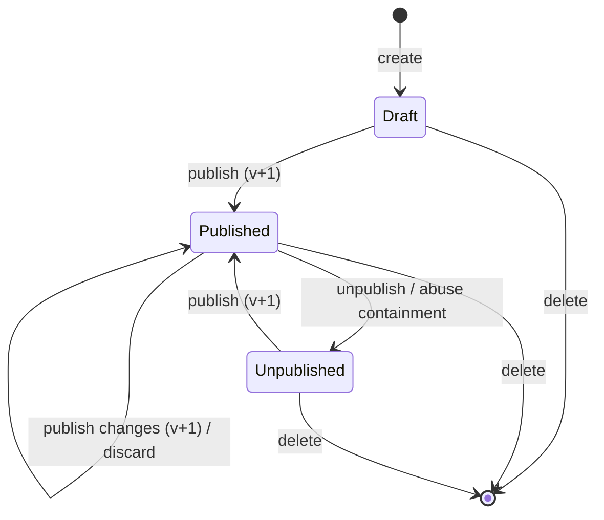

# Forms

> Scope: forms, fields, drafts and publishing, responses, uploads, covers, templates, export, summary, form events. State as of 2026-10-17.

## Summary

A form is an owner-built list of questions served to anonymous visitors at its own public page. The owner edits a draft; publishing takes a snapshot of the publishable parts of the draft, raises the published version, and that snapshot is the only thing visitors see. Visitors submit through a public endpoint protected by a honeypot field, a bot check (Turnstile), per-IP rate limits and a body size limit. Answers are validated against the published definition and stored without the respondent's IP or raw user agent. Image answers are uploaded first, re-encoded to WebP by a sandboxed image processor and claimed by the response in the same step. A booking question (at most one per form) turns a submission into appointments in that same step; see [booking-engine](booking-engine.md) and [appointments-lifecycle](appointments-lifecycle.md). Owners read responses, a summary (funnel, timeline, audience, per-question numbers) and export them as XLSX (generated by the server) or CSV (generated in the browser).

## Glossary

- **Form**: a questionnaire owned by one user. It is identified publicly by a 12-character public id and privately by its internal id.
- **Field / question**: one item of a form, with a type, a label, optional help text and a required flag, plus type-specific settings. "Question" means an answerable field (every type except a section).
- **Section**: a non-answerable heading; it splits pages in the "steps" layout. Ignored by submission, summary, export and the publish check.
- **Draft**: the form as the owner is editing it. It is always what the editor shows.
- **Published snapshot**: a frozen copy of the publishable settings taken at publish time; it is what visitors see.
- **Published version**: a counter raised on each publish; 0 means the form was never published. Each response records the version it was validated against.
- **Digest**: a fingerprint of the snapshot content, computed at publish time.
- **Public definition**: the single view of what a visitor sees and what submissions are validated against.
- **Publish blocks**: reasons that prevent publishing (no questions, plus the booking-related blocks).
- **Upload**: one stored image, identified by a 24-character token. The answer to an image question is that token.
- **Orphan upload**: an upload not claimed by any response after 1 hour.
- **Cover**: the form's header image, stored as an upload tied to the form rather than to a question.
- **Intro screen**: a welcome screen with the cover, title, description and a start button.
- **Accepting responses**: an open/closed switch that is independent of publishing and of the snapshot.
- **Form event**: a "view" or a "start", counted per form and UTC day in the daily stats.
- **Reporting fields**: the draft questions plus questions still live in the snapshot but already removed from the draft; used by the summary and the XLSX export.
- **Built-in template**: one of six ready-made starter forms, available in English and European Portuguese.

A form carries a title, a description, a thank-you message, a theme with optional custom colors, a layout, a start-button label, a cover with a vertical focal point, and the intro and accepting-responses switches. A response stores the answers, the country, platform, browser and traffic source of the respondent, the published version it was validated against, and its creation time. The form keeps a running count of its responses.

## Business rules

### Form attributes

- **FO-01** A title is required and at most 120 characters; the description is at most 1000, the thank-you message at most 500 and the start-button label at most 40. The cover focal point is a whole number from 0 to 100. The theme must be one of the page themes and the layout one of "page", "one at a time" or "steps". The editor repeats the same maxima.
- **FO-02** New forms default to the "page" layout; a layout given on creation is kept; duplicates keep the original's layout; existing forms were not migrated to the new default.
- **FO-03** When creating a form the owner can set only the title, description, thank-you message, theme, custom colors, layout, a template and a locale. When updating, the owner can change the title, description, thank-you message, theme, custom colors, layout, cover focal point, intro switch, start-button label and the accepting-responses switch. Publication state, questions, ownership, counters and snapshot data cannot be set through create or update.
- **FO-04** A public id is 12 random letters and digits, generated on creation and unique. Public endpoints answer "not found" without any lookup unless the id has exactly that shape.
- **FO-05** A user may create at most 20 forms per rolling 24 hours (creating and duplicating both count). The check is made atomically so parallel requests cannot exceed it; over the quota the request is refused as a daily limit. There is no cap on the total number of forms.

### Short link

- **FO-06** Every form gets a short link to its public page on creation, owned by the form's owner and titled with the first 120 characters of the form title. Publishing creates the link for older forms that have none. If the site's public address is not configured, no link is created. A duplicate gets its own link. Deleting the form soft-deletes the link. The reason is that the form's clicks then appear in the existing link statistics. The link title is not updated when the form is renamed. See [shortlinks](shortlinks.md).

### Field definitions

- **FO-07** A form's questions are an ordered list. Each question has an 8-character letters-and-digits id that is unique within the form.
- **FO-08** The question types are: short text, long text, email, number, single choice, multiple choice, yes/no, rating, date, image, section and booking. Unknown types are rejected.
- **FO-09** A question may only carry the common settings (id, type, label, help, required) plus the settings of its type; any other setting is rejected as unknown.

| Type | Extra settings | Definition rules | Accepted answer |
|---|---|---|---|
| Short text | none | | Text, trimmed, up to 500 characters |
| Long text | none | | Text, trimmed, up to 5000 characters |
| Email | none | | Text, trimmed, up to 254 characters, a valid e-mail address with no whitespace |
| Number | min, max | bounds numeric and finite, absolute value up to 10¹², min not above max | A number (or numeric text), at most 4 decimals, absolute value up to 10¹², within min and max; stored as a whole number when whole |
| Single choice | choices | at least 2 choices, each with an id (8 letters/digits, unique) and a label of 1 to 100 characters | One existing choice |
| Multiple choice | choices, max choices | as above; max choices empty or between 1 and the number of choices | Distinct existing choices, no more than max choices (default: all) |
| Yes/no | none | | Yes or no ("no" is an answer) |
| Rating | scale | scale of 5 or 10 | A whole number from 1 to the scale |
| Date | none | | A valid date (YYYY-MM-DD) between years 1900 and 2100 |
| Image | none | | An upload token (see FO-31) |
| Section | none | label required | Not answerable |
| Booking | mode, availability, services, categories, rules, exceptions | validated by the booking rules; at most one per form | Handled by the booking engine; see [booking-engine](booking-engine.md) |

- **FO-10** A label is required (non-blank) and at most 300 characters for every type except booking, where it is optional; help text is at most 500 characters; the required flag is true, false or unset; no text may contain a NUL character. A blank label is dropped rather than stored as an empty string.
- **FO-11** A form has only one booking question.
- **FO-12** Blank answers (empty, whitespace-only or an empty list) count as "unanswered": an error when the question is required, otherwise omitted from the stored answers. Any text containing a NUL character is invalid.
- **FO-13** There is no limit on the number of questions or choices per form; the only bound on the owner side is the size of the request. (Not enforced anywhere; see Drift.)

### Editing fields

- **FO-14** Every question operation (add, update, remove, reorder, apply template) is made atomically on the whole question list, and then the whole form is validated.
- **FO-15** Question and choice ids are generated by the server: an id sent by the client when adding a question is ignored; existing choice ids are kept on update and new choices get a fresh one.
- **FO-16** A question's type cannot be changed, and a booking question's mode cannot be changed (refused). On update the given settings are merged into the question and settings sent empty are removed; a booking question's rules are merged key by key.
- **FO-17** A reorder must list every current question exactly once, otherwise it is refused ("ids must list every question exactly once").
- **FO-18** Adding a booking question fills its defaults from the owner's account; see [booking-engine](booking-engine.md).
- **FO-19** After a form has responses, the dashboard still lets the owner add, edit, remove and reorder questions; only applying a template is refused (the questions of a form that has responses cannot be replaced). Old answers keep their question ids; answers to removed questions disappear from the responses list but stay stored. AI apps (MCP) are refused structural edits on a form with responses unless the connection has full account access. See [mcp-and-oauth](mcp-and-oauth.md).

### Draft, publish, unpublish, discard

- **FO-20** The snapshot holds the title, description, thank-you message, theme, custom colors, layout, questions, cover, cover focal point, intro switch and start-button label. Snapshots made before covers existed default to no cover, a focal point of 50, intro off and no start label.
- **FO-21** Publishing requires at least one answerable question (otherwise refused with a "no questions" block) and no booking publish blocks (refused with the list of blocking messages). A form with only sections cannot be published. The blocks the editor knows are: no questions, no service, service incomplete, availability incomplete, waitlist questions and no e-mail question; their rules are in [booking-engine](booking-engine.md).
- **FO-22** Publishing makes sure the short link exists, then atomically marks the form published, stores the snapshot, raises the published version by 1 and records the digest; afterwards it deletes cover images that neither the draft nor the snapshot uses. Every publish raises the version, including a republish after unpublishing.
- **FO-23** Unpublishing only marks the form as not published; the snapshot and the version stay.
- **FO-24** Discard restores every snapshot setting into the draft (including the cover) and deletes unused cover images; it is refused ("nothing has been published yet") when there is no snapshot.
- **FO-25** A form "has unpublished changes" when a snapshot exists and the draft differs from it (after applying defaults).
- **FO-26** Visitors read only the published snapshot (falling back to the draft only for a published form with no snapshot, i.e. older forms from before snapshots existed). Booking questions are prepared for the visitor before being served.
- **FO-27** A form is publicly visible only when it is published and its owner is active; every other state (draft, unpublished, deleted, deactivated owner, malformed id) answers the same "not found".
- **FO-28** The public form exposes only the title, description, thank-you message, theme, custom colors, layout, cover, cover focal point, intro switch, start-button label, published version and questions, plus the accepting-responses switch read live from the draft. For each question only its id, type, label, help, required flag and type settings are exposed; choices only as id and label; a booking question adds its public service details, categories, waitlist setting, multiple-services setting, buffer minutes, e-mail verification setting and time zone. The owner, internal ids, counters and timestamps are never exposed.
- **FO-29** A one-off backfill gives every published form without a snapshot a snapshot at version 1 (without cover or intro settings), fills missing digests and tags those forms' untagged responses with version 1. It only fills missing values, so rerunning it is safe.

### Accepting responses

- **FO-30** The accepting-responses switch (default on) is independent of publishing and bypasses the snapshot: it takes effect immediately. When off, submissions and waitlist joins are refused as closed; the public page shows a closed screen; already offered waitlist places can still be claimed and existing bookings managed. The server lets the switch change on a draft; the editor disables it until the form is published. There is no schedule (open/close dates) and no response cap. AI apps (MCP) cannot change the switch on purpose.

### Submission

- **FO-31** Image answers: the answer must be the token of an upload that belongs to this form and this question and has not yet been claimed. The upload is claimed in the same step that stores the response; if any claim fails, the whole response is rolled back and the submission is refused as an invalid answer.
- **FO-32** Validation runs against the published definition. Answer keys that are not questions of the form are dropped; sections are ignored; errors are reported per question as codes without echoing the values. An answers payload that is not a set of answers is refused as invalid.
- **FO-33** If the client sends a form version and it differs from the live published version, the submission is refused as "form changed" (together with the current public form) and nothing is stored. Without a version the submission is accepted and validated against the live version. The response stores the version it was validated against.
- **FO-34** Idempotency: a submission carries a key (first 64 characters) that is unique per form. A repeated key returns the stored response as a success without validating again (even if the form changed); a concurrent duplicate also returns the existing response. The web page sends one random key per page load.
- **FO-35** Stored request metadata: the country when the network edge provides a valid two-letter code (not the unknown or Tor placeholders); the platform and browser from the user agent; the traffic source from the user agent and the client-sent referrer (first 255 characters); each text trimmed to 40 characters. The IP address and the raw user agent are never stored.
- **FO-36** The answers of one response are at most 32 KB (64 KB hard limit in storage), and the request body at most 64 KB (larger is refused).
- **FO-37** Booking step: the booking answer is validated while answers are cast (and may add details to a refusal); inside the same step the engine reserves places and creates appointments using the contact (e-mail: the first required email question when the booking requires e-mail verification, otherwise the email question the visitor ticked as "confirm here"; name: the first required short text), the visitor's time zone and locale. Losing a race for the last place refuses the submission as "slot full" (with the start time) and rolls the response back. The success reply adds the appointments and the receipt (manage link, e-mail delivery, price). See [booking-engine](booking-engine.md) and [appointments-lifecycle](appointments-lifecycle.md).
- **FO-38** A form without a booking question sends no e-mail and no notification on submission: there is no confirmation e-mail to the respondent and no owner alert. The "confirm here" checkbox appears only on booking forms without e-mail verification that have an email question. See [notifications-and-email](notifications-and-email.md).

### Uploads

- **FO-39** An image upload to a form question requires a form-data request, a body of at most 11 MB, a file of at most 10 MB whose real content is PNG, JPEG, WebP, HEIC or HEIF (otherwise refused as an invalid image), a visible form and an image question of the **draft** with that id (otherwise not found). When total stored upload size is at or over 20 GB, or the image processor or storage fails, the upload is refused as unavailable and nothing is kept. On success the visitor receives the upload token.
- **FO-40** Every image is re-encoded by a sandboxed image processor that is isolated from the rest of the system (no database, no storage access, read-only, internal network only): it re-checks the file type, refuses more than 10 MB, more than 10000 px per side or 50 megapixels before decoding, blocks untrusted image loaders, keeps the primary frame, caps the longest side at 4096 px and outputs WebP with metadata stripped. The caller gives up after 2 s to connect and 25 s to read; a rejection by the processor becomes an invalid-image refusal and anything else becomes "unavailable". Stored files get a generic name; the client file name is dropped. There is no antivirus scanning: re-encoding is the defence against hostile content.
- **FO-41** The owner can download only uploads attached to a response of the owner's own form, as a WebP attachment that is never cached and cannot run scripts. The dashboard fetches it privately, so an answer image never has a public URL.
- **FO-42** The generic file-serving endpoints refuse any file that belongs to a form upload, so a signed link alone never serves a respondent's image or a cover.
- **FO-43** Orphans (no response, older than 1 hour, not a cover) are deleted together with their files every 15 minutes by a background job.

### Covers and intro

- **FO-44** The owner sets a cover with a form-data request: a file of at most 5 MB that is PNG, JPEG or WebP (HEIC is refused, unlike avatars), at most 8000 px per side and 40 megapixels (checked from the file header before processing), re-encoded by the image processor; 20 per 10 minutes per user. It sets the **draft** cover and deletes cover images that neither the draft nor the snapshot uses. Removing the cover clears the draft cover and cleans up the same way.
- **FO-45** Visitors see a cover only after it is published: the public cover endpoint serves only the snapshot's cover of a visible form (publicly cacheable for an hour, scripts disabled); the owner's draft cover is served privately and never cached. A replaced or removed cover keeps its file until the new version is published.
- **FO-46** Layouts: "one at a time" shows one question per screen with a progress bar and always opens on a welcome screen (title, description, cover, a start button labelled with the start label or "Start", and "~N min" where N is the number of questions divided by 4, rounded up); "page" shows all questions on one page; "steps" splits pages at each section that follows a non-empty page. In "page" and "steps" the intro screen appears only when the intro switch is on; otherwise the cover is shown on top of the page. Required questions and incomplete booking picks are checked per screen before moving on.
- **FO-47** In the intro text and the thank-you message, http and https URLs become links; trailing punctuation and unbalanced closing brackets are trimmed; other schemes stay plain text.
- **FO-48** The public page's link preview uses the form title, the description collapsed to one line and clipped at a word to 160 characters (or a text that depends on whether there is a booking question), the published cover as the preview image or the default Kurz image, and always asks search engines not to index or follow; an unknown form gets a generic preview. The public page cannot be embedded in other sites.

### Form events and daily stats

- **FO-49** The public page reports "view" and "start" events (anything else is refused; JSON only, body at most 1 KB, 60 per minute per IP, visible forms only). The request is answered without content and sets no cookie. Each event adds to the form's count for the current UTC day.
- **FO-50** A view is unique once per visitor, form and UTC day. The unique-view marker is a keyed hash of the form, the IP and the user agent that changes every day, kept only in a short-lived cache for 25 hours; nothing about the visitor is stored permanently, and visitors cannot be linked across forms or days.
- **FO-51** The web page sends "view" once per page load and "start" once, on the start button or the first answer; it sends no credentials and ignores errors.

### Owner reads: list, summary, export

- **FO-52** The forms list is not paginated; it can be filtered by status (live or draft), searched by title (the first 100 characters of the search term, wildcards escaped), sorted by last edited (default), name or number of responses, and shows totals (all forms, live, draft, responses) that ignore the filters.
- **FO-53** The responses list is newest first, in pages of at most 50 (default 50) walked with a cursor, optionally filtered to the last 7, 30 or 90 days (anything else: all). Choice answers are shown as labels using the **draft** questions; answers to questions no longer in the draft are omitted.
- **FO-54** Summary (last 7, 30 or 90 days, or all; default 30): the period starts at UTC midnight (days − 1) days ago. It contains the funnel (views, unique views, starts, completions and completion rate = responses divided by views, rounded to 3 decimals, empty with no views); a timeline with one entry per UTC day from the period start (or the form's creation) to today; the audience (sources, devices, browsers, countries; each the top 8 plus "Other", blanks as "Unknown"); and per-question detail over the reporting fields: text → the last 5 samples of up to 200 characters (omitted for AI apps), number → min, max and average (2 decimals), choices → counts per choice including zero plus a "removed" bucket, yes/no → yes and no counts, rating → average and distribution, date → first and last, image and booking → only how many answered.
- **FO-55** XLSX export: one sheet named after the title (forbidden characters replaced, 31 characters, fallback "Responses"); columns Submitted (UTC, ISO 8601), one per reporting question (label, or the type name), Source, Platform, Browser and Country. Cells: choices as labels ("(removed option)" when unknown, several joined with ", "), yes/no as "Yes"/"No", image as "Image", booking as a list of date and time (with several services: "Service: times; ..."), numbers and ratings as numbers, every other cell as plain text (never a formula). At most 50,000 rows (larger is refused), 10 exports per hour per user, never cached, file named after the title followed by "-responses.xlsx".
- **FO-56** CSV export is built in the browser by paging through the responses list: same column order with translated headers, UTF-8 with a byte-order mark, Windows line endings, and cells starting with = + - @ tab or carriage return prefixed with an apostrophe. It has no row cap and no rate limit beyond the list itself, and uses the draft questions.

### Templates and duplication

- **FO-57** There are six built-in templates: contact, feedback, event RSVP, satisfaction, bug report and waitlist, each with name, description, theme, title, thank-you message and questions. Only built-in templates are accepted (community page templates are not form templates).
- **FO-58** Locale: for European Portuguese (pt-PT) the template texts are translated (structure, types and limits stay the same); any other locale stays English. The locale requested by the dashboard (when supported) wins over the owner's saved locale; AI apps (MCP) always get English.
- **FO-59** Creating from a template takes the template's title, theme, thank-you message and questions (with fresh ids), overridden by any value given in the request (so a given title wins). Applying a template to an existing form replaces its questions, theme and thank-you message, keeps its title, and is refused when the form has responses.
- **FO-60** Duplicating copies the title ("Copy of <title>", cut to 120 characters), description, thank-you message, theme, colors, layout and questions with fresh question and choice ids (booking ids too); the copy is unpublished, has no responses, cover, intro settings or snapshot, gets its own short link, and counts against the daily quota.

### Deletion

- **FO-61** Deleting one response deletes its uploads (and files), releases its held booking places and lowers the response count. Deleting all responses deletes every attached upload, releases the held places of the form's appointments, removes the responses (and their appointments) and resets the count to 0.
- **FO-62** Deleting a form soft-deletes its short link, deletes its uploads (and files), responses, waitlist entries and daily stats; its appointments are removed with it. A user's forms are deleted with the user.

## Flows

**Create.** The owner submits the title (and optionally a template and locale). In one atomic step the system counts the owner's forms of the last 24 hours against the quota, creates the form and its short link, then returns the new form.

**Edit.** Settings changes are saved to the draft. Question changes (add, update, remove, reorder) rewrite and validate the whole question list. The editor marks the form as having unpublished changes and offers "publish changes" (with a confirmation showing the next version) or "discard draft".

**Publish.** The system checks that the form has a question and that no booking block applies, makes sure the short link exists, then atomically stores the snapshot, marks the form published and raises the version, and finally deletes cover images that neither the draft nor the snapshot uses.

**Visit.** The browser loads the public page, the form is fetched (120 per minute per IP) and a "view" event is sent.

**Image answer.** The visitor picks a file (the browser refuses files over 10 MB before uploading); the server checks the file type and the storage budget, the image processor converts it to WebP, the upload is stored and its token is placed in the answers.

**Submit.** The public submission goes through these checks in order:
1. The body size (64 KB) and the JSON content type.
2. The rate limit of 30 per 10 minutes per IP.
3. The form must be visible, otherwise not found.
4. Honeypot: if the hidden "website" field is filled, a fake success is returned, nothing is stored and the bot check is not called.
5. If the form is closed, the submission is refused as closed.
6. Bot check (Turnstile): a rejection is refused as "captcha failed"; if the check is unavailable (the provider is down or no key is configured), the stricter limit of 5 per 10 minutes per IP applies.
7. Answer processing: an existing idempotency key returns the stored response; non-object answers are refused; a stale form version is refused as "form changed"; every question is cast and invalid answers are refused with per-question error codes (booking validation may compute availability).
8. One atomic step: the response is stored and the response count rises, each upload is claimed (a failed claim rolls everything back), and the booking engine reserves places and creates appointments (owner notification and e-mails are queued after the step commits; a lost race for the last place rolls everything back as "slot full").
9. The visitor receives a success (plus the appointments and the receipt for booking forms). The web page resets the bot-check widget after every attempt.

**Closed form.** The owner turns off accepting responses (audited) → the next submission is refused as closed; the public form says it is not accepting responses → the page shows the closed screen.

**Read responses.** List, detail, summary and export as in FO-52 to FO-56; image cells open through the authenticated download.

**Abuse containment.** Every 10 minutes a background job unpublishes a published form that received more than 600 responses or 300 MB of uploads in the last hour and opens an abuse signal; see [admin-and-moderation](admin-and-moderation.md).

## States and transitions

A form's publication state, together with its published version and snapshot:

| From | Event | To | Guard | Effects |
|---|---|---|---|---|
| (none) | create | draft, v0, no snapshot | daily quota 20 | short link created |
| draft (v0) | publish | published, v1 | at least 1 question, no booking blocks | snapshot and digest stored, unused covers deleted, short link created if missing |
| published vN | edit draft | published vN, has unpublished changes | | visitors still see vN |
| published vN | publish | published vN+1 | same as publish | new snapshot |
| published vN | discard | published vN, no changes | snapshot exists | draft restored, unused covers deleted |
| published vN | unpublish | unpublished vN (snapshot kept) | | the public page answers "not found"; also happens through abuse containment |
| unpublished vN | publish | published vN+1 | same as publish | |
| unpublished vN | discard | unpublished vN | snapshot exists | draft restored |
| any | delete | (gone) | owner | see FO-62 |

Accepting responses: on ↔ off by the owner at any time (the server has no guard; the editor requires the form to be published). The effect is immediate (it is not part of the snapshot).

Uploads: pending (no response) → claimed by a response at submission (once); pending for more than 1 hour → deleted by the cleanup job (covers excepted); claimed → deleted with the response or the form. Covers never belong to a response; they live while the draft or the snapshot references them.

## Limits and configuration

| Name | Value | Notes |
|---|---|---|
| Forms created per user | 20 per rolling 24 h | includes duplicates; refused as a daily limit |
| Title / description / thank-you / start label | 120 / 1000 / 500 / 40 characters | |
| Public id | 12 letters and digits | |
| Question id / choice id | 8 letters and digits | |
| Label / help / choice label | 300 / 500 / 100 characters | booking label optional |
| Short text / long text / email answer | 500 / 5000 / 254 characters | |
| Number | absolute value up to 10¹², up to 4 decimals | |
| Rating scales | 5 or 10 | |
| Date years | 1900 to 2100 | |
| Answers of one response | 32 KB (64 KB hard limit in storage) | |
| Public request body | 64 KB (events 1 KB, uploads 11 MB) | larger is refused |
| Idempotency key | 64 characters | |
| Metadata text | 40 characters; referrer 255 | |
| Public form read | 120 per minute per IP | |
| Submit | 30 per 10 min per IP | |
| Submit, bot check unavailable | 5 per 10 min per IP | |
| Upload | 15 per 10 min per IP | |
| Public cover | 240 per minute per IP | |
| Events | 60 per minute per IP | |
| Cover upload | 20 per 10 min per user | |
| XLSX export | 10 per hour per user; 50,000 rows | |
| Responses page | at most 50 | |
| Forms search term | 100 characters | |
| Image upload | 10 MB; PNG, JPEG, WebP, HEIC, HEIF | |
| Cover upload | 5 MB; PNG, JPEG, WebP; 8000 px per side; 40 megapixels | |
| Image processor | 10 MB in; 10000 px per side; 50 megapixels; output WebP up to 4096 px | |
| Image processor timeouts | 2 s to connect, 25 s to read | |
| Upload storage budget | 20 GB in total (re-measured about once a minute) | uploads refused when reached |
| Orphan upload age | 1 hour; cleanup every 15 minutes | |
| Unique-view marker lifetime | 25 hours | |
| Summary periods | 7, 30, 90 days or all; default 30; top 8; 5 text samples of 200 characters | |
| Abuse thresholds | more than 600 responses or 300 MB of uploads per hour; checked every 10 minutes | [admin-and-moderation](admin-and-moderation.md) |

Public form pages and short links need the site's public address to be configured (no short link is created otherwise). Image uploads need the image processor and the forms storage to be available, otherwise uploads are refused as unavailable. The bot check needs its keys; see [accounts-and-auth](accounts-and-auth.md).

## Authorization and privacy

- **Owner**: every owner action requires sign-in and only reaches the owner's own forms, so another user's form, question or response answers "not found", the same as a missing one.
- **Anonymous visitor**: can read a visible form and its published cover, send events, upload images to its image questions and submit. No cookies, no credentials.
- **AI apps (MCP)**: form tools need the forms read or write permission, publishing needs the publish permission, responses need the responses read permission; structural edits on published forms or forms with responses need full account access. See [mcp-and-oauth](mcp-and-oauth.md) and the MCP guide.
- **Admin**: abuse signals reference forms; see [admin-and-moderation](admin-and-moderation.md).
- **Personal data stored**: answers (whatever respondents type, possibly names and e-mails), images (re-encoded, metadata stripped), country, platform, browser, traffic source and created time. Not stored: IP, raw user agent, visitor identifiers (the unique-view marker lives only in a short-lived cache for 25 hours). Request logs filter out answers, e-mails, file names, tokens and similar values. The public form footer tells respondents this.
- **Retention**: responses and uploads have no automatic expiry; they live until the owner deletes them, the form, or the account. Orphan uploads go after 1 hour. Daily stats are kept with the form. Responses are included in the user data export (see [accounts-and-auth](accounts-and-auth.md)).

## API and UI surface

**Owners (dashboard and API)** can:
- list, search, filter and sort their forms; create (optionally from a built-in template), view, update and delete a form;
- publish, unpublish, discard the draft, apply a template and duplicate a form;
- add, update, remove and reorder questions;
- list, open and delete responses (one or all), read the summary, and export XLSX;
- download a response image privately, and upload, view or remove the form cover;
- list the built-in templates (name, description, theme, number of questions);
- manage appointments, the waitlist and the appointments export; see [appointments-lifecycle](appointments-lifecycle.md).

**Visitors (public page and API)** can read a published form, submit a response, upload images to image questions, view the published cover, and send view and start events. Slots and waitlist actions are described in [booking-engine](booking-engine.md) and [appointments-lifecycle](appointments-lifecycle.md).

**Dashboard screens**: the public form page; the forms list with a templates row; the form editor (Questions and Settings tabs, preview, publish controls); and the responses screen (summary, table, detail drawer, export menu). The public page and the editor share one form renderer.

**Background jobs**: orphan upload cleanup every 15 minutes and abuse detection every 10 minutes. No e-mail belongs to plain forms.

**AI apps (MCP)** can create forms (blank, from a template, or by duplicating), apply a template, add, edit, remove and reorder fields, publish and unpublish, read the response summary, delete a form, delete all responses, and read responses; the catalogue is in [mcp-and-oauth](mcp-and-oauth.md).

## Decisions

### D-FO-01 Visitors read a published snapshot, not the draft
**Decision.** Publishing copies the publishable settings into a snapshot with a version and digest; visitors and submission validation read only that snapshot through one public definition. **Why.** Draft edits must never reach visitors, and a single read point lets the source change in one place. **Consequence.** Any new publishable setting must be added to the snapshot (with a default for old snapshots), to the public definition and to the public form output.

### D-FO-02 Closing a form is separate from publishing
**Decision.** Accepting responses is a live switch outside the snapshot. **Why.** Closing must take effect at once without a republish, while offered waitlist places and existing bookings keep working. **Consequence.** The public form adds the switch outside the snapshot definition.

### D-FO-03 Images are re-encoded in a sandbox and never public
**Decision.** Uploads go through a sandboxed image processor (a separate process with no secrets and no network route to the database, cache or the Internet) and are stored as WebP; answers hold a single-use token; the generic file-serving endpoints refuse form files; only the owner downloads. **Why.** Respondents control the bytes; if the sandbox is down, only uploads should stop working. **Consequence.** Uploads depend on the image processor and the forms storage; if the processor is down, uploads are refused as unavailable.

### D-FO-04 Every spreadsheet cell from respondents is a string
**Decision.** XLSX cells are written as plain text (numbers and ratings excepted); CSV cells starting with formula characters are prefixed with an apostrophe. **Why.** Respondent text must never execute as a formula in a spreadsheet. **Consequence.** Keep the explicit cell typing in the XLSX export.

### D-FO-05 No IP or visitor identifier is stored
**Decision.** Responses keep only country, platform, browser and source; unique views use a daily-rotating keyed hash kept 25 hours in a cache. **Why.** It is a privacy promise shown on the form footer, and visitor IPs and user agents are also kept out of request logs. **Consequence.** There is no per-visitor de-duplication of responses beyond the idempotency key and rate limits.

### D-FO-06 Bookings are created inside the submission
**Decision.** There is no separate appointment endpoint; the submission books in the same atomic step as the response. **Why.** The contact comes from the form's own questions and a lost place must roll the response back. **Consequence.** See [booking-engine](booking-engine.md).

### D-FO-07 Every form has a short link
**Decision.** The link is created on form creation (and on publish for old forms) and removed with the form. **Why.** It reuses the link click statistics on the responses summary. **Consequence.** Form creation also creates a short link; see [shortlinks](shortlinks.md).

### D-FO-08 Built-in templates are fixed, translated by a parallel set of texts
**Decision.** The templates are fixed in the product; the European Portuguese texts live in a parallel set that keeps the English structure. **Why.** Translations must not change the structure, types or limits of a template. **Consequence.** A new template or question needs both the English and the Portuguese texts; see the language guide.

## Change impact

- New field type → review FO-08 to FO-12 and the type table; the public form output (FO-28); the summary (FO-54) and exports (FO-55, FO-56); the responses list and drawer (FO-53); the user data export ([accounts-and-auth](accounts-and-auth.md)); the editor and renderer; English and Portuguese texts; the MCP field tools and the MCP guide.
- New publishable form attribute → add it to the snapshot with a default (otherwise old snapshots would show as having unpublished changes, FO-20, FO-25), the public definition (FO-26), the public form output (FO-28), the update rules (FO-03), the renderer and the editor; ship it in a way the previous release survives.
- Changing how questions are stored → existing responses keep question ids as keys and the reporting fields combine snapshot and draft questions (FO-19, FO-54); backfill rather than rename, because the previous release reads the old shape during a deploy.
- Changing the public id length or format → FO-04, the four public endpoints, short link URLs already issued, the public page route and the report link.
- Changing the submit pipeline (FO-30 to FO-38) → keep the check order (honeypot before the bot check so bots never cost a provider call; closed before the bot check); the waitlist join reuses the same bot check and closed rule; the booking engine expects to run inside the same atomic step as the response.
- Changing upload rules (FO-39 to FO-45) → image upload rules are shared with avatars ([accounts-and-auth](accounts-and-auth.md), [bio-pages](bio-pages.md)); the image processor limits must stay at or above the web limits; the security checks exercise the image processor; any new file-serving endpoint must refuse form files (FO-42); abuse detection sums upload bytes.
- Changing orphan upload rules (FO-43) → covers are excluded by their dedicated marker; a real question must never get that marker (ids are random, so a collision is only theoretical).
- Changing summary or export columns (FO-54 to FO-56) → the MCP summary and response tools, the dashboard summary cards and the CSV.
- Changing response deletion (FO-61) → release of held booking places, the waitlist, the counter reset; the MCP "delete all responses" tool repeats the same logic.
- Changing accepting-responses semantics (FO-30) → the public waitlist join and claim, the editor switch, the list badge and the end-to-end test of closing a form.
- Changing rate limits → the limits catalogue in [platform-and-operations](platform-and-operations.md) and the visitor-facing error messages.
- Changing the public form output (FO-28) → the link preview (FO-48), the API contract checks, the security checks that expect only public keys, and MCP previews.

## Drift and open questions

- **Medium.** The web client never sends the form version, so a visitor whose page is older than a republish is validated against the new version instead of being refused as "form changed" (FO-33). The appointments guide describes the refusal only for API clients that send the version.
- **Medium.** Without a configured Turnstile key, every submission is treated as "bot check unavailable": the stricter limit of 5 per 10 minutes per IP applies and a warning is reported on every submit.
- **Medium.** No limit on the number of questions, choices or forms in total, and no cap on responses per form (only the 20 per day creation quota and the abuse detection). A huge question list is bounded only by the owner's request size (FO-13).
- **Low.** The responses list, the response drawer and the CSV use the draft questions, while the summary and the XLSX use the draft-plus-live union: a question removed from the draft but still live disappears from the table and CSV but not from the summary and XLSX.
- **Low.** CSV export has no row cap or dedicated rate limit (it pages through the list), unlike XLSX (50,000 rows, 10 per hour).
- **Low.** Accepting responses can be changed on a draft through the API; only the editor disables the switch (FO-30).
- **Low.** The "one at a time" layout always shows a welcome screen, ignoring the intro switch; the switch only affects "page" and "steps" (FO-46).
- **Low.** Deleting a user or a form directly in the database (outside the application) fails when uploads exist; only the application's own delete paths work.
- **Low.** "Delete all responses" runs its steps (deleting uploads, releasing places, removing responses) separately rather than as one atomic step, so a failure midway leaves a partial deletion. The MCP tool repeats the same logic.
- **Low.** The short link title is set once at creation and not updated when the form is renamed (FO-06).
- **Low.** Early documentation said "one at a time" was the default layout; it was later changed to "page" (FO-02). The MCP guide lists "one at a time" first but does not claim a default.
- Open: no notification or e-mail exists for a plain (non-booking) response; whether owners expect one is not recorded.
