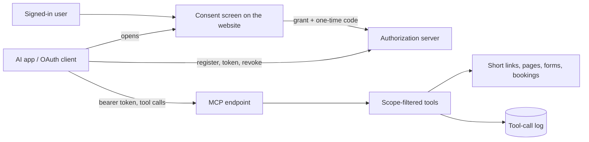
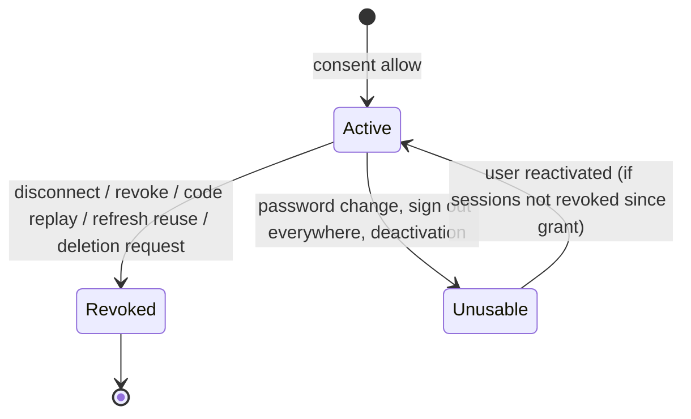

# MCP server and OAuth 2.1

> Scope: the OAuth 2.1 authorization server, scopes and grants, the consent screen and connected apps, the remote MCP endpoint, every MCP tool with its guards, throttles, budgets, untrusted-data marking and call log. State as of 2026-10-17.

The MCP guide is the user and operator reference. This page does not repeat it; it records the rules the product enforces and lists where the guide disagrees under [Drift and open questions](#drift-and-open-questions).

## Summary

Kurz runs its own OAuth 2.1 authorization server so that AI apps (Claude, ChatGPT, the Kurz app) can act on a user's short links, bio pages, forms, responses and bookings through a remote MCP server. Clients register themselves (dynamic client registration, public clients only), send the user to the consent screen on the Kurz website, and exchange a one-time code with PKCE (the S256 proof-key method) for a 1-hour access token and a rotating refresh token (30 days sliding, 90 days absolute). A grant records the scopes the user left switched on; tools are listed and allowed per scope, and the full-access scope replaces every other scope. The MCP endpoint is stateless JSON over Streamable HTTP; each tool call runs in one database transaction with a 5 s statement timeout, is rate-limited per user, and is logged as metadata in the tool-call log (purged after 90 days). Text typed by visitors (responses, booking names, emails, notes) is cleaned, capped, counted against a 2000-record daily budget and wrapped as untrusted data. Nothing responds unless the MCP feature is switched on.

## Glossary

- **Client**: an app registered through the client-registration endpoint. Public: it has no secret.
- **Grant**: one consent by one user to one client, with a scope list and a resource. Every consent creates a new grant; it is what Account → Connected apps lists and revokes.
- **Resource**: the MCP endpoint at the issuer address, the only protected resource (the audience every token is issued for).
- **Personal-data scopes**: reading responses, reading appointments, writing appointments, managing appointments.
- **Publish scopes**: publishing forms, publishing pages.
- **Full access**: one scope that allows every tool and lifts the draft-only guards.
- **Tool**: one MCP tool; it declares the scope it requires, whether it writes, and its throttle limits.
- **Guard**: the checks a tool applies — owner lookup plus draft-only, style-only, no-structure-after-responses and confirmation checks.
- **Untrusted data**: visitor text returned flagged as untrusted inside a nonce-delimited envelope.
- **Record budget**: personal records returned in the last 24 hours, per user.
- **Security event**: a code replay or a refresh-token reuse; logged, reported to the error tracker, and the grant is revoked.

## Data

Full catalogue in [data-model](data-model.md). Four kinds of record make up the OAuth and MCP data:

- **Client.** An app that registered itself. It holds a random public client id, a display name (up to 100 characters) and one to five redirect URIs. It is never purged, and a registration is not tied to any user.
- **Grant.** One user's consent to one client. It holds the user, the client, the granted scope list, the resource, when it was revoked (if it was) and when it was last used. There is no uniqueness per user and client: each consent is a separate grant. Changes to scopes and revocation are audited.
- **Token and code records.** Authorization codes (challenge, redirect URI, expiry, used marker), access tokens (expiry) and refresh tokens (sliding expiry, absolute expiry, used marker) each belong to a grant. Only one-way SHA-256 digests of codes and tokens are stored, never the raw values. Raw values carry a prefix that tells the kind (code, access or refresh) followed by 32 random bytes. Used authorization codes stay after use, and rotated refresh tokens stay marked as used, because replay and reuse detection need them.
- **Tool-call log entry.** One per tool call, belonging to a grant: tool name, success or error, error code, duration in milliseconds, number of personal records returned, and when it happened. Metadata only: never arguments, results or IP addresses.

Relationships and cascades: a grant belongs to one user and one client; codes, tokens and log entries belong to a grant. Deleting a user deletes their grants, and with them every code, token and log entry. Revoking a grant keeps the grant, its codes and its log, but deletes all of its access and refresh tokens. Revoked grants, expired tokens and clients are never purged; only the tool-call log is purged on its own, after 90 days.

Throttle counters live in the shared cache, per user and per rate-limit window, alongside the rate limits for registration, token exchange, consent and the MCP endpoint per grant.

## Business rules

### Feature flag and metadata

- **MC-01** The MCP endpoint, the registration, token and revocation endpoints, the OAuth discovery metadata and the consent preview/decision interface all respond as "not found" unless the MCP feature flag is exactly on. Listing and disconnecting a user's connected apps is **not** gated.
- **MC-02** The issuer is a configured address (by default the product's API domain), never taken from the request's declared host; the resource is the MCP endpoint at the issuer; the authorization endpoint is the consent screen on the website (by default the product's website domain).
- **MC-03** Protected-resource metadata (standard discovery metadata) is served both at the general address and at the address specific to the MCP endpoint. Authorization-server metadata advertises the authorization-code response type, the authorization-code and refresh-token grants, the S256 proof-key method, no client authentication at the token and revocation endpoints, every scope, and support for returning the issuer identifier in authorization responses.
- **MC-04** Every OAuth and discovery response is marked non-cacheable (no storing by browsers, proxies or caches).
- **MC-05** Cross-origin access: the discovery, token, registration, revocation and MCP endpoints allow any origin without credentials; the MCP endpoint also lets browsers read its sign-in challenge and session headers.

### Dynamic client registration

- **MC-06** Registration accepts a JSON body only (an unsupported type is refused), at most 5 KB (larger is refused as too large), and 10 registrations an hour per client IP (beyond that the caller is rate-limited and told the service is temporarily unavailable).
- **MC-07** Only public clients are accepted: the token endpoint authentication method must be absent or "none"; the grant types must be a subset of the authorization-code and refresh-token grants; the redirect URIs must be an array of strings. Failures are reported as invalid client metadata or an invalid redirect URI.
- **MC-08** The client name loses every control and invisible-format character (including bidi overrides), is trimmed, defaults to "Unnamed app", and is at most 100 characters. The consent screen still labels the name as unverified and shows the redirect host.
- **MC-09** A client has 1 to 5 redirect URIs, each valid per MC-10.

### Redirect URIs

- **MC-10** A redirect URI is valid when it is a string of at most 2048 characters, ASCII only, without surrounding whitespace, control characters or backslash, and one of: (a) exactly the Kurz app's registered callback address; (b) a plain-web address on a loopback host (the IPv4 loopback address, the IPv6 loopback address or localhost); (c) a secure-web address on a host from the operator-configured allow-list (by default the known AI-app vendors), written in lower case. No fragment and no userinfo in (b) and (c). Subdomains of allowed hosts are not allowed.
- **MC-11** The requested redirect URI must equal a registered one string for string; for loopback URIs only the port may differ (scheme, host, path and query are still compared).

### Authorization request and consent

- **MC-12** The authorization request is validated in this order: client (the client id is truncated to 64 characters), redirect URI, the authorization-code response type, the S256 proof-key method with a 43-character base64url challenge, at least one scope and all scopes known, and the requested resource equal to the MCP resource (the default when absent). An unknown client or unregistered redirect URI is rejected without redirecting; any later error is rejected with a redirect target carrying the error, the state value and the issuer identifier.
- **MC-13** The state value is echoed back truncated to 512 characters; every redirect adds the issuer identifier.
- **MC-14** The consent preview (signed-in user, 30 a minute per user) returns the client name, the redirect host, the requested scopes, the user's email and the resource.
- **MC-15** The consent decision revalidates the whole request (MC-12) and needs the anti-forgery token with a cookie session. Any decision other than allow redirects with an access-denied error. Granted scopes are the granted set intersected with the requested set (never a scope that was not requested). If full access is among them, the grant holds the full-access scope only. An empty set redirects with an access-denied error.
- **MC-16** A grant can never hold a personal-data scope together with a publish scope. This is enforced three times: the consent endpoint rejects the decision as conflicting scopes, the grant itself refuses to save, and the consent screen disables the conflicting switches. Full access is exempt because it is neither kind (it is collapsed to itself first).
- **MC-17** Grant scopes must be non-empty, known and without repeats; the resource is required.
- **MC-18** Consent screen (website only): personal-data, publish and full-access switches start off, all others on. Turning on full access forces and disables every other switch and sends the full-access scope alone. Allow is disabled when nothing is on. A red warning is shown for full access, a blue note when personal-data and publish scopes were both requested, and a yellow note when reading responses was requested. The screen follows the returned redirect only for secure-web, plain-web or the Kurz app's own scheme. The page is client-rendered only, cannot be framed and is not indexed.
- **MC-19** A signed-out user is sent to login. The authorization address is remembered in the browser session (only authorization addresses of printable ASCII, up to 4096 characters) and restored once after password, code, Google or password-reset login. See [accounts-and-auth](accounts-and-auth.md).

### Codes and tokens

| Item | Lifetime | Single use |
|---|---|---|
| Authorization code | 60 s | yes, claimed atomically so two exchanges cannot both succeed |
| Access token | 1 h | no |
| Refresh token | 30 days from use, capped at an absolute 90 days from the first exchange (kept across rotations) | yes, rotated atomically |

- **MC-20** The token endpoint takes a form-submission body only (an unsupported type is refused), allows 60 requests a minute per client id parameter (not per IP), and supports the authorization-code and refresh-token grants; any other grant type is reported as unsupported.
- **MC-21** Code exchange: the code is claimed first (so a failed exchange burns it). Then the grant must be active, its user active and not signed out everywhere since the grant was created; the client id must match the grant's client; the redirect URI must equal the one stored with the code; the code verifier must be 43–128 characters from the URL-safe unreserved set (letters, digits, hyphen, period, underscore, tilde) and its SHA-256, base64url-encoded, must equal the challenge (constant-time comparison); a supplied resource must equal the grant's (otherwise an invalid-target error). Every other failure is reported as an invalid grant.
- **MC-22** Code replay: presenting a code that exists but cannot be claimed (already used **or expired**) records a code-replay security event and revokes the grant.
- **MC-23** Refresh: the old token is claimed atomically and a new pair is issued with the same absolute expiry. The scope may not be widened (an invalid-scope error); a narrower scope is accepted but the new token still carries all the grant's scopes. The same usability and client checks as MC-21 apply.
- **MC-24** Refresh reuse: presenting a refresh token that was already used records a refresh-reuse security event and revokes the grant with every token. An expired, never-used refresh token is refused without revocation.
- **MC-25** Token kinds are checked by prefix and length (at most 128 characters) before any lookup.
- **MC-26** Each successful exchange updates the grant's last-used time.

### Revocation and grant lifecycle

- **MC-27** The revocation endpoint (form submission, no client authentication) revokes the whole grant of the access or refresh token given, and always reports success.
- **MC-28** Revoking a grant marks it revoked once and deletes all its access and refresh tokens; codes stay but are unusable because the grant is inactive.
- **MC-29** Grants are revoked by: the user in Connected apps (another user's grant is reported as not found), the revocation endpoint, code replay, refresh reuse, and an account-deletion request.
- **MC-30** Without being revoked, a grant stops working when the user is deactivated or when the user signed out everywhere or changed their password after the grant was created. Such grants still appear in Connected apps.
- **MC-31** Connected apps lists only the user's active grants, newest first, with client name, the host of the client's first redirect URI, scopes, connection time and last-used time; no secret.

### MCP transport and authentication

- **MC-32** All of the MCP endpoint's request methods (read, post and delete) reach the same handler. Authentication accepts only a bearer access token that is unexpired, whose grant is active and has the MCP resource, and whose user is active and not signed out since the grant. A revoked grant fails on the very next call.
- **MC-33** Failure is a "not signed in" refusal with a sign-in challenge carrying the address of the protected-resource metadata for the MCP endpoint and every scope; an invalid-token error is added only when a credential was presented. A log line records that an unauthorized call happened and whether a credential was presented (never the token).
- **MC-34** The grant's last-used time is written at most once a minute.
- **MC-35** 120 requests a minute per grant; beyond that, calls are rate-limited and told so.
- **MC-36** The server is built per request (with the product's name and a fixed version) with only the tools the grant's scopes allow, over the Streamable HTTP transport in stateless mode. Subscription listening is switched off (subscriptions are not supported). The request's declared host must match the resource's host (a DNS-rebinding guard). Cross-site origins must be on an operator-configured allow-list that is empty by default, so a request from a foreign origin is refused. Request bodies over 256 KiB are refused as too large. Responses are marked non-cacheable and set no cookie.
- **MC-37** An OAuth token never acts as a session on the dashboard API, and a session cookie never authenticates the token endpoint or the MCP endpoint.

### Scopes and tool access

| Scope | Allows | Implied by | Default on consent | Exclusions |
|---|---|---|---|---|
| Read short links | list, statistics | write short links, full access | on | – |
| Write short links | create a short link only | full access | on | – |
| Read pages | list, get, statistics, templates | write pages, full access | on | – |
| Write pages | create and edit drafts, links, page templates | full access | on | – |
| Publish pages | publish and unpublish a page | full access | off | personal-data scopes |
| Read forms | list, get, templates | write forms, full access | on | – |
| Write forms | create and edit drafts and questions | full access | on | – |
| Publish forms | publish and unpublish a form | full access | off | personal-data scopes |
| Read responses | list, get, summary | full access | off | publish scopes |
| Read appointments | booking setup, availability, time lists, appointments, agenda, impact, notifications | write appointments, full access | off | publish scopes |
| Write appointments | booking setup of drafts, mark notification read | full access | off | publish scopes |
| Manage appointments | approve, decline, cancel, reschedule, remind | full access only | off | publish scopes |
| Full access | every tool, guards lifted (MC-42 to MC-44) | – | off | replaces all others |

- **MC-38** A tool is allowed when the grant holds full access, the tool's exact scope, or, for a read tool, the matching write scope of the same area. Nothing else implies anything: managing appointments does not imply reading them, and a publish scope does not imply read.
- **MC-39** The tool list shows only allowed tools, and every tool call checks again (an insufficient-scope error), so a stale tool list cannot bypass scopes.
- **MC-40** No tool exists for account deletion, passwords, connected apps, data export, avatars, covers, uploads download, response export, form discard, community templates, calendar feeds or admin.

### Guards

- **MC-41** Every lookup is scoped to the token's user (their short links, pages, forms, the appointments of their forms, their notifications); another user's item is reported as not found exactly like a missing one. The dashboard's authorization policies are not used on this path; ownership scoping is the guard.
- **MC-42** Draft-only: without full access, link and field tools, page templates, booking setup and time slots refuse a published page or form (a page-published or form-published outcome).
- **MC-43** Style-only on live items: without full access, updating a published page or form accepts only the theme and custom colors.
- **MC-44** No structure edits after responses: without full access, the add-, update-, remove- and reorder-field tools answer that the form has responses when the form already has responses; texts (form update) still change. Applying a form template refuses forms with responses even with full access (a domain rule).
- **MC-45** Confirmation: deleting a short link needs the exact short code, deleting a page the exact slug, deleting a form or all its responses the exact title (both trimmed), else a confirmation-mismatch outcome. Deleting a single response has no confirmation. The five manage tools need the appointment id repeated as confirmation.
- **MC-46** Every tool refuses unknown input properties; keys that would set the published state, the short code, a password, the owner, whole field lists, a public id or (for pages) an expiry are rejected by the tool's input schema. Booking questions cannot be added through the add-field tool (the question type list excludes booking).
- **MC-47** Booking setup tools edit only questions in the services mode (an unsupported-mode outcome otherwise); services, categories and exceptions are replaced as a whole and rules are merged; exception notes are never echoed back.
- **MC-48** Page templates: built-in ones or the user's own custom ones; community templates are refused as invalid input.
- **MC-49** Annotations: read tools are marked read-only; every delete tool, the short-link update tool, the apply-page-template and apply-form-template tools, the remove-field and remove-page-link tools, and the decline and cancel appointment tools are marked destructive; publish tools and the five manage tools are marked open-world (they reach the public or send e-mail).

### Execution, errors and timeouts

- **MC-50** Each call runs inside one database transaction with a 5000 ms statement timeout (per statement, not per call); a cancelled query becomes a timeout outcome.
- **MC-51** Errors are returned as error tool results with these outcomes: insufficient scope, rate limited, timeout, daily form limit reached, invalid input (validation), not found, and tool failed (any other failure, logged by exception type only, without its message), plus tool-specific ones (page published, form published, form has responses, confirmation mismatch, response budget exhausted, no booking, unsupported mode, no questions, form incomplete, nothing to cancel, and the outcomes of the appointment actions such as already decided, expired, same time, unavailable, too soon, no e-mail).
- **MC-52** All owner-authored text returned (titles, labels, bios, URLs, names) is cleaned: invalid UTF-8 dropped, normalised (NFC), control characters dropped except newline and tab, invisible format characters dropped except zero-width joiner and non-joiner, tag characters dropped, and the text truncated with an ellipsis (default 2000 characters).

### Rate limits

All MCP throttles are per **user** (across every grant), in fixed windows, and are incremented before the tool runs, so refused or failed calls count too.

- **MC-53** Every write tool shares one write throttle: 30 a minute and 500 a day.
- **MC-54** Per-tool limits are in the catalogue; the five manage tools also share a manage throttle of 30 an hour and 100 a day, checked after the confirmation and ownership checks.
- **MC-55** New forms (create form, create form from template, duplicate form) share the same per-user daily form-creation limit as the dashboard, reported as a daily form limit outcome. See [forms](forms.md).

### Personal data: untrusted marking and budget

- **MC-56** Visitor text (short/long text and email answers, appointment client name, client email and cancel reason) is returned flagged as untrusted text, capped at 2000 characters per value, 8000 per response or appointment, and 40000 per call.
- **MC-57** Payloads with visitor text carry a content-trust marker identifying them as untrusted respondent input and a notice; their text content is the notice, then a clearly-marked begin-untrusted-data delimiter carrying a random nonce, the JSON, and a matching end delimiter, with a random 32-hex nonce that does not occur in the JSON. Used by the tools that read responses, appointments and the agenda.
- **MC-58** Daily record budget: 2000 records per user over a rolling 24 hours, computed as the sum of records returned in the tool-call log across all the user's grants. A call is refused with a response-budget-exhausted outcome when nothing is left; otherwise it returns the lesser of the requested amount and what is left. Responses, appointments and people in the agenda count; notifications, summaries, booking setup and availability do not.
- **MC-59** Responses never expose IP, user agent, country or device; choices are resolved to the owner's labels (a "removed option" placeholder when gone) and images appear as an "image attached" placeholder. The summary tool returns no text samples and is marked as aggregates only. Statistics tools return aggregates only.
- **MC-60** Manage tools clean messages and reasons (capped at 500 characters) and return only an id, a status and a result, never names or emails.
- **MC-61** Paging: the response, appointment and notification list tools default to 10 and allow at most 20, with a cursor (an id) pointing at the next page; the short-link list pages default to 20, at most 50 per page, up to page 10000; the agenda returns at most 300 sessions; date ranges are 1 to 62 days.

### Call log

- **MC-62** Every tool call that reaches a tool (including insufficient-scope and rate-limited ones) writes one log entry: grant, tool, success or error, error code, records returned and duration in ms. No arguments, results or IPs.
- **MC-63** A daily job at 4am deletes log entries older than 90 days, in batches of 1000. Entries also go when their grant is deleted (cascade), not when it is revoked.
- **MC-64** Security events are logged as a warning with the event name and grant id and sent to the error tracker as a warning named for the OAuth event and tagged with it.

## MCP tool catalogue

55 tools. Kind: R read, W write, D destructive annotation. Every W tool also counts against MC-53. "draft" = draft-only unless full access (MC-42), "style" = MC-43, "no-resp" = MC-44, "budget" = MC-58.

| Tool | Scope | Kind | Guards and limits | Owner page |
|---|---|---|---|---|
| List short links | read short links | R | max 50 per page | [shortlinks](shortlinks.md) |
| Get short-link statistics | read short links | R | – | [shortlinks](shortlinks.md) |
| Create short link | write short links | W | 20/h, 100/day; title ≤120; no password, code or extras | [shortlinks](shortlinks.md) |
| Update short link | full access | W D | 60/h | [shortlinks](shortlinks.md) |
| Delete short link | full access | W D | confirm short code; 10/h, 30/day | [shortlinks](shortlinks.md) |
| List pages | read pages | R | – | [bio-pages](bio-pages.md) |
| Get page | read pages | R | – | [bio-pages](bio-pages.md) |
| Get page statistics | read pages | R | days 7/30/90 | [bio-pages](bio-pages.md) |
| List page templates | read pages | R | built-in and own only | [bio-pages](bio-pages.md) |
| Create page | write pages | W | 10/h, 50/day; always created unpublished | [bio-pages](bio-pages.md) |
| Update page | write pages | W | style | [bio-pages](bio-pages.md) |
| Add page link | write pages | W | draft | [bio-pages](bio-pages.md) |
| Update page link | write pages | W | draft; kind not editable | [bio-pages](bio-pages.md) |
| Remove page link | write pages | W D | draft | [bio-pages](bio-pages.md) |
| Reorder page links | write pages | W | draft; exact permutation | [bio-pages](bio-pages.md) |
| Apply page template | write pages | W D | draft; no community templates | [bio-pages](bio-pages.md) |
| Publish page | publish pages | W | 20/h, 100/day | [bio-pages](bio-pages.md) |
| Unpublish page | publish pages | W | 30/h | [bio-pages](bio-pages.md) |
| Delete page | full access | W D | confirm slug; 10/h, 30/day | [bio-pages](bio-pages.md) |
| List forms | read forms | R | – | [forms](forms.md) |
| Get form | read forms | R | – | [forms](forms.md) |
| List form templates | read forms | R | – | [forms](forms.md) |
| Create form | write forms | W | daily forms limit | [forms](forms.md) |
| Create form from template | write forms | W | daily forms limit; no locale | [forms](forms.md) |
| Update form | write forms | W | style | [forms](forms.md) |
| Add field | write forms | W | draft, no-resp; not the booking type | [forms](forms.md) |
| Update field | write forms | W | draft, no-resp | [forms](forms.md) |
| Remove field | write forms | W D | draft, no-resp | [forms](forms.md) |
| Reorder fields | write forms | W | draft, no-resp | [forms](forms.md) |
| Publish form | publish forms | W | 20/h, 100/day | [forms](forms.md) |
| Unpublish form | publish forms | W | 30/h | [forms](forms.md) |
| Duplicate form | full access | W | 20/h; daily forms limit | [forms](forms.md) |
| Apply form template | full access | W D | 30/h; refused with responses; no locale | [forms](forms.md) |
| Delete form | full access | W D | confirm title; 10/h, 30/day | [forms](forms.md) |
| List responses | read responses | R | budget; untrusted | [forms](forms.md) |
| Get response | read responses | R | budget; untrusted | [forms](forms.md) |
| Get response summary | read responses | R | aggregates only | [forms](forms.md) |
| Delete response | full access | W D | 100/h, 500/day; no confirm (releases the booked places) | [forms](forms.md) |
| Delete all responses | full access | W D | confirm title; 10/h, 30/day (does not release booked places, see drift 1) | [forms](forms.md) |
| Get booking setup | read appointments | R | – | [booking-engine](booking-engine.md) |
| Preview availability | read appointments | R | 1–62 days | [booking-engine](booking-engine.md) |
| Generate time slots | read appointments | R | pure calculation | [booking-engine](booking-engine.md) |
| Get booking impact | read appointments | R | ids and counts | [booking-engine](booking-engine.md) |
| Update booking setup | write appointments | W | draft; 60/h; services mode only | [booking-engine](booking-engine.md) |
| Apply time slots | write appointments | W | draft; 60/h; services mode only | [booking-engine](booking-engine.md) |
| List appointments | read appointments | R | budget; untrusted; max 20 | [appointments-lifecycle](appointments-lifecycle.md) |
| Get appointment | read appointments | R | budget; untrusted | [appointments-lifecycle](appointments-lifecycle.md) |
| Get agenda | read appointments | R | budget; untrusted; 62 days, 300 sessions | [appointments-lifecycle](appointments-lifecycle.md) |
| Approve appointment | manage appointments | W | confirm id; 20/h; shared 30/h, 100/day | [appointments-lifecycle](appointments-lifecycle.md) |
| Decline appointment | manage appointments | W D | same | [appointments-lifecycle](appointments-lifecycle.md) |
| Cancel appointment | manage appointments | W D | same; scope all / one / remaining | [appointments-lifecycle](appointments-lifecycle.md) |
| Reschedule appointment | manage appointments | W | same; no force option | [appointments-lifecycle](appointments-lifecycle.md) |
| Remind appointment | manage appointments | W | same; 1/h per booking | [appointments-lifecycle](appointments-lifecycle.md) |
| List notifications | read appointments | R | max 20; not budgeted | [notifications-and-email](notifications-and-email.md) |
| Mark notification read | write appointments | W | 120/h | [notifications-and-email](notifications-and-email.md) |

### Shared versus duplicated behaviour

Shared (a change to the product rule reaches both the dashboard and MCP): form creation, editing, publishing, unpublishing and summaries; page templates and page statistics; deleting short links and pages; every validation and side effect on short links, page links and form responses (cache refresh, safety check, link limit, release of booked places); every input check named for a tool; appointment decisions, cancellation, rescheduling, reminders, time generation, availability, impact, search and agenda; notification listing.

Duplicated for MCP (a change to the dashboard behaviour does not reach MCP and must be ported deliberately):

| MCP tool | Dashboard twin | Difference today |
|---|---|---|
| Delete all responses | deleting all responses | MCP does not release the places held by the deleted appointments (see drift 1). |
| Update short link | editing a short link | Same logic; MCP ignores the password (no password input). |
| Create short link | creating a short link | MCP has its own throttle (20/h, 100/day) instead of 60 per 10 min; no password. |
| Create page | creating a page | MCP forces unpublished, no community templates, own throttle 10/h + 50/day. |
| page template lookup | page template lookup | Community branch removed; usage counts are not updated. |
| Reorder page links | reordering page links | Copy of the same rule. |
| Duplicate form | duplicating a form | Copy of the same rule. |
| Mark notification read | marking a notification read | Copy of the same rule. |
| appointment tools | appointments list | Same ownership rule. |
| tool output shapes | dashboard output shapes | Separate shapes: a new field is not exposed to MCP (or leaked) unless added there deliberately. |
| Create form from template, apply form template | same actions | MCP builds templates without the user's locale. |

## Flows

### Connect an app

1. The client fetches the protected-resource metadata (or receives a sign-in challenge pointing at it) and then the authorization-server metadata.
2. The client registers with JSON metadata and receives a client id (MC-06 to MC-09).
3. The client opens the consent screen with its client id, redirect URI, the authorization-code response type, PKCE challenge (S256), scopes, resource and state. If the user is signed out, the address is stored and the user logs in first (MC-19).
4. The screen asks for a preview of the request, or is redirected back with an error (MC-12, MC-14).
5. The user toggles scopes and clicks Allow. The server creates the grant and a 60 s one-time code, and returns the redirect with the code, the state value and the issuer identifier (MC-15, MC-16).
6. The client exchanges the code at the token endpoint with its client id, redirect URI, code verifier and optional resource, and receives a bearer access token (valid 3600 s), a refresh token and the scope (MC-21).
7. The client calls the MCP endpoint with the bearer token, and refreshes before or after expiry (MC-23).

### Tool call

Authenticate (MC-32) → endpoint rate limit (MC-35) → the server is built with the scope-filtered tools → the transport checks the declared host, the origin and the size (MC-36) → scope check (MC-39) → full-access mode is noted → write throttle → tool throttle (MC-53, MC-54) → transaction with a 5 s statement timeout → the tool runs (guards, domain action) → the result is rendered as JSON (or wrapped as untrusted data) → the call-log entry is written outside the transaction. Side effects such as e-mails from the manage tools come from the booking actions themselves ([appointments-lifecycle](appointments-lifecycle.md), [notifications-and-email](notifications-and-email.md)).

### Disconnect

Connected apps → confirm → the grant is revoked and its tokens deleted → the next MCP call or refresh fails (MC-28, MC-32).

## States and transitions

| Object | From | Event | To | Guard | Side effects |
|---|---|---|---|---|---|
| Grant | – | consent allow | active | MC-15, MC-16, MC-17 | code issued |
| Grant | active | user disconnects, revocation endpoint, code replay, refresh reuse, account-deletion request | revoked | – | access and refresh tokens deleted; security event for replay/reuse |
| Grant | active | password change, sign-out-everywhere, deactivation | active but unusable | user active and sessions not revoked since the grant | none; still listed |
| Code | issued | exchange within 60 s | used | atomic claim | grant usability checks |
| Code | issued/used | exchange when used or expired | – | – | code replay, grant revoked |
| Refresh token | active | refresh | used (rotated) | atomic claim, not expired | new pair, same absolute expiry |
| Refresh token | used | presented again | – | – | refresh reuse, grant revoked |
| Refresh token | active | 30 d idle or 90 d absolute | expired | – | refused, no revocation |
| Access token | active | 1 h | expired | – | record stays until the grant is revoked |

## Limits and configuration

| Name | Value | Notes |
|---|---|---|
| MCP feature flag | must be on | otherwise nothing responds |
| Issuer | the product's API domain by default | the resource is the MCP endpoint at the issuer |
| Website address | the product's website domain by default | consent address, dashboard links |
| Allowed redirect hosts | operator-configured allow-list, by default the known AI-app vendors | secure web only; loopback plain-web addresses and the Kurz app's registered callback are always allowed |
| Allowed origins | default empty | cross-site origin allow-list for the MCP endpoint |
| Registration rate | 10/h per IP | |
| Registration body | 5 KB | |
| Redirect URIs per client | 1–5, ≤2048 chars each | |
| Client name | ≤100 | |
| State value | ≤512 kept | |
| Consent API rate | 30/min per user | |
| Token endpoint rate | 60/min per client id | |
| Code lifetime | 60 s | |
| Access token lifetime | 1 h | |
| Refresh lifetime | 30 d sliding, 90 d absolute | |
| PKCE verifier | 43–128 URL-safe unreserved characters | challenge exactly 43 base64url |
| MCP endpoint rate | 120/min per grant | |
| MCP endpoint body | 256 KiB | |
| Writes throttle | 30/min, 500/day per user | all W tools |
| Manage throttle | 30/h, 100/day per user | plus 20/h per tool |
| Statement timeout | 5000 ms | per statement |
| Record budget | 2000 per rolling 24 h per user | |
| Untrusted caps | 2000 value, 8000 record, 40000 call | |
| Content clean default | 2000 chars | |
| Manage message | 500 chars | |
| Call log retention | 90 days, purged daily at 4am | |

## Authorization and privacy

- Anonymous: metadata, registration, token and revocation endpoints (all behind the flag and their rate limits).
- Signed-in user (cookie session with an anti-forgery token): consent preview and decision, Connected apps list and disconnect for their own grants.
- MCP bearer: exactly the tools the grant's scopes allow, always limited to the grant user's own records (MC-41). Admin rights are never available through MCP.
- Personal data stored: grant metadata (including last-used time), client names typed by third parties, and the call log (no arguments). Tokens and codes only as digests.
- Personal data exposed: respondent answers and booking names/emails only with the read-responses scope, any appointments scope or full access, as untrusted data within the 2000-record budget; no IP, user agent, country or device.
- Retained and purged: the call log for 90 days; grants, tokens, codes and clients have no purge (they cascade on user deletion, and an account-deletion request revokes grants first). The data export lists the user's grant ids; see [accounts-and-auth](accounts-and-auth.md).

## API and UI surface

Protocol endpoints (public, all behind the feature flag):

- **Protected-resource metadata**: standard discovery metadata, served at the general address and at the MCP-specific address.
- **Authorization-server metadata**: standard discovery metadata for the authorization server.
- **Client-registration endpoint**: dynamic client registration, JSON body.
- **Token endpoint**: code exchange and refresh, form-submission body.
- **Revocation endpoint**: revocation, form-submission body.
- **MCP endpoint**: Streamable HTTP, stateless.

For the signed-in user:

- **Consent screen** on the website: previews the request and records the decision (strict content security policy, no framing).
- **Account → Connected apps**: lists active grants with client name, host, scopes and dates; disconnect with a confirmation; shows the MCP URL to paste into an app. Scope labels are translated (English and Portuguese).
- No e-mail is sent by the OAuth flow itself.

## Decisions

### D-MC-01 Own OAuth server with public clients, open registration and PKCE (S256)
**Decision.** Kurz is its own authorization server; clients self-register without secrets; only the authorization-code grant with the S256 proof-key method and the refresh-token grant are supported; there is a single resource. **Why.** This matches what remote MCP clients expect, and self-registration lets any AI app connect without a manual onboarding step. **Consequence.** Registration is unauthenticated, so the redirect-host allow-list (MC-10) and the consent screen's "unverified" label are the main defences.

### D-MC-02 Publishing never shares a grant with personal data
**Decision.** Publish scopes are opt-in and exclusive with reading responses and every appointments scope, checked by the grant, the consent endpoint and the screen. **Why.** Text typed by respondents is untrusted and must not be able to steer what goes online; the rule was extended to booking names and emails and to managing appointments. **Consequence.** A new personal-data scope must be added to the personal-data group both on the server and on the consent screen.

### D-MC-03 Full access is one knowingly chosen scope
**Decision.** One scope replaces all others, lifts the draft-only and no-structure-after-responses guards, and is the only way to combine reading responses with publishing. **Why.** It serves connections that should do whatever the dashboard does, and the user chooses it knowingly. **Consequence.** Every new tool is automatically available to full grants; destructive ones need a confirmation, a destructive annotation and a tight throttle.

### D-MC-04 Write tools act on drafts; live items take only style changes
**Decision.** Write scopes edit only unpublished items; live pages and forms accept theme and colors. **Why.** Live content stays out of reach of the write scopes. **Consequence.** MCP cannot edit the draft of a live form, unlike the dashboard ([forms](forms.md)).

### D-MC-05 Untrusted marking and a record budget for visitor text
**Decision.** Visitor text is cleaned, capped, nonce-wrapped, flagged, and counted against 2000 records a day computed from the call log. **Why.** Visitor text can carry instructions aimed at the AI; marking it and limiting how much can be pulled out reduces both prompt injection and bulk extraction of personal data. **Consequence.** Any new tool returning visitor text must wrap it as untrusted and count the records it returns.

### D-MC-06 Per-call statement timeout and 90-day log
**Decision.** Each call runs in a transaction with a 5 s statement timeout; the call log is purged after 90 days. **Why.** A slow query cancels itself instead of holding a web worker and a database connection. **Consequence.** Tools cannot commit partial work and must not rely on work outside the transaction.

### D-MC-07 Stateless transport without subscriptions
**Decision.** The transport is stateless and subscription listening is switched off. **Why.** The endpoint buffers whole responses and cannot hold a stream open; subscription listening caused a server error. **Consequence.** No server-initiated notifications or sessions.

### D-MC-08 Booking actions are a separate scope with a confirmation id
**Decision.** The manage-appointments scope is not implied by the write-appointments scope; the appointment id is repeated as confirmation; 20/h per tool and 30/h, 100/day together. **Why.** The tools e-mail clients in the owner's name. **Consequence.** Read tools are not available with the manage scope alone.

### D-MC-09 Replay and reuse revoke the grant and alert
**Decision.** Code replay and refresh reuse are logged, reported to the error tracker and revoke the grant. **Why.** A replayed code or reused refresh token signals a possibly stolen credential. **Consequence.** A client bug that retries a token request can disconnect the user.

### D-MC-10 No allow-lists left
**Decision.** The beta e-mail allow-list was dropped, and the appointments allow-list for the appointments scopes was removed with the appointments feature flag. **Consequence.** Every account can be offered every scope.

## Change impact

- New scope → review the scope list, the personal-data and publish groupings (MC-16, D-MC-02), the consent screen defaults and labels (MC-18, English and Portuguese), the implication rule (MC-38), and the MCP guide. Existing grants keep their stored scope lists, so removing or renaming a scope invalidates them at validation time: ship removals in two releases.
- New tool → declare its scope, whether it writes, its throttle limits and annotations (MC-49, MC-53, MC-54), refuse unknown properties (MC-46), apply the ownership and draft guards (MC-41, MC-42), clean every owner string (MC-52), and mark visitor text as untrusted and count it against the budget (MC-56, MC-57, MC-58); add the tool to the catalogue and to the MCP guide.
- Dashboard behaviour change for a duplicated tool (see the duplicated-behaviour table) → port it to MCP, notably deleting all responses, short-link update cache rules, page creation, page link reorder, form duplication, template lookup.
- Domain change in forms, bookings, page templates or the validations of short links, page links and responses → reaches MCP automatically; check how new outcomes and failures map to MCP error outcomes (MC-51: unknown failures become "tool failed").
- Dashboard output change → not reflected in MCP output; update the MCP output shapes deliberately (and never add IP, user agent, country or device, MC-59).
- Session revocation (sign-out everywhere, password change, deactivation) → also disconnects MCP grants (MC-30; [accounts-and-auth](accounts-and-auth.md)).
- Account deletion → it revokes grants first (MC-29); keep it.
- Limits owned by other areas (the daily form-creation limit, the date-range limit, appointment statuses and cancel scopes, page themes, form layouts, page link kinds, icons and maximum per page, form field types) → feed the MCP input schemas directly; see [forms](forms.md), [bio-pages](bio-pages.md), [booking-engine](booking-engine.md).
- Shared cache outage → throttles silently stop counting if the cache is unavailable, so the write and manage limits (MC-53, MC-54) lapse.
- Issuer address change → every grant's resource no longer matches, so all connections fail until users reconnect (MC-32).
- Deploy: the previous release runs against the new schema, so OAuth and call-log changes follow the add-then-drop rule. The edge protection in front of the site must not challenge the MCP, OAuth or discovery endpoints ([platform-and-operations](platform-and-operations.md)).
- The MCP guide and the static page that shows the MCP URL.

## Drift and open questions

1. **High.** The delete-all-responses tool deletes responses without releasing the places held by their appointments, unlike the dashboard. Appointments vanish with the responses, but the booked count on the time slots keeps the places and the waitlist is not offered. The release was added to the dashboard after the tool was written. No test checks the slots.
2. **Medium.** The MCP guide says appointments scopes are offered "when appointments are enabled for the account"; the allow-list was removed and nothing filters them now.
3. **Medium.** The MCP guide says deleting tools need the exact code, slug or title and are limited to 10 an hour; deleting a single response has no confirmation and allows 100/h, 500/day; the others also have 30/day.
4. **Medium.** The MCP guide does not mention that plain-web loopback redirect URIs (the IPv4 and IPv6 loopback addresses and localhost) on any port are always accepted, nor that allowed hosts are exact (no subdomains) and secure web only.
5. **Medium.** Grants made unusable by a password change or deactivation (MC-30) stay listed as connected in Account, with no indication; the user may think the app still has access or cannot tell it must reconnect.
6. **Low.** An expired, never-used authorization code is treated as a replay: it logs a code-replay event, alerts the error tracker and revokes the grant (MC-22). Not pinned by any test; a false security alert.
7. **Low.** "Each call is cancelled after 5 seconds in the database" (docs): the timeout is per statement, so a call with many statements can run longer.
8. **Low.** The docs table says the MCP flag gates the MCP, OAuth and discovery endpoints; it also gates the consent preview and decision but not the connected-apps list.
9. **Low.** docs say notifications carry "ids and counts only"; waitlist notices also carry form title, service name, time and a link path.
10. **Low.** docs do not mention the shared writes throttle (30/min, 500/day), the 120/min endpoint limit, or that every throttle counts failed calls.
11. **Low.** The get-booking-setup and preview-availability tools read the published snapshot when one exists, while the update-booking-setup tool edits the draft; after an unpublish the two can differ. Open question whether this is intended.
12. **Low.** MCP form templates ignore the user's locale; the dashboard uses it.
13. **Low.** The add-field and update-field tools skip the dashboard's field validation and rely on the tool input schema plus the form's own field definition checks.
14. **Low.** The update-short-link tool allows a 255-character title while the create-short-link tool caps it at 120.
15. **Low.** Two definitions are unused: an appointment-scopes grouping on grants and a payload-size constant on clients. No product effect.
16. **Low.** No purge for expired or used codes, access tokens, rotated refresh tokens, revoked grants or clients; the client list grows with open registration (10/h per IP).
17. **Low.** Refresh with a narrower scope is accepted but the issued token keeps all grant scopes; the response's scope shows that.
18. **Low.** The consent screen rules (defaults, full-access lock) are enforced in the website only; the server enforces only MC-15 and MC-16. Not covered by website tests.
