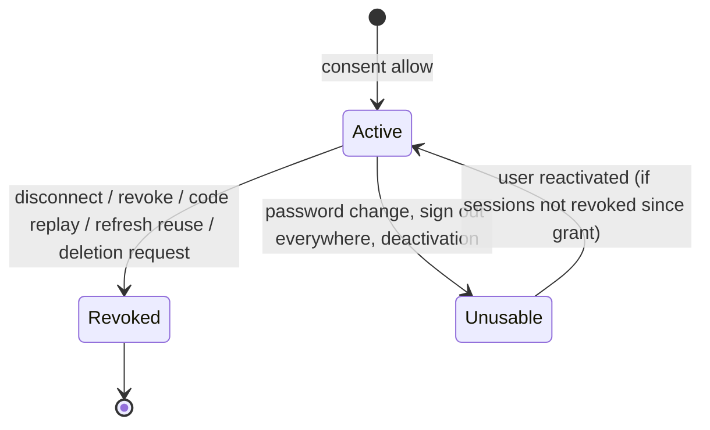

# MCP server and OAuth 2.1

> Scope: the OAuth 2.1 authorization server, scopes and grants, the consent screen and connected apps, the remote MCP endpoint, every MCP tool with its guards, throttles, budgets, untrusted-data marking and call log. State as of commit `bc7f65c` (2026-10-17).
> Main code: `backend/app/services/oauth/`, `backend/app/controllers/oauth/`, `backend/app/controllers/well_known/oauth_controller.rb`, `backend/app/controllers/api/me/oauth_*_controller.rb`, `backend/app/models/oauth_*.rb`, `backend/app/models/mcp_tool_call.rb`, `backend/app/controllers/mcp/endpoint_controller.rb`, `backend/app/services/mcp/`, `backend/app/jobs/purge_mcp_tool_calls_job.rb`, `frontend/app/routes/oauth/authorize.tsx`, `frontend/app/modules/oauth/`, `frontend/app/routes/account.tsx` (ConnectedApps).

The user and operator guide is [docs/mcp.md](../docs/mcp.md). This page does not repeat it; it records the rules as the code enforces them and lists where the guide disagrees under [Drift and open questions](#drift-and-open-questions).

## Summary

Kurz runs its own OAuth 2.1 authorization server so that AI apps (Claude, ChatGPT, the Kurz app) can act on a user's short links, bio pages, forms, responses and bookings through a remote MCP server at `/mcp`. Clients register themselves (dynamic client registration, public clients only), send the user to the consent screen at `FRONTEND_URL/oauth/authorize`, and exchange a one-time code with PKCE S256 for a 1-hour access token and a rotating refresh token (30 days sliding, 90 days absolute). A grant records the scopes the user left switched on; tools are listed and allowed per scope, and `account:full` replaces every other scope. The MCP endpoint is stateless JSON over Streamable HTTP; each tool call runs in one database transaction with a 5 s statement timeout, is throttled per user, and is logged as metadata in `mcp_tool_calls` (purged after 90 days). Text typed by visitors (responses, booking names, emails, notes) is cleaned, capped, counted against a 2000-record daily budget and wrapped as untrusted data. Everything answers 404 unless `MCP_ENABLED=true`.

## Glossary

- **Client** (`OauthClient`): an app registered through `POST /oauth/register`. Public: no secret.
- **Grant** (`OauthGrant`): one consent by one user to one client, with a scope list and a resource. Every consent creates a new grant; it is what Account, Connected apps lists and revokes.
- **Resource** (`Oauth::Config.resource`): `OAUTH_ISSUER + "/mcp"`, the only protected resource (RFC 8707 audience).
- **Personal-data scopes** (`OauthGrant::PERSONAL_DATA_SCOPES`): `responses:read`, `appointments:read`, `appointments:write`, `appointments:manage`.
- **Publish scopes** (`OauthGrant::PUBLISH_SCOPES`): `forms:publish`, `pages:publish`.
- **Full access** (`OauthGrant::FULL_SCOPE`, `account:full`): one scope that allows every tool and lifts the draft-only guards.
- **Tool** (`Mcp::BaseTool` subclass): one MCP tool; declares `requires scope, writes:, limits:`.
- **Guard** (`Mcp::Guards`): owner lookup plus draft-only, style-only, no-structure-after-responses and confirm checks.
- **Untrusted data** (`Mcp::Untrusted`): visitor text returned as `{untrusted: true, text}` inside a nonce-delimited envelope.
- **Record budget** (`Mcp::ResponseBudget`): personal records returned in the last 24 hours, per user.
- **Security event** (`Oauth::SecurityEvent`): `code_replay` or `refresh_reuse`; logged, sent to Sentry, grant revoked.

## Data

Full catalogue in [data-model](data-model.md). All tables below cascade from `oauth_grants` (`backend/db/schema.rb:690`, `:694`, `:695`, `:698`); `oauth_grants` cascades from `users` and `oauth_clients` (`backend/db/schema.rb:696-697`).

| Table | Key columns | Constraints | Notes |
|---|---|---|---|
| `oauth_clients` | `client_id` (random `urlsafe_base64(24)`), `client_name` (≤100), `redirect_uris` jsonb (1–5) | unique `client_id` | Never purged. `backend/app/models/oauth_client.rb:7-23` |
| `oauth_grants` | `user_id`, `oauth_client_id`, `scopes` jsonb, `resource`, `revoked_at`, `last_used_at` | FK cascade to users and clients | Audited, only `scopes` and `revoked_at` (`backend/app/models/oauth_grant.rb:8`). No unique (user, client): one row per consent. |
| `oauth_authorization_codes` | `code_digest`, `code_challenge`, `redirect_uri`, `expires_at`, `used_at` | unique `code_digest` | Not deleted on use or revoke. |
| `oauth_access_tokens` | `token_digest`, `expires_at` | unique `token_digest` | Deleted on revoke. |
| `oauth_refresh_tokens` | `token_digest`, `expires_at`, `absolute_expires_at`, `used_at` | unique `token_digest` | Rotated rows stay with `used_at` set (needed for reuse detection); deleted on revoke. |
| `mcp_tool_calls` | `oauth_grant_id`, `tool`, `status` (`ok`/`error`), `error_code`, `duration_ms`, `records_returned`, `created_at` | index on `created_at` and `oauth_grant_id` | Metadata only, never arguments or results. Purged after 90 days. |

Only SHA-256 hex digests of codes and tokens are stored (`backend/app/services/oauth/tokens.rb:11`). Raw values carry a kind prefix: `kz_at_` access, `kz_rt_` refresh, `kz_ac_` code, followed by `urlsafe_base64(32)` (`backend/app/services/oauth/tokens.rb:5-9`).

Valkey (Rails cache, `backend/config/application.rb:46`) keys: `mcp-throttle:<bucket>:<user_id>:<window seconds>` (`backend/app/services/mcp/throttle.rb:9`), plus the Rails `rate_limit` counters named `oauth_register`, `oauth_token`, `oauth_authorize`, `mcp_grant`.

## Business rules

### Feature flag and metadata

- **MC-01** `/mcp`, `/oauth/register`, `/oauth/token`, `/oauth/revoke`, `/.well-known/oauth-*` and `/api/me/oauth/authorization` answer 404 unless `ENV["MCP_ENABLED"] == "true"` exactly. `GET/DELETE /api/me/oauth_grants` is **not** gated. — `backend/app/services/oauth/config.rb:5`, `backend/app/controllers/oauth/base_controller.rb:7`, `backend/app/controllers/mcp/endpoint_controller.rb:20`, `backend/app/controllers/api/me/oauth_authorizations_controller.rb:43`; test `backend/spec/requests/oauth_spec.rb:36`.
- **MC-02** Issuer is `OAUTH_ISSUER` (default `https://api.kurz.fyi`), never the Host header; resource is `<issuer>/mcp`; authorization endpoint is `FRONTEND_URL/oauth/authorize` (default `https://kurz.fyi`). — `backend/app/services/oauth/config.rb:9-19`; test `backend/spec/requests/oauth_spec.rb:47`.
- **MC-03** Protected-resource metadata (RFC 9728) is served at both `/.well-known/oauth-protected-resource` and `/.well-known/oauth-protected-resource/mcp`; authorization-server metadata (RFC 8414) advertises `response_types: [code]`, grant types `authorization_code`, `refresh_token`, `code_challenge_methods: [S256]`, token and revocation auth `none`, every scope, and `authorization_response_iss_parameter_supported: true`. — `backend/app/controllers/well_known/oauth_controller.rb:2-27`, `backend/config/routes.rb:14-16`; test `backend/spec/requests/oauth_spec.rb:56`.
- **MC-04** Every `/oauth/*` and `/.well-known/*` response carries `Cache-Control: no-store` and `Pragma: no-cache`. — `backend/app/controllers/oauth/base_controller.rb:11-14`.
- **MC-05** CORS: `/.well-known/*`, `/oauth/token|register|revoke` and `/mcp` allow any origin without credentials; `/mcp` exposes `WWW-Authenticate` and `Mcp-Session-Id`. — `backend/config/initializers/cors.rb:15-24`; test `backend/spec/requests/oauth_spec.rb:303`.

### Dynamic client registration

- **MC-06** `POST /oauth/register` takes `application/json` only (415 otherwise), at most 5 KB (413), 10 registrations an hour per client IP (429 `temporarily_unavailable`). — `backend/app/controllers/oauth/registrations_controller.rb:9-13`, `:42-44`, `backend/app/controllers/concerns/public_json_endpoint.rb:17-27`; tests `backend/spec/requests/oauth_spec.rb:106`, `:115`.
- **MC-07** Only public clients: `token_endpoint_auth_method` must be absent or `none`; `grant_types` must be a subset of `authorization_code`, `refresh_token`; `redirect_uris` must be an array of strings. Errors are `invalid_client_metadata` or `invalid_redirect_uri`. — `backend/app/controllers/oauth/registrations_controller.rb:7`, `:17-19`; test `backend/spec/requests/oauth_spec.rb:86`.
- **MC-08** `client_name` loses every `\p{Cc}` and `\p{Cf}` character (controls, bidi overrides), is stripped, defaults to `Unnamed app`, max 100 characters. The consent screen still labels the name as unverified and shows the redirect host. — `backend/app/controllers/oauth/registrations_controller.rb:21-22`, `backend/app/models/oauth_client.rb:9`; test `backend/spec/requests/oauth_spec.rb:98`.
- **MC-09** A client has 1 to 5 redirect URIs (`MAX_REDIRECT_URIS`), each valid per MC-10. — `backend/app/models/oauth_client.rb:2`, `:18-23`; test `backend/spec/models/oauth_spec.rb:9`.

### Redirect URIs

- **MC-10** A redirect URI is valid when it is a String of at most 2048 characters, ASCII only, without surrounding whitespace, control characters or backslash, and one of: (a) exactly `fyi.kurz.app://oauth/callback`; (b) `http://` on a loopback host `127.0.0.1`, `[::1]` or `localhost`; (c) `https://` on a host listed in `MCP_REDIRECT_HOSTS` (default `claude.ai,claude.com,chatgpt.com`), written in lower case. No fragment and no userinfo in (b) and (c). Subdomains of allowed hosts are not allowed. — `backend/app/services/oauth/redirect_uri.rb:5-11`, `:28-41`; tests `backend/spec/services/oauth/redirect_uri_spec.rb:38`, `:43`, `:70`, `backend/spec/models/oauth_spec.rb:23`.
- **MC-11** The requested redirect URI must equal a registered one string for string; for loopback URIs only the port may differ (scheme, host, path and query still compared). — `backend/app/services/oauth/redirect_uri.rb:17-24`, `backend/app/models/oauth_client.rb:12`; tests `backend/spec/services/oauth/redirect_uri_spec.rb:10`, `:57`, `:63`, `backend/spec/requests/api/me/oauth_consent_spec.rb:124`.

### Authorization request and consent

- **MC-12** The authorization request is validated in this order: client (`client_id` truncated to 64), redirect URI, `response_type=code`, `code_challenge_method=S256` with a 43-character base64url challenge, at least one scope and all scopes known, `resource` equal to the MCP resource (default when absent). An unknown client or unregistered redirect URI answers 400 without redirecting; any later error answers 400 with `redirect_to` carrying `error`, `state` and `iss`. — `backend/app/services/oauth/authorization_request.rb:3`, `:29-31`, `:46-56`, `backend/app/controllers/api/me/oauth_authorizations_controller.rb:51-57`; tests `backend/spec/requests/api/me/oauth_consent_spec.rb:42`, `:52`.
- **MC-13** `state` is echoed back truncated to 512 characters; every redirect adds `iss=<issuer>` (RFC 9207). — `backend/app/services/oauth/authorization_request.rb:4`, `:33-42`.
- **MC-14** `GET /api/me/oauth/authorization` (signed-in user, 30 a minute per user) returns client name, redirect host, requested scopes, the user's email and the resource. — `backend/app/controllers/api/me/oauth_authorizations_controller.rb:5-21`; test `backend/spec/requests/api/me/oauth_consent_spec.rb:35`.
- **MC-15** `POST /api/me/oauth/authorization` revalidates the whole request (MC-12), needs the CSRF header with a cookie session, and: any `decision` other than `allow` redirects with `access_denied`; granted scopes are `granted_scopes ∩ requested` (never a scope that was not requested); if `account:full` is among them the grant holds `["account:full"]` only; an empty set redirects with `access_denied`. — `backend/app/controllers/api/me/oauth_authorizations_controller.rb:23-30`, `backend/app/controllers/application_controller.rb:75`; tests `backend/spec/requests/api/me/oauth_consent_spec.rb:71`, `:102`, `:109`, `:117`, `backend/spec/requests/mcp_full_tools_spec.rb:160`.
- **MC-16** A grant can never hold a personal-data scope together with a publish scope. Enforced three times: the consent endpoint answers 422 `conflicting_scopes`, the `OauthGrant` validation `publish_apart_from_responses`, and the consent screen disables the conflicting switches. `account:full` is exempt because it is neither (it is collapsed to itself first). — `backend/app/controllers/api/me/oauth_authorizations_controller.rb:32-34`, `backend/app/models/oauth_grant.rb:36-40`, `frontend/app/routes/oauth/authorize.tsx:130-134`; tests `backend/spec/requests/api/me/oauth_consent_spec.rb:78`, `backend/spec/requests/api/me/oauth_appointment_scopes_spec.rb:56`, `:74`, `backend/spec/requests/mcp_appointment_manage_spec.rb:103`.
- **MC-17** Grant scopes must be non-empty, known and without repeats; `resource` is required. — `backend/app/models/oauth_grant.rb:18-19`, `:42-44`; test `backend/spec/models/oauth_spec.rb:34`.
- **MC-18** Consent screen (frontend only): personal-data, publish and full-access switches start off, all others on; turning on full access forces and disables every other switch and sends `granted_scopes=["account:full"]`; Allow is disabled when nothing is on; red warning for full access, blue note when personal-data and publish scopes were both requested, yellow note when `responses:read` was requested; it follows `redirect_to` only for `https:`, `http:` or `fyi.kurz.app:` URLs; the page is client-only (`ssr = false`), `frame-ancestors 'none'`, `X-Frame-Options: DENY`, `noindex`. — `frontend/app/routes/oauth/authorize.tsx:11-18`, `:27-29`, `:42-49`, `:76-79`, `:87-92`, `:146-171`, `frontend/app/utils/content-security-policy.ts:5`.
- **MC-19** A signed-out user is sent to login; the authorize URL is kept in `sessionStorage` key `kurz:oauth-return` (only `/oauth/authorize?` plus printable ASCII, ≤4096 characters) and restored once after password, code, Google or password-reset login. — `frontend/app/modules/oauth/return-to.ts:1-25`. See [accounts-and-auth](accounts-and-auth.md).

### Codes and tokens

| Item | TTL | Single use | Source |
|---|---|---|---|
| Authorization code | 60 s | yes, atomic `UPDATE … WHERE used_at IS NULL AND expires_at > now` | `backend/app/models/oauth_authorization_code.rb:2`, `:14-27` |
| Access token | 1 h (`expires_in: 3600`) | no | `backend/app/models/oauth_access_token.rb:2`, `:8-12` |
| Refresh token | `min(now + 30 d, absolute)`; absolute 90 d from the first exchange, kept across rotations | yes, rotated atomically | `backend/app/models/oauth_refresh_token.rb:2-3`, `:9-37` |

- **MC-20** `POST /oauth/token` takes `application/x-www-form-urlencoded` only (415), 60 requests a minute per `client_id` parameter (not per IP), and supports `authorization_code` and `refresh_token`; anything else is `unsupported_grant_type`. — `backend/app/controllers/oauth/tokens_controller.rb:4-18`, `backend/app/controllers/oauth/base_controller.rb:16-18`; tests `backend/spec/requests/oauth_spec.rb:256`, `:263`.
- **MC-21** Code exchange: the code is claimed first (so a failed exchange burns it), then the grant must be active, its user active and not signed out since the grant (`sessions_revoked_at`), `client_id` must match the grant's client, `redirect_uri` must equal the one stored with the code, the `code_verifier` must match `/\A[A-Za-z0-9\-._~]{43,128}\z/` and `BASE64URL(SHA256(verifier)) == challenge` (constant-time compare), and a given `resource` must equal the grant's (`invalid_target`). Every other failure is `invalid_grant`. — `backend/app/controllers/oauth/tokens_controller.rb:2`, `:22-33`, `:48-57`; tests `backend/spec/requests/oauth_spec.rb:137`, `:147`, `:185`.
- **MC-22** Code replay: presenting a code that exists but cannot be claimed (already used **or expired**) records `code_replay` and revokes the grant. — `backend/app/models/oauth_authorization_code.rb:21-25`; tests `backend/spec/requests/oauth_spec.rb:160`, `backend/spec/models/oauth_spec.rb:100`, `:111`.
- **MC-23** Refresh: the old token is claimed atomically and a new pair is issued with the same absolute expiry; scope may not be widened (`invalid_scope`), and a narrower `scope` is accepted but the new token still carries all the grant's scopes; same `usable?` and client checks as MC-21. — `backend/app/controllers/oauth/tokens_controller.rb:35-46`; tests `backend/spec/requests/oauth_spec.rb:202`, `:227`, `:235`, `:245`, `backend/spec/models/oauth_spec.rb:150`.
- **MC-24** Refresh reuse: presenting a refresh token whose `used_at` is set records `refresh_reuse` and revokes the grant with every token. An expired, never-used refresh token is refused without revocation. — `backend/app/models/oauth_refresh_token.rb:28-36`; tests `backend/spec/requests/oauth_spec.rb:216`, `backend/spec/models/oauth_spec.rb:131`, `:144`.
- **MC-25** Token kinds are checked by prefix and length (≤128) before any lookup. — `backend/app/services/oauth/tokens.rb:15-17`; test `backend/spec/models/oauth_spec.rb:58`.
- **MC-26** Each successful exchange sets `oauth_grants.last_used_at`. — `backend/app/controllers/oauth/tokens_controller.rb:59-63`.

### Revocation and grant lifecycle

- **MC-27** `POST /oauth/revoke` (form-encoded, no client authentication) revokes the whole grant of the access or refresh token given and always answers 200. — `backend/app/controllers/oauth/revocations_controller.rb:4-11`; test `backend/spec/requests/oauth_spec.rb:284`.
- **MC-28** `OauthGrant#revoke!` sets `revoked_at` once and deletes all access and refresh tokens; codes stay but are unusable because the grant is inactive. — `backend/app/models/oauth_grant.rb:26-32`; test `backend/spec/models/oauth_spec.rb:40`.
- **MC-29** Grants are revoked by: the user in Connected apps (`DELETE /api/me/oauth_grants/:id`, another user's grant is 404), `/oauth/revoke`, code replay, refresh reuse, and account deletion request. — `backend/app/controllers/api/me/oauth_grants_controller.rb:9-12`, `backend/app/models/user.rb:109-113`; test `backend/spec/requests/api/me/oauth_consent_spec.rb:148`.
- **MC-30** Without revoking, a grant stops working when the user is deactivated or `sessions_revoked_at` moves past the grant's `created_at` (password change, sign out everywhere). Such grants still appear in Connected apps. — `backend/app/controllers/mcp/endpoint_controller.rb:38`, `backend/app/controllers/oauth/tokens_controller.rb:48-50`, `backend/app/models/concerns/password_authenticatable.rb:92-94`; test `backend/spec/requests/mcp_endpoint_spec.rb:67`.
- **MC-31** Connected apps lists only the user's active grants, newest first, with client name, host of the client's first redirect URI, scopes, `connected_at`, `last_used_at`; no secret. — `backend/app/controllers/api/me/oauth_grants_controller.rb:4-25`, `frontend/app/routes/account.tsx:335`; test `backend/spec/requests/api/me/oauth_consent_spec.rb:138`.

### MCP transport and authentication

- **MC-32** `GET`, `POST` and `DELETE /mcp` reach one action. Authentication accepts only `Authorization: Bearer kz_at_…` of an unexpired token whose grant is active, has `resource == Oauth::Config.resource`, and whose user is active and not signed out since the grant. A revoked grant fails on the very next call. — `backend/app/controllers/mcp/endpoint_controller.rb:24-41`, `backend/config/routes.rb:17-19`; tests `backend/spec/requests/mcp_endpoint_spec.rb:49`, `:67`, `:91`.
- **MC-33** Failure is 401 with `WWW-Authenticate: Bearer [error="invalid_token", ]resource_metadata="<issuer>/.well-known/oauth-protected-resource/mcp", scope="<every scope>"`, `error="invalid_token"` only when a credential was presented, and a log line `[mcp] event=unauthorized presented=<bool>` (never the token). — `backend/app/controllers/mcp/endpoint_controller.rb:43-50`; tests `backend/spec/requests/mcp_endpoint_spec.rb:31`, `:42`.
- **MC-34** `last_used_at` is written at most once a minute per grant. — `backend/app/controllers/mcp/endpoint_controller.rb:28`.
- **MC-35** 120 requests a minute per grant, then 429 `{"error":"rate_limited"}`. — `backend/app/controllers/mcp/endpoint_controller.rb:5-9`; test `backend/spec/requests/mcp_endpoint_spec.rb:187`.
- **MC-36** The server is built per request (`name: kurz`, `version: 1.0.0`) with only the tools the grant's scopes allow, over the `mcp` gem 1.7.0 `StreamableHTTPTransport` in stateless mode, with `serve_subscriptions_listen: false` (answered `-32601`), `allowed_hosts` = host of the resource URL (DNS-rebinding guard), `allowed_origins` = `MCP_ALLOWED_ORIGINS` (comma list, default empty: a request with a foreign `Origin` is 403), and requests over 256 KiB refused. GET opens no stream (405). Responses are `no-store` and set no cookie. — `backend/app/services/mcp/server_factory.rb:5-23`, `backend/app/controllers/mcp/endpoint_controller.rb:11-16`, `backend/Gemfile.lock:277`; tests `backend/spec/requests/mcp_endpoint_spec.rb:117`, `:125`, `:133`, `:160`, `:166`, `:172`.
- **MC-37** An OAuth token never acts as a session on `/api`, and a session cookie never authenticates `/oauth/token` or `/mcp`. — tests `backend/spec/requests/mcp_endpoint_spec.rb:179`, `backend/spec/requests/oauth_spec.rb:272`.

### Scopes and tool access

| Scope | Allows | Implied by | Default on consent | Exclusions |
|---|---|---|---|---|
| `shortlinks:read` | list, statistics | `shortlinks:write`, `account:full` | on | – |
| `shortlinks:write` | `create_shortlink` only | `account:full` | on | – |
| `pages:read` | list, get, statistics, templates | `pages:write`, `account:full` | on | – |
| `pages:write` | create and edit drafts, links, page templates | `account:full` | on | – |
| `pages:publish` | `publish_page`, `unpublish_page` | `account:full` | off | personal-data scopes |
| `forms:read` | list, get, templates | `forms:write`, `account:full` | on | – |
| `forms:write` | create and edit drafts and questions | `account:full` | on | – |
| `forms:publish` | `publish_form`, `unpublish_form` | `account:full` | off | personal-data scopes |
| `responses:read` | list, get, summary | `account:full` | off | publish scopes |
| `appointments:read` | booking setup, availability, time lists, appointments, agenda, impact, notifications | `appointments:write`, `account:full` | off | publish scopes |
| `appointments:write` | booking setup of drafts, mark notification read | `account:full` | off | publish scopes |
| `appointments:manage` | approve, decline, cancel, reschedule, remind | `account:full` only | off | publish scopes |
| `account:full` | every tool, guards lifted (MC-41) | – | off | replaces all others |

- **MC-38** A tool is allowed when the grant holds `account:full`, its exact scope, or, for a `:read` tool, `<resource>:write`. Nothing else implies anything: `appointments:manage` does not imply `appointments:read`, and a publish scope does not imply read. — `backend/app/services/mcp/base_tool.rb:25-30`; tests `backend/spec/requests/mcp_tools_spec.rb:65`, `backend/spec/requests/mcp_appointment_manage_spec.rb:83`.
- **MC-39** `tools/list` shows only allowed tools, and `tools/call` checks again (`insufficient_scope`), so a stale tool list cannot bypass scopes. — `backend/app/services/mcp/tools.rb:65-67`, `backend/app/services/mcp/base_tool.rb:35`; tests `backend/spec/requests/mcp_tools_spec.rb:46`, `:129`, `backend/spec/requests/mcp_appointment_manage_spec.rb:96`.
- **MC-40** No tool exists for account deletion, passwords, connected apps, data export, avatars, covers, uploads download, response export, form discard, community templates, calendar feeds or admin. — `backend/app/services/mcp/tools.rb:5-63`.

### Guards

- **MC-41** Every lookup is scoped to the token's user (`user.pages`, `user.forms`, `user.shortlinks`, `Appointment.where(form_id: user.forms)`, `Notification.bell(user)`); another user's id answers `not_found` exactly like a missing one. Pundit policies are not used on this path. — `backend/app/services/mcp/guards.rb:5-7`, `:26-28`, `backend/app/services/mcp/tools/appointment_tool_helpers.rb:11`; tests `backend/spec/requests/mcp_form_tools_spec.rb:229`, `backend/spec/requests/mcp_page_tools_spec.rb:183`.
- **MC-42** Draft-only: without `account:full`, link and field tools, page templates, booking setup and time slots answer `page_published` / `form_published` on a published item. — `backend/app/services/mcp/guards.rb:9-14`, `:30-35`; tests `backend/spec/requests/mcp_page_tools_spec.rb:123`, `backend/spec/requests/mcp_form_tools_spec.rb:169`, `backend/spec/requests/mcp_booking_config_tools_spec.rb:101`.
- **MC-43** Style-only on live items: `update_page` and `update_form` accept only `theme` and `custom_colors` on a published item without `account:full`. — `backend/app/services/mcp/guards.rb:37-51`; test `backend/spec/requests/mcp_publish_tools_spec.rb:95`.
- **MC-44** No structure edits after responses: without `account:full`, `add_field`, `update_field`, `remove_field`, `reorder_fields` answer `form_has_responses` when `responses_count > 0`; texts (`update_form`) still change. `apply_form_template` refuses forms with responses even with full access (domain rule). — `backend/app/services/mcp/guards.rb:53-58`, `backend/app/services/forms/definition.rb:53`; test `backend/spec/requests/mcp_form_tools_spec.rb:185`.
- **MC-45** Confirm: `delete_shortlink` needs the exact `short_code`, `delete_page` the exact `slug`, `delete_form` and `delete_all_responses` the exact `title` (both stripped), else `confirmation_mismatch`. `delete_response` has no confirm. The five manage tools need the appointment id repeated as `confirm`. — `backend/app/services/mcp/guards.rb:20-24`, `backend/app/services/mcp/tools/appointment_tool_helpers.rb:12`; tests `backend/spec/requests/mcp_full_tools_spec.rb:56`, `backend/spec/requests/mcp_appointment_manage_spec.rb:110`.
- **MC-46** Every tool has `additionalProperties: false`; keys such as `published`, `short_code`, `password`, `user_id`, `fields`, `public_id`, `expires_at` (pages) are refused by the schema. Booking questions cannot be added through `add_field` (type enum excludes `booking`). — `backend/app/services/mcp/tools/form_tool_helpers.rb:5`; tests `backend/spec/requests/mcp_tools_spec.rb:82`, `backend/spec/requests/mcp_form_tools_spec.rb:51`, `backend/spec/requests/mcp_page_tools_spec.rb:52`.
- **MC-47** Booking setup tools edit only questions in the `Services` mode (`unsupported_mode` otherwise); services, categories and exceptions are replaced as a whole and rules merged; exception notes are never echoed back. — `backend/app/services/mcp/tools/booking_config_helpers.rb:67-88`, `backend/app/services/forms/definition.rb:21`; tests `backend/spec/requests/mcp_booking_config_tools_spec.rb:63`, `:85`, `:93`.
- **MC-48** Page templates: built-in or `custom-<id>` of the user; `community-*` is refused (`invalid_input`). — `backend/app/services/mcp/tools/page_tool_helpers.rb:39-49`; test `backend/spec/requests/mcp_page_tools_spec.rb:80`.
- **MC-49** Annotations: read tools `read_only_hint: true`; `destructive_hint: true` on every delete tool, `update_shortlink`, `apply_page_template`, `apply_form_template`, `remove_field`, `remove_page_link`, `decline_appointment`, `cancel_appointment`; `open_world_hint: true` on publish tools and the five manage tools (they reach the public or send e-mail). — tool files, see catalogue; test `backend/spec/requests/mcp_full_tools_spec.rb:46`.

### Execution, errors and timeouts

- **MC-50** Each call runs `perform` inside `ActiveRecord::Base.transaction` with `SET LOCAL statement_timeout = 5000` (per statement, not per call); `QueryCanceled` becomes `timeout`. — `backend/app/services/mcp/base_tool.rb:12`, `:41`, `:63-68`; test `backend/spec/requests/mcp_response_tools_spec.rb:160`.
- **MC-51** Error codes returned as `isError` tool results: `insufficient_scope`, `rate_limited`, `timeout`, `forms_daily_limit`, `invalid_input` (validation), `not_found`, `tool_failed` (any other exception, logged as `[mcp] <tool> failed: <class>` without message), plus tool-specific ones (`page_published`, `form_published`, `form_has_responses`, `confirmation_mismatch`, `response_budget_exhausted`, `no_booking`, `unsupported_mode`, `no_questions`, `form_incomplete`, `nothing_to_cancel`, and the outcome symbols of the appointment services such as `already_decided`, `expired`, `same_time`, `unavailable`, `too_soon`, `no_email`). — `backend/app/services/mcp/base_tool.rb:44-59`; test `backend/spec/requests/mcp_tools_spec.rb:192`.
- **MC-52** All owner-authored text returned (titles, labels, bios, URLs, names) goes through `Mcp::Content.clean`: invalid UTF-8 dropped, NFC, every `\p{Cc}` except `\n` and `\t` dropped, every `\p{Cf}` except ZWNJ and ZWJ dropped, tag characters U+E0000–U+E0FFF dropped, truncated with `…` (default 2000). — `backend/app/services/mcp/content.rb:5-22`; test `backend/spec/requests/mcp_tools_spec.rb:203`.

### Rate limits

All MCP throttles are per **user** (across every grant), fixed windows counted in Valkey, incremented before the tool runs, so refused or failed calls count too. — `backend/app/services/mcp/throttle.rb:5-13`, `backend/app/services/mcp/base_tool.rb:39-40`.

- **MC-53** Every tool with `writes: true` shares `writes`: 30 a minute and 500 a day. — `backend/app/services/mcp/throttle.rb:5`.
- **MC-54** Per-tool limits are in the catalogue; the five manage tools also share `appointment_manage`: 30 an hour and 100 a day, checked after the confirm and ownership checks. — `backend/app/services/mcp/tools/appointment_tool_helpers.rb:7`, `:10-16`; tests `backend/spec/requests/mcp_appointment_manage_spec.rb:249`, `:256`, `backend/spec/requests/mcp_tools_spec.rb:107`, `backend/spec/requests/mcp_full_tools_spec.rb:110`, `backend/spec/requests/mcp_page_tools_spec.rb:89`.
- **MC-55** New forms (`create_form`, `create_form_from_template`, `duplicate_form`) share the domain limit `Form::MAX_CREATED_PER_DAY` per user, the same as the dashboard, answered `forms_daily_limit`. — `backend/app/services/forms/create.rb:12`; test `backend/spec/requests/mcp_form_tools_spec.rb:66`. See [forms](forms.md).

### Personal data: untrusted marking and budget

- **MC-56** Visitor text (short/long text and email answers, appointment `client_name`, `client_email`, `cancel_reason`) is returned as `{untrusted: true, text}` with caps of 2000 characters per value, 8000 per response or appointment, 40000 per call. — `backend/app/services/mcp/untrusted.rb:7-20`, `backend/app/services/mcp/tools/response_tool_helpers.rb:4`, `:17`, `backend/app/services/mcp/tools/appointment_tool_helpers.rb:45-53`; tests `backend/spec/requests/mcp_response_tools_spec.rb:75`, `:101`.
- **MC-57** Payloads with visitor text carry `content_trust: "untrusted_respondent_input"` and a `notice`; their text content is `NOTICE`, then `BEGIN_UNTRUSTED_DATA_<nonce>`, the JSON, `END_UNTRUSTED_DATA_<nonce>`, with a random 32-hex nonce that does not occur in the JSON. Used by `list_responses`, `get_response`, `list_appointments`, `get_appointment`, `get_agenda`. — `backend/app/services/mcp/untrusted.rb:22-30`; test `backend/spec/requests/mcp_response_tools_spec.rb:75`.
- **MC-58** Daily record budget: 2000 records per user over a rolling 24 hours, computed as `SUM(mcp_tool_calls.records_returned)` across all the user's grants. A call is refused with `response_budget_exhausted` when nothing is left; otherwise it returns `min(requested, left)`. Responses, appointments and people in the agenda count; notifications, summaries, booking setup and availability do not. — `backend/app/services/mcp/response_budget.rb:5-13`, `backend/app/services/mcp/tools/response_tool_helpers.rb:31-36`, `backend/app/services/mcp/base_tool.rb:42`; tests `backend/spec/requests/mcp_response_tools_spec.rb:130`, `backend/spec/requests/mcp_appointment_tools_spec.rb:182`, `backend/spec/requests/mcp_notification_tools_spec.rb:69`.
- **MC-59** Responses never expose IP, user agent, country or device; choices are resolved to owner labels (`(removed option)` when gone), images are `(image attached)`. `get_summary` calls `Forms::Summary` with `text_samples: false` and is marked `content_trust: "aggregates_only"`. Statistics tools return aggregates only. — `backend/app/services/mcp/tools/response_tool_helpers.rb:6-29`, `backend/app/services/mcp/tools/get_summary.rb:13`; tests `backend/spec/requests/mcp_response_tools_spec.rb:49`, `:120`, `backend/spec/requests/mcp_tools_spec.rb:152`.
- **MC-60** Manage tools clean messages and reasons with `Content.clean` capped at 500 characters and return only `{id, status, result}`, never names or emails. — `backend/app/services/mcp/tools/appointment_tool_helpers.rb:8`, `:18-24`; tests `backend/spec/requests/mcp_appointment_manage_spec.rb:142`, `:180`.
- **MC-61** Paging: `list_responses`, `list_appointments`, `list_notifications` default 10, max 20, cursor `before` (id) and `next_before`; `list_shortlinks` page/per_page default 20, max 50, page ≤10000; agenda at most 300 sessions; date ranges 1 to 62 days. — tool files; `backend/app/services/mcp/tools/appointment_tool_helpers.rb:4-5`, `:32-38`, `backend/app/services/appointments/slots.rb:5`.

### Call log

- **MC-62** Every `tools/call` that reaches a tool (including `insufficient_scope` and rate-limited ones) writes one `mcp_tool_calls` row: grant, tool, `ok`/`error`, error code, records returned, duration in ms. No arguments, results or IPs. — `backend/app/services/mcp/base_tool.rb:78-88`; test `backend/spec/requests/mcp_tools_spec.rb:173`.
- **MC-63** `PurgeMcpToolCallsJob` deletes rows older than 90 days in batches of 1000, daily at 4am. Rows also go when their grant row is deleted (cascade), not when it is revoked. — `backend/app/jobs/purge_mcp_tool_calls_job.rb:4-7`, `backend/config/recurring.yml:36-39`; test `backend/spec/jobs/purge_mcp_tool_calls_job_spec.rb:9`.
- **MC-64** Security events log `[oauth] event=<name> grant=<id>` at warn and send a Sentry warning `OAuth <name>` tagged `oauth_event`. — `backend/app/services/oauth/security_event.rb:5-8`.

## MCP tool catalogue

55 tools (`backend/app/services/mcp/tools.rb:5-63`). Kind: R read, W write, D destructive annotation. Every W tool also counts against MC-53. "draft" = draft-only unless full (MC-42), "style" = MC-43, "no-resp" = MC-44, "budget" = MC-58.

| Tool | Scope | Kind | Guards and limits | Domain code it calls | Owner page |
|---|---|---|---|---|---|
| `list_shortlinks` | shortlinks:read | R | max 50 per page | `user.shortlinks`, own serializer `Mcp::Tools.shortlink` | [shortlinks](shortlinks.md) |
| `get_shortlink_statistics` | shortlinks:read | R | – | `Shortlink#event_statistics` | [shortlinks](shortlinks.md) |
| `create_shortlink` | shortlinks:write | W | 20/h, 100/day; title ≤120; no password, code or extras | `ShortlinkContract`, `Shortlink` callbacks (cache, safety) | [shortlinks](shortlinks.md) |
| `update_shortlink` | account:full | W D | 60/h | `ShortlinkUpdateContract`, `SafetyUrlJob`, cache refresh copied from controller | [shortlinks](shortlinks.md) |
| `delete_shortlink` | account:full | W D | confirm `short_code`; 10/h, 30/day | `Shortlink#soft_delete!` | [shortlinks](shortlinks.md) |
| `list_pages` | pages:read | R | – | `user.pages` | [bio-pages](bio-pages.md) |
| `get_page` | pages:read | R | – | `user.pages` | [bio-pages](bio-pages.md) |
| `get_page_statistics` | pages:read | R | days 7/30/90 | `Pages::StatisticsService` | [bio-pages](bio-pages.md) |
| `list_page_templates` | pages:read | R | built-in and own only | `BuiltInPageTemplates`, `user.page_templates` | [bio-pages](bio-pages.md) |
| `create_page` | pages:write | W | 10/h, 50/day; always `published: false` | `PageContract`, `ApplyPageTemplate` | [bio-pages](bio-pages.md) |
| `update_page` | pages:write | W | style | `PageUpdateContract` | [bio-pages](bio-pages.md) |
| `add_page_link` | pages:write | W | draft | `PageLinkContract`, `PageLink` (limit, safety callback) | [bio-pages](bio-pages.md) |
| `update_page_link` | pages:write | W | draft; kind not editable | `PageLinkUpdateContract` | [bio-pages](bio-pages.md) |
| `remove_page_link` | pages:write | W D | draft | `PageLink#destroy!` | [bio-pages](bio-pages.md) |
| `reorder_page_links` | pages:write | W | draft; exact permutation | own copy of controller reorder | [bio-pages](bio-pages.md) |
| `apply_page_template` | pages:write | W D | draft; no community | `ApplyPageTemplate` | [bio-pages](bio-pages.md) |
| `publish_page` | pages:publish | W | 20/h, 100/day | `Page#update!(published: true)` | [bio-pages](bio-pages.md) |
| `unpublish_page` | pages:publish | W | 30/h | `Page#update!(published: false)` | [bio-pages](bio-pages.md) |
| `delete_page` | account:full | W D | confirm `slug`; 10/h, 30/day | `Page#soft_delete!` | [bio-pages](bio-pages.md) |
| `list_forms` | forms:read | R | – | `user.forms` | [forms](forms.md) |
| `get_form` | forms:read | R | – | `user.forms` | [forms](forms.md) |
| `list_form_templates` | forms:read | R | – | `BuiltInFormTemplates.all` | [forms](forms.md) |
| `create_form` | forms:write | W | daily forms limit | `FormContract`, `Forms::Create` | [forms](forms.md) |
| `create_form_from_template` | forms:write | W | daily forms limit; no locale | `BuiltInFormTemplates.build`, `Forms::Create` | [forms](forms.md) |
| `update_form` | forms:write | W | style | `FormUpdateContract` | [forms](forms.md) |
| `add_field` | forms:write | W | draft, no-resp; not `booking` | `Forms::Definition.add` (no `FormFieldContract`) | [forms](forms.md) |
| `update_field` | forms:write | W | draft, no-resp | `Forms::Definition.update` | [forms](forms.md) |
| `remove_field` | forms:write | W D | draft, no-resp | `Forms::Definition.remove` | [forms](forms.md) |
| `reorder_fields` | forms:write | W | draft, no-resp | `Forms::Definition.reorder` | [forms](forms.md) |
| `publish_form` | forms:publish | W | 20/h, 100/day | `Forms::Publish` | [forms](forms.md) |
| `unpublish_form` | forms:publish | W | 30/h | `Forms::Unpublish` | [forms](forms.md) |
| `duplicate_form` | account:full | W | 20/h; daily forms limit | attributes copied from controller, `Forms::Create` | [forms](forms.md) |
| `apply_form_template` | account:full | W D | 30/h; refused with responses | `Forms::Definition.apply_template` (no locale) | [forms](forms.md) |
| `delete_form` | account:full | W D | confirm title; 10/h, 30/day | `Form#destroy!` | [forms](forms.md) |
| `list_responses` | responses:read | R | budget; untrusted | own serializer `ResponseToolHelpers` | [forms](forms.md) |
| `get_response` | responses:read | R | budget; untrusted | own serializer | [forms](forms.md) |
| `get_summary` | responses:read | R | aggregates only | `Forms::Summary(text_samples: false)` | [forms](forms.md) |
| `delete_response` | account:full | W D | 100/h, 500/day; no confirm | `FormResponse#destroy!` (releases slots) | [forms](forms.md) |
| `delete_all_responses` | account:full | W D | confirm title; 10/h, 30/day | own code: uploads, `delete_all`, counter reset (no slot release) | [forms](forms.md) |
| `get_booking_config` | appointments:read | R | – | `Forms::PublicDefinition` | [booking-engine](booking-engine.md) |
| `preview_availability` | appointments:read | R | 1–62 days | `Appointments::FreeSlots` | [booking-engine](booking-engine.md) |
| `generate_time_slots` | appointments:read | R | pure calculation | `Appointments::GenerateTimes` | [booking-engine](booking-engine.md) |
| `get_booking_impact` | appointments:read | R | ids and counts | `Appointments::Impact` | [booking-engine](booking-engine.md) |
| `update_booking_config` | appointments:write | W | draft; 60/h; Services mode only | `FormFieldUpdateContract`, `Forms::Definition` | [booking-engine](booking-engine.md) |
| `apply_time_slots` | appointments:write | W | draft; 60/h; Services mode only | `Appointments::GenerateTimes`, `Forms::Definition.update` | [booking-engine](booking-engine.md) |
| `list_appointments` | appointments:read | R | budget; untrusted; max 20 | `Appointments::Search` | [appointments-lifecycle](appointments-lifecycle.md) |
| `get_appointment` | appointments:read | R | budget; untrusted | owner-scoped `Appointment` | [appointments-lifecycle](appointments-lifecycle.md) |
| `get_agenda` | appointments:read | R | budget; untrusted; 62 days, 300 sessions | `Appointments::Agenda` | [appointments-lifecycle](appointments-lifecycle.md) |
| `approve_appointment` | appointments:manage | W | confirm id; 20/h; shared 30/h, 100/day | `Appointments::Decide` | [appointments-lifecycle](appointments-lifecycle.md) |
| `decline_appointment` | appointments:manage | W D | same | `Appointments::Decide` | [appointments-lifecycle](appointments-lifecycle.md) |
| `cancel_appointment` | appointments:manage | W D | same; scope `all`/`one`/`remaining` | `Appointments::ClientCancel(by: "owner")` | [appointments-lifecycle](appointments-lifecycle.md) |
| `reschedule_appointment` | appointments:manage | W | same; no `force` | `Appointments::Reschedule` | [appointments-lifecycle](appointments-lifecycle.md) |
| `remind_appointment` | appointments:manage | W | same; domain 1/h per booking | `Appointments::RemindNow` | [appointments-lifecycle](appointments-lifecycle.md) |
| `list_notifications` | appointments:read | R | max 20; not budgeted | `Notification.bell`, `Notification.present` | [notifications-and-email](notifications-and-email.md) |
| `mark_notification_read` | appointments:write | W | 120/h | own copy of controller update | [notifications-and-email](notifications-and-email.md) |

### Reused versus re-implemented rules

Reused (a change in the domain service reaches both paths): `Forms::Create`, `Forms::Definition`, `Forms::Publish`, `Forms::Unpublish`, `Forms::Summary`, `ApplyPageTemplate`, `Pages::StatisticsService`, `Shortlink#soft_delete!`, `Page#soft_delete!`, every model validation and callback (shortlink cache and safety check, page link limit and safety check, `FormResponse` slot release), every contract named in the table, `Appointments::Decide`, `ClientCancel`, `Reschedule`, `RemindNow`, `GenerateTimes`, `FreeSlots`, `Impact`, `Search`, `Agenda`, `Notification.bell`/`present`.

Re-implemented in `backend/app/services/mcp/` (a change in the dashboard controller does not reach MCP):

| MCP code | Dashboard twin | Difference today |
|---|---|---|
| `backend/app/services/mcp/tools/delete_all_responses.rb:11-18` | `backend/app/controllers/api/me/form_responses_controller.rb:45-51` | MCP omits `Appointments::Release` of holding appointments (see drift). |
| `backend/app/services/mcp/tools/update_shortlink.rb:25-34` | `backend/app/controllers/api/me/shortlinks_controller.rb:52-55`, `:94-102` | Same logic; MCP ignores `password_digest` (no password input). |
| `backend/app/services/mcp/tools/create_shortlink.rb:21-30` | `backend/app/controllers/api/me/shortlinks_controller.rb:37-46` | MCP has its own throttle (20/h, 100/day) instead of 60 per 10 min; no password. |
| `backend/app/services/mcp/tools/create_page.rb:22-30` | `backend/app/controllers/api/me/pages_controller.rb:52-67` | MCP forces `published: false`, no community templates, own throttle 10/h + 50/day. |
| `backend/app/services/mcp/tools/page_tool_helpers.rb:39-49` | `backend/app/controllers/concerns/page_template_lookup.rb:14-25` | Community branch removed; no `uses_count`. |
| `backend/app/services/mcp/tools/reorder_page_links.rb:13-17` | `backend/app/controllers/api/me/page_links_controller.rb:37-52` | Copy. |
| `backend/app/services/mcp/tools/duplicate_form.rb:11-24` | `backend/app/controllers/api/me/forms_controller.rb:105-115` | Copy. |
| `backend/app/services/mcp/tools/mark_notification_read.rb:12-13` | `backend/app/controllers/api/me/notifications_controller.rb:17` | Copy. |
| `backend/app/services/mcp/tools/appointment_tool_helpers.rb:11` | `backend/app/controllers/api/me/appointments_controller.rb:59` | Same ownership query. |
| `response_tool_helpers.rb`, `form_tool_helpers.rb`, `page_tool_helpers.rb`, `Mcp::Tools.shortlink` | `*Serializer` classes | Separate serializers: a new column is not exposed to MCP (or leaked) unless added here. |
| `backend/app/services/mcp/tools/create_form_from_template.rb:12`, `backend/app/services/mcp/tools/apply_form_template.rb:13` | `backend/app/controllers/api/me/forms_controller.rb:95-97`, `:122` | MCP builds templates without the user's locale. |

## Flows

### Connect an app

1. Client fetches `/.well-known/oauth-protected-resource/mcp` (or gets a 401 with `resource_metadata`) then `/.well-known/oauth-authorization-server`.
2. Client `POST /oauth/register` with JSON metadata → `client_id` (MC-06–MC-09).
3. Client opens `FRONTEND_URL/oauth/authorize?client_id&redirect_uri&response_type=code&code_challenge&code_challenge_method=S256&scope&resource&state`. If signed out the URL is stored and the user logs in (MC-19).
4. Frontend `GET /api/me/oauth/authorization` → preview, or redirect with error (MC-12, MC-14).
5. User toggles scopes and clicks Allow → `POST /api/me/oauth/authorization` with `decision`, `granted_scopes`. Server creates `OauthGrant` and a 60 s code (both outside a shared transaction), returns `redirect_to` with `code`, `state`, `iss` (MC-15, MC-16).
6. Client `POST /oauth/token grant_type=authorization_code` with `code`, `client_id`, `redirect_uri`, `code_verifier`, optional `resource` → `{access_token, token_type: Bearer, expires_in: 3600, refresh_token, scope}` (MC-21).
7. Client calls `/mcp` with the bearer; refreshes with `grant_type=refresh_token` before or after expiry (MC-23).

### Tool call

`Mcp::EndpointController#handle` → authenticate (MC-32) → endpoint rate limit (MC-35) → `ServerFactory` builds the server with the scope-filtered tools → transport checks Host, Origin, size → `BaseTool.call`: scope check → set `Mcp::Current.full` → writes throttle → tool throttle → transaction with 5 s statement timeout → `perform` (guards, domain service) → render JSON (or untrusted wrap) → `McpToolCall` row (outside the transaction). Side effects such as e-mails from manage tools come from the domain services ([appointments-lifecycle](appointments-lifecycle.md), [notifications-and-email](notifications-and-email.md)).

### Disconnect

Connected apps → confirm modal → `DELETE /api/me/oauth_grants/:id` → `revoke!` (tokens deleted) → the next `/mcp` call or refresh fails (MC-28, MC-32).

## States and transitions

| Object | From | Event | To | Guard | Side effects |
|---|---|---|---|---|---|
| Grant | – | consent allow | active | MC-15, MC-16, MC-17 | code issued |
| Grant | active | user disconnects, `/oauth/revoke`, code replay, refresh reuse, account deletion request | revoked | – | access and refresh tokens deleted; security event for replay/reuse |
| Grant | active | password change, sign-out-everywhere, deactivation | active but unusable | `session_current?`, `user.active?` | none; still listed |
| Code | issued | exchange within 60 s | used | atomic claim | grant usable checks |
| Code | issued/used | exchange when used or expired | – | – | `code_replay`, grant revoked |
| Refresh token | active | refresh | used (rotated) | atomic claim, not expired | new pair, same absolute expiry |
| Refresh token | used | presented again | – | – | `refresh_reuse`, grant revoked |
| Refresh token | active | 30 d idle or 90 d absolute | expired | – | refused, no revocation |
| Access token | active | 1 h | expired | – | row stays until revoke |

## Limits and configuration

| Name | Value | Where | Notes |
|---|---|---|---|
| `MCP_ENABLED` | must equal `true` | `backend/app/services/oauth/config.rb:6` | otherwise 404 |
| `OAUTH_ISSUER` | default `https://api.kurz.fyi` | `backend/app/services/oauth/config.rb:10` | resource = issuer + `/mcp` |
| `FRONTEND_URL` | default `https://kurz.fyi` | `backend/app/services/oauth/config.rb:18` | consent URL, dashboard links |
| `MCP_REDIRECT_HOSTS` | default `claude.ai,claude.com,chatgpt.com` | `backend/app/services/oauth/redirect_uri.rb:10` | https only; loopback http and `fyi.kurz.app://oauth/callback` always allowed |
| `MCP_ALLOWED_ORIGINS` | default empty | `backend/app/services/mcp/server_factory.rb:19` | Origin allow-list for `/mcp` |
| Registration rate | 10/h per IP | `backend/app/controllers/oauth/registrations_controller.rb:9` | |
| Registration body | 5 KB | `backend/app/controllers/oauth/registrations_controller.rb:42` | |
| Redirect URIs per client | 1–5, ≤2048 chars each | `backend/app/models/oauth_client.rb:2`, `backend/app/services/oauth/redirect_uri.rb:6` | |
| Client name | ≤100 | `backend/app/models/oauth_client.rb:9` | |
| `state` | ≤512 kept | `backend/app/services/oauth/authorization_request.rb:4` | |
| Consent API rate | 30/min per user | `backend/app/controllers/api/me/oauth_authorizations_controller.rb:5` | |
| Token endpoint rate | 60/min per `client_id` | `backend/app/controllers/oauth/tokens_controller.rb:6` | |
| Code TTL | 60 s | `backend/app/models/oauth_authorization_code.rb:2` | |
| Access token TTL | 1 h | `backend/app/models/oauth_access_token.rb:2` | |
| Refresh TTL | 30 d sliding, 90 d absolute | `backend/app/models/oauth_refresh_token.rb:2-3` | |
| PKCE verifier | 43–128 of `[A-Za-z0-9-._~]` | `backend/app/controllers/oauth/tokens_controller.rb:2` | challenge exactly 43 base64url |
| `/mcp` rate | 120/min per grant | `backend/app/controllers/mcp/endpoint_controller.rb:5` | |
| `/mcp` body | 256 KiB | `backend/app/services/mcp/server_factory.rb:5` | |
| Writes throttle | 30/min, 500/day per user | `backend/app/services/mcp/throttle.rb:5` | all W tools |
| Manage throttle | 30/h, 100/day per user | `backend/app/services/mcp/tools/appointment_tool_helpers.rb:7` | plus 20/h per tool |
| Statement timeout | 5000 ms | `backend/app/services/mcp/base_tool.rb:12` | per statement |
| Record budget | 2000 per rolling 24 h per user | `backend/app/services/mcp/response_budget.rb:5` | |
| Untrusted caps | 2000 value, 8000 record, 40000 call | `backend/app/services/mcp/untrusted.rb:7-9` | |
| Content clean default | 2000 chars | `backend/app/services/mcp/content.rb:5` | |
| Manage message | 500 chars | `backend/app/services/mcp/tools/appointment_tool_helpers.rb:8` | |
| Call log retention | 90 days, daily at 4am | `backend/app/jobs/purge_mcp_tool_calls_job.rb:4`, `backend/config/recurring.yml:36-39` | |

## Authorization and privacy

- Anonymous: metadata, registration, token and revocation endpoints (all behind the flag and their rate limits).
- Signed-in user (cookie session with CSRF header): consent preview and decision, Connected apps list and disconnect for their own grants.
- MCP bearer: exactly the tools the grant's scopes allow, always limited to the grant user's own records (MC-41). Admin rights are never available through MCP.
- Personal data stored: grant metadata (`last_used_at`), client names typed by third parties, and the call log (no arguments). Tokens and codes only as digests.
- Personal data exposed: respondent answers and booking names/emails only with `responses:read`, `appointments:*` or `account:full`, as untrusted data within the 2000-record budget; no IP, UA, country or device.
- Retained and purged: `mcp_tool_calls` 90 days; grants, tokens, codes and clients have no purge (cascade on user deletion; account deletion request revokes grants first). Data export lists grant ids (`backend/app/models/user.rb:137`); see [accounts-and-auth](accounts-and-auth.md).

## API and UI surface

| Endpoint | Controller | Notes |
|---|---|---|
| `GET /.well-known/oauth-protected-resource[/mcp]` | `well_known/oauth#protected_resource` | RFC 9728 |
| `GET /.well-known/oauth-authorization-server` | `well_known/oauth#authorization_server` | RFC 8414 |
| `POST /oauth/register` | `oauth/registrations#create` | JSON |
| `POST /oauth/token` | `oauth/tokens#create` | form-encoded |
| `POST /oauth/revoke` | `oauth/revocations#create` | form-encoded |
| `GET/POST/DELETE /mcp` | `mcp/endpoint#handle` | Streamable HTTP, stateless |
| `GET /api/me/oauth/authorization` | `api/me/oauth_authorizations#show` | consent preview |
| `POST /api/me/oauth/authorization` | `api/me/oauth_authorizations#create` | consent decision |
| `GET /api/me/oauth_grants` | `api/me/oauth_grants#index` | Connected apps |
| `DELETE /api/me/oauth_grants/:id` | `api/me/oauth_grants#destroy` | disconnect |

Routes: `backend/config/routes.rb:14-22`, `:66-67`. Frontend: `/oauth/authorize` (`frontend/app/routes.ts:24`, bio layout, strict CSP), Account → Connected apps (`frontend/app/routes/account.tsx:335`, shows the MCP URL `VITE_BASE_URL/mcp`), scope labels in `frontend/app/modules/oauth/scopes.ts:9-23` (i18n namespace `oauth`). Job: `PurgeMcpToolCallsJob`, daily 4am. No mailer.

## Decisions

### D-MC-01 Own OAuth server with public clients, open registration and PKCE S256
**Decision.** Kurz is its own authorization server; clients self-register without secrets; only `authorization_code` with S256 and `refresh_token`; one resource. **Why.** Rationale: not recorded in the commits (`cad1e63` #56, `82371a6` #57 have no body); the metadata matches what remote MCP clients expect (inferred). **Consequence.** Registration is unauthenticated, so the redirect-host allow-list (MC-10) and the consent screen's "unverified" label are the main defences.

### D-MC-02 Publishing never shares a grant with personal data
**Decision.** Publish scopes are opt-in and exclusive with `responses:read` and every appointments scope, checked by model, endpoint and screen. **Why.** "text typed by respondents is untrusted and must not be able to steer what goes online" (`3ae7008` #86); extended to booking names and emails (`fc18819` #123) and to `appointments:manage` (`c660b03` #197). **Consequence.** A new personal-data scope must be added to `PERSONAL_DATA_SCOPES` and to `PERSONAL` in `authorize.tsx`.

### D-MC-03 `account:full` is one knowingly chosen scope
**Decision.** One scope replaces all others, lifts draft-only and no-structure-after-responses guards, and is the only way to combine reading responses with publishing. **Why.** For "connections that should do whatever the dashboard does"; "the user chooses it knowingly" (`201f345` #88). **Consequence.** Every new tool is automatically available to full grants; destructive ones need confirm, destructive annotation and a tight throttle.

### D-MC-04 Write tools act on drafts; live items take only style changes
**Decision.** Write scopes edit only unpublished items; live pages and forms accept theme and colors. **Why.** "live content stays out of reach of the write scopes" (`3ae7008` #86). **Consequence.** The MCP cannot edit the draft of a live form, unlike the dashboard ([forms](forms.md)).

### D-MC-05 Untrusted marking and a record budget for visitor text
**Decision.** Visitor text is cleaned, capped, nonce-wrapped, flagged, and counted against 2000 records a day computed from the call log. **Why.** `3a390b7` #64. **Consequence.** Any new tool returning visitor text must use `Untrusted.text`, `Untrusted.wrap` and `returned_records`.

### D-MC-06 Per-call statement timeout and 90-day log
**Decision.** Each call runs in a transaction with `SET LOCAL statement_timeout = 5s`; the call log is purged after 90 days. **Why.** "a slow query cancels itself ... instead of holding a Puma thread and a connection" (`7ac567f` #65). **Consequence.** Tools cannot commit partial work and must not rely on work outside the transaction.

### D-MC-07 Stateless transport without subscriptions/listen
**Decision.** `stateless: true`, `serve_subscriptions_listen: false`. **Why.** The controller buffers the body with `body.join` and cannot hold a stream; `subscriptions/listen` caused a 500 (`293bb76` #83). **Consequence.** No server-initiated notifications or sessions.

### D-MC-08 Booking actions are a separate scope with a confirm id
**Decision.** `appointments:manage`, not implied by `appointments:write`, id repeated as `confirm`, 20/h per tool and 30/h, 100/day together. **Why.** The tools e-mail clients in the owner's name (`c660b03` #197). **Consequence.** Read tools are not available with `manage` alone.

### D-MC-09 Replay and reuse revoke the grant and alert
**Decision.** Code replay and refresh reuse log, alert Sentry and revoke. **Why.** `faae1e6` #66. **Consequence.** A client bug that retries a token request can disconnect the user.

### D-MC-10 No allow-lists left
**Decision.** `MCP_BETA_EMAILS` was dropped (`4bdefdf` #70) and the appointments allow-list for the appointments scopes was removed with the appointments feature flag (`c61b24f` #196). **Consequence.** Every account can be offered every scope.

## Change impact

- New scope → `OauthGrant::SCOPES`, `PERSONAL_DATA_SCOPES`/`PUBLISH_SCOPES` if applicable, `frontend/app/modules/oauth/scopes.ts`, `PERSONAL`/`PUBLISH` in `authorize.tsx`, i18n `oauth.json` (EN and pt-PT), `BaseTool.allowed?` implication rule, `docs/mcp.md`. Existing grants keep their stored scope arrays (jsonb), so removing or renaming a scope invalidates them at validation time: ship removals in two releases.
- New tool → add it to `Mcp::Tools.all`, declare scope, `writes:`, `limits:`, annotations, `additionalProperties: false`; use `Mcp::Guards` for ownership and drafts; use `Content.clean` for every owner string and `Untrusted` plus `returned_records` for visitor text; add a request spec under `backend/spec/requests/mcp_*`.
- Dashboard controller logic change (see re-implemented table) → port it to the MCP twin, notably form responses deletion, shortlink update cache rules, page creation, page link reorder, form duplication, template lookup.
- Domain service change (`Forms::*`, `Appointments::*`, `ApplyPageTemplate`, model callbacks) → reaches MCP automatically; check MCP error mapping for new outcome symbols (`raise ToolError.new(outcome.to_s, …)`) and new exceptions (they become `tool_failed`).
- Serializer change in the dashboard → not reflected in MCP JSON; update `*_tool_helpers.rb` deliberately (and never add IP, UA, country or device).
- Session revocation (`sessions_revoked_at`, `User#active?`) → also disconnects MCP grants ([accounts-and-auth](accounts-and-auth.md)).
- Account deletion → `request_deletion!` revokes grants; keep it.
- `Form::MAX_CREATED_PER_DAY`, `Appointments::Slots::MAX_RANGE_DAYS`, `Appointments::Search::STATUSES`, `Appointments::ClientCancel::SCOPES`, `Page::THEMES`, `Form::LAYOUTS`, `PageLink::KINDS`/`ICONS`/`MAX_PER_PAGE`, `Forms::FieldSchema::*` → feed MCP input schemas directly.
- Redis/Valkey cache → throttles silently stop (counts nil) if the cache is unavailable (`raise RateLimited if count && …`).
- `OAUTH_ISSUER` change → every grant's `resource` no longer matches, all connections fail until users reconnect (MC-32).
- Deploy: the previous release runs against the new schema; `mcp_tool_calls` and `oauth_*` columns follow the add-then-drop rule. Cloudflare must not challenge `/mcp`, `/oauth/*`, `/.well-known/*` ([platform-and-operations](platform-and-operations.md)).
- `docs/mcp.md` and `e2e/tests/static.spec.ts:8` (checks the MCP URL on a static page).

## Tests that pin this behaviour

- OAuth endpoints: `backend/spec/requests/oauth_spec.rb` (flag, metadata, DCR, code exchange, refresh, hygiene, revocation, CORS).
- Consent and connected apps: `backend/spec/requests/api/me/oauth_consent_spec.rb`, `backend/spec/requests/api/me/oauth_appointment_scopes_spec.rb`.
- Models and tokens: `backend/spec/models/oauth_spec.rb`; redirect URIs: `backend/spec/services/oauth/redirect_uri_spec.rb`.
- Transport and auth: `backend/spec/requests/mcp_endpoint_spec.rb`.
- Tool base, shortlinks, call log, cleaning: `backend/spec/requests/mcp_tools_spec.rb`.
- Pages: `backend/spec/requests/mcp_page_tools_spec.rb`; forms: `backend/spec/requests/mcp_form_tools_spec.rb`; publishing: `backend/spec/requests/mcp_publish_tools_spec.rb`; full access: `backend/spec/requests/mcp_full_tools_spec.rb`.
- Responses and budget: `backend/spec/requests/mcp_response_tools_spec.rb`.
- Appointments: `backend/spec/requests/mcp_appointment_tools_spec.rb`, `backend/spec/requests/mcp_booking_config_tools_spec.rb`, `backend/spec/requests/mcp_appointment_manage_spec.rb`, `backend/spec/requests/mcp_notification_tools_spec.rb`.
- Purge: `backend/spec/jobs/purge_mcp_tool_calls_job_spec.rb`.
- Frontend: no unit test covers `authorize.tsx`, `scopes.ts` or `return-to.ts`; e2e only checks the MCP URL text (`e2e/tests/static.spec.ts:8`).

## Drift and open questions

1. **High.** `delete_all_responses` deletes responses with `delete_all` and never calls `Appointments::Release`, unlike the dashboard (`backend/app/controllers/api/me/form_responses_controller.rb:47`). Appointments vanish by FK cascade (`backend/db/schema.rb:678`) but `appointment_slots.booked` keeps the places and the waitlist is not offered. The release was added to the dashboard in `58ad7e6` (#111) after the tool (`201f345`, #88). Spec `backend/spec/requests/mcp_full_tools_spec.rb:84` does not check slots. — `backend/app/services/mcp/tools/delete_all_responses.rb:15-17`.
2. **Medium.** docs/mcp.md says appointments scopes are offered "when appointments are enabled for the account"; the allow-list was removed in `c61b24f` (#196) and no code filters them now.
3. **Medium.** docs/mcp.md says deleting tools need the exact code, slug or title and are limited to 10 an hour; `delete_response` has no confirm and allows 100/h, 500/day; the others also have 30/day.
4. **Medium.** docs/mcp.md does not mention that loopback `http://127.0.0.1|[::1]|localhost` redirect URIs on any port are always accepted (`backend/app/services/oauth/redirect_uri.rb:35`), nor that allowed hosts are exact (no subdomains) and https only.
5. **Medium.** Grants made unusable by a password change or deactivation (MC-30) stay listed as connected in Account, with no indication; the user may think the app still has access or cannot tell it must reconnect.
6. **Low.** An expired, never-used authorization code is treated as a replay: logs `code_replay`, alerts Sentry and revokes the grant (`backend/app/models/oauth_authorization_code.rb:21-25`). Not pinned by any spec; a false security alert.
7. **Low.** "Each call is cancelled after 5 seconds in the database" (docs): the timeout is per statement, so a call with many statements can run longer.
8. **Low.** docs table says `MCP_ENABLED` gates `/mcp`, `/oauth/*`, `/.well-known/*`; it also gates `/api/me/oauth/authorization` but not `/api/me/oauth_grants`.
9. **Low.** docs say notifications carry "ids and counts only"; waitlist notices also carry form title, service name, time and `waitlist_path` (`backend/app/services/mcp/tools/list_notifications.rb:8`, `backend/app/models/notification.rb:55-61`).
10. **Low.** docs do not mention the shared writes throttle (30/min, 500/day), the 120/min endpoint limit, or that every throttle counts failed calls.
11. **Low.** `get_booking_config` and `preview_availability` read `Forms::PublicDefinition` (the published snapshot when one exists) while `update_booking_config` edits the draft; after an unpublish the two can differ. Open question whether this is intended.
12. **Low.** MCP form templates ignore the user's locale (`BuiltInFormTemplates.build(template)` without `locale:`), the dashboard uses it.
13. **Low.** `add_field` and `update_field` skip `FormFieldContract` and rely on the tool input schema plus `Form#field_definitions`.
14. **Low.** `update_shortlink` allows a 255-character title while `create_shortlink` caps it at 120.
15. **Low.** Dead code: `OauthGrant::APPOINTMENT_SCOPES` (`backend/app/models/oauth_grant.rb:6`) and `OauthClient::MAX_PAYLOAD_BYTES` (`backend/app/models/oauth_client.rb:3`) are unused.
16. **Low.** No purge for expired or used codes, access tokens, rotated refresh tokens, revoked grants or clients; `oauth_clients` grows with open registration (10/h per IP).
17. **Low.** Refresh with a narrower `scope` is accepted but the issued token keeps all grant scopes; the response's `scope` shows that.
18. **Low.** The consent screen rules (defaults, full-access lock) are frontend only; the server enforces only MC-15/MC-16. Not covered by frontend tests.
19. **Unverified.** Origin and Host handling is delegated to the `mcp` gem 1.7.0, whose source is not installed here: whether a request without an `Origin` header is accepted was taken from the spec behaviour only.
