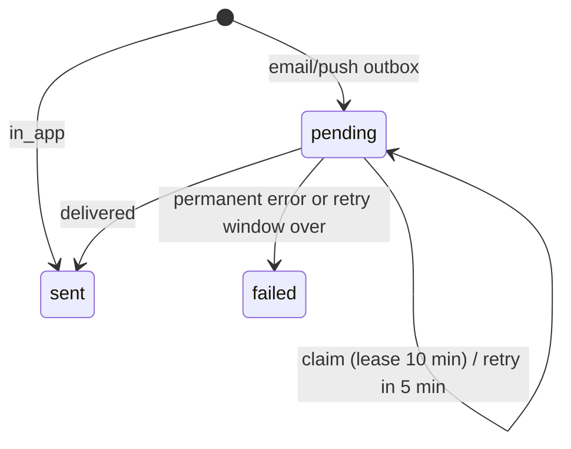

# Notifications and e-mail

> Scope: the `notifications` outbox (in-app bell, e-mail, Web Push), per-owner preferences, the delivery jobs, the e-mail budget, and the catalogue of every e-mail the app can send. State as of commit `bc7f65c` (2026-10-17).
> Main code: `backend/app/models/notification.rb`, `notification_preference.rb`, `push_subscription.rb`; `backend/app/services/notifications/`, `mail_budget.rb`, `push/config.rb`; `backend/app/jobs/*notification*`, `push_delivery_job.rb`, `mail_delivery_job.rb`; `backend/app/mailers/`, `backend/app/views/{layouts,shared}/mailer*`, `backend/config/locales/{en,pt-PT}.yml`, `backend/config/mail_settings.rb`; `frontend/app/modules/notices/`, `frontend/app/routes/notifications/`, `frontend/app/components/notification-bell/`, `frontend/public/sw.js`.

## Summary

A notification is one row in `notifications` per event, recipient and channel (`in_app`, `email`, `push`). Appointment flows write the rows inside the transaction of the event, so a failed event leaves nothing. In-app rows are born `sent`. E-mail and push rows are an outbox: they are born `pending`, delivered by a job enqueued after commit, and picked up again by a sweep that runs every minute. Only owners have preferences (5 events x 3 channels, all on by default); e-mails to clients are never optional. E-mail is rationed by `MailBudget` (100 a day, 3000 a month, shared with sign-in codes); Web Push needs three VAPID env vars. Sixteen e-mail templates exist across four mailers (appointment, waiting list, sign-in, account); only the ten appointment ones go through the outbox.

## Glossary

- **Notification** (`Notification`): one outbox/bell row. Columns `channel`, `kind`, `recipient_kind`, `user_id`, `recipient_email`, `appointment_id`, `event_key`, `payload`, `status`, `attempts`, `next_attempt_at`, `sent_at`, `read_at`, `last_error`.
- **Kind** (`kind`): the event name. Owner kinds: `appointment_created`, `appointment_requested`, `appointment_cancelled`, `appointment_expired`, `appointment_auto_confirmed`. Client kinds: `appointment_confirmed`, `appointment_request_received`, `appointment_declined`, `appointment_cancelled`, `appointment_reminder`, `appointment_rescheduled`, `appointment_verify`, plus in-app only `waitlist_joined`, `waitlist_offered`.
- **Recipient kind** (`recipient_kind`): `owner` (the form owner, identified by `user_id`) or `client` (the person who booked, identified by `recipient_email`; `user_id` is set only on the in-app mirror).
- **Event key** (`event_key`): idempotency part of the unique key. Usually the booking `group_key`; see NT-03.
- **Outbox**: the pending e-mail/push rows plus the sweep that retries them.
- **Mirror**: the in-app copy of a client e-mail, written for a client who has a verified Kurz account (NT-08).
- **Bell**: the in-app list, `Notification.bell(user)`.
- **Lease**: `next_attempt_at` pushed 10 minutes ahead by the worker that claims a row.
- **Mail budget** (`MailBudget`): Valkey/Redis counters that cap outgoing e-mail.
- **Share**: the fraction of the daily/monthly budget a sender may use (0.8 appointment mail, 0.5 reminders and data export, 1.0 sign-in codes).
- **VAPID**: the key pair and contact that authenticate the server to push services.

## Data

Full catalogue: [data-model](data-model.md).

| Table | Key columns and constraints | Source |
|---|---|---|
| `notifications` | `channel` check in (`in_app`,`email`,`push`); `recipient_kind` check in (`owner`,`client`); `status` check in (`pending`,`sent`,`failed`), default `pending`; `payload` jsonb must be an object; check: owner row has `user_id`, client row has `recipient_email`; `attempts` default 0. FK `user_id` and `appointment_id` `ON DELETE CASCADE`. `kind` has no database constraint. | `backend/db/schema.rb:290` |
| `notifications` unique index | `(kind, event_key, channel, recipient_kind, COALESCE(user_id::text, recipient_email))` | `backend/db/schema.rb:306` |
| `notifications` other indexes | partial `(status, next_attempt_at) WHERE status='pending'` (the sweep), `(user_id, channel, id)` (the bell), `created_at` (purge), `appointment_id`, `user_id` | `backend/db/schema.rb:307` |
| `notification_preferences` | `(user_id, kind, channel)` unique; `enabled` not null; channel check; FK to `users` cascade | `backend/db/schema.rb:278` |
| `push_subscriptions` | `endpoint` unique, max 2048; `p256dh`, `auth` not null; `user_agent_label`; `last_used_at`; FK to `users` cascade | `backend/db/schema.rb:452` |
| Valkey keys | `mail_budget:day:YYYY-MM-DD` (TTL 2 days), `mail_budget:month:YYYY-MM` (32 days), `mail_budget:new:YYYY-MM-DD` (2 days), `mail_budget:alerted:<reason>:YYYY-MM-DD` (1 day); all UTC | `backend/app/services/mail_budget.rb:60` |
| Queues | `notifications` (dispatch, delivery, push delivery, reminders, expiry sweep), `mailers` (`deliver_later` mails, data export) | `backend/config/queue.yml:26` |

`status` of a row: `pending` -> `sent` or `failed`. `read_at` is independent and used only by the bell.

## Business rules

### The notification row

- **NT-01** One row per event, recipient and channel. The database refuses a second row with the same `(kind, event_key, channel, recipient_kind, user_id or recipient_email)`. A duplicate `create!` raises `ActiveRecord::RecordNotUnique`, which no caller rescues in the appointment flows, so it would roll back the whole event; callers avoid it by making `event_key` unique per event. — `backend/db/schema.rb:306`; test `backend/spec/requests/api/me/notifications_spec.rb:150`.
- **NT-02** Channel, recipient kind and status are closed sets enforced by check constraints; an owner row needs `user_id`, a client row needs `recipient_email`. A new channel or status needs a migration. — `backend/db/schema.rb:312`; test `backend/spec/requests/api/me/notifications_spec.rb:156`.
- **NT-03** `event_key` values: the booking `group_key` for created/requested/confirmed/declined/verify/expired/auto-confirmed; `"<group>:r<lead>"` for sweep reminders (`lead` in minutes); `"<group>:m<hex8>"` for the owner's "remind now" (random, so repeats never collide); `"<group>:r<appointment id>"` for a reschedule; `<group>` for a full cancellation and `"<group>:<scope><first id>"` for a partial one (`one`, `remaining`); `"waitlist:<entry id>:<joined|offered>"` for waiting-list notices. — `backend/app/services/appointments/send_reminders.rb:37`, `remind_now.rb:18`, `reschedule.rb:78`, `client_cancel.rb:67`, `waitlist.rb:195`.
- **NT-04** Rows are written inside the transaction of the event that causes them (booking via `Forms::SubmitResponse`, `Decide`, `ClientCancel`, `Reschedule`, `Verify`, `ResolveExpired`, `SendReminders`). A failed booking leaves no notification; deleting the response or the appointment deletes its rows (FK cascade). Delivery jobs are enqueued with `ActiveRecord.after_all_transactions_commit`, never inside the transaction. Exceptions: `RemindNow` writes its row outside a transaction of its own, and waiting-list in-app notices are written in a nested `requires_new` transaction and swallowed on error. — `backend/app/services/appointments/book/notify.rb:26`, `backend/app/services/forms/submit_response.rb:125`, `backend/app/services/appointments/waitlist.rb:188`; test `backend/spec/requests/api/me/notifications_spec.rb:137`, `:142`, `backend/spec/requests/api/public/booking_emails_spec.rb:63`.
- **NT-05** Domains that write rows: booking creation (`Appointments::Book::Notify`, `book.rb:75`), email verification (`Verify`, `verify.rb:15`, which only then announces the booking), owner approve/decline (`Decide`), client or owner cancel (`ClientCancel`), reschedule, remind now, the reminder sweep, the timeout sweep (`ResolveExpired`), and the waiting list. MCP tools reuse the same services, so they write the same rows. See [appointments-lifecycle](appointments-lifecycle.md) and [booking-engine](booking-engine.md). — `backend/app/services/appointments/`.
- **NT-06** An owner event creates up to three rows via `Notification.notify_owner` (in-app + push) and `queue_email` (e-mail). Each channel is created only if the owner's preference for `(kind, channel)` is not `false`; a silenced event leaves no row at all (no audit trail). — `backend/app/models/notification.rb:65`, `:71`, `:11`; test `backend/spec/requests/api/me/notification_preferences_spec.rb:114`.
- **NT-07** Client e-mails ignore preferences. `queue_email` checks the preference only when `recipient_kind == "owner"`. — `backend/app/models/notification.rb:11`; test `backend/spec/requests/api/me/notification_preferences_spec.rb:134`.
- **NT-08** Client mirror: every client e-mail row except `appointment_verify` also creates an `in_app` row (status `sent`) when `client_account(email)` finds an active user with a verified address, matched case-insensitively. The mirror payload keeps only `group_key` and `sessions`. It is written when the e-mail row is queued, so it exists even if the e-mail later fails or is refused by the budget. Unverified, deactivated and unknown addresses get no mirror; the verification mail is never mirrored. — `backend/app/models/notification.rb:25`, `:29`, `:47`; test `backend/spec/requests/api/me/client_notifications_spec.rb:36`, `:58`, `:71`, `:78`.
- **NT-09** Waiting-list notices: `waitlist_joined` and `waitlist_offered` are written as in-app rows for a verified account with that e-mail, before the budget is checked, and never break the join/offer. The payload holds `waitlist_entry_id`, form title, service name and `starts_at`; `waitlist_path` (`/w/<token>`) is computed when the bell is read, only while the entry is active and its e-mail matches, so no token is stored. — `backend/app/services/appointments/waitlist.rb:188`, `backend/app/models/notification.rb:55`; test `backend/spec/requests/api/public/waitlist_spec.rb`, `e2e/tests/waitlist.spec.ts:67`.
- **NT-10** Payloads carry ids and counts only: owner rows `form_id`, `response_id`, `group_key`, `sessions`, optional `expires_at` (manual approval), `cancelled_ids`, `from`. No names, e-mails or notes. Mailers rebuild the content from the appointments at send time. — `backend/app/services/appointments/book.rb:62`; test `backend/spec/requests/api/me/notifications_spec.rb:119`, `backend/spec/requests/api/public/booking_emails_spec.rb:54`, `backend/spec/requests/api/me/client_notifications_spec.rb:48`.

### Dispatch pipeline (e-mail and push)

- **NT-11** After commit, the event enqueues `NotificationDeliveryJob` (e-mail) or `PushDeliveryJob` (push) on queue `notifications`. Reminder rows from the 5-minute sweep are not enqueued by the writer; they wait for the dispatch sweep. — `backend/app/models/notification.rb:102`, `backend/app/services/appointments/book/notify.rb:53`, `backend/app/services/appointments/send_reminders.rb:37`.
- **NT-12** `DispatchNotificationsJob` runs every minute on queue `notifications` (recurring task `dispatch_notifications`). It selects up to 200 rows with `status = 'pending'` and `next_attempt_at <= now`, ordered by `id`, and enqueues one delivery job per row by channel. There is no per-recipient ordering: jobs run on 2 threads and can finish in any order. `in_app` rows are ignored. — `backend/app/jobs/dispatch_notifications_job.rb:4`, `backend/config/recurring.yml:64`, `backend/config/queue.yml:30`.
- **NT-13** Idempotency by claim: a delivery job first runs an atomic `UPDATE ... WHERE id AND channel AND status='pending' AND next_attempt_at <= now` that sets `next_attempt_at = now + 10 minutes` (the lease). Only the job that updates one row proceeds; duplicate jobs (writer + sweep, or the sweep enqueuing twice while the queue lags) return silently. A crash after the claim leaves the row to be re-enqueued when the lease ends (at-least-once; a crash after sending but before `finish` would send twice, inferred). — `backend/app/services/notifications/deliver.rb:46`, `deliver_push.rb:43`; test `backend/spec/requests/api/public/booking_emails_spec.rb:95`, `backend/spec/requests/api/me/push_channel_spec.rb:182`.
- **NT-14** E-mail template is chosen from `(kind, recipient_kind)`; any other pair, or a row whose appointment is gone, fails at once with `last_error = "unsupported"`. — `backend/app/services/notifications/deliver.rb:11`, `:22`; test `backend/spec/requests/api/public/booking_emails_spec.rb:113`.
- **NT-15** Re-checks at send time: a `appointment_reminder` fails with `not_confirmed` unless some appointment of the group is still `confirmed`; an `appointment_verify` fails with `not_unverified` unless one is still `unverified`. — `backend/app/services/notifications/deliver.rb:24`, `:26`; test `backend/spec/requests/api/public/booking_reminders_spec.rb:94`.
- **NT-16** Budget before sending: e-mail rows call `MailBudget.reserve(new_address: false, share:)` with share 0.8, or 0.5 for `appointment_reminder`. A refused reservation is a retry, not a failure (NT-17). — `backend/app/services/notifications/deliver.rb:5`, `:28`; test `backend/spec/requests/api/public/booking_emails_spec.rb:126`, `booking_reminders_spec.rb:105`.
- **NT-17** E-mail retry policy: transient errors (`Socket::ResolutionError`, `Net::OpenTimeout`, `Net::ReadTimeout`, `Errno::ECONNREFUSED`, `Errno::ECONNRESET`, `Net::SMTPServerBusy`) and budget refusals set `attempts += 1`, `last_error` (`"budget:<reason>"` or the class name) and `next_attempt_at = now + 5 minutes`. When the row is older than 24 hours (`created_at`), the next retry marks it `failed` with that last error. Any other `StandardError` goes to Sentry (`notification_id` extra) and fails the row at once with the class name. Success sets `status = sent`, `sent_at`, clears `next_attempt_at`. — `backend/app/services/notifications/deliver.rb:7`, `:33`, `:51`, `:55`; test `backend/spec/requests/api/public/booking_emails_spec.rb:132`, `:144`, `:156`, `:165`, `:182`.
- **NT-18** Push retry policy: transient (`Socket::ResolutionError`, `Net::OpenTimeout`, `Net::ReadTimeout`, `ECONNREFUSED`, `ECONNRESET`, `WebPush::PushServiceError`, `WebPush::TooManyRequests`) retries every 5 minutes, gives up after 6 hours. Per row, devices are tried in `id` order. Outcome: any device delivered -> `sent`; no subscriptions left -> `sent` with `last_error = "no_subscriptions"`; all failures transient -> retry; otherwise `failed` with the first failure. A row is `failed` with `push_disabled` if VAPID vanished after queuing. — `backend/app/services/notifications/deliver_push.rb:5`, `:19`, `:29`; test `backend/spec/requests/api/me/push_channel_spec.rb:161`, `:175`.
- **NT-19** Dead jobs: the three jobs never raise (`StandardError` is rescued in the service), so they do not accumulate in Solid Queue failed executions. The dead state is a `notifications` row with `status = 'failed'` and `last_error`. `ApplicationJob` enables no `retry_on` or `discard_on` (both commented out), so the row is the only retry state. `failed` rows are never retried and never re-sent. — `backend/app/jobs/application_job.rb:1`, `backend/app/services/notifications/deliver.rb:35`.
- **NT-20** Observability: `Appointments::Health` reports `email_pending`, `email_oldest_pending_seconds`, `push_pending`, failures of the last day, `notifications` queue lag and budget use; alerts `notification_queue_lag` (> 5 min), `email_budget` (>= 80 % of the daily limit), `notifications_failed` (any failure in the last day). `AppointmentsHealthJob` (every 5 minutes) sends each alert to Sentry at most once an hour; `GET /api/admin/appointments_health` exposes the report. — `backend/app/services/appointments/health.rb:30`, `:60`, `backend/app/jobs/appointments_health_job.rb:4`; test `backend/spec/requests/api/admin/appointments_health_spec.rb`.

### Preferences

- **NT-21** The matrix is 5 events x 3 channels = 15 cells. Supported cells: `appointment_created`, `appointment_requested`, `appointment_cancelled` on in_app, email and push; `appointment_expired` and `appointment_auto_confirmed` on in_app and push only (no e-mail exists for them). Unsupported cells are returned with `supported: false, enabled: false` and are refused on write. — `backend/app/models/notification_preference.rb:3`, `:22`, `:34`; test `backend/spec/requests/api/me/notification_preferences_spec.rb:62`, `:94`.
- **NT-22** Default is on. `enabled?` is true unless a stored row says exactly `false`; no row is created until the owner changes a cell. — `backend/app/models/notification_preference.rb:18`; test `backend/spec/requests/api/me/notification_preferences_spec.rb:62`, `:81`.
- **NT-23** `PUT /api/me/notification_preferences` takes `{preferences: [{kind, channel, enabled}]}`; the list must be an array of at most 15 items, each `enabled` strictly `true` or `false`, kind/channel known and supported. All changes apply in one transaction or none (422 `invalid_preferences`). Response is the full matrix. — `backend/app/controllers/api/me/notification_preferences_controller.rb:8`; test `backend/spec/requests/api/me/notification_preferences_spec.rb:94`, `:108`.
- **NT-24** Who can opt out of what: only the form owner, only of the owner's own notices about bookings. Not opt-out-able: every e-mail to a client (confirmed, request received, declined, cancelled, reminder, rescheduled, verify, waiting-list mails), sign-in codes, data export and account-deletion mail, and the client's in-app mirror. The settings footnote says so to the owner ("Your clients always receive their own emails"). — `backend/app/models/notification.rb:11`, `frontend/app/i18n/en/notices.json`.
- **NT-25** Preferences are per user and per channel, not per device. The push preference silences push for all of the owner's devices; removing a device is a separate action (NT-33). Preferences are deleted with the account. — `backend/app/models/user.rb:72`; test `backend/spec/requests/api/me/notification_preferences_spec.rb:88`, `:149`.
- **NT-26** Preference screen is part of `/app/account` (`NoticeSettings`). Rows come from the server (`eventsOf`), the push column is shown only when `GET /api/me/push_config` says `enabled: true` (`shownChannels`). The frontend has its own labels for the 5 kinds and falls back to "Other" for an unknown kind. — `frontend/app/modules/notices/notice-matrix.ts:6`, `notice-settings.tsx:20`; test `frontend/app/modules/notices/notice-matrix.test.ts`.

### Web Push

- **NT-27** Push is on only when `VAPID_PUBLIC_KEY`, `VAPID_PRIVATE_KEY` and `VAPID_SUBJECT` are all present. Without them no push row is created, `push_config` answers `{enabled:false, public_key:null}` and nothing fails. The private key never leaves the server; `push_config` returns only the public key. — `backend/app/services/push/config.rb:11`, `backend/app/controllers/api/me/push_subscriptions_controller.rb:8`; test `backend/spec/requests/api/me/push_channel_spec.rb:49`, `:55`.
- **NT-28** A push row is created only when push is enabled, the owner has at least one subscription, and the `push` preference is on. Push is independent of the bell: turning the bell off keeps push, and the reverse. Push payload columns kept: `form_id`, `response_id`, `group_key`. — `backend/app/models/notification.rb:87`; test `backend/spec/requests/api/me/push_channel_spec.rb:104`, `:112`.
- **NT-29** Push is owner-only and only for the kinds in the matrix. Clients never get push. — `backend/app/models/notification_preference.rb:3`.
- **NT-30** What the push message carries: `{"kind": <kind>, "id": <notification id>}`, encrypted for the subscription, TTL 3600 seconds, urgency `normal`. No names, e-mails or booking data. The text shown is chosen in the service worker from a fixed table (`en`/`pt`) keyed by `kind`, language from `navigator.language`, not from the account locale. — `backend/app/services/notifications/deliver_push.rb:8`, `:52`, `frontend/public/sw.js:1`; test `backend/spec/requests/api/me/push_channel_spec.rb:68`.
- **NT-31** Subscription endpoint allow-list (SSRF guard): `https`, port 443, no user info, no fragment, host matching `fcm.googleapis.com`, `updates.push.services.mozilla.com`, `*.push.services.mozilla.com` (`[a-z0-9-]+`), `web.push.apple.com`, `*.notify.windows.com`. The list is checked on save and again before every send; an endpoint that no longer qualifies is deleted without a request. — `backend/app/models/push_subscription.rb:3`, `:22`, `backend/app/services/notifications/deliver_push.rb:49`; test `backend/spec/requests/api/me/push_subscriptions_spec.rb:46`, `:66`, `backend/spec/requests/api/me/push_channel_spec.rb:120`.
- **NT-32** Key shapes: `p256dh` base64url, 80-100 chars; `auth` base64url, 20-30 chars; `endpoint` up to 2048 chars. The contract only checks presence and `endpoint` length; format is enforced by the model (422 with `errors`). — `backend/app/models/push_subscription.rb:10`, `:14`, `backend/app/contracts/push_subscription_contract.rb:1`; test `backend/spec/requests/api/me/push_subscriptions_spec.rb:72`, `:82`.
- **NT-33** Lifecycle: `POST /api/me/push_subscriptions` upserts by `endpoint` (so a browser's subscription moves to whoever signs in there now); at most 5 per user, checked on create only, so renewing an existing endpoint is allowed at the limit; `user_agent_label` is the first 80 characters of the request `User-Agent`. The API returns only `{id, label, created_at}` (never endpoint or keys). `DELETE /api/me/push_subscriptions/:id` deletes the caller's own (404 otherwise). `endpoint`, `p256dh`, `auth` are filtered from logs. — `backend/app/controllers/api/me/push_subscriptions_controller.rb:12`, `backend/app/models/push_subscription.rb:2`, `:30`, `backend/config/initializers/filter_parameter_logging.rb:35`; test `backend/spec/requests/api/me/push_subscriptions_spec.rb:32`, `:87`, `:100`, `:106`, `:122`, `:129`.
- **NT-34** Expired endpoints: `WebPush::ExpiredSubscription` or `InvalidSubscription` (410/404) deletes that subscription and counts as neither success nor failure; other devices still get the message. `last_used_at` is updated on each success. Other errors: `TooManyRequests` and `PushServiceError` are transient; `Unauthorized` and other `WebPush::Error` fail the row. — `backend/app/services/notifications/deliver_push.rb:60`; test `backend/spec/requests/api/me/push_channel_spec.rb:138`, `:148`, `:161`, `:175`.
- **NT-35** Browser side: the service worker `/sw.js` is registered only when the owner turns the device on; permission is requested then; `applicationServerKey` is the VAPID public key. The subscription id is kept in `localStorage` key `kurz-push-subscription`, used to delete the row when the device is turned off (if storage is lost the row stays until the push service reports it gone). Device states: `server_off`, `ios_install` (iOS outside a home-screen app), `unsupported`, `denied`, `on` (permission granted and subscribed), `off`. — `frontend/app/modules/notices/push.ts:36`, `push-logic.ts:6`; test `frontend/app/modules/notices/push-logic.test.ts`.
- **NT-36** The service worker shows no notification when a window of the app is visible and focused. It shows title "Kurz", `tag = "kurz-<kind>"` (same-kind notices replace each other), and a click focuses or opens the app at `/app/agenda` whatever the kind. Unknown kinds show "New notice"/"Novo aviso". — `frontend/public/sw.js:23`, `:48`.

### Mail budget

- **NT-37** Limits (env override): `MAIL_DAILY_LIMIT` 100, `MAIL_MONTHLY_LIMIT` 3000, `MAIL_NEW_ADDRESS_DAILY_LIMIT` 40. They mirror the Resend free plan (100/day, 3000/month). Days and months are UTC. — `backend/app/services/mail_budget.rb:16`, `:1`; `.ci/stack.yml:41`.
- **NT-38** `reserve(new_address:, share: 1.0)` increments the day and month counters (and, for an address that never signed in, the new-address counter) atomically in the Rails cache (Redis/Valkey), and refuses when any exceeds its limit: day `floor(limit x share)`, month `floor(limit x share)`, new-address limit unscaled. A refused call gives back every increment it took. Reasons: `:daily_limit`, `:monthly_limit`, `:new_address_limit`. — `backend/app/services/mail_budget.rb:26`, `:50`; test `backend/spec/services/mail_budget_spec.rb:20`, `:28`, `:40`, `:47`.
- **NT-39** Shares by sender: sign-in codes 1.0 (plus new-address cap when the address is not verified); appointment e-mails 0.8; reminders 0.5; waiting-list mails 0.8; data export 0.5. The lower shares keep the last 20-50 % of the day for sign-in codes. The account-deletion notice is not budgeted. — `backend/app/services/login_code_request.rb:126`, `backend/app/services/notifications/deliver.rb:5`, `backend/app/services/appointments/waitlist.rb:183`, `backend/app/jobs/send_data_export_job.rb:5`, `backend/app/controllers/api/me/users_controller.rb:55`.
- **NT-40** What happens when the budget is exceeded depends on the sender:

  | Sender | Behaviour | Source |
  |---|---|---|
  | Sign-in code | Refused at once; `LoginCodeRequest` returns `:budget_exhausted` (the code expires in 15 minutes, so waiting is useless) | `login_code_request.rb:129` |
  | Appointment e-mail (outbox) | Row stays `pending`, retried every 5 minutes, `failed` after 24 hours; booking and in-app row unaffected | `notifications/deliver.rb:28` |
  | Waiting-list mail | Skipped silently, no retry; in-app notice already written | `waitlist.rb:183` |
  | Data export | `BudgetExhausted` -> job retried every hour, unlimited attempts | `send_data_export_job.rb:12` |
  | Account-deletion notice | Not counted, not refused | `users_controller.rb:55` |

- **NT-41** The first refusal per reason per day sends a Sentry warning "Email budget reached: <reason>" with the usage; later refusals the same day are silent. — `backend/app/services/mail_budget.rb:65`; test `backend/spec/services/mail_budget_spec.rb:55`.
- **NT-42** Disposable and MX-less addresses never reach the budget: sign-in codes to unverified addresses are checked with `ValidEmail2` (disposable, MX cached 1 day under `mail_mx:<domain>`). Appointment e-mails to clients have no such check. — `backend/app/services/login_code_request.rb:149`.

### The bell and read state

- **NT-43** The bell is `in_app` rows where `user_id` is the caller and `recipient_kind` is `owner` or `client`; an account sees both sides (it can be the owner of a form and the client of another, or both of the same booking). — `backend/app/models/notification.rb:51`; test `backend/spec/requests/api/me/client_notifications_spec.rb:89`, `:115`.
- **NT-44** Read model: a row is unread while `read_at IS NULL`. `POST /api/me/notifications/:id/read` sets `read_at` once (a repeat keeps the first time), 404 for another user's row; `POST /api/me/notifications/read_all` marks every unread row of the caller (not only the visible page). Rows are never deleted by the user. — `backend/app/controllers/api/me/notifications_controller.rb:15`, `:21`; test `backend/spec/requests/api/me/notifications_spec.rb:64`, `:76`, `:86`.
- **NT-45** `GET /api/me/notifications` returns 30 rows (`PAGE`) newest first by `id`, `unread_count` (all unread, not only the page) and `next_before` (the last id when more exist; pass it as `before`). Items expose `id`, `kind`, `recipient_kind`, `payload`, `read_at`, `created_at` (and `waitlist_path`). — `backend/app/controllers/api/me/notifications_controller.rb:4`, `:6`; test `backend/spec/requests/api/me/notifications_spec.rb:30`, `:51`.
- **NT-46** MCP exposes the same data: `list_notifications` (`appointments:read`, up to 20 per page, default 10, optional `unread_only`) and `mark_notification_read` (`appointments:write`, 120 an hour). See [mcp-and-oauth](mcp-and-oauth.md). — `backend/app/services/mcp/tools/list_notifications.rb:3`, `mark_notification_read.rb:11`; test `backend/spec/requests/mcp_notification_tools_spec.rb`.
- **NT-47** Frontend: the bell polls every 60 seconds and on window focus, with no retry; it shows `9+` above 9. `/app/notifications` (client-side only, `ssr = false`) lists the first page, marks an item read when opened, then navigates: client rows to `waitlist_path` or `/app/agenda`, owner rows to `/app/forms/<form_id>/responses`. The page has no "load more" (`next_before` is unused). Labels come from `kind`; unknown kinds show "Update". — `frontend/packages/core/actions/get-notifications/get-notifications.hook.ts:9`, `frontend/app/routes/notifications/index.tsx:15`, `:87`, `frontend/app/components/notification-bell/index.tsx:133`.

### Retention and purge

- **NT-48** `PurgeOldNotificationsJob` runs daily at 04:45 (queue `default`) and deletes, in batches of 1000, every row with `created_at` older than 90 days (`Notification::RETENTION`), whatever the channel, status or read state. — `backend/app/jobs/purge_old_notifications_job.rb:5`, `backend/app/models/notification.rb:2`, `backend/config/recurring.yml:60`; test `backend/spec/requests/api/me/notifications_spec.rb:162`.
- **NT-49** Deleting a user cascades to their owner rows, mirrors and preferences. Client e-mail rows have no `user_id`; they hold `recipient_email` until the appointment is deleted (FK cascade) or 90 days pass. — `backend/db/schema.rb:692`.

### E-mail composition and localization

- **NT-50** Every mailer inherits `ApplicationMailer`: sender `MailSettings.from`, layout `mailer`, delivery job `MailDeliveryJob`. Provider: Resend over `smtp.resend.com:587` only when `MAIL_PROVIDER=resend` and `RESEND_API_KEY` are both set (sender `MAIL_FROM`, default `Kurz <login@kurz.fyi>`); otherwise Gmail over `smtp.gmail.com:587` (sender `Kurz <GMAIL_USERNAME>`, default `kurz.fyi@gmail.com`, because Gmail rewrites other senders). Timeouts: open 10 s, read 15 s. Development/production use these settings; e2e uses plain SMTP to Mailpit (`E2E_SMTP_HOST`/`E2E_SMTP_PORT`, default `localhost:1025`); test uses `:test` delivery. — `backend/config/mail_settings.rb:10`, `:43`, `backend/app/mailers/application_mailer.rb:6`, `backend/config/environments/e2e.rb:16`; test `backend/spec/mailers/login_mailer_spec.rb:15`.
- **NT-51** Languages: `en` (default) and `pt-PT` (`User::LOCALES`, `config.i18n.available_locales`, fallbacks on). Language order (`recipient_locale`): the language of this interaction, then the recipient's saved `users.locale`, then the form owner's locale, then English. Interaction language: client mail = `appointments.client_locale`; waiting-list mail = `waitlist_entries.locale`; sign-in code = `locale` sent with the request; account mails = none (saved locale). Owner mails use the owner's locale only. Unsupported tags are skipped. Rendering is wrapped in `I18n.with_locale`, so the job's process locale is untouched. — `backend/app/mailers/application_mailer.rb:10`, `:16`; test `backend/spec/mailers/recipient_language_spec.rb:14`, `:47`, `:64`, `:84`.
- **NT-52** Time zone: client mail uses `client_time_zone`, else the booking question's `rules.time_zone`, else UTC; waiting-list mail uses the entry's zone with the same fallback; owner mail uses `users.time_zone`. Dates are written with `I18n.l` (24-hour clock, localized day/month names); money as `EUR`/`USD`/`GBP`/`BRL` symbols, other currencies as `amount CODE`. — `backend/app/mailers/appointment_mailer.rb:88`, `backend/app/mailers/waitlist_mailer.rb:25`, `backend/app/helpers/mailer_helper.rb:1`, `:41`; test `backend/spec/mailers/mail_money_spec.rb:7`, `backend/spec/mailers/mail_catalog_spec.rb:79`.
- **NT-53** Layout and structure: one HTML layout and one text layout; a status pill (from `@status`, tones teal/amber/blue/red, dark-mode CSS), the card, a footer. Shared partials: `_intro` (title, lead), `_details` (labelled rows), `_action` (one button, an optional note and extra links), `_note`. Every mail has an HTML and a text part; in the text part each link sits on its own line. The footer says who the mail is sent for, that replying reaches the organizer (client mails), why the address got it, and (owner mails) a link "Choose which emails you get" to `/app/account`. — `backend/app/views/layouts/mailer.html.erb:47`, `backend/app/views/shared/mailer/`, `backend/app/mailers/application_mailer.rb:28`; test `backend/spec/mailers/mail_catalog_spec.rb:53`, `:60`, `:66`, `:93`.
- **NT-54** Reply-To: client mails (except `verify`) and waiting-list mails set `Reply-To` to the form owner's e-mail address, so the owner's address is disclosed to the client. From is always Kurz. — `backend/app/mailers/appointment_mailer.rb:93`, `backend/app/mailers/waitlist_mailer.rb:32`; test `backend/spec/requests/api/public/booking_emails_spec.rb:70`.
- **NT-55** Untrusted text: names, titles, service names, reasons and messages are flattened (control characters become spaces) before they reach a subject, and are HTML-escaped in the body. — `backend/app/mailers/application_mailer.rb:24`; test `backend/spec/requests/api/public/booking_emails_spec.rb:103`, `backend/spec/mailers/mail_catalog_spec.rb:86`.
- **NT-56** Links use `FRONTEND_URL` (default `https://kurz.fyi`). Manage and decide links carry an `AppointmentToken` (raw 32-byte urlsafe value shown once, SHA-256 digest stored): `manage` and `decide` expire 7 days after the booking's last session; `verify` expires 1 hour after the 15-minute hold. See [appointments-lifecycle](appointments-lifecycle.md). — `backend/app/mailers/appointment_mailer.rb:123`, `:65`, `backend/app/models/appointment_token.rb:6`.
- **NT-57** Delivery paths: the outbox uses `deliver_now` inside `Notifications::Deliver` (its own retry, NT-17). `deliver_later` runs `MailDeliveryJob` on queue `mailers`, which retries only the transient errors (same list as NT-17) up to 4 attempts with `polynomially_longer` waits, and raises on the 4th; any other error raises at once and reaches Sentry. Sign-in codes, waiting-list mails and the deletion notice use `deliver_later`; the data export uses `deliver_now` inside `SendDataExportJob`, which has no SMTP retry. — `backend/app/jobs/mail_delivery_job.rb:5`, `backend/app/mailers/application_mailer.rb:8`; test `backend/spec/jobs/mail_delivery_job_spec.rb:21`, `:38`, `:47`, `:55`.
- **NT-58** The mail catalogue spec renders every mailer action in both languages and fails when a new action is not listed. — `backend/spec/support/mail_catalog.rb:1`; test `backend/spec/mailers/mail_catalog_spec.rb:39`.

## Catalogue of every e-mail

Every e-mail the app can send (16). "Outbox" means it goes through a `notifications` row (NT-11 to NT-18); "direct" means `deliver_later`/`deliver_now` without a row.

| Mailer#method | Trigger | Recipient | Locale source | Template | Tokens and links | Owning page |
|---|---|---|---|---|---|---|
| `AppointmentMailer#confirmed` | Outbox kind `appointment_confirmed`: booking made in automatic mode with a contact e-mail; email verified; owner approves; pending request times out with `on_timeout: accept` | client (`appointments.client_email`) | `client_locale` > client's account locale > owner locale > en | `appointment_mailer/confirmed` (pill `confirmed`) | details with total; button `manage_url` = `/m/<manage token>` | [appointments-lifecycle](appointments-lifecycle.md) |
| `AppointmentMailer#new_booking` | Outbox `appointment_created` (owner), automatic booking or after verification; skipped if owner e-mail preference is off | form owner | owner locale | `appointment_mailer/new_booking` (pill `new_booking`) | client name and e-mail in details; button `/app/forms/<id>/responses`; footer link `/app/account` | [appointments-lifecycle](appointments-lifecycle.md) |
| `AppointmentMailer#request_received` | Outbox `appointment_request_received`: booking needing manual approval | client | as `confirmed` | `appointment_mailer/request_received` (pill `pending`) | details; button `/m/<manage token>` | [appointments-lifecycle](appointments-lifecycle.md) |
| `AppointmentMailer#new_request` | Outbox `appointment_requested` (owner), manual approval; preference-gated | form owner | owner locale | `appointment_mailer/new_request` (pill `pending`) | deadline (`expires_at`) and whether it auto-accepts; button `decide_url` = `/a/<decide token>`; link `/app/forms/<id>/responses` | [appointments-lifecycle](appointments-lifecycle.md) |
| `AppointmentMailer#declined` | Outbox `appointment_declined`: owner declines or request times out | client | as `confirmed` | `appointment_mailer/declined` (pill `declined`) | owner's message (<= 500 chars); button `/f/<public_id>` only while the form is published and accepting | [appointments-lifecycle](appointments-lifecycle.md) |
| `AppointmentMailer#verify` | Outbox `appointment_verify`: booking in e-mail-verification mode (place held 15 minutes); not mirrored; no Reply-To | client | as `confirmed` | `appointment_mailer/verify` (pill `verify`) | button `verify_url` = `/v/<verify token>`; hold minutes | [appointments-lifecycle](appointments-lifecycle.md), [forms](forms.md) |
| `AppointmentMailer#reminder` | Outbox `appointment_reminder`: 5-minute sweep when `first start - lead <= now` (lead from `reminder_minutes`, default 1440) or owner "remind now" (1-hour cooldown) | client | as `confirmed` | `appointment_mailer/reminder` (pill `reminder`) | button `/m/<manage token>` | [appointments-lifecycle](appointments-lifecycle.md) |
| `AppointmentMailer#rescheduled` | Outbox `appointment_rescheduled`: owner moves one session | client | as `confirmed` | `appointment_mailer/rescheduled` (pill `rescheduled`) | new time, previous time, owner's message; button `/m/<manage token>` | [appointments-lifecycle](appointments-lifecycle.md) |
| `AppointmentMailer#cancelled` | Outbox `appointment_cancelled` (client): cancelled by the client (from the manage link) or by the owner | client | as `confirmed` | `appointment_mailer/cancelled` (pill `cancelled`) | only the cancelled sessions (`cancelled_ids`); wording differs by `cancelled_by`; button `/f/<public_id>` while the form accepts | [appointments-lifecycle](appointments-lifecycle.md) |
| `AppointmentMailer#owner_cancelled` | Outbox `appointment_cancelled` (owner): only when the client cancels; preference-gated | form owner | owner locale | `appointment_mailer/owner_cancelled` (pill `cancelled`) | client name, reason (<= 500 chars), cancelled sessions; button `/app/forms/<id>/responses` | [appointments-lifecycle](appointments-lifecycle.md) |
| `WaitlistMailer#joined` | `Waitlist::Mailing.joined` after joining a full time; skipped if the budget refuses | waiting-list entry e-mail | `waitlist_entries.locale` > account locale > owner locale | `waitlist_mailer/joined` (pill `waitlist`) | link `leave_url` = `/w/<entry token>` | [appointments-lifecycle](appointments-lifecycle.md) |
| `WaitlistMailer#offered` | `Waitlist::Mailing.offered` when a place frees up and is held for the entry | waiting-list entry e-mail | as `joined` | `waitlist_mailer/offered` (pill `offered`) | button `/w/<entry token>`; confirm-before time (`offered_until`) | [appointments-lifecycle](appointments-lifecycle.md) |
| `LoginMailer#magic_link` | `User#send_magic_link` after `LoginCodeRequest` passed the budget; purposes `sign_in`, `sign_up`, `sign_up_existing`, `password_reset` (others fall back to `sign_in`) | the account's address | request `locale` > `users.locale` > en | `login_mailer/magic_link` (no pill) | 7-digit code (also in the subject), valid 15 minutes, one use; no link; 1-minute resend cooldown | [accounts-and-auth](accounts-and-auth.md) |
| `AccountMailer#data_export` | `SendDataExportJob` on `POST /api/me/data_export` (one a week) | the account's address | `users.locale` > en | `account_mailer/data_export` (no pill) | attachment `kurz-data-<date>.json` (<= 15 MB) | [accounts-and-auth](accounts-and-auth.md) |
| `AccountMailer#data_export_too_large` | Same job when the file exceeds 15 MB or `DataExport::TooLarge` | the account's address | `users.locale` > en | `account_mailer/data_export_too_large` (no pill) | none | [accounts-and-auth](accounts-and-auth.md) |
| `AccountMailer#deletion_scheduled` | `DELETE /api/me` (account deletion requested) | the account's address | `users.locale` > en | `account_mailer/deletion_scheduled` (pill `deletion`) | deletion date (30-day grace); button `/login` | [accounts-and-auth](accounts-and-auth.md) |

Subjects (en, `config/locales/en.yml`): confirmed `Confirmed: <service> · <time>`; verify `Confirm your booking: ...`; request_received `Request received: ...`; new_request `Booking to approve: <service> · <name> · <time>`; declined `Not confirmed: ...`; reminder `Reminder: ...`; rescheduled `Time changed: ...`; cancelled `Cancelled: ...`; owner_cancelled `Booking cancelled: <service> · <name> · <time>`; new_booking `New booking: <service> · <name> · <time>`; joined `You are on the waiting list: ...`; offered `A place opened: ...`; magic_link `<code> is your Kurz sign-in code` (or `confirmation code`, `password reset code`); data export `Your Kurz data`; too large `Your Kurz data is too large to send`; deletion `Your Kurz account is scheduled for deletion`. — `backend/config/locales/en.yml:56`.

## Flows

**Booking with e-mail and bell (automatic mode).**
1. Inside the `SubmitResponse` transaction, `Book` inserts the appointments and calls `Notify.announce`.
2. `notify_owner` writes the owner's `in_app` row (if preference on) and, when VAPID is on and the owner has devices, a `push` row (pending).
3. `queue_emails` writes the owner's `email` row (if preference on) and, when the visitor left an address, the client `email` row, each pending with `next_attempt_at = now`; a verified client account also gets the `in_app` mirror.
4. After commit: `NotificationDeliveryJob` per e-mail id and `PushDeliveryJob` per push row are enqueued on `notifications`.
5. Each job claims its row (lease), checks template and re-checks (NT-14, NT-15), reserves the budget, renders, sends with `deliver_now`, and sets `sent`/`retry`/`failed`.
6. If any step is lost, the minute sweep re-enqueues the row once `next_attempt_at` is due.

**Verification mode.** The booking writes only the `appointment_verify` e-mail row (no owner notice, no mirror). When the client confirms, `Verify` flips the group to `confirmed` and calls `Book.announce` as in the flow above. If the hold runs out, `ResolveExpired` expires it silently (no notification).

**Manual approval.** Booking writes kinds `appointment_requested` (owner: bell, push, `new_request` e-mail) and `appointment_request_received` (client). `Decide` writes `appointment_confirmed` or `appointment_declined` to the client only. On timeout, `ResolveExpired` writes the owner's `appointment_auto_confirmed` or `appointment_expired` (bell and push only) and the client's confirmed/declined e-mail.

**Cancellation.** By the client: owner gets bell + push + `owner_cancelled` e-mail (preference-gated), client gets `cancelled`. By the owner (agenda or MCP): only the client is told.

**Reminder.** Every 5 minutes `SendReminders` looks at confirmed appointments with a client e-mail whose first session is within the horizon, marks the leads as sent (`reminders_sent`) and writes one `appointment_reminder` row per group in the same transaction. The row waits for the minute sweep.

**Push subscribe.** Account page loads `push_config` -> user turns the device on -> `/sw.js` registered, permission asked, `pushManager.subscribe` with the VAPID public key -> `POST /api/me/push_subscriptions` -> id saved in `localStorage`.

**Sign-in code.** `LoginCodeRequest` -> checks (deliverable address, cooldown, budget) -> `send_magic_link` -> `LoginMailer#magic_link.deliver_later` on `mailers` -> `MailDeliveryJob` with `retry_on`.

## States and transitions

`notifications.status` (e-mail and push rows; in-app rows are created `sent`):

| From | Event | To | Guard | Side effects |
|---|---|---|---|---|
| (new) | row created by `queue_email`/`queue_push` | `pending` | preference on (owner), VAPID + subscription (push) | `next_attempt_at = now`; delivery job enqueued after commit |
| (new) | in-app row created | `sent` | preference on (owner) / verified account (client) | `sent_at = now` |
| `pending` | job claims row | `pending` | `next_attempt_at <= now` | `next_attempt_at = now + 10 min` |
| `pending` | delivered | `sent` | send succeeded (push: at least one device, or none left) | `sent_at`, `attempts + 1`, `next_attempt_at` null |
| `pending` | transient error or budget refusal | `pending` | row younger than 24 h (e-mail) / 6 h (push) | `attempts + 1`, `last_error`, `next_attempt_at = now + 5 min` |
| `pending` | transient error or budget refusal | `failed` | row older than 24 h / 6 h | `last_error` kept |
| `pending` | unsupported, `not_confirmed`, `not_unverified`, `push_disabled`, other error, non-transient push error | `failed` | n/a | `last_error`; Sentry for unexpected errors |
| any | purge | deleted | `created_at` older than 90 days | none |

`read_at` is a separate flag: null -> timestamp, never back.

## Limits and configuration

| Name | Value | Where | Notes |
|---|---|---|---|
| Retention | 90 days | `notification.rb:2` | daily purge 04:45 |
| Dispatch sweep | every minute, batch 200 | `recurring.yml:64`, `dispatch_notifications_job.rb:4` | queue `notifications` |
| Lease | 10 minutes | `deliver.rb:7`, `deliver_push.rb:5` | |
| Retry interval | 5 minutes | `deliver.rb:8`, `deliver_push.rb:6` | |
| Give up | 24 h e-mail, 6 h push | `deliver.rb:9`, `deliver_push.rb:7` | from `created_at` |
| Worker for `notifications` | 1 process, 2 threads, poll 2 s | `queue.yml:30` | pinned by `spec/config/queue_spec.rb:10` |
| Worker for `mailers` | 1 process, 1 thread, poll 1 s | `queue.yml:26` | |
| `MailDeliveryJob` | 4 attempts, `polynomially_longer` | `mail_delivery_job.rb:8` | transient errors only |
| Budget day / month / new-address | 100 / 3000 / 40 | `mail_budget.rb:16` | env `MAIL_DAILY_LIMIT`, `MAIL_MONTHLY_LIMIT`, `MAIL_NEW_ADDRESS_DAILY_LIMIT` |
| Budget shares | 1.0 codes, 0.8 appointments and waiting list, 0.5 reminders and export | see NT-39 | |
| Budget alert threshold (health) | 80 % of the day | `health.rb:7` | |
| Data export retry | every 1 hour, unlimited | `send_data_export_job.rb:12` | |
| Push TTL / urgency | 3600 s / `normal` | `deliver_push.rb:8` | |
| Push subscriptions per user | 5 | `push_subscription.rb:2` | |
| Bell page size | 30 | `notifications_controller.rb:4` | MCP: 20 max |
| Bell refresh | 60 s | `get-notifications.hook.ts:9` | |
| Preferences per request | at most 15 | `notification_preferences_controller.rb:10` | |
| SMTP timeouts | open 10 s, read 15 s | `mail_settings.rb:23` | |
| Env vars | `VAPID_PUBLIC_KEY`, `VAPID_PRIVATE_KEY`, `VAPID_SUBJECT`, `MAIL_PROVIDER`, `RESEND_API_KEY`, `MAIL_FROM`, `GMAIL_USERNAME`, `GMAIL_APP_PASSWORD`, `FRONTEND_URL`, `MAIL_DAILY_LIMIT`, `MAIL_MONTHLY_LIMIT`, `MAIL_NEW_ADDRESS_DAILY_LIMIT`, `E2E_SMTP_HOST`, `E2E_SMTP_PORT`, `MAILPIT_URL` (e2e) | `.ci/stack.yml:26`, `backend/config/environments/e2e.rb:18` | see [platform-and-operations](platform-and-operations.md) |

## Authorization and privacy

- All `/api/me/notifications*`, `notification_preferences`, `push_config` and `push_subscriptions*` require a signed-in user (`authenticate_user!`); each action is scoped to the caller. Another user's notification or subscription answers 404. Test `backend/spec/requests/api/me/notifications_spec.rb:22`, `push_subscriptions_spec.rb:23`, `:129`.
- Any account can have bell rows as owner and as client. There is no admin read access to the bell; admins see only the health counters (NT-20).
- Personal data in `notifications`: `recipient_email` (client rows, up to 90 days), `user_id`, ids in `payload`. Names and notes are never stored in a row; they are read from the appointment when the mail is built. Waiting-list in-app payloads do store form title, service name and time.
- Push: the browser receives only `kind` and the row id; the push service sees the endpoint and encrypted payload. `user_agent_label` (80 chars of the User-Agent) is stored per device and shown to the owner as the device label.
- Client e-mails reveal the owner's e-mail through Reply-To (NT-54).
- Sign-in responses never reveal whether an address has an account (budget refusals are the exception, see [accounts-and-auth](accounts-and-auth.md)).

## API and UI surface

| Endpoint | Action |
|---|---|
| `GET /api/me/notifications` | `api/me/notifications#index` (params `before`) |
| `POST /api/me/notifications/:id/read` | `#read` |
| `POST /api/me/notifications/read_all` | `#read_all` |
| `GET /api/me/notification_preferences`, `PUT` same | `api/me/notification_preferences#show`, `#update` |
| `GET /api/me/push_config` | `api/me/push_subscriptions#vapid` |
| `GET/POST /api/me/push_subscriptions`, `DELETE /api/me/push_subscriptions/:id` | `api/me/push_subscriptions#index`, `#create`, `#destroy` |
| `GET /api/admin/appointments_health` | `api/admin/appointments_health#show` |

Source: `backend/config/routes.rb:47`, `:72`, `:82`.

Frontend: `/app/notifications` (`frontend/app/routes/notifications/index.tsx`), bell in `app-header` and `app-sidebar`, notice settings in `/app/account` (`frontend/app/modules/notices/notice-settings.tsx`), service worker `frontend/public/sw.js`. Namespaces `notifications` and `notices` in `frontend/app/i18n/{en,pt-PT}/` (declared in `frontend/app/i18n/namespaces.ts`). See [frontend-architecture](frontend-architecture.md).

Jobs: `DispatchNotificationsJob` (every minute), `NotificationDeliveryJob`, `PushDeliveryJob` (queue `notifications`, enqueued), `MailDeliveryJob` (queue `mailers`), `SendDataExportJob` (queue `mailers`), `PurgeOldNotificationsJob` (daily 04:45), `AppointmentsHealthJob` (every 5 minutes). Full schedule: [platform-and-operations](platform-and-operations.md).

## Decisions

### D-NT-01 Outbox rows in the event transaction
**Decision.** E-mail and push are rows written in the same transaction as the event, delivered by a job enqueued after commit, with a one-minute sweep as safety net. **Why.** A failed booking must leave no notice and a committed booking must not lose its e-mail; "the booking and the in-app notification never depend on the email" (evidence: `24e9a64`, #143; `fe2def3`, #113). **Consequence.** Delivery is at-least-once with a claim lease; the row, not the job, holds retry state (NT-13, NT-19).

### D-NT-02 Lower budget share for appointment mail
**Decision.** Appointment e-mails stop at 80 % of the day, reminders at 50 %. **Why.** "sign-in codes keep the last fifth of the day" (evidence: `24e9a64`, #143; reminders: `21bea65`, #151). **Consequence.** A busy day can defer booking mails to the next day (NT-17).

### D-NT-03 Appointment mail uses `deliver_now` inside the outbox
**Decision.** The outbox sends with `deliver_now`; the `mailers` queue stays for sign-in codes. **Why.** "the mailers queue stays for sign-in codes only" (evidence: `24e9a64`, #143). **Consequence.** `MailDeliveryJob` retries do not apply to appointment mail; `Notifications::Deliver` has its own policy. (Data export and waiting-list mails later joined that queue.)

### D-NT-04 Push carries no personal data
**Decision.** Payload is `kind` + `id`. **Why.** "event kind and notification id only, no personal data" (evidence: `c37e077`, #163; `docs/appointments.md`). **Consequence.** Texts live in `sw.js`; a new kind needs a line there (NT-30).

### D-NT-05 Closed allow-list of push hosts
**Decision.** Endpoints must be on a known push service host. **Why.** "so a subscription can never point the server at an internal address" (evidence: `8b19e91`, #119). **Consequence.** A new browser vendor needs an entry in `PushSubscription::HOSTS`.

### D-NT-06 Silenced owner events create no row
**Decision.** Preferences are checked before row creation. **Why.** "a silenced event neither fills the bell nor queues an email, while the booking and the client's emails are unaffected" (evidence: `ac49f98`, #160). **Consequence.** Changing a preference does not affect existing rows; no history of silenced events.

### D-NT-07 Mirror client mail into the bell
**Decision.** Clients with a verified account see their mails in the bell, without owner ids. **Why.** "Clients with a verified account matching the contact e-mail get the client e-mails mirrored as in-app notifications (without the owner's ids)" (evidence: `7d6813e`, #223). **Consequence.** Matching is by e-mail address, case-insensitive; the mirror ignores mail failures.

### D-NT-08 One layout, language chosen in one place
**Decision.** All mails share a layout, partials and a single language resolver. **Why.** Owners without a saved language received English mail about their clients; the e-mails lacked structure (evidence: `3197918`, #239; `ce570cc`, #129). **Consequence.** Wording lives in `config/locales`, not in views (NT-51, NT-53).

### D-NT-09 Provider switch is explicit
**Decision.** Resend is used only with `MAIL_PROVIDER=resend` plus a key. **Why.** "Resend refuses to send for a domain whose DNS records are not verified yet, so having the key around must not be enough" (evidence: `backend/config/mail_settings.rb:1`, `23188c0`). **Consequence.** Sender must match the provider (NT-50).

## Change impact

- **New notification kind**: add to `NotificationPreference::SUPPORTED` (owner) and `Deliver::TEMPLATES` (e-mail), write a mailer method with HTML and text views, add `en` and `pt-PT` keys (spec checks parity), add it to `mail_catalog.rb`, the frontend labels (`notifications.json`, `notices.json`, both languages, plus the `switch` in `routes/notifications/index.tsx` and `notice-settings.tsx`) and `sw.js` `TEXT`. A kind unknown to the frontend shows "Update"/"Other"; unknown to `sw.js` shows "New notice".
- **New channel or status**: migration for the check constraints on `notifications` and `notification_preferences`; update `CHANNELS`, the dispatch job, `Appointments::Health`, the frontend `NoticeChannel` type. The previous release must survive the new schema (CLAUDE.md): add the value first, ship the writer later.
- **Change an `event_key` format**: the unique index makes an old and a new format coexist; a collision rolls back the whole event (NT-01). Reminders depend on `"<group>:r<lead>"`; `RemindNow` cooldown reads `kind` and `created_at`.
- **Change a mail template or link**: check the token flows in [appointments-lifecycle](appointments-lifecycle.md) (`/m/`, `/a/`, `/v/`, `/w/` routes in the frontend), the e2e tests that read Mailpit, and the pt-PT keys.
- **Change budget limits or shares**: sign-in codes in [accounts-and-auth](accounts-and-auth.md), data export, waiting list, `Appointments::Health` alert at 80 %, `.ci/stack.yml` defaults, `spec/services/mail_budget_spec.rb`.
- **Change the push hosts or VAPID**: `PushSubscription::HOSTS`, `push_subscriptions_spec`, `.ci/stack.yml`, `docs/appointments.md`. Rotating the VAPID key invalidates existing subscriptions on the browser side (they were created with the old public key; inferred).
- **Change retention**: `Notification::RETENTION`, the purge spec, and the privacy text of the account deletion/export if it mentions notices ([accounts-and-auth](accounts-and-auth.md)).
- **Change who is notified on an appointment action** (approve, cancel, reschedule): the services in `backend/app/services/appointments/` and the MCP manage tools ([mcp-and-oauth](mcp-and-oauth.md)) share the same code path.
- **Add a queue or worker**: `config/queue.yml` and `spec/config/queue_spec.rb`; see [platform-and-operations](platform-and-operations.md).
- **Change the booking transaction** ([booking-engine](booking-engine.md), [forms](forms.md)): the notification rows rely on being inside it (NT-04).

## Tests that pin this behaviour

- Rows and bell: `backend/spec/requests/api/me/notifications_spec.rb` (listing, read, ids only, rollback, purge, DB rules); `backend/spec/requests/api/me/client_notifications_spec.rb` (mirror); `backend/spec/requests/mcp_notification_tools_spec.rb`.
- Preferences: `backend/spec/requests/api/me/notification_preferences_spec.rb`; `frontend/app/modules/notices/notice-matrix.test.ts`.
- Push: `backend/spec/requests/api/me/push_subscriptions_spec.rb`, `push_channel_spec.rb`; `frontend/app/modules/notices/push-logic.test.ts`.
- Outbox and e-mail content: `backend/spec/requests/api/public/booking_emails_spec.rb`, `booking_reminders_spec.rb`, `owner_cancel_email_spec.rb`, `booking_verification_spec.rb`, `appointment_decision_spec.rb`, `waitlist_spec.rb`, `appointment_expiry_spec.rb`.
- Budget and delivery job: `backend/spec/services/mail_budget_spec.rb`, `backend/spec/jobs/mail_delivery_job_spec.rb`, `backend/spec/config/queue_spec.rb`, `backend/spec/requests/data_export_spec.rb`, `backend/spec/requests/account_deletion_spec.rb`, `backend/spec/requests/api/login_request_protection_spec.rb`.
- Mailers and language: `backend/spec/mailers/mail_catalog_spec.rb`, `localized_mail_spec.rb`, `recipient_language_spec.rb`, `login_mailer_spec.rb`, `mail_money_spec.rb`.
- Health: `backend/spec/requests/api/admin/appointments_health_spec.rb`.
- e2e (Mailpit helpers in `e2e/support/mail.ts`): `e2e/tests/emails-verify-waitlist-login.spec.ts`, `waitlist.spec.ts`, `client-account.spec.ts`, `agenda-approval.spec.ts`, `accepting-responses.spec.ts`.

## Drift and open questions

- **Docs vs code, budget (medium).** `docs/appointments.md:99` says that when the quota is exhausted "email is skipped". The code defers appointment mail for up to 24 hours and then marks it `failed` (NT-17); waiting-list mail is the only one skipped (NT-40).
- **Docs vs code, i18n (low).** `docs/i18n.md` says e-mails are "not covered by this guide until they are localized (I12)", but they have been localized since `ce570cc` (#129) and `3197918` (#239).
- **Stale spec titles (low).** Specs say "404 when the feature is off" (`notification_preferences_spec.rb:53`, `push_subscriptions_spec.rb:23`, `push_channel_spec.rb:61`) but assert only 401; no feature gate exists in the controllers (inferred removed).
- **Budget consumed twice on a failed send (low-medium, inferred).** `Deliver` reserves before `deliver_now`; a transient SMTP error retries and reserves again, with no refund. A flapping provider burns the budget faster than mail leaves.
- **Deletion notice unbudgeted (low).** `deletion_scheduled` bypasses `MailBudget` (NT-39).
- **At-least-once (low, inferred).** A crash between a successful send and `finish` causes a second e-mail or push after the lease.
- **Duplicate `event_key` is fatal to the event (low).** `RecordNotUnique` is not rescued in `queue_email` (NT-01).
- **No "load more" in the bell page (low).** The API pages with `next_before` but `routes/notifications/index.tsx` shows 30 items only; older rows are reachable through the API and MCP.
- **Service worker language and target (low).** Text language follows the browser, not the account locale, and a click always opens `/app/agenda`, also for an expired request or a cancellation (NT-36).
- **Layout footer link hard-coded (low).** `mailer.html.erb:70` links to `https://kurz.fyi` instead of `FRONTEND_URL`; the `from` domain is also fixed by env.
- **Comment vs backoff (low, inferred).** `mail_delivery_job.rb:3` says retries stay within about a minute; the default `polynomially_longer` waits of roughly 3, 18 and 83 seconds add up to nearly two minutes.
- **`SendDataExportJob` has no SMTP retry (low).** It uses `deliver_now`, so a transient SMTP error fails the job once (only `BudgetExhausted` is retried).
- **Owner address exposed (low, by design).** Reply-To discloses the owner's e-mail to every client (NT-54).
- **pt-PT gaps (low).** `pt-PT.yml` lacks `errors.form_error` and `errors.account_deactivated`; they fall back to English (`localized_mail_spec.rb:95` only checks namespaces pt-PT declares).
- **Unverified.** The production cache store settings were read only from `backend/config/application.rb:46` (Redis cache store); the Valkey persistence and eviction policy that keep `mail_budget:*` counters accurate were not checked.
