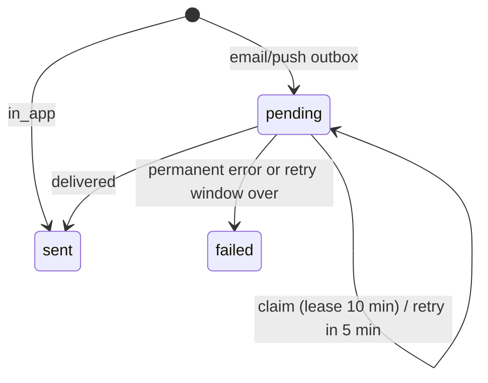

# Notifications and e-mail

> Scope: notifications (in-app bell, e-mail, push), per-owner preferences, delivery and retries, the e-mail budget, and the catalogue of every e-mail the product can send.
> State as of 2026-10-17.

## Summary

A notification is one record per event, recipient and channel. The channels are the in-app bell, e-mail and push. Appointment flows write their notifications together with the event itself, so a failed event leaves nothing behind. In-app notifications are delivered immediately. E-mail and push notifications are queued as "pending", sent right after the event is saved, and picked up again by a delivery job that runs every minute if anything was lost. Only owners have preferences (5 events × 3 channels, all on by default); e-mails to clients are never optional. E-mail is rationed by the mail budget (100 a day, 3000 a month, shared with sign-in codes); push needs the server's push keys to be configured. Sixteen e-mails exist (appointment, waiting list, sign-in, account); only the ten appointment e-mails go through the queued delivery path.

## Glossary

- **Notification**: one queued or in-app item for one recipient on one channel. It records its kind, who it is for (an owner account or a client's e-mail address), the related appointment, a unique event key, a small payload of ids and counts, its delivery status, attempts, error, sent time and read time.
- **Kind**: the event name. Owner kinds: appointment created, appointment requested, appointment cancelled, appointment expired, appointment auto-confirmed. Client kinds: appointment confirmed, request received, declined, cancelled, reminder, rescheduled, verify, plus in-app only waiting-list joined and waiting-list offered.
- **Recipient kind**: *owner* (the form owner, identified by account) or *client* (the person who booked, identified by e-mail address; the account is attached only to the in-app mirror).
- **Event key**: the part of a notification's identity that makes it unique per event. Usually the booking's group key; see NT-03.
- **Outbox**: the pending e-mail and push notifications plus the delivery job that retries them.
- **Mirror**: the in-app copy of a client e-mail, written for a client who has a verified Kurz account (NT-08).
- **Bell**: the in-app list of notifications.
- **Lease**: when a delivery job claims a notification, it is hidden from other jobs for 10 minutes.
- **Mail budget**: the daily and monthly counters that cap outgoing e-mail.
- **Share**: the fraction of the daily and monthly budget a sender may use (0.8 appointment mail, 0.5 reminders and data export, 1.0 sign-in codes).
- **Push keys**: the key pair and contact that authenticate the server to browser push services.

## Business rules

### The notification record

- **NT-01** There is one notification per event, recipient and channel. A second notification with the same kind, event key, channel and recipient is refused. Because the refusal is not handled in the appointment flows, it would roll back the whole event; so every event gets a unique event key.
- **NT-02** Channel (in-app, e-mail, push), recipient kind (owner, client) and status (pending, sent, failed) are closed sets. An owner notification needs an account; a client notification needs an e-mail address. Adding a channel or status requires a data migration.
- **NT-03** Event keys: the booking's group key for created, requested, confirmed, declined, verify, expired and auto-confirmed notices; group key plus the reminder lead time in minutes for scheduled reminders; group key plus a random suffix for the owner's "remind now" (so repeats never collide); group key plus the appointment id for a reschedule; the plain group key for a full cancellation and group key plus scope ("one" or "remaining") and the first appointment id for a partial one; and waiting-list entry plus "joined" or "offered" for waiting-list notices.
- **NT-04** Notifications are written inside the same transaction as the event that causes them (booking, approve or decline, cancellation, reschedule, e-mail verification, timeout resolution, scheduled reminders). A failed booking leaves no notification; deleting the response or the appointment deletes its notifications. Delivery is started only after the event is committed, never inside it. Exceptions: the owner's "remind now" writes its notification in its own step, and waiting-list in-app notices are written in a nested step whose errors are swallowed.
- **NT-05** Notifications are written by: booking creation, e-mail verification (which only then announces the booking), owner approve or decline, client or owner cancellation, reschedule, "remind now", the reminder sweep, the timeout sweep, and the waiting list. AI apps (via MCP) use the same flows, so they produce the same notifications. See [appointments-lifecycle](appointments-lifecycle.md) and [booking-engine](booking-engine.md).
- **NT-06** An owner event creates up to three notifications: in-app and push, and e-mail. Each channel is created only if the owner's preference for that event and channel is not switched off; a silenced event leaves no notification at all (no audit trail).
- **NT-07** Client e-mails ignore preferences. The preference check applies only to owner notifications.
- **NT-08** Client mirror: every client e-mail except the verification mail also creates an in-app notification (already delivered) when the address belongs to an active Kurz account with a verified address, matched case-insensitively. The mirror keeps only the booking group and session count. It is written when the e-mail is queued, so it exists even if the e-mail later fails or is refused by the budget. Unverified, deactivated and unknown addresses get no mirror; the verification mail is never mirrored.
- **NT-09** Waiting-list notices: "joined" and "offered" are written as in-app notices for a verified account with that e-mail, before the budget is checked, and never break the join or the offer. The notice holds the waiting-list entry, form title, service name and start time; the link to the waiting-list entry is worked out when the bell is read, only while the entry is still active and its e-mail matches, so no secret token is stored.
- **NT-10** Notification payloads carry ids and counts only: for owner notices the form, response, booking group, session count, the approval deadline (manual approval), cancelled appointments and the origin of the change. No names, e-mails or notes. E-mails rebuild their content from the appointments at send time.

### Dispatch pipeline (e-mail and push)

- **NT-11** After the event is committed, it starts delivery of its e-mail or push notification. Reminders created by the 5-minute reminder sweep are not started by the writer; they wait for the delivery job that runs every minute.
- **NT-12** A delivery job runs every minute. It takes up to 200 pending notifications that are due, oldest first, and starts one delivery per notification according to its channel. There is no per-recipient ordering: two deliveries run at once and can finish in any order. In-app notifications are ignored.
- **NT-13** Idempotency by claim: a delivery first claims its notification atomically and hides it from other jobs for 10 minutes (the lease). Only the job that wins the claim proceeds; duplicate jobs (the event plus the sweep, or the sweep started twice while delivery lags) return silently. A crash after the claim leaves the notification to be picked up again when the lease ends, so delivery is at-least-once: a crash after sending but before recording the result would send twice.
- **NT-14** The e-mail is chosen from the kind and the recipient kind. Any other combination, or a notification whose appointment no longer exists, fails at once with the reason "unsupported".
- **NT-15** Re-checks at send time: a reminder fails with "not_confirmed" unless some appointment of the booking is still confirmed; a verification mail fails with "not_unverified" unless one is still unverified.
- **NT-16** Budget before sending: each e-mail reserves budget first, using a share of 0.8, or 0.5 for reminders. A refused reservation is a retry, not a failure (NT-17).
- **NT-17** E-mail retry policy: transient errors (name resolution failure, connection or read timeout, connection refused or reset, mail server busy) and budget refusals add one attempt, record the reason (the budget reason or the error type) and schedule the next try in 5 minutes. Once the notification is older than 24 hours, the next retry marks it failed with that last reason. Any other error is reported to the error tracker and fails the notification at once. Success marks it sent, records the time and clears the retry time.
- **NT-18** Push retry policy: transient errors (network failures and push-service errors or "too many requests") retry every 5 minutes and give up after 6 hours. A notification's devices are tried in order. Outcome: any device delivered means sent; no subscriptions left means sent with the note "no_subscriptions"; all failures transient means retry; otherwise failed with the first failure. A notification fails with "push_disabled" if push keys disappeared after it was queued.
- **NT-19** Dead jobs: the delivery jobs never raise errors, so nothing accumulates in the background queue's failed list. The dead state is a notification marked failed with its last error; it is the only retry state. Failed notifications are never retried and never re-sent.
- **NT-20** Observability: the appointment health report shows pending e-mail count, age of the oldest pending e-mail, pending push count, failures in the last day, delivery queue lag and budget use. It raises alerts for delivery lag (over 5 minutes), e-mail budget (80 % or more of the daily limit) and notification failures (any failure in the last day). A check runs every 5 minutes and sends each alert to the error tracker at most once an hour. Admins can read the report through the admin API.

### Preferences

- **NT-21** The preference matrix is 5 events × 3 channels = 15 cells. Supported cells: appointment created, requested and cancelled on in-app, e-mail and push; appointment expired and auto-confirmed on in-app and push only (no e-mail exists for them). Unsupported cells are shown as not supported and off, and cannot be changed.
- **NT-22** Default is on. A cell counts as on unless a stored choice says exactly off; nothing is stored until the owner changes a cell.
- **NT-23** Preferences are saved as a list of changes of at most 15 items, each strictly on or off, for a known and supported event and channel. All changes apply together or none do (an invalid list is rejected). The response is the full matrix.
- **NT-24** Who can opt out of what: only the form owner, and only of the owner's own notices about bookings. Not opt-out-able: every e-mail to a client (confirmed, request received, declined, cancelled, reminder, rescheduled, verify, waiting-list mails), sign-in codes, data export and account-deletion mail, and the client's in-app mirror. The settings footnote tells the owner so ("Your clients always receive their own emails").
- **NT-25** Preferences are per user and per channel, not per device. The push preference silences push for all of the owner's devices; removing a device is a separate action (NT-33). Preferences are deleted with the account.
- **NT-26** The preference screen is part of the account page. Rows come from the server; the push column is shown only when the server reports push as enabled. The app has its own labels for the 5 kinds and falls back to "Other" for an unknown kind.

### Push notifications

- **NT-27** Push is on only when the server's three push settings (public key, private key and contact) are all present. Without them no push notification is created, the app reports push as disabled, and nothing fails. The private key never leaves the server; only the public key is shared with browsers.
- **NT-28** A push notification is created only when push is enabled, the owner has at least one subscribed device, and the push preference is on. Push is independent of the bell: turning the bell off keeps push, and the reverse. Only the form, response and booking group are kept in the payload.
- **NT-29** Push is owner-only and only for the kinds in the matrix. Clients never get push.
- **NT-30** What the push message carries: the kind and the notification id only, encrypted for the subscription, valid for 1 hour, normal urgency. No names, e-mails or booking data. The text shown is chosen on the device from a fixed table (English and Portuguese) keyed by kind, in the browser's language, not the account's language.
- **NT-31** Subscription endpoint allow-list (protects the server from being pointed at internal addresses): secure connection, port 443, no user info, no fragment, and a host from the known push services: fcm.googleapis.com, updates.push.services.mozilla.com, *.push.services.mozilla.com, web.push.apple.com, *.notify.windows.com. The list is checked on save and again before every send; an endpoint that no longer qualifies is deleted without sending anything.
- **NT-32** Key shapes: the encryption key is 80–100 base64url characters; the auth secret is 20–30 base64url characters; the endpoint is up to 2048 characters. Invalid values are rejected with an error.
- **NT-33** Lifecycle: subscribing a device registers it by endpoint (so a browser's subscription moves to whoever signs in there now); at most 5 devices per user, checked only when adding, so renewing an existing endpoint is allowed at the limit; the device label is the first 80 characters of the browser's User-Agent. The owner sees only the device id, label and creation date (never the endpoint or keys). An owner can remove their own device (anyone else's answers "not found"). Endpoint and keys are kept out of logs.
- **NT-34** Expired endpoints: when the push service reports a subscription as gone (expired or invalid), that subscription is deleted and counts as neither success nor failure; other devices still get the message. The device's last-used time is updated on each success. Other errors: "too many requests" and push-service errors are transient; "unauthorized" and any other push error fail the notification.
- **NT-35** Browser side: the background push component is registered only when the owner turns the device on; permission is requested at that moment and the server's public key is used to subscribe. The subscription id is kept in the browser's local storage and used to remove the server record when the device is turned off (if storage is lost, the record stays until the push service reports it gone). Device states: server off, iOS install needed (iOS outside a home-screen app), unsupported, denied, on (permission granted and subscribed), off.
- **NT-36** The device shows no push notification when a window of the app is visible and focused. Otherwise it shows the title "Kurz", and same-kind notices replace each other. A click focuses or opens the agenda, whatever the kind. Unknown kinds show "New notice" / "Novo aviso".

### Mail budget

- **NT-37** Limits: 100 e-mails a day, 3000 a month, and 40 a day to addresses that never signed in (operators can override these). They mirror the mail provider's free plan (100/day, 3000/month). Days and months are counted in UTC.
- **NT-38** Reserving budget increments the day and month counters (and, for an address that never signed in, the new-address counter) atomically and refuses when any exceeds its limit: the day and month limits are scaled by the sender's share (rounded down), the new-address limit is not scaled. A refused reservation gives back every increment it took. Refusal reasons: daily limit, monthly limit, new-address limit.
- **NT-39** Shares by sender: sign-in codes 1.0 (plus the new-address cap when the address is not verified); appointment e-mails 0.8; reminders 0.5; waiting-list mails 0.8; data export 0.5. The lower shares keep the last 20–50 % of the day for sign-in codes. The account-deletion notice is not budgeted.
- **NT-40** What happens when the budget is exceeded depends on the sender:

  | Sender | Behaviour |
  |---|---|
  | Sign-in code | Refused at once and the user is told the budget is exhausted (the code expires in 15 minutes, so waiting is useless) |
  | Appointment e-mail (queued path) | Stays pending, retried every 5 minutes, failed after 24 hours; the booking and the in-app notice are unaffected |
  | Waiting-list mail | Skipped silently, no retry; the in-app notice is already written |
  | Data export | Retried every hour, with no limit on attempts |
  | Account-deletion notice | Not counted, not refused |

- **NT-41** The first refusal per reason per day sends a warning to the error tracker, "Email budget reached: <reason>", with the usage; later refusals the same day are silent.
- **NT-42** Disposable and mail-less (no MX record) addresses never reach the budget: sign-in codes to unverified addresses are checked for disposable domains and for a working mail server (the lookup is cached for 1 day). Appointment e-mails to clients have no such check.

### The bell and read state

- **NT-43** The bell lists the in-app notifications of the signed-in account, as owner or as client; an account sees both sides (it can be the owner of a form and the client of another, or both of the same booking).
- **NT-44** Read model: a notification is unread until it is marked read. Marking one read sets the time once (a repeat keeps the first time) and answers "not found" for another user's notification; "mark all read" marks every unread notification of the caller, not only the visible page. Users never delete notifications.
- **NT-45** The bell list returns 30 notifications at a time, newest first, with the total unread count (all unread, not only the page) and a cursor for older ones when more exist. Each item shows its kind, recipient kind, payload, read time, creation time and (for waiting-list notices) the link to the entry.
- **NT-46** AI apps through MCP see the same data: listing notifications (read access to appointments; up to 20 per page, default 10, optional unread-only) and marking a notification read (write access, 120 an hour). See [mcp-and-oauth](mcp-and-oauth.md).
- **NT-47** Dashboard behaviour: the bell refreshes every 60 seconds and when the window regains focus, with no retry; it shows "9+" above 9. The notifications page lists the first page, marks an item read when opened, then navigates: client notices to the waiting-list entry or the agenda, owner notices to the form's responses. The page has no "load more" (the cursor is unused). Labels come from the kind; unknown kinds show "Update".

### Retention and purge

- **NT-48** A purge runs daily at 04:45 and deletes every notification older than 90 days, whatever its channel, status or read state, in batches of 1000.
- **NT-49** Deleting a user deletes their owner notifications, mirrors and preferences. Client e-mail notifications are not tied to an account; they hold the client's e-mail address until the appointment is deleted or 90 days pass.

### E-mail composition and localization

- **NT-50** Every e-mail is sent from Kurz. The mail is sent through the transactional provider (Resend, sender "Kurz <login@kurz.fyi>" by default) only when the operator has explicitly enabled it and supplied its key; otherwise a Gmail account is used as the fallback sender (default kurz.fyi@gmail.com, because Gmail rewrites other senders). Connections time out after 10 seconds to open and 15 seconds to read. End-to-end test environments send to a local mail catcher instead.
- **NT-51** Languages: English (default) and Portuguese (pt-PT). Language order: the language of this interaction, then the recipient's saved language, then the form owner's language, then English. Interaction language: for client mail, the language the client used when booking; for waiting-list mail, the language of the waiting-list entry; for a sign-in code, the language sent with the request; for account mail there is none (the saved language is used). Owner mail uses the owner's language only. Unsupported language tags are skipped. Rendering one e-mail never changes the language of anything else.
- **NT-52** Time zone: client mail uses the client's time zone, else the booking question's time zone, else UTC; waiting-list mail uses the entry's zone with the same fallback; owner mail uses the owner's time zone. Dates are written in the e-mail's language (24-hour clock, localized day and month names); money uses symbols for EUR, USD, GBP and BRL, and other currencies are written as amount plus code.
- **NT-53** Layout and structure: one HTML layout and one text layout; a status pill (tones teal, amber, blue and red, with dark-mode styling), the card, and a footer. Building blocks: intro (title and lead), details (labelled rows), action (one button with an optional note and extra links) and note. Every e-mail has an HTML and a text version; in the text version each link sits on its own line. The footer says who the mail is sent for, that replying reaches the organizer (client mails), why the address got it, and (owner mails) a link "Choose which emails you get" to the account page.
- **NT-54** Reply-To: client e-mails (except verification) and waiting-list e-mails set Reply-To to the form owner's e-mail address, so the owner's address is disclosed to the client. From is always Kurz.
- **NT-55** Untrusted text: names, titles, service names, reasons and messages are flattened (control characters become spaces) before they reach a subject, and are escaped in the body.
- **NT-56** Links point to the public site (https://kurz.fyi by default). Manage and decide links carry a secret token (shown once; only a digest is stored): the manage and decide links expire 7 days after the booking's last session; the verify link expires 1 hour after the 15-minute hold. See [appointments-lifecycle](appointments-lifecycle.md).
- **NT-57** Delivery paths: queued appointment e-mails are sent directly by the delivery job, with their own retry policy (NT-17). Sign-in codes, waiting-list mails and the deletion notice go through the background mail queue, which retries only transient errors, up to 4 attempts with growing waits, and reports to the error tracker on the 4th failure; any other error is reported at once. The data export is sent directly by its own job, which has no retry on mail errors (only on a refused budget).
- **NT-58** Every e-mail exists in both languages, and a new e-mail must be added to the catalogue (below) with both translations.

## Catalogue of every e-mail

Every e-mail the product can send (16). "Queued" means it goes through the notification outbox (NT-11 to NT-18); "direct" means it is sent without a notification record. In all client appointment e-mails, the language follows NT-51 (client's booking language, then the client's account language, then the owner's, then English).

| E-mail | When it is sent | To | Language | Content and links | Page |
|---|---|---|---|---|---|
| Booking confirmed (queued) | A booking is made in automatic mode with a contact e-mail; the e-mail is verified; the owner approves; or a pending request times out with "accept" | the client | booking language, then client's account language, then owner's, then English | details with total; a button to manage the booking | [appointments-lifecycle](appointments-lifecycle.md) |
| New booking (queued, owner) | Automatic booking, or after verification; skipped if the owner switched the e-mail preference off | the form owner | owner's language | client name and e-mail in the details; a button to the form's responses; footer link to e-mail preferences | [appointments-lifecycle](appointments-lifecycle.md) |
| Request received (queued) | A booking that needs manual approval | the client | as above | details; a button to manage the booking | [appointments-lifecycle](appointments-lifecycle.md) |
| New request (queued, owner) | Manual approval needed; preference-gated | the form owner | owner's language | the deadline and whether it auto-accepts; a button to decide; a link to the form's responses | [appointments-lifecycle](appointments-lifecycle.md) |
| Declined (queued) | The owner declines, or the request times out | the client | as above | the owner's message (up to 500 characters); a button to the form only while it is published and accepting | [appointments-lifecycle](appointments-lifecycle.md) |
| Verify your booking (queued) | A booking in e-mail-verification mode (place held 15 minutes); not mirrored; no Reply-To | the client | as above | a button to verify; the hold time in minutes | [appointments-lifecycle](appointments-lifecycle.md), [forms](forms.md) |
| Reminder (queued) | The 5-minute reminder sweep when the first session is within the reminder lead time (default 1440 minutes), or the owner's "remind now" (1-hour cooldown) | the client | as above | a button to manage the booking | [appointments-lifecycle](appointments-lifecycle.md) |
| Rescheduled (queued) | The owner moves one session | the client | as above | new time, previous time, the owner's message; a button to manage the booking | [appointments-lifecycle](appointments-lifecycle.md) |
| Cancelled (queued) | Cancelled by the client (from the manage link) or by the owner | the client | as above | only the cancelled sessions; wording differs by who cancelled; a button to the form while it accepts bookings | [appointments-lifecycle](appointments-lifecycle.md) |
| Booking cancelled (queued, owner) | Only when the client cancels; preference-gated | the form owner | owner's language | client name, reason (up to 500 characters), cancelled sessions; a button to the form's responses | [appointments-lifecycle](appointments-lifecycle.md) |
| Waiting list joined (direct) | After joining a full time; skipped if the budget refuses | the waiting-list entry's e-mail | the entry's language, then account language, then owner's | a link to leave the waiting list | [appointments-lifecycle](appointments-lifecycle.md) |
| Waiting list offer (direct) | A place frees up and is held for the entry | the waiting-list entry's e-mail | as above | a button to take the place; the time to confirm by | [appointments-lifecycle](appointments-lifecycle.md) |
| Sign-in code (direct) | A sign-in, sign-up, sign-up for an existing address, or password-reset request that passed the budget check | the account's address | request language, then saved language, then English | a 7-digit code (also in the subject), valid 15 minutes, single use; no link; 1-minute resend cooldown | [accounts-and-auth](accounts-and-auth.md) |
| Data export (direct) | The user requests a data export (one a week) | the account's address | saved language, then English | the export file attached (up to 15 MB) | [accounts-and-auth](accounts-and-auth.md) |
| Data export too large (direct) | The same job, when the file exceeds 15 MB | the account's address | saved language, then English | none | [accounts-and-auth](accounts-and-auth.md) |
| Account deletion scheduled (direct) | The user requests account deletion | the account's address | saved language, then English | the deletion date (30-day grace); a button to sign in | [accounts-and-auth](accounts-and-auth.md) |

English subjects: confirmed "Confirmed: <service> · <time>"; verify "Confirm your booking: ..."; request received "Request received: ..."; new request "Booking to approve: <service> · <name> · <time>"; declined "Not confirmed: ..."; reminder "Reminder: ..."; rescheduled "Time changed: ..."; cancelled "Cancelled: ..."; owner cancelled "Booking cancelled: <service> · <name> · <time>"; new booking "New booking: <service> · <name> · <time>"; waiting list joined "You are on the waiting list: ..."; waiting list offer "A place opened: ..."; sign-in code "<code> is your Kurz sign-in code" (or "confirmation code", "password reset code"); data export "Your Kurz data"; too large "Your Kurz data is too large to send"; deletion "Your Kurz account is scheduled for deletion".

## Flows

**Booking with e-mail and bell (automatic mode).**
1. In the same step that saves the booking, the appointments are created and the notifications are announced.
2. The owner's in-app notification is written (if the preference is on) and, when push is enabled and the owner has devices, a pending push notification.
3. The owner's e-mail is queued (if the preference is on) and, when the visitor left an address, the client's e-mail too, each due immediately; a verified client account also gets the in-app mirror.
4. After the booking is saved, a delivery is started for each e-mail and push notification.
5. Each delivery claims its notification (lease), checks the e-mail type and re-checks the booking state (NT-14, NT-15), reserves the budget, builds and sends the e-mail, and marks the notification sent, to retry, or failed.
6. If any step is lost, the minute-by-minute delivery job picks the notification up again once it is due.

**Verification mode.** The booking writes only the verification e-mail (no owner notice, no mirror). When the client confirms, the booking becomes confirmed and is announced as in the flow above. If the hold runs out, the booking expires silently (no notification).

**Manual approval.** The booking writes "appointment requested" (owner: bell, push, "new request" e-mail) and "request received" (client). Approve or decline writes "confirmed" or "declined" to the client only. On timeout, the owner gets "auto-confirmed" or "expired" (bell and push only) and the client gets the confirmed or declined e-mail.

**Cancellation.** By the client: the owner gets bell, push and a "booking cancelled" e-mail (preference-gated), and the client gets the "cancelled" e-mail. By the owner (agenda or MCP): only the client is told.

**Reminder.** Every 5 minutes the reminder sweep looks at confirmed appointments with a client e-mail whose first session is within the reminder window, marks those lead times as sent, and writes one reminder per booking in the same step. The reminder waits for the next minute-by-minute delivery run.

**Push subscribe.** The account page asks the server whether push is enabled; the user turns the device on; the push component is registered, permission is asked, and the browser subscribes with the server's public key; the subscription is saved on the server and its id is remembered in the browser.

**Sign-in code.** The request is checked (deliverable address, cooldown, budget); the code e-mail is queued on the background mail queue and retried on transient errors.

## States and transitions

Status of an e-mail or push notification (in-app notifications are created as sent):

| From | Event | To | Guard | Effects |
|---|---|---|---|---|
| (new) | E-mail or push notification created | pending | preference on (owner); push enabled and device subscribed (push) | due immediately; delivery started after the event commits |
| (new) | In-app notification created | sent | preference on (owner) / verified account (client) | sent time recorded |
| pending | A delivery job claims it | pending | due now | hidden from other jobs for 10 minutes |
| pending | Delivered | sent | send succeeded (push: at least one device, or none left) | sent time and attempt count recorded; no further retry |
| pending | Transient error or budget refusal | pending | younger than 24 h (e-mail) / 6 h (push) | attempt counted, reason recorded, next try in 5 minutes |
| pending | Transient error or budget refusal | failed | older than 24 h / 6 h | last reason kept |
| pending | Unsupported, not confirmed, not unverified, push disabled, other error, or non-transient push error | failed | n/a | reason recorded; unexpected errors reported to the error tracker |
| any | Purge | deleted | older than 90 days | none |

The read flag is separate: unread to read, never back.

## Limits and configuration

| Name | Value | Notes |
|---|---|---|
| Retention | 90 days | daily purge at 04:45 |
| Delivery job | every minute, batch of 200 | two deliveries at once; no ordering |
| Lease | 10 minutes | |
| Retry interval | 5 minutes | |
| Give up | 24 h e-mail, 6 h push | counted from creation |
| Background mail queue | 4 attempts, growing waits | transient errors only |
| Budget day / month / new-address | 100 / 3000 / 40 | operators can override |
| Budget shares | 1.0 codes, 0.8 appointments and waiting list, 0.5 reminders and export | see NT-39 |
| Budget alert threshold (health) | 80 % of the day | |
| Data export retry | every 1 hour, unlimited | budget refusals only |
| Push validity / urgency | 1 hour / normal | |
| Push devices per user | 5 | |
| Bell page size | 30 | MCP: 20 max |
| Bell refresh | 60 s | |
| Preference changes per save | at most 15 | |
| Mail connection timeouts | open 10 s, read 15 s | |
| Operator settings | push keys, mail provider and sender, public site address, budget limits | see [platform-and-operations](platform-and-operations.md) |

## Authorization and privacy

- Notifications, preferences, push configuration and push devices require a signed-in user, and each action is limited to the caller. Another user's notification or device answers "not found".
- Any account can have bell notices as owner and as client. There is no admin read access to the bell; admins see only the health counters (NT-20).
- Personal data in notifications: the client's e-mail address (client notifications, up to 90 days), the account, and ids in the payload. Names and notes are never stored in a notification; they are read from the appointment when the e-mail is built. Waiting-list in-app notices do store form title, service name and time.
- Push: the browser receives only the kind and the notification id; the push service sees the endpoint and the encrypted payload. The device label (80 characters of the User-Agent) is stored per device and shown to the owner.
- Client e-mails reveal the owner's e-mail through Reply-To (NT-54).
- Sign-in responses never reveal whether an address has an account (budget refusals are the exception, see [accounts-and-auth](accounts-and-auth.md)).

## API and UI surface

- **Bell (dashboard).** Signed-in users see their notifications (30 at a time, newest first), the unread count, and can mark one or all as read. The bell appears in the dashboard header and sidebar, with a full notifications page.
- **Preferences (dashboard).** Owners view and change the 5 × 3 matrix on the account page; the push column appears only when push is enabled.
- **Push devices (dashboard).** Owners turn push on or off per browser and see the list of their devices; at most 5.
- **MCP.** AI apps can list notifications and mark them read (NT-46). See [mcp-and-oauth](mcp-and-oauth.md).
- **Admin.** Admins can read the appointment health report (NT-20).
- **Delivery jobs.** A delivery job every minute, a reminder sweep every 5 minutes, a health check every 5 minutes and a daily purge at 04:45. Full schedule: [platform-and-operations](platform-and-operations.md). See also [frontend-architecture](frontend-architecture.md).

## Decisions

### D-NT-01 Outbox rows in the event transaction
**Decision.** E-mail and push are queued in the same step as the event, delivered right after the event is saved, with a one-minute sweep as safety net. **Why.** A failed booking must leave no notice and a committed booking must not lose its e-mail; the booking and the in-app notification never depend on the e-mail. **Consequence.** Delivery is at-least-once with a claim lease; the notification, not the job, holds the retry state (NT-13, NT-19).

### D-NT-02 Lower budget share for appointment mail
**Decision.** Appointment e-mails stop at 80 % of the day, reminders at 50 %. **Why.** Sign-in codes keep the last fifth of the day. **Consequence.** A busy day can defer booking mails to the next day (NT-17).

### D-NT-03 Appointment mail is sent directly by the outbox
**Decision.** The outbox sends appointment e-mail itself; the background mail queue stays for sign-in codes. **Why.** The background mail queue was kept for sign-in codes only. **Consequence.** The background queue's retries do not apply to appointment mail; the outbox has its own policy. (Data export and waiting-list mails later joined that queue.)

### D-NT-04 Push carries no personal data
**Decision.** The payload is the kind plus the notification id. **Why.** Only the event kind and the notification id travel, no personal data. **Consequence.** Texts live on the device; a new kind needs a line there (NT-30).

### D-NT-05 Closed allow-list of push hosts
**Decision.** Endpoints must be on a known push service host. **Why.** So a subscription can never point the server at an internal address. **Consequence.** A new browser vendor needs an entry on the allow-list.

### D-NT-06 Silenced owner events create no notification
**Decision.** Preferences are checked before a notification is created. **Why.** A silenced event neither fills the bell nor queues an e-mail, while the booking and the client's e-mails are unaffected. **Consequence.** Changing a preference does not affect existing notifications; no history of silenced events.

### D-NT-07 Mirror client mail into the bell
**Decision.** Clients with a verified account see their e-mails in the bell, without owner ids. **Why.** Clients with a verified account matching the contact e-mail get the client e-mails mirrored as in-app notifications, without the owner's ids. **Consequence.** Matching is by e-mail address, case-insensitive; the mirror ignores mail failures.

### D-NT-08 One layout, language chosen in one place
**Decision.** All e-mails share a layout, building blocks and a single language resolver. **Why.** Owners without a saved language received English mail about their clients, and the e-mails lacked structure. **Consequence.** Wording lives in the translation files, not in the layouts (NT-51, NT-53).

### D-NT-09 Provider switch is explicit
**Decision.** The transactional provider is used only when explicitly enabled and a key is supplied. **Why.** The provider refuses to send for a domain whose DNS records are not verified yet, so having the key around must not be enough. **Consequence.** The sender must match the provider (NT-50).

## Change impact

- **New notification kind**: add it to the owner preference matrix (NT-21) if owners can silence it; give it an e-mail (NT-14) with HTML and text versions, English and Portuguese wording, an entry in the catalogue (NT-58), labels in the bell and preference screens (both languages) and a line in the push texts (NT-30). A kind unknown to the dashboard shows "Update" or "Other"; unknown to the push texts it shows "New notice".
- **New channel or status**: a data migration is needed (NT-02); also update the delivery job, the health report (NT-20) and the preference screen. The previous release must survive the new schema: add the value first, ship the writer later.
- **Change an event key format** (NT-03): an old and a new format can coexist, and a collision rolls back the whole event (NT-01). Reminders depend on the lead-time key; the "remind now" cooldown reads the kind and creation time.
- **Change an e-mail or its link**: check the token flows in [appointments-lifecycle](appointments-lifecycle.md) (manage, decide, verify and waiting-list links), the end-to-end tests that read the mail catcher, and the Portuguese wording.
- **Change budget limits or shares** (NT-37 to NT-40): review sign-in codes in [accounts-and-auth](accounts-and-auth.md), data export, the waiting list, the 80 % health alert (NT-20) and the operator defaults.
- **Change the push hosts or push keys** (NT-27, NT-31): review the allow-list and the operator settings. Rotating the push key invalidates existing subscriptions on the browser side, since they were created with the old public key.
- **Change retention** (NT-48): review the privacy text of account deletion and export if it mentions notices ([accounts-and-auth](accounts-and-auth.md)).
- **Change who is notified on an appointment action** (approve, cancel, reschedule): the dashboard and the MCP manage tools ([mcp-and-oauth](mcp-and-oauth.md)) share the same flow.
- **Add a delivery queue or worker**: see [platform-and-operations](platform-and-operations.md).
- **Change the booking transaction** ([booking-engine](booking-engine.md), [forms](forms.md)): notifications rely on being written inside it (NT-04).

## Drift and open questions

- **Docs vs product, budget (medium).** The appointments guide says that when the quota is exhausted "email is skipped". In reality appointment mail is deferred for up to 24 hours and then marked failed (NT-17); waiting-list mail is the only one skipped (NT-40).
- **Docs vs product, i18n (low).** The i18n guide says e-mails are "not covered by this guide until they are localized", but they are already localized.
- **Budget consumed twice on a failed send (low-medium).** A budget slot is reserved before sending; a transient mail error retries and reserves again, with no refund. A flapping provider burns the budget faster than mail leaves.
- **Deletion notice unbudgeted (low).** The account-deletion e-mail bypasses the budget (NT-39).
- **At-least-once (low).** A crash between a successful send and recording it causes a second e-mail or push after the lease.
- **Duplicate event key is fatal to the event (low).** A second notification with the same key is not handled and would roll back the event (NT-01).
- **No "load more" in the bell page (low).** The API pages through older notifications but the page shows 30 items only; older ones are reachable through the API and MCP.
- **Push language and target (low).** The text language follows the browser, not the account language, and a click always opens the agenda, also for an expired request or a cancellation (NT-36).
- **Footer link hard-coded (low).** The e-mail footer links to https://kurz.fyi instead of the configured public site; the sender domain is also fixed by configuration.
- **Retry timing (low).** The intent is that background mail retries stay within about a minute; the actual growing waits of roughly 3, 18 and 83 seconds add up to nearly two minutes.
- **Data export has no mail retry (low).** A transient mail error fails the export once; only a refused budget is retried.
- **Owner address exposed (low, by design).** Reply-To discloses the owner's e-mail to every client (NT-54).
- **Portuguese gaps (low).** Two error messages (a form error and an account-deactivated message) lack Portuguese text and fall back to English.
- **Unverified.** The persistence and eviction settings of the store that keeps the budget counters were not checked, so counter accuracy across restarts is unconfirmed.
