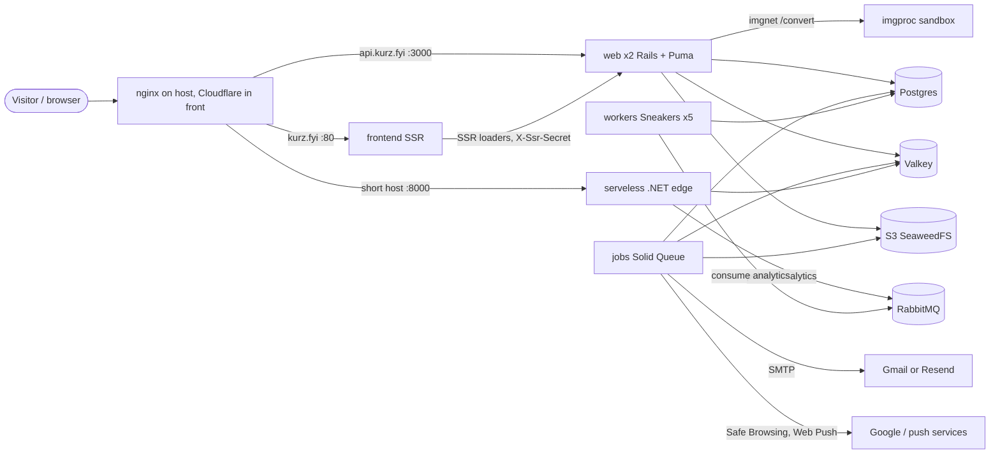

# Platform and operations

> Scope: runtime topology, deploy, CI and the security harness, job queues and the recurring schedule, rate limits, environment variables, observability and the testing strategy. State as of commit `bc7f65c` (2026-10-17).
> Main code: `.ci/`, `deploy.sh`, `.github/workflows/`, `docker-compose.yml`, `Dockerfile.backend`, `backend/config/` (queue.yml, recurring.yml, environments, initializers), `backend/bin/`, `backend/imgproc/`, `edge-function/`, `e2e/`, `backend/spec/`.

## Summary

Kurz runs as a Docker Swarm on one self-hosted host (`pizito`) in three stacks: `shortener` (Rails web, Solid Queue jobs, Sneakers workers, imgproc, the .NET edge function), `shortenerfe` (React Router SSR frontend) and `shortenerdb` (RabbitMQ, Postgres, Valkey, deployed by hand). A merge to `main` builds three images on a self-hosted runner and runs `deploy.sh`, which migrates the database once and then rolls every service `start-first` behind a healthcheck, rolling back on failure. Pull requests are gated by `ci.yml` (backend, frontend, e2e, edge function) and `security-static.yml`; a heavier security harness runs the production image against an isolated network nightly. All configuration is environment variables listed by name in the stack files; the app reads no Rails credentials key by name.

## Glossary

- **Stack** (`shortener`, `shortenerfe`, `shortenerdb`): a Swarm deployment from one compose file. `.ci/stack.yml`, `.ci/fe-stack.yml`, `.ci/db-stack.yml`.
- **proxy_net**: external overlay network shared by every stack and by the host reverse proxy. Created outside the repo.
- **imgnet**: internal overlay network joining only `web` and `imgproc`. `.ci/stack.yml:188`.
- **imgproc**: sandboxed Puma app that decodes images to WebP. `backend/imgproc/app.rb`. Reached through `Imgproc.convert`.
- **Edge function** (service `serveless`): .NET 10 redirect service. Reads `shortlink:<code>` from Valkey and publishes clicks to RabbitMQ. See [shortlinks](shortlinks.md).
- **Solid Queue**: Active Job backend in Postgres (`solid_queue_*` tables in the main database). Process `bin/jobs`.
- **Sneakers**: RabbitMQ consumer framework. Process `rake workers:run`, consumer `AnalyticsWorker`.
- **Harness**: the security suite in `.ci/security/`, run by `run.sh`.
- **Start-first**: Swarm `order: start-first`, the new task must be healthy before the old one stops.
- **Rolled back**: Swarm update state `rollback_*` or `paused`, detected by `deploy.sh`.

## Data

Infrastructure state this page owns. Application tables are in [data-model](data-model.md).

| Store | What it holds | Persistence | Source |
|---|---|---|---|
| Postgres 17 (`db`, container `postgres`) | all application tables plus `solid_queue_*` (jobs, executions, processes, recurring tasks, semaphores) | bind mount `/mnt/ssd/@docker/shortener/postgres`, manager node only | `.ci/db-stack.yml:27-47`; `backend/db/schema.rb:507-617` |
| Valkey 8.1.4 (`cache`, container `valkey`) | `shortlink:<code>` redirect entries written without TTL by Rails and read by the edge; Rails cache (namespace `kurz`) with TTLs: rate-limit counters, mail budget, session revocations, MX lookups, visitor dedup keys | AOF `appendonly yes`, `appendfsync everysec`, `maxmemory 768mb`, `volatile-lru` | `.ci/db-stack.yml:50-69`; `backend/app/models/shortlink.rb:97`; `backend/config/application.rb:46` |
| RabbitMQ 3 (`rabbitmq`) | durable queue `analytics` (click events) | bind mount `/mnt/ssd/@docker/shortener/rabbit` | `.ci/db-stack.yml:3-24`; `edge-function/Analytics.cs:23`; `backend/app/workers/analytics_worker.rb:5` |
| S3 (SeaweedFS gateway) | Active Storage blobs: buckets `S3_BUCKET` (avatars, covers) and `S3_FORMS_BUCKET` (form uploads) | outside the repo | `backend/config/storage.yml:13-29` |

Valkey eviction rule: with `volatile-lru` only keys that have a TTL can be evicted. Redirect keys have none, so they are never evicted; rate-limit counters and other cache entries are (inferred consequence; the policy is set in `.ci/db-stack.yml:60`).

## Business rules

### Topology

- **OP-01** Production runs as three Swarm stacks: `shortener` (`web`, `workers`, `jobs`, `imgproc`, `serveless`), `shortenerfe` (`frontend`) and `shortenerdb` (`rabbitmq`, `db`, `cache`). `deploy.sh` deploys the first two; the third is deployed by hand with `deploy-db.sh` and has no rolling update, no healthchecks and no `update_config`. — `deploy.sh:5-8`; `deploy-db.sh:4-5`; `.ci/db-stack.yml`.
- **OP-02** Services and replicas: `web` 2 replicas (2 CPU, 2048M), `workers` 1 (2 CPU, 1024M), `jobs` 1 (1 CPU, 2048M), `imgproc` 1 (1 CPU, 1024M), `frontend` 1 (0.5 CPU, 512M), `serveless` 1 (no limits). Stateful services are pinned to `node.role == manager`. — `.ci/stack.yml:83-89,108-109,128-129,152-160`; `.ci/fe-stack.yml:32`; `.ci/db-stack.yml:15,40,67`.
- **OP-03** Who talks to whom (see the diagram): the host reverse proxy (nginx, outside the repo) reaches `web`, `frontend` and `serveless` over `proxy_net`; `web` calls `imgproc` over `imgnet` only; `web`, `jobs`, `workers` use Postgres, Valkey and RabbitMQ over `proxy_net`; `serveless` uses Valkey and RabbitMQ. `imgproc` is attached to `imgnet` only and receives no secrets, no database access and no Internet route. — `.ci/stack.yml:73-74,95,115,141,173,186-190`; commit `c8bf132` (#77).
- **OP-04** `imgproc` runs the same image as `web` with `read_only: true`, `cap_drop: ALL`, user `1000:1000`, a tmpfs `/tmp`, only `SKIP_DB_PREPARE=1` as environment, and `restart_policy: any`. The harness oracle D12 checks these properties on every run. — `.ci/stack.yml:131-160`; `.ci/security/run.sh:42-52`; commit `c8bf132` (#77).
- **OP-05** `imgproc` accepts `POST /convert` and `GET /up` only; limits: body 10 MB (`413`), `Content-Length` required (`411`), side 10,000 px and 50,000,000 pixels (`422 dimensions`), output longest edge 4096 px as stripped WebP, magic-byte check for PNG, JPEG, WebP, HEIF (`422 unsupported_type`). Rails calls it with open timeout 2 s and read/write timeout 25 s; any failure becomes `Imgproc::Unavailable` and the upload endpoint answers `503 uploads_unavailable`. — `backend/imgproc/app.rb:9-34`; `backend/app/services/imgproc.rb:9-26`; harness AV06 `.ci/security/chaos.rb:5`.
- **OP-06** The Rails image is API-only (`config.api_only = true`) and loads only the railties it uses (no Action Cable, Action Mailbox, Action Text). Puma uses 3 threads per process and, in production, forks 2 workers with `preload_app!` (`WEB_CONCURRENCY` overrides, `0` means single process). Thruster fronts Puma in the image (`./bin/thrust ./bin/rails server`, port 80 to 3000). — `backend/config/application.rb:3-10,42`; `backend/config/puma.rb:27-37`; `.ci/Dockerfile:56`; commits `6ab65b4` (#310), `c963374` (#304).
- **OP-07** The click path never touches Rails: the edge function looks up `shortlink:<code>` in Valkey, redirects, and writes the click to a bounded in-memory channel (10,000 items, `DropWrite` when full) that a background service publishes to the durable `analytics` queue. A full channel or a RabbitMQ outage loses clicks but never delays a redirect. A Valkey error answers an "unavailable" page. — `edge-function/Program.cs:66-86`; `edge-function/Analytics.cs:23-41`.
- **OP-08** Click persistence: 5 Sneakers workers, 1 thread each, prefetch 10, manual ack, `timeout_job_after` 60 s, durable queue. On error `AnalyticsWorker` requeues once; a redelivered failure is rejected (dropped) and reported to Sentry. An unknown short code is rejected. — `backend/config/initializers/sneakers.rb:3-13`; `backend/app/workers/analytics_worker.rb:10,26-33`.
- **OP-09** Production only: `force_ssl` and `assume_ssl` (TLS terminates at the proxy), Host allow-list `API_HOSTS` (default `api.kurz.fyi`) with `/up` exempt, logs to stdout. — `backend/config/environments/production.rb:27,30,37,76,77`; commit `c52721c` (#12).
- **OP-10** Active Storage service in production is `seaweedfs` when `S3_BUCKET` is set, else local disk, so a deploy before the bucket exists still boots. `FormUpload` uses `seaweedfs_forms` only in production with `S3_FORMS_BUCKET` set. Files are served through Rails (proxy mode), so the gateway never needs to be public. — `backend/config/environments/production.rb:24`; `backend/app/models/form_upload.rb:8`; `backend/config/storage.yml:9-12`.
- **OP-11** The Rails cache store is Redis (`REDIS_URL`, namespace `kurz`, TLS verification off) in every environment except test. The same Valkey holds the edge's `shortlink:` keys, so a cache flush must never use `flushdb`/`flushall` in production. — `backend/config/application.rb:46-52`; `backend/lib/tasks/shortlink.rake:6-9`.
- **OP-12** Mail goes by SMTP: Gmail by default, Resend only when `MAIL_PROVIDER=resend` and `RESEND_API_KEY` are both set. The sender must match the provider. Open timeout 10 s, read timeout 15 s. The e2e environment sends to Mailpit (`E2E_SMTP_HOST`, `E2E_SMTP_PORT`, default 1025). — `backend/config/mail_settings.rb:10-49`; `backend/config/environments/e2e.rb:15-21`; spec `backend/spec/config/mail_settings_spec.rb:14,22`.

In e2e CI the stack is smaller: Rails (`RAILS_ENV=e2e`, jobs inline), imgproc on 8080, the built frontend on 3001, Postgres, Valkey and Mailpit. No RabbitMQ, edge or Solid Queue. — `e2e/playwright.config.ts:49-79`; `.github/workflows/ci.yml:81-168`.

### Release and deploy

- **OP-20** A push to `main` runs `Deploy`: build `shortener` (`.ci/Dockerfile`), `shortener-frontend` (`.ci/Dockerfile.frontend`) and `shortener-edge` (`.ci/Dockerfile.edge`), tag each `:latest` and `:<sha>`, push to the private registry `pizito:5001`, then run `./deploy.sh`. The job runs on the self-hosted runner, one deploy at a time (`cancel-in-progress: false`). The workflow no longer runs specs; it relies on the pull request CI having passed (it does not enforce it). — `.github/workflows/deploy.yml:3-42`; commit `bc7f65c` (#331).
- **OP-21** Migrations run first and once: for the `shortener` stack `deploy.sh` runs `docker run --rm --network proxy_net pizito:5001/shortener:latest ./bin/rails db:prepare` with the variables named in `MIGRATE_ENV`, before any new container starts. A failure prints "nothing was deployed" and exits 1. Services set `SKIP_DB_PREPARE=1` so `bin/docker-entrypoint` never migrates. Rationale: containers booting together raced for the migration lock and crashed with `ActiveRecord::ConcurrentMigrationError`. — `deploy.sh:20-25,43-57,73-75`; `.ci/stack.yml:15`; `backend/bin/docker-entrypoint:12-14`; commit `2003584` (#308).
- **OP-22** Optional migration role: when `MIGRATE_POSTGRES_USER` is set (and then `MIGRATE_POSTGRES_PASSWORD` is mandatory) `db:prepare` runs with that owner role, while services run as the DML-only role `kurz_app`. Setup and rollback are in [postgres-roles](../docs/postgres-roles.md). — `deploy.sh:48-50`; commit `9c050ab` (#79).
- **OP-23** Every service rolls with `parallelism: 1`, `order: start-first`, `delay: 10s`, `monitor: 30s`, `failure_action: rollback`; rollback itself is `parallelism: 1`, `order: start-first`. One anchor per stack file (`x-update`, `x-rollback`). The previous release serves traffic until the new task is healthy. — `.ci/stack.yml:1-10`; `.ci/fe-stack.yml:1-10`; commit `79debd9` (#291).
- **OP-24** Every rolled service has a healthcheck, otherwise Swarm sends traffic to a task as soon as the process starts. Probes: `web` `curl http://localhost:3000/up` (10 s, 3 retries, 60 s start period); `workers` `bin/workers-healthcheck`; `jobs` `bin/jobs-healthcheck`; `imgproc` `curl :8080/up`; `serveless` `/app/Edge --healthcheck` (GET `/404`, healthy below 500); `frontend` `curl :80/robots.txt`. — `.ci/stack.yml:76-82,97-103,117-123,145-151,174-179`; `.ci/fe-stack.yml:20-26`; `edge-function/Program.cs:4-16`.
- **OP-25** `bin/jobs-healthcheck` is healthy when `solid_queue_processes` has a `Supervisor%` row for this container's hostname with a heartbeat newer than 3 minutes (Solid Queue beats every 60 s and prunes at 5 minutes). It reads `backend/config/database.yml`, so it uses the app's own role. — `backend/bin/jobs-healthcheck:18-23`; commit `2003584` (#308).
- **OP-26** `bin/workers-healthcheck` is healthy when this container holds an established TCP connection to the AMQP port (read from `/proc/net/tcp`) and the `analytics` queue has at least one consumer (passive declare). The consumer count alone would pass a bad release during start-first because the old task's consumers are still attached. — `backend/bin/workers-healthcheck:7-23`; commit `2003584` (#308).
- **OP-27** `web` gets `stop_grace_period: 30s` so Puma drains in-flight requests; `serveless` 20 s. — `.ci/stack.yml:75,180`.
- **OP-28** `deploy.sh` deploys with `docker stack deploy --detach=false --prune --with-registry-auth` under `timeout $DEPLOY_TIMEOUT` (default 15m), then reads each service's `UpdateStatus`. `--detach=false` exits 0 even after Swarm rolled back, so any service whose state is `rollback_*` or `paused` and whose `StartedAt` is not older than this deploy's start makes the script print an error and exit 1. Older rollback states left on untouched services are ignored. — `deploy.sh:27-41,77-86`; commit `79debd9` (#291).
- **OP-29** Order of stacks: `shortener` first, then `shortenerfe`. A rollback or timeout in the backend stack exits before the frontend is deployed. `docker compose pull` runs per stack first; a failed pull aborts. — `deploy.sh:5-8,59-87`; commit `79debd9` (#291).
- **OP-30** For a few seconds during every rollout, and indefinitely after a rollback, the previous release runs against the new schema. Migrations must be additive: add, backfill and ship the code that uses it; drop or rename only in a later release once nothing reads the old column. — `CLAUDE.md` ("Deploys do not stop the site"); `deploy.sh:69-72`; `.ci/stack.yml:14`.
- **OP-31** A new service in a stack needs a `healthcheck` and `update_config: *update` / `rollback_config: *rollback`. A new environment variable goes into the matching anchor in `.ci/stack.yml` (`x-env-base` for workers, jobs and web; `x-env-jobs` for jobs and web; the `web` block for web only), and into `MIGRATE_ENV` in `deploy.sh` only if `db:prepare` cannot boot without it. — `.ci/stack.yml:12-51`; `deploy.sh:16-25`; commit `2003584` (#308).
- **OP-32** Images are tagged `:latest` and `:<sha>`; stacks reference `:latest`. A manual rollback is a redeploy of an earlier tag; no script exists for it. — `.github/workflows/deploy.yml:23-39`; `.ci/stack.yml:53` (not verified: registry retention).

### Continuous integration

- **OP-40** `CI` runs on every pull request to `main` (cancel in progress per ref) with four jobs: `backend` (rubocop, brakeman, `db:create db:schema:load`, rspec against Postgres 17 and Valkey 8.1.4 with `REDIS_URL` set), `frontend` (Node 22: `npm ci`, `npm run typecheck`, `npm test`, `npm run build` with IPv4-first DNS), `e2e` (Playwright, see testing) and `edge-function` (restore `--locked-mode`, `dotnet format --verify-no-changes`, build, test against Valkey and RabbitMQ). — `.github/workflows/ci.yml:3-210`.
- **OP-41** `Security (static)` runs on every pull request to `main` with five jobs: `bundler-audit check --update`; `npm audit --omit=dev --audit-level=high` (fixes ship in their own PR); NuGet audit with warnings NU1901 to NU1904 as errors; gitleaks v8.30.1 on the full history with `--redact`; Trivy 0.75.0 filesystem scan for HIGH and CRITICAL vulnerabilities (fix available) and secrets, exit code 1. Read-only token, no secrets. — `.github/workflows/security-static.yml:15-75`.
- **OP-42** One gitleaks false positive is ignored by fingerprint (a column name `login_token_sent_at`). — `.gitleaksignore:2`.
- **OP-43** `Security harness` runs nightly at 03:17 UTC, on demand, and on pull requests that touch `.ci/security/**`, `.ci/compose.security.yml` or its own workflow. It builds the production image, needs about 6 GB RAM, has 30 minutes, never runs on the production runner and has no secrets. ZAP runs only outside pull requests (`ZAP=0` on PRs, it pulls about 1 GB). Results are uploaded as the `security-results` artifact. — `.github/workflows/security.yml:3-42`.
- **OP-44** Dependabot runs weekly with at most 3 open PRs per ecosystem: bundler (Rails packages grouped), npm (minor and patch grouped, TypeScript majors ignored until typescript-eslint supports TS 7), NuGet (two directories), Docker (`/.ci` only), GitHub Actions. — `.github/dependabot.yml:1-31`; commit `fa0df71` (#326).
- **OP-45** Required status checks and branch protection are not defined in the repository, so which of the checks above actually block a merge is not verifiable from the code. The deploy does not wait for any of them (OP-20).
- **OP-46** Lint rules: RuboCop inherits `rubocop-shopify` plus `rubocop-erb`; migrations, `backend/db/schema.rb`, `Gemfile.lock` and `bin/*` are excluded; 2-space indentation; `Style/FrozenStringLiteralComment`, `Style/SymbolProc`, `Style/ClassAndModuleChildren` and `Style/ClassMethodsDefinitions` are off. Frontend ESLint and Prettier exist (`npm run lint`, `npm run format`) but CI runs neither. — `backend/.rubocop.yml:1-34`; `frontend/package.json:11-12`.

### Security harness

- **OP-50** The harness proves its claims against the production image (`.ci/Dockerfile`, `RAILS_ENV=production`), never against production data: Postgres and Valkey are throwaway, both networks are `internal: true`, nothing is published, the API answers as `api.kurz.fyi`, and the app connects as the DML-only role `kurz_app`. Secrets are dummy (a fresh `SEC_SECRET_KEY_BASE` per run, a dummy Sentry DSN so the production Sentry initializer runs). — `.ci/compose.security.yml:4-104`; `.ci/security/roles.sql:1-5`; `.ci/security/run.sh:12`.
- **OP-51** Interlocks in `run.sh` refuse to run on a Docker context other than `desktop-linux` or `default`, with `DOCKER_HOST` set, on a host named `pizito`, or when the `kurzsec_sec` network is not internal (exit 2). — `.ci/security/run.sh:8-10,19`.
- **OP-52** Route matrix: `.ci/security/matrix.tsv` classifies all 159 routes of the production route table (owner 98, public 27, admin 11, storage 9, auth 8, mcp 3, internal 2, infra 1). Check A00 fails on any unclassified or stale route and requires `401` for anonymous calls on every owner, admin and mcp route. Adding or removing a route requires editing the matrix in the same PR. — `.ci/security/matrix.tsv:1-162`; `.ci/security/suite.rb:65-76`; commits `6ab65b4` (#310), `885a768` (#305).
- **OP-53** Global oracles after the suite: no request ended in `Completed 5xx` in the API log; no log line carries a respondent answer canary (`CNRY-`) or the visitor IP canaries (`203.0.113.77`, `2001:db8:dead:beef`); imgproc has no secret-looking variable, cannot reach `db:5432`, `cache:6379` or `1.1.1.1:443`, has a read-only filesystem and does not run as root. — `.ci/security/run.sh:42-68`.
- **OP-54** Chaos step: imgproc is stopped, then check AV06 asserts that an upload answers `503 {"error":"uploads_unavailable"}` with no leaked host or port and no row left behind, while text answers, the public form and `/up` keep working. — `.ci/security/run.sh:69-75`; `.ci/security/chaos.rb:5-22`.
- **OP-55** Checks in `suite.rb` (37) plus AV06; a failing check with priority `M` (the default) fails the run. Summary of what is proved:

| Group | Checks | Proof |
|---|---|---|
| Isolation | ISO, P04, P16 | no Internet route; forged `Host` gets 403 while `/up` answers any host; app role cannot do DDL, create roles, read host files or run programs |
| AuthN/AuthZ | A01, A07, A00, A02, A09 | no/garbage/`alg:none`/foreign-key bearer gives 401; cookie writes without `X-Requested-With` give 403; deactivated user 403; non-admins 403 on admin member routes; tenant isolation (404) on every form route; mass-assignment protection |
| Public form | A04, A10, A16, A13, C03, C16, C08, C20, G07, G04, B04, F4 | whitelisted public JSON; NUL byte gives 400; 30 parallel form creations give exactly 20 created and 10 limited; no lost field updates; 5 submissions per 10 minutes per IP when Turnstile is down; bodies over 64 KB give 413, non-JSON 415; idempotency under parallel load; events counted and rate-limited; no IP, user agent or referrer columns in form tables; Valkey unique-view keys hold no IP and expire within 25 h |
| OAuth and MCP | E01, E11, E04, E12, E07, MC08 to MC13 | metadata from config, S256 only; registration limited to 10 an hour per IP; PKCE, code replay and refresh reuse revoke; only digests stored; consent needs cookie plus CSRF header; OAuth tokens are useless on `/api`; scopes decide the tool list; drafts only; no tool reads responses; delete tools only with `account:full` |
| Uploads | D01, D02 | real images become stripped WebP; hostile files refused before the sandbox; image bombs rejected quickly; 30 concurrent uploads never 5xx |
| Platform | X01 | Action Mailbox conductor and ingresses refuse the Internet without 5xx (stale since #310 removed Action Mailbox, still passes as 404) |
| Load | AP01, AP02, AP03 | 50 parallel bookings of one place, five rounds: exactly one created; p95 under 500 ms for the public form, free times and a booking; 5,000 queued emails do not slow sign-in and the dispatcher picks a batch in under 200 ms |
| ZAP baseline | report only | `/`, OAuth and MCP discovery documents and the public booking routes; findings are not gating (`-I`) |

— `.ci/security/suite.rb` (check ids at lines 32-772); `.ci/security/harness.rb:84-93`.

### Testing strategy

- **OP-60** All tests, lint and typechecks run in throwaway containers, never on the host (the host has other Ruby and Node versions). Recipes are in `CLAUDE.md`; summarised in Flows. — `CLAUDE.md` ("Tests run in containers").
- **OP-61** Backend specs: RSpec with transactional fixtures disabled and DatabaseCleaner truncation before each example; Active Job uses the `:test` adapter; the Redis database is flushed before each example when `REDIS_URL` is set (never point it at a real Valkey); Bullet raises on N+1 queries; WebMock and VCR with `record: :once`; `verify_partial_doubles` on; `eager_load` only when `CI` is set. — `backend/spec/rails_helper.rb:44,64-73`; `backend/config/environments/test.rb:8-10,22`; `backend/spec/spec_helper.rb:2,16-18,71`.
- **OP-62** Without `REDIS_URL` the test cache is a null store, so every spec that depends on `rate_limit`, the mail budget or the redirect cache needs a Valkey and `REDIS_URL` (CI sets `redis://localhost:6379/0`). — `backend/config/environments/test.rb:33-38`; `.github/workflows/ci.yml:38-39`.
- **OP-63** Specs never reach DNS, Have I Been Pwned or the real providers: MX validation returns true, the pwned-passwords range call returns an empty body, and `TURNSTILE_*`, `MAIL_PROVIDER`, `RESEND_API_KEY`, `MAIL_FROM` and `GOOGLE_*` are deleted from `ENV` before the suite. Safe Browsing is forced on with a test key. — `backend/spec/support/email_deliverability.rb:5,13,21`; `backend/spec/spec_helper.rb:11-14`.
- **OP-64** e2e: Playwright 1.64 (Chromium only, `workers: 1`, `fullyParallel: false`, timeout 60 s, 1 retry in CI, locale `pt-PT`, timezone `Europe/Lisbon`). Rails runs with `RAILS_ENV=e2e`: jobs inline (so each e-mail renders with its own locale and exists when the API call returns), Active Storage `:test`, SMTP to Mailpit, `raise_delivery_errors`. Every test flushes the Valkey cache, clears the mailbox and deletes the forms it created (an account can create 20 forms a day). Accounts are seeded by `e2e/support/seed.rb` and signed in by injecting the `kurz_session` cookie. — `e2e/playwright.config.ts:29-48`; `backend/config/environments/e2e.rb:14,15-21`; `e2e/support/fixtures.ts:14-35`; `e2e/support/seed.rb:4-19`; commit `515a220` (#228).
- **OP-65** The `e2e` Rails environment has no host allow-list, no Solid Queue and no Sentry, and uses the application's Redis cache (`REDIS_URL`). `SSR_FORWARD_SECRET` defaults to `e2e-ssr-forward-secret` when Playwright starts the servers. — `backend/config/environments/e2e.rb`; `e2e/playwright.config.ts:30`.
- **OP-66** Frontend tests: Node's built-in test runner over i18n, forms, agenda, notices, appointments-tab and booking-package files (`npm test`); `npm run typecheck` is `react-router typegen && tsc`. There is no component or browser test below e2e. — `frontend/package.json:9-10`.
- **OP-67** Edge function tests: `Edge.Tests` (integration tests against real Valkey and RabbitMQ using `REDIS_URL`, `RABBITMQ_*`). — `.github/workflows/ci.yml:170-210`; `edge-function/Edge.Tests/IntegrationTests.cs:15-36`.

### Queues and jobs

- **OP-70** Solid Queue runs inside `jobs` (`bin/jobs`): one dispatcher (poll 1 s, batch 500), the scheduler for `recurring.yml`, and six worker groups. Queue to worker map: `default`, `safety`, `analytics`, `solid_queue_recurring` share a 2-thread group (`JOB_CONCURRENCY` processes, default 1, poll 5 s); `safety` has its own 1-thread worker (poll 10 s); `analytics` its own 2-thread worker (poll 6 s); `mailers` 1 thread (poll 1 s, so sign-in codes are never delayed); `notifications` 2 threads (poll 2 s); `images` 1 thread (poll 2 s). — `backend/config/queue.yml:1-39`; spec `backend/spec/config/queue_spec.rb:10`.
- **OP-71** The `notifications` queue must have exactly one worker group and it serves only that queue, so a backlog elsewhere never delays notices. The `images` queue has one thread cluster-wide: at most one avatar decode (up to 48 MP) at a time; `OptimizeAvatarJob` also limits concurrency to 1 per user with a 5 minute duration. — `backend/config/queue.yml:30-39`; `backend/app/jobs/optimize_avatar_job.rb:11-17`; spec `backend/spec/config/queue_spec.rb:10`.
- **OP-72** The Solid Queue `analytics` queue is listed in `queue.yml` but no job uses it; click events travel through RabbitMQ instead. — `backend/config/queue.yml:10,19`; grep of `queue_as` in `backend/app/jobs`.
- **OP-73** Retry and discard policy: `ApplicationJob` sets none (both examples are commented out), so a failing job lands in `solid_queue_failed_executions` and is not retried unless the job says so. Exceptions: `MailDeliveryJob` retries DNS, open/read timeout, connection refused/reset and `SMTPServerBusy` up to 4 attempts with polynomial back-off (permanent SMTP errors fail at once and reach Sentry); `PageLinkSafetyJob` retries Safe Browsing errors up to 3 times; `SendDataExportJob` retries `BudgetExhausted` every hour without limit; `OptimizeAvatarJob` discards on `ActiveStorage::FileNotFoundError`. — `backend/app/jobs/application_job.rb:2-6`; `backend/app/jobs/mail_delivery_job.rb:8-15`; `backend/app/jobs/page_link_safety_job.rb:7`; `backend/app/jobs/send_data_export_job.rb:9`; `backend/app/jobs/optimize_avatar_job.rb:19`.
- **OP-74** Mailers use the queue `mailers` (`deliver_later_queue_name`) and the custom `MailDeliveryJob`. Active Storage analyze and purge jobs use `default`. Job arguments are never logged (`log_arguments = false`). — `backend/config/environments/production.rb:62,51`; `backend/config/queue.yml:6-9`.
- **OP-75** A new recurring job is added to `production:` in `backend/config/recurring.yml` with `class`, an explicit `queue` and a `schedule`; there is no recurring schedule in development, so it must be run by hand there. A `command:` task runs on `solid_queue_recurring`. A new queue also needs a worker entry in `queue.yml`, otherwise nothing consumes it. — `backend/config/recurring.yml:12-79`; `backend/config/queue.yml:8-10`.

### Rate limits and request guards

- **OP-80** Rate limits use Rails' controller `rate_limit` backed by the Rails cache store, which is Valkey in production. Counters are shared by all web replicas; they are keyed by the `by:` value and the limit `name`. When the store is unreachable the cache store returns nil and the request is allowed (inferred from Rails' `RedisCacheStore` error handling; the gem source is not in this checkout). In tests without `REDIS_URL` the store is null and nothing is limited (OP-62). — `backend/config/application.rb:46`; `backend/config/environments/test.rb:33-38`.
- **OP-81** `client_ip` resolves the caller as: the `X-Visitor-Ip` header when `X-Ssr-Secret` equals `SSR_FORWARD_SECRET` (constant-time compare; only the SSR frontend knows it), else `CF-Connecting-IP`, else `request.remote_ip`; malformed addresses are ignored. If `SSR_FORWARD_SECRET` is unset or empty the forwarded address is never trusted and SSR loaders share the frontend's IP bucket. — `backend/app/controllers/concerns/client_ip.rb:6-26`; `frontend/packages/core/utils/forward-visitor.ts:1-7`; spec `backend/spec/requests/client_ip_spec.rb:32-48`; commit `ef5db4d` (#94).
- **OP-82** The public JSON endpoints that include `PublicJsonEndpoint` (OAuth registration, form events, form uploads, form responses, waitlist join) refuse bodies over 64 KB with `413` (checked on `Content-Length` and on the actual stream) and anything but `application/json` with `415`. The MCP endpoint caps requests at 256 KB. Every controller rejects NUL bytes in parameters with `400`. — `backend/app/controllers/concerns/public_json_endpoint.rb:4-27`; `backend/app/services/mcp/server_factory.rb:5`; `backend/app/controllers/application_controller.rb:57-59`; harness C16, A10.
- **OP-83** Every API response carries `X-Content-Type-Options: nosniff` and `Content-Security-Policy: default-src 'none'; frame-ancestors 'none'` unless the response sets its own (QR SVGs use a sandbox policy). — `backend/config/initializers/default_headers.rb:2-14`; commit `e607869` (#71).
- **OP-84** CORS: `/.well-known/*`, `/oauth/token`, `/oauth/register`, `/oauth/revoke` and `/mcp` allow any origin without credentials (MCP exposes `WWW-Authenticate` and `Mcp-Session-Id`); everything else allows credentials only for the exact origins `https://kurz.fyi`, `https://app.kurz.fyi`, `FRONTEND_URL`, plus `http://localhost:5173` outside production. No wildcard subdomains, so other `kurz.fyi` hosts cannot act with a user's cookie. — `backend/config/initializers/cors.rb:12-34`; spec `backend/spec/requests/security/injection_spec.rb:143,152`.

### Observability

- **OP-90** Sentry is initialised only in production with `SENTRY_DSN` set: traces sampled at `SENTRY_TRACES_SAMPLE_RATE` (default 0.1), profiles at `SENTRY_PROFILES_SAMPLE_RATE` (default 0.5, of sampled transactions), `send_default_pii = false`, breadcrumbs from `active_support_logger`. Rails log forwarding (`:logger` patch) is on only when `SENTRY_LOGGER` is set, which the stack sets on `web` only. — `backend/config/initializers/sentry.rb:3-18`; `.ci/stack.yml:65`; commits `c46811f` (#299), `2b99ee6` (#32).
- **OP-91** `SentryScrubber` runs on events, transactions and logs: it clears request body, query string, cookies, headers and env, cuts the URL at `?`, drops all breadcrumbs, replaces Postgres `DETAIL:` text in exception messages with `DETAIL: [FILTERED]`, and drops log lines containing `Parameters:`, `with arguments` or `DETAIL:`. Transaction events have no exception and skip that step. — `backend/app/services/sentry_scrubber.rb:3-26`; spec `backend/spec/services/sentry_scrubber_spec.rb:7,29,42`; commits `aa6705c` (#26), `d01ec35` (#80).
- **OP-92** Request log format: Rails' tagged logger on stdout (`[request_id]` tag, level `RAILS_LOG_LEVEL`, default info). The `Started` line is `Started <METHOD> "<filtered path>" at <time>` and deliberately omits the client IP (stock Rails prints `for <ip>`). `/up` is silenced. Visitor IP, user agent and respondent answers must stay out of logs (harness canary oracles). — `backend/config/initializers/request_log.rb:1-9`; `backend/config/environments/production.rb:37,40,43`; commit `a87cd9d` (#52).
- **OP-93** Parameter filtering replaces these keys in logs: `passw`, `email`, `secret`, `token`, `_key`, `crypt`, `salt`, `certificate`, `otp`, `ssn`, `cvv`, `cvc`, `code`, `code_verifier`, `credential`, `answers`, `answer`, `value`, `values`, `text`, `message`, `comment`, `arguments`, `query`, `q`, `search`, `filename`, `file`, `endpoint`, `p256dh` and the exact key `auth`. — `backend/config/initializers/filter_parameter_logging.rb:6-38`; spec `backend/spec/config/filter_parameters_spec.rb:29,34`; commits `ad59386` (#10), `8b19e91` (#119).
- **OP-94** Structured log prefixes used for searching: `[oauth] event=<name> grant=<id>` (also a Sentry warning tagged `oauth_event`), `[mcp] event=unauthorized`, `[appointments] health ...`, `[appointments] resolved=... oldest_overdue_seconds=...`, `[ExpireInactiveShortlinksJob]`, `[PurgeShortlinkJob]`, `[AnalyticsWorker]`, `[Turnstile]`. Alerts that go to Sentry as warnings: mail budget reached (once per reason per day), Turnstile unavailable, form and page abuse, appointments health (once per alert per hour). — `backend/app/controllers/mcp/endpoint_controller.rb:45`; `backend/app/services/oauth/security_event.rb:7`; `backend/app/services/mail_budget.rb:65-70`; `backend/app/jobs/appointments_health_job.rb:4-17`.
- **OP-95** Appointments health (pointer): `AppointmentsHealthJob` every 5 minutes builds `Appointments::Health` and raises Sentry alerts `pending_overdue` (oldest overdue over 5 minutes), `notification_queue_lag` (over 5 minutes) and `email_budget` (80 percent of the daily limit); the same numbers are at `GET /api/admin/appointments_health`. Rules are owned by [appointments-lifecycle](appointments-lifecycle.md) and [admin-and-moderation](admin-and-moderation.md). — `backend/app/services/appointments/health.rb:5-7,60-64`; `backend/config/routes.rb:47`.

## Flows

### Release of a change

1. A pull request runs `CI` and `Security (static)`; the harness runs only if harness files changed.
2. Merge to `main` triggers `Deploy` on the self-hosted runner: build 3 images, push `:latest` and `:<sha>`.
3. `deploy.sh` sources `/mnt/ssd/@docker/shortener/.env`, pulls the `shortener` images, runs `db:prepare` in a one-off container on `proxy_net`.
4. `docker stack deploy` of `shortener`: per service one new task starts, must pass its healthcheck, the monitor window (30 s) must pass, then the old task stops; 10 s delay between tasks.
5. If any service fails its update Swarm rolls back by itself; `deploy.sh` sees the state, exits 1, and `shortenerfe` is not deployed.
6. `shortenerfe` is deployed the same way. The database stack is never touched by this flow.

### Running the tests (container recipes)

| Suite | Recipe |
|---|---|
| Backend (rspec, rubocop, brakeman) | image `kurz-backend-vips` (from `Dockerfile.backend`, Ruby 4.0.7, needs libvips), `backend` mounted at `/rails`, gems in a named volume (`BUNDLE_PATH=/bundle`, `bundle install`), `RAILS_ENV=test`, throwaway `postgres:17` and `valkey/valkey:8.1.4` on a private network with `POSTGRES_*` and `REDIS_URL`, then `bin/rails db:create db:schema:load` and the tool |
| Frontend | `node:22` with `frontend` mounted and `node_modules` in a named volume; `npm run typecheck`, `npm test`; builds need `NODE_OPTIONS=--dns-result-order=ipv4first` |
| e2e | Playwright image matching `e2e/package.json` (1.64.0), Rails with `RAILS_ENV=e2e`, built frontend (`VITE_BASE_URL=http://localhost:3000`, empty `VITE_TURNSTILE_SITE_KEY`) and Mailpit, all sharing the Rails container's network (`--network container:<rails>`) so `localhost:3000`, `3001`, `8025` work; seed first with `bin/rails runner ../e2e/support/seed.rb`; `E2E_START_SERVERS=1 npx playwright test` |
| Edge function | .NET SDK from `edge-function/global.json`; `dotnet test Edge.Tests/Edge.Tests.csproj` with Valkey and RabbitMQ reachable via `REDIS_URL`, `RABBITMQ_HOST`, `RABBITMQ_PORT` |
| Security harness | `.ci/security/run.sh` on a developer machine (Docker Desktop context), `ZAP=1` to include the baseline |

Use throwaway containers, never the compose dev database. — `CLAUDE.md`; `e2e/README.md:7-25`; `backend/README.md` ("Tests, lint, security").

### Local development

`docker compose up --build` starts RabbitMQ, Postgres (trust auth), Valkey, `backend` (`.env.development`, port 3000) and the edge function (port 8000, `dotnet run`); it needs a root `.env` for RabbitMQ, Valkey and edge variables. The frontend runs separately (`npm run dev`). `backend/Procfile.dev` starts `web`, `worker` (`rake workers:run`) and `jobs`. The `.devcontainer` composes the same services plus a workspace container. — `docker-compose.yml:1-52`; `README.md:47-55`; `backend/Procfile.dev:1-3`; `.devcontainer/docker-compose.devcontainer.yml`.

## States and transitions

Swarm service update states that `deploy.sh` interprets (the only status-like value this page owns):

| State | Meaning | `deploy.sh` outcome |
|---|---|---|
| `updating`, `completed` | rolling or finished | success when `docker stack deploy` returns 0 |
| `rollback_started`, `rollback_completed`, `rollback_paused` | update failed, previous release restored | exit 1 if `StartedAt` >= deploy start |
| `paused` | update paused after failure | exit 1 if `StartedAt` >= deploy start |
| any state older than this deploy | stale status of an untouched service | ignored |

— `deploy.sh:27-41`.

## Limits and configuration

### Recurring jobs (`backend/config/recurring.yml`, production only)

Schedules use Solid Queue's Fugit syntax, evaluated in the jobs container's timezone (UTC unless `TZ` is set; inferred). Rows cite `backend/config/recurring.yml` lines.

| Job | Schedule | Queue | What it does | Owner page |
|---|---|---|---|---|
| `clear_solid_queue_finished_jobs` (:13) | every hour at minute 12 | `solid_queue_recurring` (command) | `SolidQueue::Job.clear_finished_in_batches(sleep_between_batches: 0.3)` | this page |
| `expire_inactive_shortlinks` (:16) | at 3am every day | default | deactivates links with no click for 30 days (`COALESCE(last_accessed_at, created_at)`) | [shortlinks](shortlinks.md) |
| `cleanup_orphan_form_uploads` (:20) | every 15 minutes | default | destroys form uploads with no response after 1 hour (cover excluded) | [forms](forms.md) |
| `detect_form_abuse` (:24) | every 10 minutes | default | unpublishes forms over 600 responses or 300 MB uploads in the last hour, alerts Sentry | [admin-and-moderation](admin-and-moderation.md) |
| `purge_old_ip_addresses` (:28) | at 4:15am every day | default | nulls IP, user agent and referer on events, page link clicks and audits older than 90 days | [admin-and-moderation](admin-and-moderation.md) |
| `purge_deleted_accounts` (:32) | at 4:30am every day | default | purges deactivated users whose deletion request is past the grace period | [accounts-and-auth](accounts-and-auth.md) |
| `purge_mcp_tool_calls` (:36) | at 4am every day | default | deletes MCP tool-call log rows older than 90 days | [mcp-and-oauth](mcp-and-oauth.md) |
| `expire_scheduled_shortlinks` (:40) | every 5 minutes | default | deactivates links past their owner-set expiry and removes their cache entry | [shortlinks](shortlinks.md) |
| `cleanup_stale_avatar_uploads` (:44) | every 15 minutes | default | purges raw avatar uploads older than 1 hour that were never optimized | [bio-pages](bio-pages.md) |
| `recheck_page_links_safety` (:48) | at 4am every day | safety | re-queues Safe Browsing checks for links unchecked for 1 day, in batches of 500; no-op unless `ENABLE_GOOGLE_SAFE_LINK` is set | [bio-pages](bio-pages.md) |
| `detect_page_abuse` (:52) | every hour at minute 40 | default | raises admin signals for 3 or more new accounts publishing the same text or links within 24 hours | [admin-and-moderation](admin-and-moderation.md) |
| `cleanup_unverified_users` (:56) | every day at 3:30am | default | destroys users never verified after 1 day | [accounts-and-auth](accounts-and-auth.md) |
| `purge_old_notifications` (:60) | at 4:45am every day | default | deletes notifications older than `Notification::RETENTION` (90 days) | [notifications-and-email](notifications-and-email.md) |
| `dispatch_notifications` (:64) | every minute | notifications | picks up to 200 due pending notifications and enqueues email or push delivery | [notifications-and-email](notifications-and-email.md) |
| `send_appointment_reminders` (:68) | every 5 minutes | notifications | `Appointments::SendReminders` | [appointments-lifecycle](appointments-lifecycle.md) |
| `resolve_pending_appointments` (:72) | every minute | notifications | resolves overdue pending requests and sweeps the waitlist | [appointments-lifecycle](appointments-lifecycle.md) |
| `appointments_health` (:76) | every 5 minutes | default | computes health numbers and raises Sentry alerts (OP-95) | [appointments-lifecycle](appointments-lifecycle.md) |

Job sources: `backend/app/jobs/*.rb` (constants at the top of each file). Jobs not on the schedule: `SafetyUrlJob`, `PageLinkSafetyJob` (safety), `OptimizeAvatarJob` (images), `PurgeShortlinkJob` (default), `NotificationDeliveryJob`, `PushDeliveryJob` (notifications), `MailDeliveryJob`, `SendDataExportJob` (mailers).

### Rate limit catalogue

All limits are per `by` key, in the Rails cache (Valkey). `IP` means `client_ip` (OP-81). Status is 429 unless noted.

| Endpoint | Limit | Window | Key | Owner page | Source; test |
|---|---|---|---|---|---|
| `POST /api/login_request` | 10 | 10 min | IP | [accounts-and-auth](accounts-and-auth.md) | `backend/app/controllers/api/sessions_controller.rb:8`; `backend/spec/requests/api/login_request_protection_spec.rb:95` |
| `POST /api/login_request` | 30 | 1 day | IP | accounts-and-auth | `backend/app/controllers/api/sessions_controller.rb:14` |
| `POST /api/login_request` | 5 | 10 min | normalized e-mail | accounts-and-auth | `backend/app/controllers/api/sessions_controller.rb:41` |
| `POST /api/login_verify` | 10 | 15 min | normalized e-mail | accounts-and-auth | `backend/app/controllers/api/sessions_controller.rb:47`; `backend/spec/requests/api/sessions_spec.rb:125` |
| `POST /api/login/password` | 20 | 10 min | IP | accounts-and-auth | `backend/app/controllers/api/sessions_controller.rb:22` |
| `POST /api/login/password` | 10 | 15 min | normalized e-mail | accounts-and-auth | `backend/app/controllers/api/sessions_controller.rb:28` |
| `POST /api/login/google` | 20 | 10 min | IP | accounts-and-auth | `backend/app/controllers/api/sessions_controller.rb:34` |
| `POST /api/signup` | 10 | 1 h | IP | accounts-and-auth | `backend/app/controllers/api/registrations_controller.rb:9` |
| `POST /api/password/forgot` | 10 | 1 h | IP | accounts-and-auth | `backend/app/controllers/api/password_resets_controller.rb:8` |
| `POST /api/password/reset` | 10 | 15 min | e-mail param | accounts-and-auth | `backend/app/controllers/api/password_resets_controller.rb:14` |
| `PATCH/PUT /api/me/password` | 10 | 15 min | user | accounts-and-auth | `backend/app/controllers/api/me/passwords_controller.rb:12` |
| `DELETE /api/me` | 5 | 1 h | user | accounts-and-auth | `backend/app/controllers/api/me/users_controller.rb:8` |
| `POST /api/me/data_export` | 1 | 1 week | user | accounts-and-auth | `users_controller.rb:36` (cache write `unless_exist`, error `export_weekly_limit`); `backend/spec/requests/data_export_spec.rb:132` |
| `POST /api/me/shortlinks` | 60 | 10 min | user | [shortlinks](shortlinks.md) | `backend/app/controllers/api/me/shortlinks_controller.rb:5`; `backend/spec/requests/api/me/shortlinks_create_spec.rb:46` |
| `POST /api/public/shortlinks/:code/unlock` | 10 | 5 min | short code + IP | shortlinks | `backend/app/controllers/api/public/shortlink_unlocks_controller.rb:8`; `backend/spec/requests/api/public/shortlink_unlocks_spec.rb:68` |
| `GET /api/public/pages/:slug` | 120 | 1 min | IP | [bio-pages](bio-pages.md) | `backend/app/controllers/api/public/pages_controller.rb:6`; `backend/spec/requests/api/public/pages_spec.rb:88` |
| `POST /api/public/pages/:slug/links/:id/click` | 30 | 1 min | IP (plus 10 s dedup per visitor key) | bio-pages | `backend/app/controllers/api/public/page_link_clicks_controller.rb:7,9`; answers `429` without body |
| `POST /api/me/pages` | 10 | 1 h | user | bio-pages | `backend/app/controllers/api/me/pages_controller.rb:10` |
| `POST /api/me/pages/:id/avatar` | 5 | 10 min | user | bio-pages | `pages_controller.rb:21`; `backend/spec/requests/api/me/pages_avatar_spec.rb:121` |
| `POST /api/me/pages/:id/avatar` | 20 | 1 day | user | bio-pages | `pages_controller.rb:27` |
| `POST /api/me/pages/:id/avatar` | 20 | 1 h | IP | bio-pages | `pages_controller.rb:33` |
| `PATCH /api/me/page_templates/:id` (publish) | 5 | 1 day | user | bio-pages | `backend/app/controllers/api/me/page_templates_controller.rb:8`; `backend/spec/requests/api/me/page_templates_publish_spec.rb:127` |
| `POST /api/me/community_templates/:id/report` | 20 | 1 h | user | [admin-and-moderation](admin-and-moderation.md) | `backend/app/controllers/api/me/community_templates_controller.rb:8` |
| `GET /api/public/forms/:public_id` | 120 | 1 min | IP | [forms](forms.md) | `backend/app/controllers/api/public/forms_controller.rb:4` |
| `POST /api/public/forms/:public_id/responses` | 30 | 10 min | IP | forms | `backend/app/controllers/api/public/form_responses_controller.rb:7`; `backend/spec/requests/api/public/form_responses_spec.rb:141` |
| same | 5 | 10 min | IP, only while Turnstile is unavailable | forms | `form_responses_controller.rb:18`; spec `form_responses_spec.rb:120` |
| `POST /api/public/forms/:public_id/events` | 60 | 1 min | IP (answers `429` empty) | forms | `backend/app/controllers/api/public/form_events_controller.rb:8`; `backend/spec/requests/api/public/form_events_spec.rb:75` |
| `POST /api/public/forms/:public_id/fields/:id/uploads` | 15 | 10 min | IP | forms | `backend/app/controllers/api/public/form_uploads_controller.rb:14`; `backend/spec/requests/form_uploads_spec.rb:139` |
| `GET /api/public/forms/:public_id/cover/:token` | 240 | 1 min | IP | forms | `backend/app/controllers/api/public/form_covers_controller.rb:6` |
| `PUT /api/me/forms/:id/cover` | 20 | 10 min | user, else `request.remote_ip` | forms | `backend/app/controllers/api/me/form_covers_controller.rb:11` |
| `GET /api/me/forms/:id/responses_export` | 10 | 1 h | user | forms | `backend/app/controllers/api/me/form_responses_controller.rb:9`; `backend/spec/requests/form_export_spec.rb:127` |
| `POST /api/me/forms` (not `rate_limit`) | 20 created | per day | user | forms | `backend/app/models/form.rb:4`; `backend/app/services/forms/create.rb:12`; error `forms_daily_limit`; `backend/spec/requests/api/me/forms_spec.rb:194` |
| `GET /api/public/forms/:public_id/slots` | 120 | 1 min | IP | [booking-engine](booking-engine.md) | `backend/app/controllers/api/public/form_slots_controller.rb:4`; `backend/spec/requests/api/public/form_slots_spec.rb:224` |
| `GET /api/public/appointments/:token` | 60 | 1 min | IP | [appointments-lifecycle](appointments-lifecycle.md) | `backend/app/controllers/api/public/appointments_controller.rb:4` |
| `POST /api/public/appointments/:token/cancel` | 20 | 1 min | IP | appointments-lifecycle | `appointments_controller.rb:11` |
| `GET /api/public/appointment_verifications/:token` | 60 | 1 min | IP | appointments-lifecycle | `backend/app/controllers/api/public/appointment_verifications_controller.rb:4` |
| `POST /api/public/appointment_verifications/:token` | 20 | 1 min | IP | appointments-lifecycle | `backend/app/controllers/api/public/appointment_verifications_controller.rb:11` |
| `GET /api/public/appointment_decisions/:token` | 60 | 1 min | IP | appointments-lifecycle | `backend/app/controllers/api/public/appointment_decisions_controller.rb:4` |
| `POST /api/public/appointment_decisions/:token` | 20 | 1 min | IP | appointments-lifecycle | `backend/app/controllers/api/public/appointment_decisions_controller.rb:11` |
| `GET /api/public/waitlist/:token` | 60 | 1 min | IP | appointments-lifecycle | `backend/app/controllers/api/public/waitlist_entries_controller.rb:4` |
| `POST /api/public/waitlist/:token/claim`, `/leave` | 20 | 1 min | IP | appointments-lifecycle | `backend/app/controllers/api/public/waitlist_entries_controller.rb:11` |
| `POST /api/public/forms/:public_id/waitlist` | 10 | 10 min | IP | appointments-lifecycle | `backend/app/controllers/api/public/waitlists_controller.rb:5`; `backend/spec/requests/api/public/waitlist_spec.rb:131,150` |
| `GET /api/public/calendar/:token` | 60 | 1 min | IP | appointments-lifecycle | `backend/app/controllers/api/public/calendars_controller.rb:4` |
| `POST /api/me/bookings/:group_key/manage_link` | 20 | 1 min | user | appointments-lifecycle | `backend/app/controllers/api/me/bookings_controller.rb:5` |
| `POST /oauth/token` | 60 | 1 min | `client_id` (first 64 chars) | [mcp-and-oauth](mcp-and-oauth.md) | `backend/app/controllers/oauth/tokens_controller.rb:6`; `backend/spec/requests/oauth_spec.rb:119` |
| `POST /oauth/register` | 10 | 1 h | IP | mcp-and-oauth | `backend/app/controllers/oauth/registrations_controller.rb:9`; `oauth_spec.rb:266` |
| `GET/POST /api/me/oauth/authorization` | 30 | 1 min | user | mcp-and-oauth | `backend/app/controllers/api/me/oauth_authorizations_controller.rb:5` |
| `/mcp` (any method) | 120 | 1 min | OAuth grant id | mcp-and-oauth | `backend/app/controllers/mcp/endpoint_controller.rb:5`; `backend/spec/requests/mcp_endpoint_spec.rb:187` |
| MCP write tools, all | 30 per minute and 500 per day | rolling window buckets | user | mcp-and-oauth | `backend/app/services/mcp/throttle.rb:5`; `backend/app/services/mcp/base_tool.rb:39` |
| MCP per-tool limits | 10 to 120 an hour, some with a daily cap (for example `create_shortlink` 20/h and 100/d, `create_page` 10/h and 50/d, delete tools 10/h and 30/d) | per tool name | user | mcp-and-oauth | `backend/app/services/mcp/tools/*.rb` (`requires ... limits:`); `backend/spec/requests/mcp_tools_spec.rb:112` |
| MCP appointment manage tools | 30 per hour and 100 per day, shared bucket `appointment_manage` | | user | mcp-and-oauth | `backend/app/services/mcp/tools/appointment_tool_helpers.rb:7,14`; `backend/spec/requests/mcp_appointment_manage_spec.rb:249` |

Unlimited by `rate_limit`: `POST /oauth/revoke`, `/.well-known/*`, the unlock `GET`, and all owner and admin endpoints not listed above (they need a session). Related caps that are not request throttles: login code attempts (`User::MAX_LOGIN_ATTEMPTS = 5`, `backend/app/models/user.rb:34`), password lock-out (exponential up to 1 hour, `backend/app/models/concerns/password_authenticatable.rb:13,101`), e-mail budget (below), form upload total 20 GB (`backend/app/models/form_upload.rb:5`). Custom Valkey counters: `mail_budget:day:<date>`, `mail_budget:month:<month>`, `mail_budget:new:<date>`, `mcp-throttle:<bucket>:<user>:<window>`, `data-export:<user>`.

Mail budget (all cache counters, shared by web and jobs): daily `MAIL_DAILY_LIMIT` (100), monthly `MAIL_MONTHLY_LIMIT` (3000), new-address daily `MAIL_NEW_ADDRESS_DAILY_LIMIT` (40); a lower-priority sender passes `share` below 1 (data export uses 0.5). A refused reservation returns its increments and alerts Sentry once per reason per day. — `backend/app/services/mail_budget.rb:16-70`; spec `backend/spec/services/mail_budget_spec.rb:20-57`. Owned by [notifications-and-email](notifications-and-email.md).

### Environment variables (names only)

"Stack" means `.ci/stack.yml`; "—" under stack means the production stack does not pass it, so the default applies.

| Name | Component | Required? | Default | Purpose |
|---|---|---|---|---|
| `RAILS_ENV` | backend | yes | `production` in stack; `development` in puma when unset | environment; `e2e` and `test` exist (`backend/config/puma.rb:32`) |
| `RAILS_MASTER_KEY` | web, jobs, workers | yes in production | none | decrypts `backend/config/credentials/production.yml.enc` (stack:25) |
| `SECRET_KEY_BASE` | backend | alternative to the master key | none | read natively by Rails; used by the harness and e2e CI (`.ci/compose.security.yml:9`, `.github/workflows/ci.yml:113`) |
| `SKIP_DB_PREPARE` | backend entrypoint | no | unset (migrate on boot) | `1` skips `db:prepare` (`backend/bin/docker-entrypoint:12`) |
| `POSTGRES_HOST`, `POSTGRES_USER`, `POSTGRES_PASSWORD` | backend | yes | none | connection (`backend/config/database.yml:5-7`) |
| `POSTGRES_PORT` | backend | no | 5432 | `backend/config/database.yml:8` (not in stack) |
| `POSTGRES_DB` | stack, Postgres image | stack only | none | not read by Rails: database names are hardcoded per environment (`development`, `test`, `e2e`, `production`, `backend/config/database.yml:13-25`) |
| `RAILS_MAX_THREADS` | backend | no | Puma 3, DB pool 5 | thread and pool size (`backend/config/puma.rb:27`; `backend/config/database.yml:4`) |
| `WEB_CONCURRENCY` | web | no | 2 in production, 0 elsewhere | Puma workers (`backend/config/puma.rb:33`) |
| `PORT`, `PIDFILE` | web | no | 3000, none | `backend/config/puma.rb:40,50` |
| `SOLID_QUEUE_IN_PUMA` | web | no | unset | run the Solid Queue supervisor inside Puma (`backend/config/puma.rb:46`); unused in production |
| `JOB_CONCURRENCY` | jobs | no | 1 | processes of the shared worker group (`backend/config/queue.yml:12`) |
| `REDIS_URL` | web, jobs, workers, edge | yes | none (edge: `redis://127.0.0.1:6379`) | cache store, rate limits, redirect keys (`backend/config/application.rb:47`) |
| `RABBITMQ_HOST`, `RABBITMQ_DEFAULT_USER`, `RABBITMQ_DEFAULT_PASS`, `RABBITMQ_PORT` | workers, web, jobs, edge | yes (port defaults 5672) | edge: `127.0.0.1`, `guest` user | AMQP (`backend/config/initializers/sneakers.rb:4`; `edge-function/Analytics.cs:32-35`) |
| `SNEAKERS_LOG_LEVEL` | workers | no | `error` | `backend/config/initializers/sneakers.rb:15` |
| `FRONTEND_URL` | backend, edge | yes | backend `https://kurz.fyi`; e2e `http://localhost:3001` | CORS origin, links in e-mail and tools, OAuth authorize URL, edge fallback (`backend/config/initializers/cors.rb:12`; `backend/app/mailers/application_mailer.rb:20`; `backend/app/services/oauth/config.rb:18`; `edge-function/Program.cs:40`) |
| `API_HOSTS` | web | no | `api.kurz.fyi` | Host allow-list (`backend/config/environments/production.rb:76`); not in stack |
| `EDGE_API` | web | yes | none | base of short URLs (`backend/app/models/shortlink.rb:153`) |
| `IMGPROC_URL` | web | yes for form uploads and covers | none (stack sets `http://imgproc:8080`) | image converter; jobs do not get it (see drift) (`backend/app/services/imgproc.rb:13`) |
| `GMAIL_USERNAME`, `GMAIL_APP_PASSWORD` | web, jobs, workers | yes unless Resend | username falls back to `kurz.fyi@gmail.com` in `from` | SMTP login (`backend/config/mail_settings.rb:31-32,47`) |
| `MAIL_PROVIDER`, `RESEND_API_KEY`, `MAIL_FROM` | web, jobs | no | provider `gmail`; from `Kurz <login@kurz.fyi>` | Resend switch (`backend/config/mail_settings.rb:11,20,45`) |
| `MAIL_DAILY_LIMIT`, `MAIL_MONTHLY_LIMIT`, `MAIL_NEW_ADDRESS_DAILY_LIMIT` | web, jobs | no | 100, 3000, 40 | mail budget (`backend/app/services/mail_budget.rb:16-18`) |
| `VAPID_PUBLIC_KEY`, `VAPID_PRIVATE_KEY`, `VAPID_SUBJECT` | web, jobs | no | empty (push off) | Web Push; all three needed (`backend/app/services/push/config.rb:5-12`) |
| `TURNSTILE_SECRET_KEY` | web, jobs | no | empty | Turnstile verification (`backend/app/services/turnstile.rb:85`) |
| `TURNSTILE_HOSTNAMES` | web, jobs | no | stack fixes `kurz.fyi` | allowed hostnames in the Turnstile answer (`backend/app/services/turnstile.rb:80`) |
| `S3_ENDPOINT`, `S3_ACCESS_KEY_ID`, `S3_SECRET_ACCESS_KEY`, `S3_BUCKET` | web, jobs | for S3 | none | storage service `seaweedfs`; unset `S3_BUCKET` means local disk (`backend/config/storage.yml:13-29`; `backend/config/environments/production.rb:24`) |
| `S3_FORMS_BUCKET` | web, jobs | no | empty | private bucket for form uploads (`backend/app/models/form_upload.rb:8`) |
| `SENTRY_DSN` | web, jobs, workers | no | none | enables Sentry (`backend/config/initializers/sentry.rb:3`) |
| `SENTRY_LOGGER` | web | no | unset | forward Rails logs to Sentry (`backend/config/initializers/sentry.rb:12`) |
| `SENTRY_TRACES_SAMPLE_RATE`, `SENTRY_PROFILES_SAMPLE_RATE` | backend | no | 0.1, 0.5 | sampling (`backend/config/initializers/sentry.rb:7,9`); not in stack |
| `RAILS_LOG_LEVEL` | backend | no | `info` | `backend/config/environments/production.rb:40`; `backend/config/environments/e2e.rb:9` |
| `LOG_REQUESTS` | web | no | stack sets `"false"` | read by no code (dead setting; `.ci/stack.yml:57`, `.ci/compose.security.yml:17`) |
| `GOOGLE_CLIENT_ID`, `GOOGLE_NATIVE_CLIENT_IDS`, `GOOGLE_CLIENT_SECRET` | web | no | empty (Google sign-in off) | ID token audience, native client ids, popup code exchange (`backend/app/services/google_sign_in.rb:25,63,64,73`) |
| `MCP_ENABLED` | web | no | off | must equal `true` to serve `/mcp`, `/oauth/*`, `/.well-known/*` (`backend/app/services/oauth/config.rb:6`) |
| `OAUTH_ISSUER` | web | no | `https://api.kurz.fyi` | issuer and MCP resource (`backend/app/services/oauth/config.rb:10`) |
| `MCP_REDIRECT_HOSTS` | web | no | `claude.ai,claude.com,chatgpt.com` | allowed OAuth redirect hosts (`backend/app/services/oauth/redirect_uri.rb:10`) |
| `MCP_ALLOWED_ORIGINS` | web | no | empty | extra `Origin` values for `/mcp` (`backend/app/services/mcp/server_factory.rb:19`) |
| `SSR_FORWARD_SECRET` | web, frontend | no | empty (forwarding off) | shared secret that lets the SSR frontend forward the visitor IP (OP-81); must be identical in both stacks |
| `ENABLE_GOOGLE_SAFE_LINK` | web, jobs | no | unset (checks off) | any value turns on Safe Browsing checks (`backend/app/models/shortlink.rb:162`; `backend/app/models/page_link.rb:106`; `backend/app/jobs/recheck_page_links_safety_job.rb:9`); not in stack |
| `GOOGLE_SAFE_LINK_KEY` | web, jobs | when the flag is on | none (`KeyError`) | API key (`backend/lib/google_lib.rb:34`); not in stack |
| `BASE_URL` | web, jobs | no | `http://localhost` | `Referer` sent to Safe Browsing (`backend/lib/google_lib.rb:39`); not in stack |
| `E2E_SMTP_HOST`, `E2E_SMTP_PORT` | e2e Rails | no | `localhost`, 1025 | Mailpit SMTP (`backend/config/environments/e2e.rb:18-19`) |
| `E2E_START_SERVERS`, `E2E_API_URL`, `E2E_APP_URL`, `E2E_REDIS_URL`, `MAILPIT_URL` | e2e Playwright | no | `0`/unset, `http://localhost:3000`, `:3001`, `REDIS_URL` or `redis://localhost:6379/0`, `http://localhost:8025` | `e2e/support/env.ts:1-5`; `e2e/playwright.config.ts:29` |
| `CI` | test | no | unset | eager load in test (`backend/config/environments/test.rb:22`); Playwright retries |
| `MIGRATE_POSTGRES_USER`, `MIGRATE_POSTGRES_PASSWORD` | `deploy.sh` host `.env` | no | unset | owner role for `db:prepare` (`deploy.sh:48-50`) |
| `DEPLOY_TIMEOUT` | `deploy.sh` | no | `15m` | stack convergence timeout (`deploy.sh:10`) |
| `RABBITMQ_PORT`, `VALKEY_PORT`, `SERVERLESS_PORT` | root `docker-compose.yml` | no | 5672, 6379, 8000 | published ports in local dev |
| `VITE_BASE_URL` | frontend build | yes at build | image default `https://api.kurz.fyi` | API origin baked into the bundle and the CSP (`.ci/Dockerfile.frontend:18`; `frontend/app/utils/content-security-policy.ts:14`) |
| `VITE_TURNSTILE_SITE_KEY` | frontend build | no | image default (public key) | widget hidden when empty (`frontend/app/modules/auth/turnstile.tsx:9`) |
| `VITE_GOOGLE_CLIENT_ID` | frontend build | no | image default (public id) | Google button hidden when empty (`frontend/app/modules/auth/google-button.tsx:12`) |
| `PORT` | frontend runtime | no | stack sets 80; e2e 3001 | `react-router-serve` port (`.ci/fe-stack.yml:16`) |
| `NODE_OPTIONS` | frontend build | yes in builds | `--dns-result-order=ipv4first` | prerender fetch to the IPv4-only preview server (`.ci/Dockerfile.frontend:26-29`) |
| `ASPNETCORE_HTTP_PORTS` | edge | image | `8000` | `.ci/Dockerfile.edge:11` |

Rails credentials keys: the application code reads none by name (`grep credentials` finds only commented examples in `backend/config/storage.yml:31-51`). The only value taken from credentials or `SECRET_KEY_BASE` is `secret_key_base`, which derives the session-token key (`backend/app/services/session_token.rb:45`) and the daily visitor-hash key for unique form views (`backend/app/services/forms/track_event.rb:52`); Active Storage signed ids use it too (framework behaviour). Encrypted files present: `backend/config/credentials.yml.enc` and `credentials/{development,production,staging}.yml.enc` (not decrypted here). Rotating `secret_key_base` signs every user out.

### Fixed runtime values

| Name | Value | Where |
|---|---|---|
| Ruby / Rails | 4.0.7 / 8.1.4, `load_defaults 8.1` | `backend/.ruby-version`; `backend/config/application.rb:20` |
| Locales | `en` (default), `pt-PT`, fallbacks on | `backend/config/application.rb:27-29` |
| Image bases | `ruby:4.0.7-slim`, `node:26-bookworm` (frontend image), `dotnet/sdk:10.0` and `aspnet:10.0-noble-chiseled` (edge), all pinned by digest | `.ci/Dockerfile:2`; `.ci/Dockerfile.frontend:1`; `.ci/Dockerfile.edge:1,8` |
| Production gems | `BUNDLE_WITHOUT=development:test` | `.ci/Dockerfile:17` |
| Container user | uid/gid 1000 `rails` (backend), `app` (edge) | `.ci/Dockerfile:46-50`; `.ci/Dockerfile.edge:12` |
| Jemalloc | preloaded by the entrypoint | `backend/bin/docker-entrypoint:4-7` |
| libvips | blocks untrusted loaders (libvips 8.13+), cache 0, concurrency 2, loaded at boot in Rails and imgproc | `backend/config/initializers/vips.rb:3-5`; `backend/imgproc/app.rb:5-7` |
| Oj | `Oj.optimize_rails`, Alba backend `oj_rails` | `backend/config/initializers/oj.rb:5,10` |
| Frontend prerender | `/`, `/login`, `/login-confirmation`, `/about`, `/report` (SSR on) | `frontend/react-router.config.ts:4-5` |

## Authorization and privacy

- Operators only: `deploy.sh` sources secrets from `/mnt/ssd/@docker/shortener/.env` on the host; they reach services through Swarm environment, not files in the repo.
- The runtime database role should be `kurz_app` (DML only); the owner role is used only by `deploy.sh` migrations when `MIGRATE_*` is set (OP-22).
- Privacy controls that live in platform config: IP, user agent and referer purge after 90 days (job above), request logs without IP (OP-92), Sentry without PII, cookies or bodies (OP-91), log parameter filtering (OP-93), harness canaries that fail the build if answers or visitor IPs reach logs (OP-53).
- `SECURITY.md` asks reporters to use GitHub private reporting; scope is `api.kurz.fyi`, `kurz.fyi` and this repository; volumetric DoS and social engineering are out of scope. — `SECURITY.md:1-16`.

## API and UI surface

| Endpoint or command | Component | Purpose |
|---|---|---|
| `GET /up` | web (`rails/health#show`, `backend/config/routes.rb:6`) | liveness; no host check, log silenced; used by the swarm healthcheck and the harness |
| `GET /up` | imgproc | liveness (`backend/imgproc/app.rb:22-23`) |
| `GET /404` | edge | liveness through `Edge --healthcheck` |
| `GET /robots.txt` | frontend | liveness |
| `GET /api/admin/appointments_health` | web | health numbers for admins |
| `/rails/active_storage/direct_uploads`, `/rails/active_storage/disk/*rest` | web | explicitly answer 404 (`backend/config/routes.rb:11-12`) |
| `bin/jobs`, `bin/jobs-healthcheck` | jobs | Solid Queue supervisor and probe |
| `bundle exec rake workers:run`, `bin/workers-healthcheck` | workers | Sneakers runner (exits 1 if no worker class is found) and probe; `backend/lib/tasks/workers.rake:3-26` |
| `rake shortlink:clear_policy`, `rake shortlink:update_cache` | maintenance | run the inactivity job by hand; rewrite every redirect key in place without flushing (`backend/lib/tasks/shortlink.rake:2-20`) |
| `bin/rails db:prepare` | deploy | migrate (only `deploy.sh` does this in production) |

## Decisions

### D-OP-01 Migrate once, before the rollout
**Decision.** `deploy.sh` runs `db:prepare` in a one-off container; services skip it with `SKIP_DB_PREPARE=1`. **Why.** Containers starting together raced for the migration lock and the losers crashed with `ConcurrentMigrationError`; a failing migration now stops the deploy before new code meets an old schema (comments in `deploy.sh:69-72`, commit `2003584` #308). **Consequence.** The previous release always meets the new schema, hence the additive-migration rule (OP-30).

### D-OP-02 Start-first rolling updates behind healthchecks with automatic rollback
**Decision.** All services use `start-first`, `parallelism 1`, 30 s monitor, `failure_action: rollback`, and `deploy.sh` reads the update state. **Why.** Swarm added a container to the service VIP as soon as it started and single-replica services stopped the old task first; a rehearsal at about 20 requests per second saw 174, 158 and 152 refused connections before and none after; `--detach=false` exits 0 even after a rollback (commit `79debd9` #291). **Consequence.** Two copies of jobs and workers briefly coexist (memory sizing, commit `2003584` #308).

### D-OP-03 Probes that do not boot Rails
**Decision.** `jobs` and `workers` are probed by small scripts that check the Solid Queue heartbeat and the AMQP consumer, using about 0.1 s and 34 to 42 MB. **Why.** Without a healthcheck a release that boots and then hangs passed the rollout (commit `2003584` #308). **Consequence.** A new background process needs its own probe.

### D-OP-04 Sandbox for image decoding
**Decision.** Decoding runs in `imgproc` on an internal network, read-only, capability-free, with no secrets (OP-04). **Why.** Image decoders are the highest-risk code path for hostile uploads; Rails degrades to `503 uploads_unavailable` when it is down (commit `c8bf132` #77, `7f2cf84` #78). **Consequence.** Avatars are decoded by `OptimizeAvatarJob` in `jobs`, not in imgproc (commit `2003584` #308 notes this), so the sandbox covers form covers and form uploads only; verify before relying on it for avatars.

### D-OP-05 Least-privilege database role
**Decision.** The runtime role `kurz_app` has DML only; migrations use an owner role. **Why.** A SQL injection must not change the schema or read the host (check P16; commit `9c050ab` #79; [postgres-roles](../docs/postgres-roles.md)). **Consequence.** Any new extension, DDL at runtime or `CREATE` in the app breaks in production when the switch is made.

### D-OP-06 Security harness on the production image, isolated
**Decision.** A Ruby suite runs inside the production image on an Internet-less network with oracles for 5xx, canaries and sandbox isolation, plus a route matrix that fails on drift. **Why.** Proving behaviour on the real stack (commits `296c855` #27, `347b129` #54); route drift guard added with the matrix. **Consequence.** New routes need a matrix row (OP-52).

### D-OP-07 Run e2e jobs inline
**Decision.** `RAILS_ENV=e2e` uses `config.active_job.queue_adapter = :inline`. **Why.** With the async adapter pool threads inherited another thread's I18n state and about one run in four sent a Portuguese e-mail in English (commit `515a220` #228). **Consequence.** e2e cannot exercise retry, queue ordering or `perform_later` timing.

### D-OP-08 Valkey eviction policy `volatile-lru`
**Decision.** Valkey is capped at 768 MB and only evicts keys with a TTL. **Why.** Rationale: not recorded in a commit message; (inferred) redirect keys have no TTL and must survive. **Consequence.** Rate-limit and budget counters can be evicted under memory pressure; redirect keys cannot, so a runaway TTL-less key set would exhaust memory and reject writes.

### D-OP-09 Puma cluster mode in production
**Decision.** Two forked workers with `preload_app!`. **Why.** One process with 3 threads used about one core under the GVL while each replica has 2 CPUs (commit `c963374` #304). **Consequence.** Memory per replica rises; code run at boot must be fork-safe.

### D-OP-10 Sentry sampling from the environment
**Decision.** Trace and profile sampling rates are read from the environment (0.1 and 0.5). **Why.** Sampling at 1.0 traced and profiled every request, including the public form and slot endpoints (commit `c46811f` #299).

## Change impact

- Add a migration: write it for the previous release (OP-30); regenerate nothing by hand in `backend/db/schema.rb` (CI loads the schema); update [data-model](data-model.md); if it adds a table, the DML role gets it by default privileges (see postgres-roles).
- Add a route: add a row to `.ci/security/matrix.tsv` (A00), pick the class that matches the auth (public, owner, admin, auth, mcp); decide its rate limit and add it to the catalogue above; add an e2e or request spec.
- Add a public endpoint that accepts JSON: include `PublicJsonEndpoint` (64 KB and JSON-only), add a `rate_limit` keyed by `client_ip`, keep IP, user agent and answers out of logs (filter parameter list, harness canaries).
- Add an environment variable: add it to the right anchor in `.ci/stack.yml` (OP-31), to `fe-stack.yml` for the frontend, to `MIGRATE_ENV` if boot needs it, to `.env.development` if local dev needs it, and to the table above. Frontend variables prefixed `VITE_` are baked at build time: add an `ARG` to `.ci/Dockerfile.frontend`.
- Add a service: healthcheck, `update_config`/`rollback_config`, resource limits, correct network (`imgnet` only for sandboxes), probe script if it is a worker, and a harness decision if it handles untrusted input.
- Add a job: a `queue_as`, a worker group in `queue.yml` if a new queue, a `recurring.yml` entry if periodic, a retry decision (the base class has none), `log_arguments` stays off, and a job spec; schedule-time collisions around 04:00 are intentional spacing (4:00, 4:15, 4:30, 4:45).
- Change a mail limit or provider: [notifications-and-email](notifications-and-email.md), `MailBudget` counters, `MailSettings`, and the `SendDataExportJob` share.
- Change `SSR_FORWARD_SECRET` handling or `client_ip`: every IP-keyed limit and the frontend's `forwardVisitor` change together ([frontend-architecture](frontend-architecture.md)).
- Change the Valkey instance, key layout or eviction: the edge function's `shortlink:` reads ([shortlinks](shortlinks.md)), the Rails cache namespace `kurz`, `Shortlink#save_cache`, the harness check B04 (it scans the `kurz` namespace).
- Change imgproc limits: `Imgproc` timeouts, upload size limits in [forms](forms.md) and [bio-pages](bio-pages.md), harness D01, D02, AV06.
- Change CORS or default headers: [frontend-architecture](frontend-architecture.md) (CSP), OAuth clients ([mcp-and-oauth](mcp-and-oauth.md)), `injection_spec` CORS tests.
- Change the Node, Ruby or .NET version: Dockerfiles, `ci.yml`, `Dockerfile.backend`, `.ruby-version`, `global.json`, container recipes in `CLAUDE.md`.
- Docs to update with a deploy change: `CLAUDE.md`, `docs/postgres-roles.md`, `e2e/README.md`, `backend/README.md`.

## Tests that pin this behaviour

- Config: `backend/spec/config/queue_spec.rb:10`, `backend/spec/config/mail_settings_spec.rb:14,22`, `backend/spec/config/filter_parameters_spec.rb:29,34`, `backend/spec/eager_load_spec.rb:4`.
- Observability and budgets: `backend/spec/services/sentry_scrubber_spec.rb:7,29,42`, `backend/spec/services/mail_budget_spec.rb:20-57`, `backend/spec/requests/api/admin/appointments_health_spec.rb`.
- Rate limits and IP: `backend/spec/requests/client_ip_spec.rb:32-48`, plus the specs listed in the rate-limit table.
- Jobs: `backend/spec/jobs/*_spec.rb` (cleanup, purge, abuse detection, avatar optimisation, mail delivery, page link safety), `backend/spec/services/imgproc_spec.rb`, `backend/spec/imgproc_spec.rb`.
- CORS and headers: `backend/spec/requests/security/injection_spec.rb:143,152`, `backend/spec/requests/oauth_spec.rb`.
- Migration safety: `backend/spec/db/*_migration_spec.rb`.
- Whole-stack: `.ci/security/suite.rb` (37 checks), `.ci/security/chaos.rb` (AV06), `e2e/tests/*.spec.ts` (25 files, `smoke.spec.ts` first), `edge-function/Edge.Tests`.
- Nothing tests `deploy.sh`, the stack files or the workflows; they were rehearsed in a throwaway swarm (commit `79debd9` #291, `2003584` #308).

## Drift and open questions

- **High, verify** `ENABLE_GOOGLE_SAFE_LINK` and `GOOGLE_SAFE_LINK_KEY` are not passed by `.ci/stack.yml`, so containers started from this stack never see them: `SafetyUrlJob`, `PageLinkSafetyJob` and `RecheckPageLinksSafetyJob` are no-ops in production and new links default to `safe: true`. Either the flag is injected another way (not visible in the repo) or Safe Browsing is off. (`backend/app/models/shortlink.rb:162`; `.ci/stack.yml:12-51`)
- **Medium** `IMGPROC_URL` is set on `web` only. `jobs` (x-env-jobs) has no `IMGPROC_URL`; `OptimizeAvatarJob` therefore decodes in `jobs` with libvips directly (consistent with commit `2003584`), so avatars bypass the sandbox the harness proves. Confirm intent. (`.ci/stack.yml:66`; `backend/app/jobs/optimize_avatar_job.rb`; `Imgproc.convert` is called only from `backend/app/controllers/api/public/form_uploads_controller.rb:30` and `backend/app/controllers/api/me/form_covers_controller.rb:33`, while `backend/README.md` says imgproc serves avatars too)
- **Medium** The Valkey and RabbitMQ management ports are published (`6379`, `15672`) in `.ci/db-stack.yml:8,76` and the stack file sets no password for Valkey; exposure depends on the host firewall, which is outside the repo. The `shortenerdb` stack has no healthcheck, no resource-managed update and is deployed by hand.
- **Medium** `deploy.yml` does not depend on `CI`; since #331 nothing re-runs specs on `main`, so a merge with a red or skipped check deploys. Branch protection is not in the repo (OP-45).
- **Medium** `CLAUDE.md` says the backend test image `kurz-backend-vips` is built from `Dockerfile.backend`, but `Dockerfile.backend` installs no libvips while `backend/config/initializers/vips.rb` loads libvips at boot (CI installs `libvips` and `libheif-plugin-libde265`). The image must add libvips; the recipe is incomplete. (`CLAUDE.md`; `Dockerfile.backend:3-7`; `.github/workflows/ci.yml:42-45`)
- **Medium** Node versions diverge: CI and `frontend/Dockerfile` use Node 22 (and `CLAUDE.md` mandates `node:22`) while the deployed image uses `node:26-bookworm` (Dependabot bump #17). Tests do not run on the version that ships. (`.ci/Dockerfile.frontend:1`; `.github/workflows/ci.yml:68`)
- **Low** `.ci/nginx.conf` (static SPA config) is referenced by nothing in the repo; the frontend is now SSR. `frontend/Dockerfile` and `frontend/docker-compose.yml` are also unused by deploy. The reverse proxy config lives outside the repo, so the real proxy routing and Cloudflare setup cannot be verified.
- **Low** `LOG_REQUESTS` is set in the stack and the harness but read by no code (the IP-free request line is unconditional, `backend/config/initializers/request_log.rb`).
- **Low** `POSTGRES_DB` is passed to Rails containers but `database.yml` hardcodes `production`; setting a different name has no effect on the app.
- **Low** `ApplicationJob` retry and discard lines are commented out, and the `analytics` Solid Queue queue is configured but never used. Failed jobs stay in `solid_queue_failed_executions`; `recurring.yml` only clears finished jobs, not failed ones (see `backend/spec/db/purge_dead_failed_jobs_migration_spec.rb`).
- **Low** The harness matrix header comment lists classes without `mcp`, and check X01 still tests Action Mailbox, which #310 removed (it passes as a 404). Tables `solid_cache_entries` and `solid_cable_messages` remain in the schema by design (#305, #310).
- **Low** `.env.development` sets `FRONTEND_URL=http://localhost:4200` while CORS allows `http://localhost:5173` outside production; local dev needs `FRONTEND_URL` adjusted. `README.md` still describes the redirect as a Cloudflare worker; the code is a .NET service (#318).
- **Low** `.ci/compose.security.yml:1` points to `tmp/plan.md, Seção 5`, which is not in the repository.
- **Low** `deploy-db.sh` prints "force recreate" but passes no such flag.
- **Low** `docs/postgres-roles.md` is consistent with `deploy.sh`; the roles switch itself (whether production currently runs as `kurz_app`) cannot be verified from the repo.
- **Low** The 90-day `PurgeMcpToolCallsJob` and `PurgeOldIpAddressesJob` retentions and the 15-minute CI/e2e timings are code-defined only; there is no ops runbook for restoring Postgres, Valkey or RabbitMQ volumes (none found).
