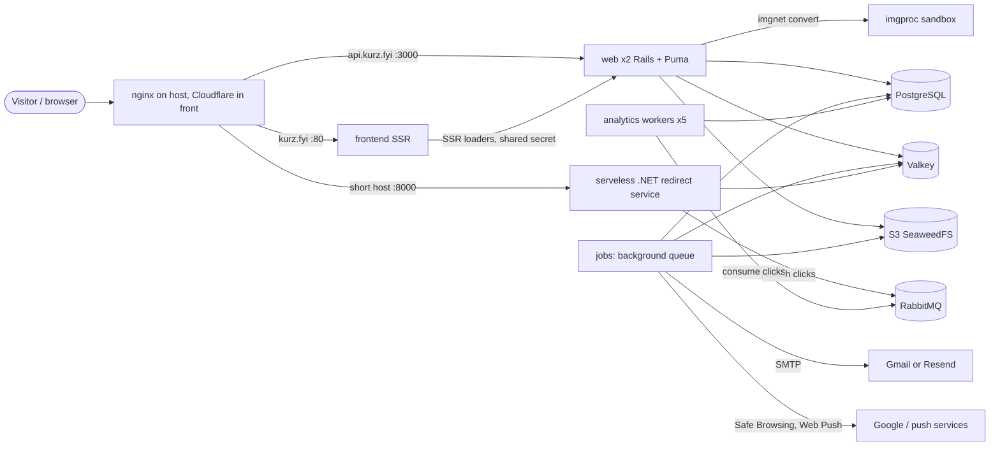

# Platform and operations

> Scope: runtime topology, deploy, CI and the security harness, job queues and the recurring schedule, rate limits, environment variables, observability and the testing strategy. State as of 2026-10-17.

## Summary

Kurz runs as a Docker Swarm on one self-hosted host (`pizito`) in three stacks: `shortener` (the Rails web API, the background-job process, the analytics workers, the image sandbox and the .NET redirect service), `shortenerfe` (the server-rendered React frontend) and `shortenerdb` (RabbitMQ, PostgreSQL and Valkey, deployed by hand). A merge to `main` builds three images on a self-hosted runner and runs the deploy script, which migrates the database once and then rolls every service start-first behind a healthcheck, rolling back on failure. Pull requests are gated by the CI workflow (backend, frontend, e2e, redirect service) and a static security workflow; a heavier security harness runs the production image against an isolated network nightly. All configuration is environment variables listed by name in the stack files; the application reads no encrypted-credentials key by name.

## Glossary

- **Stack**: a Swarm deployment from one compose file. There are three: `shortener`, `shortenerfe`, `shortenerdb`.
- **proxy_net**: external overlay network shared by every stack and by the host reverse proxy. It is created outside the repository.
- **imgnet**: internal overlay network joining only the web service and the image sandbox.
- **Image sandbox (imgproc)**: a small, locked-down Puma app that decodes uploaded images to WebP. The web service reaches it over the internal network only.
- **Redirect service (edge function)**: the .NET 10 service that answers short links. It reads the cached redirect entry from Valkey and publishes clicks to RabbitMQ. See [shortlinks](shortlinks.md).
- **Job queue**: the background-job backend, stored in the main PostgreSQL database and run by the jobs service.
- **Analytics workers**: RabbitMQ consumers that persist click events into PostgreSQL.
- **Harness**: the nightly security suite that attacks the production image on an isolated network.
- **Start-first**: a Swarm update order in which the new task must be healthy before the old one stops.
- **Rolled back**: a Swarm update state in which an update failed and the previous release was restored (or the update paused); the deploy script detects it and fails.

## Data

Infrastructure state this page owns. Application tables are in [data-model](data-model.md).

| Store | What it holds | Persistence |
|---|---|---|
| PostgreSQL 17 | all application tables plus the background-job queue tables (jobs, executions, processes, recurring tasks, semaphores) | bind mount on the host SSD, manager node only |
| Valkey 8.1.4 | redirect entries (one per servable short link) written without expiry by Rails and read by the redirect service; the Rails cache under a dedicated namespace, with TTLs: rate-limit counters, mail budget, session revocations, MX lookups, visitor deduplication keys | append-only file persistence (fsync every second), 768 MB memory cap, eviction of keys with a TTL only |
| RabbitMQ 3 | the durable click-event queue | bind mount on the host SSD |
| S3-compatible storage (SeaweedFS gateway) | file blobs: one bucket for avatars and covers, one private bucket for form uploads | outside the repository |

Valkey eviction rule: only keys that have a TTL can be evicted. Redirect entries have none, so they are never evicted; rate-limit counters and other cache entries can be.

## Business rules

### Topology

- **OP-01** Production runs as three Swarm stacks: `shortener` (web, workers, jobs, imgproc, serveless), `shortenerfe` (frontend) and `shortenerdb` (RabbitMQ, PostgreSQL, Valkey). The deploy script deploys the first two; the third is deployed by hand with its own script and has no rolling update, no healthchecks and no update policy.
- **OP-02** Services and replicas: web 2 replicas (2 CPU, 2048M), workers 1 (2 CPU, 1024M), jobs 1 (1 CPU, 2048M), image sandbox 1 (1 CPU, 1024M), frontend 1 (0.5 CPU, 512M), redirect service 1 (no limits). Stateful services are pinned to the manager node.
- **OP-03** Who talks to whom (see the diagram): the host reverse proxy (nginx, outside the repository) reaches web, frontend and the redirect service over proxy_net; web calls the image sandbox over imgnet only; web, jobs and workers use PostgreSQL, Valkey and RabbitMQ over proxy_net; the redirect service uses Valkey and RabbitMQ. The image sandbox is attached to imgnet only and receives no secrets, no database access and no Internet route.
- **OP-04** The image sandbox runs the same image as web with a read-only filesystem, all Linux capabilities dropped, an unprivileged user (1000:1000), a tmpfs for temporary files, only the "skip database prepare" flag as environment, and always-restart. The harness checks these properties on every run (oracle D12).
- **OP-05** The image sandbox accepts only a convert request and a health request. Limits: body 10 MB (`413`), `Content-Length` required (`411`), side 10,000 px and 50,000,000 pixels (`422 dimensions`), output longest edge 4096 px as stripped WebP, magic-byte check for PNG, JPEG, WebP and HEIF (`422 unsupported_type`). Rails calls it with an open timeout of 2 s and a read/write timeout of 25 s; any failure makes the upload endpoint answer `503 uploads_unavailable` (harness check AV06).
- **OP-06** The Rails image is API-only and loads only the framework parts it uses (no Action Cable, Action Mailbox, Action Text). Puma uses 3 threads per process and, in production, forks 2 workers with the app preloaded (`WEB_CONCURRENCY` overrides, `0` means a single process). Thruster fronts Puma in the image (port 80 to 3000).
- **OP-07** The click path never touches Rails: the redirect service looks up the cached redirect entry in Valkey, redirects, and writes the click to a bounded in-memory channel (10,000 items, new items dropped when full) that a background service publishes to the durable click queue. A full channel or a RabbitMQ outage loses clicks but never delays a redirect. A Valkey error answers an "unavailable" page.
- **OP-08** Click persistence: 5 analytics workers, 1 thread each, prefetch 10, manual acknowledgement, 60 s job timeout, durable queue. On error a worker requeues the message once; a redelivered failure is rejected (dropped) and reported to Sentry. A click for an unknown short code is rejected.
- **OP-09** Production only: forced HTTPS (TLS terminates at the proxy), a Host allow-list `API_HOSTS` (default `api.kurz.fyi`) with the health endpoint exempt, and logs to stdout.
- **OP-10** The file-storage service in production is the SeaweedFS gateway when `S3_BUCKET` is set, otherwise local disk, so a deploy before the bucket exists still boots. Form uploads use their own private bucket only in production with `S3_FORMS_BUCKET` set. Files are served through Rails (proxy mode), so the gateway never needs to be public.
- **OP-11** The Rails cache is a Valkey-backed Redis store (`REDIS_URL`, dedicated namespace, TLS verification off) in every environment except test. The same Valkey holds the redirect entries, so a cache flush must never wipe the whole database in production.
- **OP-12** Mail goes by SMTP: Gmail by default, Resend only when `MAIL_PROVIDER=resend` and `RESEND_API_KEY` are both set. The sender address must match the provider. Open timeout 10 s, read timeout 15 s. The e2e environment sends to Mailpit (`E2E_SMTP_HOST`, `E2E_SMTP_PORT`, default 1025).

In e2e CI the stack is smaller: Rails (e2e environment, jobs run inline), the image sandbox, the built frontend, PostgreSQL, Valkey and Mailpit. No RabbitMQ, redirect service or background-job process.

### Release and deploy

- **OP-20** A push to `main` runs the Deploy workflow: build the backend, frontend and redirect-service images, tag each `:latest` and `:<sha>`, push to the private registry (`pizito:5001`), then run the deploy script. The job runs on the self-hosted runner, one deploy at a time (no cancellation of a running deploy). The workflow does not run tests; it relies on the pull-request CI having passed but does not enforce it.
- **OP-21** Migrations run first and once: for the `shortener` stack the deploy script runs the database prepare step in a one-off container on proxy_net, with the variables the migration needs, before any new container starts. A failure prints "nothing was deployed" and exits 1. Services set `SKIP_DB_PREPARE=1` so the container entrypoint never migrates. Rationale: containers booting together raced for the migration lock and crashed with a concurrent-migration error.
- **OP-22** Optional migration role: when `MIGRATE_POSTGRES_USER` is set (and then `MIGRATE_POSTGRES_PASSWORD` is mandatory) the migration runs with that owner role, while services run as the DML-only role `kurz_app`. Setup and rollback are in the Postgres roles guide.
- **OP-23** Every service rolls with parallelism 1, start-first order, 10 s delay, 30 s monitor window and automatic rollback on failure; the rollback itself is also parallelism 1 and start-first. The settings are defined once per stack file and shared by all services. The previous release serves traffic until the new task is healthy.
- **OP-24** Every rolled service has a healthcheck, otherwise Swarm sends traffic to a task as soon as the process starts. Probes: web checks its health endpoint (10 s interval, 3 retries, 60 s start period); workers and jobs have dedicated probe scripts (OP-25, OP-26); the image sandbox checks its health endpoint; the redirect service requests an unknown path and is healthy below HTTP 500; the frontend fetches its `robots.txt`.
- **OP-25** The jobs probe is healthy when the job queue's process table has a supervisor row for this container's hostname with a heartbeat newer than 3 minutes (the queue beats every 60 s and prunes at 5 minutes). It uses the app's own database role.
- **OP-26** The workers probe is healthy when this container holds an established TCP connection to RabbitMQ and the click queue has at least one consumer. The consumer count alone would pass a bad release during start-first because the old task's consumers are still attached.
- **OP-27** The web service gets a 30 s stop grace period so Puma drains in-flight requests; the redirect service gets 20 s.
- **OP-28** The deploy script runs the stack deploy in blocking mode with pruning and registry credentials, under a timeout `DEPLOY_TIMEOUT` (default 15 minutes), then reads each service's update status. Blocking mode exits 0 even after Swarm rolled back, so any service whose state is a rollback state or paused and whose start time is not older than this deploy's start makes the script print an error and exit 1. Older rollback states left on untouched services are ignored.
- **OP-29** Order of stacks: `shortener` first, then `shortenerfe`. A rollback or timeout in the backend stack exits before the frontend is deployed. Images are pulled per stack first; a failed pull aborts.
- **OP-30** For a few seconds during every rollout, and indefinitely after a rollback, the previous release runs against the new schema. Migrations must be additive: add, backfill and ship the code that uses it; drop or rename only in a later release once nothing reads the old column.
- **OP-31** A new service in a stack needs a healthcheck and the shared update and rollback policy. A new environment variable goes into the matching shared environment block of the stack file (the one for workers, jobs and web; the one for jobs and web; or the web service only), and into the migration environment of the deploy script only if the database prepare step cannot boot without it.
- **OP-32** Images are tagged `:latest` and `:<sha>`; stacks reference `:latest`. A manual rollback is a redeploy of an earlier tag; no script exists for it. Registry retention of old tags is not verified.

### Continuous integration

- **OP-40** The CI workflow runs on every pull request to `main` (in-progress runs for the same ref are cancelled) with four jobs: backend (linting, security static analysis, schema load, the test suite against PostgreSQL 17 and Valkey 8.1.4), frontend (Node 22: install, typecheck, tests, build with IPv4-first DNS), e2e (Playwright, see testing) and edge function (locked restore, format check, build, tests against Valkey and RabbitMQ).
- **OP-41** The static security workflow runs on every pull request to `main` with five jobs: Ruby dependency audit; npm audit for production dependencies at high severity (fixes ship in their own pull request); NuGet audit with warnings NU1901 to NU1904 treated as errors; gitleaks v8.30.1 on the full history with redaction; Trivy 0.75.0 filesystem scan for HIGH and CRITICAL vulnerabilities (fix available) and secrets, failing with exit code 1. It uses a read-only token and no secrets.
- **OP-42** One gitleaks false positive is ignored by fingerprint (a column name that looks like a token).
- **OP-43** The security harness workflow runs nightly at 03:17 UTC, on demand, and on pull requests that touch the harness files or its own workflow. It builds the production image, needs about 6 GB RAM, has 30 minutes, never runs on the production runner and has no secrets. The ZAP baseline runs only outside pull requests (it pulls about 1 GB). Results are uploaded as the `security-results` artifact.
- **OP-44** Dependabot runs weekly with at most 3 open pull requests per ecosystem: bundler (Rails packages grouped), npm (minor and patch grouped, TypeScript majors ignored until typescript-eslint supports TS 7), NuGet (two directories), Docker (the CI directory only), GitHub Actions.
- **OP-45** Required status checks and branch protection are not defined in the repository, so which of the checks above actually block a merge is not verifiable from the code. The deploy does not wait for any of them (OP-20).
- **OP-46** Lint rules: the Ruby linter inherits the Shopify rule set plus ERB rules; migrations, the schema file, the lockfile and binstubs are excluded; 2-space indentation; four style cops are switched off. Frontend ESLint and Prettier exist but CI runs neither.

### Security harness

- **OP-50** The harness proves its claims against the production image (production environment), never against production data: PostgreSQL and Valkey are throwaway, both networks are internal, nothing is published, the API answers as `api.kurz.fyi`, and the app connects as the DML-only role `kurz_app`. Secrets are dummy (a fresh secret key base per run, a dummy Sentry DSN so the production Sentry setup runs).
- **OP-51** Interlocks in the harness runner refuse to run on a Docker context other than `desktop-linux` or `default`, with `DOCKER_HOST` set, on a host named `pizito`, or when the harness network is not internal (exit 2).
- **OP-52** Route matrix: the harness classifies all 159 routes of the production route table (owner 98, public 27, admin 11, storage 9, auth 8, mcp 3, internal 2, infra 1). Check A00 fails on any unclassified or stale route and requires `401` for anonymous calls on every owner, admin and mcp route. Adding or removing a route requires editing the matrix in the same pull request.
- **OP-53** Global oracles after the suite: no request ended in a 5xx in the API log; no log line carries a respondent answer canary or the visitor IP canaries; the image sandbox has no secret-looking variable, cannot reach the database, the cache or the Internet, has a read-only filesystem and does not run as root.
- **OP-54** Chaos step: the image sandbox is stopped, then check AV06 asserts that an upload answers `503 {"error":"uploads_unavailable"}` with no leaked host or port and no row left behind, while text answers, the public form and the health endpoint keep working.
- **OP-55** The suite has 37 checks plus AV06; a failing check with priority `M` (the default) fails the run. Summary of what is proved:

| Group | Checks | Proof |
|---|---|---|
| Isolation | ISO, P04, P16 | no Internet route; forged `Host` gets 403 while the health endpoint answers any host; app role cannot do DDL, create roles, read host files or run programs |
| AuthN/AuthZ | A01, A07, A00, A02, A09 | no/garbage/`alg:none`/foreign-key bearer gives 401; cookie writes without `X-Requested-With` give 403; deactivated user 403; non-admins 403 on admin member routes; tenant isolation (404) on every form route; mass-assignment protection |
| Public form | A04, A10, A16, A13, C03, C16, C08, C20, G07, G04, B04, F4 | whitelisted public JSON; NUL byte gives 400; 30 parallel form creations give exactly 20 created and 10 limited; no lost field updates; 5 submissions per 10 minutes per IP when Turnstile is down; bodies over 64 KB give 413, non-JSON 415; idempotency under parallel load; events counted and rate-limited; no IP, user agent or referrer stored for forms; unique-view keys in Valkey hold no IP and expire within 25 h |
| OAuth and MCP | E01, E11, E04, E12, E07, MC08 to MC13 | metadata from config, S256 only; registration limited to 10 an hour per IP; PKCE, code replay and refresh reuse revoke; only digests stored; consent needs cookie plus CSRF header; OAuth tokens are useless on the regular API; scopes decide the tool list; drafts only; no tool reads responses; delete tools only with `account:full` |
| Uploads | D01, D02 | real images become stripped WebP; hostile files refused before the sandbox; image bombs rejected quickly; 30 concurrent uploads never 5xx |
| Platform | X01 | the removed mailbox ingress endpoints refuse the Internet without 5xx (the check is stale, since the feature was removed, and still passes as 404) |
| Load | AP01, AP02, AP03 | 50 parallel bookings of one place, five rounds: exactly one created; p95 under 500 ms for the public form, free times and a booking; 5,000 queued emails do not slow sign-in and the dispatcher picks a batch in under 200 ms |
| ZAP baseline | report only | the home page, OAuth and MCP discovery documents and the public booking routes; findings are not gating |

### Testing strategy

- **OP-60** All tests, lint and typechecks run in throwaway containers, never on the host (the host has other Ruby and Node versions and macOS-only dependencies). Each suite gets its own disposable PostgreSQL and Valkey, never the development database. See "Running the tests" in Flows.
- **OP-61** Backend tests: transactional fixtures are disabled and the database is truncated before each example; background jobs use the test adapter; the Valkey database is flushed before each example when `REDIS_URL` is set (never point it at a real Valkey); N+1 queries raise; outbound HTTP is stubbed and recorded; partial doubles are verified; the application is eager-loaded only in CI.
- **OP-62** Without `REDIS_URL` the test cache is a null store, so every test that depends on rate limiting, the mail budget or the redirect cache needs a Valkey and `REDIS_URL` (CI uses a local Valkey database 0).
- **OP-63** Tests never reach DNS, Have I Been Pwned or the real providers: MX validation returns true, the pwned-passwords range call returns an empty body, and `TURNSTILE_*`, `MAIL_PROVIDER`, `RESEND_API_KEY`, `MAIL_FROM` and `GOOGLE_*` are removed from the environment before the suite. Safe Browsing is forced on with a test key.
- **OP-64** e2e: Playwright 1.64 (Chromium only, one worker, no parallel files, 60 s timeout, 1 retry in CI, locale `pt-PT`, timezone `Europe/Lisbon`). Rails runs in the e2e environment: jobs inline (so each e-mail renders with its own locale and exists when the API call returns), test file storage, SMTP to Mailpit, delivery errors raised. Every test flushes the Valkey cache, clears the mailbox and deletes the forms it created (an account can create 20 forms a day). Accounts are seeded before the run and signed in by injecting the session cookie.
- **OP-65** The e2e environment has no host allow-list, no background-job process and no Sentry, and uses the application's Redis cache (`REDIS_URL`). `SSR_FORWARD_SECRET` defaults to a fixed test value when Playwright starts the servers.
- **OP-66** Frontend tests use Node's built-in test runner over the i18n, forms, agenda, notices, appointments-tab and booking-package areas; the typecheck generates route types and then runs the TypeScript compiler. There is no component or browser test below e2e.
- **OP-67** Redirect-service tests are integration tests against a real Valkey and RabbitMQ, configured through `REDIS_URL` and `RABBITMQ_*`.

### Queues and jobs

- **OP-70** The background-job queue runs inside the jobs service: one dispatcher (poll 1 s, batch 500), the scheduler for the recurring schedule, and six worker groups. Queue to worker map: the default, safety, analytics and recurring-command queues share a 2-thread group (`JOB_CONCURRENCY` processes, default 1, poll 5 s); the safety queue also has its own 1-thread worker (poll 10 s); the analytics queue its own 2-thread worker (poll 6 s); mailers 1 thread (poll 1 s, so sign-in codes are never delayed); notifications 2 threads (poll 2 s); images 1 thread (poll 2 s).
- **OP-71** The notifications queue must have exactly one worker group and it serves only that queue, so a backlog elsewhere never delays notices. The images queue has one thread cluster-wide: at most one avatar decode (up to 48 MP) at a time; the avatar optimisation job also limits concurrency to 1 per user with a 5 minute duration.
- **OP-72** The analytics queue in the job system is configured but no job uses it; click events travel through RabbitMQ instead.
- **OP-73** Retry and discard policy: there is no default, so a failing job lands in the failed-executions table and is not retried unless the job says so. Exceptions: mail delivery retries DNS, open/read timeout, connection refused/reset and SMTP-server-busy errors up to 4 attempts with polynomial back-off (permanent SMTP errors fail at once and reach Sentry); the page-link safety check retries Safe Browsing errors up to 3 times; the data-export email retries when the mail budget is exhausted, every hour without limit; avatar optimisation discards the job when the file no longer exists.
- **OP-74** Mailers use the mailers queue and the custom mail-delivery job. File-storage analyze and purge jobs use the default queue. Job arguments are never logged.
- **OP-75** A new recurring job is added to the production schedule with its job, an explicit queue and a schedule; there is no recurring schedule in development, so it must be run by hand there. A shell-command task runs on the recurring-command queue. A new queue also needs a worker entry in the queue configuration, otherwise nothing consumes it.

### Rate limits and request guards

- **OP-80** Rate limits are enforced per controller and backed by the Rails cache, which is Valkey in production. Counters are shared by all web replicas and are keyed by the limit's name and its scope (client address, user, e-mail, ...). When the store is unreachable the request is allowed. In tests without `REDIS_URL` the store is null and nothing is limited (OP-62).
- **OP-81** The client address is resolved as: the `X-Visitor-Ip` header when `X-Ssr-Secret` equals `SSR_FORWARD_SECRET` (constant-time compare; only the SSR frontend knows it), else `CF-Connecting-IP`, else the connection's remote address; malformed addresses are ignored. If `SSR_FORWARD_SECRET` is unset or empty the forwarded address is never trusted and SSR loaders share the frontend's address bucket.
- **OP-82** The public JSON endpoints (OAuth client registration, form events, form uploads, form responses, waitlist join) refuse bodies over 64 KB with `413` (checked on `Content-Length` and on the actual stream) and anything but `application/json` with `415`. The MCP endpoint caps requests at 256 KB. Every controller rejects NUL bytes in parameters with `400`.
- **OP-83** Every API response carries `X-Content-Type-Options: nosniff` and `Content-Security-Policy: default-src 'none'; frame-ancestors 'none'` unless the response sets its own (QR SVGs use a sandbox policy).
- **OP-84** CORS: `/.well-known/*`, `/oauth/token`, `/oauth/register`, `/oauth/revoke` and `/mcp` allow any origin without credentials (MCP exposes `WWW-Authenticate` and `Mcp-Session-Id`); everything else allows credentials only for the exact origins `https://kurz.fyi`, `https://app.kurz.fyi`, `FRONTEND_URL`, plus `http://localhost:5173` outside production. No wildcard subdomains, so other `kurz.fyi` hosts cannot act with a user's cookie.

### Observability

- **OP-90** Sentry is initialised only in production with `SENTRY_DSN` set: traces sampled at `SENTRY_TRACES_SAMPLE_RATE` (default 0.1), profiles at `SENTRY_PROFILES_SAMPLE_RATE` (default 0.5, of sampled transactions), no default PII, breadcrumbs from the framework logger. Rails log forwarding is on only when `SENTRY_LOGGER` is set, which the stack sets on web only.
- **OP-91** A scrubber runs on Sentry events, transactions and logs: it clears request body, query string, cookies, headers and environment, cuts the URL at `?`, drops all breadcrumbs, replaces PostgreSQL `DETAIL:` text in exception messages with `DETAIL: [FILTERED]`, and drops log lines containing `Parameters:`, `with arguments` or `DETAIL:`. Transaction events have no exception and skip that step.
- **OP-92** Request log format: Rails' tagged logger on stdout (request-id tag, level `RAILS_LOG_LEVEL`, default info). The `Started` line is `Started <METHOD> "<filtered path>" at <time>` and deliberately omits the client IP (stock Rails prints `for <ip>`). The health endpoint is silenced. Visitor IP, user agent and respondent answers must stay out of logs (harness canary oracles).
- **OP-93** Parameter filtering replaces these keys in logs: `passw`, `email`, `secret`, `token`, `_key`, `crypt`, `salt`, `certificate`, `otp`, `ssn`, `cvv`, `cvc`, `code`, `code_verifier`, `credential`, `answers`, `answer`, `value`, `values`, `text`, `message`, `comment`, `arguments`, `query`, `q`, `search`, `filename`, `file`, `endpoint`, `p256dh` and the exact key `auth`.
- **OP-94** Structured log lines are tagged for searching: OAuth events (also a Sentry warning tagged `oauth_event`), unauthorized MCP calls, appointments health and resolution lines, and one tag each for the short-link expiry job, the short-link purge job, the analytics worker and Turnstile. Alerts that go to Sentry as warnings: mail budget reached (once per reason per day), Turnstile unavailable, form and page abuse, appointments health (once per alert per hour).
- **OP-95** Appointments health (pointer): a job every 5 minutes computes health numbers and raises Sentry alerts `pending_overdue` (oldest overdue request over 5 minutes), `notification_queue_lag` (over 5 minutes) and `email_budget` (80 percent of the daily limit); the same numbers are available to admins through the API. Rules are owned by [appointments-lifecycle](appointments-lifecycle.md) and [admin-and-moderation](admin-and-moderation.md).

## Flows

### Release of a change

1. A pull request runs CI and the static security checks; the harness runs only if harness files changed.
2. Merge to `main` triggers Deploy on the self-hosted runner: build 3 images, push `:latest` and `:<sha>`.
3. The deploy script loads the host's secret environment file, pulls the `shortener` images and runs the database migration in a one-off container on proxy_net.
4. The `shortener` stack is deployed: per service one new task starts, must pass its healthcheck, the monitor window (30 s) must pass, then the old task stops; 10 s delay between tasks.
5. If any service fails its update Swarm rolls back by itself; the deploy script sees the state, exits 1, and `shortenerfe` is not deployed.
6. `shortenerfe` is deployed the same way. The database stack is never touched by this flow.

### Running the tests

All suites run in throwaway containers with their own disposable PostgreSQL, Valkey and (for e2e) Mailpit, never against the compose development database and never on the host.

| Suite | What it needs |
|---|---|
| Backend (tests, lint, static security analysis) | a Ruby 4.0.7 image with libvips, a disposable PostgreSQL 17 and Valkey 8.1.4 on a private network, and the schema loaded before the tests |
| Frontend (typecheck, tests) | a Node 22 container; builds need IPv4-first DNS |
| e2e | the Playwright image matching the pinned Playwright version, Rails in the e2e environment, the built frontend and Mailpit, all sharing one container network so the API (3000), frontend (3001) and Mailpit (8025) are on localhost; the database is seeded first |
| Redirect service | the .NET SDK version pinned by the repository, with Valkey and RabbitMQ reachable |
| Security harness | run on a developer machine with the Docker Desktop context; the ZAP baseline is optional |

### Local development

The compose file starts RabbitMQ, PostgreSQL (trust auth), Valkey, the backend (port 3000) and the redirect service (port 8000); it needs a root environment file for the RabbitMQ, Valkey and redirect-service variables. The frontend runs separately. The backend's process file starts the web server, the analytics workers and the jobs process. The dev container composes the same services plus a workspace container.

## States and transitions

Swarm service update states that the deploy script interprets (the only status-like value this page owns):

| State | Meaning | Deploy script outcome |
|---|---|---|
| updating, completed | rolling or finished | success when the stack deploy returns 0 |
| rollback started, rollback completed, rollback paused | update failed, previous release restored | exit 1 if the state is not older than the deploy start |
| paused | update paused after failure | exit 1 if the state is not older than the deploy start |
| any state older than this deploy | stale status of an untouched service | ignored |

## Limits and configuration

### Recurring jobs (production only)

Schedules are evaluated in the jobs container's timezone (UTC unless `TZ` is set).

| What runs | When | Queue | Why / what it does | Owner page |
|---|---|---|---|---|
| Finished-job cleanup | every hour at minute 12 | recurring-command | clears finished jobs from the job queue in small batches so the table does not grow | this page |
| Short-link inactivity expiry | at 3am every day | default | deactivates links with no click for 30 days (counting from creation when never clicked) | [shortlinks](shortlinks.md) |
| Orphan form-upload cleanup | every 15 minutes | default | destroys form uploads with no response after 1 hour (cover excluded) | [forms](forms.md) |
| Form abuse detection | every 10 minutes | default | unpublishes forms over 600 responses or 300 MB uploads in the last hour, alerts Sentry | [admin-and-moderation](admin-and-moderation.md) |
| Visitor IP purge | at 4:15am every day | default | nulls IP, user agent and referer on events, page link clicks and audits older than 90 days | [admin-and-moderation](admin-and-moderation.md) |
| Deleted-account purge | at 4:30am every day | default | purges deactivated users whose deletion request is past the grace period | [accounts-and-auth](accounts-and-auth.md) |
| MCP tool-call log purge | at 4am every day | default | deletes MCP tool-call log rows older than 90 days | [mcp-and-oauth](mcp-and-oauth.md) |
| Scheduled short-link expiry | every 5 minutes | default | deactivates links past their owner-set expiry and removes their cache entry | [shortlinks](shortlinks.md) |
| Stale avatar-upload cleanup | every 15 minutes | default | purges raw avatar uploads older than 1 hour that were never optimized | [bio-pages](bio-pages.md) |
| Page-link safety recheck | at 4am every day | safety | re-queues Safe Browsing checks for links unchecked for 1 day, in batches of 500; no-op unless `ENABLE_GOOGLE_SAFE_LINK` is set | [bio-pages](bio-pages.md) |
| Page abuse detection | every hour at minute 40 | default | raises admin signals for 3 or more new accounts publishing the same text or links within 24 hours | [admin-and-moderation](admin-and-moderation.md) |
| Unverified-user cleanup | every day at 3:30am | default | destroys users never verified after 1 day | [accounts-and-auth](accounts-and-auth.md) |
| Notification purge | at 4:45am every day | default | deletes notifications older than 90 days | [notifications-and-email](notifications-and-email.md) |
| Notification dispatch | every minute | notifications | picks up to 200 due pending notifications and enqueues email or push delivery | [notifications-and-email](notifications-and-email.md) |
| Appointment reminders | every 5 minutes | notifications | sends due appointment reminders | [appointments-lifecycle](appointments-lifecycle.md) |
| Pending-appointment resolution | every minute | notifications | resolves overdue pending requests and sweeps the waitlist | [appointments-lifecycle](appointments-lifecycle.md) |
| Appointments health | every 5 minutes | default | computes health numbers and raises Sentry alerts (OP-95) | [appointments-lifecycle](appointments-lifecycle.md) |

Background jobs that run on demand rather than on the schedule: the short-link and page-link safety checks (safety queue), avatar optimisation (images), short-link purge (default), notification and push delivery (notifications), mail delivery and data-export email (mailers).

### Rate limit catalogue

All limits are per scope key, kept in the Rails cache (Valkey). "IP" means the resolved client address (OP-81). Status is 429 unless noted. Owner pages hold the product rules.

| Action | Limit | Window | Scope | Owner page |
|---|---|---|---|---|
| Request a login code | 10 | 10 min | IP | [accounts-and-auth](accounts-and-auth.md) |
| Request a login code | 30 | 1 day | IP | accounts-and-auth |
| Request a login code | 5 | 10 min | normalized e-mail | accounts-and-auth |
| Verify a login code | 10 | 15 min | normalized e-mail | accounts-and-auth |
| Password login | 20 | 10 min | IP | accounts-and-auth |
| Password login | 10 | 15 min | normalized e-mail | accounts-and-auth |
| Google login | 20 | 10 min | IP | accounts-and-auth |
| Sign up | 10 | 1 h | IP | accounts-and-auth |
| Forgot password | 10 | 1 h | IP | accounts-and-auth |
| Reset password | 10 | 15 min | e-mail parameter | accounts-and-auth |
| Change own password | 10 | 15 min | user | accounts-and-auth |
| Delete own account | 5 | 1 h | user | accounts-and-auth |
| Request a data export | 1 | 1 week | user (error `export_weekly_limit`) | accounts-and-auth |
| Create a short link | 60 | 10 min | user | [shortlinks](shortlinks.md) |
| Unlock a protected short link | 10 | 5 min | short code + IP | shortlinks |
| View a public bio page | 120 | 1 min | IP | [bio-pages](bio-pages.md) |
| Count a bio-page link click | 30 | 1 min | IP (plus 10 s deduplication per visitor key; answers `429` without body) | bio-pages |
| Create a bio page | 10 | 1 h | user | bio-pages |
| Upload a page avatar | 5 | 10 min | user | bio-pages |
| Upload a page avatar | 20 | 1 day | user | bio-pages |
| Upload a page avatar | 20 | 1 h | IP | bio-pages |
| Publish a page template | 5 | 1 day | user | bio-pages |
| Report a community template | 20 | 1 h | user | [admin-and-moderation](admin-and-moderation.md) |
| View a public form | 120 | 1 min | IP | [forms](forms.md) |
| Submit a form response | 30 | 10 min | IP | forms |
| Submit a form response | 5 | 10 min | IP, only while Turnstile is unavailable | forms |
| Send a form event | 60 | 1 min | IP (answers `429` empty) | forms |
| Upload a file to a form field | 15 | 10 min | IP | forms |
| Fetch a public form cover | 240 | 1 min | IP | forms |
| Set a form cover | 20 | 10 min | user, else connection address | forms |
| Export form responses | 10 | 1 h | user | forms |
| Create a form (not a request throttle) | 20 created | per day | user (error `forms_daily_limit`) | forms |
| List free booking slots | 120 | 1 min | IP | [booking-engine](booking-engine.md) |
| View a booking via its link | 60 | 1 min | IP | [appointments-lifecycle](appointments-lifecycle.md) |
| Cancel a booking via its link | 20 | 1 min | IP | appointments-lifecycle |
| View or submit an appointment verification | 60 / 20 | 1 min | IP | appointments-lifecycle |
| View or submit an appointment decision | 60 / 20 | 1 min | IP | appointments-lifecycle |
| View a waitlist entry | 60 | 1 min | IP | appointments-lifecycle |
| Claim or leave a waitlist slot | 20 | 1 min | IP | appointments-lifecycle |
| Join a form's waitlist | 10 | 10 min | IP | appointments-lifecycle |
| Fetch a calendar feed | 60 | 1 min | IP | appointments-lifecycle |
| Request a booking manage link | 20 | 1 min | user | appointments-lifecycle |
| OAuth token exchange | 60 | 1 min | client id (first 64 characters) | [mcp-and-oauth](mcp-and-oauth.md) |
| OAuth client registration | 10 | 1 h | IP | mcp-and-oauth |
| OAuth authorization (consent) | 30 | 1 min | user | mcp-and-oauth |
| MCP endpoint, any call | 120 | 1 min | OAuth grant | mcp-and-oauth |
| MCP write tools, all together | 30 per minute and 500 per day | rolling window buckets | user | mcp-and-oauth |
| MCP per-tool limits | 10 to 120 an hour, some with a daily cap (for example create short link 20/h and 100/d, create page 10/h and 50/d, delete tools 10/h and 30/d) | per tool | user | mcp-and-oauth |
| MCP appointment manage tools | 30 per hour and 100 per day, one shared bucket | | user | mcp-and-oauth |

Not rate-limited: OAuth token revocation, the discovery documents, the short-link unlock page view, and all owner and admin endpoints not listed above (they need a session). Related caps that are not request throttles: login code attempts (5), password lock-out (exponential up to 1 hour), the e-mail budget (below) and a total form-upload size of 20 GB. Besides the per-limit counters, Valkey also holds counters for the mail budget (day, month, new-address day), the MCP write throttle and the weekly data export.

Mail budget (all cache counters, shared by web and jobs): daily `MAIL_DAILY_LIMIT` (100), monthly `MAIL_MONTHLY_LIMIT` (3000), new-address daily `MAIL_NEW_ADDRESS_DAILY_LIMIT` (40); a lower-priority sender takes only a share of the budget (data export uses half). A refused reservation returns its increments and alerts Sentry once per reason per day. Owned by [notifications-and-email](notifications-and-email.md).

### Environment variables (names only)

"Stack" means the production `shortener` stack file; "not in stack" means the production stack does not pass the variable, so the default applies.

| Name | Component | Required? | Default | Purpose |
|---|---|---|---|---|
| `RAILS_ENV` | backend | yes | `production` in stack; `development` in Puma when unset | environment; `e2e` and `test` exist |
| `RAILS_MASTER_KEY` | web, jobs, workers | yes in production | none | decrypts the production encrypted credentials |
| `SECRET_KEY_BASE` | backend | alternative to the master key | none | read natively by Rails; used by the harness and e2e CI |
| `SKIP_DB_PREPARE` | backend entrypoint | no | unset (migrate on boot) | `1` skips the database prepare step on boot |
| `POSTGRES_HOST`, `POSTGRES_USER`, `POSTGRES_PASSWORD` | backend | yes | none | database connection |
| `POSTGRES_PORT` | backend | no | 5432 | not in stack |
| `POSTGRES_DB` | stack, PostgreSQL image | stack only | none | not read by Rails: database names are fixed per environment (`development`, `test`, `e2e`, `production`) |
| `RAILS_MAX_THREADS` | backend | no | Puma 3, DB pool 5 | thread and pool size |
| `WEB_CONCURRENCY` | web | no | 2 in production, 0 elsewhere | Puma workers |
| `PORT`, `PIDFILE` | web | no | 3000, none | Puma port and pid file |
| `SOLID_QUEUE_IN_PUMA` | web | no | unset | run the job supervisor inside Puma; unused in production |
| `JOB_CONCURRENCY` | jobs | no | 1 | processes of the shared worker group |
| `REDIS_URL` | web, jobs, workers, edge | yes | none (edge: `redis://127.0.0.1:6379`) | cache store, rate limits, redirect entries |
| `RABBITMQ_HOST`, `RABBITMQ_DEFAULT_USER`, `RABBITMQ_DEFAULT_PASS`, `RABBITMQ_PORT` | workers, web, jobs, edge | yes (port defaults 5672) | edge: `127.0.0.1`, `guest` user | AMQP connection |
| `SNEAKERS_LOG_LEVEL` | workers | no | `error` | analytics worker log level |
| `FRONTEND_URL` | backend, edge | yes | backend `https://kurz.fyi`; e2e `http://localhost:3001` | CORS origin, links in e-mail and tools, OAuth authorize URL, redirect-service fallback |
| `API_HOSTS` | web | no | `api.kurz.fyi` | Host allow-list; not in stack |
| `EDGE_API` | web | yes | none | base of short URLs |
| `IMGPROC_URL` | web | yes for form uploads and covers | none (stack sets `http://imgproc:8080`) | image converter; jobs do not get it (see D-OP-04) |
| `GMAIL_USERNAME`, `GMAIL_APP_PASSWORD` | web, jobs, workers | yes unless Resend | username falls back to `kurz.fyi@gmail.com` for the sender | SMTP login |
| `MAIL_PROVIDER`, `RESEND_API_KEY`, `MAIL_FROM` | web, jobs | no | provider `gmail`; from `Kurz <login@kurz.fyi>` | Resend switch |
| `MAIL_DAILY_LIMIT`, `MAIL_MONTHLY_LIMIT`, `MAIL_NEW_ADDRESS_DAILY_LIMIT` | web, jobs | no | 100, 3000, 40 | mail budget |
| `VAPID_PUBLIC_KEY`, `VAPID_PRIVATE_KEY`, `VAPID_SUBJECT` | web, jobs | no | empty (push off) | Web Push; all three needed |
| `TURNSTILE_SECRET_KEY` | web, jobs | no | empty | Turnstile verification |
| `TURNSTILE_HOSTNAMES` | web, jobs | no | stack fixes `kurz.fyi` | allowed hostnames in the Turnstile answer |
| `S3_ENDPOINT`, `S3_ACCESS_KEY_ID`, `S3_SECRET_ACCESS_KEY`, `S3_BUCKET` | web, jobs | for S3 | none | S3 storage; unset `S3_BUCKET` means local disk |
| `S3_FORMS_BUCKET` | web, jobs | no | empty | private bucket for form uploads |
| `SENTRY_DSN` | web, jobs, workers | no | none | enables Sentry |
| `SENTRY_LOGGER` | web | no | unset | forward Rails logs to Sentry |
| `SENTRY_TRACES_SAMPLE_RATE`, `SENTRY_PROFILES_SAMPLE_RATE` | backend | no | 0.1, 0.5 | sampling; not in stack |
| `RAILS_LOG_LEVEL` | backend | no | `info` | log level |
| `LOG_REQUESTS` | web | no | stack sets `"false"` | read by nothing (dead setting) |
| `GOOGLE_CLIENT_ID`, `GOOGLE_NATIVE_CLIENT_IDS`, `GOOGLE_CLIENT_SECRET` | web | no | empty (Google sign-in off) | ID token audience, native client ids, popup code exchange |
| `MCP_ENABLED` | web | no | off | must equal `true` to serve the MCP, OAuth and discovery endpoints |
| `OAUTH_ISSUER` | web | no | `https://api.kurz.fyi` | issuer and MCP resource |
| `MCP_REDIRECT_HOSTS` | web | no | `claude.ai,claude.com,chatgpt.com` | allowed OAuth redirect hosts |
| `MCP_ALLOWED_ORIGINS` | web | no | empty | extra `Origin` values for the MCP endpoint |
| `SSR_FORWARD_SECRET` | web, frontend | no | empty (forwarding off) | shared secret that lets the SSR frontend forward the visitor IP (OP-81); must be identical in both stacks |
| `ENABLE_GOOGLE_SAFE_LINK` | web, jobs | no | unset (checks off) | any value turns on Safe Browsing checks; not in stack |
| `GOOGLE_SAFE_LINK_KEY` | web, jobs | when the flag is on | none (missing key raises an error) | Safe Browsing API key |
| `BASE_URL` | web, jobs | no | `http://localhost` | `Referer` sent to Safe Browsing; not in stack |
| `E2E_SMTP_HOST`, `E2E_SMTP_PORT` | e2e Rails | no | `localhost`, 1025 | Mailpit SMTP |
| `E2E_START_SERVERS`, `E2E_API_URL`, `E2E_APP_URL`, `E2E_REDIS_URL`, `MAILPIT_URL` | e2e Playwright | no | `0`/unset, `http://localhost:3000`, `http://localhost:3001`, `REDIS_URL` or `redis://localhost:6379/0`, `http://localhost:8025` | e2e run configuration |
| `CI` | test | no | unset | eager load in test; Playwright retries |
| `MIGRATE_POSTGRES_USER`, `MIGRATE_POSTGRES_PASSWORD` | deploy script host env file | no | unset | owner role for migrations |
| `DEPLOY_TIMEOUT` | deploy script | no | `15m` | stack convergence timeout |
| `RABBITMQ_PORT`, `VALKEY_PORT`, `SERVERLESS_PORT` | root compose file | no | 5672, 6379, 8000 | published ports in local dev |
| `VITE_BASE_URL` | frontend build | yes at build | image default `https://api.kurz.fyi` | API origin baked into the bundle and the CSP |
| `VITE_TURNSTILE_SITE_KEY` | frontend build | no | image default (public key) | widget hidden when empty |
| `VITE_GOOGLE_CLIENT_ID` | frontend build | no | image default (public id) | Google button hidden when empty |
| `PORT` | frontend runtime | no | stack sets 80; e2e 3001 | frontend server port |
| `NODE_OPTIONS` | frontend build | yes in builds | `--dns-result-order=ipv4first` | prerender fetch to the IPv4-only preview server |
| `ASPNETCORE_HTTP_PORTS` | edge | image | `8000` | redirect-service port |

Encrypted credentials: the application reads no credentials key by name. The only value taken from credentials or `SECRET_KEY_BASE` is the secret key base, which derives the session-token key and the daily visitor-hash key for unique form views; file-storage signed ids use it too (framework behaviour). Encrypted credentials files exist for development, production and staging. Rotating the secret key base signs every user out.

### Fixed runtime values

| Name | Value |
|---|---|
| Ruby / Rails | 4.0.7 / 8.1.4 |
| Locales | `en` (default), `pt-PT`, fallbacks on |
| Image bases | `ruby:4.0.7-slim` (backend), `node:26-bookworm` (frontend image), .NET SDK 10.0 and ASP.NET 10.0 chiseled (redirect service), all pinned by digest |
| Production gems | development and test groups excluded |
| Container user | uid/gid 1000 (`rails` in the backend, `app` in the redirect service) |
| Memory allocator | jemalloc, preloaded by the entrypoint |
| libvips | blocks untrusted loaders (libvips 8.13+), cache 0, concurrency 2, loaded at boot in Rails and in the image sandbox |
| Frontend prerender | `/`, `/login`, `/login-confirmation`, `/about`, `/report` (SSR on) |

## Authorization and privacy

- Operators only: the deploy script reads secrets from an environment file on the host; they reach services through Swarm environment, not files in the repository.
- The runtime database role should be `kurz_app` (DML only); the owner role is used only by deploy-time migrations when `MIGRATE_*` is set (OP-22).
- Privacy controls that live in platform config: IP, user agent and referer purge after 90 days (recurring job above), request logs without IP (OP-92), Sentry without PII, cookies or bodies (OP-91), log parameter filtering (OP-93), harness canaries that fail the build if answers or visitor IPs reach logs (OP-53).
- The security policy asks reporters to use GitHub private reporting; scope is `api.kurz.fyi`, `kurz.fyi` and this repository; volumetric DoS and social engineering are out of scope. See [SECURITY.md](../SECURITY.md).

## API and UI surface

There is no end-user UI here; the operational surface is:

| Capability | Component | Purpose |
|---|---|---|
| Health endpoint | web | liveness; no host check, log silenced; used by the Swarm healthcheck and the harness |
| Health endpoint | image sandbox | liveness |
| Unknown-path request | redirect service | liveness (healthy below HTTP 500) |
| `robots.txt` | frontend | liveness |
| Appointments health numbers | web (admins) | the same numbers that drive the Sentry alerts (OP-95) |
| Direct-upload and disk-service endpoints | web | explicitly answer 404; files are served through Rails (OP-10) |
| Jobs process and probe | jobs | background-job supervisor and its healthcheck |
| Analytics workers and probe | workers | click consumers (the runner exits 1 if no worker is found) and their healthcheck |
| Maintenance commands | operators | run the inactivity expiry by hand; rewrite every redirect entry in place without flushing the cache |
| Database prepare | deploy | migrate (only the deploy script does this in production) |

## Decisions

### D-OP-01 Migrate once, before the rollout
**Decision.** The deploy script runs the database prepare step in a one-off container; services skip it with `SKIP_DB_PREPARE=1`. **Why.** Containers starting together raced for the migration lock and the losers crashed; a failing migration now stops the deploy before new code meets an old schema. **Consequence.** The previous release always meets the new schema, hence the additive-migration rule (OP-30).

### D-OP-02 Start-first rolling updates behind healthchecks with automatic rollback
**Decision.** All services use start-first, parallelism 1, a 30 s monitor window and automatic rollback, and the deploy script reads the update state. **Why.** Swarm added a container to the service address as soon as it started and single-replica services stopped the old task first; a rehearsal at about 20 requests per second saw 174, 158 and 152 refused connections before and none after; blocking deploy mode exits 0 even after a rollback. **Consequence.** Two copies of jobs and workers briefly coexist (memory sizing).

### D-OP-03 Probes that do not boot Rails
**Decision.** Jobs and workers are probed by small scripts that check the job-queue heartbeat and the RabbitMQ consumer, using about 0.1 s and 34 to 42 MB. **Why.** Without a healthcheck a release that boots and then hangs passed the rollout. **Consequence.** A new background process needs its own probe.

### D-OP-04 Sandbox for image decoding
**Decision.** Decoding runs in the image sandbox on an internal network, read-only, capability-free, with no secrets (OP-04). **Why.** Image decoders are the highest-risk code path for hostile uploads; Rails degrades to `503 uploads_unavailable` when the sandbox is down. **Consequence.** Avatars are decoded by the avatar optimisation job in the jobs service, not in the sandbox, so the sandbox covers form covers and form uploads only; verify before relying on it for avatars.

### D-OP-05 Least-privilege database role
**Decision.** The runtime role `kurz_app` has DML only; migrations use an owner role. **Why.** A SQL injection must not change the schema or read the host (see the Postgres roles guide). **Consequence.** Any new extension, DDL at runtime or `CREATE` in the app breaks in production when the switch is made.

### D-OP-06 Security harness on the production image, isolated
**Decision.** A suite runs inside the production image on an Internet-less network with oracles for 5xx, canaries and sandbox isolation, plus a route matrix that fails on drift. **Why.** Behaviour must be proven on the real stack; the route-drift guard was added with the matrix. **Consequence.** New routes need a matrix row (OP-52).

### D-OP-07 Run e2e jobs inline
**Decision.** The e2e environment runs background jobs inline. **Why.** With the asynchronous adapter, pool threads inherited another thread's locale state and about one run in four sent a Portuguese e-mail in English. **Consequence.** e2e cannot exercise retry, queue ordering or enqueue timing.

### D-OP-08 Valkey eviction policy: only keys with a TTL
**Decision.** Valkey is capped at 768 MB and only evicts keys with a TTL. **Why.** Redirect entries have no TTL and must survive memory pressure. **Consequence.** Rate-limit and budget counters can be evicted under memory pressure; redirect entries cannot, so a runaway set of TTL-less keys would exhaust memory and reject writes.

### D-OP-09 Puma cluster mode in production
**Decision.** Two forked workers with the app preloaded. **Why.** One process with 3 threads used about one core under Ruby's global lock while each replica has 2 CPUs. **Consequence.** Memory per replica rises; code run at boot must be fork-safe.

### D-OP-10 Sentry sampling from the environment
**Decision.** Trace and profile sampling rates are read from the environment (0.1 and 0.5). **Why.** Sampling at 1.0 traced and profiled every request, including the public form and slot endpoints.

## Change impact

- Add a migration: write it for the previous release (OP-30); the CI loads the schema, so do not hand-edit it; update [data-model](data-model.md); a new table is granted to the DML role by default privileges (see the Postgres roles guide).
- Add a route: add a row to the harness route matrix (OP-52), pick the class that matches the auth (public, owner, admin, auth, mcp); decide its rate limit and add it to the catalogue above; add test coverage.
- Add a public endpoint that accepts JSON: apply the 64 KB and JSON-only guard (OP-82), add a rate limit keyed by client address (OP-81), keep IP, user agent and answers out of logs (OP-92, OP-93, harness canaries).
- Add an environment variable: add it to the right shared block of the stack file (OP-31), to the frontend stack for the frontend, to the deploy script's migration environment if boot needs it, to the local development environment if local dev needs it, and to the table above. Frontend variables prefixed `VITE_` are baked at build time and must also be passed as a build argument in the frontend image.
- Add a service: healthcheck, shared update and rollback policy, resource limits, correct network (internal network only for sandboxes), a probe script if it is a worker, and a harness decision if it handles untrusted input.
- Add a job: pick a queue (add a worker group if it is a new queue), add it to the production schedule if periodic, make an explicit retry decision (there is no default), keep argument logging off, and add test coverage; schedule-time collisions around 04:00 are intentional spacing (4:00, 4:15, 4:30, 4:45).
- Change a mail limit or provider: [notifications-and-email](notifications-and-email.md), the mail-budget counters, the provider settings and the data-export share.
- Change `SSR_FORWARD_SECRET` handling or client-address resolution: every IP-keyed limit and the frontend's visitor forwarding change together ([frontend-architecture](frontend-architecture.md)).
- Change the Valkey instance, key layout or eviction: the redirect service's reads ([shortlinks](shortlinks.md)), the Rails cache namespace, how redirect entries are written, and the harness check B04 (it scans the cache namespace).
- Change image-sandbox limits: the Rails call timeouts, upload size limits in [forms](forms.md) and [bio-pages](bio-pages.md), harness D01, D02, AV06.
- Change CORS or default headers: [frontend-architecture](frontend-architecture.md) (CSP) and OAuth clients ([mcp-and-oauth](mcp-and-oauth.md)).
- Change the Node, Ruby or .NET version: the Dockerfiles, the CI workflow, the backend test image and the container test recipes.
- Docs to update with a deploy change: the contributor instructions, the Postgres roles guide, and the end-to-end and backend setup guides.

## Drift and open questions

- **Medium** The Deploy workflow does not depend on CI; nothing re-runs tests on `main`, so a merge with a red or skipped check deploys. Branch protection is not in the repository (OP-45).
- **Medium** The contributor instructions say the backend test image is built from the backend Dockerfile, but that Dockerfile installs no libvips while the application loads libvips at boot (CI installs libvips and the HEIF plugin). The image must add libvips; the recipe is incomplete.
- **Medium** Node versions diverge: CI and the frontend's own Dockerfile use Node 22 (and the contributor instructions mandate it) while the deployed image uses Node 26. Tests do not run on the version that ships.
- **Low** A static-SPA nginx config is referenced by nothing; the frontend is now SSR. The frontend's own Dockerfile and compose file are also unused by deploy. The reverse-proxy config lives outside the repository, so the real proxy routing and Cloudflare setup cannot be verified.
- **Low** `LOG_REQUESTS` is set in the stack and the harness but read by nothing (the IP-free request line is unconditional).
- **Low** `POSTGRES_DB` is passed to Rails containers but the database name is fixed to `production`; setting a different name has no effect on the app.
- **Low** The job base class has no retry or discard policy, and the analytics queue in the job system is configured but never used. Failed jobs stay in the failed-executions table; the recurring schedule only clears finished jobs, not failed ones.
- **Low** The harness matrix header lists classes without `mcp`, and check X01 still tests the removed mailbox feature (it passes as a 404). Two leftover tables (a cache and a cable table) remain in the schema by design.
- **Low** The local development environment sets `FRONTEND_URL` to `http://localhost:4200` while CORS allows `http://localhost:5173` outside production; local dev needs `FRONTEND_URL` adjusted. The README still describes the redirect as a Cloudflare worker; it is a .NET service.
- **Low** A comment in the security compose file points to a planning document that is not in the repository.
- **Low** The database-stack deploy script prints "force recreate" but passes no such flag.
- **Low** The Postgres roles guide is consistent with the deploy script; whether production currently runs as `kurz_app` cannot be verified from the repository.
- **Low** The 90-day MCP tool-call and visitor-IP retentions and the 15-minute CI/e2e timings are defined only in code; there is no ops runbook for restoring PostgreSQL, Valkey or RabbitMQ volumes.
