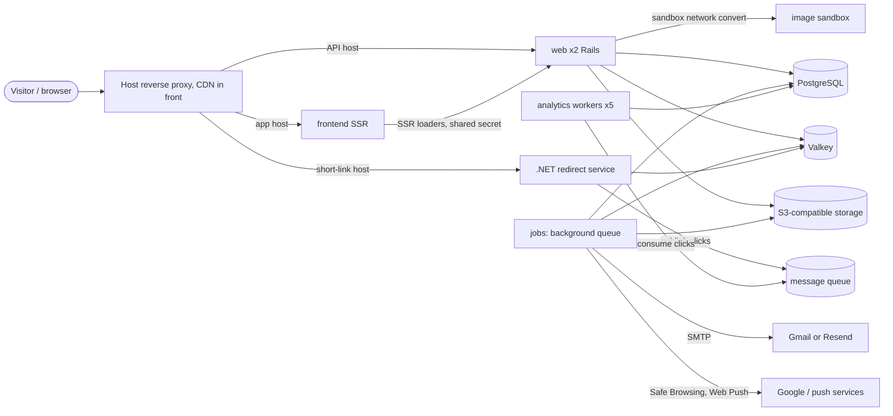

# Platform and operations

> Scope: runtime topology, deploy, pre-merge checks and security verification, job queues and the recurring schedule, rate limits, configuration, observability and the testing strategy. State as of 2026-10-17.

## Summary

Kurz runs on one self-hosted host under container orchestration, as three groups of services. The application group holds the Rails web API, the background-job process, the analytics workers, the image sandbox and the .NET redirect service. The frontend group holds the server-rendered React frontend. The data group holds the message queue, PostgreSQL and Valkey, and is deployed by hand. A merge to the main branch builds three images on a self-hosted runner and runs the deploy script, which migrates the database once and then rolls every service start-first behind a healthcheck, rolling back on failure. Pull requests are gated by automated checks (backend, frontend, end-to-end browser tests, redirect service) and by security scans; a heavier security verification runs the production image against an isolated network every night. All configuration is passed to services as environment settings defined in the stack definitions; the application reads no encrypted-credentials key by name.

## Glossary

- **Stack**: one orchestrated deployment from one definition file. There are three: the application stack, the frontend stack and the data stack.
- **Shared proxy network**: the external network shared by every stack and by the host reverse proxy. It is created outside the repository.
- **Sandbox network**: an internal network joining only the web service and the image sandbox.
- **Image sandbox**: a small, locked-down app that decodes uploaded images to WebP. The web service reaches it over the internal network only.
- **Redirect service (edge function)**: the .NET service that answers short links. It reads the cached redirect entry from Valkey and publishes clicks to the message queue. See [shortlinks](shortlinks.md).
- **Job queue**: the background-job backend, stored in the main PostgreSQL database and run by the jobs service.
- **Analytics workers**: message-queue consumers that persist click events into PostgreSQL.
- **Security verification**: the nightly suite that attacks the production image on an isolated network.
- **Start-first**: an update order in which the new task must be healthy before the old one stops.
- **Rolled back**: an update state in which an update failed and the previous release was restored (or the update paused); the deploy script detects it and fails.

## Data

Infrastructure state this page owns. Application tables are in [data-model](data-model.md).

| Store | What it holds | Persistence |
|---|---|---|
| PostgreSQL 17 | all application tables plus the background-job queue tables (jobs, executions, processes, recurring tasks, semaphores) | bind mount on the host SSD, manager node only |
| Valkey 8.1.4 | redirect entries (one per servable short link) written without expiry by Rails and read by the redirect service; the Rails cache under a dedicated namespace, with TTLs: rate-limit counters, mail budget, session revocations, MX lookups, visitor deduplication keys | append-only file persistence (fsync every second), 768 MB memory cap, eviction of keys with a TTL only |
| Message queue (RabbitMQ 3) | the durable click-event queue | bind mount on the host SSD |
| S3-compatible storage (SeaweedFS gateway) | file blobs: one bucket for avatars and covers, one private bucket for form uploads | outside the repository |

Valkey eviction rule: only keys that have a TTL can be evicted. Redirect entries have none, so they are never evicted; rate-limit counters and other cache entries can be.

## Business rules

### Topology

- **OP-01** Production runs as three stacks: the application stack (web, workers, jobs, image sandbox, redirect service), the frontend stack and the data stack (message queue, PostgreSQL, Valkey). The deploy script deploys the first two; the data stack is deployed by hand with its own script and has no rolling update, no healthchecks and no update policy.
- **OP-02** Services and replicas: web 2 replicas (2 CPU, 2048M), workers 1 (2 CPU, 1024M), jobs 1 (1 CPU, 2048M), image sandbox 1 (1 CPU, 1024M), frontend 1 (0.5 CPU, 512M), redirect service 1 (no limits). Stateful services are pinned to the manager node.
- **OP-03** Who talks to whom (see the diagram): the host reverse proxy (outside the repository) reaches web, frontend and the redirect service over the shared proxy network; web calls the image sandbox over the sandbox network only; web, jobs and workers use PostgreSQL, Valkey and the message queue over the shared proxy network; the redirect service uses Valkey and the message queue. The image sandbox is attached to the sandbox network only and receives no secrets, no database access and no Internet route.
- **OP-04** The image sandbox runs the same image as web with a read-only filesystem, all Linux capabilities dropped, an unprivileged user, a temporary in-memory filesystem for scratch files, a minimal environment (no secrets) and always-restart. The security verification confirms on every run that the sandbox runs read-only, unprivileged, with no network access to anything but its caller.
- **OP-05** The image sandbox accepts only a convert request and a health request. Limits: body 10 MB (larger bodies are rejected), a declared body length is required (requests without one are rejected), side 10,000 px and 50,000,000 pixels (larger images are rejected as too large), output longest edge 4096 px as stripped WebP, and a magic-byte check for PNG, JPEG, WebP and HEIF (other types are rejected as unsupported). Rails calls it with an open timeout of 2 s and a read/write timeout of 25 s; any failure makes the upload endpoint degrade to an "uploads unavailable" response, which the security verification asserts with the sandbox stopped.
- **OP-06** The Rails image is API-only and loads only the framework parts it uses (no Action Cable, Action Mailbox, Action Text). The web server uses 3 threads per process and, in production, forks 2 worker processes with the app preloaded (configurable; zero means a single process). A small proxy in the image fronts the web server.
- **OP-07** The click path never touches Rails: the redirect service looks up the cached redirect entry in Valkey, redirects, and writes the click to a bounded in-memory channel (10,000 items, new items dropped when full) that a background service publishes to the durable click queue. A full channel or a message-queue outage loses clicks but never delays a redirect. A Valkey error answers an "unavailable" page.
- **OP-08** Click persistence: 5 analytics workers, 1 thread each, manual acknowledgement, 60 s job timeout, durable queue. On error a worker requeues the message once; a redelivered failure is rejected (dropped) and reported to Sentry. A click for an unknown short code is rejected.
- **OP-09** Production only: forced HTTPS (TLS terminates at the proxy), an allow-list of API host names (default api.kurz.fyi) with the health endpoint exempt, and logs to standard output.
- **OP-10** The file-storage service in production is the S3-compatible gateway when a bucket is configured, otherwise local disk, so a deploy before the bucket exists still boots. Form uploads use their own private bucket only in production and only when that bucket is configured. Files are served through Rails (proxy mode), so the gateway never needs to be public.
- **OP-11** The Rails cache is a Valkey-backed Redis store (dedicated namespace, certificate verification off) in every environment except test. The same Valkey holds the redirect entries, so a cache flush must never wipe the whole database in production.
- **OP-12** Mail goes by SMTP: Gmail by default, Resend only when the Resend provider is selected and its API key is set. The sender address must match the provider. Open timeout 10 s, read timeout 15 s. The end-to-end test environment sends to a local mail catcher instead.

In the end-to-end test environment the stack is smaller: Rails (jobs run inline), the image sandbox, the built frontend, PostgreSQL, Valkey and a local mail catcher. No message queue, redirect service or background-job process.

### Release and deploy

- **OP-20** A push to the main branch runs the deploy pipeline: build the backend, frontend and redirect-service images, tag each as latest and with the commit, push to the private registry, then run the deploy script. The job runs on the self-hosted runner, one deploy at a time (no cancellation of a running deploy). The pipeline does not run tests; it relies on the pull-request checks having passed but does not enforce it.
- **OP-21** Migrations run first and once: for the application stack the deploy script runs the database prepare step in a one-off container on the shared proxy network, with the settings the migration needs, before any new container starts. A failure prints "nothing was deployed" and fails the deploy. Services are told to skip database preparation at boot, so the container entrypoint never migrates. Rationale: containers booting together raced for the migration lock and crashed with a concurrent-migration error.
- **OP-22** Optional migration role: when a separate migration owner role is configured on the deploy host (its password is then mandatory) the migration runs with that owner role, while services run as the DML-only application role. Setup and rollback are in the Postgres roles guide.
- **OP-23** Every service rolls with parallelism 1, start-first order, 10 s delay, 30 s monitor window and automatic rollback on failure; the rollback itself is also parallelism 1 and start-first. The settings are defined once per stack definition and shared by all services. The previous release serves traffic until the new task is healthy.
- **OP-24** Every rolled service has a healthcheck, otherwise the orchestrator sends traffic to a task as soon as the process starts. Probes: web checks its health endpoint (10 s interval, 3 retries, 60 s start period); workers and jobs have dedicated probe scripts (OP-25, OP-26); the image sandbox checks its health endpoint; the redirect service requests an unknown path and is healthy as long as it does not answer with a server error; the frontend fetches its crawler-policy file.
- **OP-25** The jobs probe is healthy when the job queue's process table has a supervisor row for this container's hostname with a heartbeat newer than 3 minutes (the queue beats every 60 s and prunes at 5 minutes). It uses the app's own database role.
- **OP-26** The workers probe is healthy when this container holds an established connection to the message queue and the click queue has at least one consumer. The consumer count alone would pass a bad release during start-first because the old task's consumers are still attached.
- **OP-27** The web service gets a 30 s stop grace period so the web server drains in-flight requests; the redirect service gets 20 s.
- **OP-28** The deploy script runs the stack deploy in blocking mode with pruning and registry credentials, under a timeout (default 15 minutes), then reads each service's update status. Blocking mode reports success even after the orchestrator rolled back, so any service whose state is a rollback state or paused and whose start time is not older than this deploy's start makes the script print an error and fail the deploy. Older rollback states left on untouched services are ignored.
- **OP-29** Order of stacks: the application stack first, then the frontend stack. A rollback or timeout in the application stack stops the deploy before the frontend is deployed. Images are pulled per stack first; a failed pull aborts.
- **OP-30** For a few seconds during every rollout, and indefinitely after a rollback, the previous release runs against the new schema. Migrations must be additive: add, backfill and ship the code that uses it; drop or rename only in a later release once nothing reads the old column.
- **OP-31** A new service in a stack needs a healthcheck and the shared update and rollback policy. A new configuration setting goes into the matching shared settings block of the stack definition (the one for workers, jobs and web; the one for jobs and web; or the web service only), and into the migration settings of the deploy script only if the database prepare step cannot boot without it.
- **OP-32** Images are tagged as latest and with the commit; stacks reference the latest tag. A manual rollback is a redeploy of an earlier tag; no script exists for it. Registry retention of old tags is not verified.

### Pre-merge checks

- **OP-40** Automated checks run on every pull request to the main branch (in-progress runs for the same branch are cancelled) in four groups: backend (linting, security static analysis, schema load, the test suite against PostgreSQL 17 and Valkey 8.1.4), frontend (Node 22: install, typecheck, tests, build with IPv4-first DNS), end-to-end browser tests (see testing) and the redirect service (locked restore, format check, build, tests against Valkey and the message queue).
- **OP-41** Security scans run on every pull request to the main branch in five groups: a Ruby dependency audit; an npm audit of production dependencies at high severity (fixes ship in their own pull request); a NuGet audit with the vulnerability warnings treated as errors; a secret scan of the full history with redaction; and a filesystem scan for high and critical vulnerabilities (fix available) and secrets, which fails the check when it finds any. The scans use a read-only token and no secrets.
- **OP-42** One secret-scan false positive is ignored by fingerprint (a column name that looks like a token).
- **OP-43** The security verification runs nightly, on demand, and on pull requests that touch its own files. It builds the production image, needs about 6 GB RAM, has 30 minutes, never runs on the production host and has no secrets. The dynamic web-scan baseline runs only outside pull requests (it pulls about 1 GB). Results are kept as a downloadable report.
- **OP-44** An automated dependency-update bot runs weekly with at most 3 open pull requests per ecosystem: Ruby (Rails packages grouped), npm (minor and patch grouped, TypeScript major upgrades held back until the linting tooling supports them), NuGet (two directories), Docker (the pipeline directory only) and the pipeline's own actions.
- **OP-45** Required status checks and branch protection are not defined in the repository, so which of the checks above actually block a merge is not verifiable from the code. The deploy does not wait for any of them (OP-20).
- **OP-46** Lint rules: the Ruby linter inherits the Shopify rule set plus ERB rules; migrations, the schema file, the lockfile and binstubs are excluded; 2-space indentation; four style rules are switched off. Frontend linting and formatting exist but the pre-merge checks run neither.

### Security verification

- **OP-50** The security verification proves its claims against the production image (production environment), never against production data: PostgreSQL and Valkey are throwaway, both networks are internal, nothing is published, the API answers under its production host name, and the app connects as the DML-only database role. Secrets are dummy (a fresh secret per run, a dummy Sentry address so the production Sentry setup runs).
- **OP-51** Interlocks in the verification runner refuse to run anywhere but a local development container engine: they refuse a remote container engine, the production host, and any case where the verification network is not internal.
- **OP-52** Route classification: every route of the production route table is classified (owner, public, admin, storage, auth, MCP, internal, infrastructure). An unclassified or stale route fails verification, and anonymous calls on every owner, admin and MCP route are always refused. Adding or removing a route requires updating the classification in the same pull request.
- **OP-53** Global checks after the suite: no request ended in a server error in the API log; no log line carries a respondent answer or a visitor IP (planted markers are searched for); the image sandbox has no secret-looking setting, cannot reach the database, the cache or the Internet, has a read-only filesystem and does not run as root.
- **OP-54** Failure drill: the image sandbox is stopped, then the verification asserts that an upload answers "uploads unavailable" with no leaked host or port and no row left behind, while text answers, the public form and the health endpoint keep working.
- **OP-55** The suite runs dozens of checks plus the sandbox failure drill; a failing check of default priority fails the run. Summary of what is proved:

| Group | Proof |
|---|---|
| Isolation | no Internet route; a forged host name is refused while the health endpoint answers any host; the app database role cannot change schema, create roles, read host files or run programs |
| Authentication and authorization | missing, garbage, unsigned or foreign-key bearer tokens are refused; cookie writes without the anti-forgery marker header are refused; deactivated users are refused; non-admins are refused on admin member routes; tenant isolation on every form route; mass-assignment protection |
| Public form | whitelisted public JSON; NUL bytes rejected; 30 parallel form creations give exactly 20 created and 10 limited; no lost field updates; 5 submissions per 10 minutes per IP when Turnstile is down; bodies over 64 KB and non-JSON bodies rejected; idempotency under parallel load; events counted and rate-limited; no IP, user agent or referrer stored for forms; unique-view keys in Valkey hold no IP and expire within 25 h |
| OAuth and MCP | discovery metadata comes from configuration, S256 only; registration limited to 10 an hour per IP; PKCE, code replay and refresh reuse revoke; only digests stored; consent needs cookie plus anti-forgery header; OAuth tokens are useless on the regular API; scopes decide the tool list; drafts only; no tool reads responses; delete tools only with the full-account scope |
| Uploads | real images become stripped WebP; hostile files refused before the sandbox; image bombs rejected quickly; 30 concurrent uploads never produce a server error |
| Platform | the removed mailbox ingress endpoints refuse the Internet without a server error (this check is stale, since the feature was removed, and still passes because the endpoints are gone) |
| Load | 50 parallel bookings of one place, five rounds: exactly one created; p95 under 500 ms for the public form, free times and a booking; 5,000 queued emails do not slow sign-in and the dispatcher picks a batch in under 200 ms |
| Dynamic web-scan baseline | report only: the home page, OAuth and MCP discovery documents and the public booking routes; findings are not gating |

### Testing strategy

- **OP-60** All tests, lint and typechecks run in throwaway containers, never on the host (the host has other Ruby and Node versions and macOS-only dependencies). Each suite gets its own disposable PostgreSQL and Valkey, never the development database. See "Running the tests" in Flows.
- **OP-61** Backend tests: transactional fixtures are disabled and the database is truncated before each example; background jobs use the test adapter; the Valkey database is flushed before each example when a Valkey is configured (never point it at a real Valkey); N+1 queries raise; outbound HTTP is stubbed and recorded; partial doubles are verified; the application is eager-loaded only in automated runs.
- **OP-62** Without a configured Valkey the test cache is a null store, so every test that depends on rate limiting, the mail budget or the redirect cache needs a Valkey (automated runs use a local Valkey database 0).
- **OP-63** Tests never reach DNS, Have I Been Pwned or the real providers: MX validation returns true, the pwned-passwords range call returns an empty body, and the Turnstile, mail-provider, sender-address and Google settings are removed from the environment before the suite. Safe Browsing is forced on with a test key.
- **OP-64** End-to-end browser tests: Chromium only, one worker, no parallel files, 60 s timeout, 1 retry in automated runs, Portuguese (Portugal) locale and Lisbon timezone. Rails runs in the end-to-end environment: jobs inline (so each e-mail renders with its own locale and exists when the API call returns), test file storage, SMTP to a local mail catcher, delivery errors raised. Every test flushes the Valkey cache, clears the mailbox and deletes the forms it created (an account can create 20 forms a day). Accounts are seeded before the run and signed in by injecting the session cookie.
- **OP-65** The end-to-end environment has no host allow-list, no background-job process and no Sentry, and uses the application's Redis cache. The secret that lets the SSR frontend forward the visitor IP defaults to a fixed test value when the test runner starts the servers.
- **OP-66** Frontend tests use Node's built-in test runner over the i18n, forms, agenda, notices, appointments-tab and booking-package areas; the typecheck generates route types and then runs the TypeScript compiler. There is no component or browser test below the end-to-end level.
- **OP-67** Redirect-service tests are integration tests against a real Valkey and message queue, configured through connection settings.

### Queues and jobs

- **OP-70** The background-job queue runs inside the jobs service: one dispatcher (poll 1 s, batch 500), the scheduler for the recurring schedule, and six worker groups. Queue to worker map: the default, safety, analytics and recurring-command queues share a 2-thread group (process count configurable, default 1, poll 5 s); the safety queue also has its own 1-thread worker (poll 10 s); the analytics queue its own 2-thread worker (poll 6 s); mailers 1 thread (poll 1 s, so sign-in codes are never delayed); notifications 2 threads (poll 2 s); images 1 thread (poll 2 s).
- **OP-71** The notifications queue must have exactly one worker group and it serves only that queue, so a backlog elsewhere never delays notices. The images queue has one thread cluster-wide: at most one avatar decode (up to 48 MP) at a time; the avatar optimisation job also limits concurrency to 1 per user with a 5 minute duration.
- **OP-72** The analytics queue in the job system is configured but no job uses it; click events travel through the message queue instead.
- **OP-73** Retry and discard policy: there is no default, so a failing job lands in the failed-executions table and is not retried unless the job says so. Exceptions: mail delivery retries DNS, open/read timeout, connection refused/reset and SMTP-server-busy errors up to 4 attempts with polynomial back-off (permanent SMTP errors fail at once and reach Sentry); the page-link safety check retries Safe Browsing errors up to 3 times; the data-export email retries when the mail budget is exhausted, every hour without limit; avatar optimisation discards the job when the file no longer exists.
- **OP-74** Mailers use the mailers queue and the custom mail-delivery job. File-storage analyze and purge jobs use the default queue. Job arguments are never logged.
- **OP-75** A new recurring job is added to the production schedule with its job, an explicit queue and a schedule; there is no recurring schedule in development, so it must be run by hand there. A shell-command task runs on the recurring-command queue. A new queue also needs a worker entry in the queue configuration, otherwise nothing consumes it.

### Rate limits and request guards

- **OP-80** Rate limits are enforced per controller and backed by the Rails cache, which is Valkey in production. Counters are shared by all web replicas and are keyed by the limit's name and its scope (client address, user, e-mail, ...). When the store is unreachable the request is allowed. In tests without a configured Valkey the store is null and nothing is limited (OP-62).
- **OP-81** The client address is resolved as: the visitor address forwarded by the SSR frontend when the request carries the shared forwarding secret (constant-time compare; only the SSR frontend knows it), else the CDN-supplied client address, else the connection's remote address; malformed addresses are ignored. If the forwarding secret is unset or empty the forwarded address is never trusted and SSR loaders share the frontend's address bucket.
- **OP-82** The public JSON endpoints (OAuth client registration, form events, form uploads, form responses, waitlist join) refuse bodies over 64 KB (checked on the declared length and on the actual stream) and anything that is not JSON. The MCP endpoint caps requests at 256 KB. Every controller rejects NUL bytes in parameters.
- **OP-83** Every API response carries a no-sniff content-type header and a content security policy that denies all content and forbids framing, unless the response sets its own (QR SVGs use a sandbox policy).
- **OP-84** CORS: the discovery-metadata endpoints, the OAuth token, registration and revocation endpoints and the MCP endpoint allow any origin without credentials (MCP exposes its authentication-challenge and session headers); everything else allows credentials only for the exact origins https://kurz.fyi, https://app.kurz.fyi, the configured frontend origin, plus a local development origin outside production. No wildcard subdomains, so other kurz.fyi hosts cannot act with a user's cookie.

### Observability

- **OP-90** Sentry is initialised only in production when its DSN is configured: traces sampled at 10 percent by default, profiles at 50 percent of sampled transactions by default (both configurable), no default PII, breadcrumbs from the framework logger. Rails log forwarding is on only when explicitly enabled, which the stack does on web only.
- **OP-91** A scrubber runs on Sentry events, transactions and logs: it clears request body, query string, cookies, headers and environment, cuts the URL at the query string, drops all breadcrumbs, replaces PostgreSQL error detail text in exception messages with a filtered marker, and drops log lines that echo request parameters, job arguments or database error detail. Transaction events have no exception and skip that step.
- **OP-92** Request log format: Rails' tagged logger on standard output (request-id tag, level configurable, default info). The request-start line shows the method, the filtered path and the time and deliberately omits the client IP (stock Rails prints it). The health endpoint is silenced. Visitor IP, user agent and respondent answers must stay out of logs, which the security verification enforces.
- **OP-93** Parameter filtering replaces these kinds of values in logs: passwords, e-mail addresses, secrets, tokens, keys, encrypted values, salts, certificates, one-time passcodes, national-id and card numbers and security codes, authorization codes and code verifiers, credentials, form answers, generic values and text, messages, comments, job arguments, queries and searches, file names and files, push endpoints and push subscription keys, and the exact parameter named for authentication secrets.
- **OP-94** Structured log lines are tagged for searching: OAuth events (also a Sentry warning), unauthorized MCP calls, appointments health and resolution lines, and one tag each for the short-link expiry job, the short-link purge job, the analytics worker and Turnstile. Alerts that go to Sentry as warnings: mail budget reached (once per reason per day), Turnstile unavailable, form and page abuse, appointments health (once per alert per hour).
- **OP-95** Appointments health (pointer): a job every 5 minutes computes health numbers and raises Sentry alerts for a pending request overdue by over 5 minutes, a notification queue lagging by over 5 minutes, and the email budget reaching 80 percent of the daily limit; the same numbers are available to admins through the API. Rules are owned by [appointments-lifecycle](appointments-lifecycle.md) and [admin-and-moderation](admin-and-moderation.md).

## Flows

### Release of a change

1. A pull request runs the automated checks and the security scans; the security verification runs only if its own files changed.
2. Merge to the main branch triggers the deploy pipeline on the self-hosted runner: build 3 images, tag each as latest and with the commit, and push.
3. The deploy script loads the host's secret settings file, pulls the application-stack images and runs the database migration in a one-off container on the shared proxy network.
4. The application stack is deployed: per service one new task starts, must pass its healthcheck, the monitor window (30 s) must pass, then the old task stops; 10 s delay between tasks.
5. If any service fails its update the orchestrator rolls back by itself; the deploy script sees the state, fails the deploy, and the frontend stack is not deployed.
6. The frontend stack is deployed the same way. The data stack is never touched by this flow.

### Running the tests

All suites run in throwaway containers with their own disposable PostgreSQL, Valkey and (for end-to-end) a local mail catcher, never against the compose development database and never on the host.

| Suite | What it needs |
|---|---|
| Backend (tests, lint, static security analysis) | a Ruby 4.0.7 image with libvips, a disposable PostgreSQL 17 and Valkey 8.1.4 on a private network, and the schema loaded before the tests |
| Frontend (typecheck, tests) | a Node 22 container; builds need IPv4-first DNS |
| End-to-end | the browser-test image matching the pinned test-runner version, Rails in the end-to-end environment, the built frontend and the mail catcher, all sharing one container network so the three services are reachable on localhost; the database is seeded first |
| Redirect service | the .NET SDK version pinned by the repository, with Valkey and the message queue reachable |
| Security verification | run on a developer machine with a local container engine; the dynamic web-scan baseline is optional |

### Local development

The compose file starts the message queue, PostgreSQL (trust auth), Valkey, the backend and the redirect service; it needs a root settings file for the message-queue, Valkey and redirect-service settings. The frontend runs separately. The backend's process file starts the web server, the analytics workers and the jobs process. The dev container composes the same services plus a workspace container.

## States and transitions

Update states that the deploy script interprets (the only status-like value this page owns):

| State | Meaning | Deploy script outcome |
|---|---|---|
| updating, completed | rolling or finished | success when the stack deploy returns success |
| rollback started, rollback completed, rollback paused | update failed, previous release restored | fails the deploy if the state is not older than the deploy start |
| paused | update paused after failure | fails the deploy if the state is not older than the deploy start |
| any state older than this deploy | stale status of an untouched service | ignored |

## Limits and configuration

### Recurring jobs (production only)

Schedules are evaluated in the jobs container's timezone (UTC unless configured otherwise).

| What runs | When | Queue | Why / what it does | Owner page |
|---|---|---|---|---|
| Finished-job cleanup | every hour at minute 12 | recurring-command | clears finished jobs from the job queue in small batches so the table does not grow | this page |
| Short-link inactivity expiry | at 3am every day | default | deactivates links with no click for 30 days (counting from creation when never clicked) | [shortlinks](shortlinks.md) |
| Orphan form-upload cleanup | every 15 minutes | default | destroys form uploads with no response after 1 hour (cover excluded) | [forms](forms.md) |
| Form abuse detection | every 10 minutes | default | unpublishes forms over 600 responses or 300 MB uploads in the last hour, alerts Sentry | [admin-and-moderation](admin-and-moderation.md) |
| Visitor IP purge | at 4:15am every day | default | nulls IP, user agent and referer on events, page link clicks and audits older than 90 days | [admin-and-moderation](admin-and-moderation.md) |
| Deleted-account purge | at 4:30am every day | default | purges deactivated users whose deletion request is past the grace period | [accounts-and-auth](accounts-and-auth.md) |
| MCP tool-call log purge | at 4am every day | default | deletes MCP tool-call log rows older than 90 days | [mcp-and-oauth](mcp-and-oauth.md) |
| Scheduled short-link expiry | every 5 minutes | default | deactivates links past their owner-set expiry and removes their cache entry | [shortlinks](shortlinks.md) |
| Stale avatar-upload cleanup | every 15 minutes | default | purges raw avatar uploads older than 1 hour that were never optimized | [bio-pages](bio-pages.md) |
| Page-link safety recheck | at 4am every day | safety | re-queues Safe Browsing checks for links unchecked for 1 day, in batches of 500; does nothing unless Safe Browsing checks are enabled | [bio-pages](bio-pages.md) |
| Page abuse detection | every hour at minute 40 | default | raises admin signals for 3 or more new accounts publishing the same text or links within 24 hours | [admin-and-moderation](admin-and-moderation.md) |
| Unverified-user cleanup | every day at 3:30am | default | destroys users never verified after 1 day | [accounts-and-auth](accounts-and-auth.md) |
| Notification purge | at 4:45am every day | default | deletes notifications older than 90 days | [notifications-and-email](notifications-and-email.md) |
| Notification dispatch | every minute | notifications | picks up to 200 due pending notifications and enqueues email or push delivery | [notifications-and-email](notifications-and-email.md) |
| Appointment reminders | every 5 minutes | notifications | sends due appointment reminders | [appointments-lifecycle](appointments-lifecycle.md) |
| Pending-appointment resolution | every minute | notifications | resolves overdue pending requests and sweeps the waitlist | [appointments-lifecycle](appointments-lifecycle.md) |
| Appointments health | every 5 minutes | default | computes health numbers and raises Sentry alerts (OP-95) | [appointments-lifecycle](appointments-lifecycle.md) |

Background jobs that run on demand rather than on the schedule: the short-link and page-link safety checks (safety queue), avatar optimisation (images), short-link purge (default), notification and push delivery (notifications), mail delivery and data-export email (mailers).

### Rate limit catalogue

All limits are per scope key, kept in the Rails cache (Valkey). "IP" means the resolved client address (OP-81). Exceeding a limit answers "too many requests" unless noted. Owner pages hold the product rules.

| Action | Limit | Window | Scope | Owner page |
|---|---|---|---|---|
| Request a login code | 10 | 10 min | IP | [accounts-and-auth](accounts-and-auth.md) |
| Request a login code | 30 | 1 day | IP | accounts-and-auth |
| Request a login code | 5 | 10 min | normalized e-mail | accounts-and-auth |
| Verify a login code | 10 | 15 min | normalized e-mail | accounts-and-auth |
| Password login | 20 | 10 min | IP | accounts-and-auth |
| Password login | 10 | 15 min | normalized e-mail | accounts-and-auth |
| Google login | 20 | 10 min | IP | accounts-and-auth |
| Sign up | 10 | 1 h | IP | accounts-and-auth |
| Forgot password | 10 | 1 h | IP | accounts-and-auth |
| Reset password | 10 | 15 min | e-mail parameter | accounts-and-auth |
| Change own password | 10 | 15 min | user | accounts-and-auth |
| Delete own account | 5 | 1 h | user | accounts-and-auth |
| Request a data export | 1 | 1 week | user (refused with a weekly-limit message) | accounts-and-auth |
| Create a short link | 60 | 10 min | user | [shortlinks](shortlinks.md) |
| Unlock a protected short link | 10 | 5 min | short code + IP | shortlinks |
| View a public bio page | 120 | 1 min | IP | [bio-pages](bio-pages.md) |
| Count a bio-page link click | 30 | 1 min | IP (plus 10 s deduplication per visitor key; answers "too many requests" without a body) | bio-pages |
| Create a bio page | 10 | 1 h | user | bio-pages |
| Upload a page avatar | 5 | 10 min | user | bio-pages |
| Upload a page avatar | 20 | 1 day | user | bio-pages |
| Upload a page avatar | 20 | 1 h | IP | bio-pages |
| Publish a page template | 5 | 1 day | user | bio-pages |
| Report a community template | 20 | 1 h | user | [admin-and-moderation](admin-and-moderation.md) |
| View a public form | 120 | 1 min | IP | [forms](forms.md) |
| Submit a form response | 30 | 10 min | IP | forms |
| Submit a form response | 5 | 10 min | IP, only while Turnstile is unavailable | forms |
| Send a form event | 60 | 1 min | IP (answers "too many requests" with an empty body) | forms |
| Upload a file to a form field | 15 | 10 min | IP | forms |
| Fetch a public form cover | 240 | 1 min | IP | forms |
| Set a form cover | 20 | 10 min | user, else connection address | forms |
| Export form responses | 10 | 1 h | user | forms |
| Create a form (not a request throttle) | 20 created | per day | user (refused with a daily-limit message) | forms |
| List free booking slots | 120 | 1 min | IP | [booking-engine](booking-engine.md) |
| View a booking via its link | 60 | 1 min | IP | [appointments-lifecycle](appointments-lifecycle.md) |
| Cancel a booking via its link | 20 | 1 min | IP | appointments-lifecycle |
| View or submit an appointment verification | 60 / 20 | 1 min | IP | appointments-lifecycle |
| View or submit an appointment decision | 60 / 20 | 1 min | IP | appointments-lifecycle |
| View a waitlist entry | 60 | 1 min | IP | appointments-lifecycle |
| Claim or leave a waitlist slot | 20 | 1 min | IP | appointments-lifecycle |
| Join a form's waitlist | 10 | 10 min | IP | appointments-lifecycle |
| Fetch a calendar feed | 60 | 1 min | IP | appointments-lifecycle |
| Request a booking manage link | 20 | 1 min | user | appointments-lifecycle |
| OAuth token exchange | 60 | 1 min | client id (first 64 characters) | [mcp-and-oauth](mcp-and-oauth.md) |
| OAuth client registration | 10 | 1 h | IP | mcp-and-oauth |
| OAuth authorization (consent) | 30 | 1 min | user | mcp-and-oauth |
| MCP endpoint, any call | 120 | 1 min | OAuth grant | mcp-and-oauth |
| MCP write tools, all together | 30 per minute and 500 per day | rolling window buckets | user | mcp-and-oauth |
| MCP per-tool limits | 10 to 120 an hour, some with a daily cap (for example create short link 20/h and 100/d, create page 10/h and 50/d, delete tools 10/h and 30/d) | per tool | user | mcp-and-oauth |
| MCP appointment manage tools | 30 per hour and 100 per day, one shared bucket | | user | mcp-and-oauth |

Not rate-limited: OAuth token revocation, the discovery documents, the short-link unlock page view, and all owner and admin endpoints not listed above (they need a session). Related caps that are not request throttles: login code attempts (5), password lock-out (exponential up to 1 hour), the e-mail budget (below) and a total form-upload size of 20 GB. Besides the per-limit counters, Valkey also holds counters for the mail budget (day, month, new-address day), the MCP write throttle and the weekly data export.

Mail budget (all cache counters, shared by web and jobs): 100 per day, 3000 per month and 40 per day for new addresses (all configurable); a lower-priority sender takes only a share of the budget (data export uses half). A refused reservation returns its increments and alerts Sentry once per reason per day. Owned by [notifications-and-email](notifications-and-email.md).

### Configuration

All configuration reaches services as environment settings defined in the stack definitions; this page does not list them by name. The production stack marks the web, jobs and workers settings as shared blocks (OP-31), and the table of defaults below is stated in plain terms.

- **Backend core.** The database connection and the message-queue connection are required for every backend service, as is the Valkey connection for web, jobs, workers and the redirect service (the redirect service defaults to a local Valkey and a local message queue with a guest user). The Rails environment is production in the stack. Either the encrypted-credentials master key or a secret key base is required in production. The web server defaults to 3 threads and a database pool of 5; production forks 2 worker processes, other environments none. Database names are fixed per environment, so a database-name setting passed to the containers has no effect on the app. Services skip database preparation at boot; only the deploy script migrates.
- **URLs and hosts.** The frontend origin defaults to https://kurz.fyi (a local origin for end-to-end tests) and drives CORS, links in e-mail and tools, the OAuth authorize address and the redirect service's fallback. The API host allow-list defaults to api.kurz.fyi. The short-link base URL is required. The image sandbox address is required for form uploads and covers and is not given to jobs (D-OP-04).
- **Mail.** SMTP login is required unless Resend is used; the sender falls back to a fixed Kurz address when no login is set. The Resend switch needs both the provider choice and its API key. The mail budget defaults to 100 per day, 3000 per month and 40 per day for new addresses.
- **Optional integrations, each off when unset.** Web Push needs its three signing values together. Turnstile needs its secret key, and its allowed hostnames are fixed to kurz.fyi in the stack. Google sign-in needs its client ids and secret. Safe Browsing checks turn on when enabled and then require an API key (a missing key raises an error); the referer sent to Safe Browsing defaults to a local address. The S3-compatible storage needs endpoint, credentials and a bucket (no bucket means local disk), and form uploads need a second private bucket.
- **MCP and OAuth.** The MCP, OAuth and discovery endpoints are served only when MCP is explicitly enabled. The OAuth issuer defaults to the API origin on api.kurz.fyi; allowed OAuth redirect hosts default to claude.ai, claude.com and chatgpt.com; extra allowed origins for the MCP endpoint default to none.
- **SSR forwarding.** A shared secret, identical in the application and frontend stacks, lets the SSR frontend forward the visitor IP (OP-81); empty means forwarding is off.
- **Observability.** Sentry is enabled by its DSN, with sampling of 10 percent for traces and 50 percent for profiles (OP-90), forwarding of Rails logs enabled on web only, and a configurable log level defaulting to info. The analytics worker log level defaults to errors only. A request-logging toggle is set in the stack but read by nothing (a dead setting).
- **Deploy host.** The optional migration owner role (OP-22) and the deploy timeout (default 15 minutes, OP-28) are read by the deploy script from the host's settings file.
- **Local development.** Published ports for the message queue, Valkey and the redirect service are configurable and default to the standard ones; the end-to-end test runner has its own settings for API, app, cache and mail-catcher addresses and whether it starts the servers itself.
- **Frontend build and runtime.** The API origin (default the production API), the Turnstile site key and the Google client id are baked into the bundle at build time with public image defaults; the widget or button is hidden when its value is empty. Builds need IPv4-first DNS so the prerender can reach the IPv4-only preview server. The frontend server port is set by the stack (a different port in end-to-end tests). The redirect service listens on its own configured port.
- **Automated runs.** A flag marking an automated run makes the test environment eager-load the application and makes the browser tests retry once.

Encrypted credentials: the application reads no credentials key by name. The only value taken from credentials or the secret key base is the secret key base, which derives the session-token key and the daily visitor-hash key for unique form views; file-storage signed ids use it too (framework behaviour). Encrypted credentials files exist for development, production and staging. Rotating the secret key base signs every user out.

### Fixed runtime values

| Name | Value |
|---|---|
| Ruby / Rails | 4.0.7 / 8.1.4 |
| Locales | English (default) and Portuguese (Portugal), fallbacks on |
| Image bases | slim Ruby 4.0.7 (backend), Node 26 (frontend image), .NET SDK 10.0 and ASP.NET 10.0 chiseled (redirect service), all pinned by digest |
| Production gems | development and test groups excluded |
| Container user | non-root in every image |
| Memory allocator | jemalloc |
| libvips | blocks untrusted loaders (libvips 8.13+), cache 0, concurrency 2, loaded at boot in Rails and in the image sandbox |
| Frontend prerender | the home, login, login-confirmation, about and report pages (SSR on) |

## Authorization and privacy

- Operators only: the deploy script reads secrets from a settings file on the host; they reach services through the orchestrator's environment, not files in the repository.
- The runtime database role should be the DML-only application role; the owner role is used only by deploy-time migrations when a migration owner is configured (OP-22).
- Privacy controls that live in platform configuration: IP, user agent and referer purge after 90 days (recurring job above), request logs without IP (OP-92), Sentry without PII, cookies or bodies (OP-91), log parameter filtering (OP-93), and security verification that fails the build if answers or visitor IPs reach logs (OP-53).
- The security policy asks reporters to use GitHub private reporting; scope is api.kurz.fyi, kurz.fyi and this repository; volumetric DoS and social engineering are out of scope. See [SECURITY.md](../SECURITY.md).

## API and UI surface

There is no end-user UI here; the operational surface is:

| Capability | Component | Purpose |
|---|---|---|
| Health endpoint | web | liveness; no host check, log silenced; used by the orchestrator's healthcheck and the security verification |
| Health endpoint | image sandbox | liveness |
| Unknown-path request | redirect service | liveness (healthy as long as it does not answer with a server error) |
| Crawler-policy file | frontend | liveness |
| Appointments health numbers | web (admins) | the same numbers that drive the Sentry alerts (OP-95) |
| Direct-upload and disk-service endpoints | web | explicitly refuse; files are served through Rails (OP-10) |
| Jobs process and probe | jobs | background-job supervisor and its healthcheck |
| Analytics workers and probe | workers | click consumers (the runner fails if no worker is found) and their healthcheck |
| Maintenance commands | operators | run the inactivity expiry by hand; rewrite every redirect entry in place without flushing the cache |
| Database prepare | deploy | migrate (only the deploy script does this in production) |

## Decisions

### D-OP-01 Migrate once, before the rollout
**Decision.** The deploy script runs the database prepare step in a one-off container; services are told to skip it at boot. **Why.** Containers starting together raced for the migration lock and the losers crashed; a failing migration now stops the deploy before new code meets an old schema. **Consequence.** The previous release always meets the new schema, hence the additive-migration rule (OP-30).

### D-OP-02 Start-first rolling updates behind healthchecks with automatic rollback
**Decision.** All services use start-first, parallelism 1, a 30 s monitor window and automatic rollback, and the deploy script reads the update state. **Why.** The orchestrator added a container to the service address as soon as it started and single-replica services stopped the old task first; a rehearsal at about 20 requests per second saw 174, 158 and 152 refused connections before and none after; blocking deploy mode reports success even after a rollback. **Consequence.** Two copies of jobs and workers briefly coexist (memory sizing).

### D-OP-03 Probes that do not boot Rails
**Decision.** Jobs and workers are probed by small scripts that check the job-queue heartbeat and the message-queue consumer, using about 0.1 s and 34 to 42 MB. **Why.** Without a healthcheck a release that boots and then hangs passed the rollout. **Consequence.** A new background process needs its own probe.

### D-OP-04 Sandbox for image decoding
**Decision.** Decoding runs in the image sandbox on an internal network, read-only, capability-free, with no secrets (OP-04). **Why.** Image decoders are the highest-risk code path for hostile uploads; Rails degrades to an "uploads unavailable" response when the sandbox is down. **Consequence.** Avatars are decoded by the avatar optimisation job in the jobs service, not in the sandbox, so the sandbox covers form covers and form uploads only; verify before relying on it for avatars.

### D-OP-05 Least-privilege database role
**Decision.** The runtime database role has DML only; migrations use an owner role. **Why.** A SQL injection must not change the schema or read the host (see the Postgres roles guide). **Consequence.** Any new extension, DDL at runtime or object creation in the app breaks in production when the switch is made.

### D-OP-06 Security verification on the production image, isolated
**Decision.** A suite runs inside the production image on an Internet-less network, checking for server errors, leaked answers and visitor IPs, and sandbox isolation, plus a route classification that fails on drift. **Why.** Behaviour must be proven on the real stack; the route-drift guard was added with the classification. **Consequence.** New routes need a classification entry (OP-52).

### D-OP-07 Run e2e jobs inline
**Decision.** The end-to-end environment runs background jobs inline. **Why.** With the asynchronous adapter, pool threads inherited another thread's locale state and about one run in four sent a Portuguese e-mail in English. **Consequence.** End-to-end tests cannot exercise retry, queue ordering or enqueue timing.

### D-OP-08 Valkey eviction policy: only keys with a TTL
**Decision.** Valkey is capped at 768 MB and only evicts keys with a TTL. **Why.** Redirect entries have no TTL and must survive memory pressure. **Consequence.** Rate-limit and budget counters can be evicted under memory pressure; redirect entries cannot, so a runaway set of TTL-less keys would exhaust memory and reject writes.

### D-OP-09 Puma cluster mode in production
**Decision.** Two forked workers with the app preloaded. **Why.** One process with 3 threads used about one core under Ruby's global lock while each replica has 2 CPUs. **Consequence.** Memory per replica rises; code run at boot must be fork-safe.

### D-OP-10 Sentry sampling from the environment
**Decision.** Trace and profile sampling rates are read from the environment (10 and 50 percent). **Why.** Sampling at 100 percent traced and profiled every request, including the public form and slot endpoints.

## Change impact

- Add a migration: write it for the previous release (OP-30); the pre-merge checks load the schema, so do not hand-edit it; update [data-model](data-model.md); a new table is granted to the DML role by default privileges (see the Postgres roles guide).
- Add a route: classify it in the security verification's route classification (OP-52), picking the class that matches its authentication (public, owner, admin, auth, MCP); decide its rate limit and add it to the catalogue above; add test coverage.
- Add a public endpoint that accepts JSON: apply the 64 KB and JSON-only guard (OP-82), add a rate limit keyed by client address (OP-81), keep IP, user agent and answers out of logs (OP-92, OP-93, OP-53).
- Add a configuration setting: add it to the right shared block of the stack definition (OP-31), to the frontend stack for the frontend, to the deploy script's migration settings if boot needs it, to the local development settings if local dev needs it, and to the configuration section above. Frontend build-time settings are baked into the bundle and must also be passed as a build argument in the frontend image.
- Add a service: healthcheck, shared update and rollback policy, resource limits, correct network (internal network only for sandboxes), a probe script if it is a worker, and a security-verification decision if it handles untrusted input.
- Add a job: pick a queue (add a worker group if it is a new queue), add it to the production schedule if periodic, make an explicit retry decision (there is no default), keep argument logging off, and add test coverage; schedule-time collisions around 04:00 are intentional spacing (4:00, 4:15, 4:30, 4:45).
- Change a mail limit or provider: [notifications-and-email](notifications-and-email.md), the mail-budget counters, the provider settings and the data-export share.
- Change the forwarding-secret handling or client-address resolution: every IP-keyed limit and the frontend's visitor forwarding change together ([frontend-architecture](frontend-architecture.md)).
- Change the Valkey instance, key layout or eviction: the redirect service's reads ([shortlinks](shortlinks.md)), the Rails cache namespace, how redirect entries are written, and the security verification that scans the cache namespace for visitor data.
- Change image-sandbox limits: the Rails call timeouts, upload size limits in [forms](forms.md) and [bio-pages](bio-pages.md), and the upload and failure-drill verifications.
- Change CORS or default headers: [frontend-architecture](frontend-architecture.md) (CSP) and OAuth clients ([mcp-and-oauth](mcp-and-oauth.md)).
- Change the Node, Ruby or .NET version: the Dockerfiles, the pre-merge check definitions, the backend test image and the container test recipes.
- Docs to update with a deploy change: the contributor instructions, the Postgres roles guide, and the end-to-end and backend setup guides.

## Drift and open questions

- **Medium** The deploy pipeline does not depend on the pre-merge checks; nothing re-runs tests on the main branch, so a merge with a red or skipped check deploys. Branch protection is not in the repository (OP-45).
- **Medium** The contributor instructions say the backend test image is built from the backend Dockerfile, but that Dockerfile installs no libvips while the application loads libvips at boot (the automated checks install libvips and the HEIF plugin). The image must add libvips; the recipe is incomplete.
- **Medium** Node versions diverge: the automated checks and the frontend's own Dockerfile use Node 22 (and the contributor instructions mandate it) while the deployed image uses Node 26. Tests do not run on the version that ships.
- **Low** A static-SPA web-server config is referenced by nothing; the frontend is now SSR. The frontend's own Dockerfile and compose file are also unused by deploy. The reverse-proxy config lives outside the repository, so the real proxy routing and CDN setup cannot be verified.
- **Low** A request-logging toggle is set in the stack and the security verification but read by nothing (the IP-free request line is unconditional).
- **Low** A database-name setting is passed to Rails containers but the database name is fixed to the production one; setting a different name has no effect on the app.
- **Low** The job base class has no retry or discard policy, and the analytics queue in the job system is configured but never used. Failed jobs stay in the failed-executions table; the recurring schedule only clears finished jobs, not failed ones.
- **Low** The route classification's header lists classes without MCP, and one verification still tests the removed mailbox feature (it passes because the endpoints are gone). Two leftover tables (a cache and a cable table) remain in the schema by design.
- **Low** The local development environment sets the frontend origin to a different local port than the one CORS allows outside production; local dev needs that setting adjusted. The README still describes the redirect as a Cloudflare worker; it is a .NET service.
- **Low** A comment in the security compose file points to a planning document that is not in the repository.
- **Low** The database-stack deploy script prints "force recreate" but passes no such flag.
- **Low** The Postgres roles guide is consistent with the deploy script; whether production currently runs as the DML-only application role cannot be verified from the repository.
- **Low** The 90-day MCP tool-call and visitor-IP retentions and the 15-minute automated-check and end-to-end timings are defined only in code; there is no ops runbook for restoring PostgreSQL, Valkey or message-queue volumes.
