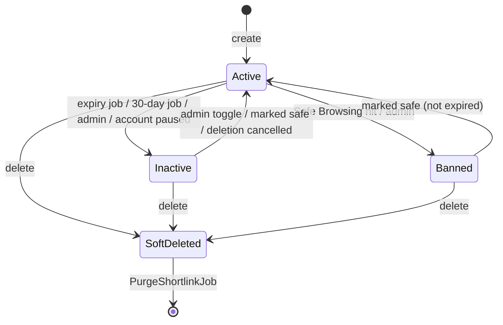

# Short links

> Scope: short links, the redirect path (edge function, Valkey, RabbitMQ, analytics worker), click events and statistics, expiry, password lock, QR codes, URL safety. State as of commit `bc7f65c` (2026-10-17).
> Main code: `backend/app/models/shortlink.rb`, `backend/app/models/event.rb`, `backend/app/controllers/api/me/shortlinks_controller.rb`, `backend/app/controllers/api/public/shortlink_unlocks_controller.rb`, `backend/app/jobs/*shortlink*`, `backend/app/jobs/safety_url_job.rb`, `backend/app/workers/analytics_worker.rb`, `backend/lib/google_lib.rb`, `edge-function/*.cs`, `frontend/app/components/shortlink-card/`, `frontend/app/routes/{dashboard,links,unlock}/`.

## Summary

A signed-in user turns an http(s) URL into `EDGE_API/<code>`, a random 6-character alphanumeric code. Rails stores the link in Postgres and writes a small JSON document under the raw Valkey key `shortlink:<code>`; the edge function (.NET 10, service `serveless`) reads only that key on every request and answers with a 302 to the destination, a 302 to the password page `/s/<code>`, a 302 to `/404`, or a 503 when Valkey fails. For tracked redirects the edge publishes a 9-key JSON click to the durable RabbitMQ queue `analytics`; a Sneakers worker (`AnalyticsWorker`) turns it into an `Event` row. Statistics are all-time `GROUP BY` counts over events. Expiry, deactivation, safety bans and deletion all work by removing the Valkey key, because the edge knows nothing else about a link. Anonymous creation was removed on 2026-07-13 (`2de5270`); the frontend still carries dead code for it.

## Glossary

- **Short link** (`Shortlink`): one row in `shortlinks`; owned by one user (`user_id NOT NULL`).
- **Short code** (`short_code`): the path segment after the edge host; generated, never chosen by the user.
- **Short URL** (`Shortlink#short_url`): `"#{ENV["EDGE_API"]}/#{short_code}"`.
- **Cache entry**: the Valkey string `shortlink:<code>` written by `Shortlink#save_cache`; the contract with the edge.
- **Servable** (`Shortlink#servable?`): `inactive_at IS NULL && safe && !expired?`; only servable links have a cache entry.
- **Inactive** (`inactive_at`): a timestamp, not a status enum. Set by expiry, by 30 days without clicks, by a safety ban, by an admin, or by account deactivation; the reason is not stored.
- **Locked link**: a link with a `password_digest`; the edge sends visitors to `/s/:code` instead of the destination.
- **Event** (`Event`): one recorded click on a short link.
- **Soft delete** (`deleted_at`): hides the link through `default_scope`; `PurgeShortlinkJob` removes the row and its events later.
- **Edge** / **edge function**: `edge-function/`, the redirect service; image `shortener-edge`, swarm service `serveless`, port 8000.

## Data

See [data-model](data-model.md) for the full catalogue.

**`shortlinks`** (`backend/db/schema.rb:465`)

| Column | Type / default | Notes |
|---|---|---|
| `short_code` | string, not null | unique index `index_shortlinks_on_short_code` |
| `original_url` | string, not null | stored as submitted (no normalisation) |
| `title` | string | ≤ 255 (contract) |
| `user_id` | bigint, not null | FK `shortlinks → users`, no `ON DELETE` (`backend/db/schema.rb:707`) |
| `password_digest` | string | bcrypt via `has_secure_password` |
| `expires_at` | datetime | partial index `index_shortlinks_on_expires_at WHERE expires_at IS NOT NULL AND inactive_at IS NULL` |
| `inactive_at` | datetime | null = active |
| `safe` | boolean, default `true`, not null | false = banned by Safe Browsing or admin |
| `safe_checked_at` | datetime | admin-only in the serializer |
| `last_accessed_at` | datetime | set from each event's `clicked_at` |
| `events_count` | integer, default 0 | counter_culture from `Event` |
| `deleted_at` | datetime | indexed; soft delete |

**`events`** (`backend/db/schema.rb:172`): `shortlink_id` (not null, FK `ON DELETE CASCADE`, `backend/db/schema.rb:682`), `clicked_at` (not null), `ip_address`, `user_agent`, `referer`, `country_code`, `region`, `platform`, `browser` (all strings, ≤ 255 by model validation). Indexes: `shortlink_id`; partial `index_events_ip_retention (clicked_at) WHERE ip_address IS NOT NULL` for the IP purge (`a8f555f`, #89).

**Counters**: `users.shortlinks_count` counts links with `deleted_at IS NULL` (dynamic counter_culture column, `9468489`, #298).

**Valkey** (same DB as `Rails.cache`, which lives under the `kurz:` namespace):

| Key | Value | TTL | Writer | Reader |
|---|---|---|---|---|
| `shortlink:<code>` | `{"t":"url","v":"<original_url>"}` | none | `Shortlink#save_cache` (raw connection, no namespace) | edge `Cache.LookupAsync` |
| `shortlink:<code>` | `{"t":"locked"}` | none | same, when `password_digest` present | edge |
| `shortlink:<code>` | legacy raw URL string | none | old releases only; rewritten by `shortlink:update_cache` | edge (still accepted) |
| `kurz:*` rate-limit counters | `shortlink_create`, `shortlink_unlock` | rate window | Rails `rate_limit` | Rails |

**RabbitMQ**: queue `analytics`, durable, non-exclusive, no auto-delete, default exchange, routing key `analytics` (`edge-function/Analytics.cs:23`, `:84`; `backend/app/workers/analytics_worker.rb:5`).

## Business rules

### Short codes

- **SL-01** A code is `SecureRandom.alphanumeric(6)`: 6 characters from `[A-Za-z0-9]`, case-sensitive (62^6 ≈ 5.7 × 10^10 codes). — `backend/app/models/shortlink.rb:165`.
- **SL-02** The generator loops until the code is not used by any row, soft-deleted rows included; a purged link frees its code for reuse. The unique index is the final guard (a concurrent duplicate raises `ActiveRecord::RecordNotUnique`, not a validation error, inferred). — `backend/app/models/shortlink.rb:166-169`, `backend/db/schema.rb:482`, model `validates :short_code, uniqueness: true` `backend/app/models/shortlink.rb:57`.
- **SL-03** There are no custom codes and no reserved-word list. `short_code` is not in either contract, so a client cannot set it. The edge reserves only `/` and `/404` (served as the 404 page); 6-character codes cannot collide with them. — `backend/app/contracts/shortlink_contract.rb:2-8`, `edge-function/Program.cs:50`.
- **SL-04** The code never changes: updates keep it, so the short URL, QR code and analytics stay attached to the same record. `short_code` is excluded from audits. — `backend/app/models/shortlink.rb:34`; test `backend/spec/requests/api/me/shortlinks_update_spec.rb:37`, `:55`.

### URL validation and normalisation

- **SL-05** `original_url` is required on create, ≤ 2048 characters, and must parse with Ruby `URI.parse(value.strip)` as `URI::HTTP` (http or https) with a non-empty host; `javascript:`, `data:`, `ftp:`, `https://` and free text are rejected with 422 `"must be a valid http or https URL"`. — `backend/app/contracts/application_contract.rb:16-24`, `backend/app/contracts/shortlink_contract.rb:3`, `:10`; test `backend/spec/requests/api/me/shortlinks_create_spec.rb:18`, `:28`.
- **SL-06** Rails stores the URL as submitted: the `strip` is used only for the check, nothing is lower-cased, punycoded or re-encoded. — `backend/app/controllers/api/me/shortlinks_controller.rb:39`.
- **SL-07** The edge normalises at redirect time with `System.Uri`: IDN hosts become punycode, scheme and host are lower-cased, default ports dropped, a bare host gets `/`, non-ASCII path/query bytes are percent-encoded; a value that is not absolute http(s) or that breaks IDN rules is treated as not found. — `edge-function/Cache.cs:91-106`; test `edge-function/Edge.Tests/CacheTests.cs:69`, `:85`. Rationale: the Deno edge used the WHATWG parser; `URI.parse` in Rails rejects every input whose outcome differs (`206c134`, #318).
- **SL-08** Title is optional, ≤ 255 characters (REST) or ≤ 120 (MCP `create_shortlink`). — `backend/app/contracts/shortlink_contract.rb:4`, `backend/app/services/mcp/tools/create_shortlink.rb:4`. Rationale for the REST caps: bulk abuse and huge rows (`5935334`, #81).
- **SL-09** The frontend checks URLs with zod `z.url()` only (any scheme); the backend contract is the real gate. — `frontend/app/modules/quick-create/use-quick-create.tsx:13`, `frontend/app/components/shortlink-card/edit-shortlink-form.tsx:24`.

### Who can create

- **SL-10** Only signed-in users create links: `POST /api/me/shortlinks` (`authenticate_user!`) or the MCP tool `create_shortlink` (scope `shortlinks:write`). `POST /api/shortlinks` returns 404. — `backend/app/controllers/api/me/shortlinks_controller.rb:2`, `backend/config/routes.rb:59`; test `backend/spec/requests/api/shortlinks_spec.rb:8`. Anonymous creation, `created_by_guest` and `PublicShortlinkSerializer` were removed in `ef3973c` and `2de5270` (no body; Rationale: not recorded).
- **SL-11** REST creation is limited to 60 per user per 10 minutes (`rate_limit name: "shortlink_create"`, keyed by user id), 429 `{"error":"Too many links created, please try again later"}`. — `shortlinks_controller.rb:5-10`; test `backend/spec/requests/api/me/shortlinks_create_spec.rb:39`. MCP creation has its own limits, 20/hour and 100/day, and does not count against the REST limit. — `backend/app/services/mcp/tools/create_shortlink.rb:19`.
- **SL-12** Creating a form creates a short link for it (`original_url = FRONTEND_URL/f/<public_id>`, title cut to 120) through the same model callbacks; deleting the form soft-deletes it. See [forms](forms.md). — `backend/app/models/form.rb:15`, `:40-46`; test `backend/spec/requests/api/me/forms_spec.rb:108`, `e2e/tests/publish.spec.ts:52`.
- **SL-13** On create a link can carry `title`, `password` and `expires_at` (REST) or `title` and `expires_at` (MCP; no password). The dashboard quick-create form sends only `original_url` and `title`. — `backend/app/contracts/shortlink_contract.rb:2-8`, `backend/app/services/mcp/tools/create_shortlink.rb:9-16`, `frontend/app/modules/quick-create/use-quick-create.tsx:11-14`.

### Expiry and deactivation

- **SL-14** `expires_at` is optional; when given it must be in the future at validation time (`"must be in the future"`); `null` removes it. Enforced in the contract and in the edit form; the database accepts any value. — `backend/app/contracts/shortlink_contract.rb:16-18`, `backend/app/contracts/shortlink_update_contract.rb:16-18`, `frontend/app/components/shortlink-card/edit-shortlink-form.tsx:37-40`; test `backend/spec/requests/api/me/shortlinks_password_expiration_spec.rb:55`, `:65`, `:71`.
- **SL-15** `ExpireScheduledShortlinksJob` runs every 5 minutes and calls `expire!` on each link in `Shortlink.expired` (`inactive_at IS NULL AND expires_at <= now`), one by one: the cache key is deleted, then `inactive_at = now`. A link therefore keeps redirecting at the edge for up to 5 minutes past `expires_at`; the unlock endpoint stops at once because it checks `servable?`. — `backend/app/jobs/expire_scheduled_shortlinks_job.rb:10`, `backend/app/models/shortlink.rb:51`, `:142-145`, `backend/config/recurring.yml:40-43`; test `backend/spec/jobs/expire_scheduled_shortlinks_job_spec.rb:4`, `:17`, `backend/spec/models/shortlink_cache_spec.rb:25`.
- **SL-16** `ExpireInactiveShortlinksJob` runs daily at 03:00 and sets `inactive_at = now` on every active link whose `COALESCE(last_accessed_at, created_at)` is older than 30 days, with one `update_all`. It does not delete the cache keys and writes no audit rows (see Drift D1). — `backend/app/jobs/expire_inactive_shortlinks_job.rb:4-12`, `backend/config/recurring.yml:16-19`; rake `shortlink:clear_policy` runs it now (`backend/lib/tasks/shortlink.rake:3`); test `backend/spec/tasks/shortlink_task_spec.rb:19`.
- **SL-17** There is no start date / "go live at" scheduling. "Scheduling" in the README and landing page means the scheduled expiration of SL-15. — `README.md:39`, `frontend/app/routes/index.tsx:64`.
- **SL-18** An owner cannot deactivate or reactivate a link: no owner endpoint exists. Ways back to `inactive_at = nil`: admin `toggle_active`; `mark_as_safe!` (Safe Browsing or admin), which clears `inactive_at` unless the link is past `expires_at`; `User#cancel_deletion!`, which restores links deactivated within 10 minutes of the account pause. — `backend/app/controllers/api/admin/shortlinks_controller.rb:29-43`, `backend/app/models/shortlink.rb:119-122`, `backend/app/models/user.rb:116-123`; test `backend/spec/models/shortlink_cache_spec.rb:45`.
- **SL-19** Account deactivation (`User#deactivate!`, also run on deletion request) deletes the cache key and sets `inactive_at` on each active link. See [accounts-and-auth](accounts-and-auth.md). — `backend/app/models/user.rb:98-104`.
- **SL-20** Updating an inactive link never touches the cache (`refresh_cache` returns early), so editing the URL or expiry does not reactivate it, except through SL-18 when the URL changes and Safe Browsing answers safe. — `shortlinks_controller.rb:98-102`, `backend/app/services/mcp/tools/update_shortlink.rb:30-34`.

### URL safety

- **SL-21** When `ENABLE_GOOGLE_SAFE_LINK` is present, `SafetyUrlJob` (queue `safety`) is enqueued after create commit and after an update that changes `original_url` (REST and MCP). Without it no check runs and every link stays `safe = true`. — `backend/app/models/shortlink.rb:73`, `:161-163`, `shortlinks_controller.rb:52-54`, `backend/app/services/mcp/tools/update_shortlink.rb:25`; test `backend/spec/requests/api/me/shortlinks_update_spec.rb:85`, `:126`.
- **SL-22** The provider is Google Safe Browsing v4 `threatMatches:find` with key `GOOGLE_SAFE_LINK_KEY`, threat types `MALWARE` and `SOCIAL_ENGINEERING`, platform `WINDOWS`, entry type `URL`, client id `kurz`. — `backend/lib/google_lib.rb:32-56`.
- **SL-23** `check_url` returns safe when the response has no `matches`; any raised exception (network, missing key) returns unsafe. An HTTP error with a JSON body has no `matches` either, so it reads as safe (inferred from code). — `backend/lib/google_lib.rb:12-16`.
- **SL-24** On a hit, `mark_as_dangerous!` deletes the cache key and sets `safe = false`, `safe_checked_at`, `inactive_at = now`; the edge then answers `/404`. On a pass, `mark_as_safe!` sets `safe = true`, `safe_checked_at`, clears `inactive_at` unless expired, and rewrites the cache if servable. — `backend/app/jobs/safety_url_job.rb:12-18`, `backend/app/models/shortlink.rb:113-122`. Rationale: "if the URL is not safe, we remove from cache … we can reactivate it later" (`backend/app/jobs/safety_url_job.rb:9-10`, `b29e882`, #4).
- **SL-25** A new link is written to the cache before the check finishes, so it redirects until `SafetyUrlJob` runs. — `backend/app/models/shortlink.rb:73`.
- **SL-26** There is no periodic re-check of short links (bio page links have `RecheckPageLinksSafetyJob`; see [bio-pages](bio-pages.md)). Admins can flip `safe` with `toggle_safe`. — `backend/config/recurring.yml:48-51`, `backend/app/controllers/api/admin/shortlinks_controller.rb:14-26`.

### Password lock

- **SL-27** A password is optional, 4 to 72 characters (contract and model), hashed with bcrypt by `has_secure_password validations: false` (default cost). `nil` or `""` removes it; an omitted key keeps it. — `backend/app/models/shortlink.rb:60-61`, `backend/app/contracts/shortlink_contract.rb:6`, `:12-14`, `shortlinks_controller.rb:88-92`; test `backend/spec/requests/api/me/shortlinks_password_expiration_spec.rb:17`, `:27`, `:33`, `:46`.
- **SL-28** The digest is never serialized, never audited and never exported; the API exposes only `password_protected`. — `backend/app/models/shortlink.rb:34`, `backend/app/serializers/shortlink_serializer.rb:44`, `backend/app/services/users/data_export.rb:49-62`.
- **SL-29** The destination of a locked link never reaches Valkey: the cache value is `{"t":"locked"}`, and the edge redirects to `FRONTEND_URL/s/<escaped code>` without publishing a click. — `backend/app/models/shortlink.rb:128-130`, `edge-function/Cache.cs:67-70`; test `backend/spec/models/shortlink_cache_spec.rb:19`, `edge-function/Edge.Tests/CacheTests.cs:21`, `edge-function/Edge.Tests/IntegrationTests.cs:79`.
- **SL-30** `GET /api/public/shortlinks/:code` answers `{short_code, locked: true}` only for a locked, servable link, otherwise 404; it does not reveal the destination. — `backend/app/controllers/api/public/shortlink_unlocks_controller.rb:18-20`, `:34-37`; test `backend/spec/requests/api/public/shortlink_unlocks_spec.rb:12`, `:19`.
- **SL-31** `POST /api/public/shortlinks/:code/unlock` with the right password returns `{original_url}` and records one `Event`; a wrong one returns 401 `"Wrong password"` and records nothing; inactive, unsafe or expired links return 404. — `backend/app/controllers/api/public/shortlink_unlocks_controller.rb:23-30`; test `backend/spec/requests/api/public/shortlink_unlocks_spec.rb:29`, `:39`, `:47`.
- **SL-32** Unlock attempts are limited to 10 per 5 minutes per `short_code:client_ip` (`rate_limit name: "shortlink_unlock"`), 429 `"Too many attempts, please try again later"`. `client_ip` is the SSR-forwarded `X-Visitor-Ip` (with `SSR_FORWARD_SECRET`), else `CF-Connecting-IP`, else the socket address; `X-Forwarded-For` is ignored. — `backend/app/controllers/api/public/shortlink_unlocks_controller.rb:8-13`, `backend/app/controllers/concerns/client_ip.rb:6-26`; test `backend/spec/requests/api/public/shortlink_unlocks_spec.rb:55`. Rationale: "slows down guessing one link's password without letting one visitor lock everybody else out of it" (code comment).
- **SL-33** There is no unlock token, cookie or session: every visit asks for the password again. The browser follows `original_url` only if it matches `^https?://`. The page sends `noindex, nofollow`, `frame-ancestors 'none'` and `X-Frame-Options: DENY`. — `frontend/app/routes/unlock/$shortCode.tsx:21-33`, `:53-57`.

### Edge redirect contract

- **SL-34** The edge looks up `shortlink:` + the percent-decoded path without its leading `/` (so `/a/b` looks up `a/b`). `/` and `/404` return the bundled `404.html` with status 404 and `Content-Length` (also on HEAD). An empty key, a missing key or an unreadable value returns `302 Location: /404` (relative). — `edge-function/Program.cs:47-87`, `edge-function/Cache.cs:15-26`; test `edge-function/Edge.Tests/IntegrationTests.cs:93`, `:106`, `edge-function/Edge.Tests/LookupTests.cs:30`.
- **SL-35** Recognised values: `{"t":"url","v":<http(s) string>}` → 302 to `v`, tracked; `{"t":"locked"}` → 302 to the password page, untracked; a raw http(s) string (legacy format) → 302, tracked. Anything else (unknown `t`, wrong types, other schemes) is not found. — `edge-function/Cache.cs:38-74`; test `edge-function/Edge.Tests/CacheTests.cs:9`, `:15`, `:57`.
- **SL-36** A Valkey error or a read slower than 2000 ms answers 503, `Retry-After: 5`, `Cache-Control: no-store`, plain-text body; never `/404`. Connection uses `BacklogPolicy.FailFast` and reconnects on its own. — `edge-function/Cache.cs:8-9`, `:28-36`, `:87`, `edge-function/Program.cs:71-76`; test `edge-function/Edge.Tests/LookupTests.cs:42`, `:49`, `:53`, `edge-function/Edge.Tests/IntegrationTests.cs:157`, `:183`. Rationale: an outage looked like "link not found" and was invisible to monitors (`50ab882`, #295).
- **SL-37** Redirects are plain 302 with no `Cache-Control` header, for every method (GET, HEAD, POST); the edge sends no `Server` header. Valkey keys have no TTL: the edge never decides expiry itself. — `edge-function/Program.cs:29`, `:86`; test `edge-function/Edge.Tests/IntegrationTests.cs:208`.
- **SL-38** The edge reads `REDIS_URL` (default `redis://127.0.0.1:6379`, `rediss` = TLS), `FRONTEND_URL` (default `https://kurz.fyi`), `RABBITMQ_HOST`, `RABBITMQ_PORT`, `RABBITMQ_DEFAULT_USER`, `RABBITMQ_DEFAULT_PASS`. Healthcheck: `/app/Edge --healthcheck` GETs `localhost:8000/404`, healthy when status < 500. — `edge-function/Program.cs:4-16`, `:37`, `:40`, `edge-function/Analytics.cs:30-37`, `.ci/stack.yml:162-183`.

### Click events

- **SL-39** For tracked redirects the edge enqueues a click in an in-memory bounded channel (10 000) and redirects without waiting; when the channel is full the click is dropped. One background reader publishes each click to queue `analytics` with `content_type: application/json` and default (non-persistent) delivery mode; publish failures are logged and the click is lost; connection retries back off 1 s → 30 s. Queued clicks are drained on SIGTERM (10 s shutdown timeout, 20 s `stop_grace_period`). — `edge-function/Analytics.cs:25-28`, `:41`, `:49-74`, `:76-106`, `edge-function/Program.cs:33`; test `edge-function/Edge.Tests/IntegrationTests.cs:51`, `:226`.
- **SL-40** Message format (snake_case, exactly these 9 keys, in this order): `country_code` (string or null), `region` (string or null), `browser`, `ip_address`, `platform`, `referer`, `user_agent`, `shortlink_code`, `timestamp` (`yyyy-MM-ddTHH:mm:ss.fffZ`, UTC). Missing headers become `""`, not null. — `edge-function/Analytics.cs:6-17`, `edge-function/Headers.cs:7-21`; test `edge-function/Edge.Tests/HeadersTests.cs:59`, `:76`, `edge-function/Edge.Tests/IntegrationTests.cs:65-67`.
- **SL-41** Field derivation: IP = `CF-Connecting-IP` (trimmed) else the socket address (IPv4-mapped IPv6 unwrapped); country = `CF-IPCountry` trimmed, upper-cased, `XX` and `T1` (unknown, Tor) → null; region = `CF-Region` trimmed; `User-Agent` and `Referer` cut at 4096 characters; browser and platform detected from the full user agent. — `edge-function/Headers.cs:23-40`; test `edge-function/Edge.Tests/HeadersTests.cs:33`, `:51`, `:66`.
- **SL-42** Browser buckets, first match wins: `Edg(e|A|iOS)?/` → Edge; `Firefox`/`FxiOS` → Firefox; `Chrome`/`CriOS` → Chrome; `Safari` → Safari; else Unknown. Platform: `Android` (case-insensitive) → Android; `iPhone|iPad|iPod` → iOS; `Windows`; `Mac OS` → macOS; `Linux`; else Unknown. `UserAgentParser` mirrors this for unlock clicks and bio page clicks. — `edge-function/Headers.cs:42-61`, `backend/app/services/user_agent_parser.rb:8-28`; test `edge-function/Edge.Tests/HeadersTests.cs:17`.
- **SL-43** `AnalyticsWorker` (Sneakers, 5 worker processes × 1 thread, prefetch 10, manual ack, job timeout 60 s) finds the link by `shortlink_code` among non-deleted links; unknown code → `reject!` (dropped). It creates the `Event` with `clicked_at = timestamp` and acks. On any error it reports to Sentry, requeues once, and rejects a redelivered message. It does not check whether the link is still servable. — `backend/app/workers/analytics_worker.rb:7-33`, `backend/config/initializers/sneakers.rb:3-13`. Rationale for requeue-once: "a poison message can't loop forever" (code comment).
- **SL-44** `Event` validates each string column at ≤ 255 characters; `clicked_at` defaults to now. After commit it sets `shortlink.last_accessed_at = clicked_at`; counter_culture maintains `events_count`. — `backend/app/models/event.rb:29`, `:34-36`, `:41-51`.
- **SL-45** An unlock click is recorded synchronously by Rails with the same derivation (client IP per SL-32, `CF-IPCountry` minus `XX`/`T1`, `CF-Region`, user agent and referer cut to 255, blank → null; `referer` comes from the page's `document.referrer`). — `backend/app/controllers/api/public/shortlink_unlocks_controller.rb:40-54`.
- **SL-46** No third party is asked about visitor IPs; `IpaddrJob` (ip-api.com over HTTP) was removed. — `409fc06` (#82); test `backend/spec/requests/security/injection_spec.rb:119`.

### Retention

- **SL-47** `PurgeOldIpAddressesJob` runs daily at 04:15 and sets `ip_address`, `user_agent` and `referer` to NULL on events with `clicked_at` older than 90 days, in batches of 5 000 (same for page link clicks and audit `remote_address`). Country, region, platform, browser and counts stay, so statistics do not change. — `backend/app/jobs/purge_old_ip_addresses_job.rb:4-18`, `backend/config/recurring.yml:28-31`; test `backend/spec/jobs/purge_old_ip_addresses_job_spec.rb:11`, `:38`, `:49`. Rationale: RGPD; a full UA plus referrer can identify someone (`a8f555f` #89, `c82075c` #91).
- **SL-48** Events have no other expiry: they live until the link is purged.

### Statistics

- **SL-49** `GET /api/me/shortlinks/:id/statistics` (and MCP `get_shortlink_statistics`) returns all-time counts for one link owned by the caller, from two queries: `GROUP BY country_code, region, browser` and `GROUP BY platform`. Response keys: `browser_statistics` `[{name, value}]`, `country_statistics` `[{country, count, color: "violet.6"}]`, `region_statistics` `[{region, count, color: "teal.6"}]`, `device_statistics` `[{name, value}]` ordered by count desc. Blank browser/country/region become `"Unknown"`; a null platform stays `null`. No date range, no time series, no unique visitors, no referrer breakdown. — `backend/app/services/events/statistics_service.rb:12-119`; test `backend/spec/requests/api/me/shortlinks_statistics_spec.rb:52`, `:92`, `:114`, `:128`, `:217`, `:250`.
- **SL-50** `events_count` and `last_accessed_at` on the link row are the dashboard's click count and "last accessed". — `backend/app/serializers/shortlink_serializer.rb:38`.

### QR codes

- **SL-51** `GET /api/me/shortlinks/:id/qr_code` returns an SVG (`rqrcode`, error correction M, module size 8, black on white, `viewBox`) encoding `short_url`, inline, filename `<code>.svg`, with `Content-Security-Policy: default-src 'none'; style-src 'unsafe-inline'; sandbox` and `nosniff`. Owner only. The QR encodes the short URL, so it survives destination changes. — `shortlinks_controller.rb:80-83`, `backend/app/services/qr_code_service.rb:8-17`, `backend/app/controllers/application_controller.rb:65-68`; test `backend/spec/requests/api/me/qr_codes_spec.rb:10`, `:33`. Rationale for fixed colours: "low-contrast QR codes fail on cheaper phone cameras" (code comment).

### Deletion

- **SL-52** `DELETE /api/me/shortlinks/:id` (or MCP `delete_shortlink` with `confirm = short_code`) runs `soft_delete!`: delete the cache key, set `deleted_at`, enqueue `PurgeShortlinkJob`; answers 204. The link disappears from every default-scoped read and from `users.shortlinks_count`. — `backend/app/models/shortlink.rb:107-111`, `shortlinks_controller.rb:64-72`, `backend/app/services/mcp/tools/delete_shortlink.rb:11-15`; test `backend/spec/requests/api/me/shortlinks_destroy_spec.rb:27`, `:36`, `backend/spec/models/shortlink_count_spec.rb:14`.
- **SL-53** `PurgeShortlinkJob` deletes events in batches of 5 000, then the row with `delete` (no callbacks); it is a no-op unless `deleted_at` is set. There is no restore UI. — `backend/app/jobs/purge_shortlink_job.rb:4-21`; test `backend/spec/jobs/purge_shortlink_job_spec.rb:6`, `:16`, `:26`, `:32`. Rationale: thousands of events must not lock the table (code comment).
- **SL-54** Account purge calls `destroy!` on every link (soft-deleted ones too): `after_destroy` deletes the cache key, the DB cascade deletes events, and audits of the links are deleted. — `backend/app/models/user.rb:129-148`, `backend/app/models/shortlink.rb:74`.

### Cache maintenance

- **SL-55** Every write path that changes servability must write or delete the key itself: create (`after_commit`), update of URL/password/expiry (REST) or URL/expiry (MCP), `expire!`, `mark_as_dangerous!`, `mark_as_safe!`, `soft_delete!`, `destroy`, admin `toggle_active`, `User#deactivate!`, `User#cancel_deletion!`. A title-only update does not touch the cache. — see the rules above; test `backend/spec/requests/api/me/shortlinks_update_spec.rb:73`, `:113`.
- **SL-56** `rake shortlink:update_cache` rewrites every key in place (servable → `save_cache`, otherwise `remove_cache`, soft-deleted included), migrating legacy raw values to JSON; it never flushes, so redirects keep working and `kurz:*` keys survive. — `backend/lib/tasks/shortlink.rake:12-20`; test `backend/spec/tasks/shortlink_update_cache_task_spec.rb:18`.
- **SL-57** Cache write failures are logged and swallowed (`false`); the DB change still happens. — `backend/app/models/shortlink.rb:85-87`, `:99-101`.
- **SL-58** `Rails.cache.clear` must not remove `shortlink:*`: the Rails store is namespaced `kurz`. — `backend/config/application.rb:46-52`; test `backend/spec/models/shortlink_cache_spec.rb:35`. Rationale: without the namespace `clear` ran FLUSHDB and dropped every short link at the edge (`68ccb25`, #297).

## Flows

### Create (REST)

1. Dashboard `QuickCreate` posts `{original_url, title}` to `POST /api/me/shortlinks` (top-level params, not nested).
2. `rate_limit` (SL-11) → `ShortlinkContract` (422 `{errors: {field: [...]}}`) → `current_user.shortlinks.new(...)`; blank password → nil.
3. `before_validation` generates the code; save; counter_culture bumps `users.shortlinks_count`; audited writes a create audit.
4. `after_commit on: :create`: `save_cache` (SET `shortlink:<code>`, no TTL), then `SafetyUrlJob.perform_later` if enabled.
5. 201 with `{shortlink: {...}}`. The frontend invalidates `get-shortlinks`.

### Redirect and click

1. Visitor → Cloudflare → edge `GET /<code>`.
2. GET `shortlink:<code>` (2 s timeout). Error → 503. Miss → 302 `/404` → 404 page.
3. `url` → enqueue click, 302 to destination. `locked` → 302 `FRONTEND_URL/s/<code>`.
4. Background: publish JSON to `analytics`. Sneakers worker → `Event.create!` → `events_count += 1`, `last_accessed_at = clicked_at` → ack.

### Locked link

1. Edge 302 → `/s/:code` (SSR). The loader calls `GET /api/public/shortlinks/:code` with forwarded visitor headers; 404 → "not found" page.
2. Visitor submits the password → `POST /api/public/shortlinks/:code/unlock {password, referer}`.
3. Rate limit → `authenticate` → `Event.create!` synchronously → `{original_url}` → `window.location.replace`.

### Update (REST)

1. Edit modal sends `title`, `original_url`, `expires_at` (always; empty = null) and `password` only when set or removed.
2. `ShortlinkUpdateContract` → `update`. URL changed → `SafetyUrlJob` (if enabled). URL, digest or expiry changed and link active → `save_cache` if servable, else `remove_cache`.

### Expire, ban, delete

See SL-15, SL-16, SL-24, SL-52, SL-53.

## States and transitions

There is no status column. A link's state is derived from `deleted_at`, `inactive_at`, `safe`, `expires_at` and `password_digest`. The serializer exposes `is_active = inactive_at.nil?`.

| From | Event | To | Guard | Side effects |
|---|---|---|---|---|
| (none) | create | active (`inactive_at` nil, `safe` true) | contract | SET cache, `SafetyUrlJob` |
| active | Safe Browsing hit / admin `toggle_safe` | banned (`safe` false, inactive) | — | DEL cache |
| banned or inactive | Safe Browsing pass / admin `toggle_safe` | active | not past `expires_at` | SET cache if servable |
| active | `expires_at` passed, 5-min job | inactive | `expires_at <= now` | DEL cache, audited |
| active | 30 days without clicks, daily job | inactive | `COALESCE(last_accessed_at, created_at) < now-30d` | none (cache kept, not audited) |
| active | admin `toggle_active` | inactive | admin | DEL cache |
| inactive | admin `toggle_active` | active | admin | SET cache if `safe` (expiry ignored) |
| active | account deactivated | inactive | — | DEL cache |
| inactive | account deletion cancelled | active | inactivated within 10 min of the pause | SET cache if servable |
| any | owner delete | soft-deleted | owner | DEL cache, `PurgeShortlinkJob` |
| soft-deleted | `PurgeShortlinkJob` | gone | `deleted_at` set | events deleted |
| unlocked ↔ locked | owner sets / clears password | — | 4..72 chars | SET cache with new `t` (if active) |

## Limits and configuration

| Name | Value | Where | Notes |
|---|---|---|---|
| Code length / alphabet | 6, `[A-Za-z0-9]` | `backend/app/models/shortlink.rb:167` | case-sensitive |
| `original_url` max | 2048 | `backend/app/contracts/shortlink_contract.rb:3` | also MCP schema |
| `title` max | 255 REST, 120 MCP create | `backend/app/contracts/shortlink_contract.rb:4`, `backend/app/services/mcp/tools/create_shortlink.rb:4` | MCP update allows 255 |
| Password length | 4..72 chars | `backend/app/contracts/shortlink_contract.rb:13`, `backend/app/models/shortlink.rb:61` | characters, not bytes |
| Create rate limit | 60 / 10 min / user | `shortlinks_controller.rb:5` | `shortlink_create` |
| MCP create | 20/h, 100/day | `backend/app/services/mcp/tools/create_shortlink.rb:19` | |
| MCP update | 60/h, scope `account:full` | `backend/app/services/mcp/tools/update_shortlink.rb:18` | no password field |
| MCP delete | 10/h, 30/day, `account:full` | `backend/app/services/mcp/tools/delete_shortlink.rb:9` | `confirm` = short code |
| Unlock rate limit | 10 / 5 min / code+IP | `backend/app/controllers/api/public/shortlink_unlocks_controller.rb:8` | `shortlink_unlock` |
| List page size | default 20, clamp 1..100 | `shortlinks_controller.rb:19-20` | MCP max 50 |
| Inactivity period | 30 days | `backend/app/jobs/expire_inactive_shortlinks_job.rb:4` | daily 03:00 |
| Expiry job | every 5 min | `backend/config/recurring.yml:40-43` | |
| IP/UA/referer retention | 90 days, batch 5 000 | `backend/app/jobs/purge_old_ip_addresses_job.rb:4-5` | daily 04:15 |
| Purge batch | 5 000 events | `backend/app/jobs/purge_shortlink_job.rb:4` | |
| Valkey key TTL | none | `backend/app/models/shortlink.rb:97` | |
| Edge Valkey timeout | 2000 ms | `edge-function/Cache.cs:8` | then 503 |
| Edge `Retry-After` | 5 s | `edge-function/Cache.cs:9` | |
| Edge click buffer | 10 000, drop when full | `edge-function/Analytics.cs:27-28` | |
| Edge header cap | 4096 chars (UA, referer) | `edge-function/Headers.cs:23` | |
| Event column cap | 255 chars | `backend/app/models/event.rb:36` | |
| Edge shutdown | 10 s; swarm grace 20 s | `edge-function/Program.cs:33`, `.ci/stack.yml:180` | |
| Edge request line | > 8 KB → 414 | Kestrel default (`206c134`) | |
| Sneakers | 5 workers, 1 thread, prefetch 10, timeout 60 s | `backend/config/initializers/sneakers.rb:6-10` | `SNEAKERS_LOG_LEVEL` (default `error`) |
| `EDGE_API` | public edge base URL | `backend/app/models/shortlink.rb:153`, `.ci/stack.yml:58` | web service only |
| `ENABLE_GOOGLE_SAFE_LINK`, `GOOGLE_SAFE_LINK_KEY` | presence enables the check | `backend/app/models/shortlink.rb:162`, `backend/lib/google_lib.rb:34` | |
| `REDIS_URL`, `RABBITMQ_HOST/PORT/DEFAULT_USER/DEFAULT_PASS`, `FRONTEND_URL` | | edge and Rails | |
| `SSR_FORWARD_SECRET` | trusts `X-Visitor-Ip` | `backend/app/controllers/concerns/client_ip.rb:15` | |

## Authorization and privacy

- Anonymous: follow links at the edge; `GET`/`POST` the unlock endpoints for locked links. Nothing else.
- Owner (`authenticate_user!`, scoped by `current_user.shortlinks.find`, so another user's id is 404): list, show, create, update, delete, statistics, QR. — `shortlinks_controller.rb:104-107`; test `backend/spec/requests/api/me/shortlinks_update_spec.rb:21`, `backend/spec/requests/api/me/shortlinks_statistics_spec.rb:21`, `backend/spec/requests/api/me/qr_codes_spec.rb:33`.
- Admin (`ShortlinkPolicy#list_all?`, `modify_shortlink_safety?`, `modify_shortlink_active?` = `user.admin?`): list all links with owner and `safe_checked_at`, toggle safe, toggle active. See [admin-and-moderation](admin-and-moderation.md). — `backend/app/policies/shortlink_policy.rb:2-12`.
- MCP: `shortlinks:read` (list, statistics), `shortlinks:write` (create), `account:full` (update, delete). See [mcp-and-oauth](mcp-and-oauth.md). MCP output cleans `original_url` and `title` as untrusted. — `backend/app/services/mcp/tools.rb:69-81`.
- Personal data: visitor IP, user agent and referer (erased after 90 days), country/region from Cloudflare (kept), derived browser/platform (kept). The owner sees aggregates only; no endpoint returns raw events. The data export lists links and click counts, not events. — `backend/app/services/users/data_export.rb:49-62`, `frontend/app/routes/privacy.tsx:18`, `:65-69`.
- Audits: link changes are audited except `short_code`, `events_count`, `last_accessed_at`, `deleted_at`, `password_digest`. — `backend/app/models/shortlink.rb:34`; test `backend/spec/models/shortlink_audit_spec.rb:6`, `:13`, `:22`, `:31`.

## API and UI surface

| Endpoint | Action | Notes |
|---|---|---|
| `GET /api/me/shortlinks` | `api/me/shortlinks#index` | `page`, `per_page`; meta `total, page, per_page` |
| `POST /api/me/shortlinks` | `#create` | 201 / 422 / 429 |
| `GET /api/me/shortlinks/:id` | `#show` | |
| `PATCH/PUT /api/me/shortlinks/:id` | `#update` | |
| `DELETE /api/me/shortlinks/:id` | `#destroy` | 204 / 404 |
| `GET /api/me/shortlinks/:id/statistics` | `#statistics` | |
| `GET /api/me/shortlinks/:id/qr_code` | `#qr_code` | SVG |
| `GET /api/public/shortlinks/:short_code` | `api/public/shortlink_unlocks#show` | locked links only |
| `POST /api/public/shortlinks/:short_code/unlock` | `#create` | |
| `GET /api/admin/shortlinks` | `api/admin/shortlinks#index` | `status=active|inactive`, `q` (pg_search over title, URL, code, owner e-mail) |
| `POST /api/admin/shortlinks/:id/toggle_safe` / `toggle_active` | admin | |

Routes: `backend/config/routes.rb:40-43`, `:59-61`, `:151-152`. Serializer fields: `id, original_url, title, events_count, last_accessed_at, short_code, short_url, inactive_at, safe, is_active, password_protected, expires_at, created_at` (+ `user`, `safe_checked_at` for admin), root `shortlink` / `shortlinks` (`backend/app/serializers/shortlink_serializer.rb:31-54`).

MCP tools: `list_shortlinks`, `get_shortlink_statistics`, `create_shortlink`, `update_shortlink`, `delete_shortlink` (`backend/app/services/mcp/tools/`).

Frontend routes: `/app` dashboard (list, 20 per page, client-side search within the page, quick create; `frontend/app/routes/dashboard/index.tsx:18`), `/app/links/:id` (details, statistics, QR; client-only), `/s/:shortCode` (password page, SSR; `frontend/app/routes.ts:18`), `/app/admin/shortlinks`. `/status/success` is routed but nothing navigates to it.

Jobs: `ExpireScheduledShortlinksJob` (every 5 min), `ExpireInactiveShortlinksJob` (03:00), `PurgeOldIpAddressesJob` (04:15), `PurgeShortlinkJob` (on delete), `SafetyUrlJob` (on create / URL change, queue `safety`). Worker: `AnalyticsWorker` via `bundle exec rake workers:run` (service `workers`, healthcheck `bin/workers-healthcheck` checks an AMQP connection and at least one consumer on `analytics`; `.ci/stack.yml:91-105`). Rake: `shortlink:clear_policy`, `shortlink:update_cache`, `workers:run`.

## Decisions

### D-SL-01 The edge reads only Valkey
**Decision.** Redirects are answered by a separate low-latency service that reads one key and never calls Rails or Postgres. **Why.** "The most important thing here is that we have a low-latency worker, and also a low-latency KV"; aggregation need not be real time (`README.md:20-29`). **Consequence.** Every state change in Rails must update the key explicitly (SL-55); the edge cannot enforce expiry or safety on its own.

### D-SL-02 Cache value is a typed JSON document
**Decision.** `{"t":"url","v":...}` / `{"t":"locked"}` instead of a raw URL. **Why.** "New link states only add a new `t`, instead of magic strings mixed with URLs" (`backend/app/models/shortlink.rb:90-94`; introduced in `5a12219`, no body). **Consequence.** Unknown `t` is not-found at the edge, so a new state needs the edge deployed first; raw legacy values are still accepted.

### D-SL-03 Locked links never put the destination in Valkey
**Decision.** The edge only knows that a link is locked; the destination comes from Rails after the password check. **Why.** Inferred from `backend/app/controllers/api/public/shortlink_unlocks_controller.rb:1-2` and test `backend/spec/models/shortlink_cache_spec.rb:19` ("never stores the destination"). **Consequence.** Locked clicks are recorded by Rails, not the queue.

### D-SL-04 503 on Valkey failure
**Decision.** Valkey errors and timeouts are 503 with `Retry-After`, never `/404`. **Why.** An outage looked like "link not found" and was invisible to uptime monitors (`50ab882`, #295). **Consequence.** Only a genuine miss or unreadable value is a 404.

### D-SL-05 Edge rewritten in .NET 10
**Decision.** Deno → .NET 10 minimal API with the same contracts. **Why.** The Deno edge never recovered after Valkey was recreated; clicks queued in memory were lost on shutdown (`206c134`, #318). **Consequence.** UA/referer capped at 4096; `System.Uri` normalisation (SL-07).

### D-SL-06 Soft delete then background purge
**Decision.** Delete returns at once; events are removed in batches later. **Why.** Avoid locking `events` and memory spikes (`backend/app/jobs/purge_shortlink_job.rb:6-8`, `backend/app/models/shortlink.rb:104-106`). **Consequence.** Codes of soft-deleted links stay reserved until purge (SL-02).

### D-SL-07 Two separate expiry jobs
**Decision.** Owner-set expiry and inactivity are separate jobs. **Why.** "Different rule and cadence, and each reason for deactivation stays auditable on its own" (`backend/app/jobs/expire_scheduled_shortlinks_job.rb:1-3`). Scheduled expiry goes one by one "so each cache entry is removed right away" (`:8-9`). **Consequence.** See Drift D1/D2: the inactivity job does neither.

### D-SL-08 Signed-in creation only
**Decision.** Anonymous creation removed. **Why.** Rationale: not recorded (`2de5270`, "feat: security package", no body); the same commit made `user_id` required. **Consequence.** The anonymous frontend action and `/status/success` are dead code.

### D-SL-09 Visitor IP privacy
**Decision.** No third-party geolocation; IP, UA and referer erased after 90 days. **Why.** RGPD; country and region already come from Cloudflare (`409fc06` #82, `a8f555f` #89, `c82075c` #91).

### D-SL-10 Raw Valkey keys beside a namespaced Rails cache
**Decision.** `shortlink:*` is written through `Rails.cache.redis` without namespace; Rails cache entries live under `kurz:`. **Why.** `Rails.cache.clear` ran FLUSHDB and dropped every link (`68ccb25`, #297).

## Change impact

- Cache key or value format (`Shortlink#cache_key`, `#cache_value`) → `edge-function/Cache.cs` (`LookupAsync`, `Resolve`), `CacheTests.cs`, `LookupTests.cs`, `IntegrationTests.cs`, `shortlink_cache_spec.rb`, `rake shortlink:update_cache`. Deploy the edge that understands the new value first, then Rails, then run `update_cache`.
- New link state that must stop or alter redirects → add the cache write/delete in every path of SL-55, the MCP `update_shortlink.refresh_cache`, `User#deactivate!`/`cancel_deletion!`, admin toggles, the rake task.
- Password page path `/s/:code` → `edge-function/Cache.cs:67-70`, `frontend/app/routes.ts:18`, `FRONTEND_URL` on the edge.
- Click payload keys, queue name or durability → `edge-function/Analytics.cs`, `Headers.cs`, `AnalyticsWorker`, `sneakers.rb`, `bin/workers-healthcheck`, `edge-function/Edge.Tests/HeadersTests.cs:76`, `edge-function/Edge.Tests/IntegrationTests.cs:51`. Redeclaring `analytics` with other arguments fails on a live broker (inferred: RabbitMQ rejects a declare with different properties).
- Browser/platform buckets → `Headers.cs` and `user_agent_parser.rb` together (bio page and form statistics use the Ruby copy; see [bio-pages](bio-pages.md)).
- Country `XX`/`T1` handling → `Headers.Location` and `ShortlinkUnlocksController#record_click`.
- `Event` length caps or new columns → edge caps (`edge-function/Headers.cs:23`), `PurgeOldIpAddressesJob::TARGETS`, privacy page `frontend/app/routes/privacy.tsx`, data export.
- URL validation (`http_url` macro) → edge `HttpHref` (they must accept the same set), MCP `create_shortlink`/`update_shortlink`, bio page links (same macro; see [bio-pages](bio-pages.md)), frontend zod schemas.
- Short code length/alphabet → edge path handling (`/`, `/404`, percent-decoding, `Uri.EscapeDataString`), the unique index, MCP `confirm` max 64.
- `Rails.cache` configuration → keep the `kurz` namespace (D-SL-10).
- Expiry/inactivity thresholds → `ExpirationAlert` copy, dashboard `inactive_shortlink_message`, privacy page, `shortlink_task_spec.rb`.
- `Shortlink` default scope or soft delete → `Form#ensure_shortlink!` / `Form` `before_destroy` (see [forms](forms.md)), `users.shortlinks_count` counter, `User#purge!`, `AnalyticsWorker` lookup.
- Migrations on `shortlinks`/`events`: the edge does not read Postgres, but the previous Rails release, the worker and the 5-minute job do; follow the add → backfill → drop-later rule in `CLAUDE.md`. Large `events` indexes go `algorithm: :concurrently` (precedent `20261006010000_add_partial_indexes_for_ip_retention.rb`).
- New env var for the edge → `.ci/stack.yml` `serveless.environment` (it does not share `x-env-base`) and `docker-compose.yml`.

## Tests that pin this behaviour

- Create / validation / rate limit: `backend/spec/requests/api/me/shortlinks_create_spec.rb`, `backend/spec/requests/api/shortlinks_spec.rb` (anonymous route gone).
- Update / cache refresh / safety re-check: `backend/spec/requests/api/me/shortlinks_update_spec.rb`.
- Password and expiry: `backend/spec/requests/api/me/shortlinks_password_expiration_spec.rb`, `backend/spec/requests/api/public/shortlink_unlocks_spec.rb`, `backend/spec/requests/client_ip_spec.rb`.
- Cache contract: `backend/spec/models/shortlink_cache_spec.rb`, `backend/spec/tasks/shortlink_update_cache_task_spec.rb`, `edge-function/Edge.Tests/CacheTests.cs`, `LookupTests.cs`, `IntegrationTests.cs`.
- Click payload and headers: `edge-function/Edge.Tests/HeadersTests.cs`, `edge-function/Edge.Tests/IntegrationTests.cs:51`, `backend/spec/requests/security/injection_spec.rb:119`.
- Jobs: `backend/spec/jobs/expire_scheduled_shortlinks_job_spec.rb`, `backend/spec/tasks/shortlink_task_spec.rb` (inactivity), `backend/spec/jobs/purge_shortlink_job_spec.rb`, `backend/spec/jobs/purge_old_ip_addresses_job_spec.rb`.
- Delete and counters: `backend/spec/requests/api/me/shortlinks_destroy_spec.rb`, `backend/spec/models/shortlink_count_spec.rb`, `backend/spec/db/recount_user_shortlinks_migration_spec.rb`.
- Statistics: `backend/spec/requests/api/me/shortlinks_statistics_spec.rb`. QR: `backend/spec/requests/api/me/qr_codes_spec.rb`.
- Audits: `backend/spec/models/shortlink_audit_spec.rb`. Admin: `backend/spec/requests/api/admin/shortlinks_spec.rb`, `bfla_spec.rb`.
- Form short links: `backend/spec/requests/api/me/forms_spec.rb:108`, `e2e/tests/publish.spec.ts:52`, `:78`.
- Not covered: `AnalyticsWorker` (no spec), `SafetyUrlJob` (no job spec), `ExpireInactiveShortlinksJob` cache behaviour, admin `toggle_active` on expired links, no e2e test of the redirect or unlock path.

## Drift and open questions

- **D1 (high)** `ExpireInactiveShortlinksJob` sets `inactive_at` with `update_all` and never deletes `shortlink:<code>`, so a link "deactivated due to inactivity" keeps redirecting at the edge, keeps recording clicks (the worker does not check `inactive_at`), and stays inactive in the dashboard with no owner way back. Every other deactivation path deletes the key. — `backend/app/jobs/expire_inactive_shortlinks_job.rb:10-12` vs `backend/app/jobs/expire_scheduled_shortlinks_job.rb:8-10`.
- **D2 (low)** The same `update_all` skips audits, contradicting "each reason for deactivation stays auditable on its own". — `backend/app/jobs/expire_scheduled_shortlinks_job.rb:1-3`.
- **D3 (medium)** The edge publishes `user_agent` and `referer` up to 4096 characters and `region` uncapped, but `Event` rejects anything over 255; `Event.create!` raises, the worker requeues once and then drops the click (Sentry error). Long in-app browser UAs and long referrer URLs lose their clicks. — `edge-function/Headers.cs:23` vs `backend/app/models/event.rb:36`, `backend/app/workers/analytics_worker.rb:26-33`.
- **D4 (medium)** The edge publishes with the default (transient) delivery mode into a durable queue, and drops clicks when its 10 000 buffer is full; clicks are lost on a broker restart. Rationale: not recorded. — `edge-function/Analytics.cs:25`, `:27-28`.
- **D8 (low)** "Hard deadline … the edge stops redirecting at the moment the link expires" (`backend/app/models/shortlink.rb:140-141`) is up to 5 minutes late (job cadence); the key has no `EXPIREAT`.
- **D9 (low)** Dead frontend code: `create-public-shortlink` action posts to the removed `POST /api/shortlinks`; `/status/success`, `modules/success-alerts/*` and `frontend/app/modules/shortlink-form/email-field.tsx` are unreachable. `ExpirationAlert` says links are "automatically deleted after 30 days without access"; the code deactivates (and, per D1, does not stop) them. — `frontend/packages/core/actions/create-public-shortlink/create-public-shortlink.service.ts:12`, `frontend/app/modules/success-alerts/expiration-alert.tsx:24-25`.
- **D10 (low)** The dashboard shows "deactivated due to inactivity" for any inactive safe link, including expired, admin-deactivated and paused-account links (no reason column). — `frontend/app/components/shortlink-card/index.tsx:184-191`, `frontend/app/i18n/en/dashboard.json:32`.
- **D11 (low)** README lists "scheduling" for short links; only scheduled expiry exists. — `README.md:39`.
- **D13 (low)** Frontend error toasts read `error.error`, but contract failures return `{errors: {...}}`, so users see a generic message for 422s. — `frontend/app/modules/quick-create/use-quick-create.tsx:31`, `frontend/app/components/shortlink-card/edit-shortlink-form.tsx:78`.
- **D14 (low)** Edge clicks store missing UA/referer/IP as `""`, unlock clicks as `NULL`; `device_statistics` returns `name: null` for a null platform while the other groups say `"Unknown"`. — `edge-function/Headers.cs:17-18`, `backend/app/controllers/api/public/shortlink_unlocks_controller.rb:48`, `statistics_service.rb:62-69`.
- **D15 (low)** MCP `create_shortlink` caps titles at 120, REST and MCP `update_shortlink` at 255. — `backend/app/services/mcp/tools/create_shortlink.rb:4`, `backend/app/services/mcp/tools/update_shortlink.rb:12`.
- **D16 (low)** Admin `GET /api/admin/shortlinks` has no pagination and its `meta.total` ignores the filters. — `backend/app/controllers/api/admin/shortlinks_controller.rb:8-10`.
- **D17 (low)** `original_url` is stored unstripped although validated stripped; the edge's `Uri.TryCreate` trims, so it still redirects (inferred). — `backend/app/contracts/application_contract.rb:19`.
- **D18 (low)** No spec covers `AnalyticsWorker` or `SafetyUrlJob`.
