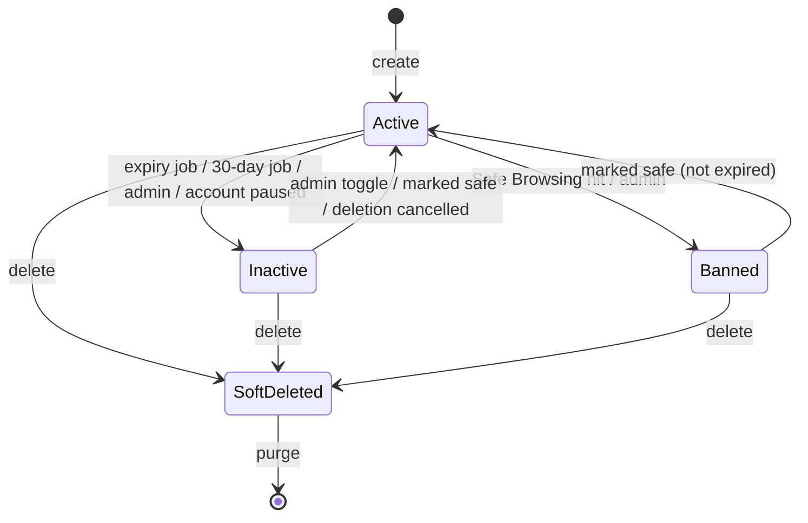

# Short links

> Scope: short links, the redirect path, click events and statistics, expiry, password lock, QR codes, URL safety. State as of 2026-10-17.

## Summary

A signed-in user turns an http(s) URL into a short URL made of the public redirect address and a random 6-character code. Each link belongs to one user and carries the original URL, an optional title, an optional expiry date, an optional password, and a click count with a "last accessed" time.

Visitors are served by a dedicated, fast redirect service. It looks up the link in a cache and answers with a redirect to the destination, a redirect to the password page for a locked link, a redirect to the "not found" page, or a temporary "service unavailable" answer when the cache cannot be read. For tracked redirects it hands a click record to a message queue; a background worker turns it into a click event. Statistics are all-time counts over those events.

Expiry, deactivation, safety bans and deletion all work by removing the link's cache entry, because the redirect service knows nothing else about a link. Anonymous creation was removed on 2026-07-13: only signed-in users create links (the frontend still carries dead code for the old anonymous flow).

## Glossary

- **Short link**: a link owned by exactly one user that redirects a short code to an original URL.
- **Short code**: the path segment after the redirect address; generated, never chosen by the user.
- **Short URL**: the public redirect address followed by the short code.
- **Cache entry**: the small record the redirect service reads for each code. It says either "redirect to this URL" or "this link is locked". It is the only contract between the main application and the redirect service.
- **Servable**: a link that will redirect — it is active, marked safe, and not past its expiry. Only servable links have a cache entry.
- **Inactive**: a link that no longer redirects, recorded as a deactivation time rather than a status. Caused by expiry, by 30 days without clicks, by a safety ban, by an admin, or by account deactivation; the reason is not stored.
- **Locked link**: a link protected by a password; visitors are sent to a password page instead of the destination.
- **Event**: one recorded click on a short link.
- **Soft delete**: deleting a link hides it at once; a background job removes the link and its events later.
- **Redirect service**: the separate low-latency service that answers visits to short URLs.

## Business rules

### Short codes

- **SL-01** A short code is 6 characters drawn from A–Z, a–z and 0–9, case-sensitive (about 5.7 × 10¹⁰ possible codes).
- **SL-02** A new code is regenerated until it is not used by any existing link, soft-deleted links included; a purged link frees its code for reuse. A uniqueness guarantee at storage level is the final protection against two links getting the same code at the same moment.
- **SL-03** There are no custom codes and no reserved-word list: a client cannot set the code. The redirect service reserves only the bare root and the "not found" path, which 6-character codes cannot collide with.
- **SL-04** The code never changes: updates keep it, so the short URL, QR code and analytics stay attached to the same link. Code changes are not part of the change history.

### URL validation and normalisation

- **SL-05** The original URL is required on creation, at most 2048 characters, and must be an http or https URL with a non-empty host. `javascript:`, `data:`, `ftp:`, a bare `https://` and free text are rejected with the message "must be a valid http or https URL".
- **SL-06** The URL is stored exactly as submitted: surrounding whitespace is ignored only for the check, and nothing is lower-cased, converted for international hosts or re-encoded.
- **SL-07** The redirect service normalises the URL at redirect time: international host names are converted to their ASCII form, scheme and host are lower-cased, default ports are dropped, a bare host gets a trailing `/`, and non-ASCII characters in path and query are percent-encoded. A value that is not an absolute http(s) URL, or that breaks international host rules, is treated as not found. The reason: the application's validation rejects every input whose outcome would differ between the two parsers.
- **SL-08** A title is optional, up to 255 characters (120 when a link is created by an AI app through MCP). The cap guards against abuse and oversized records.
- **SL-09** The frontend checks that the URL looks like a URL (any scheme); the backend validation is the real gate.

### Who can create

- **SL-10** Only signed-in users create links: through the dashboard/API, or through an AI app with write permission on short links. Anonymous creation no longer exists.
- **SL-11** Creation through the dashboard/API is limited to 60 links per user per 10 minutes; beyond that the user gets "Too many links created, please try again later". Creation through MCP has its own limits, 20 per hour and 100 per day, and does not count against the dashboard/API limit.
- **SL-12** Creating a form also creates a short link for it, pointing at the form's public page, with the title cut to 120 characters; deleting the form soft-deletes that link. See [forms](forms.md).
- **SL-13** On creation a link can carry a title, a password and an expiry date (dashboard/API), or a title and an expiry date (MCP; no password). The dashboard quick-create form sends only the URL and a title.

### Expiry and deactivation

- **SL-14** An expiry date is optional; when given it must be in the future ("must be in the future"), and clearing it removes the expiry. This is enforced when saving and in the edit form.
- **SL-15** A background job runs every 5 minutes and expires every active link whose expiry has passed: the cache entry is removed, then the link is marked inactive, one link at a time. A link therefore keeps redirecting for up to 5 minutes past its expiry date; the password-unlock step stops at once because it checks that the link is servable.
- **SL-16** A daily job at 03:00 marks inactive every active link not clicked for 30 days (counted from creation if it was never clicked). It does not remove the cache entries and leaves no change-history record (see Drift D1). It can also be run manually by an operator.
- **SL-17** There is no start date / "go live at" scheduling. "Scheduling" in the README and landing page means the scheduled expiry of SL-15.
- **SL-18** An owner cannot deactivate or reactivate a link. A link becomes active again only through: an admin toggling it active; being marked safe (by the safety check or an admin), which reactivates it unless it is past its expiry; or an account deletion being cancelled, which restores links deactivated within 10 minutes of the account pause.
- **SL-19** Deactivating an account (also done when deletion is requested) removes the cache entry and marks every active link of that account inactive. See [accounts-and-auth](accounts-and-auth.md).
- **SL-20** Updating an inactive link never touches the cache, so editing its URL or expiry does not reactivate it — except through SL-18 when the URL changes and the safety check answers safe.

### URL safety

- **SL-21** When the safety check is enabled, a link is checked after it is created and after an update that changes its URL (dashboard/API and MCP). Without it no check runs and every link stays marked safe.
- **SL-22** The check uses Google Safe Browsing, looking for malware and social-engineering (phishing) threats.
- **SL-23** A link is considered safe when Safe Browsing reports no match. If the check itself fails (network error, missing key) the link is treated as unsafe. An HTTP error answer from the provider that carries a body but no matches reads as safe.
- **SL-24** When a URL is flagged, the cache entry is removed and the link is marked unsafe and inactive; visitors then see the "not found" page. When a URL passes, the link is marked safe and checked-at is recorded; it is reactivated unless it is past its expiry, and its cache entry is rewritten if it is servable. The reason for removing rather than deleting: an unsafe link can be reactivated later.
- **SL-25** A new link is cached before the check finishes, so it redirects until the check completes.
- **SL-26** Short links are not re-checked periodically (bio page links are; see [bio-pages](bio-pages.md)). Admins can flip a link's safe flag.

### Password lock

- **SL-27** A password is optional, 4 to 72 characters, and stored hashed. Sending an empty password removes it; omitting the password on an update keeps it.
- **SL-28** The password is never shown, never recorded in the change history and never exported; the API exposes only whether a link is password-protected.
- **SL-29** The destination of a locked link is never given to the redirect service: it only knows the link is locked and sends the visitor to the password page, without recording a click.
- **SL-30** The password page first asks whether the link is locked; the answer is yes only for a locked, servable link and "not found" otherwise. It never reveals the destination.
- **SL-31** Submitting the right password returns the destination and records one click; a wrong password returns "Wrong password" and records nothing; inactive, unsafe or expired links answer "not found".
- **SL-32** Unlock attempts are limited to 10 per 5 minutes per combination of link and visitor address; beyond that the visitor gets "Too many attempts, please try again later". The visitor address is the one forwarded by the website, else the one reported by the CDN, else the connection's address; client-supplied forwarding headers are ignored. The reason: it slows down guessing one link's password without letting one visitor lock everybody else out of it.
- **SL-33** There is no unlock token, cookie or session: every visit asks for the password again. The browser follows the returned address only if it is http(s). The password page is excluded from search engines and cannot be shown inside another site's frame.

### Redirect behaviour

- **SL-34** The redirect service looks up the code taken from the path (percent-decoded, without the leading `/`, so `/a/b` looks up `a/b`). The bare root and `/404` show the "not found" page with status 404 (also for HEAD requests). An empty code, an unknown code or an unreadable cache entry redirects to `/404`.
- **SL-35** A cache entry means one of: redirect to this http(s) URL (tracked); this link is locked, go to the password page (untracked); or, for entries written by older releases, a raw http(s) URL (tracked). Anything else (unknown kind, wrong types, other schemes) is treated as not found.
- **SL-36** If the cache fails or does not answer within 2 seconds, the redirect service answers 503 "service unavailable" with a retry hint of 5 seconds and no caching — never "not found" — and reconnects on its own. The reason: an outage used to look like "link not found" and was invisible to monitors.
- **SL-37** Redirects are plain 302 responses with no cache headers, for every method (GET, HEAD, POST). Cache entries have no time limit: the redirect service never decides expiry itself. Very long request lines (over 8 KB) are rejected with 414.
- **SL-38** The redirect service is configured with the address of the cache, the frontend address (default `https://kurz.fyi`, used for the password page) and the message queue connection. It has a healthcheck that asks for the "not found" page and is healthy when the answer is not a server error.

### Click events

- **SL-39** For tracked redirects the redirect service puts the click in a bounded in-memory buffer (10 000) and redirects without waiting; when the buffer is full the click is dropped. A background reader sends each click to the message queue; if sending fails the click is lost, and connection retries back off from 1 s to 30 s. Buffered clicks are sent out when the service shuts down (10 s allowed, 20 s grace from the platform).
- **SL-40** A click message carries exactly: country, region, browser, IP address, platform, referer, user agent, link code and a UTC timestamp. Country and region may be empty; any other missing header is sent as an empty string.
- **SL-41** Click fields are derived as follows: the IP address is the one reported by the CDN (trimmed), else the connection's address; the country is the CDN's country code, upper-cased, with unknown (`XX`) and Tor (`T1`) treated as no country; the region is the CDN's region; user agent and referer are cut at 4096 characters; browser and platform are detected from the full user agent.
- **SL-42** Browsers are grouped, first match wins: Edge, Firefox, Chrome, Safari, otherwise Unknown. Platforms are Android, iOS (iPhone, iPad, iPod), Windows, macOS, Linux, otherwise Unknown. The same grouping is used for unlock clicks and for bio page clicks.
- **SL-43** A background worker (several in parallel) turns each queued click into an event for the link with that code among non-deleted links; an unknown code is dropped. On any error it reports the problem, retries the message once, and drops it if it fails again, so a poisonous message cannot loop forever. It does not check whether the link is still servable.
- **SL-44** Each text field of an event is limited to 255 characters; the click time defaults to now. Recording an event updates the link's click count and its "last accessed" time to the click time.
- **SL-45** An unlock click is recorded immediately by the main application with the same derivation (visitor address per SL-32, country without `XX`/`T1`, region, user agent and referer cut to 255, blank values stored as empty; the referer is the page the visitor came from).
- **SL-46** No third party is asked about visitor IPs; the former external IP-geolocation lookup was removed.

### Retention

- **SL-47** A daily job at 04:15 erases the IP address, user agent and referer of events older than 90 days (the same applies to page link clicks and to the address recorded in the change history). Country, region, platform, browser and counts stay, so statistics do not change. The reason: privacy (GDPR); a full user agent plus referrer can identify someone.
- **SL-48** Events have no other expiry: they live until the link is purged.

### Statistics

- **SL-49** The owner (dashboard or an AI app) sees all-time statistics for one of their links: clicks by browser, by country, by region and by device platform, ordered by count, highest first. A blank browser, country or region shows as "Unknown"; a missing platform stays empty. There is no date range, no time series, no unique visitors and no referrer breakdown.
- **SL-50** The click count and "last accessed" time shown on the dashboard come from the link itself, kept up to date as events are recorded.

### QR codes

- **SL-51** The owner can download a QR code for a link as an SVG, black on white, encoding the short URL, named after the short code. Only the owner can get it. Because it encodes the short URL it survives destination changes. The fixed colours are deliberate: low-contrast QR codes fail on cheaper phone cameras.

### Deletion

- **SL-52** An owner can delete a link (dashboard/API, or an AI app with the short code as confirmation). The cache entry is removed, the link is soft-deleted and a background purge is queued. The link disappears from every list and from the user's link count.
- **SL-53** The purge deletes the link's events in batches of 5 000, then the link itself; it does nothing if the link is not soft-deleted. There is no restore. Batching keeps thousands of events from locking the database.
- **SL-54** Purging an account deletes every link of the user (soft-deleted ones too): the cache entry, the events and the link's change history are all removed.

### Cache maintenance

- **SL-55** Every change that affects whether a link redirects must write or remove its cache entry: creation, an update of URL, password or expiry (dashboard/API) or URL or expiry (MCP), expiry, a safety ban, marking safe, deletion, admin toggling active, account deactivation and cancelling an account deletion. A title-only update does not touch the cache.
- **SL-56** An operator can rewrite every cache entry in place: servable links get an entry, all others have it removed (soft-deleted ones included), and old-format entries are migrated. It never flushes the cache, so redirects keep working.
- **SL-57** A failure to write the cache is logged and ignored; the change to the link itself still happens.
- **SL-58** Clearing the application's own cache must never remove short link entries: the application cache is kept in a separate namespace. The reason: without it, a clear once wiped every short link at the redirect service.

## Flows

### Create

1. The user submits the URL and a title from the dashboard.
2. The creation rate limit (SL-11) and the validation (SL-05, SL-08, SL-14, SL-27) are applied; errors are reported per field. A blank password means no password.
3. A code is generated (SL-01, SL-02), the link is saved, the user's link count goes up and the creation is recorded in the change history.
4. The cache entry is written (no time limit), then the URL safety check is queued if enabled.
5. The user sees the new link in the dashboard list.

### Redirect and click

1. A visitor opens a short URL; the request reaches the redirect service through the CDN.
2. The service reads the cache entry (2 s limit). On failure it answers 503; on a miss it redirects to the "not found" page.
3. A URL entry: the click is queued and the visitor is redirected to the destination. A locked entry: the visitor is redirected to the password page.
4. In the background the click is sent to the queue and a worker records the event, which raises the click count and updates "last accessed".

### Locked link

1. The redirect service sends the visitor to the password page, which first checks the link is locked; otherwise it shows "not found".
2. The visitor submits the password.
3. After the rate limit, a right password records the click immediately and the browser is sent to the destination.

### Update

1. The edit form sends title, URL and expiry (always; empty means none) and a password only when it is set or removed.
2. If the URL changed, the safety check is queued (if enabled). If URL, password or expiry changed and the link is active, the cache entry is rewritten when the link is servable and removed otherwise.

### Expire, ban, delete

See SL-15, SL-16, SL-24, SL-52, SL-53.

## States and transitions

There is no stored status. A link's state is derived from whether it is deleted, inactive, marked safe, past its expiry and password-protected. The dashboard shows a link as active when it is not inactive.

| From | Event | To | Guard | Effect |
|---|---|---|---|---|
| (none) | create | active (safe) | valid input | cache entry written, safety check queued |
| active | safety hit / admin marks unsafe | banned (unsafe, inactive) | — | stops redirecting |
| banned or inactive | safety pass / admin marks safe | active | not past expiry | redirects again if servable |
| active | expiry passed (5-minute job) | inactive | expiry ≤ now | stops redirecting, recorded in change history |
| active | 30 days without clicks (daily job) | inactive | no click since 30 days (or creation) | marked inactive only; cache entry kept, no history (D1) |
| active | admin toggles inactive | inactive | admin | stops redirecting |
| inactive | admin toggles active | active | admin | redirects again if safe (expiry ignored) |
| active | account deactivated | inactive | — | stops redirecting |
| inactive | account deletion cancelled | active | deactivated within 10 min of the pause | redirects again if servable |
| any | owner deletes | soft-deleted | owner | stops redirecting, hidden from lists, purge queued |
| soft-deleted | purge | gone | deleted | events deleted |
| unlocked ↔ locked | owner sets / clears password | — | 4–72 characters | redirect behaviour changes (if active) |

## Limits and configuration

| Name | Value | Notes |
|---|---|---|
| Code length / alphabet | 6, A–Z a–z 0–9 | case-sensitive |
| Original URL max | 2048 characters | also for MCP |
| Title max | 255 (120 for MCP create) | MCP update allows 255 |
| Password length | 4–72 characters | |
| Creation rate limit | 60 per 10 min per user | dashboard/API |
| MCP create | 20/hour, 100/day | |
| MCP update | 60/hour | needs full account access; no password field |
| MCP delete | 10/hour, 30/day | needs full account access; confirmation = short code |
| Unlock rate limit | 10 per 5 min per link and visitor address | |
| List page size | default 20, between 1 and 100 | MCP max 50 |
| Inactivity period | 30 days | daily check at 03:00 |
| Expiry check | every 5 minutes | |
| IP / user agent / referer retention | 90 days | daily at 04:15, batches of 5 000 |
| Purge batch | 5 000 events | |
| Cache entry lifetime | none | removed explicitly |
| Redirect cache timeout | 2000 ms | then 503 |
| Retry hint on 503 | 5 s | |
| Click buffer | 10 000, drops when full | |
| User agent / referer cap on click | 4096 characters | |
| Event text field cap | 255 characters | see D3 |
| Redirect service shutdown | 10 s (platform grace 20 s) | |
| Request line | over 8 KB rejected with 414 | |
| Click workers | several in parallel, 60 s per click | |
| Safety check | enabled by configuration | off means every link stays safe |

## Authorization and privacy

- Anonymous visitors can follow links and use the password page and unlock step for locked links. Nothing else.
- Owners see and manage only their own links (another user's link looks like "not found"): list, show, create, update, delete, statistics, QR.
- Admins can list all links with owner and last safety-check time, flip the safe flag and flip active. See [admin-and-moderation](admin-and-moderation.md).
- MCP: read permission (list, statistics), write permission (create), full account access (update, delete). See [mcp-and-oauth](mcp-and-oauth.md). MCP output treats the URL and title as untrusted text.
- Personal data: visitor IP, user agent and referer (erased after 90 days); country and region from the CDN (kept); derived browser and platform (kept). The owner sees aggregates only; no one gets raw events. The data export lists links and click counts, not events.
- Change history: link changes are recorded, except the short code, click count, last accessed time, deletion time and password.

## API and UI surface

- **Owners (dashboard, API)**: list links (paged, default 20), create, view, edit (title, URL, expiry, password), delete, view statistics, download QR code. The dashboard offers quick create, search within the current page and a link detail page with statistics and QR code.
- **Visitors**: follow a short URL; for a locked link, use the public password page (check lock status, submit password).
- **Admins**: list all links (filter by active/inactive, search by title, URL, code or owner e-mail; no pagination, see D16), flip safe, flip active.
- **AI apps (MCP)**: list links, view statistics, and create, update and delete links.
- **What a link shows**: original URL, title, click count, last accessed, short code and short URL, active and safe flags, whether it is password-protected, expiry and creation time (admins also see the owner and last safety check).
- **Background jobs**: expiry every 5 minutes; 30-day inactivity daily at 03:00; erasure of old visitor data daily at 04:15; purge after deletion; safety check after create or URL change. A click worker processes the queue; it has its own healthcheck that confirms the queue connection and an active consumer.
- **Operator actions**: run the inactivity job now; rewrite all cache entries.
- A success page is routed in the frontend but nothing navigates to it.

## Decisions

### D-SL-01 Redirects are served by a separate fast service
**Decision.** Redirects are answered by a dedicated low-latency service that looks up a single cached entry, not the main application or its database. **Why.** Redirects must be fast and always available; click aggregation need not be real time. **Consequence.** Every change to a link's state must update that cached entry (SL-55); the redirect service cannot decide expiry or safety on its own.

### D-SL-02 The cache entry is a typed document
**Decision.** The cache entry says what kind of entry it is ("redirect to URL" or "locked") instead of being a raw URL. **Why.** New link states only add a new kind, instead of special strings mixed with URLs. **Consequence.** An unknown kind is not found at the redirect service, so a new state needs the redirect service deployed first; old raw entries are still accepted.

### D-SL-03 Locked links never put the destination in the cache
**Decision.** The redirect service only knows that a link is locked; the destination comes from the main application after the password check. **Why.** The destination of a locked link must never be reachable without the password. **Consequence.** Locked clicks are recorded by the main application, not through the queue.

### D-SL-04 503 when the cache fails
**Decision.** Cache errors and timeouts answer 503 with a retry hint, never "not found". **Why.** An outage looked like "link not found" and was invisible to uptime monitors. **Consequence.** Only a genuine miss or unreadable entry is a 404.

### D-SL-05 Redirect service rewritten on a new platform
**Decision.** The redirect service was rebuilt on a new platform with the same behaviour. **Why.** The previous version never recovered after the cache was recreated, and clicks held in memory were lost on shutdown. **Consequence.** User agent and referer are capped at 4096 characters and URLs are normalised as in SL-07.

### D-SL-06 Soft delete, then background purge
**Decision.** Delete returns at once; events are removed in batches later. **Why.** Avoid locking the database and memory spikes. **Consequence.** Codes of soft-deleted links stay reserved until purge (SL-02).

### D-SL-07 Two separate expiry jobs
**Decision.** Owner-set expiry and inactivity are separate jobs. **Why.** They have different rules and cadence, and each reason for deactivation should stay auditable on its own; scheduled expiry goes one link at a time so each cache entry is removed right away. **Consequence.** See Drift D1/D2: the inactivity job does neither.

### D-SL-08 Signed-in creation only
**Decision.** Anonymous creation was removed and every link needs an owner. **Why.** Not recorded; it was part of a security-hardening change. **Consequence.** The old anonymous frontend flow and success page are dead code.

### D-SL-09 Visitor IP privacy
**Decision.** No third-party geolocation; IP, user agent and referer are erased after 90 days. **Why.** Privacy (GDPR); country and region already come from the CDN.

### D-SL-10 Short link entries live apart from the application cache
**Decision.** Short link cache entries are written outside the application cache's namespace, so clearing the application cache cannot touch them. **Why.** A clear once wiped the whole cache and dropped every link at the redirect service.

## Change impact

- Cache entry format → redirect service, the operator cache rewrite (SL-56) and SL-35. Deploy the redirect service that understands the new format first, then the main application, then rewrite the entries.
- New link state that must stop or alter redirects → add the cache write/remove to every path in SL-55, including MCP update, account deactivation/cancellation, admin toggles and the operator rewrite.
- Password page address → redirect service redirect (SL-29, SL-35), frontend password page, the configured frontend address (SL-38).
- Click message fields, queue name or durability → redirect service (SL-39–SL-41), click worker (SL-43) and its healthcheck; redeclaring the queue with different properties fails on a live broker.
- Browser/platform grouping (SL-42) → apply to both the redirect service and the main application's copy (bio page and form statistics use the latter; see [bio-pages](bio-pages.md)).
- Country `XX`/`T1` handling → SL-41 and SL-45 together.
- Event length caps or new event fields → redirect service caps (SL-41), D3, the retention erasure (SL-47), the privacy page and the data export.
- URL validation (SL-05) → redirect service URL handling (SL-07; both must accept the same set), MCP create/update, bio page links (same validation; see [bio-pages](bio-pages.md)), frontend checks (SL-09).
- Code length or alphabet (SL-01) → redirect path handling (SL-34), uniqueness guarantee (SL-02), MCP confirmation length for delete.
- Cache namespace → keep short link entries separate (D-SL-10, SL-58).
- Expiry/inactivity thresholds (SL-15, SL-16) → expiry alert copy, dashboard inactivity message, privacy page.
- Soft delete behaviour (SL-52) → forms (SL-12; see [forms](forms.md)), the user's link count, account purge (SL-54), click worker lookup (SL-43).
- Database changes touching links or events: the redirect service does not read the database, but the previous release, the click worker and the 5-minute job do; follow the add → backfill → drop-later rule so the previous release survives.
- New configuration for the redirect service → it must be added to the redirect service's own deployment settings, which are not shared with the main application.

## Drift and open questions

- **D1 (high)** The 30-day inactivity job marks links inactive but never removes their cache entry, so a link "deactivated due to inactivity" keeps redirecting, keeps recording clicks (the worker does not check inactivity), and shows as inactive in the dashboard with no owner way back. Every other deactivation path removes the entry.
- **D2 (low)** The same inactivity job records nothing in the change history, contradicting the intent that each reason for deactivation stays auditable on its own.
- **D3 (medium)** The redirect service sends user agent and referer up to 4096 characters and region uncapped, but an event rejects any field over 255; the worker retries once and then drops the click (reported as an error). Long in-app browser user agents and long referrer URLs lose their clicks.
- **D4 (medium)** The redirect service publishes with transient delivery into a durable queue and drops clicks when its 10 000 buffer is full; clicks are lost when the message broker restarts.
- **D8 (low)** Expiry is expected to be immediate ("the link stops redirecting at the moment it expires"), but in practice it can be up to 5 minutes late because it is applied on a schedule rather than instantly.
- **D9 (low)** Dead frontend code: the anonymous-creation action posts to a removed endpoint; the success page and its alerts and an e-mail field are unreachable. The expiry alert says links are "automatically deleted after 30 days without access"; the product deactivates them (and, per D1, does not stop them).
- **D10 (low)** The dashboard shows "deactivated due to inactivity" for any inactive safe link, including expired, admin-deactivated and paused-account links (the reason is not stored).
- **D11 (low)** The README lists "scheduling" for short links; only scheduled expiry exists.
- **D13 (low)** Frontend error messages read a single error field, but validation failures return per-field errors, so users see a generic message for validation errors.
- **D14 (low)** Redirect-service clicks store missing user agent/referer/IP as empty text, unlock clicks as empty values; the device statistics show a missing platform as empty while the other breakdowns say "Unknown".
- **D15 (low)** MCP link creation caps titles at 120 characters; the dashboard/API and MCP update cap them at 255.
- **D16 (low)** The admin link list has no pagination and its total ignores the filters.
- **D17 (low)** The original URL is stored with surrounding whitespace although validated without it; the redirect service trims it, so it still redirects.
- **D18 (low)** Click recording and the URL safety check have no dedicated automated verification.
