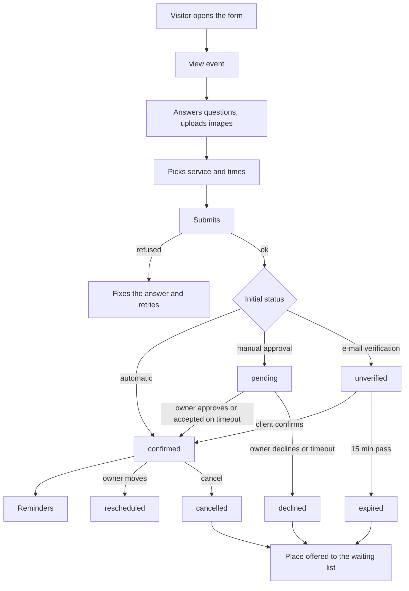

# Use cases: form and agenda

> Scope: every scenario of the public form, the booking made through it and the agenda that follows, by actor, with the rules that decide the outcome. State as of 2026-10-17.

This page is a map, not a rulebook. Each use case gives the trigger, the outcome and the rule ids that enforce it; the rule text lives on the owner page ([forms](forms.md), [booking-engine](booking-engine.md), [appointments-lifecycle](appointments-lifecycle.md), [notifications-and-email](notifications-and-email.md)). Where a case has no defined behaviour, it is listed in [Gaps](#gaps-cases-without-a-defined-answer).

Ids are stable (`UC-V01`). A new scenario takes the next free number in its group; a removed one keeps its id, marked as removed. When a rule changes, check every use case that cites it.

## Actors

| Actor | Who | Credential |
|---|---|---|
| Visitor | anyone on the public form page | none |
| Link holder | a visitor or client holding a private link (manage, decide, verify, waiting list) | the link secret |
| Client account | a verified signed-in user whose e-mail matches a booking | session |
| Owner | the signed-in user who owns the form | session |
| AI app | an OAuth-connected app acting for the owner | scoped token |
| System | background sweeps and jobs | none |

## Reading order of a booking

## A. Visitor opens and reads the form

| Id | Scenario | Outcome | Rules |
|---|---|---|---|
| UC-V01 | Opens a published form of an active owner | The published snapshot is shown, never the draft; a view event is sent once per page load | FO-26, FO-27, FO-28, FO-49, FO-51 |
| UC-V02 | Opens a draft, unpublished, deleted form, one of a deactivated owner, or a malformed id | The same "not found" for all | FO-04, FO-27 |
| UC-V03 | Opens a published form the owner has closed | The closed screen; submissions are refused as closed | FO-30 |
| UC-V04 | Opens a form with an intro screen or the "one at a time" layout | Welcome screen with cover, title, description and a start button; "one at a time" always shows it | FO-46 |
| UC-V05 | Presses start or answers the first question | A start event is sent once | FO-51 |
| UC-V06 | Returns the same day | Counted as one unique view for that form and UTC day | FO-50 |
| UC-V07 | Shares the link | Preview with the form title, description and the published cover; never indexed; cannot be embedded | FO-48 |
| UC-V08 | Reads a thank-you message or intro text with a URL | http and https URLs become links; other schemes stay text | FO-47 |
| UC-V09 | Opens the form after the owner republished it while the page was already open | The page keeps its copy; the submit is validated against the new version (the web client does not send the version) | FO-33, Drift in [forms](forms.md) |
| UC-V10 | Exceeds the page-read rate limit | Rate-limited answer | FO-49, Limits in [forms](forms.md) |

## B. Visitor answers the form (without booking)

| Id | Scenario | Outcome | Rules |
|---|---|---|---|
| UC-F01 | Fills every question and submits | Response stored, count raised, success shown with the thank-you message; no e-mail, no owner notice | FO-32, FO-38 |
| UC-F02 | Leaves a required question empty | Refused with a per-question error code | FO-12, FO-32 |
| UC-F03 | Leaves an optional question empty | The answer is omitted from the stored response | FO-12 |
| UC-F04 | Gives an invalid value (bad e-mail, number out of range or too many decimals, unknown choice, too many choices, rating outside the scale, impossible date) | Refused per question, the value is not echoed | FO-09 type table, FO-32 |
| UC-F05 | Types text with a NUL character or over the length limit | Refused as invalid | FO-10, FO-12 |
| UC-F06 | Sends an answer to a question that does not exist, or to a section | The key is dropped | FO-32 |
| UC-F07 | Sends an answers payload that is not a set of answers | Refused as invalid | FO-32 |
| UC-F08 | Sends an oversized body (above 64 KB) or answers above 32 KB | Refused | FO-36 |
| UC-F09 | Double-clicks or retries after a network error | The same idempotency key returns the stored response as a success; a concurrent duplicate returns the same one | FO-34 |
| UC-F10 | A bot fills the hidden trap field | Fake success, nothing stored, bot check never called | Submit step 4 in [forms](forms.md) |
| UC-F11 | The bot check rejects the visitor | Refused as "captcha failed"; the widget resets after every attempt | Submit steps 6 and 9 |
| UC-F12 | The bot-check provider is down or no key is set | Accepted under the stricter limit of 5 per 10 minutes per IP | Submit step 6, Drift in [forms](forms.md) |
| UC-F13 | Submits too often from one IP | Rate-limited (30 per 10 minutes) | Limits in [forms](forms.md) |
| UC-F14 | Submits with a form version that is stale (API client only) | Refused as "form changed" with the current public form; nothing stored | FO-33, BK-53 |
| UC-F15 | Submits a form that was closed after the page loaded | Refused as closed | FO-30 |
| UC-F16 | Submits a form unpublished after the page loaded | "Not found" | FO-27 |

### Image answers

| Id | Scenario | Outcome | Rules |
|---|---|---|---|
| UC-F20 | Picks a PNG, JPEG, WebP, HEIC or HEIF up to 10 MB | Re-encoded to WebP, a token returned and placed in the answers | FO-39, FO-40 |
| UC-F21 | Picks a file over 10 MB | The browser refuses it before uploading; the server refuses a body over 11 MB | FO-39 |
| UC-F22 | Picks a file that is not really an image, or one too large in pixels | Refused as an invalid image | FO-39, FO-40 |
| UC-F23 | The image processor or storage is down, or the 20 GB budget is reached | Refused as unavailable, nothing kept | FO-39, FO-40 |
| UC-F24 | Uploads and never submits | The upload is deleted after 1 hour by the cleanup job | FO-43 |
| UC-F25 | Submits a token that belongs to another form or question, or was already used | Refused as an invalid answer; the whole response is rolled back | FO-31 |

## C. Visitor books a time

A booking is never a separate step: it is the booking question of the form, answered and submitted with the other answers (D-FO-06).

### Seeing times

| Id | Scenario | Outcome | Rules |
|---|---|---|---|
| UC-B01 | Opens the booking question | Services (grouped by category from 2 categories), durations and prices are shown; capacity, notice, window and per-day limit stay hidden | BK-20 |
| UC-B02 | Picks a service | Free times load for up to 56 days from today (62 per request, never beyond the booking window) | BK-23, BK-70 |
| UC-B03 | The times request is slow | Gives up after 10 seconds and shows a retry | BK-74 |
| UC-B04 | A day has no times | Weekday not run by the service, closed day, special hours without it, per-day limit reached, or inside the minimum notice | BK-12, BK-24, BK-25, BK-26 |
| UC-B05 | A time has places left | Shown with the remaining count; unlimited capacity shows none | BK-27 |
| UC-B06 | A time is full | Hidden, or listed as full for the waiting list when that is on | BK-27, BK-48, UC-W01 |
| UC-B07 | A time falls in a daylight-saving gap or repeat | A time that does not exist is skipped; a repeated one is offered once | BK-22 |
| UC-B08 | The visitor is in another time zone | Times are displayed in the visitor's zone, the booking keeps the form zone's date and time; the zone choice is remembered | BK-21, BK-73 |
| UC-B09 | A neighbouring booking, the buffer or a shared teacher blocks a time | The time is hidden or offers a shorter duration | BK-29, BK-30, BK-31 |
| UC-B10 | A partly booked class | Offers only the length the slot was opened with, while the service still offers it | BK-28 |
| UC-B11 | Free times reload while sessions are picked | Picks that are no longer free are dropped and the visitor is told | BK-72 |

### Choosing and submitting

| Id | Scenario | Outcome | Rules |
|---|---|---|---|
| UC-B20 | Books one session | One appointment | BK-41, BK-56 |
| UC-B21 | Books several sessions of one service (up to 31) | One appointment per session, one booking group; same time picked again removes it, another duration replaces it | BK-41, BK-71 |
| UC-B22 | Picks a session with a different duration | Allowed if the service offers it; the price follows the duration | BK-28, BK-49 |
| UC-B23 | Picks two sessions that overlap, buffer included | Refused in the picker and again by the server, naming the later one | BK-42, BK-71 |
| UC-B24 | Books several services in one go (multiple services on, up to 5, one currency, distinct services) | One group, one decision; the sessions of all items may not overlap | BK-40, BK-42, BK-15 |
| UC-B25 | Books a monthly weekday pattern (month, weekdays, one time) | One appointment per matching date; unavailable dates are skipped and reported in the receipt | BK-45 |
| UC-B26 | A date of the pattern is offered but already full | The whole request is refused, naming the date | BK-45 |
| UC-B27 | Books a monthly plan with an allowance (dates and times up to the allowance, per month or per Monday-to-Sunday week) | Same result as single sessions; the monthly price counts once | BK-46, BK-47, BK-49 |
| UC-B28 | Picks more than the allowance | Refused in the picker and by the server | BK-46, BK-71 |
| UC-B29 | Sends a booking answer that is missing or empty | Treated as blank; refused even when the question is not marked required | BK-39 |
| UC-B30 | Sends a booking answer of the wrong shape | Refused as invalid | BK-39, BK-40 |
| UC-B31 | Picks a time that is no longer free at submit | Refused as unavailable, naming service, date and time | BK-41, BK-62 |
| UC-B32 | Two visitors take the last place at once | The loser is refused as full with the start time; the response is rolled back; the buffer and overlaps of a service that is its own resource are not guarded here | BK-56, BK-58, BK-59 |
| UC-B33 | Two bookings of the same teacher's lessons overlap | The second is shown as a full time | BK-37, BK-58 |
| UC-B34 | A day reaches the per-day limit during the request | Refused as full, without a service or time | BK-43, BK-54 |
| UC-B35 | A different service tries to take a slot another service holds | Refused as full | BK-36, BK-56 |
| UC-B36 | Submits a form with a booking whose contact e-mail is missing | The booking contact comes from the first required e-mail question (verification on) or the e-mail question the visitor ticked as "confirm here"; the tick appears only on forms without verification | FO-37, FO-38 |

### What the visitor gets

| Id | Scenario | Outcome | Rules |
|---|---|---|---|
| UC-B40 | Booking succeeds | Receipt with appointments (start, service, status, duration), price and currency, skipped dates, whether the e-mail went out, and a manage link valid until 7 days after the last session | FO-37, AP-16 |
| UC-B41 | Form has automatic approval and no verification | Status `confirmed`; client confirmed e-mail if an address exists; owner in-app, push and e-mail "new booking" | BK-61, AP-02 |
| UC-B42 | Form has manual approval and the first session is inside the approval window (or no window is set) | Status `pending` with a deadline; client "request received" e-mail; owner request notice and e-mail with a decide link | AP-03, AP-04 |
| UC-B43 | Form has manual approval and the session is further away than the window | Confirmed on the spot, no deadline, and no e-mail verification even when it is on | AP-03 |
| UC-B44 | Form has automatic approval and e-mail verification, with an address | Status `unverified` for 15 minutes; only the client is told, with a verify link | AP-02, AP-11, AP-12 |
| UC-B45 | Booking without an e-mail address | No client e-mail at all; no reminders; the manage link is only on the receipt | AP-32, AP-02 |

The initial status is decided once per booking:

| Approval | E-mail verification on and address given | Session inside the window (or no window) | Status |
|---|---|---|---|
| manual | any | yes | `pending` |
| manual | any | no | `confirmed` |
| automatic | yes | not applicable | `unverified` |
| automatic | no | not applicable | `confirmed` |

## D. Visitor or client after booking (private links)

| Id | Scenario | Outcome | Rules |
|---|---|---|---|
| UC-L01 | Opens the manage link `/m/:token` | Sees the whole booking, in any status, until the link expires (last session plus 7 days) | AP-15, AP-16, AP-17 |
| UC-L02 | Cancels all upcoming sessions | Status `cancelled`, places freed, owner told in-app, push and e-mail (preference), client cancellation e-mail, waiting list offered | AP-19, AP-21, AP-22, AP-35 |
| UC-L03 | Cancels one session or the remaining ones (series only in the interface) | Only those sessions are cancelled; each action sends its own e-mail listing only what it cancelled | AP-20, AP-22, AP-24 |
| UC-L04 | Cancels after a session started | Refused for started sessions | AP-19 |
| UC-L05 | Cancels a pending or unverified booking | Allowed | AP-19 |
| UC-L06 | Cancels after the form was closed or unpublished | Still works | AP-25 |
| UC-L07 | Cancels twice, or from two tabs | Harmless; the page shows the current state | AP-06, AP-17, AP-23 |
| UC-L08 | Uses an unknown, expired, foreign or wrong-purpose link | The same "not found" | AP-15 |
| UC-L09 | Wants to reschedule | No client-side reschedule: the owner moves it | AP-26 |
| UC-L10 | Wants an "add to calendar" file | None exists; only the owner's feed | AP-45 |
| UC-L11 | Opens the verify link `/v/:token` and confirms (an explicit action, not a page view) | `confirmed`, deadline cleared, then the owner and client are told as for an automatic booking | AP-13 |
| UC-L12 | Confirms after the 15-minute deadline | Refused, even before the sweep ran | AP-13 |
| UC-L13 | Never confirms | Sweep marks it `expired`, frees the places, tells nobody | AP-14 |
| UC-L14 | The owner opens the decide link `/a/:token` (no login) | Sees the pending part and approves or declines | AP-09, AP-07 |
| UC-L15 | A client account asks for a new manage link | Allowed for a verified e-mail; a new link is issued each time | AP-16, AP-49 |
| UC-L16 | Receives a reminder | One e-mail per lead, only the smallest due lead is sent | AP-31, AP-32, AP-33 |

## E. Waiting list

| Id | Scenario | Outcome | Rules |
|---|---|---|---|
| UC-W01 | Wants a full time on a form with the waiting list on | The time is listed as full with a join option (services mode, capacity set, not for monthly times) | BK-09, BK-48, AP-36 |
| UC-W02 | Joins with a name (up to 100 characters) and a valid e-mail | Entry `waiting`; "joined" e-mail with a waiting-list link; client account gets an in-app notice | AP-36, AP-41 |
| UC-W03 | Joins a time that is not full by the current capacity | Refused | AP-36 |
| UC-W04 | Joins twice | The existing entry is returned | AP-37 |
| UC-W05 | Joins when 20 are already waiting, or the e-mail has 5 active entries | Refused as "waitlist full" or "too many waitlists" | AP-37 |
| UC-W06 | Joins a closed form | Refused as closed | FO-30, AP-37 |
| UC-W07 | A place frees up | The oldest waiting entry for that form, service and start is `offered`, a place is held, "offered" e-mail with the deadline (confirm window, never past the start) | AP-35, AP-38 |
| UC-W08 | Claims the offer in time | Books through the normal flow with the entry's contact; entry `claimed`; the booking can still be `pending` or `unverified`; works on a closed form | AP-39 |
| UC-W09 | The claim fails | Entry `expired`, hold released, the next person is offered the place | AP-39 |
| UC-W10 | Leaves the list | Entry `left`; an offered hold is released and passed on | AP-40 |
| UC-W11 | The offer deadline passes, or the time starts | The sweep expires the entry, releases the hold and offers it again | AP-40 |
| UC-W12 | Publishing a waiting-list form with required questions beyond one short text and one e-mail | Publishing is blocked | BK-16, AP-37 |

## F. Owner builds and publishes the form

| Id | Scenario | Outcome | Rules |
|---|---|---|---|
| UC-O01 | Creates a form (blank or from one of six templates, in English or pt-PT) | Draft v0 with a short link; 20 per rolling 24 hours | FO-05, FO-06, FO-57, FO-58, FO-59 |
| UC-O02 | Duplicates a form | Unpublished copy with fresh ids, its own short link; counts against the quota | FO-60 |
| UC-O03 | Adds, edits, removes or reorders questions | The whole list is rewritten and validated; a type cannot change; a reorder must list every question | FO-14 to FO-17 |
| UC-O04 | Edits a form that has responses | Allowed; only applying a template is refused; answers to removed questions disappear from the list but stay stored | FO-19 |
| UC-O05 | Adds the booking question | At most one per form; defaults from the owner's account; mode fixed for life | BK-01 to BK-05, FO-18 |
| UC-O06 | Configures services, categories, schedule, days off, special hours and rules | Validated per mode; incomplete schedules can be saved but not published | BK-06 to BK-14, BK-16 |
| UC-O07 | Generates start times from working hours | Lists starts for a step, lunch and blocked ranges; more than 96 times is refused on save | BK-65, BK-66 |
| UC-O08 | Publishes | Snapshot, digest and version raised; needs an answerable question and no booking blocks; unused covers deleted | FO-21, FO-22, BK-16 |
| UC-O09 | Publishing is blocked | No question, no service, incomplete service or availability, waiting list with other required questions, or verification without a required e-mail question | FO-21, BK-16 |
| UC-O10 | Edits after publishing | Visitors still see the published version; the editor shows unpublished changes | FO-25, BK-19 |
| UC-O11 | Discards the draft | Draft restored from the snapshot; refused when nothing was published | FO-24 |
| UC-O12 | Unpublishes | The page answers "not found"; existing bookings and links keep working | FO-23, AP-25 |
| UC-O13 | Republishes | Version raised again | FO-22 |
| UC-O14 | Closes and reopens accepting responses | Effective at once; offered waiting-list places and existing bookings still work | FO-30 |
| UC-O15 | Sets a cover or removes it | Draft cover first; visitors see it only after publishing | FO-44, FO-45 |
| UC-O16 | Removes a service or a time that has upcoming bookings | Existing bookings keep their slot and details; the agenda falls back to the booking's snapshot; only an AI app can list what would be orphaned | BK-63, BK-64, AP-46 |
| UC-O17 | Changes capacity or removes a duration with bookings in place | Pinned lengths and capacity rules apply; lowering capacity below what is booked makes the time refuse | BK-28, Drift in [booking-engine](booking-engine.md) |
| UC-O18 | Deletes the form | Short link soft-deleted, uploads, responses, waiting list, stats and appointments removed; clients are not told | FO-62 |

## G. Owner reads responses

| Id | Scenario | Outcome | Rules |
|---|---|---|---|
| UC-R01 | Lists forms | Filter by live or draft, search by title, sort by edit date, name or responses | FO-52 |
| UC-R02 | Reads responses | Newest first, 50 per page, optional last 7, 30 or 90 days; choice answers shown as labels from the draft | FO-53 |
| UC-R03 | Opens the summary | Funnel, timeline, audience and per-question numbers for 7, 30, 90 days or all | FO-54 |
| UC-R04 | Exports XLSX or CSV | XLSX up to 50,000 rows, 10 per hour; CSV built in the browser; formula-looking cells neutralised | FO-55, FO-56, D-FO-04 |
| UC-R05 | Opens an image answer | Authenticated private download only | FO-41, FO-42 |
| UC-R06 | Deletes one response, or all | Uploads deleted, held places released and offered to the waiting list, count lowered; clients are not told | FO-61, AP-35 |
| UC-R07 | A form gets a burst of responses (over 600 or 300 MB in an hour) | Unpublished by the abuse job, with a signal for admins | [admin-and-moderation](admin-and-moderation.md) |

## H. Owner runs the agenda

| Id | Scenario | Outcome | Rules |
|---|---|---|---|
| UC-A01 | Opens the agenda (day, week or month; phones day only) | Up to 62 days in the owner's zone; real slots with booked or held places plus derived future times of published forms | AP-46, AP-47 |
| UC-A02 | Filters the agenda | Hide forms or categories, "waiting only", show or hide own client bookings; done in the browser | AP-47 |
| UC-A03 | Approves a pending request (agenda, tab, decide link or AI app) | Booking-wide `confirmed`; client e-mail with the optional message (500 characters) | AP-07, AP-08, AP-09 |
| UC-A04 | Declines a pending request | `declined`, places freed, waiting list offered, client e-mail | AP-08, AP-35 |
| UC-A05 | Approves or declines after the deadline, or after someone decided | Refused as expired or already decided | AP-07 |
| UC-A06 | "Approve all" | Approves one pending booking per group in view | AP-47 |
| UC-A07 | Cancels a booking, with an optional reason | `cancelled`; only the client is e-mailed; non-series from the agenda cancels everything | AP-21, AP-22, AP-24 |
| UC-A08 | Cancels one session or the rest of a series | Scope one or remaining; API and AI app accept any scope | AP-20, AP-24 |
| UC-A09 | Reschedules one session to a time the service offers (notice ignored) | Old appointment `rescheduled`, new one created with the same status and deadline, reminders restart, client e-mail with old and new time | AP-26, AP-28, AP-29 |
| UC-A10 | Drags a session to another time | Forced move: weekly hours skipped, a future time with room is still needed; every client of the session except unverified ones is moved | AP-27, AP-30 |
| UC-A11 | Reschedules to the same time, to a full time, or a started session | Refused as not reschedulable | AP-26 |
| UC-A12 | Sends a reminder now | Needs an address and a confirmed upcoming session; refused if a reminder e-mail was created in the last hour | AP-34 |
| UC-A13 | Searches the appointments tab | Status, name or e-mail (100 characters), date range; newest first, 50 per page | AP-48 |
| UC-A14 | Exports appointments | CSV or XLSX, up to 50,000 rows, oldest start first | AP-48 |
| UC-A15 | Creates, replaces or revokes the calendar feed | One feed per owner; the URL is shown once; confirmed appointments from 30 days back to 365 ahead, up to 2,000 | AP-42, AP-43, AP-44 |
| UC-A16 | Reads own bookings as a client | Through a verified account matching the e-mail | AP-49 |
| UC-A17 | Reads the waiting list of a form | Up to 200 active entries | AP-36, AP-37 |
| UC-A18 | Sets up e-mail preferences | Owner e-mail for client cancellations can be switched off | AP-22, [notifications-and-email](notifications-and-email.md) |

## I. System, on its own clock

| Id | Scenario | Outcome | Rules |
|---|---|---|---|
| UC-S01 | Every minute: an unverified booking is past 15 minutes | `expired`, places freed, nobody told | AP-14, AP-35 |
| UC-S02 | Every minute: a pending booking is past its deadline | Confirmed when accept-on-timeout was chosen and every session is still ahead, otherwise declined; owner in-app or push only; client e-mail | AP-10 |
| UC-S03 | Every minute: waiting-list clean-up | Expires overdue offers and entries whose time has started, then offers again | AP-40 |
| UC-S04 | Every 5 minutes: reminders | Per booking with a confirmed session in the next 7 days and an address; each lead once | AP-32, AP-33 |
| UC-S05 | Every 5 minutes: health check | Alerts at most once per hour per alert | AP-50, AP-51 |
| UC-S06 | Every 15 minutes: orphan upload cleanup | Deletes uploads unclaimed for over 1 hour | FO-43 |
| UC-S07 | Every 10 minutes: abuse detection | Unpublishes a form over the thresholds | [admin-and-moderation](admin-and-moderation.md) |
| UC-S08 | A session passes | Stays `confirmed`; there is no completed or no-show status | AP-01 |

## J. AI app (MCP) on the same flows

| Id | Scenario | Outcome | Rules |
|---|---|---|---|
| UC-M01 | Builds a form: create, template, duplicate, edit, reorder, publish, unpublish | Same rules as the dashboard; structural edits on a published form or one with responses need full account access | FO-19, [mcp-and-oauth](mcp-and-oauth.md) |
| UC-M02 | Configures the booking question | Individual mode is refused as unsupported in the setup tools | [booking-engine](booking-engine.md) authorization |
| UC-M03 | Previews free times or checks the impact of a draft | The only way to see which upcoming bookings a draft would orphan | BK-63, BK-64 |
| UC-M04 | Lists, reads appointments and the agenda | Visitor text is marked untrusted; results are record-budgeted | AP-46 |
| UC-M05 | Approves, declines, cancels, reschedules, reminds | The same rules; reschedule never forces; the confirmation must repeat the appointment id; 30 per hour | AP-09, AP-27, AP-34 |
| UC-M06 | Reads response summary and responses; cannot close a form | Text samples are omitted | FO-30, FO-54 |

## Combinations that change the outcome

| Combination | Result |
|---|---|
| Manual approval and e-mail verification both on | Verification is never used (AP-03); the editor offers verification only with automatic approval |
| Manual approval, accept-on-timeout, and a session already started at the deadline | Declined, because every session must still be ahead (AP-10) |
| Waiting-list claim into a manual-approval form | The claimed booking can be `pending` (AP-39) |
| A place is freed on a time with a waiting list | The place is held for the first in line, not shown to new visitors (D-AP-07) |
| Closed form with an offered waiting-list place | The claim still works (AP-39) |
| Owner reschedules an unverified booking through the API | Allowed; only the agenda drag skips it |
| Multiple services with a monthly offer | Each item follows its own shape; one group, one decision (BK-40, D-BK-09) |

## Gaps: cases without a defined answer

These are scenarios a user can reach where the product has no stated rule, or the rule is surprising. They come from the Drift sections of the owner pages and from reading the cases above; confirm each before acting on it.

- **No client self-service reschedule.** A client who needs another time can only cancel and book again (UC-L09).
- **No cancellation cut-off.** A client can cancel one minute before the session (AP-19), and the freed place goes straight to the waiting list.
- **A visitor cannot change contact details after booking.** No documented path exists (inference: none was found in the rules).
- **Deleting responses, forms or accounts cancels bookings silently** (UC-O18, UC-R06): the client is not told and no e-mail goes out.
- **A booking without an e-mail address gets no e-mail and no reminders**, and nothing tells the owner (UC-B45).
- **Stale page on republish** (UC-V09): the visitor books against a changed definition without being told.
- **The booking contact has two sources** (first required e-mail with verification, the ticked e-mail without it) and a form with neither e-mail question books without any client contact (UC-B36, UC-B45).
- **Unlimited-capacity services never block neighbours**, so a visitor can double-book across different starts of the same service (BK-30, BK-59).
- **A booking that starts the evening before the viewed range** is not seen when computing availability (BK-32).
- **No retention purge** for waiting-list entries, expired links and old appointments' personal data.
- **Declined and expired bookings appear as `cancelled`** in the client's own list (AP-49).
- **No completed or no-show state**: reporting on attendance is not possible (UC-S08).

## Change impact

- A new booking shape or status → UC-B20 to UC-B45, the status table, UC-A03 to UC-A12 and the e-mail rows that cite it.
- A new field type or form attribute → UC-V01, UC-F01 to UC-F08, UC-R02 to UC-R04.
- Changing the submit pipeline → UC-F09 to UC-F16 and UC-B32; keep the order of the checks.
- Changing a link kind or lifetime → UC-L01 to UC-L15 and UC-B40.
- Changing how a place is released → UC-L02, UC-A04, UC-S01, UC-R06 and every waiting-list case.
